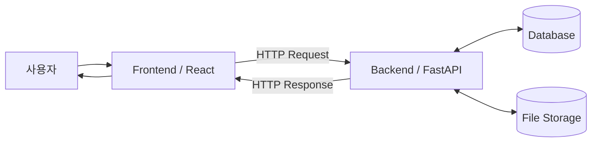
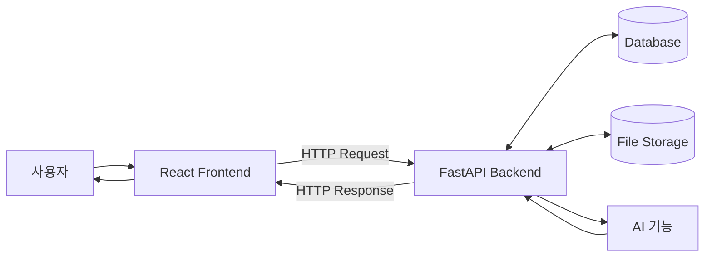
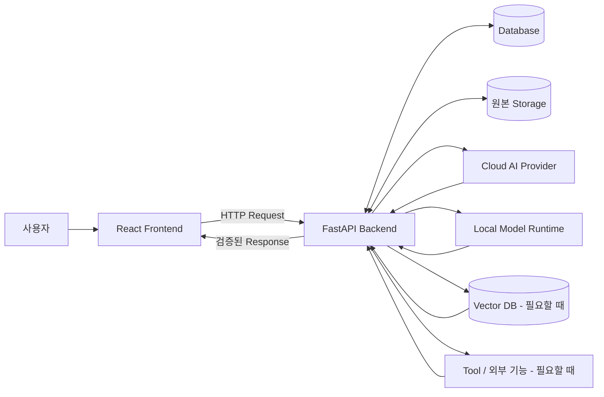
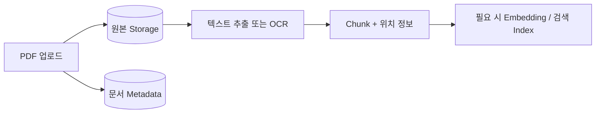
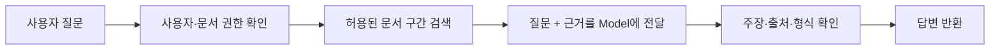
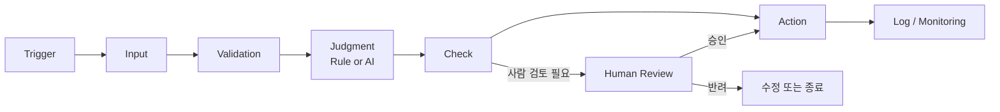
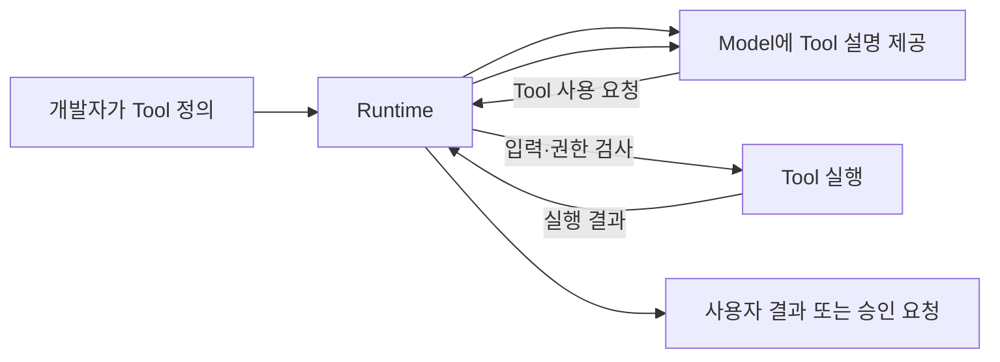
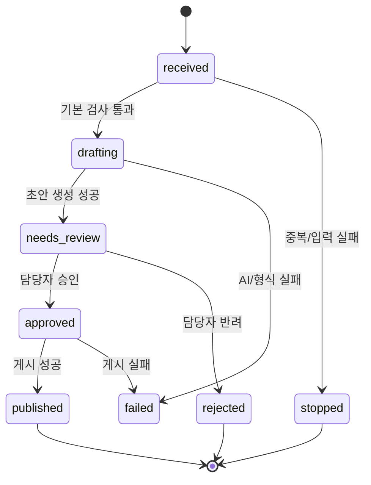
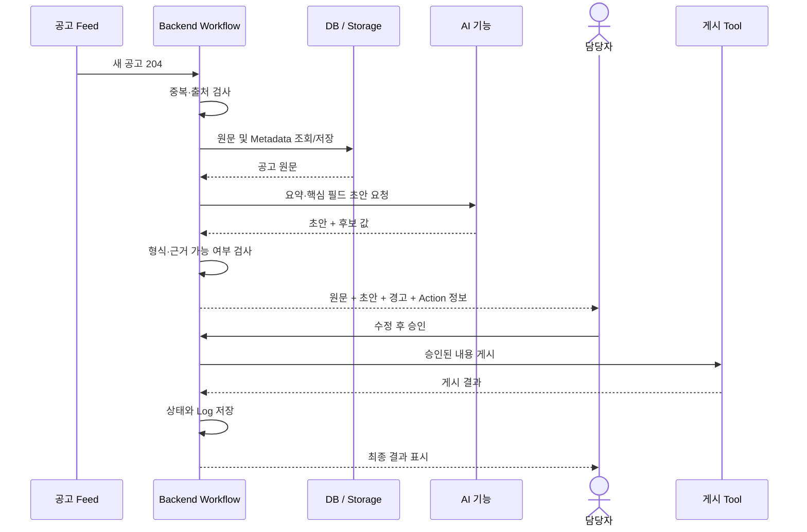

# AI 애플리케이션 아키텍처

> **AIKOS Phase 1 — AI Service Development**  
> **과목 01. AI 애플리케이션 아키텍처**  
> 01-1. 차세대 풀스택 개발의 이해  
> 01-2. AI Automation의 이해

---

## 개요

Phase 1의 목표는 생성형 AI를 단순히 사용하는 데서 끝나지 않고, **AI 기능이 포함된 실제 서비스를 설계하고 구현할 수 있는 개발 기반**을 만드는 것이다.

학생들은 이후 React, Python, FastAPI, GPT/Ollama/Gemma 등을 각각 배우게 된다. 하지만 개별 기술부터 바로 학습하면 다음과 같은 문제가 생긴다.

- React를 왜 배우는지 모른 채 화면 문법만 외우게 된다.
- FastAPI를 왜 사용하는지 모른 채 Endpoint 코드만 작성하게 된다.
- AI 모델을 서비스 전체와 동일한 것으로 오해하기 쉽다.
- API, HTTP, JSON, State 같은 개념이 서로 분리된 용어처럼 보인다.
- AI Automation을 단순히 “AI가 알아서 일하는 것”으로 이해하기 쉽다.

따라서 이 과목에서는 코드를 본격적으로 작성하기 전에 **AI 서비스 전체를 한 장의 지도처럼 이해하는 것**을 목표로 한다.

이 과목은 두 부분으로 구성한다.

```text
01-1. 차세대 풀스택 개발의 이해

사용자
  ↓
Frontend
  ↓
HTTP / API / JSON
  ↓
Backend
  ↓
Database / Storage / AI

"AI 서비스는 어떤 구조로 만들어지는가?"


01-2. AI Automation의 이해

Trigger
  ↓
Input
  ↓
Validation
  ↓
Judgment
  ↓
Check
  ↓
Action
  ↓
Log / Monitoring

"그 서비스를 어떻게 업무 자동화에 연결하는가?"
```

---

## 과목 학습 목표

이 과목을 마치면 다음 질문에 자신의 언어로 답할 수 있어야 한다.

1. AI 모델과 AI 애플리케이션의 차이는 무엇인가?
2. Frontend, Backend, Database, Storage, AI 기능은 각각 어떤 역할을 하는가?
3. Client와 Server는 왜 분리하는가?
4. HTTP Request와 Response는 무엇인가?
5. URL, localhost, Port, API, Endpoint, Method는 어떤 관계인가?
6. JSON과 Python Dictionary는 무엇이 다른가?
7. HTTP가 Stateless인데 채팅 서비스는 어떻게 이전 대화를 이어가는가?
8. AI Provider나 Local Model은 전체 서비스의 어디에 위치하는가?
9. 기존 Automation과 AI Automation은 무엇이 다른가?
10. Workflow와 Agent는 어떻게 구분하는가?
11. AI가 Tool을 사용할 때 Model, Tool, Runtime은 각각 무엇을 하는가?
12. 자동화에서 사람의 승인과 검증이 필요한 지점은 어디인가?

---

# 01-1. 차세대 풀스택 개발의 이해

## 개요

AI 서비스를 처음 접하면 가장 먼저 눈에 들어오는 것은 AI 모델이다.

그래서 다음과 같이 생각하기 쉽다.

> “좋은 LLM을 연결하면 AI 서비스가 완성되는 것 아닐까?”

하지만 실제 사용자가 이용하는 서비스는 모델 하나로 이루어지지 않는다.

사용자는 화면에서 질문을 입력하고, 파일을 올리고, 결과를 확인한다. 서비스는 사용자를 식별하고, 요청을 검사하고, 필요한 데이터를 찾고, AI 모델을 호출하고, 결과를 저장하고, 오류가 발생하면 적절하게 알려주어야 한다.

즉, AI 서비스는 **AI 모델을 포함하는 하나의 소프트웨어 시스템**이다.

이 강의에서는 AI 모델의 원리를 깊게 배우기 전에 먼저 그 모델이 실제 서비스 안에서 **어디에 위치하고, 다른 구성 요소와 어떻게 연결되는지**를 이해한다.

이번 강의에서 계속 사용할 대표 예시는 다음과 같다.

```text
사용자가 공고 PDF를 업로드하고
→ “이 공고를 초보자도 이해할 수 있게 요약해 줘.”라고 요청하고
→ 서비스가 결과를 화면에 보여주는 기능
```

이 하나의 예제를 따라가며 다음 질문에 답할 것이다.

```text
화면은 누가 만드는가?
요청은 어디로 가는가?
서버는 무엇을 하는가?
PDF는 어디에 저장되는가?
AI 모델은 누가 호출하는가?
결과는 어떤 형식으로 돌아오는가?
이전 대화는 어떻게 이어지는가?
오류가 나면 어디서 확인해야 하는가?
```

**한 문장 목표:** 사용자의 행동에서 최종 결과가 화면에 표시되기까지, 각 구성 요소가 어떤 책임을 가지고 어떤 데이터를 주고받는지 자신의 말로 설명할 수 있다.

---

## 학습 목표

학습 후 다음을 할 수 있다.

1. AI 모델과 AI 애플리케이션을 구분한다.
2. Full-stack이 무엇을 의미하는지 설명한다.
3. Browser, Client, Frontend의 관계를 구분한다.
4. Server와 Backend의 관계를 구분한다.
5. Frontend, Backend, Database, Storage, AI 기능의 역할을 설명한다.
6. Client와 Server가 HTTP Request와 Response로 통신하는 흐름을 설명한다.
7. URL, localhost, Port의 의미를 설명한다.
8. JSON과 Python Dictionary의 차이를 설명한다.
9. API, Endpoint, HTTP Method의 관계를 설명한다.
10. UI State, Server State, Model Context를 구분한다.
11. 기존 Full-stack에 AI 기능이 추가될 때 구조가 어떻게 확장되는지 설명한다.
12. React → FastAPI → AI 기능 → Response의 전체 흐름을 그릴 수 있다.
13. 문서 기반 AI 서비스에서 문서 준비 흐름과 사용자 질의 흐름을 구분한다.

---

## 학습 순서

이번 강의는 다음 순서로 진행한다.

```text
Why
왜 구조부터 배워야 하는가?
        ↓
Concept
AI Model / Application / Full-stack
        ↓
Concept
Frontend / Backend / Database / Storage / AI
        ↓
Concept
Client / Server / HTTP
        ↓
Concept
URL / localhost / Port
        ↓
Concept
JSON / API / Endpoint / Method
        ↓
Concept
State / Stateless / Model Context
        ↓
Architecture
AI가 포함된 전체 서비스 구조
        ↓
Environment
React / Python / FastAPI / Model은 어디에 위치하는가?
        ↓
Implementation
코드보다 먼저 API 계약을 설계한다
        ↓
Practice
직접 구조를 읽고 그려본다
        ↓
Best Practice / Project Connection / Summary
```

지금 단계에서는 각 기술의 문법을 외우는 것이 목적이 아니다.

이번 과목에서는 먼저 **전체 지도**를 만든다.

이후 React, Python, FastAPI, GPT/Ollama/Gemma 과목에서 이 지도의 각 부분을 실제 코드로 구현한다.

---

# Why — 왜 AI 애플리케이션 아키텍처를 먼저 배우는가

## AI를 안다고 바로 AI 서비스를 만들 수 있는 것은 아니다

AI를 공부하면 다음 개념들을 접하게 된다.

```text
LLM
Prompt
Embedding
RAG
Agent
Fine-tuning
```

이 개념들은 모두 중요하다.

하지만 이 개념을 안다고 해서 곧바로 실제 서비스를 만들 수 있는 것은 아니다.

예를 들어 LLM에게 다음 입력을 전달하면 답변을 생성할 수 있다.

```text
“이 공고를 요약해 줘.”
```

그러나 실제 서비스에서는 그 앞뒤에 훨씬 많은 일이 필요하다.

```text
사용자가 로그인했는가?
        ↓
어떤 공고를 선택했는가?
        ↓
그 공고를 볼 권한이 있는가?
        ↓
원본 파일은 어디에 있는가?
        ↓
텍스트를 어떻게 가져오는가?
        ↓
어떤 모델을 호출할 것인가?
        ↓
API Key는 어디에 보관하는가?
        ↓
결과 형식은 올바른가?
        ↓
결과를 저장할 것인가?
        ↓
화면에는 무엇을 보여줄 것인가?
```

이 중 상당수는 **LLM 자체의 일이 아니다.**

이것이 바로 애플리케이션의 일이다.

---

## 자동차에 비유해 보자

자동차에서 엔진은 매우 중요하다.

그러나 엔진만 바닥에 놓여 있다고 자동차라고 부르지는 않는다.

자동차에는 다음과 같은 요소가 함께 필요하다.

```text
엔진
바퀴
브레이크
핸들
차체
전기 시스템
계기판
```

각 요소가 서로 연결되어야 운전자가 실제로 사용할 수 있는 자동차가 된다.

AI 서비스도 비슷하다.

```text
LLM / AI Model = 엔진
Frontend       = 사용자가 보는 계기판과 조작 장치
Backend        = 내부 기능을 연결하고 제어하는 시스템
Database       = 서비스가 기억해야 할 구조화된 정보
Storage        = 실제 파일과 대용량 원본 자료
API            = 구성 요소 사이의 통신 약속
```

따라서 다음 문장을 기억하자.

> **AI 모델은 AI 서비스의 핵심 구성 요소이지만, AI 서비스 전체는 아니다.**

---

## ChatGPT 같은 서비스도 모델 하나로만 이루어지지 않는다

사용자 입장에서 ChatGPT 같은 서비스는 하나의 화면으로 보인다.

하지만 서비스 관점에서는 여러 역할이 필요하다.

```text
사용자 화면
대화 입력
대화 목록
로그인
파일 업로드
대화 저장
모델 호출
오류 처리
사용량 관리
결과 표시
```

사용자는 이 모든 구조를 볼 필요가 없다.

하지만 개발자는 **사용자가 보지 못하는 내부 구조를 설계해야 한다.**

아키텍처를 배운다는 것은 바로 이 내부 구조를 이해하는 것이다.

---

## 이번 과목에서 얻어야 하는 가장 중요한 관점

AI 서비스를 만들 때 질문이 다음과 같이 바뀌어야 한다.

처음에는 보통 이렇게 묻는다.

```text
“어떤 AI 모델을 사용할까?”
```

서비스 개발 관점에서는 질문이 확장된다.

```text
“사용자의 요청이 어디에서 시작되는가?”
“어느 계층이 입력을 검증하는가?”
“데이터는 어디에 저장되는가?”
“AI 모델은 어느 계층에서 호출하는가?”
“결과는 어떻게 다시 사용자에게 전달되는가?”
“실패하면 어느 경계에서 처리하는가?”
```

이 관점이 생기면 이후 React, FastAPI, Database, RAG, Agent를 배울 때 각각이 **전체 시스템에서 왜 필요한지** 이해하기 쉬워진다.

---

## 중간 확인

다음 질문에 한 문장으로 답해보자.

1. LLM만 배포하면 로그인과 파일 저장 기능도 자동으로 생기는가?
2. AI 모델과 AI 애플리케이션은 같은 것인가?
3. 아키텍처를 배우는 목적은 기술 이름을 외우는 것인가, 각 기술의 역할과 연결을 이해하는 것인가?

정답을 외우는 것보다 **왜 그런지 설명할 수 있는지**가 중요하다.

---

# Concept 1 — AI 모델과 AI 애플리케이션

## AI 모델이 하는 일

AI 모델은 입력을 받아 특정한 출력을 만드는 구성 요소다.

가장 단순한 형태로 보면 다음과 같다.

```text
입력
  ↓
AI Model
  ↓
출력
```

예를 들어 텍스트 생성 모델은 다음처럼 생각할 수 있다.

```text
“Transformer를 쉽게 설명해 줘.”
  ↓
Text Generation Model
  ↓
설명 텍스트
```

OCR 모델은 다음과 같다.

```text
스캔 이미지
  ↓
OCR Model
  ↓
인식된 텍스트
```

Embedding 모델은 다음과 같이 사용할 수 있다.

```text
텍스트
  ↓
Embedding Model
  ↓
Vector
```

여기서 중요한 것은 모델마다 입력과 출력의 형태가 다를 수 있지만, **모델 자체는 전체 서비스 중 하나의 기능을 담당하는 구성 요소**라는 점이다.

Embedding과 Vector의 세부 원리는 Phase 2에서 다시 배운다. 지금은 “텍스트를 검색 등에 활용할 수 있는 표현으로 바꾸는 모델이 있다” 정도만 이해하면 된다.

---

## AI 애플리케이션이 하는 일

애플리케이션은 사용자가 실제로 이용하는 서비스다.

예를 들어 AI 채팅 서비스에는 다음과 같은 기능이 함께 있을 수 있다.

```text
회원 로그인
채팅 화면
질문 전송
대화 저장
파일 업로드
프로젝트 관리
검색
공유
권한 관리
AI 모델 호출
오류 처리
```

이 기능을 모두 LLM이 직접 수행하는 것은 아니다.

따라서 AI 애플리케이션을 다음과 같이 볼 수 있다.

```text
AI Model
+
Frontend
+
Backend
+
Database
+
Storage
+
API
+
인증과 권한
+
운영 기능
=
AI Application
```

---

## 같은 질문을 모델 관점과 서비스 관점에서 비교해 보자

사용자가 다음과 같이 요청한다고 하자.

```text
“이 공고를 5개 항목으로 요약해 줘.”
```

### 모델 관점

```text
공고 내용 + 요청
        ↓
      LLM
        ↓
     요약 결과
```

### 애플리케이션 관점

```text
사용자
  ↓
화면에서 공고 선택
  ↓
요약 버튼 클릭
  ↓
Frontend가 요청 생성
  ↓
Backend가 입력·권한 확인
  ↓
원본 공고 조회
  ↓
필요한 내용을 모델에 전달
  ↓
AI가 요약 초안 생성
  ↓
Backend가 결과 형식 확인
  ↓
결과 저장
  ↓
Frontend가 화면에 표시
```

둘은 같은 문제를 보는 범위가 다르다.

```text
Model 관점       = AI가 무엇을 생성하는가?
Application 관점 = 사용자 요청 전체를 서비스가 어떻게 처리하는가?
```

---

# Concept 2 — Full-stack이란 무엇인가

> **이 Concept의 역할:** 서비스 전체를 `Frontend → Backend → Database / Storage → AI 기능`이라는 큰 구조로 보는 단계다.  
> 여기서는 각 용어를 세세하게 구분하기보다, 앞으로 배울 기술들이 하나의 서비스 안에서 어디에 위치하는지 **전체 지도**를 잡는 데 집중한다.

## 먼저 기존 웹서비스의 구조를 이해한다

AI가 들어가기 전의 일반적인 웹서비스를 생각해보자.

```text
사용자
  ↓
Frontend
  ↓
Backend
  ↓
Database / Storage
```

Frontend부터 Backend, 데이터 저장 영역까지 전체를 연결해 서비스를 구현하는 관점을 흔히 **Full-stack**이라고 부른다.

이 강의에서 Full-stack은 특정 직업 이름을 외우기 위한 용어가 아니다.

다음 질문을 이해하기 위한 지도다.

```text
사용자가 보는 부분은 어디인가?
서버에서 처리하는 부분은 어디인가?
데이터는 어디에 저장되는가?
각 부분은 어떻게 통신하는가?
```

AI가 추가된다고 이 구조가 사라지지 않는다.

기존 Full-stack 구조 위에 AI 기능이 추가된다.

```text
기존 Full-stack
Frontend
Backend
Database / Storage

        +

AI 기능
Cloud Model / Local Model / 검색 / Tool 등
```

그래서 이번 강의에서는 이를 **AI가 포함된 차세대 Full-stack 구조**라는 관점으로 살펴본다.

Concept 2에서 전체 지도를 잡았다면, 다음 Concept 3에서는 이 구조를 설명할 때 함께 등장하는 `Browser`, `Client`, `Frontend`, `Server`, `Backend`가 **어떤 기준에서 서로 다른 용어인지** 정리한다.

---

# Concept 3 — 먼저 용어의 관계를 정리하자

> **이 Concept의 역할:** Concept 2에서 본 전체 구조를 다시 설명하는 것이 아니라, 그 구조에서 자주 함께 사용되는 용어를 **분류 기준에 따라 구분하는 단계**다.  
> `Frontend / Backend`는 애플리케이션의 영역을, `Client / Server`는 통신할 때의 역할을, `Browser`는 실행 환경을 설명한다.

초보자가 가장 자주 헷갈리는 부분 중 하나가 다음 용어들이다.

```text
Browser
Client
Frontend
Server
Backend
```

서로 관련되어 있지만 완전히 같은 뜻은 아니다.

---

## Browser

Browser는 웹페이지와 웹 애플리케이션을 실행하는 프로그램이다.

예를 들면 Chrome, Safari, Edge 같은 프로그램이다.

우리 실습에서는 React로 만든 Frontend가 Browser 안에서 실행된다.

```text
Browser
└─ React Frontend 실행
```

---

## Client

Client는 **요청을 보내는 쪽의 역할**을 의미한다.

우리 실습에서는 Browser 안에서 실행되는 React Frontend가 Backend API에 요청을 보내므로 Client 역할을 한다.

```text
React Frontend
  ↓ Request
FastAPI Backend
```

따라서 입문 단계에서는 다음처럼 생각해도 된다.

```text
React Frontend ≈ Client 역할
```

다만 Client는 반드시 화면을 가진 프로그램만 의미하는 것은 아니다. 다른 Server 프로그램이 API를 호출하는 경우에도 요청을 보내는 쪽은 Client 역할을 할 수 있다.

이번 강의에서는 **React가 Client 역할을 한다**는 사례에 집중한다.

---

## Frontend

Frontend는 사용자가 직접 보고 조작하는 애플리케이션 영역이다.

예를 들면 다음과 같다.

```text
입력창
버튼
파일 선택
채팅 목록
진행 상태
오류 메시지
결과 화면
```

React는 이러한 Frontend를 만드는 기술이다.

---

## Server

Server는 Client의 요청을 받아 처리하고 응답하는 쪽의 역할을 의미한다.

이번 과정에서는 FastAPI 애플리케이션이 Server 역할을 담당한다.

```text
Client
  ↓ Request
FastAPI Server
  ↓ 처리
Response
  ↓
Client
```

실무에서 “Server”라는 말은 문맥에 따라 서버 컴퓨터 자체를 가리키기도 하고, 요청을 처리하는 서버 프로그램을 가리키기도 한다.

이번 강의에서는 주로 **요청을 처리하는 서버 프로그램의 역할**로 사용한다.

---

## Backend

Backend는 사용자 화면 뒤에서 서비스의 실제 처리와 규칙을 담당하는 영역이다.

예를 들면 다음과 같다.

```text
입력 검증
사용자 인증
권한 확인
업무 규칙
Database 조회
Storage 접근
AI Provider 호출
결과 검증
오류 처리
```

FastAPI로 Backend를 만들고, 그 FastAPI 애플리케이션이 HTTP Server 역할을 하도록 실행한다.

따라서 이번 과정에서는 다음 관계로 이해하면 된다.

```text
Browser
└─ React Frontend
   └─ Client 역할

FastAPI Backend
└─ Server 역할
```

---

## 한 번에 정리

| 용어 | 이번 과정에서의 의미 | 대표 예 |
|---|---|---|
| Browser | 웹 애플리케이션을 실행하는 프로그램 | Chrome, Safari |
| Frontend | 사용자가 보고 조작하는 영역 | React 앱 |
| Client | 요청을 보내는 역할 | React 앱 |
| Backend | 화면 뒤의 처리 영역 | FastAPI 코드 |
| Server | 요청을 받아 응답하는 역할 | 실행 중인 FastAPI 앱 |

이 표에서 가장 중요한 점은 **Frontend/Backend는 애플리케이션의 영역을 설명하는 말이고, Client/Server는 통신할 때의 역할을 설명하는 말**이라는 것이다.

---

## 중간 확인

다음 문장을 설명해보자.

```text
“React Frontend는 Browser에서 실행되며, FastAPI Backend에게 요청을 보내는 Client 역할을 한다.”
```

이 문장을 자신의 말로 설명할 수 있다면 용어 관계를 제대로 잡은 것이다.

---

# Concept 4 — AI 애플리케이션의 주요 구성 요소

이제 전체 구조를 조금 더 구체적으로 보자.

```text
사용자
  ↓
Frontend
  ↓
Backend
  ├─ Database
  ├─ Storage
  └─ AI 기능
```

각 구성 요소는 역할이 다르다.

---

## 1. Frontend — 사용자와 직접 만나는 영역

Frontend는 사용자가 보고 조작하는 부분이다.

공고 요약 서비스를 예로 들면 다음과 같다.

```text
공고 목록 표시
공고 선택
“요약 생성” 버튼
요약 결과 표시
로딩 표시
오류 메시지
```

Frontend의 기본 흐름은 다음과 같다.

```text
사용자 입력 받기
        ↓
화면 상태 변경
        ↓
Backend API 호출
        ↓
Response 받기
        ↓
결과 또는 오류 표시
```

### Frontend에서 할 수 있는 검증

예를 들어 사용자가 아무 내용도 입력하지 않았다면 버튼을 눌렀을 때 바로 안내할 수 있다.

```text
“질문을 입력해 주세요.”
```

이런 검증은 사용자 경험을 좋게 만든다.

하지만 Frontend의 검증만 믿어서는 안 된다.

Browser에서 보내는 Request는 개발자 도구나 다른 프로그램을 이용해 바꿀 수 있기 때문이다.

따라서 보안과 업무 규칙에 필요한 검증은 Backend에서도 다시 수행한다.

---

## 2. Backend — 서비스의 처리 흐름을 조정하는 영역

Backend는 요청을 받아 서비스의 실제 동작을 조정한다.

공고 요약 요청을 받았다고 하자.

Backend는 다음과 같은 판단을 해야 할 수 있다.

```text
요청 형식이 올바른가?
        ↓
사용자를 확인할 수 있는가?
        ↓
이 공고를 볼 권한이 있는가?
        ↓
공고 원문이 존재하는가?
        ↓
AI를 호출할 필요가 있는가?
        ↓
어떤 입력을 AI에게 전달할 것인가?
        ↓
결과 형식이 올바른가?
        ↓
결과를 저장할 것인가?
        ↓
어떤 Response를 돌려줄 것인가?
```

Backend는 단순히 “화면 뒤에서 실행되는 코드”가 아니다.

서비스가 믿을 수 있는 처리를 수행하도록 만드는 **중심 조정 영역**이다.

이번 과정에서는 Python과 FastAPI를 이용해 이 영역을 구현한다.

---

## 3. AI 기능 — 모델을 사용하는 영역

AI 기능은 Backend가 필요할 때 호출하는 하나의 기능 영역으로 볼 수 있다.

예를 들면 다음과 같다.

```text
LLM 답변 생성
문서 요약
OCR
Embedding 생성
문서 검색 보조
이미지 이해
```

여기서 중요한 점은 **AI 기능이 논리적으로 분리된다고 해서 처음부터 별도 서버를 만들어야 하는 것은 아니라는 점**이다.

입문 프로젝트에서는 한 FastAPI 프로젝트 안에서 역할을 나눌 수 있다.

```text
FastAPI Project
├─ Router
├─ Service
│  ├─ AI Service
│  ├─ Document Service
│  └─ User Service
└─ Repository
```

나중에 규모가 커지면 AI 처리를 별도 Worker나 서비스로 분리할 수도 있다.

하지만 처음부터 Microservice를 만드는 것이 목표는 아니다.

**먼저 책임을 구분하고, 필요한 만큼만 물리적으로 분리한다.**

---

## 4. Database — 구조화된 정보를 저장하는 영역

Database는 서비스가 나중에 다시 조회해야 하는 구조화된 정보를 저장한다.

예를 들어 다음과 같다.

```text
사용자 정보
프로젝트 정보
문서 Metadata
대화 기록
처리 상태
승인 상태
요약 결과
```

공고 PDF가 업로드되었다면 Database에는 다음과 같은 정보가 들어갈 수 있다.

```text
document_id
original_name
owner_id
storage_key
uploaded_at
status
```

---

## 5. Storage — 실제 파일을 보관하는 영역

Storage는 실제 원본 파일을 저장하는 공간이다.

예를 들면 다음과 같다.

```text
PDF
DOCX
HWP
이미지
음성
영상
```

공고 PDF를 예로 들면 다음처럼 나눌 수 있다.

```text
Storage
└─ documents/notice-204.pdf

Database
├─ document_id: 204
├─ original_name: notice-204.pdf
├─ storage_key: documents/notice-204.pdf
├─ owner_id: user-7
└─ status: uploaded
```

Database의 `storage_key`는 PDF 파일 그 자체가 아니다.

파일을 찾아갈 수 있도록 연결해 주는 정보다.

---

## 도서관에 비유해 보자

도서관을 생각하면 Database와 Storage를 구분하기 쉽다.

### Database

도서관의 검색 목록에 해당한다.

```text
책 제목
저자
출판일
분류번호
보관 위치
대출 상태
```

### Storage

실제 책이 놓인 서가에 해당한다.

```text
실제 책
실제 문서
실제 파일
```

즉,

```text
Database = “무엇이 있고 어디에 있는가?”를 관리
Storage  = 실제 원본을 보관
```

실제 시스템에서는 데이터베이스 제품이나 저장 기술에 따라 구현 방식이 다양할 수 있다. 이 강의에서는 **구조화된 Metadata와 대용량 원본 파일의 책임을 분리해서 생각하는 설계 관점**을 익힌다.

---

## 구성 요소 전체를 연결해 보자

공고 업로드와 요약 기능을 하나로 연결하면 다음과 같다.

```text
사용자
  ↓
Frontend
  ↓
Backend
  ├─ Database에서 문서 Metadata 확인
  ├─ Storage에서 원본 PDF 확인
  └─ AI 기능 호출
        ↓
      결과 생성
        ↓
Backend
  ├─ 결과 확인
  └─ 필요하면 Database에 저장
        ↓
Frontend
  ↓
사용자
```

---

## 중간 확인

다음 항목을 어디에 둘지 생각해보자.

| 항목 | 위치 |
|---|---|
| “요약 생성” 버튼 | Frontend |
| 사용자의 문서 접근 권한 확인 | Backend |
| `notice-204.pdf` 원본 | Storage |
| `document_id=204` | Database |
| LLM 호출 | AI 기능 |

위 표를 보고 이유까지 말할 수 있어야 한다.

---

# Concept 5 — Client와 Server

## 우리가 사용하는 웹서비스는 요청과 응답으로 연결된다

웹서비스를 아주 단순하게 보면 다음과 같다.

```text
사용자
  ↓
Client
  ↓ Request
Server
  ↓ Response
Client
  ↓
사용자
```

- **Client**: 요청을 보내는 역할
- **Server**: 요청을 받아 처리하고 응답하는 역할

우리 과정에서는 다음처럼 연결된다.

```text
React Frontend = Client 역할
FastAPI Backend = Server 역할
```

---

## 식당으로 비유해 보자

손님이 식당에 들어와 직원에게 주문한다.

```text
손님
  ↓ 주문
직원
  ↓ 전달
주방
  ↓ 음식
직원
  ↓
손님
```

이 비유에서 다음처럼 생각할 수 있다.

```text
손님 = 사용자
직원 = Frontend / Client 역할
주방 = Backend / Server 역할
```

직원은 손님의 주문을 받고 결과를 전달한다.

주방은 실제 요리를 처리한다.

물론 실제 Frontend는 단순 전달만 하는 것이 아니라 화면 상태와 사용자 상호작용도 관리한다. 비유의 목적은 **사용자와 처리 영역을 분리해서 이해하는 것**이다.

---

## 왜 Client와 Server를 나눌까

### 1. 보안

Cloud AI Provider를 사용할 때 API Key가 필요할 수 있다.

이 값을 Browser에서 실행되는 Frontend 코드에 넣으면 사용자에게 노출될 수 있다.

따라서 다음처럼 구성한다.

```text
Browser / Frontend
  X Secret 보관

Backend
  O Secret 보관
  O Provider 호출
```

---

### 2. 역할 분리

Frontend는 화면과 사용자 경험에 집중한다.

Backend는 데이터와 업무 규칙, 권한과 외부 기능 호출에 집중한다.

```text
Frontend
→ 보여주고 입력받는 일

Backend
→ 검사하고 처리하고 연결하는 일
```

---

### 3. 유지보수

Frontend를 웹에서 모바일 앱으로 바꾸더라도 같은 Backend API를 사용할 수 있다.

```text
Web Client ─┐
Mobile App ─┼→ Backend API
Tablet App ─┘
```

---

### 4. 확장성

하나의 Backend가 여러 Client에게 같은 기능을 제공할 수 있다.

또한 Backend 내부 구현을 바꾸더라도 외부 API 계약을 유지한다면 Client의 변경을 줄일 수 있다.

---

## 중간 확인

다음 질문에 답해보자.

1. React에서 Provider API Key를 직접 넣는 것이 왜 위험한가?
2. Client와 Frontend는 항상 완전히 같은 뜻인가?
3. 우리 실습에서 어떤 프로그램이 Client 역할을 하고 어떤 프로그램이 Server 역할을 하는가?

---

# Concept 6 — HTTP Request와 Response

## Client와 Server는 어떻게 대화할까

Client와 Server가 서로 다른 프로그램이라면 아무 규칙 없이 대화할 수는 없다.

웹에서는 대표적으로 HTTP라는 통신 규칙을 사용한다.

> **HTTP는 Client와 Server가 Request와 Response를 주고받기 위한 통신 규칙(Protocol)이다.**

---

## 편지에 비유해 보자

Client가 Server에게 편지를 보낸다고 생각해보자.

```text
“이 공고를 요약해 주세요.”
```

Server는 요청을 처리하고 답장을 보낸다.

```text
“처리가 끝났습니다. 결과는 다음과 같습니다.”
```

이때 다음처럼 부른다.

```text
Client가 보냄 = Request
Server가 돌려줌 = Response
```

---

## HTTP Request

Client가 Server에게 보내는 요청이다.

입문 수준에서는 다음 요소를 기억하면 된다.

```text
Request
= Method
+ URL
+ Header
+ Body(필요할 때)
```

예를 들어 공고 요약 생성 요청은 다음처럼 표현할 수 있다.

```http
POST /api/announcements/204/summaries
Content-Type: application/json
```

```json
{
  "audience": "first_time_applicant",
  "max_items": 5
}
```

이 요청은 자연어로 읽으면 다음과 비슷하다.

```text
POST
→ 새로운 요약 생성 작업을 요청한다.

/api/announcements/204/summaries
→ 204번 공고의 요약 기능에 요청한다.

JSON Body
→ 요약할 때 필요한 추가 조건을 전달한다.
```

---

## HTTP Response

Server는 처리 결과를 Response로 돌려준다.

입문 수준에서는 다음처럼 이해한다.

```text
Response
= 처리 결과를 나타내는 상태 정보
+ Header
+ Body(필요할 때)
```

예를 들어 성공한 경우 다음과 같은 JSON을 받을 수 있다.

```json
{
  "summary_id": "sum-204-01",
  "status": "draft",
  "items": [
    "지원 대상은 예비 창업자입니다.",
    "접수 마감일을 확인해야 합니다."
  ]
}
```

Frontend는 이 Response를 받아 화면을 바꾼다.

```text
요청 전      → 버튼 표시
요청 중      → Loading 표시
성공         → 요약 표시
실패         → 오류 메시지와 재시도 표시
```

---

## Request와 Response는 한 쌍으로 생각한다

```text
React
  ↓ Request
FastAPI
  ↓ 처리
Response
  ↓
React
```

Frontend 개발에서 API를 호출한다는 말은 결국 **Request를 보내고 Response를 받아 화면에 반영한다는 뜻**이다.

Backend 개발에서 Endpoint를 만든다는 말은 **특정 Request를 받아 처리하고 Response를 돌려주는 기능을 만든다는 뜻**이다.

---

# Concept 7 — URL, localhost, Port

## Request는 목적지를 알아야 한다

사람이 택배를 보내려면 주소가 필요하다.

Client도 Server에게 Request를 보내려면 목적지 주소를 알아야 한다.

개발 중 FastAPI 서버가 다음 주소에서 실행된다고 하자.

```text
http://localhost:8000
```

React는 이 주소를 이용해 FastAPI를 찾는다.

---

## URL

URL은 네트워크에서 특정 서버나 자원에 접근하기 위한 주소다.

다음 예를 보자.

```text
http://localhost:8000/api/chat
│       │          │    │
│       │          │    └─ Path
│       │          └────── Port
│       └───────────────── Host
└───────────────────────── Protocol
```

각 부분을 읽으면 다음과 같다.

```text
http       → 어떤 통신 규칙을 사용할 것인가?
localhost  → 어느 컴퓨터로 갈 것인가?
8000       → 그 컴퓨터의 어느 서버 프로그램으로 갈 것인가?
/api/chat  → 그 서버의 어느 기능으로 갈 것인가?
```

---

## localhost

`localhost`는 **현재 요청을 보내는 컴퓨터 자신**을 가리킨다.

내 노트북에서 FastAPI를 실행하고 다음 주소를 호출하면 내 노트북에서 실행 중인 서버를 찾는다.

```text
http://localhost:8000
```

다른 사람의 컴퓨터에서 같은 주소를 입력하면 그 사람의 컴퓨터 자신을 가리킨다.

따라서 `localhost`는 인터넷에 공개된 공용 서버 주소가 아니다.

---

## Port

한 컴퓨터에서는 여러 네트워크 프로그램이 동시에 실행될 수 있다.

그래서 어느 프로그램으로 Request를 전달할지 구분하는 번호가 필요하다.

Port를 아파트의 방 번호에 비유해보자.

```text
컴퓨터 = 아파트 건물
Port   = 방 번호
```

학습 환경에서는 예를 들어 다음과 같이 사용할 수 있다.

```text
localhost:5173 → React 개발 서버
localhost:8000 → FastAPI 개발 서버
```

숫자 `5173`, `8000` 자체를 외우는 것이 목표가 아니다.

핵심은 다음이다.

> **같은 컴퓨터에서도 서로 다른 서버 프로그램을 Port로 구분할 수 있다.**

---

## 버튼을 눌렀을 때 실제로 일어나는 일

사용자가 React 화면에서 “요약 생성” 버튼을 누른다고 하자.

```text
1. 사용자가 버튼 클릭
        ↓
2. React 코드가 실행
        ↓
3. React가 FastAPI의 URL을 지정
        ↓
4. HTTP Request 전송
        ↓
5. 운영체제가 Host와 Port를 보고 해당 서버 프로그램에 전달
        ↓
6. FastAPI가 Path에 연결된 기능을 실행
```

이 흐름을 이해하면 “React가 FastAPI를 호출한다”는 표현이 더 이상 추상적으로 느껴지지 않는다.

---

## 중간 확인

다음 주소를 읽어보자.

```text
http://localhost:8000/api/documents
```

다음 네 가지를 구분해 말할 수 있어야 한다.

```text
Protocol
Host
Port
Path
```

---

# Concept 8 — JSON: Client와 Server가 주고받는 데이터 형식

## 왜 데이터 형식이 필요할까

사람도 업무를 처리할 때 양식을 사용한다.

```text
이름:
전화번호:
주소:
```

양식이 없으면 사람마다 서로 다른 순서와 표현으로 정보를 전달할 수 있다.

컴퓨터 프로그램끼리 통신할 때도 같은 문제가 생긴다.

Frontend는 JavaScript를 사용하고 Backend는 Python을 사용해도, 서로 약속된 데이터 형식을 사용하면 정보를 교환할 수 있다.

웹 API에서 대표적으로 사용하는 형식이 JSON이다.

---

## JSON 예시

```json
{
  "message": "이 공고를 요약해 줘.",
  "max_items": 5
}
```

이 구조에서는 다음 정보를 명확하게 구분할 수 있다.

```text
message   → 사용자의 요청
max_items → 최대 항목 수
```

---

## 국제공항의 공통 양식에 비유해 보자

국가마다 언어가 다르더라도 여권이나 입국 문서에는 정해진 항목이 있다.

```text
이름
국적
생년월일
여권번호
```

Frontend와 Backend가 서로 다른 프로그래밍 언어를 사용하더라도 JSON이라는 공통 형식을 사용하면 데이터를 주고받기 쉽다.

---

## Python Dictionary와 JSON은 같은 것이 아니다

초보자가 매우 자주 혼동하는 부분이다.

Python 코드 안에 다음 값이 있다고 하자.

```python
student = {
    "name": "Kim",
    "age": 20
}
```

이것은 Python 프로그램 메모리 안에 존재하는 **Dictionary 객체**다.

반면 다음은 JSON 형식의 데이터 표현이다.

```json
{
  "name": "Kim",
  "age": 20
}
```

겉모습은 비슷하지만 개념은 다르다.

```text
Python Dictionary
= Python 프로그램 안의 객체

JSON
= 프로그램 사이에서 데이터를 표현·교환하기 위한 표준 형식
```

---

## 직렬화와 파싱의 흐름

Python Dictionary를 네트워크로 보내기 위해 JSON 형식의 텍스트로 바꿀 수 있다.

```text
Python Dictionary
        ↓ 직렬화
JSON 형식의 데이터
        ↓ 네트워크 전송
Server 또는 Client가 수신
        ↓ 파싱
프로그램 내부 객체
```

Python에서는 다음처럼 확인할 수 있다.

```python
import json

payload = {
    "text": "공고를 요약해 줘",
    "max_items": 5
}

wire_text = json.dumps(payload, ensure_ascii=False)
restored = json.loads(wire_text)

print(type(payload))
print(type(wire_text))
print(type(restored))
```

FastAPI에서는 Request Model과 Response Model을 이용해 이런 데이터 계약을 더 명확하게 관리한다. 자세한 구현은 Python과 FastAPI 과목에서 학습한다.

---

# Concept 9 — API, Endpoint, HTTP Method

## API란 무엇인가

Backend에는 여러 기능이 있다.

예를 들어 다음 기능을 제공할 수 있다.

```text
문서 업로드
문서 목록 조회
문서 상세 조회
AI 질문
문서 요약
대화 기록 조회
```

Frontend가 이런 기능을 사용할 수 있도록 외부에 정해진 방식으로 제공해야 한다.

이때 API라는 개념을 사용한다.

> **API는 다른 프로그램이 사용할 수 있도록 기능과 사용 방법을 제공하는 계약이다.**

입문 단계에서는 “프로그램이 다른 프로그램의 기능을 사용할 수 있도록 만든 창구와 약속”이라고 이해해도 좋다.

---

## 식당 창구에 비유해 보자

식당에 주문 창구가 있다고 하자.

```text
주문하기
주문 조회하기
주문 취소하기
```

손님은 주방 안으로 직접 들어가 조리 도구를 만지지 않는다.

정해진 창구를 통해 필요한 기능을 요청한다.

Backend API도 비슷하다.

Frontend는 Database에 직접 접속하거나 AI Provider의 Secret을 직접 사용하는 대신 Backend가 제공하는 API를 호출한다.

---

## Endpoint란 무엇인가

하나의 Backend에는 여러 기능이 존재한다.

각 기능에 접근할 수 있는 구체적인 지점을 Endpoint라고 생각할 수 있다.

예를 들면 다음과 같다.

```text
POST /api/documents
GET  /api/documents/204
POST /api/chats/demo-7/messages
POST /api/announcements/204/summaries
```

이 중 `/api/documents/204` 같은 Path만 보고 기능을 완전히 판단하면 안 된다.

HTTP Method와 함께 읽어야 한다.

---

## HTTP Method란 무엇인가

같은 Server에서도 요청의 목적이 다르다.

대표적인 Method는 다음과 같다.

| Method | 입문 수준의 의미 | 예 |
|---|---|---|
| GET | 기존 정보 조회 | 공고 상세 조회 |
| POST | 새로운 데이터나 처리 요청 | AI 질문, 파일 업로드, 요약 생성 |
| PUT | 전체 수정에 사용될 수 있음 | 전체 정보 수정 |
| PATCH | 일부 수정에 사용될 수 있음 | 상태 일부 변경 |
| DELETE | 삭제 | 문서 삭제 |

처음에는 GET과 POST의 차이를 확실하게 이해하면 된다.

---

## GET

GET은 기존 정보를 조회하는 요청에 사용한다.

```text
GET /api/documents
→ 문서 목록 조회
```

```text
GET /api/documents/204
→ 204번 문서 조회
```

---

## POST

POST는 새로운 데이터를 보내거나 새로운 처리를 요청할 때 자주 사용한다.

```text
POST /api/chat
→ 새로운 질문 처리
```

```text
POST /api/documents
→ 새로운 문서 업로드
```

```text
POST /api/announcements/204/summaries
→ 새로운 요약 생성 요청
```

---

## 같은 Path라도 Method가 다르면 의미가 달라질 수 있다

```text
GET  /api/announcements/204/summaries
→ 기존 요약 목록 조회

POST /api/announcements/204/summaries
→ 새 요약 생성 요청
```

따라서 Endpoint를 읽을 때는 다음을 한 묶음으로 본다.

```text
Method + Path
```

---

## API, Endpoint, Method를 한 번에 정리

```text
API
= 프로그램이 제공하는 기능과 사용 계약 전체

Endpoint
= 그 기능에 접근하는 구체적인 지점

Method
= 그 지점에 어떤 종류의 작업을 요청하는가
```

예를 들어 다음 요청을 보자.

```text
POST /api/announcements/204/summaries
```

자연어로 읽으면 다음과 같다.

```text
POST
→ 새로운 처리를 요청한다.

/api/announcements/204/summaries
→ 204번 공고의 요약 기능에 요청한다.
```

---

## REST API는 무엇인가

API를 공부하다 보면 REST API라는 용어를 자주 보게 된다.

입문 단계에서 다음 정도로 구분하면 충분하다.

```text
API
└─ REST 스타일로 설계한 API
```

REST는 API를 설계하는 대표적인 방식 중 하나다.

이번 과목에서는 REST의 세부 규칙을 암기하지 않는다. FastAPI에서 실제 Endpoint를 만들면서 더 구체적으로 학습한다.

---

## 중간 확인

다음 요청을 보고 설명해보자.

```text
POST /api/chat
```

설명에는 최소한 다음이 들어가야 한다.

```text
POST는 무엇을 의미하는가?
/api/chat은 무엇인가?
누가 요청을 보내는가?
누가 처리하는가?
결과는 어떤 방식으로 돌아오는가?
```

---

# Concept 10 — State와 Stateless

## State란 무엇인가

State는 **이후 동작에 영향을 주기 위해 현재 기억하고 있어야 하는 정보**다.

게임을 예로 들면 다음 정보가 State다.

```text
현재 레벨
현재 체력
현재 위치
보유 아이템
```

쇼핑몰에서는 다음이 State가 될 수 있다.

```text
장바구니 상품
로그인 사용자
선택한 배송지
```

웹 애플리케이션에서도 여러 종류의 State가 존재한다.

---

## Frontend State

Frontend가 화면을 그리기 위해 기억하는 정보다.

예를 들면 다음과 같다.

```text
입력 중인 질문
선택한 문서
현재 열린 메뉴
loading 여부
error 메시지
```

React를 배우면 이런 State를 직접 관리한다.

---

## Server State

Backend나 데이터 저장 영역에서 관리하는 정보다.

예를 들면 다음과 같다.

```text
사용자 정보
저장된 대화
문서 Metadata
사용자 권한
처리 작업 상태
저장된 AI 결과
```

---

## Model Context

AI 모델이 **이번 한 번의 호출에서 실제로 전달받은 정보**다.

예를 들어 Backend가 다음을 모델에게 전달할 수 있다.

```text
System 지시
현재 사용자 질문
최근 대화 일부
검색된 문서 근거
출력 형식 지시
```

이 정보가 Model Context다.

Model Context와 Database에 저장된 전체 대화 기록은 같은 것이 아니다.

Database에 대화가 1,000개 저장되어 있어도 이번 모델 호출에 10개만 전달했다면 모델이 직접 보는 것은 그 10개와 함께 전달한 정보다.

---

## “기억”이라는 한 단어 때문에 생기는 혼동

초보자는 다음 세 가지를 모두 “AI가 기억한다”고 표현하기 쉽다.

```text
1. Frontend가 화면 상태를 기억
2. Backend/Database가 대화 기록을 저장
3. Model이 이번 호출에서 Context를 참고
```

하지만 설계에서는 반드시 구분해야 한다.

```text
UI State
Server State
Model Context
```

이 세 가지는 저장 위치도 다르고 목적도 다르다.

---

## Stateless란 무엇인가

HTTP 요청은 기본적으로 서로 독립적으로 처리된다.

```text
Request 1

Request 2

Request 3
```

Request 2가 Request 1의 내용을 자동으로 포함하는 것은 아니다.

이런 특성을 이해할 때 Stateless라는 개념을 사용한다.

---

## 그렇다면 채팅 서비스는 어떻게 이전 대화를 이어갈까

사용자가 다음과 같이 말한다고 하자.

```text
사용자: 내 이름은 민지야.

사용자: 내 이름 기억해?
```

두 번째 HTTP Request가 첫 번째 Request를 자동으로 기억해서 처리하는 것은 아니다.

애플리케이션이 필요한 State를 관리해야 한다.

```text
[첫 번째 요청]
사용자 메시지
→ Backend
→ 대화 기록 저장

[두 번째 요청]
사용자 메시지
→ Backend
→ 사용자와 대화 ID 확인
→ 이전 대화 조회
→ 필요한 대화만 Model Context에 구성
→ AI 호출
→ 새 결과 저장
→ Response
```

따라서 “AI가 대화를 기억한다”는 사용자 경험 뒤에는 애플리케이션의 State 관리가 존재한다.

---

## Stateless는 “아무것도 저장하지 않는다”는 뜻이 아니다

HTTP가 Stateless라고 해서 서비스가 데이터를 저장하면 안 된다는 뜻은 아니다.

애플리케이션은 Database, Session 관련 저장소, Token 등 필요한 방법을 이용해 상태를 관리할 수 있다.

핵심은 다음이다.

```text
각 Request마다
필요한 식별과 권한을 확인하고
필요한 State를 다시 찾아 사용한다.
```

---

## 중간 확인

다음 항목을 세 범주로 나눠보자.

```text
입력창의 현재 문자열
loading=true
저장된 대화 기록
사용자의 문서 권한
이번 모델 호출에 넣은 최근 대화
저장된 요약 초안
```

범주는 다음 세 가지다.

```text
Frontend State
Server State
Model Context
```

---

# Architecture — 지금까지 배운 구조를 하나로 연결한다

지금까지 각각 따로 배운 개념을 하나의 그림으로 합쳐보자.

먼저 AI가 없는 일반적인 웹서비스다.



이 구조가 기본이다.

AI가 추가되어도 기본 구조를 버리지 않는다.

Backend가 필요할 때 AI 기능을 호출하도록 확장한다.



가장 먼저 이 단순한 그림을 이해하는 것이 중요하다.

---

## AI 기능 내부에는 여러 선택지가 있을 수 있다

AI 기능을 조금 더 펼치면 다음처럼 볼 수 있다.



하지만 이 그림을 보고 모든 프로젝트에 모든 요소가 필요하다고 생각하면 안 된다.

```text
간단한 채팅 서비스
→ Database와 Cloud LLM만 사용할 수도 있음

로컬 AI 서비스
→ Local Model Runtime을 사용할 수 있음

문서 검색 서비스
→ 검색 Index나 Vector DB가 필요할 수 있음

업무 자동화 서비스
→ 외부 Tool 연결이 필요할 수 있음
```

**필요한 기능만 추가한다.**

---

## 각 요소의 역할

| 요소 | 역할 | 지금 알아야 하는 수준 |
|---|---|---|
| React Frontend | 사용자 입력과 화면 상태 | Browser에서 실행되고 Backend API를 호출한다 |
| FastAPI Backend | 요청 검증, 업무 흐름, 데이터/AI 연결 | 서비스 처리의 중심이다 |
| Database | 구조화된 State와 Metadata | 무엇을 기억할지 관리한다 |
| File Storage | 원본 파일 보관 | PDF·이미지 등 실제 파일을 보관한다 |
| Cloud AI Provider | 네트워크 API로 AI 기능 제공 | Backend에서 호출한다 |
| Local Model Runtime | 로컬 환경에서 모델 실행 | Cloud와 다른 배치 방식이다 |
| Vector DB | Vector 기반 검색 저장·조회 | RAG 과목에서 자세히 배운다 |
| Tool | 검색·저장·외부 업무 기능 | Automation/Agent 과목에서 자세히 배운다 |

---

# Architecture — 사용자의 요청 하나를 끝까지 따라가 보자

이번에는 공고 요약 서비스의 실제 요청 하나를 처음부터 끝까지 추적한다.

사용자가 다음 공고를 보고 있다고 하자.

```text
공고 ID: 204
```

그리고 “요약 생성” 버튼을 누른다.

---

## Step 1. 사용자가 Frontend에서 행동한다

사용자는 화면에서 버튼을 누른다.

이 시점에서 아직 FastAPI나 AI 모델은 아무 일도 하지 않았다.

```text
사용자
  ↓ 클릭
React Frontend
```

---

## Step 2. Frontend가 필요한 State를 확인한다

React는 현재 화면에서 필요한 정보를 가지고 있을 수 있다.

```text
선택된 공고 ID = 204
요약 대상 = first_time_applicant
최대 항목 수 = 5
```

Frontend는 이 정보를 이용해 Request를 만든다.

---

## Step 3. Frontend가 HTTP Request를 보낸다

```http
POST /api/announcements/204/summaries
Content-Type: application/json
```

```json
{
  "audience": "first_time_applicant",
  "max_items": 5
}
```

이제 Request가 FastAPI Backend로 이동한다.

---

## Step 4. Backend가 요청을 검증한다

Backend는 요청을 받자마자 AI부터 호출하지 않는다.

먼저 서비스 규칙을 확인한다.

```text
입력 형식이 올바른가?
사용자를 확인할 수 있는가?
204번 공고가 존재하는가?
사용자가 이 공고에 접근할 수 있는가?
요청한 max_items 값은 허용 범위인가?
```

검증에 실패하면 AI를 호출하지 않고 적절한 오류 Response를 돌려줄 수 있다.

---

## Step 5. 필요한 데이터를 찾는다

Backend는 Database에서 Metadata를 확인하고 Storage에서 원본 문서를 찾을 수 있다.

```text
Database
→ 204번 문서의 storage_key 확인

Storage
→ 실제 공고 PDF 또는 추출된 텍스트 조회
```

---

## Step 6. AI에게 전달할 입력을 구성한다

Backend는 원본 전체를 무조건 그대로 모델에게 보내는 것이 아니라, 서비스 목적에 필요한 입력을 구성한다.

예를 들면 다음과 같다.

```text
역할/지시
요약 대상 독자
요약해야 할 공고 내용
출력 형식
```

문서 검색이 필요한 서비스라면 이 단계 전에 관련 문서 구간을 찾는 처리가 추가될 수 있다.

---

## Step 7. AI 기능을 호출한다

Backend가 Cloud AI Provider 또는 Local Model Runtime을 호출한다.

```text
FastAPI
  ↓
AI 기능
  ↓
요약 초안
```

AI 모델은 **초안 결과를 생성하는 역할**을 담당한다.

---

## Step 8. Backend가 결과를 확인한다

AI가 결과를 만들었다고 바로 사용자에게 보내지 않는다.

서비스에서 확인 가능한 범위의 검증을 수행한다.

예를 들면 다음과 같다.

```text
필요한 JSON 필드가 있는가?
항목 수가 계약과 맞는가?
필수 출처 필드가 있는가?
허용되지 않은 형식이 섞이지 않았는가?
저장 가능한 구조인가?
```

여기서 “결과 검증”은 AI가 말한 모든 사실이 자동으로 참인지 완벽하게 판정한다는 뜻이 아니다.

서비스가 확인할 수 있는 **형식, 계약, 권한, 근거 존재 여부 등**을 검증한다는 의미다.

---

## Step 9. 필요한 결과를 저장한다

서비스 설계에 따라 요약 초안을 Database에 저장할 수 있다.

```text
summary_id
announcement_id
status=draft
created_by
created_at
```

---

## Step 10. HTTP Response를 돌려준다

```json
{
  "summary_id": "sum-204-01",
  "status": "draft",
  "items": [
    {
      "text": "지원 대상은 예비 창업자입니다.",
      "source_id": "notice-204"
    }
  ]
}
```

---

## Step 11. Frontend가 화면을 갱신한다

React는 Response를 받고 화면 State를 바꾼다.

```text
loading = false
summary = Response 결과
error = 없음
```

그리고 사용자에게 결과를 보여준다.

---

## 전체 흐름

```text
사용자
  ↓
React
  ↓ HTTP Request
FastAPI
  ↓ 입력·사용자·권한 검증
Database / Storage
  ↓ 필요한 데이터 준비
AI 기능
  ↓ AI 초안
FastAPI
  ↓ 결과 계약 확인 / 저장
HTTP Response
  ↓
React
  ↓ 화면 갱신
사용자
```

이 흐름이 이번 과목의 핵심이다.

---

# Architecture — 일반 질문과 문서 근거 질문은 흐름이 다를 수 있다

모든 질문에 같은 데이터 경로가 필요한 것은 아니다.

## 일반적인 설명 요청

```text
“Transformer가 뭐야?”
```

서비스가 일반 지식 답변을 허용한다면 다음처럼 처리할 수 있다.

```text
질문
→ 입력 검증
→ Model
→ 출력 형식 확인
→ Response
```

---

## 특정 문서의 사실을 묻는 요청

```text
“공고 204의 신청 마감일은 언제야?”
```

이 질문은 특정 공고의 사실을 묻고 있다.

따라서 관련 문서를 확인하는 경로가 필요하다.

```text
질문
→ 사용자 확인
→ 문서 접근 권한 확인
→ 관련 문서 내용 찾기
→ 질문 + 근거를 Model에 전달
→ 답변과 출처 형식 확인
→ Response
```

관련 문서에서 근거를 찾지 못했다면 모델이 임의의 날짜로 빈칸을 채우게 해서는 안 된다.

문서 근거를 이용하는 방식의 상세 원리는 Phase 2의 RAG에서 배운다.

---

# Architecture — 문서 준비와 사용자 질문은 서로 다른 흐름이다

문서 기반 AI 서비스를 처음 보면 다음을 하나의 긴 처리처럼 생각하기 쉽다.

```text
PDF 업로드
→ 질문
→ 답변
```

하지만 실제로는 두 흐름을 나누어 생각하는 것이 중요하다.

---

## 1. 문서 준비 흐름

문서가 업로드될 때 미리 수행하는 작업이다.



입문 단계에서는 각 세부 기술보다 다음만 기억하면 된다.

```text
원본을 저장한다.
문서 정보를 관리한다.
검색에 필요한 형태로 준비할 수 있다.
```

---

## 2. 질의 흐름

사용자가 나중에 질문할 때 수행하는 작업이다.



두 흐름을 분리하면 다음을 이해하기 쉽다.

```text
원본 PDF는 계속 보관해야 한다.
문서가 바뀌면 검색 준비 결과도 갱신해야 할 수 있다.
사용자 권한은 질문 시점에도 다시 확인해야 한다.
검색 Index가 존재한다고 답변 정확성이 자동으로 보장되는 것은 아니다.
```

Embedding, Chunk, Vector DB의 상세 원리는 지금 외우지 않는다. 이후 Phase 2에서 다시 다룬다.

---

# Environment — 앞으로 배울 기술은 어디에 위치하는가

이제 AIKOS Phase 1에서 배울 기술을 전체 지도에 배치해보자.

| 기술                     | 위치            | 역할                        | 이후 학습                           |
| ---------------------- | ------------- | ------------------------- | ------------------------------- |
| Browser                | 사용자 환경        | Frontend 실행, Network 확인   | React 실습                        |
| React                  | Frontend      | 화면, 이벤트, UI State, API 호출 | Phase 1 React                   |
| Python                 | Backend 개발 기반 | 데이터 처리와 서비스 로직 작성         | Phase 1 Python                  |
| FastAPI                | Backend       | HTTP API, 요청 검증, 서비스 연결   | Phase 1 FastAPI                 |
| Database / Storage     | Data          | State, Metadata, 원본 보존    | 프로젝트 실습                         |
| GPT 등 Cloud AI         | AI 기능         | 외부 Provider의 모델 기능 사용     | GPT/Ollama/Gemma                |
| Ollama 등 Local Runtime | AI 기능         | 로컬 모델 실행                  | GPT/Ollama/Gemma                |
| Vector DB              | 검색 계층         | Vector 검색                 | Phase 2 Embedding/Vector DB/RAG |
| Agent / Tool           | 자동화 계층        | 외부 기능 선택·실행               | Phase 2 Agent / Integration     |

지금은 설치 명령이나 세부 문법을 배우지 않는다.

이번 과목의 목표는 **각 기술이 어느 상자에 들어가는지 설명할 수 있게 되는 것**이다.

---

# Implementation — 코드를 쓰기 전에 계약부터 정한다

## 왜 API 계약을 먼저 정해야 할까

Frontend와 Backend를 동시에 개발한다고 하자.

Frontend 개발자는 다음 JSON을 보낸다고 생각할 수 있다.

```json
{
  "message": "공고를 요약해 줘."
}
```

그런데 Backend 개발자는 다음 필드를 기대한다고 하자.

```json
{
  "text": "공고를 요약해 줘."
}
```

둘 다 프로그램을 열심히 만들었지만 서로 약속이 다르기 때문에 요청이 맞지 않는다.

그래서 코드를 작성하기 전에 최소한 다음을 정한다.

```text
어떤 Method를 사용할까?
어떤 Path를 사용할까?
무슨 데이터를 보낼까?
성공하면 무엇을 돌려줄까?
실패하면 어떤 형태로 알려줄까?
```

이것이 API 계약을 먼저 생각하는 이유다.

---

## 예시 — 공고 요약 생성 API

### 1. 사용자 행동

```text
공고 상세 화면
→ “요약 생성” 버튼 클릭
```

### 2. Request 계약

```http
POST /api/announcements/204/summaries
Content-Type: application/json
```

```json
{
  "audience": "first_time_applicant",
  "max_items": 5
}
```

### 3. Backend 책임

```text
입력 검증
→ 사용자 확인
→ 공고 접근 권한 확인
→ 원문 조회
→ AI 기능 호출
→ 결과 구조 확인
→ 초안 저장
```

### 4. Response 계약

```json
{
  "summary_id": "sum-204-01",
  "status": "draft",
  "items": [
    {
      "text": "지원 대상은 예비 창업자입니다.",
      "source_id": "notice-204"
    }
  ]
}
```

### 5. Frontend State

```text
idle
  ↓ 버튼 클릭
loading
  ├─ 성공 → draft 표시
  └─ 실패 → error 표시
```

---

## AI Provider가 바뀌어도 Frontend 계약은 유지할 수 있다

예를 들어 Backend 내부에서 사용하는 AI 기능이 다음처럼 바뀔 수 있다.

```text
Cloud Provider A
        ↓ 교체
Local Model Runtime
```

Client와 Backend 사이의 API 계약을 유지한다면 Frontend는 내부 AI 구현을 모두 알 필요가 없다.

```text
Frontend가 알아야 하는 것
= Backend API 계약

Frontend가 몰라도 되는 것
= Backend 내부에서 어떤 Provider를 호출하는지
```

이것이 계층을 나누는 중요한 이유 중 하나다.

---

# Practice

## 실습 1. AI 모델과 AI 애플리케이션 구분하기

**실습 목표**  
AI 모델의 역할과 애플리케이션의 역할을 구분한다.

**실습 환경**  
종이, 메모장 또는 Markdown 편집기.

**실습 절차**

다음 기능을 `AI Model`과 `Application`으로 구분한다.

```text
텍스트 생성
로그인
파일 업로드
OCR 수행
사용자 권한 확인
대화 목록 표시
Embedding 생성
오류 메시지 표시
대화 기록 저장
```

**예상 결과**

```text
AI Model
- 텍스트 생성
- OCR 수행
- Embedding 생성

Application
- 로그인
- 파일 업로드
- 사용자 권한 확인
- 대화 목록 표시
- 오류 메시지 표시
- 대화 기록 저장
```

**실습 확인**

- “AI가 들어간 기능”과 “AI 모델이 직접 수행하는 기능”을 같은 것으로 보지 않았는가?
- 로그인·권한·저장을 LLM의 역할이라고 분류하지 않았는가?

**응용 과제**  
현재 사용 중인 AI 서비스 하나를 골라 모델 이외에 필요한 기능을 5개 이상 찾아본다.

---

## 실습 2. 요청의 경로 그리기

**실습 목표**  
사용자의 입력에서 결과가 화면에 표시될 때까지의 경로를 설명한다.

**실습 환경**  
종이, 화이트보드 또는 Mermaid 편집기.

**실습 절차**

1. 사용자, React, FastAPI, Database/Storage, AI 기능을 상자로 그린다.
2. 각 화살표에 이동하는 데이터나 요청을 적는다.
3. AI 결과와 화면 사이에 Backend 확인 단계를 넣는다.
4. Request와 Response의 방향을 구분한다.

**예상 결과**

```text
사용자 입력
→ React
→ HTTP Request
→ FastAPI
→ 데이터 조회
→ AI 요청
→ AI 초안
→ Backend 확인
→ HTTP Response
→ React 표시
```

**실습 확인**

- API Key가 Browser에 위치하지 않았는가?
- AI 출력이 Backend를 거치지 않고 화면으로 바로 전달되지 않았는가?
- Request와 Response의 방향이 반대로 되어 있지 않은가?

**응용 과제**  
Cloud AI Provider를 Local Model Runtime으로 바꾸면 어느 부분이 달라지고 어느 부분이 그대로인지 표시한다.

---

## 실습 3. Browser / Client / Frontend / Server / Backend 구분하기

**실습 목표**  
비슷하게 들리는 다섯 용어를 역할 기준으로 설명한다.

**실습 환경**  
React + FastAPI 학습 환경을 가정한다.

**실습 절차**

다음 문장을 완성한다.

```text
Chrome은 ________이다.
React 앱은 ________ 영역이며 API를 호출할 때 ________ 역할을 한다.
FastAPI 코드는 ________ 영역이며 실행되어 요청을 받을 때 ________ 역할을 한다.
```

**예상 결과**

```text
Chrome은 Browser이다.
React 앱은 Frontend 영역이며 API를 호출할 때 Client 역할을 한다.
FastAPI 코드는 Backend 영역이며 실행되어 요청을 받을 때 Server 역할을 한다.
```

**실습 확인**  
Client를 무조건 Browser와 같은 뜻이라고 설명하지 않았는지 확인한다.

**응용 과제**  
다른 Backend 서비스가 FastAPI API를 호출하는 경우 어느 쪽이 Client 역할인지 설명한다.

---

## 실습 4. Client와 Server 책임 나누기

**실습 목표**  
Frontend 검증과 Backend 검증의 차이를 구분한다.

**실습 환경**  
공고 요약 API 사례.

**실습 절차**

다음 상황을 보고 어느 계층에서 어떤 처리를 해야 하는지 적는다.

```text
max_items 입력이 비어 있음
max_items에 문자열이 들어옴
사용자가 접근할 수 없는 공고를 요청함
AI Provider가 Timeout 됨
요약 생성 중 버튼을 여러 번 클릭함
```

**예상 결과**

- Frontend는 빠른 사용자 안내와 중복 클릭 방지를 제공할 수 있다.
- Backend는 입력과 권한을 다시 검증한다.
- 외부 AI 호출 실패는 Backend에서 처리하고 Frontend에는 일관된 오류 Response를 보낸다.

**실습 확인**  
“Frontend에서 검사했으므로 Backend에서는 검사하지 않아도 된다”는 결론이 아닌지 확인한다.

**응용 과제**  
AI 요약 초안을 사람이 승인하는 기능을 추가한다면 어떤 State가 필요할지 적는다.

---

## 실습 5. URL과 Port 읽기

**실습 목표**  
URL에서 Protocol, Host, Port, Path를 구분한다.

**실습 환경**

```text
http://localhost:5173
http://localhost:8000/api/chat
```

**실습 절차**

1. 두 URL의 Protocol, Host, Port, Path를 표시한다.
2. React 개발 서버와 FastAPI 서버를 구분한다.
3. 다른 컴퓨터에서 `localhost:8000`을 입력했을 때 무엇을 가리키는지 설명한다.

**예상 결과**

```text
localhost는 요청을 보내는 컴퓨터 자신을 가리킨다.
Port는 같은 컴퓨터 안에서 서버 프로그램을 구분한다.
```

**실습 확인**  
`localhost`를 인터넷상의 공용 Server 이름으로 설명하지 않았는지 확인한다.

**응용 과제**  
실제 배포 환경에서는 `localhost` 대신 어떤 형태의 주소가 필요할지 생각해본다.

---

## 실습 6. JSON과 Python Dictionary 구분하기

**실습 목표**  
프로그램 내부 객체와 네트워크 데이터 형식을 구분한다.

**실습 환경**  
Python 실행 환경.

**실습 절차**

다음 코드를 실행한다.

```python
import json

payload = {
    "message": "AI 애플리케이션을 설명해 줘.",
    "max_items": 5
}

json_text = json.dumps(payload, ensure_ascii=False)
restored = json.loads(json_text)

print(type(payload))
print(type(json_text))
print(type(restored))
```

**예상 결과**

```text
<class 'dict'>
<class 'str'>
<class 'dict'>
```

**실습 확인**

- Python Dictionary 자체를 JSON이라고 부르지 않았는가?
- JSON 형식으로 직렬화된 값이 문자열 형태가 될 수 있음을 확인했는가?

**응용 과제**  
`payload`에 `document_id`와 `language` 필드를 추가한 뒤 다시 직렬화한다.

---

## 실습 7. API 계약 읽기

**실습 목표**  
Method, Path, JSON Body, Response의 역할을 구분한다.

**실습 환경**

```http
POST /api/announcements/204/summaries
```

**실습 절차**

1. Method를 찾는다.
2. Path를 찾는다.
3. Request JSON의 필드를 확인한다.
4. Response JSON의 필드를 확인한다.
5. 같은 Path의 GET을 만든다면 어떤 의미가 적절할지 작성한다.

**예상 결과**

```text
GET  → 기존 요약 조회
POST → 새 요약 생성 요청
```

**실습 확인**  
Method와 Path 중 하나만 보고 API 기능을 설명하지 않았는지 확인한다.

**응용 과제**  
문서 삭제 기능을 만든다면 Method와 Path를 어떻게 설계할지 적고, 삭제 권한도 함께 생각한다.

---

## 실습 8. State 구분하기

**실습 목표**  
Frontend State, Server State, Model Context를 구분한다.

**실습 환경**  
채팅 서비스 사례.

**실습 절차**

다음 항목을 세 범주에 배치한다.

```text
입력창의 현재 문자열
loading=true
저장된 대화 기록
사용자의 문서 권한
이번 모델 호출에 넣은 최근 대화 5개
저장된 요약 초안
```

**예상 결과**

```text
Frontend State
- 입력창의 현재 문자열
- loading=true

Server State
- 저장된 대화 기록
- 사용자의 문서 권한
- 저장된 요약 초안

Model Context
- 이번 모델 호출에 넣은 최근 대화 5개
```

**실습 확인**  
“모델이 모든 대화를 영구적으로 기억한다”고 설명하지 않았는지 확인한다.

**응용 과제**  
Browser를 새로고침한 뒤에도 이전 대화를 표시하려면 무엇을 저장하고 무엇을 다시 조회해야 하는지 적는다.

---

## 실습 9. 문서 AI의 두 경로 그리기

**실습 목표**  
문서 준비와 질의 시점의 처리를 구분한다.

**실습 환경**  
가상의 `notice-204.pdf`.

**실습 절차**

1. 문서 업로드 시 수행할 단계를 그린다.
2. 다음 날 사용자가 질문할 때 수행할 단계를 그린다.
3. 원본 PDF, 문서 ID, 사용자 권한, 검색 Index, Model Context의 위치를 표시한다.

**예상 결과**

```text
문서 준비:
원본 저장
→ 텍스트 추출/OCR
→ Chunk
→ 필요 시 검색 Index 준비

질의:
사용자/문서 권한 확인
→ 관련 내용 검색
→ Model Context 구성
→ AI 답변
→ 결과 확인
```

**실습 확인**

- 검색 Index가 있으면 원본 PDF가 필요 없다고 설명하지 않았는가?
- 문서를 준비할 때의 처리와 질문할 때의 처리를 하나로 섞지 않았는가?

**응용 과제**  
원본 PDF가 새 버전으로 교체되었을 때 어떤 부분을 다시 처리해야 할지 표시한다.

---

## 실습 10. 전체 구조를 자신의 말로 설명하기

**실습 목표**  
기술 이름을 나열하는 것이 아니라 전체 서비스 동작을 설명한다.

**실습 환경**  
아래 키워드만 제공한다.

```text
사용자
React
HTTP
FastAPI
Database
Storage
AI Model
JSON
```

**실습 절차**

위 키워드를 모두 사용해 “공고 요약 버튼을 눌렀을 때 무슨 일이 일어나는가?”를 1분 이내로 설명한다.

**예상 결과 예시**

```text
사용자가 React 화면에서 요약 버튼을 누르면 React가 HTTP Request를 FastAPI로 보낸다.
FastAPI는 요청을 검증하고 Database에서 문서 정보를 확인한 뒤 Storage에서 필요한 원문을 찾는다.
필요한 내용을 AI Model에 전달해 요약 초안을 받고, 결과 구조를 확인한 뒤 JSON Response로 React에 돌려준다.
React는 Response를 받아 화면에 요약 결과를 표시한다.
```

**실습 확인**

- 기술 이름만 나열하지 않고 데이터의 이동을 설명했는가?
- 각 기술의 역할을 설명했는가?
- Request와 Response 방향을 설명했는가?

**응용 과제**  
AI Model을 사용하지 않는 일반 게시판 조회 기능도 같은 구조로 설명해보고 차이점을 표시한다.

---

# Best Practice

## 1. 구조를 먼저 그리고 코드를 작성한다

처음부터 React와 FastAPI 코드를 동시에 작성하면 무엇이 어디의 책임인지 섞이기 쉽다.

먼저 다음을 적는다.

```text
사용자 행동
→ Frontend
→ API
→ Backend
→ Data / AI
→ Response
```

---

## 2. Frontend와 Backend의 책임을 구분한다

```text
Frontend
→ 사용자 경험을 위한 빠른 검증

Backend
→ 신뢰 경계에서 입력·권한·업무 규칙 검증
```

둘 중 하나만 하는 것이 아니다.

---

## 3. Secret은 Browser에 넣지 않는다

Provider API Key, Database Password 같은 비밀 값은 Frontend 코드에 포함하지 않는다.

Backend의 실행 환경에서 관리한다.

---

## 4. AI 결과를 그대로 신뢰하지 않는다

AI 결과는 서비스가 사용할 **입력 데이터 또는 초안 데이터**로 취급한다.

서비스에서 확인 가능한 다음 항목을 검사한다.

```text
형식
필수 필드
허용 범위
출처 필드
업무 규칙
```

---

## 5. State의 위치를 항상 구분한다

“기억한다”라는 표현 대신 다음을 확인한다.

```text
Frontend State인가?
Server State인가?
Model Context인가?
```

---

## 6. Database와 Storage의 책임을 분리해서 설계한다

원본 파일과 Metadata를 무조건 같은 방식으로 다루지 않는다.

```text
원본 파일
→ Storage

파일 ID, 이름, 소유자, 상태, 위치
→ Database
```

---

## 7. 모든 기술을 처음부터 넣지 않는다

AI 서비스라고 해서 항상 다음이 모두 필요한 것은 아니다.

```text
Vector DB
Agent
Microservice
Queue
여러 Model
```

가장 작은 구조로 시작하고, 필요가 생기면 확장한다.

---

## 8. 오류와 실패도 Architecture의 일부다

정상 흐름만 그리지 않는다.

```text
Request 실패
권한 없음
문서 없음
AI Timeout
잘못된 결과 형식
저장 실패
```

이런 상황에서 사용자에게 무엇을 보여줄지까지 설계한다.

---

# 학생이 자주 헷갈리는 부분

## 오해 1. “Frontend = Client = Browser는 완전히 같은 말이다.”

아니다.

이번 실습에서는 서로 가까이 연결되어 있지만 관점이 다르다.

```text
Browser  = 실행 프로그램
Frontend = 사용자 화면 영역
Client   = 요청을 보내는 역할
```

---

## 오해 2. “Backend = Server 컴퓨터다.”

항상 같은 뜻은 아니다.

Backend는 애플리케이션의 처리 영역이고, Server라는 말은 요청을 받는 프로그램 또는 그것이 실행되는 컴퓨터를 문맥에 따라 가리킬 수 있다.

이번 과정에서는 FastAPI Backend가 Server 역할을 한다고 이해한다.

---

## 오해 3. “HTTP가 Stateless이면 대화를 저장할 수 없다.”

아니다.

요청 자체가 이전 요청을 자동 기억하지 않는다는 의미다.

대화 기록은 별도로 저장하고 다음 요청에서 다시 조회해 사용할 수 있다.

---

## 오해 4. “JSON과 Python Dictionary는 같은 것이다.”

아니다.

겉모습은 비슷하지만 Python Dictionary는 Python 객체이고 JSON은 데이터 교환 형식이다.

---

## 오해 5. “AI 모델이 답을 만들었으니 서비스의 책임은 끝난다.”

아니다.

Backend는 결과 형식, 권한, 저장, 오류 처리 등 서비스 책임을 계속 수행한다.

---

## 오해 6. “AI 서비스에는 Vector DB와 Agent가 반드시 필요하다.”

아니다.

서비스 요구사항에 따라 필요한 경우에만 사용한다.

---

# Project Connection

Phase 1의 각 과목은 지금까지 그린 Architecture의 한 부분을 실제 코드로 구현하는 과정이다.

```text
01. AI 애플리케이션 아키텍처
→ 전체 지도 이해

02. React
→ Frontend와 UI State 구현

03. Python for AI
→ Backend 로직을 작성하기 위한 언어 기반

04. FastAPI
→ HTTP API와 Backend 구조 구현

05. GPT / Ollama / Gemma
→ Cloud 또는 Local AI 기능 연결
```

Phase 2에서는 이 구조 안의 AI 개념을 더 깊게 이해한다.

```text
Transformer / LLM
→ Model 내부 원리

Embedding / Vector DB / RAG
→ 문서 검색과 근거 보강

Agent
→ Tool 선택과 실행 흐름

AI Integration
→ AI 기능과 서비스 통합

Document AI
→ PDF / OCR / Multimodal 문서 처리
```

즉, 이후 과목은 서로 떨어진 기술 목록이 아니다.

**이번 강의에서 만든 전체 지도의 각 상자를 실제로 구현하거나 더 깊이 이해하는 과정**이다.

---

# Summary

## 전체 흐름 한 번 더 보기

```text
사용자 행동
        ↓
React Frontend
- 입력 받기
- UI State 관리
        ↓
HTTP Request
        ↓
FastAPI Backend
- 입력 검증
- 사용자/권한 확인
- 업무 규칙 처리
        ↓
Database / Storage
- State / Metadata / 원본 조회
        ↓
필요한 경우 AI 기능 호출
        ↓
AI 결과
        ↓
FastAPI
- 결과 구조 확인
- 저장
- Response 생성
        ↓
HTTP Response / JSON
        ↓
React
- loading 종료
- 결과 또는 오류 표시
        ↓
사용자
```

---

## 반드시 기억해야 할 핵심

1. **AI Model과 AI Application은 다르다.**
2. AI 애플리케이션은 Frontend, Backend, Data, AI 기능이 연결된 시스템이다.
3. Browser는 Frontend를 실행할 수 있고, React Frontend는 API를 호출할 때 Client 역할을 한다.
4. FastAPI Backend는 Request를 받아 처리하는 Server 역할을 한다.
5. Client와 Server는 HTTP Request와 Response로 통신한다.
6. URL은 목적지 주소이며 Port는 같은 컴퓨터 안의 서버 프로그램을 구분한다.
7. JSON은 데이터 교환 형식이고 Python Dictionary는 Python 프로그램 내부 객체다.
8. API는 기능과 사용 계약이고, Endpoint는 구체적인 접근 지점이며, Method는 요청의 종류를 나타낸다.
9. HTTP가 Stateless여도 애플리케이션은 필요한 State를 별도로 저장하고 다시 사용할 수 있다.
10. Frontend State, Server State, Model Context는 서로 다르다.
11. AI가 추가되어도 기존 Full-stack 구조는 사라지지 않고 AI 기능이 확장된다.
12. 문서 기반 AI에서는 문서 준비 흐름과 질문 흐름을 구분한다.
13. AI 출력은 서비스가 확인하고 처리해야 할 결과 데이터다.

---

# 최종 자기 점검

다음 질문에 자료를 보지 않고 답할 수 있는지 확인한다.

```text
1. AI Model과 AI Application은 어떻게 다른가?
2. Full-stack은 무엇을 연결하는 관점인가?
3. Browser, Frontend, Client의 차이는 무엇인가?
4. Backend와 Server는 어떤 관계인가?
5. Database와 Storage는 어떤 차이가 있는가?
6. HTTP Request와 Response는 무엇인가?
7. localhost와 Port는 각각 무엇을 의미하는가?
8. Python Dictionary와 JSON은 왜 같은 것이 아닌가?
9. API, Endpoint, Method는 어떤 관계인가?
10. HTTP가 Stateless인데 채팅은 어떻게 이전 대화를 이어가는가?
11. React → FastAPI → AI Model → React 흐름을 설명할 수 있는가?
12. 문서 업로드 시점과 질문 시점의 처리를 왜 나누는가?
```

이 질문에 자신의 말로 답할 수 있다면 다음 React, Python, FastAPI 강의를 배울 준비가 된 것이다.

---

# 실무 팁

- 오류를 찾을 때는 `화면 → Browser Network → API Endpoint → Backend Log → 외부 기능` 순서로 경계를 따라간다.
- API 문제가 생기면 먼저 Method, URL, Request Body, Response를 확인한다.
- “AI가 기억한다”는 표현을 들으면 실제 State가 어디에 저장되어 있는지 확인한다.
- 화면에 보이는 파일명과 실제 Storage 파일이 Metadata로 제대로 연결되어 있는지 확인한다.
- AI 결과가 JSON처럼 보여도 실제 Response 계약을 만족하는지 별도로 확인한다.
- 새로운 기술을 추가하기 전에 “이 기능이 정말 필요한가?”와 “어느 계층의 책임인가?”부터 확인한다.

---

# 주의사항

- `Stateless`는 “Database를 사용하지 않는다”는 뜻이 아니다.
- Browser에 Secret이나 Provider API Key를 넣지 않는다.
- AI 모델의 출력이 사실·정책·형식을 자동으로 보장한다고 생각하지 않는다.
- Vector DB가 최종 답변을 직접 작성하는 것은 아니다.
- 입문 단계의 논리적 구성 요소를 처음부터 여러 Server로 분리할 필요는 없다.
- `Frontend 검증`을 했더라도 `Backend 검증`이 필요하다.
- 이 문서의 Endpoint와 JSON은 Architecture 학습을 위한 설계 예시이며 실제 구현 세부사항은 이후 실습에서 검증한다.

---

# 참고자료

- 기존 5기 `AI 애플리케이션 아키텍처.md` Unit 1~10
- 6기 Working `차세대 풀스택 개발의 이해_강의용.md`
- MDN HTTP 관련 공식 문서
- React 공식 학습 문서
- FastAPI 공식 Tutorial

> 설치 방법, SDK, Provider API, 버전처럼 변경될 수 있는 내용은 실제 강의 직전에 공식 문서를 기준으로 다시 확인한다.

---

# 관련 Wiki Link

[[AIKOS]]  
[[AI 애플리케이션 아키텍처]]  
[[Full-stack]]  
[[Client Server Architecture]]  
[[HTTP]]  
[[API]]  
[[REST API]]  
[[JSON]]  
[[State]]  
[[React]]  
[[Python]]  
[[FastAPI]]  
[[GPT]]  
[[Ollama]]  
[[Gemma]]  
[[Embedding]]  
[[Vector DB]]  
[[RAG]]  
[[AI Agent]]

---

# 01-2. AI Automation의 이해

## 개요

앞의 `01-1. 차세대 풀스택 개발의 이해`에서는 사용자의 요청이 Frontend와 Backend를 지나 AI 기능으로 전달되고 다시 화면으로 돌아오는 구조를 배웠다.

이제 한 단계 더 나아가 보자.

사용자가 버튼을 눌러 한 번 AI를 호출하는 것과, **업무 전체가 일정한 규칙과 조건에 따라 계속 움직이도록 만드는 것**은 다른 문제다.

예를 들어 담당자가 매일 다음 일을 반복한다고 하자.

```text
새로운 지원사업 공고 확인
→ 기존 공고와 중복인지 확인
→ PDF 열기
→ 지원 대상 확인
→ 신청 기간 확인
→ 핵심 내용 요약
→ 안내문 초안 작성
→ 담당자 검토
→ 게시
```

이 업무를 보고 단순히 다음처럼 생각할 수 있다.

> “AI에게 전부 시키면 되지 않을까?”

하지만 실제 자동화에서는 훨씬 많은 질문이 필요하다.

```text
언제 자동화를 시작할 것인가?
새 공고인지 어떻게 확인할 것인가?
원문이 없으면 어떻게 할 것인가?
어떤 단계는 일반 코드로 처리할 것인가?
어떤 단계에 AI가 필요한가?
AI 결과가 틀리면 어떻게 발견할 것인가?
게시 전에 사람이 확인해야 하는가?
같은 공고가 두 번 들어오면 어떻게 할 것인가?
게시 실패 시 다시 시도해도 되는가?
누가 어떤 작업을 실행했는지 어떻게 남길 것인가?
```

따라서 AI Automation은 단순히 “AI를 호출하는 기능”이 아니다.

> **업무를 단계로 나누고, 규칙·AI·사람·실제 Action의 책임을 배치하며, 실패와 권한까지 포함해 전체 Workflow를 설계하는 것**이다.

이번 강의에서는 계속 다음 사례를 사용한다.

```text
공개 지원사업 공고를 수집한다.
        ↓
중복과 원문을 확인한다.
        ↓
AI가 요약 초안을 만든다.
        ↓
담당자가 원문과 비교해 검토한다.
        ↓
승인된 내용만 게시한다.
```

**한 문장 목표:** 하나의 반복 업무를 작은 단계로 분해하고, 각 단계에 Rule·AI·Human Review·Action을 배치해 안전한 자동화 Workflow를 설계할 수 있다.

---

## 학습 목표

학습 후 다음을 할 수 있다.

1. Automation과 AI Automation의 차이를 설명한다.
2. Rule-based Automation, Workflow, AI Automation, Agent를 구분한다.
3. 업무를 작은 단계로 분해한다.
4. AI가 필요한 단계와 일반 코드가 더 적합한 단계를 구분한다.
5. Trigger → Input → Validation → Judgment → Check → Action → Log 흐름을 설명한다.
6. 자동화 대상을 반복성뿐 아니라 오류 영향, 검증 가능성, 권한, 되돌리기 가능성으로 평가한다.
7. Human-in-the-loop가 필요한 지점을 지정한다.
8. Workflow와 Agent를 문제 특성에 따라 구분한다.
9. Model, Tool, Runtime의 역할을 설명한다.
10. Action과 “AI가 Action을 제안하는 것”의 차이를 설명한다.
11. 실패, 중복 실행, Retry, 권한, 승인, Logging, Monitoring을 Workflow에 포함한다.
12. 자동화 상태를 명시적으로 설계하는 이유를 설명한다.
13. Phase 1의 React/Python/FastAPI/AI Model이 Automation에서 어떻게 연결되는지 설명한다.

---

## 학습 순서

```text
Why
왜 Automation을 별도로 배워야 하는가?
        ↓
Concept
Automation이란 무엇인가?
        ↓
Concept
Rule / Workflow / AI Automation / Agent
        ↓
Architecture
Trigger → Input → Validation → Judgment → Check → Action → Log
        ↓
Concept
자동화 대상 선정
        ↓
Concept
Human-in-the-loop
        ↓
Concept
Workflow vs Agent
        ↓
Concept
Model / Tool / Runtime
        ↓
Architecture
실패 / 권한 / 승인 / 상태 / Logging / Monitoring
        ↓
Example
공개 공고 알림 자동화
        ↓
Implementation
코드 전에 Workflow 계약 작성
        ↓
Practice
직접 업무를 분해하고 설계
        ↓
Best Practice / Project Connection / Summary
```

이번 강의 역시 Framework 이름이나 특정 Agent Library 사용법을 외우는 시간이 아니다.

핵심은 **자동화 구조를 읽고 설계하는 능력**이다.

---

# Why — 왜 AI Automation을 배워야 하는가

## “AI 기능”과 “업무 자동화”는 다르다

다음 기능을 생각해보자.

```text
버튼 클릭
→ AI에게 문서 요약 요청
→ 결과 표시
```

이것은 훌륭한 AI 기능이다.

하지만 업무 자동화라고 부르려면 보통 더 많은 흐름이 필요하다.

```text
새 문서 감지
→ 중복 확인
→ 원문 검증
→ AI 요약
→ 결과 검토
→ 승인
→ 게시
→ 실행 결과 기록
```

즉,

```text
AI 기능
= 특정 순간에 AI를 사용한다.

AI Automation
= 업무 흐름 안에서 필요한 지점에 AI를 넣고 전체 실행을 관리한다.
```

---

## 먼저 “Automation” 자체를 이해하자

Automation은 사람이 반복해서 하던 작업의 일부 또는 전체를 시스템이 정해진 조건에 따라 수행하도록 만드는 것이다.

AI가 없어도 자동화는 가능하다.

예를 들어 다음은 모두 AI 없이 만들 수 있다.

```text
매일 오전 9시에 보고서 생성
새 파일이 들어오면 지정 폴더로 이동
금액이 100만 원을 넘으면 승인 요청
같은 ID가 이미 있으면 등록 중단
마감일이 지났으면 상태를 closed로 변경
```

이 작업들은 명확한 규칙으로 처리할 수 있다.

따라서 다음 문장을 먼저 기억해야 한다.

> **Automation은 AI보다 오래된 개념이며, AI Automation은 Automation의 일부 단계에 AI 판단이나 생성 기능을 사용하는 방식이다.**

---

## 왜 생성형 AI가 Automation의 범위를 넓혔는가

기존 자동화는 명확한 규칙에 강하다.

예를 들어 다음 조건은 코드로 매우 쉽게 처리할 수 있다.

```text
if deadline < today:
    상태 = "마감"
```

하지만 다음 작업은 규칙만으로 만들기 어렵다.

```text
“이 긴 공고의 지원 대상 조건을 초보자가 이해하기 쉽게 세 문장으로 정리해라.”
```

자연어 문장을 해석하고 새로운 설명을 만드는 일은 단순한 `if` 조건으로 표현하기 어렵다.

생성형 AI는 이런 단계에 활용될 수 있다.

```text
비정형 문서 읽기
분류 후보 만들기
정보 추출 후보 만들기
요약 초안 작성
안내문 초안 작성
```

그래서 기존에는 사람이 직접 처리해야 했던 일부 비정형 업무도 자동화 Workflow 안에 넣을 수 있게 되었다.

---

## 하지만 AI가 들어가면 새로운 위험도 생긴다

규칙 기반 코드는 보통 같은 입력에 같은 규칙을 적용한다.

반면 생성형 AI 출력은 다음 문제가 생길 수 있다.

```text
필수 정보 누락
잘못된 해석
형식 불일치
근거 없는 내용 추가
문장 표현의 변동
```

따라서 AI Automation에서는 다음 단계가 더 중요해진다.

```text
Validation
Check
Human Review
권한 제한
실패 처리
Logging
Monitoring
```

즉, AI를 추가했다고 자동화가 더 단순해지는 것이 아니다.

**AI를 사용할 수 있는 범위는 넓어지지만, 검증과 운영 설계가 더 중요해진다.**

---

## 자동화의 목표를 다시 정의하자

자동화의 목표를 다음처럼 잡으면 위험하다.

```text
“사람이 하던 일을 전부 없앤다.”
```

대신 다음처럼 생각한다.

> **반복 작업은 시스템이 줄이고, 사람이 판단해야 할 문제는 더 명확한 근거와 함께 사람에게 보여준다.**

이 관점이 Human-in-the-loop와 연결된다.

---

## 중간 확인

다음 중 AI가 없어도 가능한 Automation을 찾아보자.

```text
1. 매일 오전 9시에 파일 목록을 확인한다.
2. 공고 내용을 초보자 수준으로 세 문장 요약한다.
3. 같은 공고 ID가 이미 존재하면 중단한다.
4. 구조화된 마감일이 오늘보다 이전인지 비교한다.
5. 긴 자유형식 문의의 의도를 분류한다.
```

핵심은 “AI가 할 수 있는가?”가 아니다.

**명확한 규칙으로 충분한지 먼저 판단하는 것**이다.

---

# Concept 1 — Rule, Workflow, AI Automation, Agent

## 모든 자동화가 같은 구조는 아니다

자동화라는 말 안에는 여러 방식이 섞여 있다.

입문 단계에서는 다음 네 가지를 우선 구분하자.

```text
Rule-based Automation
Workflow
AI Automation
Agent
```

---

## 1. Rule-based Automation

미리 정의한 조건과 규칙에 따라 동작한다.

```text
IF 조건
THEN 행동
```

예를 들어 다음과 같다.

```text
IF 공고 ID가 이미 Database에 존재함
THEN 중복으로 처리하고 종료
```

또는

```text
IF 마감일 < 오늘
THEN 상태 = closed
```

규칙이 명확한 업무에서는 가장 단순하고 예측하기 쉬운 방법이다.

---

## 2. Workflow

여러 단계를 정해진 순서와 조건으로 연결한 흐름이다.

```text
새 공고 감지
→ 중복 확인
→ 원문 확보
→ 정보 추출
→ 검토
→ 게시
```

중간에 조건 분기가 들어갈 수 있다.

```text
원문 있음?
├─ Yes → 다음 단계
└─ No  → 중지 + 오류 기록
```

Workflow의 핵심은 **전체 단계와 주요 분기를 개발자가 비교적 명확하게 정의한다는 점**이다.

---

## 3. AI Automation

Workflow 안의 일부 단계에 AI 기능이 들어간다.

```text
새 공고 감지        → Rule
중복 확인           → Rule
원문 확보           → 일반 코드
요약 초안 생성      → AI
마감일 후보 추출    → AI 또는 Parser
원문 대조           → Rule / Human
게시 승인           → Human
게시                → Tool
```

AI가 들어간다고 Workflow 전체가 AI에게 맡겨지는 것은 아니다.

**정해진 Workflow 안에서 AI가 특정 역할을 담당할 수 있다.**

---

## 4. Agent

Agent 방식에서는 모델이 목표와 사용 가능한 Tool 정보를 보고 다음 행동을 선택하도록 설계할 수 있다.

예를 들어 사용자가 다음 목표를 준다고 하자.

```text
“이 회사가 지원할 만한 최신 사업 공고를 찾아 비교해 줘.”
```

필요한 작업 경로가 항상 같지 않을 수 있다.

```text
어느 사이트를 검색할까?
→ 어떤 공고를 먼저 읽을까?
→ 추가 자료가 필요한가?
→ 기업 정보 Tool을 호출할까?
→ 비교표를 만들 만큼 정보가 충분한가?
```

이런 문제는 Agent를 검토할 수 있다.

---

## 네 가지를 한 번에 비교

| 방식 | 경로 | 판단 주체 | 공고 사례 |
|---|---|---|---|
| Rule-based | 매우 고정적 | 코드 규칙 | 중복 ID 검사 |
| Workflow | 대부분 미리 정의 | 코드 + 분기 규칙 | 수집 → 요약 → 승인 → 게시 |
| AI Automation | Workflow 안에 AI 단계 포함 | 코드 + AI + 사람 | 공고 요약 초안 작성 |
| Agent | 일부 경로를 상황에 따라 선택 | Model + Runtime + Tool | 여러 자료원을 탐색하며 조사 |

---

## RPA는 어디에 들어갈까

RPA는 기존 화면을 클릭하거나 값을 입력하는 사용자 작업을 자동화하는 방식으로 많이 사용된다.

예를 들어 API가 없는 오래된 관리 시스템에서 다음 작업을 자동화할 수 있다.

```text
로그인 화면 열기
→ 메뉴 클릭
→ 값 입력
→ 저장 버튼 클릭
```

RPA는 화면 구조가 바뀌면 영향을 받을 수 있다는 특성이 있다.

이번 강의의 핵심은 RPA 구현이 아니라, **Automation이 반드시 AI나 Agent를 의미하는 것은 아니라는 점**을 이해하는 것이다.

---

## AI가 들어갔다고 모두 Agent는 아니다

다음 Workflow를 보자.

```text
새 공고
→ 원문 확보
→ AI 요약
→ 담당자 승인
→ 게시
```

AI를 사용하지만 전체 경로는 미리 정해져 있다.

이것은 충분히 AI Automation이지만, Agent일 필요는 없다.

Agent라는 이름을 붙이기 위해 억지로 모델에게 다음 행동 선택권을 줄 필요도 없다.

---

## AI가 필요 없는 곳에는 일반 코드를 사용한다

예를 들어 이미 마감일이 `2026-10-31`처럼 구조화된 값으로 저장되어 있다고 하자.

```text
마감일까지 7일 이하인가?
```

이 문제는 일반 날짜 비교 코드로 충분하다.

LLM에게 매번 물어보면 다음 단점이 생긴다.

```text
비용 증가
응답 시간 증가
불필요한 불확실성 증가
테스트 복잡도 증가
```

반면 다음과 같은 작업은 AI 사용을 검토할 수 있다.

```text
긴 공고의 지원 대상 조건을 쉬운 말로 다시 설명한다.
```

따라서 AI Automation 설계의 첫 질문은 다음이다.

> **“AI를 어디에 넣을까?”가 아니라 “이 단계는 규칙으로 충분한가, 아니면 AI가 실제로 필요한가?”**

---

# Architecture — AI Automation의 기본 구조

자동화를 하나의 큰 상자로 보면 설계하기 어렵다.

업무를 다음 단계로 나누면 이해하기 쉬워진다.

```text
Trigger
  ↓
Input
  ↓
Validation
  ↓
Judgment
  ↓
Check
  ↓
Action
  ↓
Log / Monitoring
```

AI는 이 중 **Judgment의 일부**에 들어갈 수도 있고, 데이터 추출이나 초안 생성 단계에 들어갈 수도 있다.

AI가 Workflow 전체를 의미하는 것은 아니다.

---

## 전체 그림



이제 각 단계를 하나씩 본다.

---

## 1. Trigger — 언제 시작할 것인가

Trigger는 자동화를 시작하게 만드는 사건이나 조건이다.

예를 들면 다음과 같다.

```text
매일 오전 9시
새 파일 업로드
사용자의 버튼 클릭
외부 시스템 Event
Queue에 새 작업 도착
새 이메일 수신
```

공고 사례에서는 다음과 같이 정의할 수 있다.

```text
Trigger
= 신뢰한 공고 Feed에서 새 공고 ID가 들어온다.
```

Trigger가 명확하지 않으면 자동화가 언제 시작되어야 하는지 알 수 없다.

---

## 2. Input — 무엇을 가지고 시작할 것인가

Input은 처리에 필요한 자료다.

공고 자동화를 예로 들면 다음과 같다.

```text
공고 ID
출처 URL
원본 PDF
수집 시각
기관 정보
```

Input에서 중요한 것은 **출처와 식별자**다.

같은 문서가 두 번 들어왔는지 판단하려면 무엇을 기준으로 같은 공고라고 볼지 정해야 한다.

---

## 3. Validation — 시작해도 되는 입력인가

Validation은 처리 전에 기본 조건을 확인하는 단계다.

예를 들면 다음과 같다.

```text
입력 형식이 올바른가?
공고 ID가 있는가?
원문이 존재하는가?
출처가 허용된 곳인가?
같은 공고를 이미 처리했는가?
현재 실행 주체에게 권한이 있는가?
```

Validation 실패 시 AI를 호출할 이유가 없다.

```text
원문 없음
→ AI 요약 호출 X
→ source_missing 상태
→ 기록 후 중지
```

이처럼 **싼 검사와 확실한 검사를 먼저 수행하는 것**이 좋다.

---

## 4. Judgment — 규칙 또는 AI가 해석한다

Judgment는 입력을 보고 어떤 값을 계산하거나 해석하는 단계다.

모든 Judgment가 AI일 필요는 없다.

### Rule Judgment

```text
마감일 < 오늘?
중복 ID가 존재하는가?
필수 필드가 모두 있는가?
```

### AI Judgment / Generation

```text
지원 대상 문장을 쉬운 표현으로 요약한다.
공고를 주제별로 분류 후보를 만든다.
긴 문서에서 핵심 제출서류 후보를 추출한다.
```

---

## 5. Check — 실제 행동 전에 확인한다

Judgment 결과가 나왔다고 바로 Action으로 넘어가면 위험할 수 있다.

Check에서는 다음을 확인한다.

```text
필수 값이 존재하는가?
원문 근거를 확인할 수 있는가?
결과 형식이 맞는가?
허용 범위를 벗어나지 않았는가?
사람 승인이 필요한 Action인가?
```

AI Automation에서 매우 중요한 단계다.

```text
AI 결과
≠ 곧바로 실행 명령
```

---

## 6. Action — 실제 상태를 바꾼다

Action은 시스템이나 외부 세계에 실제 변화를 만드는 동작이다.

예를 들면 다음과 같다.

```text
초안 저장
게시
메일 발송
문서 생성
Database 수정
파일 삭제
결제 취소
```

Action은 위험 수준이 서로 다르다.

```text
초안 저장
→ 비교적 되돌리기 쉬움

공식 게시
→ 외부에 노출됨

파일 삭제
→ 복구가 어려울 수 있음

결제 취소
→ 금전 영향
```

따라서 자동화 수준을 정할 때 **AI 판단보다 실제 Action의 영향**을 더 중요하게 봐야 할 수 있다.

---

## 7. Log / Monitoring — 실행 이후에도 추적한다

자동화가 성공했는지 실패했는지 나중에 확인할 수 있어야 한다.

한 번의 실행에는 다음과 같은 정보가 필요할 수 있다.

```text
run_id
처리 대상 ID
현재 단계
시작 시각
완료 시각
결과 상태
오류 범주
승인자
실행한 Action
```

이 기록이 없으면 자동화가 실패했을 때 원인을 찾기 어렵다.

---

## 하나의 공고로 전체 단계 연결

```text
Trigger
새 공고 204 수신
        ↓
Input
ID=204, 원문 URL
        ↓
Validation
중복 없음 / 원문 존재 / 출처 허용
        ↓
Judgment
AI가 지원 대상과 핵심 내용 초안 생성
        ↓
Check
필수 필드 / 원문 근거 / 사람 검토
        ↓
Action
승인된 초안 게시
        ↓
Log
run_id와 게시 결과 기록
```

---

## 중간 확인

다음 상황은 어느 단계에 해당하는지 생각해보자.

```text
“공고 ID가 이미 처리되었는지 확인한다.”
“AI가 지원 자격을 세 문장으로 요약한다.”
“담당자가 원문과 요약을 비교한다.”
“승인된 글을 게시한다.”
“게시 결과를 run_id와 함께 남긴다.”
```

---

# Concept 2 — 자동화할 업무를 어떻게 고를까

## 가장 먼저 물어야 할 질문

자동화 아이디어를 보면 다음 질문부터 하기 쉽다.

```text
“AI로 할 수 있나?”
```

하지만 더 먼저 물어야 할 질문은 다음이다.

> **“이 업무를 자동화해도 좋은가?”**

가능성과 적합성은 다르다.

AI가 기술적으로 수행할 수 있어도 오류 영향이 너무 크거나 검증이 어려운 작업이라면 자동화 범위를 제한해야 할 수 있다.

---

## 업무 전체가 아니라 작은 단계로 나눈다

다음 요구를 생각해보자.

```text
“고객 문의를 AI가 처리하고 필요하면 환불까지 자동으로 해줘.”
```

이 문장을 하나의 자동화로 보면 위험하다.

작게 나누면 다음과 같다.

```text
1. 문의 수신
2. 문의 유형 분류
3. 고객 정보 조회
4. 환불 정책 확인
5. 답변 초안 생성
6. 환불 가능 여부 확인
7. 실제 결제 취소
8. 고객에게 안내
```

각 단계의 위험이 다르다.

```text
문의 유형 분류
→ 잘못되면 사람이 수정 가능

답변 초안
→ 검토 후 수정 가능

결제 취소
→ 실제 금전 Action
```

따라서 자동화 수준도 다르게 설정해야 한다.

---

## 자동화 대상 선정 기준

| 기준 | 자동화하기 쉬운 쪽 | 더 신중해야 하는 쪽 |
|---|---|---|
| 입력 | 형식과 출처가 일정함 | 형식·출처가 자주 바뀜 |
| 반복성 | 자주 반복됨 | 매우 드물고 매번 다름 |
| 규칙 | 명확한 규칙이 있음 | 복잡한 해석이 필요함 |
| 오류 영향 | 수정 가능한 초안 | 금전·권리·대외 신뢰 영향 |
| 되돌리기 | 쉽게 취소 가능 | 발송·삭제·결제 등 복구 어려움 |
| 검증 | 원문과 대조 가능 | 정답을 확인하기 어려움 |
| 권한 | 읽기·초안 저장 | 게시·삭제·결제 |

---

## 자동화하기 좋은 첫 대상

교육과 초기 프로젝트에서는 다음과 같은 업무가 적합하다.

```text
반복적이다.
입력 출처가 비교적 명확하다.
결과를 사람이 확인할 수 있다.
초안 형태로 제공할 수 있다.
실패해도 큰 피해 없이 다시 처리할 수 있다.
```

예를 들면 다음과 같다.

```text
문서 분류 후보
요약 초안
회의록 핵심 항목 추출
공고 정보 정리
내부 태그 추천
```

---

## 처음부터 완전 자동화하기 어려운 Action

다음 Action은 더 신중하게 접근한다.

```text
외부 공개 게시
대량 메일 발송
파일 영구 삭제
결제
계정 권한 변경
계약·법률적 결정
```

이런 Action은 잘못 실행했을 때 영향이 크고 되돌리기 어렵다.

따라서 승인, 제한된 권한, 실행 전 확인, 감사 기록 등이 더 중요하다.

---

# Concept 3 — Human-in-the-loop

## 사람이 있다는 것만으로는 설계가 아니다

AI Automation 문서에 다음 한 줄을 적는 경우가 많다.

```text
“최종적으로 사람이 검토한다.”
```

하지만 이 문장만으로는 실제 시스템을 만들 수 없다.

다음 질문에 답해야 한다.

```text
누가 검토하는가?
무엇을 검토하는가?
어떤 근거를 같이 보여줄 것인가?
언제 검토하는가?
승인하면 무엇이 실행되는가?
반려하면 어디로 돌아가는가?
검토가 오래 걸리면 상태는 어떻게 표시하는가?
```

---

## Human-in-the-loop란 무엇인가

Human-in-the-loop는 시스템의 중요한 판단이나 Action 사이에 사람의 검토·승인 단계를 명시적으로 포함하는 설계다.

예를 들면 다음과 같다.

```text
AI 요약 초안
  ↓
원문과 함께 담당자에게 표시
  ↓
담당자 수정 또는 승인
  ↓
승인된 경우에만 게시
```

---

## 자동화 수준을 단계적으로 높인다

| 수준 | 시스템 역할 | 사람 역할 | 예 |
|---|---|---|---|
| 제안 | 후보·초안만 생성 | 모든 최종 판단 | AI 요약을 사람이 직접 검토 |
| 보조 | 규칙 검사와 근거 표시 | 핵심 항목 확인 | 날짜·자격 원문 대조 |
| 조건부 자동 | 낮은 위험 작업 자동 실행 | 예외·고위험 Action 승인 | 내부 태그 자동, 게시 승인 |
| 넓은 자동 | 허용된 범위 내 자동 처리 | 감사·운영 통제 | 되돌리기 쉬운 내부 작업 |

처음부터 가장 높은 자동화 수준을 목표로 할 필요는 없다.

실제 운영 결과를 보고 점진적으로 높이는 편이 안전하다.

---

## 좋은 승인 화면에는 근거가 있어야 한다

담당자에게 AI 결과만 보여주면 검토가 어렵다.

다음 정보를 함께 보여주는 것이 좋다.

```text
원문 위치
AI가 추출한 값
AI가 만든 요약
변경 전/후 값
실행하려는 Action
영향 대상
경고 또는 불확실한 항목
```

예를 들어 다음처럼 볼 수 있다.

```text
[AI 추출]
신청 마감일: 10월 31일

[원문 근거]
PDF 3페이지: 신청기간 2026.10.01 ~ 2026.10.13

[상태]
불일치 → 승인 불가
```

사람이 검토한다고 해도 **검토에 필요한 정보를 제대로 보여주지 않으면 좋은 Human-in-the-loop가 아니다.**

---

## 중간 확인

다음 두 설계를 비교해보자.

### 설계 A

```text
AI 결과
→ “확인” 버튼
```

### 설계 B

```text
AI 결과
+ 원문 근거
+ 변경되는 값
+ 실행될 Action
→ 승인 / 수정 / 반려
```

어느 쪽이 실제 검토에 도움이 되는지 설명해보자.

---

# Concept 4 — Workflow와 Agent

## 먼저 Workflow를 확실히 이해한다

Workflow는 실행 단계와 주요 분기를 개발자가 미리 설계한 구조다.

공고 자동화를 예로 들면 다음과 같다.

```text
새 공고 감지
→ 중복 확인
→ 원문 확보
→ AI 요약
→ 담당자 승인
→ 게시
```

실패 분기도 미리 정의할 수 있다.

```text
원문 없음
→ source_missing
→ 종료

AI 실패
→ needs_retry 또는 needs_review

승인 거절
→ rejected
→ 게시 안 함
```

Workflow는 “항상 일직선”이라는 뜻은 아니다.

조건 분기와 Retry가 있어도 전체 경로가 개발자가 설계한 범위 안에서 움직이면 Workflow로 볼 수 있다.

---

## Agent는 무엇이 다른가

Agent 방식에서는 Model이 목표와 현재 상황, 사용 가능한 Tool을 보고 **다음에 어떤 행동을 할지 선택**하는 부분이 커진다.

예를 들어 목표가 다음과 같다고 하자.

```text
“우리 회사에 맞는 지원사업을 찾아 비교해 줘.”
```

Agent는 상황에 따라 다음과 같은 행동을 선택하도록 설계할 수 있다.

```text
검색 Tool 사용
→ 공고 후보 확인
→ 특정 공고 원문 Tool 사용
→ 회사 정보 Tool 사용
→ 추가 검색 필요 판단
→ 비교 결과 작성
```

요청마다 Tool 사용 순서가 달라질 수 있다.

---

## 비유로 이해하기

### Workflow

정해진 조리법을 따라 요리하는 것과 비슷하다.

```text
재료 준비
→ 씻기
→ 자르기
→ 볶기
→ 담기
```

순서가 미리 정해져 있다.

### Agent

목표만 받고 상황을 보며 다음 행동을 정하는 직원과 비슷하다.

```text
“오늘 10명 회식 준비해.”
```

직원은 상황에 따라 다음을 판단할 수 있다.

```text
예약 가능한 식당 검색
예산 확인
메뉴 비교
인원 확인
추가 정보 요청
예약 Tool 실행
```

자유도가 높아지는 만큼 통제가 더 중요해진다.

---

## 무엇을 먼저 선택해야 할까

```text
경로가 거의 항상 같다
→ Workflow 우선

규칙과 분기를 코드로 충분히 표현할 수 있다
→ Workflow 우선

여러 Tool 중 무엇을 사용할지 상황에 따라 달라진다
→ Agent 검토

작업 완료를 위해 추가 정보 수집과 반복 판단이 필요하다
→ Agent 검토
```

Agent가 최신 기술이라는 이유만으로 선택하지 않는다.

---

## Workflow와 Agent 비교

| 항목 | Workflow | Agent |
|---|---|---|
| 실행 경로 | 대부분 미리 정의 | 일부 경로를 상황에 따라 선택 |
| 테스트 | 비교적 단순 | 가능한 경로가 많아 복잡 |
| 권한 설계 | 단계별로 명확히 제한 가능 | Tool 선택 범위를 더 세밀하게 제한해야 함 |
| 적합한 문제 | 반복적이고 절차가 안정적 | 다음 행동이 상황에 따라 달라지는 문제 |
| 첫 프로젝트 | 추천 | 필요할 때 검토 |

---

## Phase 1에서의 원칙

Phase 1에서는 먼저 다음 구조를 제대로 구현하는 것이 중요하다.

```text
정해진 Workflow
+
AI 초안 생성
+
Human Review
+
제한된 Action
```

Agent 내부 Loop, Tool Selection, State, 종료 조건, 평가 방식은 Phase 2 Agent에서 더 깊게 다룬다.

---

# Concept 5 — Tool을 사용하는 AI

## Tool이란 무엇인가

AI 모델은 텍스트를 생성하는 것만으로는 외부 시스템을 실제로 바꾸지 못한다.

예를 들어 모델이 다음 문장을 생성했다고 하자.

```text
“공고 204를 게시하겠습니다.”
```

이 문장이 생성되었다고 실제 게시가 일어난 것은 아니다.

실제 게시 기능을 수행하는 코드가 따로 필요하다.

이런 기능을 Tool로 연결할 수 있다.

---

## 예시 Tool

```text
get_notice(id)
→ 공고 원문 조회

save_draft(data)
→ 초안 저장

publish_notice(id)
→ 승인된 공고 게시
```

이 세 Tool은 위험 수준이 다르다.

```text
get_notice
→ 읽기

save_draft
→ 내부 상태 변경

publish_notice
→ 외부 공개 Action
```

---

## Model, Tool, Runtime을 구분한다

Tool Calling을 이해하려면 세 역할을 분리해야 한다.

### Model

모델은 주어진 목표와 Tool 정보를 보고 답을 생성하거나 Tool 사용을 요청할 수 있다.

```text
“get_notice Tool로 204번 공고를 읽어야 합니다.”
```

### Tool

Tool은 실제 기능을 수행하는 코드다.

```text
get_notice(204)
→ Database / Storage에서 공고 원문 조회
```

### Runtime / Orchestrator

Runtime은 Model과 Tool 사이에서 실제 실행을 관리하는 애플리케이션 영역이다.

```text
Model의 Tool 요청 받기
→ Tool 이름 확인
→ 입력값 검증
→ 권한 확인
→ 허용 여부 판단
→ 실제 Tool 함수 실행
→ 결과 수집
→ 다시 Model 또는 사용자에게 전달
```

---

## 비유로 이해하기

다음처럼 생각해볼 수 있다.

```text
Model
= 무엇을 하면 좋을지 판단하거나 제안하는 두뇌

Tool
= 실제 일을 수행하는 손과 장비

Runtime
= 두뇌의 요청을 확인하고 실제 행동을 허용·실행하는 운영 시스템
```

이 비유에서 가장 중요한 부분은 **Model이 Tool 자체가 아니라는 점**이다.

---

## 실제 흐름



---

## 모델이 Tool을 요청했다고 무조건 실행하면 안 된다

예를 들어 Model이 다음 요청을 만들었다고 하자.

```text
publish_notice(204)
```

Runtime은 다음을 확인해야 할 수 있다.

```text
204번 공고가 존재하는가?
현재 Workflow 상태가 approved인가?
현재 사용자에게 게시 권한이 있는가?
같은 공고가 이미 게시되지 않았는가?
요청 값이 허용 범위인가?
```

조건을 만족하지 않으면 Tool 실행을 거부할 수 있다.

따라서 Tool 권한을 Prompt만으로 통제해서는 안 된다.

**실제 권한은 애플리케이션 코드와 권한 체계에서 제한해야 한다.**

---

## 중간 확인

다음 세 문장의 차이를 설명해보자.

```text
1. Model이 “게시해야 한다”고 답했다.
2. Model이 publish_notice Tool 사용을 요청했다.
3. Runtime이 권한과 상태를 확인하고 publish_notice를 실제 실행했다.
```

실제 외부 Action이 발생한 것은 3번이다.

---

# Concept 6 — 실패를 먼저 설계한다

## 자동화는 항상 성공하지 않는다

정상 흐름만 그리면 자동화 설계가 완성되지 않는다.

각 단계에서 실패할 수 있다.

```text
Trigger 실패
Input 누락
원문 접근 실패
AI Provider Timeout
AI 출력 형식 오류
승인 지연
게시 Tool 실패
중복 Event
```

따라서 각 단계마다 다음 질문을 한다.

```text
이 단계가 실패하면 다음 상태는 무엇인가?
다시 시도해도 되는가?
사람에게 알려야 하는가?
이전 단계로 돌아갈 수 있는가?
이미 Action이 실행된 것은 아닌가?
```

---

## 실패 유형과 기본 대응

| 실패/위험 | 예 | 기본 대응 |
|---|---|---|
| 원문 확보 실패 | 파일 없음, 접근 실패 | 다음 단계 중지, 원인 기록 |
| AI 출력 오류 | 날짜 누락, 형식 오류 | Action 중지, 검토 상태 |
| Provider 장애 | Timeout, 일시적 오류 | 제한된 Retry 또는 수동 처리 |
| 중복 Event | 같은 공고 재수신 | 처리 ID와 상태로 중복 방지 |
| 권한 부족 | 게시 권한 없음 | 실행 거부, 승인 요청 |
| 권한 과다 | 읽기 기능이 삭제 권한까지 보유 | Tool 권한 분리 |
| 로그 노출 | Secret·민감정보 기록 | 필요한 Metadata만 저장 |

---

## Retry는 무조건 다시 실행하는 것이 아니다

실패했다고 모두 다시 시도하면 안 된다.

예를 들어 네트워크의 일시적 Timeout은 제한적으로 다시 시도할 수 있다.

하지만 다음은 Retry해도 해결되지 않을 가능성이 크다.

```text
필수 입력 누락
잘못된 권한
존재하지 않는 공고 ID
잘못된 데이터 형식
```

또한 게시처럼 외부 Action을 Retry할 때는 이미 한 번 성공했는데 응답만 놓친 경우 중복 게시가 발생할 수 있다.

따라서 Retry를 설계할 때는 다음을 함께 본다.

```text
실패 원인이 일시적인가?
몇 번까지 시도할 것인가?
이미 Action이 실행되었을 가능성이 있는가?
중복 실행을 어떻게 막을 것인가?
```

---

## 중복 실행을 반드시 생각한다

자동화에서는 같은 Event가 두 번 들어올 수 있다.

```text
공고 204 수신
공고 204 수신
```

아무 확인 없이 두 번 처리하면 다음 문제가 생길 수 있다.

```text
요약 두 번 생성
게시 두 번 실행
메일 두 번 발송
```

그래서 처리 대상 ID와 실행 상태를 저장해 다음을 확인한다.

```text
이 공고를 이미 처리했는가?
현재 processing인가?
이미 published인가?
```

---

# Concept 7 — 권한과 승인

## 읽기와 쓰기는 위험이 다르다

다음 Tool을 비교해보자.

```text
read_notice
save_draft
publish_notice
delete_notice
```

위험 수준이 같지 않다.

```text
read_notice
→ 정보 조회

save_draft
→ 내부 데이터 변경

publish_notice
→ 외부 공개

delete_notice
→ 데이터 손실 가능성
```

따라서 모든 Tool에 같은 권한을 주지 않는다.

---

## 최소 권한 원칙

각 구성 요소에는 작업에 필요한 만큼의 권한만 부여한다.

예를 들어 요약 생성 Workflow가 공고를 읽기만 하면 되는 단계에서는 삭제 권한이 필요하지 않다.

```text
요약 생성 단계
→ read_notice 허용
→ delete_notice 불필요
```

실제 게시 단계에서는 `publish_notice` 권한을 별도로 확인할 수 있다.

---

## Prompt와 권한 체계는 다르다

다음 Prompt를 작성했다고 하자.

```text
“절대로 승인 없이 게시하지 마.”
```

이 지시는 도움이 될 수 있지만, 이것만으로 보안 통제가 끝나는 것은 아니다.

Runtime에서 다음처럼 실제 조건을 확인해야 한다.

```text
IF status != approved:
    publish_notice 실행 금지
```

즉,

```text
Prompt
= Model의 행동 지침

Authorization
= 애플리케이션에서 실제 Action을 허용할지 결정하는 통제
```

---

# Concept 8 — Logging과 Monitoring

## Logging

Logging은 개별 실행에서 무슨 일이 있었는지 기록하는 것이다.

예를 들어 한 공고 처리에 다음 Log를 남길 수 있다.

```text
run_id: run-2026-091
notice_id: 204
stage: drafting
started_at: ...
completed_at: ...
result: needs_review
error_type: none
reviewer_id: user-3
```

Log의 목적은 나중에 “무슨 일이 있었는가?”를 추적하는 것이다.

---

## Monitoring

Monitoring은 여러 실행을 계속 관찰해서 이상한 변화가 있는지 보는 것이다.

예를 들면 다음과 같다.

```text
오늘 Provider 실패율이 평소보다 높다.
평균 처리 시간이 갑자기 늘었다.
승인 대기 건이 계속 쌓이고 있다.
게시 실패가 특정 시간대에 집중된다.
```

즉,

```text
Logging
= 한 실행의 기록

Monitoring
= 여러 실행의 상태를 지속적으로 관찰
```

---

## 무엇을 Log로 남겨야 할까

다음 정보는 운영에 유용할 수 있다.

```text
run_id
대상 ID
단계
상태
시각
오류 종류
사용한 Provider 또는 Model 식별 정보
승인자
실행한 Action
```

하지만 다음 값을 무조건 그대로 남겨서는 안 된다.

```text
API Key
Password
Access Token
불필요한 개인정보
민감한 원문 전체
```

Logging은 문제 해결을 위한 것이지 Secret 저장소가 아니다.

---

# Concept 9 — 상태(State)를 설계한다

## 자동화는 지금 어디까지 진행되었는지 알아야 한다

자동화가 여러 단계로 이루어지면 현재 상태를 명확하게 관리해야 한다.

예를 들어 다음 상태를 사용할 수 있다.

```text
received
validating
drafting
needs_review
approved
published
rejected
failed
stopped
```

상태가 없으면 다음 질문에 답하기 어렵다.

```text
이 공고를 이미 처리했는가?
AI 초안 생성까지 끝났는가?
사람의 승인을 기다리는 중인가?
이미 게시되었는가?
어디에서 실패했는가?
```

---

## 상태 전이는 “다음에 어디로 갈 수 있는가”를 정한다

```text
received
→ drafting
→ needs_review
→ approved
→ published
```

하지만 아무 상태에서나 아무 상태로 이동하면 안 된다.

예를 들어 다음은 위험하다.

```text
received
→ published
```

검증과 승인 단계를 건너뛰었기 때문이다.

---

## 상태 전이 예시



---

## 상태를 명시하면 좋은 점

```text
중복 처리 방지
실패 위치 확인
승인 전 Action 차단
재시도 대상 식별
사용자 화면에 현재 진행 상태 표시
운영 통계 계산
```

이 State는 React 화면 State와 다른 개념이다.

이번 State는 **업무 Workflow 자체의 진행 상태**다.

---

# Architecture / Example — 공개 공고 알림 자동화

이제 지금까지 배운 내용을 하나의 실제 사례로 합쳐보자.

## 목표

```text
공개 지원사업 공고가 새로 올라오면
핵심 내용을 AI가 요약하고
담당자가 원문과 비교한 뒤
승인된 내용만 게시한다.
```

---

## 전체 단계

| 단계 | 핵심 입력/출력 | 담당 | 실패 시 |
|---|---|---|---|
| 1. 새 공고 감지 | 공고 ID, 출처 | Trigger / 수집 Workflow | 수집 실패 기록 |
| 2. 중복·출처 확인 | 기존 처리 기록 | Backend Rule | 중복이면 종료 |
| 3. 원문 확보 | PDF 또는 웹 원문 | Storage / Parser | 원문 없으면 중지 |
| 4. 정보 추출·요약 | 대상·마감일 후보·요약 | AI 기능 | 형식 오류면 검토 대기 |
| 5. 근거 확인 | AI 후보값 + 원문 | Rule + Human | 불일치면 게시 금지 |
| 6. 승인 | 초안 + 근거 + Action 정보 | 담당자 | 반려 또는 수정 |
| 7. 게시 | 승인된 내용 | 게시 Tool | 실패 상태 기록 |
| 8. 실행 기록 | 상태·시간·오류 | Backend / Monitoring | 운영자가 확인 |

---

## Sequence Diagram



---

## 단계별로 다시 읽기

### Step 1. Trigger

```text
새 공고 204가 Feed에 들어온다.
```

### Step 2. Validation

```text
204를 이미 처리했는가?
출처가 허용된 기관인가?
원문에 접근 가능한가?
```

### Step 3. 원문 저장과 조회

```text
Database
→ Metadata / 상태

Storage
→ PDF 원본
```

### Step 4. AI 초안

AI에게 다음 역할만 맡긴다.

```text
지원 대상 후보 정리
마감일 후보 추출
초보자용 요약 초안 작성
```

### Step 5. Check

```text
필수 필드 존재?
마감일 후보가 원문에 존재?
지원 자격 근거 위치 확인 가능?
```

### Step 6. Human Review

담당자는 다음을 함께 본다.

```text
원문
AI 초안
추출 값
경고
게시될 최종 문구
```

### Step 7. Action

승인된 경우에만 게시한다.

```text
status == approved
→ publish_notice 실행 허용
```

### Step 8. Log / Monitoring

```text
언제 게시되었는가?
누가 승인했는가?
어떤 run_id가 실행했는가?
실패했는가?
```

---

## 중요한 실패 사례 1 — AI가 날짜를 잘못 읽음

AI 결과:

```text
신청 마감일: 10월 31일
```

원문:

```text
신청 마감일: 10월 13일
```

올바른 흐름은 다음과 같다.

```text
AI 생성
→ 원문 대조
→ 불일치 발견
→ needs_review
→ 담당자 확인
→ 게시 보류
```

자동화 품질은 단순히 “AI가 평균적으로 잘 맞는다”만으로 평가해서는 안 된다.

**틀렸을 때 Action 전에 멈출 수 있는가**가 중요하다.

---

## 중요한 실패 사례 2 — 게시 성공 후 응답 Timeout

다음 상황을 생각해보자.

```text
게시 Tool이 실제로 게시 성공
→ 네트워크 문제로 성공 응답을 받지 못함
→ Workflow는 실패로 착각
→ 자동 Retry
→ 같은 글 두 번 게시
```

그래서 외부 Action에는 중복 실행 방지 설계가 필요하다.

단순히 “실패하면 무조건 다시 실행”하면 안 된다.

---

## 중요한 실패 사례 3 — Prompt는 승인하라고 했지만 Tool이 바로 실행됨

```text
Prompt:
“게시 전에 반드시 사람 승인을 받아라.”
```

그런데 Runtime이 `publish_notice`를 아무 상태에서나 실행하도록 허용했다면 Prompt만으로는 통제가 부족하다.

다음과 같은 애플리케이션 조건이 필요하다.

```text
status == approved
AND
user has publish permission
AND
not already published
```

---

# Environment — 실제 구현에서는 어떤 요소가 필요한가

이 강의의 중심은 특정 Framework가 아니라 Workflow 설계다.

그래도 실제 구현에서는 다음 요소가 연결된다.

| 구성 | 역할 | 확인할 질문 |
|---|---|---|
| Trigger | 실행 시작 | 무엇이 새 작업을 발생시키는가? |
| Backend Workflow | 단계와 상태 관리 | 현재 어디까지 진행되었는가? |
| Database | 상태·Metadata·Log | 중복과 진행 상태를 어떻게 기억하는가? |
| Storage | 원본 보관 | 원문은 어디에 있는가? |
| AI Provider / Local Runtime | AI 판단·생성 | 어떤 입력과 출력을 사용할 것인가? |
| Review UI | 사람 승인 | 무엇을 근거로 승인할 것인가? |
| Tool | 실제 Action | 어떤 권한으로 실행되는가? |
| Logging / Monitoring | 운영 추적 | 실패를 어떻게 찾을 것인가? |

---

## Phase 1 기술과 연결

```text
React
→ 승인 화면, 상태 표시, 실패 알림

Python
→ Workflow 로직, 데이터 처리

FastAPI
→ API, 권한 확인, 상태 전이, Tool 실행

GPT / Ollama / Gemma
→ 요약, 분류, 정보 추출 등 AI 단계
```

---

# Implementation — 코드 전에 Workflow 계약을 작성한다

## 왜 코드보다 계약을 먼저 작성하는가

자동화는 여러 단계와 실패 상태가 연결되기 때문에 바로 코딩하면 다음 문제가 생기기 쉽다.

```text
언제 시작되는지 모호함
AI가 어디까지 책임지는지 모호함
실패 후 다음 행동이 없음
승인 전 게시 가능
같은 작업 중복 실행
운영자가 상태를 확인할 수 없음
```

그래서 먼저 문서로 Workflow 계약을 작성한다.

---

## Workflow 계약 예시

```text
작업 이름:
공개 공고 알림 초안 생성 및 승인 게시

Trigger:
신뢰한 Feed에서 새 공고 ID 도착

Input:
공고 ID
출처 URL
원문

Validation:
출처 허용 여부
중복 여부
원문 존재 여부

AI 역할:
요약 초안 생성
지원 대상 후보 추출
마감일 후보 추출

Rule Check:
필수 필드 존재 여부
원문 근거 위치 확인 가능 여부
형식 검사

Human Review:
마감일
지원 자격
대외 게시 문구

Action:
승인된 초안만 게시

Failure State:
source_missing
invalid_input
provider_error
invalid_draft
publish_error

Log:
run_id
notice_id
현재 단계
상태
시각
오류 범주
승인자
실행 Action
```

---

## Tool 권한 계약도 함께 적는다

```text
Tool: read_notice
권한: read
승인: 불필요

Tool: save_draft
권한: write_internal
승인: 불필요 또는 정책에 따라 결정

Tool: publish_notice
권한: publish_external
승인: 필수
조건: status == approved
```

이렇게 적으면 Tool Calling을 구현할 때 Runtime이 무엇을 확인해야 하는지 명확해진다.

---

## 상태 전이 계약

```text
received
→ validating
→ drafting
→ needs_review
→ approved
→ published
```

실패와 반려 경로도 적는다.

```text
validating
→ stopped

drafting
→ failed

needs_review
→ rejected

approved
→ publish_error
```

---

# Practice

## 실습 1. AI가 필요 없는 Automation 찾기

**실습 목표**  
Automation과 AI Automation을 구분한다.

**실습 환경**  
메모장 또는 Markdown 편집기.

**실습 절차**

다음 작업을 `Rule`, `AI`, `사람 판단`으로 구분한다.

```text
마감일이 지났는지 확인
긴 공고를 쉬운 말로 요약
공고 ID 중복 확인
대외 게시 최종 승인
필수 필드 누락 확인
자유형식 문의의 의도 분류
```

**예상 결과**

```text
Rule
- 마감일 비교
- 공고 ID 중복 확인
- 필수 필드 누락 확인

AI
- 공고 요약
- 자유형식 문의 분류 후보

Human
- 대외 게시 최종 승인
```

**실습 확인**  
명확한 규칙으로 처리 가능한 작업까지 AI로 분류하지 않았는지 확인한다.

**응용 과제**  
현재 자신의 업무에서 AI 없이 자동화할 수 있는 작업을 3개 찾아본다.

---

## 실습 2. 자동화 후보 분해

**실습 목표**  
하나의 큰 업무를 작은 Action 단위로 분해한다.

**실습 환경**  
화이트보드 또는 Mermaid 편집기.

**실습 절차**

다음 업무를 최소 7단계로 나눈다.

```text
“새 공고를 찾아 자동으로 안내한다.”
```

각 단계에 다음 중 하나를 붙인다.

```text
Rule
AI
Human Review
Action
```

**예상 결과**

```text
새 공고 감지 → Rule / Trigger
중복 확인 → Rule
원문 확보 → 일반 코드
핵심 내용 요약 → AI
날짜·자격 확인 → Rule + Human
게시 승인 → Human Review
게시 → Action
```

**실습 확인**  
업무 전체를 하나의 “AI 작업”으로 뭉뚱그리지 않았는지 확인한다.

**응용 과제**  
같은 방식으로 고객 문의 업무를 분해한다.

---

## 실습 3. Trigger부터 Log까지 표시하기

**실습 목표**  
AI Automation의 기본 구조를 실제 업무에 적용한다.

**실습 환경**  
공고 자동화 사례.

**실습 절차**

다음 빈칸을 채운다.

```text
Trigger:
Input:
Validation:
Judgment:
Check:
Action:
Log:
```

**예상 결과**

```text
Trigger: 새 공고 ID 수신
Input: ID, 출처, 원문
Validation: 중복, 원문, 출처 확인
Judgment: AI 요약 및 필드 후보
Check: 원문 대조 + 사람 검토
Action: 승인된 내용 게시
Log: run_id, 상태, 시각, 승인자, 게시 결과
```

**실습 확인**  
AI 결과 다음에 Check 없이 바로 Action이 연결되지 않았는지 확인한다.

**응용 과제**  
`Action=메일 발송`으로 바꾸고 위험 요소를 다시 적는다.

---

## 실습 4. Human-in-the-loop 설계

**실습 목표**  
“사람이 검토한다”를 실제 UI와 상태로 구체화한다.

**실습 환경**  
가상의 공고 검토 화면.

**실습 절차**

승인 화면에 반드시 보여줄 정보를 설계한다.

```text
AI 요약
원문 근거
마감일 후보
지원 자격 후보
실행될 Action
승인 / 수정 / 반려 버튼
```

**예상 결과**  
담당자가 원문과 AI 결과를 쉽게 비교할 수 있는 화면 구조.

**실습 확인**  
AI 결과만 보여주고 “승인”을 누르게 하지 않았는지 확인한다.

**응용 과제**  
불일치가 발견되면 승인 버튼을 비활성화하는 규칙을 설계한다.

---

## 실습 5. Workflow와 Agent 선택

**실습 목표**  
문제 특성에 따라 Workflow와 Agent를 구분한다.

**실습 환경**

사례 A:

```text
정해진 Feed에서 공고를 읽고 매번 같은 요약·승인 절차를 수행한다.
```

사례 B:

```text
여러 기관의 서로 다른 자료원 중 필요한 정보를 찾아 비교하고,
정보가 부족하면 다른 Tool을 선택해 추가 자료를 찾는다.
```

**실습 절차**

각 사례에 대해 적는다.

```text
Workflow가 적합한가?
Agent를 검토할 이유가 있는가?
필요한 Tool은 무엇인가?
위험한 Action은 무엇인가?
```

**예상 결과**

```text
A
→ Workflow가 자연스럽다.

B
→ Agent를 검토할 수 있다.
→ 하지만 Agent가 반드시 정답이라는 뜻은 아니다.
```

**실습 확인**  
“Agent가 더 최신이므로 사용한다”는 근거가 없는지 확인한다.

**응용 과제**  
사례 B를 Agent 없이 만들려면 어떤 분기 규칙이 필요한지 작성한다.

---

## 실습 6. Model / Tool / Runtime 구분하기

**실습 목표**  
AI의 판단과 실제 함수 실행을 구분한다.

**실습 환경**

```text
get_notice
save_draft
publish_notice
```

세 Tool이 있다고 가정한다.

**실습 절차**

다음 사건을 Model, Runtime, Tool 중 어디의 책임인지 분류한다.

```text
“공고를 먼저 읽어야 한다”고 판단
Tool 입력값 검증
공고 원문 실제 조회
현재 사용자의 게시 권한 확인
게시 함수 실제 실행
Tool 결과를 Model에게 다시 전달
```

**예상 결과**

```text
Model
- 공고를 읽어야 한다고 판단/요청

Runtime
- 입력 검증
- 권한 확인
- Tool 실행 관리
- 결과 전달

Tool
- 실제 공고 조회
- 실제 게시 수행
```

**실습 확인**  
Model이 직접 Database나 외부 시스템을 수정한다고 설명하지 않았는지 확인한다.

**응용 과제**  
`delete_notice` Tool을 추가한다면 어떤 추가 승인이 필요한지 설계한다.

---

## 실습 7. 실패와 Retry 설계

**실습 목표**  
실패 유형에 따라 Retry 여부를 다르게 설계한다.

**실습 환경**  
공고 게시 Workflow.

**실습 절차**

다음 실패마다 `Retry`, `중지`, `Human Review` 중 적절한 대응을 선택하고 이유를 쓴다.

```text
Provider Timeout
필수 공고 ID 없음
사용자 게시 권한 없음
AI JSON 형식 오류
게시 Tool 응답 Timeout
```

**예상 결과**

- 일시적인 Provider Timeout은 제한된 Retry를 고려할 수 있다.
- 입력 누락과 권한 부족은 단순 Retry로 해결되지 않는다.
- 게시 Tool Timeout은 이미 게시되었을 가능성을 확인한 뒤 재시도해야 한다.

**실습 확인**  
모든 실패를 무조건 Retry로 처리하지 않았는지 확인한다.

**응용 과제**  
최대 Retry 횟수와 Retry 후 최종 상태를 정한다.

---

## 실습 8. 상태 전이 설계

**실습 목표**  
Workflow의 현재 진행 상태를 명시적으로 표현한다.

**실습 환경**  
공고 자동화.

**실습 절차**

다음 상태를 이용해 상태 전이도를 그린다.

```text
received
validating
drafting
needs_review
approved
published
rejected
failed
stopped
```

**예상 결과**  
승인 전에는 `published`로 이동할 수 없는 구조.

**실습 확인**  
어떤 상태에서든 `published`로 바로 갈 수 있게 만들지 않았는지 확인한다.

**응용 과제**  
`retrying` 상태를 추가하고 어떤 실패에서 이동할 수 있는지 정한다.

---

## 실습 9. Logging과 Monitoring 구분하기

**실습 목표**  
개별 실행 기록과 전체 운영 관찰을 구분한다.

**실습 환경**  
가상의 100건 자동화 실행 기록.

**실습 절차**

다음 항목을 Logging과 Monitoring으로 나눈다.

```text
run-001이 drafting 단계에서 실패함
오늘 Provider 실패율이 20%로 상승함
notice-204를 user-7이 승인함
평균 처리 시간이 2배 증가함
publish_notice가 10:32에 실행됨
승인 대기 건이 50건으로 증가함
```

**예상 결과**

```text
Logging
- 개별 run 실패
- 개별 승인 기록
- 개별 Tool 실행

Monitoring
- 실패율 상승
- 평균 처리 시간 증가
- 승인 대기 건 증가
```

**실습 확인**  
Secret이나 Password를 Log 항목으로 넣지 않았는지 확인한다.

**응용 과제**  
운영 Dashboard에서 보고 싶은 지표 5개를 정한다.

---

## 실습 10. 전체 Automation을 2분 안에 설명하기

**실습 목표**  
AI Automation 전체 구조를 자신의 언어로 설명한다.

**실습 환경**

다음 키워드만 제공한다.

```text
Trigger
Rule
AI
Human Review
Tool
Runtime
State
Log
```

**실습 절차**

공고 자동화가 어떻게 동작하는지 2분 이내로 설명한다.

**예상 결과 예시**

```text
새 공고가 들어오면 Trigger가 Workflow를 시작한다.
Backend는 중복과 원문을 Rule로 확인하고, 통과한 공고만 AI에게 보내 요약 초안을 만든다.
AI 결과는 바로 게시하지 않고 원문 근거와 함께 Human Review 상태로 보낸다.
담당자가 승인하면 Runtime이 현재 State와 게시 권한을 확인한 뒤 publish Tool을 실행한다.
모든 단계와 결과는 run_id 기준으로 Log를 남기고 실패율이나 승인 대기 건은 Monitoring한다.
```

**실습 확인**  
“AI가 알아서 전부 처리한다”는 표현 없이 각 책임을 분리해 설명했는지 확인한다.

**응용 과제**  
같은 구조를 사내 문서 자동 분류 업무에 적용한다.

---

# Best Practice

## 1. 업무를 작은 단계로 나눈다

```text
“공고 처리 자동화”
```

처럼 큰 이름으로 끝내지 않는다.

```text
수집
중복 검사
원문 확보
요약
검토
승인
게시
기록
```

처럼 실제 Action 단위로 나눈다.

---

## 2. AI는 필요한 단계에만 넣는다

명확한 날짜 비교나 ID 중복 확인은 일반 코드로 처리한다.

AI는 비정형 문장 해석, 분류 후보, 요약 초안처럼 실제로 장점이 있는 단계에 사용한다.

---

## 3. AI 출력과 실제 Action을 분리한다

```text
AI가 “게시해야 한다”고 생성
≠ 실제 게시
```

실제 Action은 Runtime의 권한·상태·입력 검사 뒤에 수행한다.

---

## 4. 위험한 Action일수록 승인과 권한을 강화한다

```text
읽기 < 초안 저장 < 외부 게시 < 삭제/결제
```

위험 수준이 올라갈수록 더 강한 통제를 둔다.

---

## 5. Human Review에는 근거를 제공한다

사람에게 단순히 “AI 결과가 맞습니까?”라고 묻지 않는다.

원문, 변경 값, 실행될 Action을 함께 보여준다.

---

## 6. 실패 상태를 정상 상태만큼 중요하게 설계한다

```text
source_missing
provider_error
invalid_draft
publish_error
```

같이 어디에서 왜 멈췄는지 알 수 있게 한다.

---

## 7. Retry에는 한도와 조건을 둔다

모든 오류를 무한 Retry하지 않는다.

일시적 오류인지, 이미 Action이 실행되었을 가능성이 있는지 확인한다.

---

## 8. 중복 실행을 막는다

같은 Event가 여러 번 도착할 수 있다고 가정한다.

대상 ID와 Workflow State를 이용해 중복 Action을 차단한다.

---

## 9. Logging과 Monitoring을 처음부터 포함한다

문제가 생긴 뒤 Log를 추가하려고 하면 이미 필요한 정보가 사라졌을 수 있다.

처음부터 어떤 실행 정보를 남길지 정한다.

---

## 10. Agent를 쓰기 전에 Workflow로 해결 가능한지 확인한다

Agent는 더 많은 자유도를 제공하지만 테스트, 권한, 종료 조건, 상태 관리가 더 복잡해질 수 있다.

정해진 Workflow가 충분하면 더 단순한 구조를 선택한다.

---

# 학생이 자주 헷갈리는 부분

## 오해 1. “Automation = AI다.”

아니다.

Automation은 AI 없이도 가능하다.

AI Automation은 Automation Workflow 안에 AI 기능을 사용하는 경우다.

---

## 오해 2. “AI Automation = Agent다.”

아니다.

정해진 Workflow에서 AI를 한두 번 호출해도 AI Automation이다.

Agent는 다음 행동 선택을 Model에 더 많이 맡기는 별도의 구조다.

---

## 오해 3. “AI가 Tool을 호출한다고 말하면 실제 함수가 실행된다.”

아니다.

Model이 Tool 사용을 요청하고 Runtime이 이를 확인한 뒤 실제 Tool 함수를 실행한다.

---

## 오해 4. “사람 승인을 넣으면 안전하다.”

승인자가 무엇을 보고 판단하는지, 승인 전후 State가 무엇인지, 어떤 Action이 실행되는지까지 설계해야 한다.

---

## 오해 5. “실패하면 다시 실행하면 된다.”

모든 오류가 Retry 가능한 것은 아니다.

특히 외부 Action은 중복 실행 위험을 확인해야 한다.

---

## 오해 6. “Prompt에 금지하면 Tool 권한 통제가 된다.”

Prompt는 Model의 행동 지침이고 실제 권한 통제는 Runtime과 애플리케이션 권한 체계에서 해야 한다.

---

## 오해 7. “Agent가 Workflow보다 발전된 방식이므로 항상 더 좋다.”

문제에 따라 다르다.

경로가 안정적인 업무에서는 Workflow가 더 단순하고 테스트하기 쉬울 수 있다.

---

# Project Connection

Phase 1에서는 다음 수준의 자동화를 실제 프로젝트 기준으로 삼는 것이 좋다.

```text
정해진 Workflow
+
명확한 Rule
+
AI 초안 생성
+
Human Review
+
제한된 Tool Action
+
State / Log
```

각 과목은 다음처럼 연결된다.

| 과목 | AI Automation에서의 역할 |
|---|---|
| React | 작업 상태, 검토, 승인, 오류 UI |
| Python | Workflow와 업무 로직 구현 |
| FastAPI | API, 권한, 상태 전이, Tool 실행 |
| GPT / Ollama / Gemma | 분류·추출·요약 등 AI 기능 |

Phase 2에서는 더 깊은 AI 개념으로 확장한다.

| Phase 2 과목 | 연결되는 질문 |
|---|---|
| RAG | 긴 문서와 관련 자료를 어떻게 검색하고 근거로 사용할까? |
| Agent | Model이 Tool을 선택하고 반복 실행하는 구조를 어떻게 설계할까? |
| AI Integration | Backend, Provider, Tool, Retry, Observability를 어떻게 연결할까? |
| Document AI | PDF, OCR, Multimodal 입력을 어떻게 처리하고 검증할까? |

---

# Summary

## 전체 Automation 흐름

```text
업무 발견
  ↓
작은 단계로 분해
  ↓
Trigger 정의
  ↓
Input 확인
  ↓
Validation
  ↓
Rule 또는 AI Judgment
  ↓
Check
  ↓
필요한 경우 Human Review
  ↓
Runtime의 권한·State 확인
  ↓
Tool Action
  ↓
결과 State 저장
  ↓
Logging / Monitoring
```

---

## 반드시 기억해야 할 핵심

1. Automation과 AI는 같은 개념이 아니다.
2. AI Automation은 Workflow의 필요한 단계에 AI를 배치하는 것이다.
3. 명확한 규칙으로 해결할 수 있는 일에는 일반 코드를 우선한다.
4. 업무 전체가 아니라 작은 Action 단위로 위험을 평가한다.
5. `Trigger → Input → Validation → Judgment → Check → Action → Log` 구조를 기억한다.
6. AI 결과와 실제 Action은 분리한다.
7. Human-in-the-loop는 검토자, 근거, 승인 조건, 다음 State까지 설계해야 한다.
8. Workflow는 경로가 비교적 미리 정해져 있고, Agent는 상황에 따라 다음 Tool/행동을 선택할 수 있다.
9. Model은 판단·요청을 만들고, Tool은 실제 기능을 수행하며, Runtime은 실행을 통제한다.
10. Prompt만으로 Tool 권한을 통제하지 않는다.
11. 실패에는 상태와 대응 방법이 있어야 한다.
12. Retry는 조건과 한도를 두고 중복 실행 가능성을 고려한다.
13. Logging은 개별 실행 기록이고 Monitoring은 전체 운영 상태 관찰이다.
14. 자동화 수준은 실제 운영 결과를 보며 단계적으로 높인다.

---

# 최종 자기 점검

다음 질문에 자신의 말로 답해보자.

```text
1. Automation과 AI Automation은 어떻게 다른가?
2. Rule-based Automation과 Workflow는 어떤 관계인가?
3. AI가 들어갔다고 왜 모두 Agent는 아닌가?
4. Trigger와 Input은 무엇인가?
5. Validation과 Check는 무엇이 다른가?
6. Judgment와 Action을 왜 분리해야 하는가?
7. Human-in-the-loop는 어떤 정보를 사람에게 보여줘야 하는가?
8. Workflow와 Agent를 어떤 기준으로 선택할 수 있는가?
9. Model, Tool, Runtime은 각각 무엇을 하는가?
10. Tool 권한을 Prompt만으로 관리하면 왜 부족한가?
11. Provider Timeout과 권한 없음은 왜 같은 Retry 정책을 쓰면 안 되는가?
12. 같은 Event가 두 번 들어오면 어떤 문제가 생기는가?
13. Workflow State를 왜 명시적으로 저장해야 하는가?
14. Logging과 Monitoring은 어떻게 다른가?
15. 공고 자동화 전체 흐름을 2분 안에 설명할 수 있는가?
```

---

# 실무 팁

- “이 업무를 AI로 자동화하자”는 요구를 들으면 먼저 입력, 출력, 성공 기준, 실패 영향, 승인자를 적는다.
- AI 정확도만 보지 말고 수정률, 승인 대기시간, 실패율, 중복 실행, Tool 오류도 함께 본다.
- Tool 이름보다 실제 권한을 먼저 확인한다.
- AI가 반환한 문자열과 실제 Tool 실행을 구분한다.
- Workflow 상태를 `received`, `processing`, `needs_review`, `failed`, `completed`처럼 명시적으로 관리한다.
- 고위험 Action은 실행 전 마지막 상태와 권한을 다시 확인한다.
- Retry 전에 “이미 성공했을 가능성”을 먼저 생각한다.
- 승인 화면에는 AI 결과보다 **검토에 필요한 근거**를 잘 보여주는 것이 중요하다.

---

# 주의사항

- Prompt만으로 Tool 권한과 승인 절차를 강제할 수 있다고 생각하지 않는다.
- Model이 Tool 사용을 요청해도 실제 실행은 Runtime의 입력·권한·State 검사 뒤에 수행한다.
- 외부 문서 안의 문장을 시스템 운영 지시로 자동 신뢰하지 않는다.
- 고위험 Action에 무제한 Retry를 적용하지 않는다.
- Logging을 이유로 Secret, API Key, Password, 불필요한 개인정보를 그대로 저장하지 않는다.
- AI Automation과 Agent를 같은 의미로 사용하지 않는다.
- “사람 검토”라는 한 줄로 끝내지 말고 검토 근거와 승인 상태를 설계한다.
- 자동화가 성공할 때만이 아니라 실패했을 때 어떤 상태가 되는지도 설계한다.

---

# 참고자료

- 6기 Working `AI Automation의 이해_강의용.md`
- 기존 5기 `AI 애플리케이션 아키텍처.md`의 구성 요소·Request Flow·프로젝트 연결 내용
- Phase 2 `Agent` 강의 자료
- Phase 2 `AI Integration` 강의 자료

> Agent Framework, Tool Calling API, SDK, Provider 사양은 변경될 수 있으므로 실제 구현 강의에서는 공식 문서를 기준으로 최신 내용을 다시 검증한다.

---

# 관련 Wiki Link

[[AIKOS]]  
[[AI 애플리케이션 아키텍처]]  
[[AI Automation]]  
[[Rule-based Automation]]  
[[Workflow]]  
[[Human-in-the-loop]]  
[[AI Agent]]  
[[Tool Calling]]  
[[Runtime]]  
[[State Machine]]  
[[Logging]]  
[[Monitoring]]  
[[React]]  
[[Python]]  
[[FastAPI]]  
[[RAG]]  
[[AI Integration]]  
[[Document AI]]

---

# 전체 과목 마무리

`AI 애플리케이션 아키텍처`에서 가장 중요한 것은 개별 용어를 외우는 것이 아니다.

학생은 다음 두 그림을 자신의 언어로 설명할 수 있어야 한다.

## 1. AI 서비스 구조

```text
사용자
→ Frontend
→ HTTP / API / JSON
→ Backend
→ Database / Storage / AI
→ 검증된 Response
→ Frontend
→ 사용자
```

## 2. AI Automation 구조

```text
Trigger
→ Input
→ Validation
→ Judgment
→ Check
→ Action
→ Log / Monitoring
```

첫 번째 그림은 **AI 서비스가 어떻게 만들어지는가**를 설명한다.

두 번째 그림은 **그 서비스를 이용해 업무를 어떻게 안전하게 자동화할 것인가**를 설명한다.

이 두 구조를 이해한 상태에서 React, Python, FastAPI, GPT/Ollama/Gemma를 배우면 각 기술이 왜 필요한지와 어디에서 사용되는지를 연결해서 이해할 수 있다.

---

## 저장 위치 제안

```text
Academy/
└── 00. 교육과정(curriculum)/
    └── 00. Phase1_Theoretical/
        └── 01. AI 애플리케이션 아키텍처/
            └── AI 애플리케이션 아키텍처_강의용.md
```
