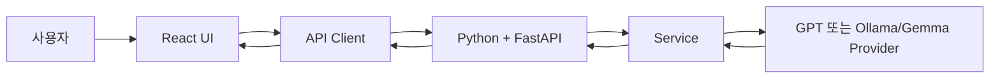

# React


> **위치:** Phase 1 — AI Service Development / 02 React  
> **기술 확인일:** 2026-09-26  
> **강의 방향:** 문법 암기보다 **상태가 변하는 AI 서비스 화면을 React로 어떻게 구조화하는가**를 이해한다.

## 개요

이 과목은 AI 서비스의 Browser 화면을 설계하고 Python+FastAPI API와 연결하는 과정이다. 학습자는 Component·Props·State·Event·Form·Router를 사용해 화면을 나누고, API 요청에서 Loading·Error·Retry·Cancel을 다루며, AI 응답을 안전하게 출력할 수 있어야 한다.

## 학습 목표

1. Component·Props·State·Event·Form·Router로 사용자 화면과 데이터 흐름을 설계한다.
2. FastAPI 요청의 입력·성공·검증 실패 계약을 설명하고 Loading·Error·Retry·Cancel 상태를 구현한다.
3. AI 응답의 Markdown과 외부 링크를 안전하게 표시하는 원칙을 적용한다.

## Why

AI Chat 화면은 입력·대기·성공·오류·취소가 빠르게 바뀐다. 정적인 HTML만 만드는 연습으로는 사용자가 현재 무엇을 기다리고 다음에 무엇을 할 수 있는지 설명하기 어렵다. React의 상태와 렌더링은 이 변화의 책임을 명시한다.

## Concept

React는 입력·표시·요청 상태를 책임지고, FastAPI는 요청 검증·업무 규칙·비밀정보 관리와 Provider 연결을 책임진다. `POST /api/v1/summaries`의 **Phase 1 최소 계약**은 `{ "text": "..." }` 요청과 `{ "summary": "..." }` 응답이다. Document ID, 실제 Provider 선택, 복구 정책은 Phase 2의 12 AI Integration에서 확장한다. `POST /api/v1/chat`은 Unit 30의 별도 **예시 계약**이며 양쪽 수업의 실제 구현 전 Request/Response Schema를 확인한다.

## Architecture



## Environment

| 항목 | 2026-09-26 공식 기준 | 강의 기준 |
|---|---|---|
| React | 19.3 | React 19.3 계열 |
| Node.js | 24.x LTS | Node.js 24 LTS 계열 |
| Vite | 8.x | Vite 8 계열 |
| React Router | 8.4.0까지 공개 | React Router 8 계열 |

이 표의 목적은 학생에게 **버전 숫자를 외우게 하는 것**이 아니다. React 생태계는 계속 갱신되므로 실제 실습에서는 `package-lock.json`이 그 프로젝트가 검증한 정확한 의존성 버전의 기준이 된다.

새 프로젝트 구조를 확인할 때는 `npm create vite@latest`를 사용할 수 있다. 제공된 동일 실습 환경을 재현할 때는 저장소의 `package-lock.json`을 유지하고 `npm ci`로 설치한다. 강의 이후 patch 버전이 올라가더라도 개념과 코드가 동일하게 동작하는지 확인한 뒤 Lock을 갱신한다.

## Implementation

Part 1에서 Component, Props, State, Event, Form, Hook을 익힌다. Part 2에서 Router, Fetch, 업로드, AI Chat UI, Markdown 출력, 테스트를 한 사용자 흐름으로 연결한다. 실습 코드는 `Academy/03. 실습/00. Phase1_Theoretical/02. React/React_실습_v2.2.1/`에서 관리한다. 각 Unit의 코드 블록은 개념·구현 예시이며 실행 검증 결과는 `실습_실행검증_결과.md`에 별도 기록한다.

## Practice

Unit별 실습에서 컴포넌트 분리, 입력 폼, API 요청, 실패 상태, AI 응답 표시를 순서대로 확인한다. 마지막에는 Unit 23의 요약 API 요청을 Python+FastAPI Unit 14의 계약과 대조하고, 정상 응답과 422 응답에서 화면에 표시할 상태를 적는다. 실제 실행 실습에서는 Browser 화면과 개발자 도구의 Console·Network 결과를 함께 확인한다.

## Best Practice

- `status`를 `idle → loading → success/error/cancelled`로 표현하고 중복 제출을 막는다.
- 사용자가 다시 시도할 수 있는 경로를 제공하되, POST 요청의 자동 반복은 서버 중복 처리 위험을 검토한다.
- 외부 AI 출력은 불신 데이터다. Markdown을 렌더링할 때 raw HTML 삽입을 기본으로 허용하지 않는다. 자세한 공격·검증 원리는 Phase 1 `06. 생성형 AI 보안`에서 다룬다.

## Project Connection

- AI Chat UI의 모델 계열·Cloud/Local 선택은 `04. GPT, Ollama, Gemma`, 적용 방식 판단은 `05. 생성형 AI 활용`과 연결한다.

## Summary

완성 기준은 화면을 보이는 것에 그치지 않는다. 요청·응답 계약, 실패 상태, 사용자에게 표시할 다음 행동을 함께 설명할 수 있어야 한다.

## 실무 팁

Browser Network 탭의 요청·응답, 실패 시 상태와 메시지, Keyboard 입력, API 계약을 함께 확인한다.

## 주의사항

`VITE_*` 환경변수는 Frontend Bundle에 포함되어 사용자가 확인할 수 있으므로 API Key 같은 비밀정보를 넣지 않는다. 버전 숫자는 계속 변할 수 있으므로 **강의의 개념 기준**과 **프로젝트의 package-lock.json 기준**을 구분한다.

## 참고자료

- [React 공식 버전](https://react.dev/versions), [React 19.3](https://react.dev/blog/2026/09/09/react-19-3)
- [React State Snapshot](https://react.dev/learn/state-as-a-snapshot), [Vite 시작 안내](https://vite.dev/guide/)
- [React Router Changelog](https://reactrouter.com/changelog), [Node.js Releases](https://nodejs.org/en/blog/release)

> **2026-09-26 기술 확인:** React 공식 문서는 React 19.3을 최신 버전으로 안내한다. React Router 공식 Changelog에는 v8.4.0(2026-09-15)이 공개되어 있다. Vite는 8.x가 현재 지원 계열이며 Node.js 24.x는 LTS 계열이다. 강의에서는 이 major/minor 계열을 기준으로 설명하고 프로젝트별 정확한 patch 버전은 lock 파일을 기준으로 한다.

## 관련 Wiki Link

[[React]] · [[FastAPI]] · [[GPT]] · [[Ollama]] · [[Gemma]] · [[생성형 AI 활용]] · [[생성형 AI 보안]]

---

## 이 과목을 배우는 전체 흐름

React를 처음 배우면 `JSX`, `Component`, `Props`, `State`, `Hook`이 각각 별개의 문법처럼 보이기 쉽습니다. 하지만 실제로는 한 가지 질문으로 연결됩니다.

> **"사용자의 행동으로 데이터가 바뀌었을 때, 화면의 어느 부분을 어떻게 다시 그릴 것인가?"**

이 질문을 다음 순서로 확장합니다.

```text
화면을 작은 단위로 나눈다
        ↓
Component
        ↓
부모가 자식에게 값을 전달한다
        ↓
Props
        ↓
화면이 기억해야 할 값을 둔다
        ↓
State
        ↓
사용자 입력으로 State를 바꾼다
        ↓
Event / Form
        ↓
State 변화에 따라 화면이 달라진다
        ↓
Conditional / List Rendering
        ↓
외부 시스템과 동기화한다
        ↓
Effect / Custom Hook
        ↓
여러 화면과 Backend API를 연결한다
        ↓
Router / Fetch / AI Service UI
```

앞 Unit의 내용이 다음 Unit에서 다시 나오는 것은 의도된 구성입니다. React는 개념 하나를 독립적으로 끝내기보다 **Component 안에서 Props·State·Event·Rendering이 함께 작동하는 모습을 반복해서 보는 것**이 더 중요합니다.

### 이전 과목과의 연결

앞의 [[AI_애플리케이션_아키텍처_강의용_v0.3.1]]에서 다음 구조를 배웠습니다.

```text
사용자 → Frontend → HTTP/API → Backend → AI/Data
```

React 과정은 이 중 **Frontend 내부를 확대해서 보는 과정**입니다.

```text
Frontend
├── 화면을 어떤 Component로 나눌 것인가?
├── 데이터는 어디에 둘 것인가?
├── 사용자 입력을 어떻게 받을 것인가?
├── Backend 요청 중에는 무엇을 보여줄 것인가?
└── 성공·실패·취소 결과를 어떻게 화면에 반영할 것인가?
```

따라서 React를 "예쁜 화면을 만드는 도구"로만 이해하지 않습니다. 이 과정에서 React는 **사용자 상태와 Backend 통신 상태를 화면으로 표현하는 UI 구조화 도구**입니다.

---

## Part 1 — React 핵심 개념

> **대상:** React를 처음 배우는 AI 서비스 개발자<br>
> **범위:** Unit 1~18<br>
> **목표:** React의 렌더링, 컴포넌트, Props, State, 이벤트, Form, Hook을 이해하고 작은 UI를 직접 구현한다.

## 강의 운영 원칙

- 정확한 React 용어를 먼저 제시하고 학생이 이해할 수 있는 언어로 설명한다.
- 기초 Unit은 개념을 가장 잘 보여주는 작은 예제를 사용한다.
- 같은 목적의 최종 코드 예제는 하나만 유지한다.
- 강사용 진행 안내는 `INSTRUCTOR` 마커 안에만 작성한다.
- Part 2에서 AI Document 서비스로 통합할 수 있도록 데이터 흐름을 연결한다.


---

# Unit 1. 왜 React가 필요한가?

<!-- INSTRUCTOR:START -->

정적 화면과 AI 채팅 화면을 비교해 상태가 계속 바뀌는 UI가 왜 어려운지 먼저 질문한다. React의 장점보다 해결하려는 문제를 먼저 이해시키는 것이 핵심이다.

<!-- INSTRUCTOR:END -->

> **커리큘럼 위치**  
> AIKOS 정규과정 → React → **Unit 1**

---

## 학습 목표

이번 Unit이 끝나면 다음 질문에 답할 수 있어야 합니다.

- React는 왜 등장했는가?
    
- HTML, CSS, JavaScript만으로는 무엇이 어려운가?
    
- React는 AI 서비스 Frontend에서 어떤 역할을 하는가?
    
- Component 기반 UI가 왜 중요한가?
    

React 공식 문서는 React를 “웹과 네이티브 사용자 인터페이스를 만들기 위한 라이브러리”라고 설명하며, UI를 작은 Component 조각으로 만들고 조합하는 방식을 핵심으로 둡니다. ([react.dev](https://react.dev/ "React"))

---

## 왜 필요한가

#### 기존 웹 개발 방식

초기 웹 페이지는 대부분 정적이었습니다.

```text
HTML → 화면 구조
CSS  → 화면 디자인
JavaScript → 사용자 동작 처리
```

예를 들어 버튼을 누르면 문구가 바뀌는 정도는 JavaScript로 충분합니다.

```html
<h1 id="title">Hello</h1>
<button onclick="changeTitle()">변경</button>

<script>
  function changeTitle() {
    document.getElementById("title").innerText = "Changed";
  }
</script>
```

이 방식은 간단한 페이지에서는 문제가 없습니다.

하지만 AI 서비스는 단순 페이지가 아닙니다.

---

#### AI 서비스 Frontend는 상태가 계속 변한다

AI Chat UI를 생각해봅시다.

사용자가 질문을 입력하면 화면에서는 여러 일이 동시에 일어납니다.

```text
1. 사용자가 메시지를 입력한다.
2. 메시지가 채팅창에 추가된다.
3. 서버로 요청을 보낸다.
4. Loading 상태를 보여준다.
5. AI 응답을 받는다.
6. 응답을 Markdown으로 출력한다.
7. 에러가 나면 에러 메시지를 보여준다.
8. 다시 입력 가능 상태로 바꾼다.
```

이때 화면은 계속 바뀝니다.

```text
입력값
채팅 메시지 목록
로딩 상태
에러 상태
서버 응답
파일 업로드 상태
이미지 미리보기 상태
```

이런 값을 **상태(State)** 라고 합니다.

React가 필요한 가장 큰 이유는 바로 이것입니다.

> **복잡하게 변하는 화면 상태를 예측 가능하게 관리하기 위해 React가 필요하다.**

---

## 개념

React는 UI를 만들기 위한 JavaScript 라이브러리입니다.

정확히 말하면 React는 다음 문제를 해결합니다.

```text
데이터가 바뀌면
화면을 어떻게 다시 그릴 것인가?
```

기존 방식은 개발자가 직접 DOM을 찾아서 바꿉니다. DOM은 브라우저가 HTML 문서를 메모리 안에서 객체 구조로 표현한 것으로, JavaScript가 문서 구조를 읽고 수정할 수 있게 해줍니다. ([MDN](https://developer.mozilla.org/en-US/docs/Web/API/Document_Object_Model "Document Object Model (DOM) - Web APIs - MDN Web Docs"))

```js
document.getElementById("message").innerText = "새 메시지";
```

React 방식은 다릅니다.

```jsx
<h1>{message}</h1>
```

개발자는 화면이 어떤 상태일 때 어떻게 보여야 하는지만 선언합니다.

```text
상태가 바뀐다
↓
React가 변경 사항을 계산한다
↓
필요한 화면을 다시 그린다
```

---

## 동작 원리와 구조

AI 서비스 전체 구조에서 React는 사용자와 직접 만나는 영역입니다.

```text
[User]
  ↓
[React Frontend]
  ↓ HTTP 요청
[FastAPI Backend]
  ↓
[LLM / RAG / Vector DB / OCR]
  ↓
[FastAPI Backend]
  ↓ HTTP 응답
[React Frontend]
  ↓
[User]
```

React는 AI 모델 자체가 아닙니다.

React의 역할은 다음과 같습니다.

```text
사용자 입력 받기
파일 업로드 UI 제공
AI 응답 출력
Markdown 렌더링
로딩/에러 처리
페이지 이동
상태 관리
```

즉, React는 **AI 서비스를 사람이 사용할 수 있는 제품으로 만들어주는 화면 계층**입니다.

---

## 비유로 이해하기

React를 식당에 비유하면 다음과 같습니다.

```text
사용자 = 손님
React = 홀 직원 / 메뉴판 / 주문 화면
FastAPI = 주방 접수대
LLM = 요리사
Vector DB = 재료 창고
```

손님은 요리사를 직접 만나지 않습니다.

손님은 메뉴판을 보고 주문합니다.

AI 서비스에서도 사용자는 LLM을 직접 호출하지 않습니다.

사용자는 React 화면에서 질문을 입력하고, React가 Backend에 요청을 보냅니다.

---

## 기본 예제

#### React식 사고

React에서는 화면을 하나의 큰 HTML 파일로 보지 않습니다.

작은 Component로 나눕니다.

```jsx
function ChatMessage() {
  return <div>안녕하세요. AI 응답입니다.</div>;
}

function ChatApp() {
  return (
    <div>
      <h1>AI Chat</h1>
      <ChatMessage />
    </div>
  );
}
```

여기서 중요한 점은 이것입니다.

```text
ChatApp은 전체 화면
ChatMessage는 재사용 가능한 작은 UI 조각
```

React는 이런 작은 조각들을 조합해서 큰 화면을 만듭니다.

---

## AI 서비스에서의 활용

AI 서비스 Frontend에서는 React Component를 보통 이렇게 나눕니다.

```text
src/
├─ components/
│  ├─ ChatMessage.jsx
│  ├─ ChatInput.jsx
│  ├─ FileUpload.jsx
│  └─ LoadingSpinner.jsx
├─ pages/
│  └─ ChatPage.jsx
├─ api/
│  └─ chatApi.js
└─ App.jsx
```

예를 들어 AI Chat UI는 다음 Component들로 나눌 수 있습니다.

```text
ChatPage
├─ ChatMessageList
├─ ChatMessage
├─ ChatInput
├─ FileUpload
└─ ErrorMessage
```

이렇게 나누면 좋은 점은 다음과 같습니다.

```text
수정이 쉽다
재사용이 쉽다
테스트가 쉽다
역할이 명확하다
협업이 쉽다
```

---

## 실무 팁과 주의사항

#### 실수 1. React를 HTML 대체 도구로만 이해한다

React는 단순히 HTML을 예쁘게 쓰는 도구가 아닙니다.

React의 핵심은 **상태에 따라 UI를 다시 구성하는 방식**입니다.

---

#### 실수 2. DOM을 직접 조작하려고 한다

React에서는 보통 다음 방식은 피합니다.

```js
document.getElementById("title").innerText = "변경";
```

React에서는 상태를 바꿉니다.

```jsx
setTitle("변경");
```

그리고 React가 화면을 다시 그리게 합니다.

---

#### 실수 3. Component를 너무 크게 만든다

초보자는 모든 코드를 `App.jsx`에 넣는 경우가 많습니다.

하지만 실무에서는 역할별로 나누어야 합니다.

```text
입력 담당 Component
출력 담당 Component
파일 업로드 Component
API 요청 함수
페이지 Component
```

---

## 핵심 요약

React가 필요한 이유는 한 문장으로 정리할 수 있습니다.

> **React는 복잡하게 변하는 사용자 화면을 Component와 State 중심으로 예측 가능하게 만들기 위해 사용한다.**

AI 서비스에서 React는 다음 역할을 합니다.

```text
AI 모델을 직접 만드는 기술은 아니다.
사용자가 AI를 사용할 수 있도록 화면을 만든다.
입력, 출력, 로딩, 에러, 파일 업로드 같은 상태를 관리한다.
FastAPI Backend와 HTTP로 연결된다.
```

---


## 학생이 설명해야 할 3문장

1. React는 복잡하게 변하는 UI를 Component와 State 중심으로 관리하기 위해 사용한다.
2. React는 AI 모델이 아니라 사용자가 AI 기능을 사용하는 Frontend UI 계층이다.
3. React에서는 DOM을 직접 바꾸기보다 현재 상태에 맞는 UI를 선언한다.

---

# Unit 2. Component 기반 사고와 UI 설계

<!-- INSTRUCTOR:START -->

완성된 AI Chat 화면을 먼저 보여주고 Header, MessageList, ChatInput처럼 역할을 나누게 한다. 이번 Unit의 목적은 Component 문법을 반복하는 것이 아니라 **화면을 어떤 기준으로 나눌지 설계하는 사고방식**을 익히는 것이다. 실제 파일 분리와 import/export는 Unit 7에서 구현한다.

<!-- INSTRUCTOR:END -->

> **커리큘럼 위치**  
> AIKOS 정규과정 → React → **Unit 2**

## 학습 목표

이번 Unit이 끝나면 다음 질문에 답할 수 있어야 합니다.

- Component 기반 사고란 무엇인가?
- 화면을 어떤 기준으로 Component로 나누는가?
- Component Tree는 무엇인가?
- AI 서비스에서 Page와 하위 UI를 어떻게 분해하는가?

## 왜 필요한가

AI 서비스 화면은 하나의 큰 HTML 덩어리가 아닙니다.

```text
AI Chat
├── Header
├── Sidebar
├── ChatPage
│   ├── ChatHistory
│   │   └── ChatMessage
│   └── ChatInput
└── Footer
```

이 구조를 한 파일에 모두 작성하면 기능이 늘어날수록 수정 이유가 서로 섞입니다.

예를 들어 `ChatInput`은 입력과 전송 때문에 변경되고, `ChatMessage`는 메시지 표현 방식 때문에 변경됩니다. 두 코드가 서로 다른 이유로 자주 바뀐다면 분리할 가치가 있습니다.

## 개념

React의 Component는 UI를 구성하는 재사용 가능한 단위입니다. 이번 Unit에서 중요한 것은 “Component는 함수다”라는 문법보다 다음 질문입니다.

> **이 UI 조각은 독립적인 책임과 변경 이유를 가지고 있는가?**

좋은 분리 기준:

```text
역할이 다르다.
반복해서 사용한다.
독립적으로 변경될 가능성이 높다.
자체적인 입력(Props)과 출력(UI)이 분명하다.
```

무조건 작게 나누는 것은 목표가 아닙니다.

```text
너무 큼
Everything.jsx
  ├── 로그인
  ├── 채팅
  ├── 파일 업로드
  └── 설정
```

반대로 버튼 안의 작은 `<span>`까지 모두 별도 Component로 만들 필요도 없습니다.

## Component Tree

React 화면은 Component가 다른 Component를 포함하는 트리 구조로 생각할 수 있습니다.

```text
App
├── MainLayout
│   ├── Header
│   ├── Sidebar
│   └── ChatPage
│       ├── ChatHistory
│       └── ChatInput
└── Footer
```

상위 Component는 하위 Component를 조합합니다. 이후 Unit에서 Props와 State를 배우면 이 트리를 따라 데이터가 어떻게 흐르는지도 연결됩니다.

## AI Document 서비스로 분해하기

예를 들어 문서 요약 서비스를 설계해봅시다.

```text
DocumentPage
├── DocumentUpload
├── DocumentPreview
├── ProcessingStatus
└── SummaryResult
```

각 Component의 책임은 다릅니다.

| Component | 책임 |
|---|---|
| `DocumentUpload` | 파일 선택과 업로드 시작 |
| `DocumentPreview` | 선택 문서 정보/미리보기 표시 |
| `ProcessingStatus` | 처리 상태 표시 |
| `SummaryResult` | 요약 결과 출력 |

여기서는 실제 파일을 만들지 않습니다. 먼저 화면을 책임 단위로 분해하는 연습을 합니다.

## 실습

다음 화면을 보고 Component Tree를 직접 설계합니다.

```text
AI Document
- 상단 서비스 이름
- 왼쪽 메뉴
- PDF 파일 선택
- 선택 파일 정보
- 요약 실행 버튼
- 처리 중 상태
- 요약 결과
```

예시 정답은 하나가 아닙니다. 중요한 것은 각 Component를 왜 분리했는지 설명할 수 있는가입니다.

## 실무 팁과 주의사항

- Component 분리는 파일 개수를 늘리는 작업이 아니라 책임을 나누는 작업입니다.
- 한 곳에서만 쓰이고 매우 단순한 UI는 성급하게 공통 Component로 만들지 않습니다.
- 같은 화면이라도 프로젝트 규모와 변경 빈도에 따라 적절한 분리 수준은 달라집니다.
- 실제 Component 파일 생성과 `import` / `export`는 Unit 7에서 다룹니다.

## 핵심 요약

- React는 UI를 Component Tree로 구성합니다.
- Component는 독립적인 책임과 변경 이유를 기준으로 나눕니다.
- 무조건 작게 나누는 것이 좋은 설계는 아닙니다.
- 이번 Unit은 **설계**, Unit 7은 **구현**에 초점을 둡니다.

참고: [React 공식 문서 — Thinking in React](https://react.dev/learn/thinking-in-react)


## 학생이 설명해야 할 3문장

1. Component 분리는 파일 수가 아니라 책임과 변경 이유를 나누는 설계다.
2. 화면은 Component Tree로 생각할 수 있다.
3. Unit 2는 Component 설계, Unit 7은 실제 구현에 초점을 둔다.

---

# Unit 3. Rendering과 DOM 반영

<!-- INSTRUCTOR:START -->

컴포넌트 함수가 다시 실행되는 것과 실제 DOM 변경을 구분한다. Virtual DOM이 언제나 더 빠르다는 식으로 설명하지 않는다. 브라우저 개발자 도구에서 DOM 노드 하나가 실제로 바뀌는지 확인한다.

<!-- INSTRUCTOR:END -->

## 학습 목표

- React의 Trigger, Render, Commit 단계를 설명할 수 있다.
- 컴포넌트 실행과 실제 DOM 변경을 구분할 수 있다.
- Reconciliation과 `key`가 필요한 이유를 설명할 수 있다.
- 렌더링 중 지켜야 하는 순수성 원칙을 이해한다.

## 왜 필요한가

State를 변경하면 컴포넌트 함수가 다시 실행된다. 그렇다고 함수가 실행될 때마다 화면의 모든 DOM 노드를 새로 만드는 것은 아니다. 이 차이를 이해해야 불필요한 최적화와 잘못된 Effect 사용을 피할 수 있다.

## DOM과 React의 역할

DOM(Document Object Model)은 브라우저가 HTML 문서를 객체 트리로 표현한 것이다. JavaScript는 DOM API를 사용해 요소의 내용과 속성을 변경할 수 있다.

React에서는 개발자가 DOM 변경 절차를 직접 나열하기보다 현재 Props와 State에 맞는 JSX를 반환한다. React는 이전 렌더링 결과와 다음 렌더링 결과를 비교해 필요한 DOM 작업을 결정한다.

## Trigger → Render → Commit

### 1. Trigger

첫 화면을 표시하거나 State가 갱신되면 렌더링이 예약된다.

### 2. Render

React가 컴포넌트 함수를 호출해 화면에 무엇을 표시할지 계산한다. 렌더링 코드는 같은 Props와 State에 대해 같은 JSX를 반환하는 순수한 계산이어야 한다.

### 3. Commit

계산된 결과가 이전 결과와 다를 때 React가 필요한 DOM 변경을 반영한다. 컴포넌트 함수가 실행됐더라도 결과가 같다면 해당 DOM 노드는 바뀌지 않을 수 있다.

```text
State 업데이트
     ↓
Render 예약
     ↓
컴포넌트 함수 실행
     ↓
이전 결과와 다음 결과 비교
     ↓
필요한 DOM 변경 Commit
     ↓
브라우저 Paint
```

## 기본 예제

```jsx
import { useState } from "react";

export default function MessageCounter() {
  const [count, setCount] = useState(0);
  console.log("MessageCounter render", count);

  return (
    <section>
      <h2>메시지 수: {count}</h2>
      <p>이 문장은 count와 관계없이 그대로 유지됩니다.</p>
      <button type="button" onClick={() => setCount((current) => current + 1)}>
        메시지 추가
      </button>
    </section>
  );
}
```

버튼을 누르면 함수는 다시 실행된다. React는 새 JSX 결과를 계산하지만 실제 DOM에서는 숫자가 표시되는 텍스트만 변경하면 된다.

## Reconciliation과 정체성

React가 이전 UI와 다음 UI를 비교해 어떤 요소를 유지하고 교체할지 판단하는 과정을 Reconciliation이라고 한다. 요소의 타입과 UI 트리에서의 위치가 정체성 판단에 사용된다.

목록에서는 `key`가 항목의 정체성을 알려준다.

```jsx
function MessageList({ messages }) {
  return (
    <ul>
      {messages.map((message) => (
        <li key={message.id}>{message.content}</li>
      ))}
    </ul>
  );
}
```

데이터가 추가·삭제·재정렬될 수 있다면 배열 index보다 데이터의 안정적인 ID를 사용한다. `key`는 자식 컴포넌트에 전달되는 일반 Props가 아니라 React가 정체성을 판단할 때 사용하는 정보다.

## Virtual DOM을 이해하는 기준

Virtual DOM은 실제 DOM의 완전한 복사본이 아니라 UI를 JavaScript 값으로 표현한 렌더링 결과를 가리키는 설명이다. 핵심은 다음과 같다.

- React가 항상 다른 방식보다 빠르다는 보장은 아니다.
- 렌더링과 실제 DOM 변경은 같은 일이 아니다.
- 성능보다 선언적인 UI와 예측 가능한 업데이트가 우선이다.
- 성능 문제는 측정한 뒤 최적화한다.

## 실습

1. 예제를 실행하고 Console에서 함수 실행 횟수를 확인한다.
2. Elements 패널에서 숫자 텍스트가 변경되는 것을 확인한다.
3. 관계없는 부모 State를 추가해 자식 함수 실행과 DOM 변경을 비교한다.
4. 메시지 목록에 안정적인 ID와 index를 각각 key로 사용해 차이를 토론한다.

## 핵심 요약

- React 화면 갱신은 Trigger, Render, Commit 단계로 이해한다.
- Render는 컴포넌트 함수를 호출해 다음 UI를 계산하는 과정이다.
- Commit은 필요한 변경을 DOM에 적용하는 과정이다.
- 렌더링 코드는 순수해야 한다.
- `key`는 목록 항목의 정체성을 나타낸다.

참고: [React 공식 문서 — Render and Commit](https://react.dev/learn/render-and-commit)


## 학생이 설명해야 할 3문장

1. Render는 다음 UI를 계산하는 과정이고 Commit은 필요한 DOM 변경을 반영하는 과정이다.
2. Component 함수가 다시 실행되어도 모든 DOM이 새로 만들어지는 것은 아니다.
3. 목록의 key는 항목의 안정적인 정체성을 표현해야 한다.

---

# Unit 4. React 개발환경 (Node.js, npm, Vite)

<!-- INSTRUCTOR:START -->

명령을 한 줄씩 실행하고 매 단계에서 현재 폴더와 출력 결과를 확인한다. React 자체와 개발 도구를 같은 것으로 설명하지 않는다. JSX, 모듈, 패키지, 개발 서버를 사용하는 **현대적인 React 개발 흐름** 때문에 Node.js와 Vite를 사용한다는 점을 강조한다.

<!-- INSTRUCTOR:END -->

> **실습 기준 환경**
>
> - VS Code
> - 강의는 Node.js 24 LTS 계열을 기준으로 설명한다.
> - React는 19.3 계열, Vite는 8 계열, React Router는 8 계열을 사용한다.
> - 실습의 정확한 patch 버전은 `package-lock.json`을 기준으로 확인한다.
> - npm
> - Vite 기반 React 프로젝트

## 학습 목표

- React와 Node.js의 역할을 구분할 수 있다.
- npm이 무엇을 관리하는지 설명할 수 있다.
- Vite가 프로젝트 생성, 개발 서버, 빌드 과정에서 어떤 역할을 하는지 설명할 수 있다.
- Vite 기반 React 프로젝트를 직접 생성하고 실행할 수 있다.

## 왜 개발환경이 필요한가

React 자체는 UI를 만들기 위한 JavaScript 라이브러리이며 JSX 사용도 필수는 아닙니다.

하지만 현대적인 React 프로젝트는 보통 다음을 함께 사용합니다.

```text
JSX
ES Module(import/export)
외부 Package
개발 서버
환경변수
Production Build
```

따라서 개발 중에는 이 요소들을 편리하게 처리해주는 도구가 필요합니다.

```text
개발자가 JSX와 모듈로 코드 작성
        ↓
Vite가 개발 환경 제공
        ↓
브라우저가 실행 가능한 모듈/코드 제공
        ↓
React 애플리케이션 실행
```

> **중요**
>
> “React는 브라우저에서 실행할 수 없어서 Node.js가 필요하다”라고 이해하면 안 됩니다.  
> Node.js는 이 수업에서 **개발 도구와 패키지를 실행하기 위한 기반 환경**입니다. Production으로 빌드된 Frontend를 사용자가 보는 순간에 Node.js가 반드시 필요한 것은 아닙니다.

## Node.js

Node.js는 브라우저 밖에서 JavaScript를 실행할 수 있는 Runtime입니다.

이 과정에서는 다음 작업의 기반으로 사용합니다.

```text
npm 실행
Vite 실행
패키지 설치
개발 서버 실행
Production Build
```

확인:

```bash
node --version
```

## npm

npm은 Node.js 생태계의 Package Manager입니다.

```bash
npm install axios
```

같은 명령으로 프로젝트 의존성을 설치하고, `package.json`의 script를 실행합니다.

```bash
npm run dev
npm run build
```

## Vite

Vite는 현대적인 Frontend 개발 도구입니다.

이 과정에서는 다음 역할로 이해합니다.

```text
프로젝트 Scaffold
개발 서버
빠른 개발 중 갱신(HMR)
환경변수 처리
Production Build
```

Vite 8 공식 문서는 Node.js `20.19+` 또는 `22.12+`를 요구합니다. React Router 8은 Node.js `22.22.0+`, React `19.2.7+`, Vite `7+`를 최소 기준으로 둡니다. 이 강의에서는 이를 모두 만족하는 **Node.js 24 LTS + React 19.3 + Vite 8 + React Router 8** 조합을 기준으로 설명합니다.

## 프로젝트 생성

수업에서는 한 번에 다음 명령을 실행할 수 있어야 합니다.

```bash
node --version
npm --version
npm create vite@latest react-ai-app -- --template react
cd react-ai-app
npm install
npm run dev
```

브라우저에 출력된 Local 주소를 엽니다. 일반적으로 `http://localhost:5173`이 사용되지만 포트가 사용 중이면 다른 포트가 배정될 수 있습니다.

## 명령의 의미

```bash
npm create vite@latest react-ai-app -- --template react
```

```text
npm
└─ Package Manager 실행

create vite@latest
└─ 최신 Vite 프로젝트 생성 도구 실행

react-ai-app
└─ 생성할 프로젝트 폴더

--template react
└─ React JavaScript Template 선택
```

## 개발환경 관계

```text
운영체제
  ↓
Node.js
  ↓
npm
  ↓
Vite
  ↓
React 프로젝트 개발
  ↓
브라우저
```

이 그림은 “React가 Vite 안에서만 동작한다”는 뜻이 아니라, **이번 수업에서 사용하는 개발 도구의 의존 관계**를 나타냅니다.

## 환경 구성 오류 진단 순서

1. `node --version`이 실행되지 않으면 Node.js 설치와 터미널 재시작을 확인합니다.
2. `npm ERR! enoent ... package.json`이면 현재 터미널 위치를 확인합니다.
3. 포트가 사용 중이면 Vite가 안내하는 다른 주소를 엽니다.
4. 의존성을 찾지 못하면 프로젝트 루트에서 `npm install`을 실행합니다.
5. 흰 화면이면 VS Code 터미널 오류와 브라우저 Console을 함께 확인합니다.

## AI 서비스와 연결

Part 2에서는 이 개발환경 위에 다음 기능을 추가합니다.

```text
React Router
Fetch / Axios
Markdown Renderer
파일 업로드
환경변수
FastAPI API 연동
```

필요한 외부 Package가 있다면 npm으로 설치하고, Vite 개발 서버에서 즉시 확인합니다.

## 핵심 요약

- React는 UI 라이브러리이고 Node.js는 JavaScript Runtime입니다.
- npm은 프로젝트의 Package와 Script를 관리합니다.
- Vite는 React 프로젝트의 개발 서버와 Build를 포함한 개발 도구입니다.
- Node.js는 “React 화면 자체의 필수 Runtime”이 아니라 이 과정의 개발 도구를 실행하는 기반입니다.
- Vite 자체 요구사항은 Node.js `20.19+` 또는 `22.12+`입니다.
- 강의 환경은 Node.js 24 LTS 계열을 기준으로 하며, 실제 프로젝트의 정확한 patch 버전은 `node --version`과 `package-lock.json`으로 확인합니다.

참고: [Vite 공식 문서 — Getting Started](https://vite.dev/guide/)


## 학생이 설명해야 할 3문장

1. Node.js는 React 화면 자체가 아니라 개발 도구를 실행하는 Runtime이다.
2. npm은 Package와 Script를 관리하고 Vite는 개발 서버와 Build를 제공한다.
3. 공통 Node.js 버전은 React와 실습 전체의 설치·빌드를 확인해 고정한다.

---

# Unit 5. React 프로젝트 구조

<!-- INSTRUCTOR:START -->

학생에게 각 파일의 역할을 맞혀 보게 한 뒤 src와 public의 차이를 설명한다. node_modules는 직접 수정하거나 Git에 올리지 않는다.

<!-- INSTRUCTOR:END -->

> **커리큘럼 위치**  
> AIKOS 정규과정 → React → **Unit 5**

---

## 학습 목표

이번 Unit이 끝나면 다음 질문에 답할 수 있어야 합니다.

- React 프로젝트는 왜 여러 파일로 구성되는가?
    
- React 프로젝트의 기본 구조를 설명할 수 있는가?
    
- package.json은 무엇인가?
    
- src 폴더는 어떤 역할을 하는가?
    
- public 폴더는 언제 사용하는가?
    
- AI 서비스에서는 프로젝트를 어떻게 구성하는가?
    

---

## 왜 필요한가

지난 Unit에서 우리는

```bash
npm create vite@latest aikos-react
```

명령으로 프로젝트를 생성했습니다.

그런데 프로젝트를 열어보면 생각보다 파일이 많습니다.

예를 들어

```text
aikos-react

├── node_modules
├── public
├── src
├── package.json
├── package-lock.json
├── vite.config.js
├── index.html
└── ...
```

처음 보는 사람들은 대부분 이런 생각을 합니다.

> **"도대체 어떤 파일을 수정해야 하지?"**

실제로 초보자들이 가장 많이 하는 실수는

모든 파일을 열어보며 수정하는 것입니다.

하지만 실무에서는

수정해야 하는 파일과

절대 수정하지 않는 파일이 명확하게 구분됩니다.

---

### React 프로젝트는 하나의 프로그램이다

Python 프로젝트를 떠올려봅시다.

예를 들어

```text
app.py

database.py

service.py

config.py
```

처럼 역할별로 파일을 나눴습니다.

React도 같습니다.

```text
화면

설정

라이브러리

이미지

CSS

환경설정
```

을 각각 다른 위치에 보관합니다.

---

### AI 서비스는 더욱 복잡하다

우리가 앞으로 만들 AI 서비스에는

```text
Chat

OCR

파일 업로드

Markdown

AI 응답

환경변수

API

로그인
```

등이 들어갑니다.

이 모든 코드를

App.jsx 하나에 넣는다면

유지보수가 거의 불가능합니다.

React 자체가 프로젝트 폴더 구조를 강제하는 것은 아닙니다. 프로젝트가 커질수록 개발팀이 역할별 구조를 정해 관리하는 것이 중요합니다.

---

## 개념

먼저 가장 기본적인 프로젝트 구조부터 보겠습니다.

```text
aikos-react/

├── node_modules/
├── public/
├── src/
│
├── .gitignore
├── index.html
├── package.json
├── package-lock.json
├── vite.config.js
└── README.md
```

하나씩 이해해보겠습니다.

---

### node_modules

가장 큰 폴더입니다.

```text
node_modules
```

안에는

React

Axios

Vite

React Router

등

설치한 모든 라이브러리가 들어 있습니다.

---

### 절대로 수정하지 않습니다.

이 폴더는

```bash
npm install
```

을 실행하면

자동으로 생성됩니다.

따라서

직접 수정하지 않습니다.

---

### Git에도 올리지 않는다

node_modules는

용량이 매우 큽니다.

그래서 Git에는 올리지 않습니다.

필요하면

다시

```bash
npm install
```

하면

자동으로 생성됩니다.

---

### public

다음은

```text
public/
```

입니다.

이 폴더에는

브라우저가

그대로 접근할 파일을 넣습니다.

예를 들어

```text
favicon.ico

logo.png

robots.txt
```

등이 있습니다.

---

### 특징

public 안의 파일은

React가 처리하지 않습니다.

그대로 브라우저에 전달됩니다.

예를 들어

```text
public/logo.png
```

는

브라우저에서

```text
/logo.png
```

로 접근할 수 있습니다.

---

### src

가장 중요한 폴더입니다.

실제로 개발자가

대부분 작업하는 곳입니다.

```text
src

├── App.jsx

├── main.jsx

├── assets

├── components

└── ...
```

---

### main.jsx

React 프로젝트의 시작점입니다.

Python으로 비유하면

```python
main.py
```

와 같습니다.

보통

```jsx
import React from "react";
import ReactDOM from "react-dom/client";
import App from "./App";

ReactDOM.createRoot(document.getElementById("root")).render(
    <App />
);
```

처럼 작성되어 있습니다.

---

### 역할

main.jsx는

```text
React 시작

↓

App Component 실행

↓

브라우저에 출력
```

을 담당합니다.

즉,

React 프로그램의

Entry Point입니다.

---

### App.jsx

App.jsx는

전체 화면의 시작입니다.

```text
App

↓

Header

↓

Sidebar

↓

Chat

↓

Footer
```

처럼

모든 Component를 조립하는

최상위 Component입니다.

---

### App.jsx는 집이다

비유하면

```text
App.jsx

=

집
```

입니다.

집 안에는

```text
거실

방

주방

욕실
```

이 있습니다.

React에서는

```text
Header

Sidebar

Chat

Footer
```

가 됩니다.

---

### assets

여기는

이미지

아이콘

폰트

등을 저장합니다.

예를 들어

```text
assets

logo.png

chat.png

loading.gif
```

등입니다.

실무에서는

public보다

assets를 더 많이 사용합니다.

왜냐하면

React가 빌드 과정에서

최적화를 수행하기 때문입니다.

---

### package.json

이 파일은

React 프로젝트에서

가장 중요한 파일 중 하나입니다.

많은 사람들이

단순한 설정 파일이라고 생각하지만

사실은

프로젝트의

설명서입니다.

---

예를 들어

```json
{
  "name": "aikos-react",

  "version": "1.0.0",

  "scripts": {

    "dev": "vite",

    "build": "vite build"

  }
}
```

처럼 되어 있습니다.

---

### package.json에는 무엇이 들어있는가?

대표적으로

```text
프로젝트 이름

버전

라이브러리 목록

실행 명령

빌드 명령
```

이 들어 있습니다.

---

예를 들어

```bash
npm run dev
```

를 입력하면

npm은

package.json을 읽고

```json
"dev": "vite"
```

를 찾아 실행합니다.

즉,

```text
npm run dev

↓

package.json 확인

↓

vite 실행
```

입니다.

---

### package-lock.json

이 파일은

라이브러리 버전을

정확하게 기록합니다.

예를 들어

React 19.3 계열 (정확한 patch 버전은 프로젝트의 package-lock.json 확인)

Axios 1.11.0

처럼

실제로 설치된 버전을 저장합니다.

덕분에

다른 개발자도

같은 환경을 사용할 수 있습니다.

---

### vite.config.js

이 파일은

Vite의 설정입니다.

예를 들어

```text
별칭(alias)

빌드 설정

플러그인

포트번호
```

등을 관리합니다.

초반에는

거의 수정하지 않습니다.

---

### index.html

많은 초보자가

HTML을 여기서 작성하려고 합니다.

하지만 React에서는

거의 수정하지 않습니다.

보통

```html
<body>

<div id="root"></div>

</body>
```

만 존재합니다.

---

### 왜 이렇게 생겼을까?

React는

```text
root

↓

App

↓

전체 화면
```

을

이 안에 그려 넣습니다.

즉,

HTML은

React를 담는 그릇입니다.

---

## 동작 원리와 구조

React 프로젝트의 흐름은 다음과 같습니다.

```text
브라우저

↓

index.html

↓

<div id="root">

↓

main.jsx

↓

<App />

↓

Header

Sidebar

Chat

Footer
```

조금 더 자세히 보면

```text
index.html
      │
      ▼
main.jsx
      │
      ▼
App.jsx
      │
 ┌────┼────┐
 │    │    │
 ▼    ▼    ▼
Header Chat Footer
```

입니다.

---

### AI 서비스 프로젝트 구조

실무에서는 다음과 같이 구성하는 경우가 많습니다.

```text
src/

├── api/

├── assets/

├── components/

├── hooks/

├── layouts/

├── pages/

├── services/

├── styles/

├── utils/

├── App.jsx

└── main.jsx
```

각 폴더의 역할은 다음과 같습니다.

|폴더|역할|
|---|---|
|api|FastAPI 호출 함수|
|assets|이미지, 아이콘|
|components|재사용 UI|
|hooks|Custom Hook|
|layouts|공통 화면 레이아웃|
|pages|페이지 단위 화면|
|services|비즈니스 로직|
|styles|CSS|
|utils|공통 함수|

이 구조는 앞으로 AIKOS 프로젝트에서 사용할 **권장 구조**입니다. React가 공식적으로 강제하는 표준 폴더 구조는 아닙니다.

---

## 실습 준비

현재 프로젝트를 VS Code에서 열어봅니다.

```text
aikos-react
```

폴더를 열고

다음 파일들을 직접 확인합니다.

```text
package.json

main.jsx

App.jsx

index.html
```

코드는 아직 수정하지 않습니다.

먼저 역할을 이해하는 것이 목표입니다.

---

## 기본 사용법

### package.json 확인

열어서

다음을 찾아봅니다.

```json
"scripts": {
  "dev": "vite",
  "build": "vite build"
}
```

이 부분이

실행 명령입니다.

---

### App.jsx 수정

```jsx
function App() {
    return (
        <h1>AIKOS React</h1>
    );
}

export default App;
```

저장하면

브라우저가 자동으로 변경됩니다.

---

## AI 서비스에서의 활용

실무에서는 프로젝트를 시작하면 가장 먼저 폴더 구조를 정합니다.

예를 들어 AI 문서 자동화 서비스를 만든다면 다음과 같이 구성할 수 있습니다.

```text
src/

├── api/
│   ├── chatApi.js
│   ├── uploadApi.js
│   └── summaryApi.js
│
├── components/
│   ├── ChatInput.jsx
│   ├── ChatMessage.jsx
│   ├── FileUploader.jsx
│   └── LoadingSpinner.jsx
│
├── pages/
│   ├── ChatPage.jsx
│   └── UploadPage.jsx
│
├── hooks/
│   └── useChat.js
│
├── utils/
│   └── markdown.js
│
├── App.jsx
└── main.jsx
```

이처럼 **역할별로 폴더를 분리**하면 유지보수와 협업이 훨씬 쉬워집니다.

---

## 실무 팁과 주의사항

### 실수 1

모든 코드를 `App.jsx`에 작성한다.

→ 화면이 커질수록 유지보수가 어려워진다.

---

### 실수 2

`node_modules`를 수정한다.

→ 자동 생성되는 폴더이므로 직접 수정하지 않는다.

---

### 실수 3

`package.json`을 삭제한다.

→ 프로젝트의 실행 정보와 의존성이 모두 들어 있으므로 매우 중요한 파일이다.

---

### 실수 4

`index.html`에 화면을 직접 작성한다.

→ React 프로젝트에서는 대부분의 UI를 `App.jsx`와 Component에서 작성한다.

---

## 핵심 요약

이번 Unit의 핵심은 다음과 같습니다.

- React 프로젝트는 **역할별 파일과 폴더**로 구성된다.
    
- `src`는 개발자가 가장 많이 작업하는 공간이다.
    
- `main.jsx`는 React 애플리케이션의 시작점이다.
    
- `App.jsx`는 최상위 Component이다.
    
- `package.json`은 프로젝트의 설정, 의존성, 실행 명령을 관리하는 핵심 파일이다.
    
- AI 서비스는 `api`, `components`, `pages`, `hooks` 등으로 구조를 나누어 개발하는 것이 일반적이다.
    

---


## 학생이 설명해야 할 3문장

1. React는 공식 폴더 구조를 강제하지 않는다.
2. AIKOS에서는 pages/components/api/hooks 같은 권장 구조를 사용한다.
3. 폴더는 코드의 책임과 변경 이유를 기준으로 나눈다.

---

# Unit 6. JSX (JavaScript XML)

> **먼저 구분하기 — HTML과 JSX**  
> JSX는 HTML 파일 자체가 아닙니다. **JavaScript 코드 안에서 UI 구조를 표현하기 위한 문법**입니다. 생김새가 HTML과 비슷하므로 처음에는 같은 것으로 보이지만, `{}` 안에서 JavaScript 표현식을 사용하고 `className` 같은 React 규칙을 따른다는 차이가 있습니다.

<!-- INSTRUCTOR:START -->

JSX를 HTML이라고 부르지 않는다. `React.createElement`는 역사적 이해를 위한 참고 수준으로만 언급하고, 학생이 기억해야 할 핵심은 “JSX는 JavaScript 안에서 UI 구조를 표현하는 문법 확장이고 빌드 과정에서 JavaScript 표현으로 변환된다”는 점이다.

<!-- INSTRUCTOR:END -->

> **커리큘럼 위치**  
> AIKOS 정규과정 → React → **Unit 6**

## 학습 목표

- JSX가 무엇인지 설명할 수 있다.
- JSX와 HTML의 차이를 설명할 수 있다.
- JSX 안에서 JavaScript 표현식을 사용할 수 있다.
- Fragment, 닫는 태그, `className`, `htmlFor` 같은 기본 규칙을 사용할 수 있다.

## 왜 JSX를 사용하는가

JavaScript DOM API만으로 복잡한 UI를 만들면 구조를 한눈에 읽기 어렵습니다.

```javascript
const title = document.createElement("h1");
title.textContent = "AI Chat";
```

React에서는 UI 구조를 다음처럼 선언적으로 표현할 수 있습니다.

```jsx
<section>
  <h1>AI Chat</h1>
  <ChatInput />
</section>
```

## JSX란

JSX는 JavaScript 안에서 UI 구조를 HTML과 비슷한 형태로 표현하기 위한 **Syntax Extension**입니다.

```text
JSX 작성
   ↓
Vite의 React 개발/빌드 과정
   ↓
브라우저가 실행할 JavaScript 표현
   ↓
React가 UI 계산
   ↓
필요한 DOM 반영
```

JSX는 HTML 파일 자체가 아니며 브라우저가 원문 JSX를 그대로 실행한다고 이해해서도 안 됩니다.

과거 JSX 변환을 설명할 때 다음과 같은 형태가 자주 사용되었습니다.

```javascript
React.createElement("h1", null, "Hello");
```

현대 React의 JSX Transform은 이 형태를 직접 작성하도록 요구하지 않습니다. 이 코드는 “JSX도 결국 JavaScript 표현으로 변환된다”는 원리를 이해하기 위한 참고 예시입니다.

## 기본 규칙

### 1. 하나의 루트로 반환한다

```jsx
return (
  <>
    <h1>AIKOS</h1>
    <p>React 학습</p>
  </>
);
```

`<>...</>`는 Fragment입니다.

### 2. 태그를 닫는다

```jsx
<input />

```

### 3. JavaScript 표현식은 `{}` 안에 쓴다

```jsx
const title = "AIKOS";

return <h1>{title}</h1>;
```

```jsx
const count = 3;

return <p>메시지 수: {count + 1}</p>;
```

`{}` 안에는 값을 계산하는 **표현식**을 넣습니다. `if` 문 자체를 JSX 중괄호 안에 직접 넣는 방식은 사용하지 않습니다. 조건부 렌더링은 Unit 13에서 다룹니다.

### 4. 일부 속성 이름이 HTML과 다르다

```jsx
<label htmlFor="prompt">질문</label>
<input id="prompt" className="prompt-input" />
```

## Component와 JSX

JSX에서는 HTML 요소뿐 아니라 React Component도 사용할 수 있습니다.

```jsx
function ChatPage() {
  return (
    <main>
      <h1>AI Chat</h1>
      <ChatHistory />
      <ChatInput />
    </main>
  );
}
```

소문자로 시작하는 태그는 DOM 요소를 나타내고, 대문자로 시작하는 이름은 사용자 정의 Component로 해석됩니다.

## AI 서비스 예제

```jsx
function SummaryResult({ summary, loading }) {
  return (
    <section>
      <h2>요약 결과</h2>
      {loading ? <p>요약 중입니다.</p> : <p>{summary}</p>}
    </section>
  );
}
```

JSX는 이후 학습할 Props, State, Event, Conditional Rendering을 하나의 UI 구조 안에서 연결하는 기반입니다.

## 실무 팁과 주의사항

- JSX를 HTML 자체라고 설명하지 않습니다.
- JSX 변환 구현 세부사항보다 “선언적인 UI 표현”에 초점을 둡니다.
- 너무 깊은 JSX는 Component 분리를 검토합니다.
- UI 계산에 필요한 JavaScript 값은 `{}`로 연결합니다.

## 핵심 요약

- JSX는 JavaScript 안에서 UI 구조를 표현하는 문법 확장입니다.
- JSX는 빌드/변환 과정을 거쳐 JavaScript 표현으로 처리됩니다.
- Fragment, 닫는 태그, `{}` 표현식, `className`, `htmlFor`가 기본 규칙입니다.
- JSX는 React UI를 선언적으로 작성하기 위한 표현 방식입니다.

참고: [React 공식 문서 — Writing Markup with JSX](https://react.dev/learn/writing-markup-with-jsx)


## 학생이 설명해야 할 3문장

1. JSX는 HTML이 아니라 JavaScript 안에서 UI 구조를 표현하는 문법 확장이다.
2. JSX 안의 JavaScript 표현식은 중괄호로 연결한다.
3. JSX는 빌드 과정을 거쳐 브라우저가 실행할 JavaScript 표현으로 처리된다.

---

# Unit 7. Component 생성과 재사용

<!-- INSTRUCTOR:START -->

Unit 2에서 Component를 “어떻게 나눌지” 설계했다. 이번 Unit에서는 그 설계를 실제 파일로 구현한다. Component 정의를 처음부터 길게 반복하지 말고 `export`, `import`, Props를 받기 전의 기본 재사용까지 구현에 초점을 둔다.

<!-- INSTRUCTOR:END -->

> **커리큘럼 위치**  
> AIKOS 정규과정 → React → **Unit 7**

## 학습 목표

- 함수 Component를 파일로 만들 수 있다.
- `export`와 `import`로 Component를 연결할 수 있다.
- Component를 여러 위치에서 재사용할 수 있다.
- Unit 2에서 설계한 Component Tree를 실제 코드로 구현할 수 있다.

## 구현할 구조

```text
src/
├── components/
│   ├── Header.jsx
│   ├── ChatInput.jsx
│   └── Footer.jsx
└── App.jsx
```

## Header Component

```jsx
// src/components/Header.jsx
export default function Header() {
  return (
    <header>
      <h1>AIKOS Chat</h1>
    </header>
  );
}
```

Component 이름은 PascalCase로 작성합니다.

## ChatInput Component

```jsx
// src/components/ChatInput.jsx
export default function ChatInput() {
  return (
    <div>
      <input type="text" placeholder="질문을 입력하세요." />
      <button type="button">전송</button>
    </div>
  );
}
```

현재는 입력 상태와 Event를 연결하지 않습니다. 이후 State와 Event Unit에서 기능을 추가합니다.

## Footer Component

```jsx
// src/components/Footer.jsx
export default function Footer() {
  return <footer>© AIKOS</footer>;
}
```

## App에서 조립하기

```jsx
import Header from "./components/Header";
import ChatInput from "./components/ChatInput";
import Footer from "./components/Footer";

export default function App() {
  return (
    <>
      <Header />
      <ChatInput />
      <Footer />
    </>
  );
}
```

## `export default`와 `import`

```jsx
export default function Header() {
  // ...
}
```

은 다른 파일에서 기본 가져오기를 할 수 있게 합니다.

```jsx
import Header from "./components/Header";
```

이번 과정에서는 초반 복잡도를 줄이기 위해 Component 파일은 주로 default export를 사용합니다. 프로젝트가 커지면 named export도 사용할 수 있습니다.

## 재사용

```jsx
function StatusBadge() {
  return <span>준비됨</span>;
}

export default function App() {
  return (
    <>
      <StatusBadge />
      <StatusBadge />
    </>
  );
}
```

같은 Component를 반복해서 렌더링할 수 있습니다. 다음 Unit의 Props를 배우면 같은 구조에 서로 다른 데이터를 전달할 수 있습니다.

## Unit 2와의 차이

```text
Unit 2
화면을 어떤 책임으로 나눌 것인가?
        ↓
Component Tree 설계

Unit 7
설계한 Component를 어떻게 파일로 만들고 연결할 것인가?
        ↓
함수 + export/import + JSX
```

## 실습

1. `Header`, `ChatInput`, `Footer`를 파일로 분리합니다.
2. `App.jsx`에서 세 Component를 import해 조립합니다.
3. `StatusBadge`를 만들어 두 번 렌더링합니다.
4. Component 이름을 소문자로 바꿨을 때 어떤 문제가 생기는지 확인합니다.

## 실무 팁과 주의사항

- 역할이 불분명한 `Everything.jsx`, `Common.jsx` 같은 이름을 피합니다.
- import 경로 오류가 나면 실제 폴더 구조부터 확인합니다.
- Component를 나누는 기준은 크기만이 아니라 책임과 변경 이유입니다.
- 하나의 파일에 하나의 주요 Component를 두는 방식은 초급 과정에서 탐색하기 쉽지만 절대 규칙은 아닙니다.

## 핵심 요약

- Unit 2는 Component 설계, Unit 7은 Component 구현에 집중합니다.
- 함수 Component를 만들고 `export` / `import`로 연결합니다.
- Component는 여러 위치에서 재사용할 수 있습니다.
- Props를 배우면 같은 Component에 서로 다른 데이터를 전달할 수 있습니다.


## 학생이 설명해야 할 3문장

1. Component는 함수로 만들고 export/import로 파일을 연결할 수 있다.
2. PascalCase 이름은 사용자 정의 Component를 구분하는 중요한 규칙이다.
3. 재사용 가능한 Component는 이후 Props를 통해 다른 데이터를 받을 수 있다.

---

# Unit 8. Props

> **이번 Unit의 핵심 질문**  
> "Component를 나눴는데 각 Component가 필요한 데이터는 어디에서 받는가?"  
> 부모가 자식 Component에 전달하는 **읽기 전용 입력값**이 Props입니다. 다음 Unit의 State와 가장 많이 혼동되므로 처음부터 `Props = 밖에서 받는 값`, `State = Component가 기억하고 바꾸는 값`이라는 구분을 잡고 시작합니다.

<!-- INSTRUCTOR:START -->

Props를 함수의 매개변수와 연결해 설명하되 읽기 전용이라는 점을 강조한다. 자식이 Props를 바꾸려는 잘못된 예를 짧게 보여준다.

<!-- INSTRUCTOR:END -->

> **커리큘럼 위치**  
> AIKOS 정규과정 → React → **Unit 8**

---

## 학습 목표

이번 Unit이 끝나면 다음 질문에 답할 수 있어야 합니다.

- Props는 왜 필요한가?
    
- Props란 무엇인가?
    
- Props는 어떻게 전달하는가?
    
- 부모 Component와 자식 Component의 관계는 무엇인가?
    
- AI 서비스에서는 Props를 어떻게 사용하는가?
    

---

## 왜 필요한가

지난 Unit에서 우리는 Component를 만들었습니다.

예를 들어

```jsx
function Button() {
    return (
        <button>전송</button>
    );
}

export default Button;
```

그리고

```jsx
<>
    <Button />
    <Button />
    <Button />
</>
```

처럼 사용할 수 있었습니다.

출력 결과는

```text
전송

전송

전송
```

입니다.

---

그런데 문제가 하나 생깁니다.

이번에는

```text
전송

취소

삭제
```

버튼을 만들고 싶습니다.

현재 방식으로는

모두 같은 Button밖에 만들 수 없습니다.

---

그러면 어떻게 해야 할까요?

초보자들이 가장 많이 하는 방법은

```jsx
function SendButton() {}

function CancelButton() {}

function DeleteButton() {}
```

처럼

Component를 계속 만드는 것입니다.

---

하지만 생각해봅시다.

버튼은 모두 같습니다.

달라지는 것은

```text
버튼의 글자

버튼 색상

클릭 동작
```

뿐입니다.

그런데

Component를 계속 만드는 것은

비효율적입니다.

---

그래서 React는 말합니다.

> **"같은 Component에 데이터를 전달해서 재사용하자."**

이 데이터가

**Props**입니다.

---

## 개념

### Props란?

Props는

> **부모(Component)가 자식(Component)에게 전달하는 읽기 전용 데이터입니다.**

조금 더 쉽게 말하면

Component의

**설정값**

입니다.

---

### 비유

커피 주문을 생각해봅시다.

커피 머신은 하나입니다.

하지만 주문은 다릅니다.

```text
아메리카노

라떼

카푸치노

바닐라라떼
```

커피 머신은 그대로입니다.

달라지는 것은

주문 정보입니다.

React도 같습니다.

```text
Button Component

↓

"전송"

↓

"삭제"

↓

"취소"
```

Component는 하나지만

Props가 달라집니다.

---

### 부모와 자식

React에서는

Component끼리

관계가 있습니다.

```text
App

↓

Button
```

여기서

```text
App

↓

부모(Component)
```

입니다.

Button은

```text
자식(Component)
```

입니다.

---

Props는

항상

```text
부모

↓

자식
```

으로 전달됩니다.

반대 방향은

불가능합니다.

이것은 React의 매우 중요한 원칙입니다.

---

### Props 전달하기

예를 들어

```jsx
<Button text="전송" />
```

를 작성하면

React는

```text
text

↓

전송
```

이라는 데이터를

Button에게 전달합니다.

---

Button에서는

```jsx
function Button(props) {

    return (

        <button>

            {props.text}

        </button>

    );

}
```

로 받을 수 있습니다.

출력 결과

```text
전송
```

---

### 여러 개 전달하기

Props는

하나만 전달하는 것이 아닙니다.

예를 들어

```jsx
<Button

    text="삭제"

    color="red"

    width="200"

/>
```

처럼

여러 개를 전달할 수 있습니다.

Button에서는

```jsx
props.text

props.color

props.width
```

를 사용할 수 있습니다.

---

### 구조 분해 할당

실무에서는

다음처럼 많이 작성합니다.

```jsx
function Button({ text }) {

    return (

        <button>

            {text}

        </button>

    );

}
```

이것은

```jsx
props.text
```

를 줄여 쓴 것입니다.

---

## 동작 원리와 구조

Props의 흐름은

매우 단순합니다.

```text
App

↓

<Button text="전송" />

↓

Button Component

↓

button 출력
```

조금 더 자세히 보면

```text
부모 Component

↓

Props 생성

↓

자식 Component 전달

↓

JSX 출력
```

입니다.

---

### 데이터는 한 방향으로 흐른다

React는

**단방향 데이터 흐름(One-way Data Flow)**

을 사용합니다.

```text
App

↓

ChatPage

↓

ChatWindow

↓

ChatMessage
```

항상

위에서 아래로

데이터가 전달됩니다.

이 원칙 덕분에

데이터의 흐름을 예측하기 쉽습니다.

---

## 실습 준비

현재 프로젝트

```text
src/

components/

    Button.jsx

App.jsx
```

를 사용합니다.

---

## 기본 사용법

### Button Component

```jsx
function Button(props) {

    return (

        <button>

            {props.text}

        </button>

    );

}

export default Button;
```

---

### App.jsx

```jsx
import Button from "./components/Button";

function App() {

    return (

        <>

            <Button text="전송" />

            <Button text="삭제" />

            <Button text="취소" />

        </>

    );

}

export default App;
```

---

결과

```text
전송

삭제

취소
```

같은 Component인데

Props만 달라졌습니다.

---

### 여러 Props 사용하기

```jsx
<Button

    text="전송"

    color="blue"

/>
```

Component

```jsx
function Button(props) {

    return (

        <button>

            {props.text}

        </button>

    );

}
```

나중에

color도 사용할 수 있습니다.

---

### 구조 분해 할당

실무에서는

다음 방식이 가장 많이 사용됩니다.

```jsx
function Button({ text }) {

    return (

        <button>

            {text}

        </button>

    );

}
```

조금 더 복잡하면

```jsx
function Button({

    text,

    color,

    width

}) {

}
```

처럼 사용합니다.

---

### Props는 읽기 전용이다

매우 중요한 규칙입니다.

다음 코드는

좋지 않습니다.

```jsx
props.text = "AIKOS";
```

Props는

부모가 준 값입니다.

자식은

읽기만 할 수 있습니다.

수정은

부모가 합니다.

---

## AI 서비스에서의 활용

AI Chat 서비스를 보면

메시지가 여러 개 있습니다.

```text
안녕하세요.

React가 무엇인가요?

감사합니다.
```

같은 Component를

계속 사용합니다.

```jsx
<ChatMessage

    message="안녕하세요."

/>

<ChatMessage

    message="React가 무엇인가요?"

/>

<ChatMessage

    message="감사합니다."

/>
```

ChatMessage는

하나뿐입니다.

Props가

내용을 바꿔줍니다.

---

### AI 응답도 같다

```jsx
<AIMessage

    answer="오늘 날씨는..."

/>
```


```jsx
<AIMessage

    answer="React는..."
/>
```

Component는

동일합니다.

데이터만

Props가 전달합니다.

---

### 파일 업로드

```jsx
<FileCard

    filename="report.pdf"
/>
```

```jsx
<FileCard

    filename="contract.docx"
/>
```

역시

Component는

하나입니다.

---

## 실무 팁과 주의사항

### 실수 1

Props를 수정하려고 한다.

잘못된 예

```jsx
props.text = "Hello";
```

Props는

읽기 전용입니다.

---

### 실수 2

Props 이름을 틀린다.

```jsx
<Button title="전송" />
```

Component

```jsx
props.text
```

출력

```text
undefined
```

Props 이름은

반드시

일치해야 합니다.

---

### 실수 3

Props 없이

Component를 계속 만든다.

```text
SendButton

DeleteButton

CancelButton
```

보다

```jsx
<Button text="전송" />
```

이 훨씬 좋습니다.

---

### 실수 4

부모와 자식의 방향을 헷갈린다.

Props는

항상

```text
부모

↓

자식
```

입니다.

---

## 핵심 요약

이번 Unit의 핵심은 다음과 같습니다.

- Props는 **부모 Component가 자식 Component에게 전달하는 데이터**이다.
    
- Props를 사용하면 **하나의 Component를 다양한 데이터로 재사용**할 수 있다.
    
- Props는 **단방향(부모 → 자식)** 으로 전달된다.
    
- Props는 **읽기 전용(Read Only)** 이며 자식 Component에서 직접 수정해서는 안 된다.
    
- 실무에서는 구조 분해 할당(`{ text }`)을 사용하는 것이 일반적이다.
    

---


## 학생이 설명해야 할 3문장

1. Props는 부모가 자식에게 전달하는 읽기 전용 데이터다.
2. Props는 함수의 매개변수처럼 Component의 입력으로 생각할 수 있다.
3. 자식은 Props를 직접 수정하지 않는다.

---

# Unit 9. State

> **일반 변수와 State를 구분합니다.**  
> JavaScript 변수도 값을 저장할 수 있지만, 변수 값이 바뀌었다고 React가 화면을 자동으로 다시 그리는 것은 아닙니다. React가 화면 변화와 연결해서 관리해야 하는 값은 State로 표현합니다.

<!-- INSTRUCTOR:START -->

일반 변수와 State를 비교해 값 변경과 화면 갱신의 차이를 먼저 관찰한다. State는 최소한으로 두어야 한다는 질문까지 연결한다.

<!-- INSTRUCTOR:END -->

> **커리큘럼 위치**  
> AIKOS 정규과정 → React → **Unit 9**

---

## 학습 목표

이번 Unit이 끝나면 다음 질문에 답할 수 있어야 합니다.

- State는 왜 필요한가?
    
- Props와 State의 차이는 무엇인가?
    
- State는 무엇인가?
    
- React는 왜 State를 직접 수정하지 못하게 하는가?
    
- AI 서비스에서는 어떤 데이터를 State로 관리하는가?
    

---

## 왜 필요한가

지난 Unit에서는 Props를 배웠습니다.

Props는 부모가 자식에게 데이터를 전달하는 방법입니다.

예를 들어

```jsx
<Button text="전송" />
```

처럼 사용할 수 있습니다.

---

그런데 여기서 문제가 하나 생깁니다.

예를 들어 AI Chat 서비스를 생각해봅시다.

```text
사용자 입력창

↓

"React가 무엇인가요?"
```

사용자가 키보드를 누를 때마다

입력 내용이 계속 바뀝니다.

```text
R

↓

Re

↓

Rea

↓

Reac

↓

React
```

이 데이터는

누가 바꾸는 걸까요?

부모가 계속 Props를 보내는 것이 아닙니다.

사용자가 직접 바꾸고 있습니다.

---

또 다른 예를 봅시다.

채팅창

처음에는

```text
메시지 0개
```

입니다.

전송 버튼을 누르면

```text
메시지 1개
```

다시 전송하면

```text
메시지 2개
```

계속 증가합니다.

이 데이터도

Props로는 관리하기 어렵습니다.

---

또 예를 들어

AI 응답 생성 중이라면

```text
Loading = true
```

응답이 끝나면

```text
Loading = false
```

로 바뀝니다.

역시

계속 변하는 데이터입니다.

---

React는

이런 데이터를 위해

**State**

를 제공합니다.

---

### Props와 State를 먼저 비교하자

이 둘을 헷갈리는 학생이 매우 많습니다.

그래서 먼저 차이를 이해해야 합니다.

|Props|State|
|---|---|
|부모가 준다|Component가 가진다|
|읽기 전용|변경 가능|
|외부 데이터|내부 데이터|
|Component 설정값|현재 상태|

한 문장으로 말하면

> **Props는 부모가 주는 값이고, State는 Component가 기억하는 값이다.**

---

### 비유

자동차를 생각해봅시다.

자동차 옵션은

```text
색상

엔진

휠
```

입니다.

이것은

구매 후 잘 바뀌지 않습니다.

Props와 비슷합니다.

---

반면

운전 중에는

```text
속도

연료

주행거리

현재 기어
```

가 계속 변합니다.

이것이

State입니다.

---

## 개념

### State란?

State는

> **Component 내부에서 관리하는 변경 가능한 데이터입니다.**

React에서는

Component마다

자신만의 State를 가질 수 있습니다.

---

예를 들어

```text
ChatInput Component
```

는

다음 State를 가질 수 있습니다.

```text
현재 입력한 글
```

---

Loading Component는

```text
Loading 여부
```

를 가질 수 있습니다.

---

ChatWindow는

```text
메시지 목록
```

을 가질 수 있습니다.

---

즉,

Component마다

기억해야 하는 데이터가 있습니다.

이것이 State입니다.

---

### State는 기억장치이다

Component는

단순한 함수처럼 보입니다.

```jsx
function App() {

}
```

하지만

React는

Component마다

State를 별도로 기억합니다.

즉,

```text
Component

+

State 저장공간
```

으로 생각하면 됩니다.

---

### Component 내부 구조

React 내부에서는

대략 다음처럼 생각할 수 있습니다.

```text
ChatInput

├── JSX

└── State

      입력값
```

---

```text
Loading

├── JSX

└── State

      true
```

---

```text
ChatWindow

├── JSX

└── State

      메시지 목록
```

---

### State가 바뀌면?

여기서 가장 중요한 원리입니다.

State가 변경되면

React는

```text
State 변경

↓

Component 다시 실행

↓

새 JSX 생성

↓

Virtual DOM 비교

↓

화면 업데이트
```

를 수행합니다.

우리가 Unit 3에서 배운 Rendering 과정이

바로 State 때문에 발생합니다.

---

### 왜 그냥 변수로 하면 안 될까?

예를 들어

```jsx
function Counter() {

    let count = 0;

    return (
        <h1>{count}</h1>
    );

}
```

이렇게 작성하면

count는 변수입니다.

문제는

React는

```text
변수 변경

↓

화면 다시 그리기
```

를 알지 못합니다.

즉,

```jsx
count = 10;
```

을 해도

화면은 그대로입니다.

---

React는 일반 변수 대입을 화면 갱신 신호로 사용하지 않습니다. State Setter를 호출하면 React가 새로운 렌더링을 예약합니다.

이것이

State가 필요한 이유입니다.

---

## 동작 원리와 구조

State는

Component 내부에 존재합니다.

```text
App

│

├── Header

├── ChatInput

│      └── State

│             입력값

│

├── ChatWindow

│      └── State

│             메시지 목록

│

└── Footer
```

---

State 변경 흐름은

```text
사용자 입력

↓

State 변경

↓

Component 재실행

↓

Virtual DOM 생성

↓

Real DOM 업데이트

↓

브라우저 출력
```

입니다.

---

### AI 서비스에서는?

예를 들어

Chat 화면

```text
Input State

↓

"React"
```

---

메시지

```text
Messages State

↓

[]

↓

["안녕하세요"]

↓

["안녕하세요","React"]
```

---

Loading

```text
false

↓

true

↓

false
```

모두 State입니다.

---

## 실습 준비

이번 Unit에서는

State의 개념만 이해합니다.

실제로 State를 만드는 방법은

다음 Unit

**useState**

에서 배웁니다.

이번 목표는

어떤 데이터를 State로 관리해야 하는지 이해하는 것입니다.

---

## 기본 사용법

현재는

가상의 코드로 이해합니다.

```jsx
Component

↓

State 생성

↓

State 출력

↓

State 변경

↓

화면 갱신
```

실제 코드는

다음 Unit에서

배웁니다.

---

### 어떤 것이 State인가?

예를 들어

```text
현재 로그인 여부
```

State

---

```text
현재 입력창 내용
```

State

---

```text
AI 응답 생성 중인가?
```

State

---

```text
업로드 진행률
```

State

---

```text
현재 선택한 메뉴
```

State

---

반대로

```text
회사 로고
```

State가 아닙니다.

---

```text
Footer 문구
```

State가 아닙니다.

---

```text
고정 메뉴 이름
```

State가 아닙니다.

---

판단 기준은

> **사용 중에 변경되는가?**

입니다.

---

## AI 서비스에서의 활용

AI 서비스에서는

거의 모든 화면이

State 기반입니다.

예를 들어

Chat 화면

```text
State

↓

messages

↓

input

↓

loading

↓

error
```

입니다.

---

문서 업로드

```text
selectedFile

uploadProgress

preview

uploadComplete
```

모두 State입니다.

---

OCR 화면

```text
image

ocrResult

language

processing
```

역시

State입니다.

---

실무에서는

State 설계를 먼저 하는 경우가 많습니다.

예를 들어

AI Chat

```text
messages

↓

input

↓

loading

↓

error
```

이 먼저 나오고

그 이후에

Component를 만듭니다.

---

## 실무 팁과 주의사항

### 실수 1

Props와 State를 구분하지 못한다.

Props

↓

부모가 준다.

State

↓

내가 가진다.

---

### 실수 2

변수와 State를 같은 것으로 생각한다.

변수는

화면을 갱신하지 않습니다.

State는

화면을 갱신합니다.

---

### 실수 3

모든 데이터를 State로 만든다.

예를 들어

```text
회사 이름
```

처럼

변하지 않는 데이터는

State가 아닙니다.

---

### 실수 4

State를 여러 Component에 중복 저장한다.

실무에서는

State를 어디에 둘지

매우 중요합니다.

이 내용은

Lifting State Up에서

다룹니다.

---

## 핵심 요약

이번 Unit의 핵심은 다음과 같습니다.

- State는 **Component 내부에서 관리하는 변경 가능한 데이터**이다.
    
- Props는 부모가 전달하는 데이터이고, State는 Component가 직접 관리하는 데이터이다.
    
- State가 변경되면 React는 Component를 다시 실행하고 화면을 갱신한다.
    
- 일반 변수는 화면을 자동으로 갱신하지 못한다.
    
- AI 서비스에서는 입력값, 메시지 목록, 로딩 상태, 에러 상태 등을 State로 관리한다.
    

---


## 학생이 설명해야 할 3문장

1. State는 Component가 렌더링 사이에 기억해야 하는 데이터다.
2. 일반 변수 변경은 React에 화면 갱신을 요청하지 않는다.
3. 계산 가능한 값까지 State로 중복 저장하지 않는다.

---

# Unit 10. useState

> **Unit 9와의 차이**  
> Unit 9의 `State`는 "화면이 기억해야 하는 데이터"라는 **개념**이고, `useState`는 함수 Component에서 그 State를 만들고 갱신하기 위해 사용하는 **React Hook**입니다. `State = useState`가 아니라, `useState`가 State를 사용하는 대표적인 방법입니다.

<!-- INSTRUCTOR:START -->

setter 호출 직후 값이 즉시 바뀐다고 가정하지 않도록 State snapshot을 설명한다. 이전 값 기반 갱신에는 함수형 업데이트를 사용한다.

<!-- INSTRUCTOR:END -->

> **커리큘럼 위치**  
> AIKOS 정규과정 → React → **Unit 10**

---

## 학습 목표

이번 Unit이 끝나면 다음 질문에 답할 수 있어야 합니다.

- Hook은 무엇인가?
    
- useState는 왜 등장했는가?
    
- useState는 어떻게 동작하는가?
    
- State를 생성하고 변경하는 방법은 무엇인가?
    
- React는 왜 setState를 사용하도록 설계했는가?
    
- AI 서비스에서는 useState를 어떻게 사용하는가?
    

---

## 왜 필요한가

지난 Unit에서 우리는 State를 배웠습니다.

State는

> **Component 내부에서 관리하는 변경 가능한 데이터**

였습니다.

하지만 아직 중요한 문제가 남아 있습니다.

> **"그렇다면 State는 어떻게 만들까요?"**

---

예를 들어

채팅 입력창을 생각해봅시다.

처음에는

```text
입력값 = ""
```

입니다.

사용자가 입력하면

```text
입력값 = "R"

↓

"Re"

↓

"Rea"

↓

"React"
```

처럼 계속 바뀝니다.

---

우리는 자연스럽게 이렇게 작성하고 싶습니다.

```javascript
let input = "";
```

그리고

```javascript
input = "React";
```

라고 변경하면 될 것 같습니다.

하지만 React에서는 동작하지 않습니다.

왜일까요?

---

### 일반 변수의 문제

다음 코드를 보겠습니다.

```jsx
function App() {

    let count = 0;

    function increase() {
        count++;
        console.log(count);
    }

    return (
        <>
            <h1>{count}</h1>
            <button onClick={increase}>
                증가
            </button>
        </>
    );
}
```

버튼을 누르면

Console에는

```text
1

2

3

4
```

가 출력됩니다.

하지만 화면은

```text
0
```

에서 바뀌지 않습니다.

---

왜일까요?

React는

```text
일반 변수 변경
```

을

모르기 때문입니다.

React는

```text
State 변경
```

만 감지합니다.

---

그래서 React는

> **State를 안전하게 관리하는 공식 방법**

을 제공합니다.

그것이

**useState**입니다.

---

### Hook이란?

useState를 배우기 전에

Hook부터 이해해야 합니다.

---

### Hook이 등장한 이유

React 초기에는

State를 사용할 수 있는 Component가

따로 있었습니다.

```text
Class Component
```

였습니다.

함수 Component는

State를 사용할 수 없었습니다.

즉,

```jsx
function App() {

}
```

에서는

State가 없었습니다.

---

React 16.8부터

새로운 기능이 등장합니다.

바로

**Hook**

입니다.

---

Hook은

> **함수 Component에서도 React 기능(State, Lifecycle 등)을 사용할 수 있게 해주는 함수입니다.**

즉,

```text
Function Component

+

Hook

=

현대 React
```

입니다.

---

현재 React에서는

거의 모든 프로젝트가

Hook을 사용합니다.

---

### useState란?

useState는

> **State를 생성하고 관리하는 Hook입니다.**

React에서

가장 많이 사용하는 Hook입니다.

---

### 기본 형태

```jsx
const [state, setState] = useState(초기값);
```

처음 보면

조금 이상해 보입니다.

하나씩 분해해 보겠습니다.

---

### useState의 반환값

```jsx
const result = useState(0);
```

라고 하면

실제로는

```javascript
[
    현재 State,
    State 변경 함수
]
```

를 반환합니다.

예를 들어

```jsx
const result = useState(0);
```

는

대략

```javascript
[
    0,
    function(){}
]
```

를 반환한다고 생각하면 됩니다.

---

그래서

우리는

배열 구조 분해를 사용합니다.

```jsx
const [count, setCount] = useState(0);
```

의 의미는

```javascript
count = 현재 State

setCount = State 변경 함수
```

입니다.

---

### 이름을 자세히 이해하자

```jsx
const [count, setCount] = useState(0);
```

여기서

```text
count
```

는

현재 값입니다.

---

```text
setCount
```

는

값을 변경하는 함수입니다.

---

```text
0
```

은

초기값입니다.

즉,

처음 실행되면

```text
count = 0
```

입니다.

---

## 개념

### 첫 번째 예제

```jsx
import { useState } from "react";

function App() {

    const [count, setCount] = useState(0);

    return (
        <h1>{count}</h1>
    );
}

export default App;
```

출력

```text
0
```

---

### 버튼 추가

```jsx
import { useState } from "react";

function App() {

    const [count, setCount] = useState(0);

    return (
        <>
            <h1>{count}</h1>

            <button>

                증가

            </button>

        </>
    );

}
```

아직은

버튼이 아무 일도 하지 않습니다.

---

### State 변경

버튼을 누르면

State를 변경합니다.

```jsx
<button

    onClick={() => setCount(count + 1)}

>

증가

</button>
```

이제

버튼을 누르면

```text
0

↓

1

↓

2

↓

3
```

으로 바뀝니다.

---

### 내부에서는 무슨 일이 일어날까?

버튼 클릭

↓

```jsx
setCount(1);
```

↓

React가 State 변경

↓

Component 재실행

↓

새 JSX 생성

↓

Virtual DOM 비교

↓

Real DOM 업데이트

↓

브라우저 출력

---

이 과정이

매우 중요합니다.

---

### 왜 count++를 사용하지 않을까?

많은 초보자가

다음처럼 작성합니다.

```jsx
count++;
```

React에서는

좋지 않습니다.

왜냐하면

React는

```text
count++
```

를

감지하지 않습니다.

---

반드시

```jsx
setCount(...)
```

를 사용해야 합니다.

이것이

React에게

> "State가 변경되었습니다."

라고 알려주는 방법입니다.

---

### useState는 여러 개 사용할 수 있다

예를 들어

AI Chat

```jsx
const [input, setInput] = useState("");

const [loading, setLoading] = useState(false);

const [messages, setMessages] = useState([]);
```

처럼

State를

여러 개 만들 수 있습니다.

---

## 동작 원리와 구조

useState의 흐름은

다음과 같습니다.

```text
useState()

↓

State 생성

↓

현재 값 반환

↓

setState 생성

↓

사용자 이벤트

↓

setState()

↓

State 변경

↓

Component 재실행

↓

화면 갱신
```

---

### AI Chat에서는?

```text
input

↓

setInput()

↓

입력창 변경
```

---

```text
loading

↓

setLoading()

↓

Loading 표시
```

---

```text
messages

↓

setMessages()

↓

채팅 추가
```

---

### React 내부 동작

React는

각 Component마다

State를 기억합니다.

```text
App

↓

State #1

↓

State #2

↓

State #3
```

Component가

다시 실행되어도

State는

React 내부에

보관됩니다.

그래서

값이 유지됩니다.

---

## 실습 준비

이번 Unit에서는

Counter 프로그램을 만듭니다.

프로젝트

```text
App.jsx
```

만 수정합니다.

---

## 기본 사용법

### Counter 만들기

```jsx
import { useState } from "react";

function App() {

    const [count, setCount] = useState(0);

    return (

        <>

            <h1>{count}</h1>

            <button

                onClick={() => setCount(count + 1)}

            >

                증가

            </button>

        </>

    );

}

export default App;
```

---

### 감소 버튼

```jsx
<button

    onClick={() => setCount(count - 1)}

>

감소

</button>
```

---

### 초기화

```jsx
<button

    onClick={() => setCount(0)}

>

초기화

</button>
```

---

실행 결과

```text
0

[증가]

[감소]

[초기화]
```

---

### AI Chat 예제

입력창

```jsx
const [input, setInput] = useState("");
```

사용자가 입력

↓

```text
React
```

↓

```jsx
setInput("React");
```

↓

화면 갱신

---

Loading

```jsx
const [loading, setLoading] = useState(false);
```

API 요청 시작

↓

```jsx
setLoading(true);
```

응답 완료

↓

```jsx
setLoading(false);
```

---

## AI 서비스에서의 활용

실무에서는

거의 모든 화면이

useState를 사용합니다.

예를 들어

```jsx
const [user, setUser] = useState(null);

const [chat, setChat] = useState([]);

const [error, setError] = useState("");

const [theme, setTheme] = useState("light");
```

AI 서비스에서는

```jsx
const [messages, setMessages] = useState([]);

const [input, setInput] = useState("");

const [loading, setLoading] = useState(false);

const [selectedFile, setSelectedFile] = useState(null);

const [summary, setSummary] = useState("");
```

처럼 매우 많이 사용합니다.

---

## 실무 팁과 주의사항

### 실수 1

State를 직접 수정한다.

잘못된 예

```jsx
count++;
```

또는

```jsx
count = 10;
```

반드시

```jsx
setCount(10);
```

을 사용해야 합니다.

---

### 실수 2

useState를 import하지 않는다.

```jsx
import { useState } from "react";
```

를 반드시 작성해야 합니다.

---

### 실수 3

State 이름과 Setter 이름을 이상하게 작성한다.

좋은 예

```jsx
count

setCount
```

나쁜 예

```jsx
count

change
```

React에서는

```text
State

↓

set + State이름
```

규칙을 많이 사용합니다.

---

### 실수 4

State를 너무 많이 만든다.

예를 들어

```jsx
firstName

lastName

fullName
```

모두 State로 만드는 것은 좋지 않습니다.

`fullName`은 `firstName`과 `lastName`으로 계산할 수 있으므로, 별도의 State로 둘 필요가 없습니다.

> **실무 원칙**
> 
> **계산 가능한 값은 State로 저장하지 않는다.**

이는 State 중복을 줄이고 데이터 불일치를 방지하는 중요한 원칙입니다.

---

## 핵심 요약

이번 Unit의 핵심은 다음과 같습니다.

- `useState`는 **State를 생성하고 관리하는 React Hook**이다.
    
- `const [state, setState] = useState(initialValue)` 형태로 사용한다.
    
- `state`는 현재 값이고, `setState`는 값을 변경하는 함수이다.
    
- State는 직접 수정하지 않고 반드시 `setState()`를 통해 변경해야 한다.
    
- `setState()`가 호출되면 React는 Component를 다시 실행하고 화면을 갱신한다.
    
- AI 서비스에서는 입력값, 메시지 목록, 로딩 상태, 파일 정보 등을 `useState`로 관리한다.
    

---


## 학생이 설명해야 할 3문장

1. useState는 State와 Setter를 제공하는 Hook이다.
2. 이전 State를 기반으로 갱신할 때는 함수형 업데이트를 사용할 수 있다.
3. Setter 호출 후 현재 렌더링의 State는 Snapshot처럼 동작한다.

---

# Unit 11. Event Handling

<!-- INSTRUCTOR:START -->

onClick에 함수 호출 결과가 아니라 함수를 전달한다는 차이를 시연한다. 이벤트 핸들러와 렌더링 코드를 구분한다.

<!-- INSTRUCTOR:END -->

> **커리큘럼 위치**  
> AIKOS 정규과정 → React → **Unit 11**

---

## 학습 목표

이번 Unit이 끝나면 다음 질문에 답할 수 있어야 합니다.

- Event는 무엇인가?
    
- React는 어떻게 사용자 입력을 감지하는가?
    
- Event Handling은 왜 필요한가?
    
- Event와 State는 어떤 관계인가?
    
- AI 서비스에서는 어떤 Event를 처리하는가?
    

---

## 왜 필요한가

지난 Unit에서는 `useState`를 배웠습니다.

우리는 다음과 같이 State를 만들었습니다.

```jsx
const [count, setCount] = useState(0);
```

그리고

```jsx
setCount(count + 1);
```

을 호출하면 화면이 변경되었습니다.

그런데 새로운 질문이 생깁니다.

> **"setCount()는 누가 호출하는가?"**

React는 스스로 State를 변경하지 않습니다.

항상

**어떤 사건(Event)**

이 발생해야 합니다.

---

예를 들어

AI Chat에서는

```text
사용자가 버튼 클릭

↓

메시지 전송
```

입니다.

---

파일 업로드에서는

```text
파일 선택

↓

업로드 시작
```

입니다.

---

로그인에서는

```text
로그인 버튼 클릭

↓

API 요청
```

입니다.

---

즉,

React 화면은

**Event가 발생해야 움직입니다.**

---

### AI 서비스는 Event의 연속이다

우리가 앞으로 만들 AI 서비스를 생각해봅시다.

```text
사용자가 질문 입력

↓

Enter 입력

↓

전송 버튼 클릭

↓

FastAPI 요청

↓

Loading 시작

↓

응답 도착

↓

Loading 종료

↓

채팅창 출력
```

이 모든 시작점은

사용자의 Event입니다.

---

### Event가 없다면?

예를 들어

Counter를 만들었습니다.

```jsx
<h1>{count}</h1>
```

하지만

버튼이 없습니다.

그러면

```text
State 변경 없음

↓

화면 변화 없음
```

입니다.

즉,

React에서는

> **Event가 State 변경의 출발점입니다.**

---

## 개념

### Event란?

Event는

> **사용자 또는 브라우저에서 발생하는 사건(Event)** 입니다.

예를 들어

```text
클릭

입력

마우스 이동

스크롤

키보드 입력

파일 선택
```

모두 Event입니다.

---

### Event Handling이란?

Event가 발생했을 때

실행할 코드를 작성하는 것을

**Event Handling**

이라고 합니다.

예를 들어

```text
버튼 클릭

↓

함수 실행
```

입니다.

---

### React는 어떻게 Event를 처리할까?

HTML에서는

```html
<button onclick="increase()">
```

처럼 작성합니다.

---

React에서는

```jsx
<button onClick={increase}>
```

처럼 작성합니다.

차이점은

```text
HTML

문자열

↓

JavaScript 실행
```

이 아니라

```text
React

함수 전달

↓

React가 실행
```

입니다.

---

### Event 이름

React에서는

HTML과 조금 다릅니다.

|HTML|React|
|---|---|
|onclick|onClick|
|onchange|onChange|
|onkeydown|onKeyDown|
|onsubmit|onSubmit|

React는

**CamelCase**

를 사용합니다.

---

### Event → State → Rendering

React의 핵심 흐름은

바로 이것입니다.

```text
사용자 Event

↓

Event Handler 실행

↓

setState()

↓

State 변경

↓

Component 재실행

↓

Virtual DOM 비교

↓

브라우저 화면 갱신
```

이 흐름을 반드시 기억해야 합니다.

---

## 동작 원리와 구조

Counter 예제를 보면

```text
버튼 클릭

↓

onClick

↓

increase()

↓

setCount()

↓

State 변경

↓

Rendering

↓

숫자 변경
```

입니다.

---

AI Chat에서는

```text
사용자 입력

↓

onChange

↓

setInput()

↓

입력창 갱신
```

---

전송 버튼

```text
onClick

↓

sendMessage()

↓

setLoading(true)

↓

API 요청

↓

응답

↓

setMessages()

↓

setLoading(false)
```

---

여기서 중요한 점은

**Event는 State를 변경하기 위한 계기**

라는 것입니다.

---

## 실습 준비

이번 Unit에서는

Counter 프로그램을 이용하여

Event를 처리해봅니다.

---

## 기본 사용법

### 버튼 클릭

```jsx
import { useState } from "react";

function App() {

    const [count, setCount] = useState(0);

    function increase() {
        setCount(count + 1);
    }

    return (
        <>
            <h1>{count}</h1>

            <button onClick={increase}>
                증가
            </button>
        </>
    );
}

export default App;
```

---

#### 코드 분석

```jsx
onClick={increase}
```

의 의미는

```text
클릭 이벤트 발생

↓

increase 함수 실행
```

입니다.

---

### 함수를 직접 작성하기

다음과 같이 작성해도 됩니다.

```jsx
<button

    onClick={() => {

        setCount(count + 1);

    }}

>

증가

</button>
```

이것을

**화살표 함수(Arrow Function)**

라고 합니다.

실무에서 매우 많이 사용합니다.

---

### 입력창 Event

React에서 가장 많이 사용하는 Event입니다.

```jsx
<input

    onChange={(event) => {

        console.log(event.target.value);

    }}

/>
```

사용자가

```text
React
```

를 입력하면

Console에는

```text
R

Re

Rea

Reac

React
```

가 출력됩니다.

---

### 입력창과 State 연결

```jsx
const [input, setInput] = useState("");
```

```jsx
<input

    value={input}

    onChange={(event) =>

        setInput(event.target.value)

    }

/>
```

이 코드의 의미는

```text
사용자 입력

↓

onChange

↓

event.target.value

↓

setInput()

↓

State 변경

↓

화면 갱신
```

입니다.

이 패턴은

React에서

가장 많이 사용하는 패턴입니다.

---

### 키보드 Event

예를 들어

Enter를 누르면

전송하고 싶습니다.

```jsx
<input

    onKeyDown={(event) => {

        if (event.key === "Enter") {

            console.log("전송");

        }

    }}

/>
```

AI Chat에서는

거의 항상 사용하는 Event입니다.

---

## AI 서비스에서의 활용

AI 서비스에서는

다음 Event를 자주 사용합니다.

|Event|사용 예|
|---|---|
|onClick|메시지 전송, 로그인, 업로드|
|onChange|입력창, 파일 선택|
|onKeyDown|Enter 전송|
|onSubmit|검색, 로그인 Form|
|onDragOver|파일 드래그|
|onDrop|파일 드롭|

---

### AI Chat

```text
입력

↓

onChange

↓

input State 변경
```

---

```text
전송 버튼

↓

onClick

↓

API 요청
```

---

```text
Enter

↓

onKeyDown

↓

sendMessage()
```

---

### 문서 업로드

```text
파일 선택

↓

onChange

↓

selectedFile State 변경
```

---

### OCR

```text
이미지 드래그

↓

onDrop

↓

OCR 시작
```

---

### Event 객체(Event Object)

React는 Event가 발생하면

이벤트 정보를 함께 전달합니다.

```jsx
function handleClick(event) {

    console.log(event);

}
```

여기에는

```text
클릭한 위치

누른 키

입력한 값

마우스 버튼

현재 요소
```

등의 정보가 들어 있습니다.

---

예를 들어

```jsx
event.target.value
```

는

현재 입력창의 값을 의미합니다.

---

## 실무 팁과 주의사항

### 실수 1

함수를 바로 실행한다.

잘못된 예

```jsx
<button onClick={increase()}>
```

이렇게 작성하면

클릭하기도 전에

함수가 실행됩니다.

---

올바른 예

```jsx
<button onClick={increase}>
```

입니다.

---

### 실수 2

State를 변경하지 않는다.

```jsx
console.log(input);
```

만 하면

화면은 바뀌지 않습니다.

반드시

```jsx
setInput(...)
```

을 호출해야 합니다.

---

### 실수 3

event.target.value를 잊는다.

잘못된 예

```jsx
setInput(event);
```

올바른 예

```jsx
setInput(event.target.value);
```

입니다.

---

### 실수 4

Event와 State를 같은 것으로 생각한다.

```text
Event

↓

변경의 계기
```

```text
State

↓

변경되는 데이터
```

둘은 완전히 다른 개념입니다.

---

## 핵심 요약

이번 Unit의 핵심은 다음과 같습니다.

- Event는 **사용자 또는 브라우저에서 발생하는 사건**이다.
    
- Event Handling은 Event 발생 시 실행할 함수를 등록하는 것이다.
    
- React에서는 `onClick`, `onChange`, `onKeyDown` 등의 Event를 사용한다.
    
- Event는 **State 변경의 시작점**이며, `setState()`를 호출하여 화면을 갱신한다.
    
- AI 서비스에서는 입력, 버튼 클릭, 파일 선택, Enter 입력 등 거의 모든 기능이 Event를 기반으로 동작한다.
    

---


## 학생이 설명해야 할 3문장

1. Event Handler는 사용자 동작에 반응해 실행되는 함수다.
2. onClick에는 함수 호출 결과가 아니라 실행할 함수를 전달한다.
3. Event는 State 변경과 API 요청 같은 사용자 동작의 시작점이다.

---

# Unit 12. Form과 Controlled Component

<!-- INSTRUCTOR:START -->

브라우저가 관리하는 입력값과 React State가 기준인 입력값을 비교한다. 한글 IME 처리는 Part 2의 최종 ChatInput에서 완성한다.

<!-- INSTRUCTOR:END -->

> **커리큘럼 위치**  
> AIKOS 정규과정 → React → **Unit 12**

---

## 학습 목표

이번 Unit이 끝나면 다음 질문에 답할 수 있어야 합니다.

- Form은 무엇인가?
    
- Controlled Component는 무엇인가?
    
- React는 왜 입력을 State로 관리하는가?
    
- HTML Form과 React Form의 차이는 무엇인가?
    
- AI Chat에서는 입력창을 어떻게 관리하는가?
    

---

## 왜 필요한가

지난 Unit에서는 Event와 State를 배웠습니다.

우리는 다음과 같은 코드를 작성했습니다.

```jsx
const [input, setInput] = useState("");

<input
    value={input}
    onChange={(event) =>
        setInput(event.target.value)
    }
/>
```

여기서 자연스럽게 질문이 생깁니다.

> **왜 이렇게까지 해야 할까?**

HTML에서는

```html
<input>
```

하나만 작성하면 입력이 됩니다.

React는 왜

```jsx
value

+

onChange

+

State
```

를 같이 사용할까요?

---

### HTML에서는 브라우저가 입력값을 관리한다

HTML에서는

```html
<input type="text">
```

만 있어도

사용자가 입력할 수 있습니다.

브라우저 내부에서는

```text
사용자 입력

↓

브라우저 메모리

↓

input 값 변경
```

이 일어납니다.

즉,

브라우저가 입력값을 기억합니다.

개발자는

필요할 때만 읽어옵니다.

---

예를 들어

```javascript
document.getElementById("name").value
```

처럼 읽습니다.

---

### AI 서비스에서는 이것만으로 부족하다

AI Chat를 생각해봅시다.

사용자가

```text
React가 무엇인가요?
```

를 입력하는 순간

우리는 단순히 입력만 필요한 것이 아닙니다.

동시에

```text
글자 수 계산

↓

전송 버튼 활성화

↓

Enter 처리

↓

금칙어 검사

↓

자동 저장

↓

추천 질문 생성
```

등을 해야 합니다.

즉,

입력값을

**React가 항상 알고 있어야 합니다.**

---

그래서 React는

브라우저에게 맡기지 않고

> **입력값을 State에서 직접 관리한다.**

이것이

**Controlled Component**

입니다.

---

## 개념

### Form이란?

Form은

> **사용자로부터 데이터를 입력받기 위한 UI 집합**

입니다.

예를 들어

```text
로그인

회원가입

검색

채팅 입력

파일 업로드

문의하기
```

모두 Form입니다.

---

AI 서비스에서도

거의 모든 화면이 Form입니다.

```text
Chat 입력

↓

Prompt 입력

↓

검색

↓

파일 업로드

↓

설정 변경
```

모두 Form입니다.

---

### Controlled Component란?

React에서

가장 중요한 개념 중 하나입니다.

정의는

> **입력 요소의 값을 React State가 관리하는 Component**

입니다.

즉,

```text
사용자 입력

↓

State 변경

↓

State 값 출력

↓

화면 갱신
```

입니다.

---

### 데이터 흐름

```text
사용자

↓

입력

↓

onChange

↓

setInput()

↓

State

↓

value={input}

↓

Input 출력
```

브라우저가 아니라

React가

입력값을 기억합니다.

---

### Uncontrolled Component와 비교

HTML 방식

```text
Input

↓

브라우저가 값 관리
```

React Controlled

```text
Input

↓

React State가 관리
```

차이를 그림으로 보면

HTML

```text
사용자

↓

Input

↓

브라우저 메모리
```

React

```text
사용자

↓

Input

↓

State

↓

React

↓

Input
```

React에서는

State가

유일한 진실(Source of Truth)이 됩니다.

---

### 왜 이것이 중요한가?

예를 들어

사용자가

```text
안녕하세요
```

를 입력했습니다.

React는

State를 알고 있기 때문에

동시에

```text
글자 수 표시

↓

남은 글자 계산

↓

전송 버튼 활성화

↓

실시간 검증

↓

자동 저장
```

를 모두 수행할 수 있습니다.

---

## 동작 원리와 구조

Controlled Component의 구조는 다음과 같습니다.

```text
             사용자 입력
                   │
                   ▼
              onChange Event
                   │
                   ▼
            setInput(value)
                   │
                   ▼
              React State
                   │
                   ▼
            value={input}
                   │
                   ▼
              Input 화면
```

이 구조는

React Form의 핵심입니다.

---

### AI Chat에서는?

```text
Input

↓

input State

↓

Send Button

↓

API 요청
```

입력값은

항상

State를 거쳐 이동합니다.

---

## 실습 준비

이번 Unit에서는

AI Chat 입력창을

Controlled Component 방식으로 구현합니다.

프로젝트

```text
src

├── App.jsx

└── components

      └── ChatInput.jsx
```

---

## 기본 사용법

### ChatInput 만들기

```jsx
import { useState } from "react";

function ChatInput() {

    const [input, setInput] = useState("");

    return (

        <input

            type="text"

            value={input}

            onChange={(event) =>
                setInput(event.target.value)
            }

        />

    );

}

export default ChatInput;
```

---

#### 코드 분석

State 생성

```jsx
const [input, setInput] = useState("");
```

현재 입력값을 저장합니다.

---

현재 값을 출력

```jsx
value={input}
```

Input의 내용은

항상 State입니다.

---

사용자가 입력

```jsx
onChange={(event)=>

setInput(event.target.value)

}
```

입력할 때마다

State가 변경됩니다.

---

### 현재 입력값 출력

```jsx
function ChatInput() {

    const [input, setInput] = useState("");

    return (

        <>

            <input

                value={input}

                onChange={(event)=>

                    setInput(event.target.value)

                }

            />

            <p>

                현재 입력 :

                {input}

            </p>

        </>

    );

}
```

실행하면

```text
React
```

를 입력할 때

```text
현재 입력 :

React
```

가 실시간으로 변경됩니다.

---

### 입력 초기화

전송 후에는

입력창을 비워야 합니다.

```jsx
setInput("");
```

한 줄이면 됩니다.

State가

빈 문자열이 되면서

화면도 같이 비워집니다.

---

## AI 서비스에서의 활용

AI Chat에서는

거의 항상

다음 State를 사용합니다.

```jsx
const [input, setInput] = useState("");

const [loading, setLoading] = useState(false);

const [messages, setMessages] = useState([]);
```

입력 과정은

```text
사용자 입력

↓

input State

↓

전송 버튼 클릭

↓

messages 추가

↓

input 초기화
```

입니다.

---

### 로그인 화면

```jsx
const [email, setEmail] = useState("");

const [password, setPassword] = useState("");
```

---

### 검색창

```jsx
const [keyword, setKeyword] = useState("");
```

---

### 파일 업로드

```jsx
const [selectedFile, setSelectedFile] = useState(null);
```

---

모두

Controlled Component입니다.

---

## 실무 팁과 주의사항

### 실수 1

value만 작성한다.

```jsx
<input value={input} />
```

입력이 되지 않습니다.

반드시

```jsx
onChange
```

도 함께 있어야 합니다.

---

### 실수 2

onChange만 작성한다.

```jsx
<input onChange={...}/>
```

동작은 하지만

React가 완전히 제어하는 입력이 아닙니다.

실무에서는

```jsx
value

+

onChange
```

를 항상 같이 사용합니다.

---

### 실수 3

State 대신 변수 사용

```jsx
let input = "";
```

입력이 유지되지 않습니다.

---

### 실수 4

DOM에서 값을 직접 읽는다.

```javascript
document.getElementById(...)
```

React에서는

State를 사용하는 것이 원칙입니다.

---

## 핵심 요약

이번 Unit의 핵심은 다음과 같습니다.

- Form은 **사용자로부터 데이터를 입력받는 UI**이다.
    
- Controlled Component는 **입력값을 React State가 관리하는 방식**이다.
    
- `value`와 `onChange`를 함께 사용하여 입력을 제어한다.
    
- React에서는 State가 입력 데이터의 **단일 진실 공급원(Source of Truth)** 이 된다.
    
- AI Chat, 로그인, 검색, 파일 업로드 등 대부분의 입력 화면은 Controlled Component로 구현한다.
    

---


## 학생이 설명해야 할 3문장

1. Controlled Component는 입력값의 기준을 React State에 둔다.
2. value와 onChange를 함께 사용하면 입력 상태를 React가 관리한다.
3. Form 제출에서는 preventDefault와 검증 흐름을 함께 고려한다.

---

# Unit 13. Conditional Rendering

<!-- INSTRUCTOR:START -->

세 문법을 모두 외우게 하기보다 복잡도에 따라 if, &&, 삼항 연산자를 선택하는 기준을 설명한다.

<!-- INSTRUCTOR:END -->

> **커리큘럼 위치**  
> AIKOS 정규과정 → React → **Unit 13**

---

## 학습 목표

이번 Unit이 끝나면 다음 질문에 답할 수 있어야 합니다.

- Conditional Rendering은 무엇인가?
    
- React는 왜 조건부 렌더링이 필요한가?
    
- React에서는 조건에 따라 화면을 어떻게 변경하는가?
    
- if, &&, 삼항 연산자는 언제 사용하는가?
    
- AI 서비스에서는 어떤 화면을 조건부 렌더링하는가?
    

---

## 왜 필요한가

지금까지 우리는

- Component
    
- Props
    
- State
    
- useState
    
- Event
    
- Controlled Component
    

까지 학습했습니다.

이제 AI Chat 입력창도 만들 수 있습니다.

하지만 새로운 문제가 생깁니다.

예를 들어 AI에게 질문을 보냈습니다.

```text
React가 무엇인가요?
```

전송을 누르면

AI는 바로 응답하지 않습니다.

약 2~5초 정도 기다립니다.

그동안 화면은 어떻게 해야 할까요?

---

아무것도 표시하지 않으면

사용자는

```text
버튼이 안 눌렸나?

오류가 난 건가?

인터넷이 끊겼나?
```

라고 생각할 수 있습니다.

그래서 대부분의 AI 서비스는

다음과 같이 표시합니다.

```text
AI가 답변을 생성하고 있습니다...
```

또는

```text
Loading...
```

---

그런데 응답이 오면

이 문구는 사라져야 합니다.

```text
Loading...

↓

AI 응답 출력
```

즉,

같은 위치에

상황에 따라

다른 화면을 보여줘야 합니다.

---

이것이

**Conditional Rendering**

입니다.

---

### AI 서비스는 조건의 연속이다

ChatGPT 화면을 생각해 봅시다.

처음에는

```text
채팅 없음
```

입니다.

질문을 입력하면

```text
Loading...
```

입니다.

응답이 끝나면

```text
AI 응답 출력
```

입니다.

오류가 발생하면

```text
에러 발생
```

입니다.

---

즉,

화면은

항상

조건에 따라

계속 변경됩니다.

---

## 개념

### Conditional Rendering이란?

정의는 매우 간단합니다.

> **조건에 따라 다른 UI를 출력하는 것**

입니다.

예를 들어

```text
로그인

↓

로그인 성공 화면
```

또는

```text
로그인 안됨

↓

로그인 버튼
```

입니다.

---

### JavaScript에서도 조건문이 있었다

우리는 이미 Python에서

조건문을 배웠습니다.

Python

```python
if score >= 60:
    print("합격")
else:
    print("불합격")
```

JavaScript도 같습니다.

```javascript
if(score >= 60){

}
```

React도

결국 JavaScript입니다.

하지만

JSX 안에서는

조금 다른 방법을 사용합니다.

---

### React에서 가장 많이 사용하는 방법

React에서는

대표적으로

세 가지를 사용합니다.

```text
if

&&

삼항 연산자
```

실무에서

거의 대부분

이 세 가지입니다.

---

### 방법 1

### if문

가장 기본적인 방법입니다.

```jsx
function App() {

    const loading = true;

    if(loading){

        return <h1>Loading...</h1>;

    }

    return <h1>완료</h1>;

}
```

출력

```text
Loading...
```

---

장점

```text
복잡한 조건 처리

여러 조건

긴 코드
```

에 적합합니다.

---

### 방법 2

### && 연산자

React에서

가장 많이 사용하는 문법입니다.

```jsx
{loading && <p>Loading...</p>}
```

이 의미는

```text
loading == true

↓

Loading 출력
```

입니다.

---

반대로

```text
loading == false
```

이면

아무것도 출력되지 않습니다.

---

즉,

```jsx
{조건 && 화면}
```

으로 외우면 됩니다.

---

예를 들어

```jsx
{error &&

<p>

오류 발생

</p>

}
```

입니다.

---

### 방법 3

### 삼항 연산자

두 화면 중

하나를 선택할 때

가장 많이 사용합니다.

```jsx
{loading

?

<p>Loading...</p>

:

<p>완료</p>

}
```

의 의미는

```text
loading

↓

true

↓

Loading

↓

false

↓

완료
```

입니다.

---

### 비교

if

```text
복잡한 조건

★★★★★
```

---

&&

```text
간단한 출력

★★★★★
```

---

삼항 연산자

```text
둘 중 하나 출력

★★★★★
```

---

## 동작 원리와 구조

예를 들어

Loading State가 있습니다.

```jsx
const [loading, setLoading]

=

useState(false);
```

흐름은

```text
사용자 클릭

↓

setLoading(true)

↓

Loading 화면

↓

응답 완료

↓

setLoading(false)

↓

AI 응답 출력
```

입니다.

---

AI Chat에서는

다음과 같습니다.

```text
Loading == false

↓

입력창 표시

↓

질문 전송

↓

Loading == true

↓

Spinner 표시

↓

응답 완료

↓

Loading == false

↓

메시지 출력
```

---

## 실습 준비

이번 Unit에서는

Loading 화면을

직접 만들어 봅니다.

---

## 기본 사용법

### if문

```jsx
function App(){

    const loading = true;

    if(loading){

        return <h1>Loading...</h1>;

    }

    return <h1>완료</h1>;

}
```

---

### && 사용

```jsx
function App(){

    const loading = true;

    return(

        <>

            {loading &&

            <p>

                Loading...

            </p>

            }

        </>

    );

}
```

---

### 삼항 연산자

```jsx
function App(){

    const loading = false;

    return(

        <>

            {

                loading

                ?

                <p>Loading...</p>

                :

                <p>완료</p>

            }

        </>

    );

}
```

---

### AI Chat 예제

```jsx
const [loading, setLoading]

=

useState(false);
```

화면

```jsx
{

loading

?

<p>

AI가 답변 생성중...

</p>

:

<button>

전송

</button>

}
```

---

### 입력이 없으면

전송 버튼 비활성화

```jsx
<button

disabled={input === ""}

>

전송

</button>
```

이것도

조건부 렌더링과 함께

매우 많이 사용하는 패턴입니다.

---

### Error 처리

```jsx
{

error &&

<p>

오류 발생

</p>

}
```

---

## AI 서비스에서의 활용

AI 서비스에서는

조건부 렌더링을

엄청 많이 사용합니다.

---

### Chat

```text
Loading

↓

Spinner
```

---

### 로그인

```text
로그인

↓

프로필

↓

로그아웃 버튼
```

---

### OCR

```text
이미지 없음

↓

업로드 버튼
```

이미지 업로드

↓

OCR 결과

---

### 문서 요약

```text
요약 없음

↓

안내문

↓

요약 생성

↓

결과 출력
```

---

### AI 응답

```text
응답 없음

↓

질문을 입력하세요.
```

응답 생성

↓

Markdown 출력

---

## 실무 팁과 주의사항

### 실수 1

JSX 안에서 if 사용

잘못된 예

```jsx
return(

<div>

if(loading){

}

</div>

)
```

JSX 안에서는

직접 if를 사용할 수 없습니다.

---

올바른 방법

```jsx
{

loading &&

...

}
```

또는

```jsx
{

loading

?

...

:

...

}
```

---

### 실수 2

&&와 삼항을 구분하지 못한다.

```text
하나만 출력

↓

&&
```

둘 중 하나

↓

삼항

---

### 실수 3

조건을 너무 복잡하게 만든다.

예를 들어

삼항 안에

삼항 안에

삼항

은

가독성이 매우 떨어집니다.

복잡하면

if문으로 분리하는 것이 좋습니다.

---

### 실수 4

Loading State를 만들지 않는다.

AI 서비스에서는

Loading UI는

거의 필수입니다.

---

## 핵심 요약

이번 Unit의 핵심은 다음과 같습니다.

- Conditional Rendering은 **조건에 따라 다른 UI를 출력하는 기법**이다.
    
- React에서는 `if`, `&&`, `삼항 연산자`를 사용하여 구현한다.
    
- JSX 내부에서는 `if`문을 직접 사용할 수 없으며, 표현식(`&&`, `? :`)을 사용하거나 JSX 밖에서 `if`를 사용한다.
    
- AI 서비스에서는 Loading, Error, 로그인 상태, 응답 결과 등을 조건부 렌더링으로 표현한다.
    
- 화면이 상태(State)에 따라 자연스럽게 바뀌는 것이 React의 핵심 설계 방식이다.
    

---


## 학생이 설명해야 할 3문장

1. Conditional Rendering은 State나 Props에 따라 다른 UI를 보여주는 방식이다.
2. 조건문을 JSX에 억지로 넣기보다 렌더링 전 계산하거나 논리 연산자를 사용한다.
3. Loading/Error/Success 같은 상태는 조건부 UI의 대표 사례다.

---

# Unit 14. List Rendering

<!-- INSTRUCTOR:START -->

key는 화면 표시 순서가 아니라 데이터의 정체성을 나타낸다. index key가 문제가 되는 삭제·재정렬 상황을 보여준다.

<!-- INSTRUCTOR:END -->

> **커리큘럼 위치**  
> AIKOS 정규과정 → React → **Unit 14**

---

## 학습 목표

이번 Unit이 끝나면 다음 질문에 답할 수 있어야 합니다.

- List Rendering은 무엇인가?
    
- React는 왜 List Rendering이 필요한가?
    
- JavaScript 배열을 JSX로 출력하는 방법은 무엇인가?
    
- `map()` 함수는 왜 사용하는가?
    
- `key`는 왜 필요한가?
    
- AI 서비스에서는 List Rendering을 어디에 사용하는가?
    

---

## 왜 필요한가

지난 Unit에서는 **Conditional Rendering**을 배웠습니다.

이제 우리는

```text
Loading이면

↓

Loading 화면

↓

아니면

↓

AI 응답 화면
```

처럼

조건에 따라 화면을 바꿀 수 있습니다.

---

하지만 AI Chat에는

새로운 문제가 있습니다.

처음에는

```text
메시지 1개
```

입니다.

```text
안녕하세요.
```

---

질문을 하나 더 보내면

```text
안녕하세요.

↓

React가 무엇인가요?
```

---

또 질문을 보내면

```text
안녕하세요.

React가 무엇인가요?

↓

감사합니다.
```

---

즉,

메시지가

계속 늘어납니다.

---

그러면

다음처럼 작성해야 할까요?

```jsx
<ChatMessage text="안녕하세요." />

<ChatMessage text="React가 무엇인가요?" />

<ChatMessage text="감사합니다." />

<ChatMessage text="..." />
```

메시지가 100개라면?

100줄을 작성해야 합니다.

---

이것은 불가능합니다.

그래서 React는

> **배열(Array)을 화면으로 자동 출력하는 기능**

을 제공합니다.

이것이

**List Rendering**입니다.

---

### AI 서비스는 대부분 목록이다

AI 서비스를 생각해 봅시다.

ChatGPT

```text
메시지 목록
```

---

문서 요약

```text
업로드한 파일 목록
```

---

OCR

```text
인식 결과 목록
```

---

검색

```text
검색 결과
```

---

RAG

```text
검색된 문서 목록
```

---

즉,

AI 서비스는

대부분

배열(Array)을

화면에 출력합니다.

---

## 개념

### List Rendering이란?

정의는 매우 간단합니다.

> **배열(Array)의 데이터를 반복하여 화면(UI)으로 출력하는 것**

입니다.

예를 들어

배열

```javascript
const fruits =

[
    "Apple",
    "Banana",
    "Orange"
];
```

를

화면에 출력하고 싶습니다.

결과는

```text
Apple

Banana

Orange
```

입니다.

---

### JavaScript에서는?

우리는 Python에서

반복문을 배웠습니다.

JavaScript도

반복문이 있습니다.

```javascript
for(...)
```

하지만

React에서는

거의 사용하지 않습니다.

---

React에서는

대부분

```text
Array.map()
```

을 사용합니다.

---

### map()이란?

map은

> **배열의 모든 요소를 새로운 형태로 변환하는 함수**

입니다.

예를 들어

```javascript
const numbers =

[1,2,3];
```

를

```javascript
numbers.map(...)
```

하면

각 요소를

하나씩 처리합니다.

---

예를 들어

```javascript
const result =

numbers.map(

    number =>

    number * 2

);
```

결과

```text
[2,4,6]
```

입니다.

---

React는

이 원리를 이용하여

```text
데이터

↓

JSX
```

로 변환합니다.

---

### JSX로 출력하기

```jsx
const fruits =

[
    "Apple",
    "Banana",
    "Orange"
];
```

React에서는

```jsx
{

fruits.map(

fruit =>

<p>

{fruit}

</p>

)

}
```

를 사용합니다.

결과

```text
Apple

Banana

Orange
```

입니다.

---

### 내부 동작

React는

다음처럼 생각합니다.

```text
Apple

↓

<p>Apple</p>

↓

Virtual DOM
```

---

```text
Banana

↓

<p>Banana</p>
```

---

```text
Orange

↓

<p>Orange</p>
```

즉,

배열 하나가

여러 Component로

변환됩니다.

---

## 동작 원리와 구조

React 내부에서는

```text
State(Array)

↓

map()

↓

JSX 생성

↓

Virtual DOM

↓

브라우저
```

입니다.

---

AI Chat에서는

```text
messages State

↓

map()

↓

ChatMessage Component

↓

채팅 출력
```

입니다.

---

예를 들어

```text
messages

↓

[

안녕하세요,

React,

감사합니다

]
```

↓

```text
<ChatMessage />

<ChatMessage />

<ChatMessage />
```

---

## 실습 준비

이번 Unit에서는

채팅 목록을

직접 출력합니다.

---

## 기본 사용법

### 배열 출력

```jsx
const fruits =

[
    "Apple",
    "Banana",
    "Orange"
];
```

출력

```jsx
{

fruits.map(

fruit=>

<p>

{fruit}

</p>

)

}
```

---

### 객체 배열

실무에서는

문자열보다

객체를 사용합니다.

```javascript
const users =

[
    {

        name:"Kim"

    },

    {

        name:"Lee"

    }

];
```

출력

```jsx
{

users.map(

user=>

<p>

{user.name}

</p>

)

}
```

---

### ChatMessage 출력

```javascript
const messages =

[
    {

        id:1,

        text:"안녕하세요."

    },

    {

        id:2,

        text:"React"

    }

];
```

Component

```jsx
{

messages.map(

message=>

<ChatMessage

text={message.text}

/>

)

}
```

---

### key가 필요한 이유

여기서

경고가 하나 발생합니다.

```text
Each child should have a unique key.
```

왜일까요?

---

React는

목록이 변경되면

```text
어느 것이

추가되었는가?

삭제되었는가?

변경되었는가?
```

를 알아야 합니다.

그래서

각 항목에

고유한 번호가 필요합니다.

---

올바른 코드

```jsx
{

messages.map(

message=>

<ChatMessage

key={message.id}

text={message.text}

/>

)

}
```

---

key는

React가

Component를

식별하는 번호입니다.

---

### index를 사용하면 안 되나요?

많은 초보자가

```jsx
key={index}
```

를 사용합니다.

가능은 합니다.

하지만

실무에서는

권장하지 않습니다.

왜냐하면

중간 삭제가 발생하면

순서가 바뀌기 때문입니다.

예를 들어

```text
1

2

3
```

에서

2를 삭제하면

```text
1

3
```

이 됩니다.

index는

```text
0

1
```

로

바뀌어 버립니다.

React는

같은 Component인지

새로운 Component인지

혼동하게 됩니다.

---

실무에서는

```text
DB ID

UUID

파일 ID

메시지 ID
```

를 사용합니다.

---

## AI 서비스에서의 활용

AI 서비스에서는

List Rendering이

가장 많이 사용됩니다.

---

### AI Chat

```jsx
messages.map(

message=>

<ChatMessage

key={message.id}

message={message}

/>

)
```

---

### 파일 목록

```jsx
files.map(...)
```

---

### OCR 결과

```jsx
lines.map(...)
```

---

### 검색 결과

```jsx
results.map(...)
```

---

### RAG

```jsx
documents.map(...)
```

---

즉,

배열이 있으면

거의 항상

map을 사용합니다.

---

### Component와 함께 사용

실무에서는

직접

```jsx
<p>

...

</p>
```

를 만들기보다

Component를 사용합니다.

```jsx
messages.map(

message=>

<ChatMessage

key={message.id}

message={message}

/>

)
```

이것이

실무 방식입니다.

---

## 실무 팁과 주의사항

### 실수 1

map 대신

for문 사용

React에서는

가능하면

map을 사용합니다.

---

### 실수 2

key를 작성하지 않는다.

경고가 발생합니다.

---

### 실수 3

index를 key로 사용한다.

가능하지만

목록 변경 시

문제가 생길 수 있습니다.

---

### 실수 4

배열이 아닌데 map 사용

```javascript
const user={}
```

는

map이 없습니다.

반드시

배열이어야 합니다.

---

### 실수 5

return을 빼먹는다.

```jsx
messages.map(

message=>{

<ChatMessage/>

}
)
```

중괄호 `{}`를 사용하면 `return`이 필요합니다.

올바른 예

```jsx
messages.map(message => {
    return <ChatMessage key={message.id} message={message} />;
});
```

또는 더 많이 사용하는 방식은

```jsx
messages.map(message => (
    <ChatMessage key={message.id} message={message} />
));
```

처럼 소괄호 `()`를 사용하는 것입니다.

---

## 핵심 요약

이번 Unit의 핵심은 다음과 같습니다.

- List Rendering은 **배열 데이터를 반복하여 UI로 출력하는 기법**이다.
    
- React에서는 `Array.map()`을 사용하여 배열을 JSX로 변환한다.
    
- 목록을 렌더링할 때는 **고유한 `key` 속성**을 반드시 지정해야 한다.
    
- `key`는 React가 각 항목을 식별하고 효율적으로 화면을 업데이트하는 데 사용된다.
    
- AI 서비스에서는 채팅 메시지, 파일 목록, 검색 결과, OCR 결과 등 대부분의 목록을 `map()`으로 렌더링한다.
    

---


## 학생이 설명해야 할 3문장

1. List Rendering은 배열을 map으로 React Element 목록으로 변환한다.
2. key는 화면 순서가 아니라 데이터의 안정적인 정체성을 사용한다.
3. 메시지나 문서 목록은 id를 가진 데이터 모델로 설계하는 것이 좋다.

---

# Unit 15. 컴포넌트의 생명 흐름과 State 보존

<!-- INSTRUCTOR:START -->

Mount, Update, Unmount를 클래스 생명주기 메서드 암기로 가르치지 않는다. 같은 위치의 같은 컴포넌트가 State를 보존하고 제거되면 State도 사라지는 흐름을 조건부 렌더링으로 보여준다.

<!-- INSTRUCTOR:END -->

## 학습 목표

- Mount, Update, Unmount의 의미를 설명할 수 있다.
- State가 UI 트리의 위치와 연결된다는 점을 이해한다.
- `key`와 컴포넌트 타입이 State 보존에 미치는 영향을 설명할 수 있다.
- 외부 시스템을 정리해야 하는 이유를 이해한다.

## 왜 필요한가

채팅방을 이동하거나 업로드 화면을 닫았을 때 이전 입력값이 유지될 수도 있고 초기화될 수도 있다. 이 동작은 컴포넌트 함수 자체가 아니라 React가 UI 트리에서 같은 컴포넌트를 같은 위치에 유지하는지에 따라 달라진다.

## 핵심 용어

- **Mount:** 컴포넌트가 UI 트리에 처음 추가되는 시점
- **Update:** Props나 State 변화로 다음 화면을 다시 계산하는 과정
- **Unmount:** 컴포넌트가 UI 트리에서 제거되는 시점

이 용어는 컴포넌트의 흐름을 설명하는 데 유용하지만, 함수 컴포넌트에서 각 시점을 명령처럼 직접 제어한다는 뜻은 아니다.

## State는 UI 트리의 위치에 연결된다

```jsx
import { useState } from "react";

function ChatDraft() {
  const [text, setText] = useState("");

  return (
    <label>
      임시 메시지
      <input value={text} onChange={(event) => setText(event.target.value)} />
    </label>
  );
}

export default function ChatPanel() {
  const [isOpen, setIsOpen] = useState(true);

  return (
    <section>
      <button type="button" onClick={() => setIsOpen((open) => !open)}>
        입력창 열기/닫기
      </button>
      {isOpen && <ChatDraft />}
    </section>
  );
}
```

`ChatDraft`가 제거되면 해당 위치에 연결된 State도 제거된다. 다시 표시하면 빈 문자열로 새 State가 만들어진다.

## 같은 위치와 다른 위치

같은 위치에 같은 타입의 컴포넌트가 렌더링되면 State는 보존된다. 타입이 달라지거나 key가 바뀌면 React는 다른 컴포넌트로 판단해 State를 초기화한다.

```jsx
<ChatDraft key={roomId} />
```

채팅방이 바뀔 때 초안을 초기화하려는 요구가 있다면 `roomId`를 key로 사용할 수 있다. 반대로 초안을 보존해야 한다면 컴포넌트를 제거하지 않고 State를 더 상위에서 관리하는 방법을 검토한다.

## 외부 자원과 정리

컴포넌트가 서버 연결, 타이머, 브라우저 이벤트 같은 외부 시스템을 사용한다면 더 이상 필요하지 않을 때 연결을 해제해야 한다. 구체적인 setup과 cleanup은 Unit 17의 `useEffect`에서 다룬다.

## 실습

1. `ChatDraft`에 텍스트를 입력한다.
2. 컴포넌트를 닫았다가 다시 열어 State가 초기화되는지 확인한다.
3. 두 개의 채팅방 버튼을 만들고 key의 유무에 따른 차이를 확인한다.
4. 초안을 유지해야 하는 경우 State를 어디로 옮겨야 하는지 설명한다.

## 핵심 요약

- State는 컴포넌트 코드가 아니라 UI 트리의 위치와 연결된다.
- 같은 위치의 같은 컴포넌트는 State를 보존한다.
- 컴포넌트가 제거되거나 정체성이 바뀌면 State가 초기화된다.
- 외부 시스템은 컴포넌트 흐름에 맞춰 정리해야 한다.

참고: [React 공식 문서 — Preserving and Resetting State](https://react.dev/learn/preserving-and-resetting-state)


## 학생이 설명해야 할 3문장

1. React는 Component의 타입과 위치를 기준으로 State를 보존한다.
2. key를 바꾸면 같은 위치의 Component라도 새로운 정체성으로 취급할 수 있다.
3. State 초기화가 필요할 때 key를 의도적으로 사용할 수 있다.

---

# Unit 16. Hook 개요

<!-- INSTRUCTOR:START -->

학생들은 이미 `useState`를 사용했다. Hook을 먼저 추상적으로 암기시키기보다 “우리가 사용한 `useState`가 Hook의 한 종류였다”는 방식으로 정리한다. Hook 이름 목록을 외우는 Unit으로 만들지 않는다.

<!-- INSTRUCTOR:END -->

## 학습 목표

- Hook이 React 기능을 함수 Component에서 사용할 수 있게 하는 함수라는 점을 설명할 수 있다.
- 이미 사용한 `useState`를 Hook 관점에서 다시 이해할 수 있다.
- Hook의 호출 규칙을 설명할 수 있다.
- `useEffect`와 Custom Hook으로 이어지는 학습 위치를 이해할 수 있다.

## 지금까지 이미 Hook을 사용했다

우리는 Unit 10에서 다음 코드를 사용했습니다.

```jsx
const [input, setInput] = useState("");
```

`useState`가 바로 React Hook입니다.

Hook은 함수 Component에서 State, Effect, Context 등 React의 기능을 사용할 수 있게 하는 함수입니다.

```text
함수 Component
    +
React Hook
    ↓
State와 외부 동기화 등 React 기능 사용
```

## 이 과정에서 중요한 Hook

| Hook | 이번 과정의 역할 |
|---|---|
| `useState` | Component가 값을 기억하고 갱신 |
| `useEffect` | 외부 시스템과 동기화 |
| `useRef` | 렌더링에 필요하지 않은 값 또는 DOM 참조 유지 |
| Custom Hook | 반복되는 Stateful Logic 재사용 |

`useContext`, `useMemo`, `useCallback` 등도 React Hook이지만 이번 정규과정에서는 필요한 범위만 다룹니다.

## Hook 호출 규칙

Hook은 일반적으로 Component 또는 Custom Hook의 최상위 수준에서 호출합니다.

```jsx
function ChatInput() {
  const [text, setText] = useState("");

  // ...
}
```

조건문 안에서 Hook을 호출하지 않습니다.

```jsx
// 잘못된 예
if (loggedIn) {
  const [user, setUser] = useState(null);
}
```

React는 Hook 호출 순서를 이용해 각 Hook의 상태를 연결하므로 호출 순서가 렌더링마다 달라지는 구조를 피해야 합니다.

## Hook은 마법이 아니다

Hook을 많이 사용하는 것이 좋은 React 코드라는 뜻은 아닙니다.

예를 들어 계산 가능한 값은 State나 Effect를 추가하지 않고 렌더링 중 계산할 수 있습니다.

```jsx
const fullName = `${firstName} ${lastName}`;
```

다음 Unit에서는 `useEffect`가 **언제 필요한지와 언제 필요하지 않은지**를 구분합니다.

## 핵심 요약

- `useState`는 우리가 이미 사용한 Hook입니다.
- Hook은 함수 Component에서 React 기능을 사용하게 해줍니다.
- Hook은 최상위 수준에서 일관된 순서로 호출합니다.
- Hook을 추가하기 전에 실제로 필요한지 먼저 판단합니다.

참고: [React 공식 문서 — Rules of Hooks](https://react.dev/reference/rules/rules-of-hooks)


## 학생이 설명해야 할 3문장

1. useState도 Hook의 한 종류다.
2. Hook은 Component 또는 Custom Hook의 최상위 수준에서 일관된 순서로 호출한다.
3. Hook을 많이 쓰는 것이 좋은 코드라는 뜻은 아니다.

---

# Unit 17. useEffect와 외부 시스템 동기화

> **Effect를 먼저 쓰지 않습니다.**  
> 버튼 클릭처럼 사용자의 특정 행동에 대한 처리는 Event Handler가 우선입니다. `useEffect`는 React의 렌더링 결과를 **브라우저 API, Timer, Subscription 같은 외부 시스템과 동기화해야 할 때** 사용합니다. "State가 바뀌었으니 일단 Effect"라는 습관을 피하는 것이 이 Unit의 핵심입니다.

<!-- INSTRUCTOR:START -->

`useEffect = Lifecycle 처리`라고 가르치지 않는다. React 공식 문서의 현재 관점대로 **외부 시스템과 Component를 동기화하는 escape hatch**로 설명한다. Props/State로 계산 가능한 값을 Effect와 추가 State로 복제하는 잘못된 예를 반드시 비교한다.

<!-- INSTRUCTOR:END -->

## 학습 목표

- `useEffect`의 목적을 “외부 시스템과 동기화”라고 설명할 수 있다.
- Event Handler와 Effect를 구분할 수 있다.
- Effect가 필요하지 않은 경우를 판단할 수 있다.
- Dependency와 Cleanup의 역할을 이해한다.

## 왜 필요한가

React의 렌더링은 Props와 State를 입력으로 다음 UI를 계산하는 과정입니다.

하지만 애플리케이션은 React 밖의 시스템과도 연결됩니다.

```text
Timer
WebSocket
브라우저 DOM API
외부 Widget
Media API
Subscription
서버 연결 상태
```

이런 외부 시스템을 현재 Component 상태와 동기화할 때 Effect를 사용합니다.

> **Effect는 렌더링 후 실행되는 임의의 “추가 코드 공간”이 아니라, React 바깥의 시스템과 동기화하기 위한 도구입니다.**

## 기본 형태

```jsx
import { useEffect } from "react";

useEffect(() => {
  // 동기화 시작

  return () => {
    // 필요하면 정리
  };
}, [dependencies]);
```

## 예제: 브라우저 문서 제목 동기화

```jsx
import { useEffect, useState } from "react";

export default function DocumentTitleExample() {
  const [documentName, setDocumentName] = useState("새 문서");

  useEffect(() => {
    document.title = `${documentName} - AIKOS`;
  }, [documentName]);

  return (
    <input
      value={documentName}
      onChange={(event) => setDocumentName(event.target.value)}
    />
  );
}
```

여기서 `document.title`은 React가 관리하는 JSX가 아니라 브라우저 API이므로 Effect로 동기화할 수 있습니다.

## Cleanup

외부 시스템을 연결했다면 해제 작업이 필요한 경우가 있습니다.

```jsx
useEffect(() => {
  const id = setInterval(() => {
    console.log("상태 확인");
  }, 1000);

  return () => {
    clearInterval(id);
  };
}, []);
```

Cleanup은 Component가 사라질 때만 실행된다고 외우지 않습니다. Dependency가 바뀌어 Effect가 다시 동기화될 때에도 이전 동기화를 정리할 수 있습니다.

## Event Handler와 Effect 구분

사용자가 버튼을 눌러 요약 API를 호출하는 것은 Event Handler가 자연스럽습니다.

```jsx
async function handleSubmit() {
  await createSummary();
}
```

단지 “비동기 작업”이라는 이유만으로 Effect에 넣지 않습니다.

```text
사용자 동작이 원인
→ Event Handler

Component가 화면에 존재하는 동안 외부 시스템과 상태를 맞춰야 함
→ Effect 검토
```

## Effect가 필요하지 않은 예

다음 값은 다른 State에서 계산할 수 있습니다.

```jsx
const [firstName, setFirstName] = useState("AI");
const [lastName, setLastName] = useState("KOS");

const fullName = `${firstName} ${lastName}`;
```

다음처럼 Effect와 State를 하나 더 만드는 것은 불필요합니다.

```jsx
// 피해야 할 예
const [fullName, setFullName] = useState("");

useEffect(() => {
  setFullName(`${firstName} ${lastName}`);
}, [firstName, lastName]);
```

계산 가능한 값은 렌더링 중 계산하면 데이터 불일치와 추가 렌더링을 줄일 수 있습니다.

## Dependency

```jsx
useEffect(() => {
  document.title = `${documentName} - AIKOS`;
}, [documentName]);
```

Effect 내부에서 사용하는 반응형 값은 Dependency와 일치해야 합니다. Dependency를 임의로 빼서 Effect 실행을 억제하는 방식은 피합니다.

## AI 서비스에서의 사용 예

정규과정에서 Effect를 검토할 만한 예:

```text
WebSocket 연결/해제
외부 Viewer 동기화
브라우저 API 동기화
Timer 등록/해제
Object URL 등 외부 리소스 Cleanup
```

반대로 다음 작업은 보통 Event Handler에서 시작합니다.

```text
전송 버튼 클릭 → Chat API 요청
업로드 버튼 클릭 → File Upload 요청
로그인 버튼 클릭 → Login 요청
```

## 실습

1. State에 따라 `document.title`을 변경합니다.
2. `setInterval`을 등록하고 Cleanup에서 해제합니다.
3. `fullName`을 Effect로 만들었다가 렌더링 중 계산하는 방식으로 고칩니다.
4. “요약 버튼 클릭 API 요청”을 Effect에 넣지 않는 이유를 설명합니다.

## 핵심 요약

- `useEffect`는 외부 시스템과 React Component를 동기화하기 위한 Hook입니다.
- 사용자 동작이 직접 원인인 작업은 Event Handler가 더 자연스러운 경우가 많습니다.
- Props/State로 계산할 수 있는 값에는 Effect가 필요하지 않습니다.
- 외부 연결이나 리소스를 만들었다면 Cleanup을 함께 설계합니다.
- Dependency는 Effect의 동기화 조건을 나타냅니다.

참고:
- [React 공식 문서 — Synchronizing with Effects](https://react.dev/learn/synchronizing-with-effects)
- [React 공식 문서 — You Might Not Need an Effect](https://react.dev/learn/you-might-not-need-an-effect)


## 학생이 설명해야 할 3문장

1. useEffect는 외부 시스템과 React 상태를 동기화할 때 사용한다.
2. 사용자 클릭으로 시작되는 작업은 보통 Event Handler가 더 자연스럽다.
3. Effect가 만든 외부 연결이나 리소스는 Cleanup을 함께 설계한다.

---

# Unit 18. 사용자 정의 Hook (Custom Hook)

<!-- INSTRUCTOR:START -->

코드를 줄이기 위해서가 아니라 상태 로직을 재사용하기 위해 Custom Hook을 만든다는 점을 강조한다.

<!-- INSTRUCTOR:END -->

> **커리큘럼 위치**  
> AIKOS 정규과정 → React → **Unit 18**

---

## 학습 목표

이번 Unit이 끝나면 다음 질문에 답할 수 있어야 합니다.

- Custom Hook은 무엇인가?
    
- 왜 Custom Hook이 필요한가?
    
- 일반 함수와 Custom Hook의 차이는 무엇인가?
    
- Custom Hook은 언제 사용하는가?
    
- AI 서비스에서는 어떤 로직을 Custom Hook으로 분리하는가?
    

---

## 왜 필요한가

지금까지 우리는

- useState
    
- useEffect
    

를 배웠습니다.

AI Chat를 만든다고 생각해봅시다.

```jsx
function Chat(){

    const [messages, setMessages] = useState([]);

    const [loading, setLoading] = useState(false);

    useEffect(()=>{

        console.log("최근 대화 조회");

    },[]);

}
```

---

이번에는

OCR 화면도 만듭니다.

```jsx
function OCR(){

    const [loading, setLoading] = useState(false);

    useEffect(()=>{

        console.log("OCR 초기화");

    },[]);

}
```

---

문서 요약 화면도 있습니다.

```jsx
function Summary(){

    const [loading, setLoading] = useState(false);

    useEffect(()=>{

        console.log("문서 조회");

    },[]);

}
```

---

무언가 이상하지 않습니까?

```text
loading

↓

useState

↓

useEffect
```

가

모든 Component에

계속 반복됩니다.

---

실무 프로젝트는

Component가

100개 이상입니다.

그러면

같은 코드가

계속 반복됩니다.

---

React에서는

이런 중복을

없애기 위해

**Custom Hook**

을 제공합니다.

---

### 우리가 이미 했던 일

Python에서도

같은 코드를

계속 작성하면

함수로 만들었습니다.

```python
def calculate():

    ...
```

React도 같습니다.

다만

Hook를 사용하는 함수는

**Custom Hook**

이라고 부릅니다.

---

## 개념

### Custom Hook이란?

정의는

> **여러 Component에서 공통으로 사용하는 Hook 로직을 하나의 함수로 만든 것**

입니다.

---

쉽게 말하면

```text
중복되는 useState

+

중복되는 useEffect

↓

하나의 Hook로 분리
```

입니다.

---

### 일반 함수와 비교

일반 함수

```javascript
function add(a,b){

}
```

---

Custom Hook

```javascript
function useChat(){

}
```

차이점은

```text
use
```

로 시작한다는 것입니다.

---

React는

```text
use
```

로 시작하면

Hook으로 인식합니다.

---

### 왜 use로 시작할까?

예를 들어

```javascript
function chat(){

}
```

이라면

React는

그냥 일반 함수라고 생각합니다.

---

반면

```javascript
function useChat(){

}
```

이라면

React는

Hook 규칙을 적용합니다.

---

그래서

Custom Hook은

반드시

```text
use
```

로 시작해야 합니다.

---

### 가장 간단한 Custom Hook

```jsx
function useCounter(){

    const [count, setCount]

    =

    useState(0);

    return{

        count,

        setCount

    };

}
```

이것도

Hook입니다.

---

사용하는 방법은

```jsx
function App(){

    const{

        count,

        setCount

    }

    =

    useCounter();

}
```

입니다.

---

### 내부에서는 무슨 일이 일어날까?

```text
App

↓

useCounter()

↓

useState()

↓

React State 생성
```

즉,

Custom Hook 안에서도

다른 Hook을

사용할 수 있습니다.

---

### 중요한 점

Custom Hook은

새로운 기능을 만드는 것이 아닙니다.

기존 Hook을

조합하는 것입니다.

---

예를 들어

```text
useState

+

useEffect

+

useRef
```

를

하나로 묶는 것입니다.

---

## 동작 원리와 구조

기존 코드

```text
Chat

↓

useState

↓

useEffect
```

---

```text
OCR

↓

useState

↓

useEffect
```

---

```text
Summary

↓

useState

↓

useEffect
```

모두

같은 코드입니다.

---

Custom Hook

```text
useLoading()

↓

useState

↓

useEffect
```

---

그러면

```text
Chat

↓

useLoading()
```

---

```text
OCR

↓

useLoading()
```

---

```text
Summary

↓

useLoading()
```

으로

바뀝니다.

---

중복이

사라집니다.

---

### AI 서비스 구조

실무에서는

다음처럼

구성합니다.

```text
Chat Component

↓

useChat()

↓

API

↓

State
```

---

```text
Upload Component

↓

useUpload()

↓

파일 처리
```

---

```text
OCR Component

↓

useOCR()

↓

OCR API
```

---

```text
Summary Component

↓

useSummary()

↓

요약 API
```

Component는

UI만 담당하고

비즈니스 로직은

Hook이 담당합니다.

---

## 실습 준비

이번 Unit에서는

Counter 로직을

Custom Hook으로

분리합니다.

---

## 기본 사용법

### 기존 코드

```jsx
const [count,setCount]

=

useState(0);
```

---

### Hook 만들기

```jsx
import { useState } from "react";

function useCounter(){

    const [count,setCount]

    =

    useState(0);

    return{

        count,

        setCount

    };

}

export default useCounter;
```

---

사용

```jsx
import useCounter

from "./useCounter";
```

```jsx
function App(){

    const{

        count,

        setCount

    }

    =

    useCounter();

}
```

---

동작은

기존과

완전히 같습니다.

---

### Loading Hook

AI 서비스에서는

아주 많이 사용합니다.

```jsx
function useLoading(){

    const [loading,setLoading]

    =

    useState(false);

    return{

        loading,

        setLoading

    };

}
```

사용

```jsx
const{

loading,

setLoading

}

=

useLoading();
```

---

### Chat Hook

실무에서는

다음처럼

구성합니다.

```jsx
function useChat(){

    const [messages,setMessages]

    =

    useState([]);

    useEffect(()=>{

        console.log("채팅 조회");

    },[]);

    return{

        messages,

        setMessages

    };

}
```

---

Component

```jsx
function Chat(){

    const{

        messages

    }

    =

    useChat();

}
```

Component가

매우

깔끔해집니다.

---

## AI 서비스에서의 활용

AI 서비스에서는

Custom Hook을

매우 많이 사용합니다.

---

### Chat

```text
useChat()
```

담당

```text
메시지 조회

전송

삭제
```

---

### Upload

```text
useUpload()
```

담당

```text
파일 선택

업로드

진행률
```

---

### OCR

```text
useOCR()
```

담당

```text
OCR 요청

결과 반환
```

---

### Summary

```text
useSummary()
```

담당

```text
문서 요약

결과 저장
```

---

### Authentication

```text
useAuth()
```

담당

```text
로그인

로그아웃

사용자 조회
```

---

### Component가 달라진다

초보자의 Component

```jsx
function Chat(){

    useState()

    useState()

    useState()

    useEffect()

    useEffect()

    useEffect()

}
```

500줄이

넘는 경우가 많습니다.

---

실무 Component

```jsx
function Chat(){

    const chat

    =

    useChat();

    const auth

    =

    useAuth();

}
```

UI만

남게 됩니다.

---

## 실무 팁과 주의사항

### 실수 1

일반 함수와

Custom Hook을

구분하지 못한다.

Hook은

반드시

Hook을 사용합니다.

---

### 실수 2

이름을

use로 시작하지 않는다.

```text
chat()

upload()
```

보다는

```text
useChat()

useUpload()
```

를 사용합니다.

---

### 실수 3

UI를

Hook 안에 작성한다.

Hook은

UI를

반환하지 않습니다.

상태와

로직만

반환합니다.

---

### 실수 4

모든 함수를

Hook으로 만든다.

단순 계산 함수는

그냥 일반 함수로 작성합니다.

Hook이 필요한 경우는

React Hook(`useState`, `useEffect` 등)을 사용하는 경우입니다.

---

### 실수 5

Component와 Hook의 역할을 섞는다.

좋은 구조는

```text
Component

↓

UI 담당
```

```text
Hook

↓

상태 + 로직 담당
```

입니다.

---

### AIKOS 실무 설계 원칙

이번 Unit에서 가장 중요한 내용입니다.

AIKOS에서는 앞으로 모든 프로젝트를 아래 구조로 작성합니다.

```text
React Component
      │
      ▼
Custom Hook
      │
      ▼
API Layer
      │
      ▼
FastAPI
      │
      ▼
LLM
```

즉,

React Component는

**화면(UI)** 만 담당합니다.

---

비즈니스 로직은

모두

Hook으로 이동합니다.

예를 들면

```text
메시지 조회

메시지 전송

파일 업로드

OCR 요청

요약 요청
```

모두

Custom Hook이 담당합니다.

---

### 왜 이렇게 설계할까?

예를 들어

Chat 화면이 두 개 있습니다.

```text
Desktop Chat

Mobile Chat
```

UI는 다릅니다.

하지만

```text
메시지 조회

메시지 전송
```

로직은 같습니다.

그러므로

```text
Desktop Chat

↓

useChat()

↑

Mobile Chat
```

처럼

하나의 Hook을

공유하면 됩니다.

---

이것이

React에서 말하는

**Logic과 UI의 분리**

입니다.

---

## 핵심 요약

이번 Unit의 핵심은 다음과 같습니다.

- Custom Hook은 **공통 Hook 로직을 재사용하기 위한 함수**이다.
    
- Custom Hook은 반드시 `use`로 시작해야 한다.
    
- Custom Hook 내부에서는 `useState`, `useEffect` 등 다른 Hook을 사용할 수 있다.
    
- Component는 UI를 담당하고, Custom Hook은 상태와 비즈니스 로직을 담당하는 것이 실무 구조이다.
    
- AI 서비스에서는 `useChat`, `useUpload`, `useOCR`, `useSummary`, `useAuth` 같은 Custom Hook을 많이 사용한다.
    

---


## 학생이 설명해야 할 3문장

1. Custom Hook은 반복되는 Stateful Logic을 재사용하기 위한 함수다.
2. Custom Hook의 이름은 use로 시작한다.
3. UI 자체가 아니라 상태와 동작 로직을 재사용한다.

---

## 공식 참고자료

이번 수정에서 최신성 검토에 사용한 공식 자료:

- React — Render and Commit: https://react.dev/learn/render-and-commit
- React — State as a Snapshot: https://react.dev/learn/state-as-a-snapshot
- React — Synchronizing with Effects: https://react.dev/learn/synchronizing-with-effects
- React — You Might Not Need an Effect: https://react.dev/learn/you-might-not-need-an-effect
- Vite — Getting Started: https://vite.dev/guide/
- React Router — Declarative Installation / Routing: https://reactrouter.com/start/declarative/installation
- React Router — Changelog: https://reactrouter.com/changelog
- React — Versions / React 19.3: https://react.dev/versions
- Vite — Releases: https://vite.dev/releases
- Node.js — Releases: https://nodejs.org/en/blog/release
- react-markdown — Official Repository: https://github.com/remarkjs/react-markdown


---

## 저장 위치 제안

```text
Academy/
└── 00. 교육과정(curriculum)/
    └── 00. Phase1_Theoretical/
        └── 02. React/
```

## 관련 Wiki Link

- [[React]]
- [[JavaScript]]
- [[Component]]
- [[Props]]
- [[State]]
- [[React Hooks]]
- [[React Router]]
- [[Vite]]
- [[FastAPI]]
- [[AI Service Architecture]]
- [[Document AI]]


## Part 2 — AI 서비스 Frontend

Part 1에서는 Component 하나의 내부 동작을 중심으로 배웠습니다. Part 2부터는 **여러 Component와 여러 Page를 하나의 서비스로 연결하고 Backend와 통신**합니다.

```text
Part 1
Component / Props / State / Event / Form / Hook
        ↓
Part 2
Component Communication
        ↓
Router / Layout
        ↓
Fetch / 환경변수
        ↓
Upload / Validation
        ↓
Loading / Error
        ↓
AI Chat / Markdown
        ↓
전체 AI Frontend Architecture
```

여기부터 새로운 개념이 많아 보이지만 대부분 Part 1의 조합입니다. 예를 들어 API 요청은 `Event`로 시작하고, 진행 상태는 `State`에 저장하며, 결과에 따라 `Conditional Rendering`을 수행합니다.

> **대상:** Part 1의 React 핵심 개념을 학습한 학생<br>
> **범위:** Unit 19~34<br>
> **목표:** Router, API, 파일 업로드, AI 응답 UI를 연결하여 AI Document 서비스 Frontend의 구조를 이해한다.

## 강의 운영 원칙

- Fetch를 기본 HTTP 통신 방식으로 사용하고 Axios는 선택 가능한 대안으로 비교한다.
- 자연스러운 Unit에서는 하나의 AI Document 서비스 흐름을 점진적으로 확장한다.
- API 예제는 `/api/v1` 규칙을 사용하고 FastAPI 교안의 계약과 연결한다.
- 접근성, 한국어 IME, 오류와 취소 상태를 실제 컴포넌트에 반영한다.
- 테스트와 Streaming은 정규과정에 필요한 최소 범위만 다룬다.


---

# Unit 19. Component 간 데이터 전달 (Component Communication)

> **Part 1의 개념을 연결하는 Unit입니다.**  
> React의 기본 데이터 흐름은 부모에서 자식으로 내려갑니다. 값은 Props로 내려가고, 자식에서 발생한 행동은 부모가 내려준 Callback을 호출해 위로 알립니다. 여기서 "데이터가 위로 올라간다"고 표현하기보다 **행동을 알리고 부모가 자기 State를 변경한다**고 이해하는 편이 정확합니다.

<!-- INSTRUCTOR:START -->

데이터는 Props로 내려가고 사건은 callback으로 올라오는 흐름을 화살표로 그리게 한다.

<!-- INSTRUCTOR:END -->

---

## 학습 목표

이번 Unit이 끝나면 다음 질문에 답할 수 있어야 한다.

- Component끼리는 어떻게 데이터를 주고받는가?
    
- 왜 부모를 거쳐야 하는가?
    
- 형제 Component는 어떻게 통신하는가?
    
- AI 서비스에서는 데이터가 어떻게 전달되는가?
    

---

## 왜 필요한가

지금까지 만든 Component들은 대부분 혼자 동작했다.

예를 들어

```
<Button />
<Input />
<Card />
```

각자 State를 가지고  
자기 화면만 변경했다.

하지만 실제 서비스는 그렇지 않다.

예를 들어 ChatGPT를 생각해보자.

```
Prompt 입력

↓

전송 버튼 클릭

↓

대화 목록 업데이트

↓

Token 사용량 표시

↓

Loading 표시
```

하나의 입력이

여러 Component를 동시에 변경한다.

즉,

Component들이 서로 협력해야 한다.

---

#### 예를 들어보자.

```
+----------------+
| Header         |
+----------------+

+----------------+
| Sidebar        |
+----------------+

+----------------+
| ChatInput      |
+----------------+

+----------------+
| ChatHistory    |
+----------------+
```

사용자가

```
ChatInput
```

에서 질문을 입력했다.

그러면

```
ChatHistory
```

가 업데이트되어야 한다.

하지만

```
ChatInput
```

은

```
ChatHistory
```

를 직접 수정할 수 없다.

왜일까?

---

### React의 중요한 철학

React에서는

Component가 서로 마음대로 접근하지 않는다.

즉

```
A Component

↓

B Component 직접 수정
```

이런 구조는 없다.

왜냐하면

Component 간 결합도가 너무 높아진다.

---

예를 들어

```
Input

↓

History

↓

Header

↓

Sidebar
```

가 서로 직접 수정하기 시작하면

```
누가 누구를 바꾸는지

알 수 없다.
```

프로젝트가 커질수록

관리할 수 없게 된다.

---

그래서 React는

아주 중요한 규칙을 만든다.

> **데이터는 위에서 아래로 흐른다.**

영어로

```
One-way Data Flow
```

라고 한다.

---

## 개념

React의 데이터 전달은 크게 3가지이다.

```
부모

↓

자식
```

↓

Props

---

```
자식

↓

부모
```

↓

Callback 함수

---

```
형제

↔
```

↓

부모를 통해 전달

---

이 세 가지를 이해하면

React 대부분의 데이터 흐름을 이해한 것이다.

---

### 부모 → 자식

가장 쉬운 경우이다.

```
Parent

↓

Child
```

부모가 데이터를 전달한다.

```
function Parent() {
    return <Child name="Tom" />
}
```

```
function Child({ name }) {
    return <h1>{name}</h1>
}
```

결과

```
Tom
```

---

흐름은

```
Parent

↓

Props

↓

Child
```

이다.

---

### Props는 읽기 전용이다.

아주 중요한 규칙이다.

Child는

```
props.name="Jane"
```

처럼 수정하면 안 된다.

왜냐하면

데이터의 주인은

Parent이기 때문이다.

---

비유하면

```
부모가 용돈을 준다.

↓

자식은 사용할 수 있다.

↓

하지만

용돈 액수를 마음대로 바꿀 수는 없다.
```

Props도 동일하다.

---

### 자식 → 부모

많은 사람들이

처음 React를 배울 때

헷갈리는 부분이다.

부모에게 데이터를 보내려면

직접 보내는 것이 아니다.

부모가

함수를 내려준다.

```
Parent

↓

Callback 함수

↓

Child
```

Child는

그 함수를 실행한다.

---

예제

```jsx
function Parent() {
    function handleClick() {
        console.log("클릭됨");
    }

    return <Child onClick={handleClick} />;
}
```

```jsx
function Child({ onClick }) {
    return (
        <button onClick={onClick}>
            Click
        </button>
    );
}
```

버튼을 누르면

```
Child

↓

Parent 함수 실행
```

이 일어난다.

---

React에서는

이것을

```
Callback Pattern
```

이라고 한다.

---

### 왜 함수를 전달할까?

State는

부모가 가지고 있다.

예를 들어

```jsx
const [count, setCount] = useState(0);
```

이 State는

Parent의 것이다.

Child가

```
setCount()
```

를 직접 만들 수는 없다.

대신

부모가

```
setCount
```

를 내려준다.

```jsx
<Child increase={setCount} />
```

Child는

```
increase(...)
```

만 호출한다.

---

## 동작 원리와 구조

가장 일반적인 구조

```
          App
           │
    ┌──────┴──────┐
 Header        Chat
                  │
          ┌───────┴───────┐
      ChatInput     ChatHistory
```

---

데이터 흐름

```
ChatInput

↓

사용자 입력

↓

Parent(App)

↓

messages 변경

↓

ChatHistory 재렌더링
```

즉

```
Input

↓

App(State)

↓

History
```

이다.

---

AI 서비스에서도 거의 동일하다.

```
사용자 입력

↓

ChatInput

↓

App

↓

API 호출

↓

응답 저장

↓

History 출력
```

모든 중심에는

App의 State가 있다.

---

### 형제 Component는 직접 통신하지 않는다.

예를 들어

```
ChatInput

↓

ChatHistory
```

직접 전달하지 않는다.

항상

```
ChatInput

↓

App

↓

ChatHistory
```

를 거친다.

ASCII Diagram

```
      App
     /   \
    /     \
Input     History
```

App이

중앙 관리자 역할을 한다.

---

## 실습 준비

이번 실습에서는 다음 구조를 만든다.

```
src/

components/

    ChatInput.jsx

    ChatHistory.jsx

App.jsx
```

---

App이

State를 관리한다.

```
messages
```

---

ChatInput

입력

↓

App

↓

messages 변경

↓

History 출력

---

## 기본 사용법

#### App.jsx

```jsx
import { useState } from "react";
import ChatInput from "./components/ChatInput";
import ChatHistory from "./components/ChatHistory";

function App() {
    const [messages, setMessages] = useState([]);

    function addMessage(text) {
        const newMessage = {
            id: crypto.randomUUID(),
            content: text,
        };

        setMessages((prev) => [...prev, newMessage]);
    }

    return (
        <>
            <ChatInput onSend={addMessage} />
            <ChatHistory messages={messages} />
        </>
    );
}

export default App;
```

---

#### ChatInput.jsx

```jsx
import { useState } from "react";

function ChatInput({ onSend }) {
    const [text, setText] = useState("");

    function handleSubmit() {
        onSend(text);
        setText("");
    }

    return (
        <>
            <input
                value={text}
                onChange={(e) => setText(e.target.value)}
            />

            <button onClick={handleSubmit}>
                Send
            </button>
        </>
    );
}

export default ChatInput;
```

---

#### ChatHistory.jsx

```jsx
function ChatHistory({ messages }) {
    return (
        <ul>
            {messages.map((message) => (
                <li key={message.id}>
                    {message.content}
                </li>
            ))}
        </ul>
    );
}

export default ChatHistory;
```

---

동작 순서는

```
입력

↓

Button Click

↓

Child

↓

onSend()

↓

Parent

↓

messages 변경

↓

History 다시 그림
```

이다.

---

### 코드 분석

#### App.jsx

```jsx
const [messages, setMessages] = useState([]);
```

전체 채팅 데이터를 저장하는 중앙 State이다.

```jsx
function addMessage(text) {
    setMessages(prev => [...prev, text]);
}
```

새 메시지에 안정적인 `id`를 부여한 뒤 기존 배열을 유지하면서 추가한다. 함수형 업데이트를 사용해 이전 상태를 기반으로 새로운 배열을 만든다.

```jsx
<ChatInput onSend={addMessage} />
```

`addMessage` 함수를 Props로 전달한다.

```jsx
<ChatHistory messages={messages} />
```

현재 메시지 목록을 Props로 전달한다.

---

#### ChatInput.jsx

```jsx
const [text, setText] = useState("");
```

입력창의 값을 관리하는 로컬 State이다.

```jsx
onSend(text);
```

메시지를 직접 저장하는 것이 아니라 부모에게 "이 메시지를 처리해 달라"고 요청한다.

```jsx
setText("");
```

전송 후 입력창을 비운다.

---

#### ChatHistory.jsx

```jsx
messages.map(...)
```

부모가 전달한 데이터를 화면에 출력하는 역할만 수행한다.

이 Component는 데이터를 수정하지 않으며, 표현(Presentation)에 집중한다.

---

## AI 서비스에서의 활용

AI 서비스에서는 이 패턴이 거의 모든 화면에서 사용된다.

```
Prompt 입력

↓

ChatInput

↓

App State

↓

API 호출

↓

응답 저장

↓

History 출력
```

또는

```
파일 선택

↓

Upload Component

↓

App

↓

업로드 진행

↓

파일 목록 갱신
```

또는

```
로그인

↓

LoginForm

↓

App

↓

User State 변경

↓

Header 변경

↓

Sidebar 변경
```

핵심은 **데이터의 단일 출처(Single Source of Truth)** 를 유지하는 것이다. 하나의 State를 기준으로 여러 Component가 동일한 데이터를 공유하면 데이터 불일치가 줄어들고 유지보수가 쉬워진다.

---

## 실무 팁과 주의사항

#### 1. Props를 수정하려고 하는 경우

```jsx
props.messages.push("Hello");
```

❌ 잘못된 코드이다.

Props는 부모가 소유하는 데이터이므로 자식은 읽기만 해야 한다.

---

#### 2. 형제 Component가 직접 통신하려는 경우

```
ChatInput

↓

ChatHistory.update()
```

❌ React의 데이터 흐름에 맞지 않는다.

반드시 부모를 통해 데이터를 전달해야 한다.

---

#### 3. 동일한 State를 여러 Component에서 각각 관리하는 경우

```
ChatInput

messages

ChatHistory

messages
```

동일한 의미의 데이터를 두 군데에서 관리하면 값이 쉽게 달라질 수 있다.

가능하면 하나의 상위 Component에서 관리하고 필요한 곳으로 전달한다.

---

## 핵심 요약

이번 Unit의 핵심은 다음 네 가지이다.

- React의 데이터는 **위에서 아래로(One-way Data Flow)** 흐른다.
    
- 부모는 Props를 통해 데이터를 자식에게 전달한다.
    
- 자식은 Callback 함수를 호출하여 부모에게 이벤트를 전달한다.
    
- 형제 Component는 직접 통신하지 않고 부모를 통해 데이터를 공유한다.
    

이 원칙은 앞으로 배울 **State 끌어올리기(Lifting State Up)**, **React Router**, **API 통신**, 그리고 AI 서비스 전체 Frontend Architecture의 기반이 된다.

---


## 학생이 설명해야 할 3문장

1. 데이터는 Props로 내려가고 사건은 Callback으로 올라온다.
2. 형제 Component는 보통 공통 부모를 통해 데이터를 공유한다.
3. Single Source of Truth를 유지하면 데이터 불일치를 줄일 수 있다.

---

# Unit 20. State 끌어올리기 (Lifting State Up)

<!-- INSTRUCTOR:START -->

Unit 19는 “어떻게 전달하는가”를 배웠다. 이번 Unit은 **State를 어디에 둘 것인가**가 핵심이다. Unit 19와 같은 Chat 예제를 반복하지 않고 AI Document의 파일 선택/미리보기/요약 실행 예제로 가장 가까운 공통 부모를 찾게 한다.

<!-- INSTRUCTOR:END -->

## 학습 목표

- 공유 State의 위치를 결정할 수 있다.
- 가장 가까운 공통 부모를 찾을 수 있다.
- 로컬 State와 공유 State를 구분할 수 있다.
- State를 무조건 `App`까지 올리지 않아야 하는 이유를 설명할 수 있다.

## 왜 필요한가

AI Document 화면을 생각해봅시다.

```text
DocumentPage
├── FileSelector
├── FilePreview
└── SummaryAction
```

`FileSelector`에서 파일을 선택하면 `FilePreview`가 같은 파일을 보여주고, `SummaryAction`도 현재 선택된 파일이 있어야 활성화됩니다.

`selectedFile`을 `FileSelector` 내부에만 두면 다른 형제 Component가 사용할 수 없습니다.

```text
FileSelector
└── selectedFile

FilePreview
└── selectedFile을 모름

SummaryAction
└── selectedFile을 모름
```

이럴 때 공유 State를 가장 가까운 공통 부모인 `DocumentPage`로 이동합니다.

## 핵심 원칙

> **같은 State를 여러 Component가 사용한다면, 그 Component들의 가장 가까운 공통 부모가 State를 소유하는 것을 먼저 검토한다.**

```text
           DocumentPage
           selectedFile
          /      |       \
         /       |        \
FileSelector FilePreview SummaryAction
```

## 기본 구현

### `DocumentPage.jsx`

```jsx
import { useState } from "react";
import FileSelector from "../components/document/FileSelector";
import FilePreview from "../components/document/FilePreview";
import SummaryAction from "../components/document/SummaryAction";

export default function DocumentPage() {
  const [selectedFile, setSelectedFile] = useState(null);

  return (
    <main>
      <FileSelector onSelect={setSelectedFile} />
      <FilePreview file={selectedFile} />
      <SummaryAction file={selectedFile} />
    </main>
  );
}
```

### `FileSelector.jsx`

```jsx
export default function FileSelector({ onSelect }) {
  function handleChange(event) {
    const file = event.target.files?.[0] ?? null;
    onSelect(file);
  }

  return (
    <div>
      <label htmlFor="document-file">문서 선택</label>
      <input
        id="document-file"
        type="file"
        accept="application/pdf,image/png,image/jpeg"
        onChange={handleChange}
      />
    </div>
  );
}
```

### `FilePreview.jsx`

```jsx
export default function FilePreview({ file }) {
  if (!file) {
    return <p>선택된 파일이 없습니다.</p>;
  }

  return (
    <section>
      <h2>선택 파일</h2>
      <p>{file.name}</p>
      <p>{Math.ceil(file.size / 1024)} KB</p>
    </section>
  );
}
```

### `SummaryAction.jsx`

```jsx
export default function SummaryAction({ file }) {
  return (
    <button type="button" disabled={!file}>
      문서 요약 시작
    </button>
  );
}
```

## 데이터 흐름

```text
FileSelector
  ↓ onSelect(file)
DocumentPage
  ↓ setSelectedFile(file)
selectedFile State 변경
  ↓ Props
FilePreview / SummaryAction 재렌더링
```

Unit 19의 통신 방법이 여기서 실제 State 위치 설계에 사용됩니다.

## 어디까지 올려야 하는가

다음 구조에서 `selectedFile`을 사용하는 곳이 `DocumentPage` 내부뿐이라면 `App`까지 올릴 필요가 없습니다.

```text
App
└── DocumentPage
    ├── FileSelector
    ├── FilePreview
    └── SummaryAction
```

반대로 로그인한 사용자 정보처럼 Header와 여러 Page에서 동시에 필요하다면 더 높은 공통 부모나 별도의 공유 상태 방법을 검토할 수 있습니다.

## 로컬 State는 그대로 둔다

`FileSelector` 안에서만 필요한 작은 UI State까지 모두 올릴 필요는 없습니다.

예:

```text
드래그 중인가?
파일 선택 영역이 열려 있는가?
```

공유하지 않는 값은 해당 Component의 로컬 State로 두는 것이 더 단순합니다.

## 실습

1. `selectedFile`을 `FileSelector` 내부에 두고 왜 `FilePreview`가 접근하지 못하는지 확인합니다.
2. `DocumentPage`로 State를 올립니다.
3. `FilePreview`, `SummaryAction`에 Props로 전달합니다.
4. 어떤 State는 `DocumentPage`에, 어떤 State는 하위 Component에 남겨야 하는지 분류합니다.

## 실무 팁과 주의사항

- “공유 State는 무조건 App에 둔다”는 규칙은 없습니다.
- 같은 의미의 State를 형제 Component에 각각 복사하지 않습니다.
- Props를 무조건 새 State로 복사하면 두 값이 달라질 수 있습니다.
- State 위치는 화면의 시각적 위치보다 **누가 그 데이터를 사용하는가**를 기준으로 정합니다.

## Unit 19와의 차이

```text
Unit 19
Props와 Callback으로 Component가 어떻게 통신하는가?

Unit 20
공유하는 State를 어느 Component가 소유해야 하는가?
```

## 핵심 요약

- Lifting State Up은 공유 State를 가장 가까운 공통 부모로 이동하는 설계입니다.
- State는 필요한 범위까지만 올립니다.
- 부모는 State를 소유하고 Props로 값을 전달합니다.
- 자식은 Callback으로 변경을 요청합니다.
- 로컬에서만 필요한 State는 하위 Component에 남겨둡니다.

참고: [React 공식 문서 — Sharing State Between Components](https://react.dev/learn/sharing-state-between-components)


## 학생이 설명해야 할 3문장

1. 공유 State는 필요한 Component들의 가장 가까운 공통 부모가 소유하는 것을 먼저 검토한다.
2. 모든 State를 App까지 올리는 것은 좋은 설계가 아니다.
3. Lifting State Up은 통신 방법이 아니라 State 위치를 결정하는 설계다.

---

# Unit 21. React Router

> **버전 기준(2026-09-26)**  
> 이 강의는 React Router 8 계열의 Declarative Mode를 기준으로 설명합니다. React Router v8은 2026-06-17 정식 출시되었고, 공식 Changelog에는 v8.4.0(2026-09-15)까지 공개되어 있습니다. v8에서는 `react-router-dom`이 제거되었으므로 이 교안의 예제처럼 `react-router`에서 API를 import합니다. 이전 v6/v7 자료를 검색할 때 import 경로가 다를 수 있으므로 주의합니다.

<!-- INSTRUCTOR:START -->

일반 링크와 Link의 차이를 브라우저 Network 탭으로 확인한다. 이번 과정은 Declarative Mode만 다룬다.

<!-- INSTRUCTOR:END -->

---

## 학습 목표

이번 Unit이 끝나면 다음 질문에 답할 수 있어야 한다.

- React Router는 왜 필요한가?
    
- SPA에서 페이지 이동은 실제로 어떻게 동작하는가?
    
- `Routes`, `Route`, `Link`, `NavLink`, `useNavigate`는 각각 어떤 역할인가?
    
- AI 서비스에서는 Router를 어떻게 설계하는가?
    

---

## 왜 필요한가

React는 기본적으로 **UI를 만드는 라이브러리**이다.

즉, React 자체는 다음 기능을 기본으로 제공하지 않는다.

```text
/about으로 이동
/chat으로 이동
/documents로 이동
/settings로 이동
```

하지만 실제 서비스는 여러 화면을 가진다.

예를 들어 AI 문서 자동화 서비스를 생각해보자.

```text
/             → Home
/chat         → AI Chat
/documents    → 문서 업로드
/settings     → 설정
```

사용자는 메뉴를 클릭하면서 화면을 이동한다.

그런데 React 앱은 보통 하나의 HTML 파일에서 동작한다.

```text
index.html
  ↓
React App
```

이런 방식을 **SPA(Single Page Application)** 라고 한다.

---

### SPA에서 페이지 이동이란?

전통적인 웹사이트는 페이지를 이동할 때 서버에서 새 HTML을 다시 받는다.

```text
/about 클릭
  ↓
서버 요청
  ↓
about.html 새로 다운로드
  ↓
전체 화면 새로고침
```

반면 React SPA는 전체 HTML을 다시 받지 않는다.

```text
/about 클릭
  ↓
URL 변경
  ↓
React가 현재 URL 확인
  ↓
해당 Component만 화면에 렌더링
```

즉, React Router는 다음 역할을 한다.

> **URL에 따라 어떤 Component를 보여줄지 결정하는 라이브러리**

React Router 공식 문서에서도 사용자는 `<Link>`, `<NavLink>`, `useNavigate`를 통해 앱 안에서 이동한다고 설명한다. ([리액트 라우터](https://reactrouter.com/start/declarative/navigating "Navigating"))

---

## 개념

React Router의 핵심 개념은 5개이다.

```text
BrowserRouter
Routes
Route
Link / NavLink
useNavigate
```

---

#### 1. BrowserRouter

React 앱 전체에 Router 기능을 제공하는 Component이다.

보통 `main.jsx`에서 App을 감싼다.

```jsx
import { BrowserRouter } from "react-router";
import { createRoot } from "react-dom/client";
import App from "./App";

createRoot(document.getElementById("root")).render(
    <BrowserRouter>
        <App />
    </BrowserRouter>
);
```

비유하면 `BrowserRouter`는 앱 전체에 “현재 주소를 읽는 능력”을 제공한다.

---

#### 2. Routes

여러 Route를 묶는 영역이다.

```jsx
<Routes>
    <Route path="/" element={<HomePage />} />
    <Route path="/chat" element={<ChatPage />} />
</Routes>
```

`Routes`는 현재 URL과 일치하는 `Route`를 찾는다.

---

#### 3. Route

URL과 Component를 연결한다.

```jsx
<Route path="/chat" element={<ChatPage />} />
```

의미는 다음과 같다.

```text
주소가 /chat이면 ChatPage를 보여준다.
```

---

#### 4. Link

페이지 이동용 Component이다.

```jsx
<Link to="/chat">AI Chat</Link>
```

HTML의 `<a>`와 비슷하지만, 전체 페이지를 새로고침하지 않고 React Router가 화면만 바꾼다.

---

#### 5. NavLink

현재 선택된 메뉴를 표시할 때 사용한다.

```jsx
<NavLink to="/chat">AI Chat</NavLink>
```

`NavLink`는 활성 상태를 표현할 수 있는 네비게이션 링크이며, 공식 문서에서도 active state가 필요한 네비게이션 링크에 사용한다고 설명한다. ([리액트 라우터](https://reactrouter.com/start/declarative/navigating "Navigating"))

---

#### 6. useNavigate

코드로 페이지를 이동할 때 사용한다.

예를 들어 로그인 성공 후 대시보드로 이동할 때 사용한다.

```jsx
const navigate = useNavigate();

function handleLogin() {
    navigate("/dashboard");
}
```

공식 문서 기준으로 `useNavigate`는 사용자 동작이나 Effect에 반응하여 프로그래밍 방식으로 이동할 수 있는 함수를 반환한다. ([리액트 라우터](https://reactrouter.com/api/hooks/useNavigate "useNavigate"))

---

## 동작 원리와 구조

React Router가 들어가면 App 구조는 보통 이렇게 바뀐다.

```text
src/
  main.jsx
  App.jsx

  pages/
    HomePage.jsx
    ChatPage.jsx
    DocumentPage.jsx
    SettingsPage.jsx

  components/
    Header.jsx
    Sidebar.jsx
```

---

라우팅 구조는 다음과 같다.

```text
BrowserRouter
  ↓
App
  ↓
Routes
  ├── /           → HomePage
  ├── /chat       → ChatPage
  ├── /documents  → DocumentPage
  └── /settings   → SettingsPage
```

---

AI 서비스 화면으로 보면 다음과 같다.

```text
사용자 URL 입력 또는 메뉴 클릭
        ↓
React Router
        ↓
현재 URL 확인
        ↓
해당 Page Component 렌더링
        ↓
Page 안에서 필요한 Component 조합
```

예를 들어 `/chat`으로 이동하면

```text
ChatPage
  ├── ChatHistory
  ├── ChatInput
  └── ModelSelector
```

가 화면에 나타난다.

---

## 실습 준비

React Router 설치

```bash
npm install react-router
```

최근 React Router 문서는 React Router를 “React를 위한 multi-strategy router”로 설명하며, 최소한의 라이브러리처럼 사용할 수도 있고 프레임워크처럼 사용할 수도 있다고 안내한다. 이번 강의에서는 Vite 기반 React 앱에서 사용하는 기본 라우팅 방식만 다룬다. ([GitHub](https://github.com/remix-run/react-router "remix-run/react-router: Declarative routing for React"))

---

## 기본 사용법

#### 1. `main.jsx`

```jsx
import { createRoot } from "react-dom/client";
import { BrowserRouter } from "react-router";
import App from "./App";

createRoot(document.getElementById("root")).render(
    <BrowserRouter>
        <App />
    </BrowserRouter>
);
```

---

#### 2. `App.jsx`

```jsx
import { Routes, Route, NavLink } from "react-router";
import HomePage from "./pages/HomePage";
import ChatPage from "./pages/ChatPage";
import DocumentPage from "./pages/DocumentPage";
import SettingsPage from "./pages/SettingsPage";

function App() {
    return (
        <>
            <nav>
                <NavLink to="/">Home</NavLink>
                <NavLink to="/chat">Chat</NavLink>
                <NavLink to="/documents">Documents</NavLink>
                <NavLink to="/settings">Settings</NavLink>
            </nav>

            <Routes>
                <Route path="/" element={<HomePage />} />
                <Route path="/chat" element={<ChatPage />} />
                <Route path="/documents" element={<DocumentPage />} />
                <Route path="/settings" element={<SettingsPage />} />
            </Routes>
        </>
    );
}

export default App;
```

---

#### 3. `pages/HomePage.jsx`

```jsx
function HomePage() {
    return <h1>Home</h1>;
}

export default HomePage;
```

---

#### 4. `pages/ChatPage.jsx`

```jsx
function ChatPage() {
    return <h1>AI Chat</h1>;
}

export default ChatPage;
```

---

#### 5. `pages/DocumentPage.jsx`

```jsx
function DocumentPage() {
    return <h1>Document Upload</h1>;
}

export default DocumentPage;
```

---

#### 6. `pages/SettingsPage.jsx`

```jsx
function SettingsPage() {
    return <h1>Settings</h1>;
}

export default SettingsPage;
```

---

### 코드 동작 흐름

사용자가 `Chat` 메뉴를 클릭한다.

```text
NavLink 클릭
  ↓
URL이 /chat으로 변경
  ↓
Routes가 현재 URL 확인
  ↓
path="/chat" Route 선택
  ↓
ChatPage 렌더링
```

중요한 점은 전체 페이지가 새로고침되지 않는다는 것이다.

---

## AI 서비스에서의 활용

AI 서비스에서는 Router를 보통 **페이지 단위 기능 분리**에 사용한다.

```text
/
  서비스 소개 또는 대시보드

/chat
  AI 채팅

/documents
  파일 업로드, OCR, 요약

/history
  이전 대화 또는 문서 처리 기록

/settings
  모델 선택, API 설정, 사용자 설정
```

---

#### AI 문서 자동화 서비스 예시

```text
App
 ├── Layout
 │    ├── Header
 │    ├── Sidebar
 │    └── Main
 │
 └── Routes
      ├── HomePage
      ├── ChatPage
      ├── DocumentPage
      └── SettingsPage
```

이 구조는 다음 Unit인 **Layout과 페이지 구성**에서 더 자세히 다룬다.

---

## 실무 팁과 주의사항

#### 1. `BrowserRouter`로 감싸지 않음

```jsx
<App />
```

만 렌더링하면 Router 관련 기능이 동작하지 않는다.

반드시 상위에서 감싸야 한다.

```jsx
<BrowserRouter>
    <App />
</BrowserRouter>
```

---

#### 2. `<a>` 태그로 내부 페이지 이동

```jsx
<a href="/chat">Chat</a>
```

이렇게 하면 브라우저가 새 페이지를 요청할 수 있다.

React Router 내부 이동은 보통 `Link` 또는 `NavLink`를 사용한다.

```jsx
<Link to="/chat">Chat</Link>
```

---

#### 3. path 오타

```jsx
<Route path="/chats" element={<ChatPage />} />
```

그런데 링크는

```jsx
<Link to="/chat">Chat</Link>
```

이면 화면이 나오지 않는다.

---

#### 4. Page와 Component를 구분하지 않음

좋은 구조는 다음과 같다.

```text
pages/
  ChatPage.jsx

components/
  ChatInput.jsx
  ChatHistory.jsx
```

`pages`는 라우터에 직접 연결되는 화면이고, `components`는 페이지 안에서 재사용되는 조각이다.

---

## 핵심 요약

React Router는 React SPA에서 URL에 따라 다른 Component를 보여주는 라이브러리이다.

핵심 흐름은 다음과 같다.

```text
URL 변경
  ↓
Routes가 현재 URL 확인
  ↓
Route 선택
  ↓
Page Component 렌더링
```

핵심 Component는 다음과 같다.

```text
BrowserRouter → Router 기능 제공
Routes        → Route 목록 관리
Route         → URL과 Component 연결
Link          → 새로고침 없는 이동
NavLink       → 활성 메뉴 표시 가능
useNavigate   → 코드로 이동
```

AI 서비스에서는 `/chat`, `/documents`, `/settings`처럼 기능별 페이지를 나누는 데 사용한다.

---


## 학생이 설명해야 할 3문장

1. React Router는 URL과 Page Component를 연결한다.
2. Declarative Mode에서는 BrowserRouter, Routes, Route를 중심으로 구성한다.
3. 내부 이동에는 Link나 NavLink를 사용해 SPA 흐름을 유지한다.

---

# Unit 22. Layout과 페이지 구성

<!-- INSTRUCTOR:START -->

Page, Layout, 재사용 Component의 책임을 파일 위치가 아니라 역할로 구분하게 한다.

<!-- INSTRUCTOR:END -->

---

## 학습 목표

이번 Unit이 끝나면 다음 질문에 답할 수 있어야 한다.

- Layout이란 무엇인가?
    
- Page와 Component의 차이는 무엇인가?
    
- Header와 Sidebar는 왜 매번 다시 만들지 않는가?
    
- AI 서비스에서는 Layout을 어떻게 설계하는가?
    

---

## 왜 필요한가

지난 Unit에서는

React Router를 이용해

```text
/
```

```text
/chat
```

```text
/documents
```

```text
/settings
```

를 만들었다.

그런데 실제 서비스를 생각해보자.

---

Home

```text
+--------------------------------------+
| Header                               |
+-----------+--------------------------+
| Sidebar   | Home                     |
|           |                          |
+-----------+--------------------------+
```

---

Chat

```text
+--------------------------------------+
| Header                               |
+-----------+--------------------------+
| Sidebar   | Chat                     |
|           |                          |
+-----------+--------------------------+
```

---

Document

```text
+--------------------------------------+
| Header                               |
+-----------+--------------------------+
| Sidebar   | Upload                   |
|           |                          |
+-----------+--------------------------+
```

---

모든 페이지에서

Header와 Sidebar가 똑같다.

그렇다면

매 페이지마다

```jsx
<Header />
<Sidebar />
```

를 복사해야 할까?

---

만약

Header 디자인이 바뀌면?

```text
Home 수정

↓

Chat 수정

↓

Document 수정

↓

Settings 수정
```

모든 파일을 수정해야 한다.

이것은 유지보수하기 어렵다.

---

그래서 등장한 것이

> **Layout Component**

이다.

---

### Layout의 역할

Layout은

서비스 전체의 공통 화면을 담당한다.

예를 들면

- Header
    
- Sidebar
    
- Footer
    
- Navigation
    
- Theme
    
- 공통 Padding
    

등이다.

---

비유하면

아파트를 생각하면 쉽다.

각 집은

```text
거실

방

주방
```

은 다를 수 있다.

하지만

건물 전체는

```text
복도

엘리베이터

계단
```

를 공유한다.

Layout도

서비스 전체가 공유하는 공간이다.

---

## 개념

React에서는

보통 다음과 같이 나눈다.

```text
Layout

↓

Page

↓

Component
```

---

각자의 역할은 완전히 다르다.

---

### Layout

공통 화면

```text
Header

Sidebar

Footer
```

---

### Page

하나의 화면

```text
ChatPage

HomePage

DocumentPage
```

---

### Component

Page 안의 작은 UI

```text
ChatInput

ChatHistory

UploadButton

Preview
```

---

관계를 그리면

```text
Layout

↓

ChatPage

↓

ChatInput

↓

Button
```

이다.

---

### 왜 이렇게 나눌까?

그 이유는

역할을 분리하기 위해서이다.

Header는

Chat 때문이 아니라

서비스 전체를 위한 것이다.

반대로

ChatInput은

Chat에서만 사용한다.

---

좋은 구조는

```text
공통 기능

↓

Layout
```

```text
화면 기능

↓

Page
```

```text
작은 기능

↓

Component
```

이다.

---

## 동작 원리와 구조

실무 프로젝트에서는

대부분 다음과 같은 구조를 사용한다.

```text
src/

components/
    Header.jsx
    Sidebar.jsx
    Footer.jsx

layouts/
    MainLayout.jsx

pages/
    HomePage.jsx
    ChatPage.jsx
    DocumentPage.jsx
    SettingsPage.jsx

App.jsx
```

---

전체 구조는

```text
BrowserRouter

↓

App

↓

MainLayout

↓

Outlet

↓

Page

↓

Components
```

이다.

---

ASCII Diagram

```text
                BrowserRouter
                       │
                     App
                       │
                 MainLayout
          ┌─────────┼─────────┐
          │         │         │
      Header    Sidebar    Outlet
                               │
               ┌───────────────┼───────────────┐
               │               │               │
          HomePage        ChatPage      DocumentPage
```

---

Outlet은

페이지가 들어가는 자리이다.

즉

Header와 Sidebar는 그대로 있고

가운데 화면만 바뀐다.

---

### AI 서비스에서의 구조

예를 들어

AIKOS 서비스를 만든다면

```text
MainLayout

↓

Header

↓

Sidebar

↓

Outlet

↓

ChatPage
```

---

ChatPage 안에는

```text
ChatInput

ChatHistory

ModelSelector
```

가 들어간다.

---

DocumentPage라면

```text
Upload

↓

Preview

↓

OCR Result

↓

Summary
```

가 들어간다.

---

Layout은

페이지가 바뀌어도

항상 유지된다.

---

## 실습 준비

새로운 디렉터리를 만든다.

```text
src/

layouts/

    MainLayout.jsx
```

---

기존 구조

```text
App

↓

Pages
```

를

다음처럼 변경한다.

```text
App

↓

Layout

↓

Pages
```

---

## 기본 사용법

### MainLayout.jsx

```jsx
import { Outlet } from "react-router";

import Header from "../components/Header";
import Sidebar from "../components/Sidebar";

function MainLayout() {
    return (
        <>
            <Header />

            <Sidebar />

            <main>
                <Outlet />
            </main>
        </>
    );
}

export default MainLayout;
```

---

여기서 가장 중요한 것은

```jsx
<Outlet />
```

이다.

Outlet이

페이지가 출력되는 위치이다.

---

### Header.jsx

```jsx
function Header() {
    return (
        <header>
            AIKOS
        </header>
    );
}

export default Header;
```

---

### Sidebar.jsx

```jsx
import { NavLink } from "react-router";

function Sidebar() {
    return (
        <nav>
            <NavLink to="/">Home</NavLink>

            <NavLink to="/chat">
                Chat
            </NavLink>

            <NavLink to="/documents">
                Documents
            </NavLink>
        </nav>
    );
}

export default Sidebar;
```

---

### App.jsx

```jsx
import { Routes, Route } from "react-router";

import MainLayout from "./layouts/MainLayout";

import HomePage from "./pages/HomePage";
import ChatPage from "./pages/ChatPage";
import DocumentPage from "./pages/DocumentPage";

function App() {

    return (

        <Routes>

            <Route element={<MainLayout />}>

                <Route
                    path="/"
                    element={<HomePage />}
                />

                <Route
                    path="/chat"
                    element={<ChatPage />}
                />

                <Route
                    path="/documents"
                    element={<DocumentPage />}
                />

            </Route>

        </Routes>

    );

}

export default App;
```

---

### 코드 분석

가장 중요한 부분은

```jsx
<Route element={<MainLayout />}>
```

이다.

이 Route는

URL을 담당하지 않는다.

대신

모든 하위 Route를

공통 Layout으로 감싼다.

---

그리고

```jsx
<Outlet />
```

위치에

```text
HomePage

또는

ChatPage

또는

DocumentPage
```

가 들어온다.

즉

```text
Header

Sidebar
```

는

절대로 사라지지 않는다.

---

### 실제 화면 변화

Home

```text
+-------------------------------+
| Header                        |
+-----------+-------------------+
| Sidebar   | Home              |
+-----------+-------------------+
```

↓

Chat

```text
+-------------------------------+
| Header                        |
+-----------+-------------------+
| Sidebar   | Chat              |
+-----------+-------------------+
```

↓

Document

```text
+-------------------------------+
| Header                        |
+-----------+-------------------+
| Sidebar   | Upload            |
+-----------+-------------------+
```

바뀌는 것은

오직

```text
Outlet
```

안의 화면뿐이다.

---

## AI 서비스에서의 활용

실제 AI 서비스에서는

Layout이 매우 중요하다.

예를 들어 ChatGPT

```text
Header

↓

Sidebar

↓

Chat Area
```

---

Notion

```text
Sidebar

↓

Editor
```

---

Google Drive

```text
Header

↓

Navigation

↓

File List
```

---

AI 문서 자동화 플랫폼도

동일하다.

```text
Header

↓

Sidebar

↓

Document Upload

↓

OCR

↓

Summary
```

---

큰 프로젝트에서는

Layout도 여러 개가 존재한다.

예를 들면

```text
MainLayout
```

로그인 이후

---

```text
AuthLayout
```

로그인 화면

---

```text
AdminLayout
```

관리자 페이지

---

이처럼

서비스 성격에 따라

Layout을 분리한다.

---

### Layout 설계 원칙

좋은 Layout은

공통 요소만 가진다.

예를 들어

다음은 Layout에 적합하다.

```text
Header

Sidebar

Footer

Theme

Navigation
```

반대로

다음은 Layout에 두지 않는다.

```text
ChatHistory

Upload

Prompt

OCR Result
```

이것들은 특정 페이지의 기능이다.

---

## 실무 팁과 주의사항

### 1. 모든 페이지에 Header를 직접 작성

```jsx
<HomePage>

<Header/>
```

```jsx
<ChatPage>

<Header/>
```

```jsx
<DocumentPage>

<Header/>
```

❌ 유지보수가 어렵다.

---

### 2. Layout에 페이지 기능을 넣음

```text
MainLayout

↓

ChatInput
```

❌ Chat에서만 사용하는 기능은 Layout에 있으면 안 된다.

---

### 3. Outlet을 빼먹음

```jsx
function MainLayout(){

    return(

        <Header/>

    );

}
```

Outlet이 없으면

Page가 출력되지 않는다.

---

### 4. Page와 Component를 혼동

```text
ChatPage
```

는 Page이다.

```text
ChatInput
```

은 Component이다.

역할이 다르다.

---

## 핵심 요약

이번 Unit의 핵심은 다음과 같다.

- Layout은 서비스 전체에서 공통으로 사용하는 화면을 담당한다.
    
- `Outlet`은 현재 Route에 해당하는 Page가 렌더링되는 위치이다.
    
- Header, Sidebar, Footer는 Layout에 배치한다.
    
- ChatInput, Upload, OCR Result처럼 특정 기능은 Page 내부에 둔다.
    
- Layout → Page → Component 구조를 유지하면 유지보수가 쉬워진다.
    

---

### AI 서비스 전체 구조

지금까지 학습한 내용을 연결하면 다음과 같다.

```text
BrowserRouter
        │
      App
        │
   MainLayout
 ┌──────┼────────┐
 │      │        │
Header Sidebar Outlet
                 │
            ChatPage
                 │
     ┌───────────┴───────────┐
 ChatHistory   ChatInput   ModelSelector
```

이 구조는 앞으로 배우게 될 **API 통신**, **파일 업로드**, **AI Chat UI**까지 그대로 유지된다.

---


## 학생이 설명해야 할 3문장

1. Layout은 여러 Page가 공유하는 Header, Sidebar 같은 공통 UI를 담당한다.
2. Outlet은 현재 하위 Route의 Page가 들어가는 위치다.
3. Page와 재사용 Component는 역할이 다르다.

---

# Unit 23. Fetch로 Backend API 통신하기

> **앞 과목의 HTTP가 실제 코드가 되는 지점입니다.**  
> [[AI 애플리케이션 아키텍처]]에서 배운 `Method + URL + Header + Body`가 여기서 `fetch()` 코드로 연결됩니다. React가 Backend를 직접 "호출한다"기보다 Browser가 HTTP Request를 보내고, React는 그 요청 전후의 화면 상태를 관리한다고 이해합니다.

<!-- INSTRUCTOR:START -->

개발자 도구 Network 탭에서 URL, Method, Status, Response를 먼저 확인한 뒤 코드를 설명한다. 성공 화면만 보여주지 말고 Backend 종료, 400, 500 응답을 각각 확인한다.

<!-- INSTRUCTOR:END -->

## 학습 목표

- HTTP 요청과 응답의 기본 구조를 설명할 수 있다.
- Fetch로 GET과 POST 요청을 보낼 수 있다.
- HTTP 상태와 JSON 응답을 안전하게 처리할 수 있다.
- Loading, Success, Error, Cancelled 상태를 구분할 수 있다.

## 왜 필요한가

React는 화면과 사용자 상호작용을 담당한다. OCR, 문서 저장, LLM 요약은 Backend가 담당하므로 Frontend는 HTTP API를 통해 데이터를 주고받아야 한다.

```text
사용자 동작
    ↓
React Event Handler
    ↓ HTTP Request
FastAPI
    ↓ HTTP Response
React State 갱신
    ↓
화면 Render
```

## HTTP 요청에서 확인할 항목

| 항목 | 예시 | 의미 |
|---|---|---|
| Method | `POST` | 서버에 요청하는 작업 종류 |
| URL | `/api/v1/summaries` | 요청 대상 Endpoint |
| Headers | `Content-Type` | 본문 형식 등 부가 정보 |
| Body | JSON | 서버에 전달할 데이터 |
| Status | `200`, `400`, `500` | 요청 처리 결과 |
| Response | JSON | 서버가 돌려준 데이터 |

## GET 요청

```js
export async function getHealth(signal) {
  const response = await fetch("http://127.0.0.1:8000/health", { signal });

  if (!response.ok) {
    throw new Error(`상태 확인 실패 (${response.status})`);
  }

  return response.json();
}
```

Fetch는 404나 500 응답을 자동으로 예외 처리하지 않는다. 네트워크 요청 자체가 완료됐다면 Promise가 resolve될 수 있으므로 `response.ok`를 직접 확인한다.

## API 기본 주소 분리

프로젝트 루트의 `.env`에서 공개 가능한 API 주소를 관리한다.

```dotenv
VITE_API_BASE_URL=http://127.0.0.1:8000
```

```js
// src/config/apiConfig.js
export const API_BASE_URL = import.meta.env.VITE_API_BASE_URL;
```

환경변수의 보안 원칙은 Unit 25에서 자세히 다룬다.

## POST 요청 함수

FastAPI 통합 교안에서 사용하는 `/api/v1/summaries`를 기준으로 요약 요청 함수를 작성한다.

```js
// src/api/summaryApi.js
import { API_BASE_URL } from "../config/apiConfig";

export async function createSummary({ text, signal }) {
  const response = await fetch(`${API_BASE_URL}/api/v1/summaries`, {
    method: "POST",
    headers: {
      "Content-Type": "application/json",
    },
    body: JSON.stringify({ text }),
    signal,
  });

  if (!response.ok) {
    let message = `요약 요청 실패 (${response.status})`;

    if (response.status === 422) {
      // FastAPI의 검증 오류 detail은 문자열 또는 항목 목록일 수 있다.
      message = "입력 내용을 확인해 주세요.";
    } else if (response.status >= 500) {
      // 서버 내부 오류 본문은 사용자 화면에 공개하지 않는다.
      message = "서버 처리 중 문제가 발생했습니다. 잠시 후 다시 시도해 주세요.";
    } else {
      try {
        const errorBody = await response.json();
        if (typeof errorBody?.detail === "string") {
          message = errorBody.detail;
        }
      } catch {
        // 오류 응답이 JSON이 아니면 기본 메시지를 사용한다.
      }
    }

    throw new Error(message);
  }

  return response.json();
}
```

API 호출을 컴포넌트 밖으로 분리하면 URL과 응답 처리를 한 곳에서 관리할 수 있다.
FastAPI의 기본 입력 검증 실패는 `detail` 항목 목록을 반환할 수 있으므로 React에서 이를 그대로 `Error` 메시지로 사용하지 않는다. 사용자가 수정할 수 있는 공개 문구를 보여 주고, 자세한 검증 정보가 필요하면 Backend에서 별도의 안전한 오류 계약을 정의한다.

## 화면에서 요청 상태 관리

```jsx
import { useRef, useState } from "react";
import { createSummary } from "../api/summaryApi";

export default function SummaryForm() {
  const [text, setText] = useState("");
  const [status, setStatus] = useState("idle");
  const [summary, setSummary] = useState("");
  const [error, setError] = useState("");
  const controllerRef = useRef(null);

  async function handleSubmit(event) {
    event.preventDefault();
    const content = text.trim();
    if (!content || status === "loading") return;

    const controller = new AbortController();
    controllerRef.current = controller;
    setStatus("loading");
    setError("");

    try {
      const data = await createSummary({ text: content, signal: controller.signal });
      setSummary(data.summary);
      setStatus("success");
    } catch (requestError) {
      if (requestError.name === "AbortError") {
        setStatus("cancelled");
      } else {
        setError(requestError.message);
        setStatus("error");
      }
    } finally {
      controllerRef.current = null;
    }
  }

  function handleCancel() {
    controllerRef.current?.abort();
  }

  return (
    <section>
      <form onSubmit={handleSubmit}>
        <label htmlFor="source-text">요약할 텍스트</label>
        <textarea
          id="source-text"
          value={text}
          onChange={(event) => setText(event.target.value)}
        />
        <button type="submit" disabled={!text.trim() || status === "loading"}>
          요약 요청
        </button>
        {status === "loading" && (
          <button type="button" onClick={handleCancel}>요청 취소</button>
        )}
      </form>

      {status === "loading" && <p role="status">요약 중입니다.</p>}
      {status === "cancelled" && <p>요청을 취소했습니다.</p>}
      {status === "error" && <p role="alert">{error}</p>}
      {status === "success" && <p>{summary}</p>}
    </section>
  );
}
```

사용자 제출로 시작된 POST 요청은 Effect가 아니라 Submit Event Handler에서 실행한다.

## 실습

1. FastAPI와 React를 별도 터미널에서 실행한다.
2. Network 탭에서 POST 요청의 Headers, Payload, Response를 확인한다.
3. Backend를 종료해 네트워크 오류를 확인한다.
4. 빈 문자열과 서버 오류 응답을 각각 처리한다.
5. 느린 요청을 취소하고 상태가 `cancelled`로 바뀌는지 확인한다.

## 핵심 요약

- Fetch는 브라우저가 제공하는 표준 HTTP API다.
- HTTP 오류는 `response.ok`로 확인한다.
- API 호출과 화면 컴포넌트의 책임을 분리한다.
- POST 요청은 원인이 명확한 이벤트 핸들러에서 실행한다.
- Loading, Success, Error, Cancelled 상태를 구분한다.


## 학생이 설명해야 할 3문장

1. Fetch는 브라우저 표준 HTTP API다.
2. HTTP 오류는 response.ok를 직접 확인해야 한다.
3. 사용자 제출로 시작되는 POST 요청은 Effect보다 Event Handler에서 실행하는 것이 자연스럽다.

---

# Unit 24. Axios를 선택적으로 사용하기

<!-- INSTRUCTOR:START -->

Fetch로 같은 기능을 먼저 구현한 뒤 Axios가 줄여 주는 코드와 추가하는 의존성을 비교한다. Axios를 반드시 써야 하는 정답처럼 설명하지 않는다.

<!-- INSTRUCTOR:END -->

## 학습 목표

- Axios가 어떤 문제를 해결하는 라이브러리인지 설명할 수 있다.
- Fetch와 Axios의 차이를 비교할 수 있다.
- Axios Instance로 공통 설정을 관리할 수 있다.
- 프로젝트 요구에 따라 HTTP Client를 선택할 수 있다.

## 개념

Axios는 Promise 기반 HTTP Client Library다. 브라우저 표준 API인 Fetch와 달리 프로젝트에 패키지를 추가해야 한다.

```bash
npm install axios
```

| 기준 | Fetch | Axios |
|---|---|---|
| 제공 방식 | 브라우저 표준 API | 외부 패키지 |
| JSON 변환 | `response.json()` 호출 | `response.data` 사용 |
| HTTP 오류 | `response.ok` 확인 | 기본적으로 2xx 밖의 응답 reject |
| 공통 설정 | 직접 함수로 구성 | Instance 제공 |
| 취소 | `AbortController` | `signal` 지원 |

## Axios Instance

```js
// src/api/httpClient.js
import axios from "axios";
import { API_BASE_URL } from "../config/apiConfig";

export const httpClient = axios.create({
  baseURL: API_BASE_URL,
  timeout: 10_000,
  headers: {
    "Content-Type": "application/json",
  },
});
```

```js
// src/api/summaryApiWithAxios.js
import { httpClient } from "./httpClient";

export async function createSummaryWithAxios({ text, signal }) {
  const response = await httpClient.post(
    "/api/v1/summaries",
    { text },
    { signal },
  );

  return response.data;
}
```

컴포넌트는 Fetch 구현과 같은 상태 흐름을 사용할 수 있다. HTTP Client가 바뀌더라도 Loading과 Error UI의 책임은 사라지지 않는다.

## 선택 기준

Fetch가 적합한 경우:

- 추가 의존성을 줄이고 싶다.
- 표준 API로 HTTP 원리를 배우려 한다.
- 요청 기능이 단순하다.

Axios가 적합할 수 있는 경우:

- 기존 프로젝트에서 이미 Axios를 사용한다.
- 공통 Instance와 일관된 오류 변환이 필요하다.
- 팀이 Axios 기반 API 계층을 운영한다.

인증 갱신, 다중 Interceptor, 동시 요청 제어는 정규과정 범위를 넘어가므로 심화학습에서 다룬다.

## 실습

1. Unit 23의 `createSummary`를 Axios로 다시 구현한다.
2. 두 함수의 입력과 반환 형태를 같게 만든다.
3. Network 탭에서 실제 HTTP 요청은 동일한지 확인한다.
4. 패키지 의존성과 코드 편의성의 차이를 정리한다.

## 핵심 요약

- Fetch는 기본 학습 기준이다.
- Axios는 프로젝트 요구에 따라 선택하는 HTTP Client Library다.
- Axios를 사용해도 오류·로딩·취소 설계는 필요하다.
- Interceptor 상세 구현은 심화 주제로 분리한다.


## 학생이 설명해야 할 3문장

1. Axios는 Fetch의 필수 대체재가 아니라 선택 가능한 HTTP Client다.
2. Axios Instance로 공통 설정을 관리할 수 있다.
3. HTTP Client가 바뀌어도 Loading/Error/Cancel 설계는 필요하다.

---

# Unit 25. 환경변수(.env)

<!-- INSTRUCTOR:START -->

`.env`를 비밀 저장소로 오해하지 않게 하는 것이 핵심이다. 개발 서버와 배포 서버 주소를 바꾸어 보고, `VITE_` 값이 브라우저 코드에 포함된다는 점을 확인한다.

<!-- INSTRUCTOR:END -->

## 학습 목표

- 환경별 설정을 코드에서 분리할 수 있다.
- Vite 환경변수를 읽을 수 있다.
- 공개 설정과 비밀정보를 구분할 수 있다.

## 환경별로 달라지는 값

```text
개발: http://127.0.0.1:8000
배포: https://api.example.com
```

주소를 모든 API 함수에 직접 적으면 환경을 바꿀 때 여러 파일을 수정해야 한다. 프로젝트 루트에 환경별 파일을 둔다.

```dotenv
# .env.development
VITE_API_BASE_URL=http://127.0.0.1:8000
```

```dotenv
# .env.production
VITE_API_BASE_URL=https://api.example.com
```

```js
// src/config/apiConfig.js
const apiBaseUrl = import.meta.env.VITE_API_BASE_URL;

if (!apiBaseUrl) {
  throw new Error("VITE_API_BASE_URL이 설정되지 않았습니다.");
}

export const API_BASE_URL = apiBaseUrl;
```

Vite의 Client Code에서 읽을 환경변수에는 기본적으로 `VITE_` 접두사가 필요하다. 값을 변경한 뒤에는 개발 서버를 다시 시작한다.

## 보안 원칙

`VITE_` 변수는 Browser Bundle에 포함될 수 있으므로 공개 가능한 설정만 넣는다.

```text
넣어도 되는 값: 공개 API 주소, 공개 기능 Flag
넣으면 안 되는 값: OpenAI API Key, DB 비밀번호, JWT 서명 Key
```

비밀정보는 Backend 환경변수에서 관리한다. `.env` 파일은 저장소 정책에 따라 `.gitignore`에 추가하고, 필요한 변수 이름만 `.env.example`에 남긴다.

```dotenv
# .env.example
VITE_API_BASE_URL=
```

## 실습

1. `.env.development`와 `.env.production`을 작성한다.
2. `src/config/apiConfig.js`에서 값이 없는 경우를 검증한다.
3. Unit 23의 Fetch 함수가 공통 설정을 사용하는지 확인한다.
4. API Key를 Frontend에 두면 안 되는 이유를 설명한다.

## 핵심 요약

- 환경변수는 환경별 설정을 코드에서 분리한다.
- `VITE_` 값은 비밀값이 아니다.
- 비밀정보는 Backend에서 관리한다.
- 변수 목록은 `.env.example`로 공유한다.


## 학생이 설명해야 할 3문장

1. VITE_ 환경변수는 Browser Bundle에 포함될 수 있으므로 비밀값이 아니다.
2. Frontend에는 공개 가능한 설정만 둔다.
3. API Key와 DB 비밀번호 같은 비밀정보는 Backend에서 관리한다.

---

# Unit 26. 파일 업로드 UI

<!-- INSTRUCTOR:START -->

File 객체를 Console에서 직접 확인한 뒤 FormData를 만든다. Content-Type을 직접 지정한 경우와 브라우저가 boundary를 설정한 경우의 Network Headers를 비교한다.

<!-- INSTRUCTOR:END -->

## 학습 목표

- `<input type="file">`에서 File 객체를 얻을 수 있다.
- FormData로 파일을 전송할 수 있다.
- 파일 형식과 크기를 Frontend에서 1차 검증할 수 있다.
- Frontend와 Backend 검증의 역할을 구분할 수 있다.

## 파일 요청과 JSON 요청의 차이

문자열 데이터를 보낼 때는 주로 JSON을 사용한다. 이미지나 PDF 같은 바이너리 파일은 `FormData`에 담아 `multipart/form-data` 요청으로 전송한다.

```text
파일 선택
    ↓
File 객체
    ↓
FormData
    ↓
multipart/form-data 요청
    ↓
FastAPI UploadFile
```

## 파일 선택

```jsx
import { useState } from "react";

export default function DocumentFileInput() {
  const [file, setFile] = useState(null);

  function handleChange(event) {
    const selectedFile = event.target.files?.[0] ?? null;
    setFile(selectedFile);
  }

  return (
    <div>
      <label htmlFor="document-file">분석할 문서</label>
      <input
        id="document-file"
        type="file"
        accept="application/pdf,image/png,image/jpeg"
        onChange={handleChange}
      />
      {file && <p>선택한 파일: {file.name}</p>}
    </div>
  );
}
```

`accept`는 파일 선택 UI를 돕지만 보안 검증을 대신하지 않는다.

## 파일 검증

```js
const ALLOWED_TYPES = ["application/pdf", "image/png", "image/jpeg"];
const MAX_FILE_SIZE = 10 * 1024 * 1024;

export function validateDocument(file) {
  if (!file) return "파일을 선택하세요.";
  if (!ALLOWED_TYPES.includes(file.type)) {
    return "PDF, PNG, JPG 파일만 업로드할 수 있습니다.";
  }
  if (file.size > MAX_FILE_SIZE) {
    return "파일은 10MB 이하여야 합니다.";
  }
  return "";
}
```

Frontend 검증은 빠른 피드백을 위한 1차 검증이다. 요청 데이터는 조작될 수 있으므로 Backend가 파일 크기, MIME type, 실제 파일 내용을 다시 검증해야 한다.

## FormData 업로드 함수

AIKOS 예제 API 계약으로 `POST /api/v1/documents`를 사용한다. 실제 Backend 교안에서 계약이 확정되면 경로와 응답 모델을 함께 맞춘다.

```js
// src/api/documentApi.js
import { API_BASE_URL } from "../config/apiConfig";

export async function uploadDocument({ file, signal }) {
  const formData = new FormData();
  formData.append("file", file);

  const response = await fetch(`${API_BASE_URL}/api/v1/documents`, {
    method: "POST",
    body: formData,
    signal,
  });

  if (!response.ok) {
    throw new Error(`파일 업로드 실패 (${response.status})`);
  }

  return response.json();
}
```

`FormData`를 전송할 때 `Content-Type` 헤더를 직접 지정하지 않는다. 브라우저가 각 필드를 구분하는 multipart boundary를 포함해 올바른 헤더를 생성한다.

## 업로드 화면

```jsx
import { useState } from "react";
import { uploadDocument } from "../api/documentApi";
import { validateDocument } from "../utils/validateDocument";

export default function DocumentUpload() {
  const [file, setFile] = useState(null);
  const [status, setStatus] = useState("idle");
  const [error, setError] = useState("");

  async function handleSubmit(event) {
    event.preventDefault();
    const validationError = validateDocument(file);
    if (validationError) {
      setError(validationError);
      return;
    }

    setStatus("loading");
    setError("");

    try {
      await uploadDocument({ file });
      setStatus("success");
    } catch (uploadError) {
      setError(uploadError.message);
      setStatus("error");
    }
  }

  return (
    <form onSubmit={handleSubmit}>
      <label htmlFor="upload-file">분석할 문서</label>
      <input
        id="upload-file"
        type="file"
        accept="application/pdf,image/png,image/jpeg"
        onChange={(event) => setFile(event.target.files?.[0] ?? null)}
      />
      <button type="submit" disabled={status === "loading"}>업로드</button>
      {status === "loading" && <p role="status">업로드 중입니다.</p>}
      {status === "success" && <p role="status">업로드가 완료됐습니다.</p>}
      {error && <p role="alert">{error}</p>}
    </form>
  );
}
```

## 실무 팁과 주의사항

- 파일명만으로 파일 형식을 신뢰하지 않는다.
- 동일한 파일을 다시 선택해야 한다면 input 초기화 정책을 정한다.
- Fetch만으로 업로드 진행률을 세밀하게 표시하는 것은 제한이 있으므로 필요하면 별도 방식을 검토한다.
- 대용량 파일은 Backend 제한과 Timeout 정책을 함께 설계한다.

## 실습

1. PDF, PNG, 허용되지 않은 파일을 각각 선택한다.
2. 10MB 초과 파일의 오류를 확인한다.
3. Network 탭에서 multipart boundary를 확인한다.
4. Backend에서도 동일한 검증이 필요한 이유를 설명한다.

## 핵심 요약

- 브라우저는 선택한 파일을 File 객체로 제공한다.
- 파일은 FormData에 담아 전송한다.
- Content-Type은 브라우저가 boundary와 함께 설정하도록 둔다.
- Frontend Validation은 Backend Validation을 대신하지 않는다.


## 학생이 설명해야 할 3문장

1. 파일은 FormData에 담아 multipart/form-data로 전송한다.
2. FormData를 보낼 때 Content-Type boundary는 브라우저가 설정하도록 둔다.
3. Frontend Validation은 Backend Validation을 대신하지 않는다.

---

# Unit 27. 이미지 미리보기 (Image Preview)

<!-- INSTRUCTOR:START -->

이번 Unit의 핵심은 `File → Object URL → Preview → Cleanup` 네 단계이다. 활용 사례를 길게 나열하기보다 여러 파일을 연속 선택하며 Object URL이 생성되고 정리되는 시점을 직접 확인한다.

<!-- INSTRUCTOR:END -->

## 학습 목표

- `File` 객체로 이미지 미리보기를 만들 수 있다.
- `URL.createObjectURL()`의 역할을 설명할 수 있다.
- 사용이 끝난 Object URL을 정리할 수 있다.

## 핵심 흐름

```text
<input type="file">
        ↓
File
        ↓
URL.createObjectURL(file)
        ↓
blob: URL
        ↓

        ↓
URL.revokeObjectURL(previewUrl)
```

Object URL은 서버에 업로드된 주소가 아니라 브라우저가 현재 File을 참조하기 위해 만든 임시 URL입니다.

## Custom Hook으로 미리보기 관리

Part 1에서 배운 Custom Hook을 실제 기능에 연결합니다.

```jsx
// src/hooks/useDocumentPreview.js
import { useEffect, useState } from "react";

export default function useDocumentPreview(file) {
  const [previewUrl, setPreviewUrl] = useState("");

  useEffect(() => {
    if (!file || !file.type.startsWith("image/")) {
      setPreviewUrl("");
      return;
    }

    const objectUrl = URL.createObjectURL(file);
    setPreviewUrl(objectUrl);

    return () => {
      URL.revokeObjectURL(objectUrl);
    };
  }, [file]);

  return previewUrl;
}
```

여기서 Effect는 브라우저의 Object URL이라는 **외부 리소스의 생성과 정리**를 동기화합니다.

## Preview Component

```jsx
// src/components/document/DocumentPreview.jsx
import useDocumentPreview from "../../hooks/useDocumentPreview";

export default function DocumentPreview({ file }) {
  const previewUrl = useDocumentPreview(file);

  if (!file) {
    return <p>선택된 파일이 없습니다.</p>;
  }

  if (!previewUrl) {
    return (
      <section>
        <p>{file.name}</p>
        <p>{Math.ceil(file.size / 1024)} KB</p>
      </section>
    );
  }

  return (
    <figure>
      
      <figcaption>{file.name}</figcaption>
    </figure>
  );
}
```

PDF는 ``로 직접 미리보기할 수 없으므로 이번 정규과정에서는 파일명과 크기만 표시합니다. PDF 페이지 렌더링은 PDF.js 같은 별도 도구가 필요한 심화 주제입니다.

## 왜 Cleanup이 필요한가

`URL.createObjectURL()`로 만든 URL은 브라우저 리소스를 참조합니다. 파일이 바뀌거나 Component가 더 이상 해당 URL을 사용하지 않을 때 `URL.revokeObjectURL()`로 정리합니다.

Effect의 Cleanup을 사용하면 다음 흐름이 자연스럽게 연결됩니다.

```text
file 변경
↓
이전 Object URL 정리
↓
새 Object URL 생성

Component 해제
↓
마지막 Object URL 정리
```

## 실습

1. JPG/PNG 파일을 선택해 미리보기를 표시합니다.
2. 다른 이미지를 연속으로 선택합니다.
3. PDF를 선택했을 때 이미지 대신 파일 정보를 표시합니다.
4. Effect Cleanup이 어떤 시점에 실행되는지 Console로 확인합니다.

## 핵심 요약

- 이미지 `File`은 Object URL로 변환해 ``에서 미리볼 수 있습니다.
- Object URL은 브라우저 내부의 임시 참조입니다.
- 더 이상 사용하지 않는 URL은 `URL.revokeObjectURL()`로 정리합니다.
- 이 기능은 `useEffect`의 외부 리소스 동기화 사례로 연결할 수 있습니다.


## 학생이 설명해야 할 3문장

1. 이미지 File은 Object URL로 미리볼 수 있다.
2. Object URL은 브라우저 내부의 임시 참조다.
3. 더 이상 사용하지 않는 Object URL은 revokeObjectURL로 정리한다.

---

# Unit 28. 폼 검증(Form Validation)

<!-- INSTRUCTOR:START -->

Frontend 검증은 사용자 경험을 위한 1차 검증이며 Backend 검증을 대신하지 않는다는 점을 강조한다.

<!-- INSTRUCTOR:END -->

---

## 학습 목표

이번 Unit이 끝나면 다음 질문에 답할 수 있어야 한다.

- 폼 검증은 왜 필요한가?
    
- React에서 입력값 검증은 어디에서 하는가?
    
- 빈 값, 길이, 파일 형식, 파일 크기는 어떻게 확인하는가?
    
- Frontend 검증과 Backend 검증은 어떤 차이가 있는가?
    
- AI 서비스에서는 어떤 입력 검증이 필요한가?
    

---

## 왜 필요한가

사용자는 항상 올바른 값만 입력하지 않는다.

예를 들어 AI Chat 서비스에서 사용자가 아무것도 입력하지 않고 Send를 누를 수 있다.

```text
입력값 없음
↓
Send
↓
API 요청
↓
Backend 오류
```

파일 업로드에서도 문제가 생긴다.

```text
PDF만 받아야 함
↓
사용자가 exe 파일 선택
↓
업로드 시도
↓
서버 오류 또는 보안 위험
```

그래서 React에서는 서버로 요청하기 전에 먼저 확인한다.

```text
사용자 입력
↓
Frontend 검증
↓
정상일 때만 API 요청
↓
Backend 검증
↓
처리
```

---

## 개념

폼 검증은 사용자가 입력한 값이 서비스 규칙에 맞는지 확인하는 과정이다.

대표적인 검증은 다음과 같다.

```text
필수 입력 여부
최소 / 최대 길이
이메일 형식
파일 형식
파일 크기
숫자 범위
동의 체크 여부
```

AI 서비스에서는 특히 다음 검증이 자주 필요하다.

```text
프롬프트가 비어 있지 않은가?
프롬프트가 너무 길지 않은가?
PDF 파일인가?
파일 크기가 제한 이하인가?
이미지 파일인가?
모델이 선택되었는가?
```

---

## 동작 원리와 구조

React에서 폼 검증은 보통 다음 흐름으로 처리한다.

```text
Input 값 변경
↓
State 저장
↓
Submit 클릭
↓
validate 함수 실행
↓
오류가 있으면 error State 저장
↓
정상이라면 API 요청
```

구조로 보면 다음과 같다.

```text
Form Component
 ├── input state
 ├── error state
 ├── validate()
 └── handleSubmit()
```

---

## 기본 예제: 빈 값 검증

#### ChatForm.jsx

```jsx
import { useState } from "react";

function ChatForm() {
    const [message, setMessage] = useState("");
    const [error, setError] = useState("");

    function validate() {
        if (!message.trim()) {
            return "질문을 입력하세요.";
        }

        return "";
    }

    function handleSubmit(event) {
        event.preventDefault();

        const validationError = validate();

        if (validationError) {
            setError(validationError);
            return;
        }

        setError("");
        console.log("API 요청:", message);
    }

    return (
        <form onSubmit={handleSubmit}>
            <input
                value={message}
                onChange={(event) => setMessage(event.target.value)}
                placeholder="질문을 입력하세요"
            />

            <button type="submit">
                Send
            </button>

            {error && <p>{error}</p>}
        </form>
    );
}

export default ChatForm;
```

---

### 코드 흐름

```text
사용자 입력
↓
message State 변경
↓
Submit
↓
validate()
↓
오류 있으면 error 출력
↓
오류 없으면 API 요청
```

여기서 핵심은 `handleSubmit` 안에서 API 요청 전에 `validate()`를 먼저 실행한다는 점이다.

---

## 여러 조건 검증

AI Chat에서는 빈 값뿐 아니라 길이 제한도 필요할 수 있다.

```jsx
function validate() {
    if (!message.trim()) {
        return "질문을 입력하세요.";
    }

    if (message.length > 1000) {
        return "질문은 1000자 이하로 입력하세요.";
    }

    return "";
}
```

이렇게 하면 너무 긴 프롬프트를 서버로 보내기 전에 막을 수 있다.

---

## 파일 검증

파일 업로드에서는 보통 다음을 확인한다.

```text
파일이 선택되었는가?
허용된 형식인가?
파일 크기가 제한 이하인가?
```

#### FileUploadForm.jsx

```jsx
import { useState } from "react";

const MAX_FILE_SIZE = 10 * 1024 * 1024;

function FileUploadForm() {
    const [file, setFile] = useState(null);
    const [error, setError] = useState("");

    function validateFile(selectedFile) {
        if (!selectedFile) {
            return "파일을 선택하세요.";
        }

        if (selectedFile.type !== "application/pdf") {
            return "PDF 파일만 업로드할 수 있습니다.";
        }

        if (selectedFile.size > MAX_FILE_SIZE) {
            return "파일 크기는 10MB 이하만 가능합니다.";
        }

        return "";
    }

    function handleFileChange(event) {
        const selectedFile = event.target.files[0];

        const validationError = validateFile(selectedFile);

        if (validationError) {
            setError(validationError);
            setFile(null);
            return;
        }

        setError("");
        setFile(selectedFile);
    }

    function handleSubmit(event) {
        event.preventDefault();

        const validationError = validateFile(file);

        if (validationError) {
            setError(validationError);
            return;
        }

        console.log("업로드 가능:", file);
    }

    return (
        <form onSubmit={handleSubmit}>
            <input
                type="file"
                accept=".pdf"
                onChange={handleFileChange}
            />

            {file && <p>선택된 파일: {file.name}</p>}
            {error && <p>{error}</p>}

            <button type="submit">
                Upload
            </button>
        </form>
    );
}

export default FileUploadForm;
```

---

## 실무형 AI Chat Form

이번에는 실제 AI Chat UI에 가까운 구조로 작성한다.

```jsx
import { useState } from "react";
import { requestChat } from "../api/chatApi";

function ChatPage() {
    const [message, setMessage] = useState("");
    const [answer, setAnswer] = useState("");
    const [error, setError] = useState("");
    const [loading, setLoading] = useState(false);

    function validateMessage() {
        if (!message.trim()) {
            return "질문을 입력하세요.";
        }

        if (message.length > 1000) {
            return "질문은 1000자 이하로 입력하세요.";
        }

        return "";
    }

    async function handleSubmit(event) {
        event.preventDefault();

        const validationError = validateMessage();

        if (validationError) {
            setError(validationError);
            return;
        }

        setLoading(true);
        setError("");

        try {
            const data = await requestChat(message);
            setAnswer(data.answer);
            setMessage("");
        } catch (err) {
            setError("AI 응답 생성 중 문제가 발생했습니다.");
        } finally {
            setLoading(false);
        }
    }

    return (
        <form onSubmit={handleSubmit}>
            <textarea
                value={message}
                onChange={(event) => setMessage(event.target.value)}
                placeholder="AI에게 질문하세요"
            />

            <button type="submit" disabled={loading}>
                {loading ? "응답 생성 중..." : "Send"}
            </button>

            {error && <p>{error}</p>}
            {answer && <p>{answer}</p>}
        </form>
    );
}

export default ChatPage;
```

---

## Frontend 검증과 Backend 검증

중요한 원칙이 있다.

> Frontend 검증은 사용자 경험을 위한 것이고, Backend 검증은 보안을 위한 것이다.

Frontend 검증은 브라우저에서 실행된다.

따라서 사용자가 우회할 수 있다.

예를 들어 개발자 도구나 직접 API 요청으로 Frontend 검증을 건너뛸 수 있다.

그래서 Backend에서도 반드시 다시 검증해야 한다.

```text
React 검증
- 빠른 피드백
- 사용자 실수 방지
- 불필요한 요청 감소

Backend 검증
- 보안
- 데이터 무결성
- 실제 처리 가능 여부 확인
```

---

## AI 서비스에서 자주 쓰는 검증 규칙

#### AI Chat

```text
질문이 비어 있지 않은가?
질문이 너무 길지 않은가?
모델이 선택되었는가?
중복 요청 중은 아닌가?
```

#### 문서 업로드

```text
파일이 선택되었는가?
PDF, DOCX, 이미지 등 허용된 형식인가?
파일 크기가 제한 이하인가?
여러 파일 개수가 제한 이하인가?
```

#### OCR / 이미지 분석

```text
이미지 파일인가?
해상도나 파일 크기가 적절한가?
미리보기가 가능한 형식인가?
```

---

## 실무 팁과 주의사항

#### 1. `event.preventDefault()`를 빼먹음

```jsx
function handleSubmit(event) {
    // 검증 코드
}
```

폼 submit 시 페이지가 새로고침될 수 있다.

```jsx
event.preventDefault();
```

를 사용해야 한다.

---

#### 2. 빈 문자열을 그대로 전송

```jsx
if (!message) {
    return;
}
```

공백만 입력한 경우를 막지 못한다.

```jsx
if (!message.trim()) {
    return;
}
```

을 사용한다.

---

#### 3. Frontend 검증만 믿음

React에서 막았다고 해서 안전한 것이 아니다.

파일 형식, 크기, 권한, 입력값은 Backend에서도 반드시 다시 검증한다.

---

#### 4. Error State를 초기화하지 않음

한 번 오류가 발생한 뒤 정상 입력을 해도 오류 문구가 계속 남을 수 있다.

요청 전 또는 정상 검증 후에는 오류를 초기화한다.

```jsx
setError("");
```

---

#### 5. 검증 로직이 Component 안에 너무 많아짐

검증 조건이 많아지면 별도 함수나 파일로 분리한다.

```text
src/
  utils/
    validators.js
```

---

## 실무 Best Practice

검증 로직은 재사용 가능하게 분리하는 것이 좋다.

#### `src/utils/validators.js`

```jsx
export function validateRequired(value, message) {
    if (!value.trim()) {
        return message;
    }

    return "";
}

export function validateMaxLength(value, maxLength, message) {
    if (value.length > maxLength) {
        return message;
    }

    return "";
}

export function validatePdfFile(file, maxSize) {
    if (!file) {
        return "파일을 선택하세요.";
    }

    if (file.type !== "application/pdf") {
        return "PDF 파일만 업로드할 수 있습니다.";
    }

    if (file.size > maxSize) {
        return "파일 크기가 너무 큽니다.";
    }

    return "";
}
```

사용 예시:

```jsx
import { validateRequired, validateMaxLength } from "../utils/validators";

function validateMessage(message) {
    return (
        validateRequired(message, "질문을 입력하세요.") ||
        validateMaxLength(message, 1000, "질문은 1000자 이하로 입력하세요.")
    );
}
```

---

## 핵심 요약

이번 Unit의 핵심은 다음과 같다.

- 폼 검증은 API 요청 전에 입력값이 올바른지 확인하는 과정이다.
    
- React에서는 State, validate 함수, error State를 함께 사용한다.
    
- 빈 값 검증에는 `trim()`을 사용한다.
    
- 파일 검증에는 `file.type`, `file.size`를 사용한다.
    
- Frontend 검증은 UX를 위한 것이고, Backend 검증은 보안을 위한 것이다.
    
- 검증 로직이 커지면 `utils/validators.js`로 분리한다.
    

---


## 학생이 설명해야 할 3문장

1. Frontend Validation은 빠른 사용자 피드백을 위한 1차 검증이다.
2. 보안과 데이터 무결성을 위한 최종 검증은 Backend에서도 수행해야 한다.
3. 검증 로직이 커지면 순수 함수로 분리해 테스트하기 쉽게 만든다.

---

# Unit 29. Loading과 Error 처리

> **API 호출 기능은 Loading과 Error까지 있어야 완성됩니다.**  
> 성공했을 때 결과만 출력하는 코드는 데모에서는 동작해도 실제 서비스에서는 부족합니다. 사용자는 요청이 진행 중인지, 실패했는지, 다시 시도해도 되는지 알아야 합니다. 따라서 이 Unit에서는 `결과 데이터`와 함께 `요청 상태`를 하나의 UI 계약으로 봅니다.

<!-- INSTRUCTOR:START -->

정상 응답만 확인하지 말고 느린 응답, 400, 500, 네트워크 단절, 취소를 차례로 재현한다. Boolean 하나보다 상태 이름이 화면 전이를 명확하게 만든다는 점을 보여 준다.

<!-- INSTRUCTOR:END -->

## 학습 목표

- 비동기 요청의 상태를 구분할 수 있다.
- 사용자에게 Loading과 Error를 명확히 전달할 수 있다.
- 중복 요청을 막고 재시도와 취소를 제공할 수 있다.

## 요청 상태 모델

```text
idle → loading → success
               ↘ error
               ↘ cancelled
```

`isLoading`, `hasError`, `isDone`처럼 서로 모순될 수 있는 Boolean을 늘리기보다 `status` 하나로 현재 상태를 표현한다.

```jsx
import { useRef, useState } from "react";
import { createSummary } from "../api/summaryApi";

export default function SummaryRequest({ text }) {
  const [status, setStatus] = useState("idle");
  const [summary, setSummary] = useState("");
  const [error, setError] = useState("");
  const controllerRef = useRef(null);

  async function requestSummary() {
    if (!text.trim() || status === "loading") return;

    const controller = new AbortController();
    controllerRef.current = controller;
    setStatus("loading");
    setError("");

    try {
      const data = await createSummary({ text, signal: controller.signal });
      setSummary(data.summary);
      setStatus("success");
    } catch (requestError) {
      if (requestError.name === "AbortError") {
        setStatus("cancelled");
      } else {
        setError(requestError.message);
        setStatus("error");
      }
    } finally {
      controllerRef.current = null;
    }
  }

  return (
    <section aria-busy={status === "loading"}>
      <button onClick={requestSummary} disabled={!text.trim() || status === "loading"}>
        {status === "loading" ? "요약 중" : "요약 요청"}
      </button>
      {status === "loading" && (
        <button type="button" onClick={() => controllerRef.current?.abort()}>
          취소
        </button>
      )}
      {status === "loading" && <p role="status">요약을 생성하고 있습니다.</p>}
      {status === "cancelled" && <p>요청을 취소했습니다.</p>}
      {status === "error" && (
        <div role="alert">
          <p>{error}</p>
          <button type="button" onClick={requestSummary}>다시 시도</button>
        </div>
      )}
      {status === "success" && <p>{summary}</p>}
    </section>
  );
}
```

## 오류 메시지 원칙

- 사용자가 할 수 있는 다음 행동을 알려 준다.
- Backend의 Stack Trace나 내부 정보를 화면에 그대로 노출하지 않는다.
- 개발 중에는 Console과 Network 탭에서 원인을 확인한다.
- 인증, 입력 오류, 서버 오류를 필요에 따라 구분한다.

## 보강 — Retry 판단과 서비스 계약

실패했다고 모든 요청을 자동 반복하지 않는다. 네트워크 연결 끊김, `502/503/504`, 서버가 안내한 일시적 제한 등은 재시도 후보이지만, 입력 오류 `400/422`와 권한 오류 `401/403`은 같은 요청을 반복해도 해결되지 않는다. `429`는 서버의 대기 안내와 사용자 경험을 함께 고려한다. `POST` 재시도는 처리 중복을 만들 수 있으므로 서버의 멱등성 정책 또는 요청 ID가 정해지기 전에는 **사용자 확인 후 재요청**으로 제한한다.

| 상황 | 화면 상태 | 다음 행동 |
|---|---|---|
| 정상 지연 | loading | 진행 안내·중복 제출 방지·취소 |
| 네트워크 단절 | error | 연결 확인 후 사용자가 다시 시도 |
| 입력 검증 실패 | error | 필드를 고친 뒤 재전송 |
| Provider 일시 장애 | error | 친절한 오류 표시·서버 정책 확인·필요 시 재시도 |
| 사용자가 취소 | cancelled | 이전 응답이 뒤늦게 화면을 덮지 않는지 확인 |

Unit 23의 `POST /api/v1/summaries`는 `{text}`를 받아 `{summary}`를 돌려주는 최소 계약을 사용한다. 상태 코드는 FastAPI 예제와 맞추고, 서버 내부 오류 메시지나 비밀 값을 그대로 화면에 노출하지 않는다. Phase 2 AI Integration에서 Timeout·Rate Limit·복구 정책을 심화한다.

## 실습

1. 성공, 실패, 취소 상태를 Fake API로 재현한다.
2. Loading 중 Button이 비활성화되는지 확인한다.
3. 오류 후 다시 시도가 가능한지 확인한다.
4. Keyboard와 Screen Reader 상태 안내를 점검한다.

## 핵심 요약

- 요청 상태는 명시적인 이름으로 관리한다.
- 중복 요청을 막고 취소와 재시도를 제공한다.
- Loading과 Error는 접근 가능한 상태 메시지로 표현한다.


## 학생이 설명해야 할 3문장

1. 비동기 요청은 idle/loading/success/error/cancelled 같은 명시적인 상태로 관리할 수 있다.
2. Loading 중 중복 요청을 막고 오류 후 재시도 경로를 제공한다.
3. AbortController를 사용하면 Fetch 요청 취소를 구현할 수 있다.

---

# Unit 30. AI Chat UI 구현

<!-- INSTRUCTOR:START -->

완성 코드를 먼저 복사시키지 말고 메시지 자료구조, 입력 상태, 요청 상태를 학생이 말로 설계하게 한다. 한글 IME 조합 중 Enter와 Shift+Enter도 직접 확인한다.

<!-- INSTRUCTOR:END -->

## 학습 목표

- Chat UI를 작은 컴포넌트로 나눌 수 있다.
- Controlled Input과 메시지 목록을 관리할 수 있다.
- 사용자 입력과 API 요청 상태를 분리할 수 있다.
- Keyboard와 Screen Reader 사용자를 고려할 수 있다.

## 먼저 데이터부터 설계하기

화면보다 먼저 메시지 한 건의 형태를 정한다.

```js
const message = {
  id: crypto.randomUUID(),
  role: "user", // "user" | "assistant"
  content: "이 문서의 핵심을 알려줘.",
};
```

메시지 배열에는 변경되지 않는 고유 `id`를 두고 React `key`로 사용한다.

## 컴포넌트 책임

```text
ChatPage
├── ChatHistory: 메시지 목록
│   └── ChatMessage: 메시지 한 건
└── ChatInput: 입력과 전송
```

`ChatPage`가 입력값, 메시지, 요청 상태를 소유하고 하위 컴포넌트에는 필요한 값과 함수만 Props로 전달한다.

## ChatInput 최종 기준 코드

```jsx
export default function ChatInput({ value, onChange, onSend, disabled }) {
  function submitMessage() {
    const content = value.trim();
    if (!content || disabled) return;
    onSend(content);
  }

  function handleSubmit(event) {
    event.preventDefault();
    submitMessage();
  }

  function handleKeyDown(event) {
    if (
      event.key === "Enter" &&
      !event.shiftKey &&
      !event.nativeEvent.isComposing
    ) {
      event.preventDefault();
      submitMessage();
    }
  }

  return (
    <form onSubmit={handleSubmit}>
      <label htmlFor="chat-message">메시지</label>
      <textarea
        id="chat-message"
        value={value}
        onChange={(event) => onChange(event.target.value)}
        onKeyDown={handleKeyDown}
        aria-describedby="chat-help"
        disabled={disabled}
      />
      <p id="chat-help">Enter로 전송하고 Shift+Enter로 줄을 바꿉니다.</p>
      <button type="submit" disabled={disabled || !value.trim()}>
        {disabled ? "응답 대기 중" : "전송"}
      </button>
    </form>
  );
}
```

한글을 입력하는 동안 Enter를 누르면 글자 조합을 확정하는 동작과 전송 동작이 겹칠 수 있다. `isComposing`을 확인해 조합 중 전송을 막는다.

## 메시지 출력

```jsx
function ChatMessage({ message }) {
  const author = message.role === "user" ? "사용자" : "AI";

  return (
    <article aria-label={`${author} 메시지`}>
      <strong>{author}</strong>
      <p>{message.content}</p>
    </article>
  );
}

export default function ChatHistory({ messages }) {
  return (
    <section aria-label="대화 내용" aria-live="polite">
      {messages.map((message) => (
        <ChatMessage key={message.id} message={message} />
      ))}
    </section>
  );
}
```

## API 함수

다음 Endpoint는 React 교안을 위한 **AIKOS 예시 계약**이다. Backend 구현 시 Request와 Response Schema를 먼저 확정한다.

```js
// src/api/chatApi.js
import { API_BASE_URL } from "../config/apiConfig";

export async function sendChatMessage({ messages, signal }) {
  const response = await fetch(`${API_BASE_URL}/api/v1/chat`, {
    method: "POST",
    headers: { "Content-Type": "application/json" },
    body: JSON.stringify({ messages }),
    signal,
  });

  if (!response.ok) {
    throw new Error(`채팅 요청 실패 (${response.status})`);
  }

  return response.json(); // 예시: { message: { id, role, content } }
}
```

## ChatPage 통합

```jsx
import { useRef, useState } from "react";
import { sendChatMessage } from "../api/chatApi";
import ChatHistory from "../components/chat/ChatHistory";
import ChatInput from "../components/chat/ChatInput";

export default function ChatPage() {
  const [input, setInput] = useState("");
  const [messages, setMessages] = useState([]);
  const [status, setStatus] = useState("idle");
  const [error, setError] = useState("");
  const controllerRef = useRef(null);

  async function handleSend(content) {
    const userMessage = {
      id: crypto.randomUUID(),
      role: "user",
      content,
    };
    const nextMessages = [...messages, userMessage];

    setMessages(nextMessages);
    setInput("");
    setStatus("loading");
    setError("");

    const controller = new AbortController();
    controllerRef.current = controller;

    try {
      const data = await sendChatMessage({
        messages: nextMessages,
        signal: controller.signal,
      });
      setMessages((current) => [...current, data.message]);
      setStatus("success");
    } catch (requestError) {
      if (requestError.name === "AbortError") {
        setStatus("cancelled");
      } else {
        setError(requestError.message);
        setStatus("error");
      }
    } finally {
      controllerRef.current = null;
    }
  }

  return (
    <main>
      <h1>문서 질문</h1>
      <ChatHistory messages={messages} />
      <ChatInput
        value={input}
        onChange={setInput}
        onSend={handleSend}
        disabled={status === "loading"}
      />
      {status === "loading" && <p role="status">AI가 답변 중입니다.</p>}
      {status === "cancelled" && <p>요청을 취소했습니다.</p>}
      {error && <p role="alert">{error}</p>}
      {status === "loading" && (
        <button type="button" onClick={() => controllerRef.current?.abort()}>
          응답 취소
        </button>
      )}
    </main>
  );
}
```

## 실습

1. 화면을 `ChatPage`, `ChatHistory`, `ChatMessage`, `ChatInput`으로 나눈다.
2. 빈 메시지와 중복 전송을 막는다.
3. 한글 조합 중 Enter와 Shift+Enter를 확인한다.
4. Fake API 응답으로 성공, 실패, 취소 상태를 확인한다.
5. Network 탭에서 Request와 Response를 확인한다.

## 핵심 요약

- 화면보다 데이터와 상태를 먼저 설계한다.
- 최종 입력 컴포넌트는 Controlled Input, IME, 비활성 상태를 함께 처리한다.
- 요청을 시작하는 코드는 Event Handler에 둔다.
- API 계약이 확정되지 않은 Endpoint는 예시 계약임을 명시한다.


## 학생이 설명해야 할 3문장

1. Chat UI는 화면보다 먼저 메시지 데이터 구조를 설계한다.
2. 메시지는 id, role, content 같은 안정적인 필드를 가진다.
3. 한국어 IME 조합 중 Enter 전송은 isComposing을 확인해야 한다.

---

# Unit 31. Markdown 및 코드 블록 출력

<!-- INSTRUCTOR:START -->

AI 응답을 신뢰할 수 없는 입력으로 취급한다. 기본 Markdown 렌더링과 코드 블록 표현을 분리하고, 외부 라이브러리의 세부 API는 설치 버전이 바뀔 수 있으므로 “개념과 확인 방법”을 함께 가르친다.

<!-- INSTRUCTOR:END -->

## 학습 목표

- AI 응답의 Markdown을 React Element로 렌더링할 수 있다.
- 사용자 메시지와 AI 메시지의 출력 방식을 구분할 수 있다.
- 코드 블록을 별도 Component로 표현할 수 있다.
- HTML 허용 여부와 XSS 위험을 설명할 수 있다.

## 왜 필요한가

AI 응답에는 제목, 목록, 링크, 코드 블록 등이 포함될 수 있습니다.

````markdown
## useState

```jsx
const [count, setCount] = useState(0);
```

- State 값
- Setter 함수
````

단순히 다음처럼 출력하면 Markdown 문법은 해석되지 않습니다.

```jsx
<p>{message.content}</p>
```

## `react-markdown` 설치

```bash
npm install react-markdown
```

`react-markdown`은 Markdown 문자열을 React Element로 렌더링하는 Component입니다.

## 기본 Renderer

```jsx
// src/components/common/MarkdownRenderer.jsx
import ReactMarkdown from "react-markdown";

export default function MarkdownRenderer({ content }) {
  return <ReactMarkdown>{content}</ReactMarkdown>;
}
```

## ChatMessage에서 사용

```jsx
import MarkdownRenderer from "../common/MarkdownRenderer";

export default function ChatMessage({ message }) {
  const isUser = message.role === "user";
  const author = isUser ? "사용자" : "AI";

  return (
    <article aria-label={`${author} 메시지`}>
      <strong>{author}</strong>

      {isUser ? (
        <p>{message.content}</p>
      ) : (
        <MarkdownRenderer content={message.content} />
      )}
    </article>
  );
}
```

## 코드 블록을 구분하는 방법

`react-markdown`의 `components` 옵션으로 Markdown 요소의 렌더링 방식을 바꿀 수 있습니다.

현재 버전 호환성을 고려해 `inline` 같은 과거 예제 전용 Property에 의존하지 않고, `className`의 `language-*` 정보와 부모 `<pre>` 구조를 기준으로 코드 블록을 확장하는 방식을 사용합니다.

가장 단순한 정규과정 버전은 기본 `<code>` 출력을 유지합니다.

```jsx
import ReactMarkdown from "react-markdown";

export default function MarkdownRenderer({ content }) {
  return (
    <ReactMarkdown
      components={{
        code({ node: _node, className, children, ...props }) {
          return (
            <code className={className} {...props}>
              {children}
            </code>
          );
        },
      }}
    >
      {content}
    </ReactMarkdown>
  );
}
```

구문 강조가 프로젝트 요구사항이라면 `react-syntax-highlighter`, `rehype-highlight` 같은 도구를 추가할 수 있습니다. 이때는 설치한 버전의 공식 예제와 TypeScript/Runtime 오류를 실제로 확인합니다.

## 코드 복사 버튼

실무 UI에서는 코드 블록을 별도 `CodeBlock` Component로 분리할 수 있습니다.

```jsx
export default function CodeBlock({ code, language = "text" }) {
  async function handleCopy() {
    await navigator.clipboard.writeText(code);
  }

  return (
    <section>
      <header>
        <span>{language}</span>
        <button type="button" onClick={handleCopy}>
          복사
        </button>
      </header>

      <pre>
        <code>{code}</code>
      </pre>
    </section>
  );
}
```

전체 Markdown AST에서 fenced code block을 `CodeBlock`으로 연결하는 상세 구현은 라이브러리 버전에 영향을 받으므로 실습 환경의 `react-markdown` 문서를 기준으로 확장합니다.

## 보안

AI 응답이나 사용자 입력을 다음처럼 직접 HTML로 삽입하지 않습니다.

```jsx
<div dangerouslySetInnerHTML={{ __html: content }} />
```

Markdown Renderer에 raw HTML 지원 플러그인을 추가하는 경우에도 “Markdown이므로 자동으로 안전하다”고 가정하면 안 됩니다. 허용할 HTML과 URL 정책을 별도로 검토해야 합니다.

기본 과정에서는 raw HTML을 허용하지 않는 구성을 사용합니다.

## 긴 코드 처리

```css
pre {
  overflow-x: auto;
}
```

코드 블록은 가로 스크롤, 복사 기능, 충분한 대비를 고려합니다.

## 실습

1. 제목, 목록, 코드 블록이 포함된 AI 응답을 렌더링합니다.
2. 사용자 메시지는 일반 텍스트, AI 메시지는 Markdown으로 출력합니다.
3. `<script>`나 HTML 문자열을 입력해 raw HTML이 그대로 실행되지 않는지 확인합니다.
4. 코드 블록에 가로 스크롤과 복사 버튼을 추가합니다.

## 핵심 요약

- AI 응답은 Markdown 형식일 수 있으므로 Renderer를 별도 Component로 둡니다.
- 기본 과정은 `react-markdown`의 기본 안전한 렌더링 흐름을 사용합니다.
- 라이브러리 버전에 따라 세부 Component callback 형태가 달라질 수 있으므로 설치 버전 문서를 확인합니다.
- AI 응답을 `dangerouslySetInnerHTML`로 직접 삽입하지 않습니다.
- 코드 블록 기능은 요구사항에 따라 점진적으로 확장합니다.

참고: [react-markdown 공식 저장소](https://github.com/remarkjs/react-markdown)


## 학생이 설명해야 할 3문장

1. AI 응답의 Markdown은 별도 Renderer Component로 처리한다.
2. AI 응답을 raw HTML로 직접 삽입하는 방식은 피한다.
3. 코드 블록은 가로 스크롤과 복사 기능을 고려한다.

---

# Unit 32. 프로젝트 구조 설계

<!-- INSTRUCTOR:START -->

정답 폴더 구조를 암기시키지 말고 파일의 변경 이유와 의존 방향을 질문한다. 작은 프로젝트는 단순하게 시작하고 책임이 분명해질 때 분리한다.

<!-- INSTRUCTOR:END -->

## 학습 목표

- 기능과 책임을 기준으로 파일을 나눌 수 있다.
- Page, Component, API, Config의 역할을 설명할 수 있다.
- 의존 방향이 단순한 구조를 설계할 수 있다.

## AIKOS AI 문서 서비스 권장 구조

```text
src/
├── api/
│   ├── documentApi.js
│   ├── summaryApi.js
│   └── chatApi.js
├── components/
│   ├── chat/
│   │   ├── ChatHistory.jsx
│   │   ├── ChatInput.jsx
│   │   └── ChatMessage.jsx
│   └── document/
│       └── DocumentUpload.jsx
├── config/
│   └── apiConfig.js
├── hooks/
│   └── useDocumentPreview.js
├── pages/
│   ├── UploadPage.jsx
│   ├── SummaryPage.jsx
│   └── ChatPage.jsx
├── routes/
│   └── AppRoutes.jsx
├── utils/
│   └── validateDocument.js
├── App.jsx
└── main.jsx
```

> **주의:** 아래 구조는 React가 공식적으로 강제하는 표준이 아니라, 이 과정에서 AI Document Frontend를 일관되게 구성하기 위한 **AIKOS 권장 구조**입니다. 작은 프로젝트는 더 단순하게 시작해도 됩니다.

## 폴더별 책임

| 위치 | 책임 |
|---|---|
| `pages` | Route 단위 화면과 상태 조합 |
| `components` | 재사용 가능한 UI와 상호작용 |
| `api` | HTTP 요청과 응답 처리 |
| `config` | 환경별 공개 설정 |
| `hooks` | 재사용할 Stateful Logic |
| `utils` | React에 의존하지 않는 순수 함수 |

의존 방향은 가능하면 다음처럼 단순하게 유지한다.

```text
Page → Component
Page → API
API → Config
Component → Hook 또는 Utility
```

API 함수가 Page를 import하거나 Utility가 Component를 import하는 역방향 의존은 피한다.

## 나누는 기준

- 서로 다른 이유로 변경되는 코드는 분리한다.
- 한 곳에서만 쓰이는 짧은 코드는 성급히 공통화하지 않는다.
- 이름은 `Common`, `Manager`, `Util`보다 구체적인 책임을 드러낸다.
- 폴더가 깊어지기 전에 탐색 비용이 실제로 줄어드는지 확인한다.

## 실습

1. 현재 프로젝트 파일을 위 책임에 따라 분류한다.
2. `ChatPage`의 HTTP 코드를 `chatApi.js`로 옮긴다.
3. 파일 검증을 순수 함수로 분리해 입력과 출력을 적는다.
4. 각 폴더의 변경 이유를 한 문장으로 설명한다.

## 핵심 요약

- 폴더 구조의 목적은 코드를 찾고 변경하기 쉽게 만드는 것이다.
- Page는 화면 흐름을 조합하고 API는 통신을 담당한다.
- 프로젝트 크기에 맞게 단순한 구조에서 시작한다.


## 학생이 설명해야 할 3문장

1. 프로젝트 구조는 정답을 암기하는 것이 아니라 책임과 의존 방향을 단순하게 만드는 도구다.
2. AIKOS 권장 구조는 React 공식 표준이 아니다.
3. Page, Component, API, Hook, Utility의 역할을 구분한다.

---

# Unit 33. React 실무 원칙과 최소 테스트

<!-- INSTRUCTOR:START -->

규칙을 암기시키기보다 이전 Unit의 코드를 함께 리뷰한다. 테스트는 도구 소개보다 사용자가 입력하고 전송하는 한 흐름이 왜 보호되는지에 초점을 둔다.

<!-- INSTRUCTOR:END -->

## 학습 목표

- 유지보수하기 쉬운 State와 컴포넌트 구조를 점검할 수 있다.
- 접근성, 오류 처리, 성능의 기본 원칙을 적용할 수 있다.
- Vitest와 React Testing Library로 사용자 행동을 테스트할 수 있다.

## 실무 코드 리뷰 기준

### State

- State는 실제로 변경되는 최소 정보만 저장한다.
- Props나 다른 State로 계산할 수 있는 값은 Render 중 계산한다.
- 함께 바뀌는 State가 여러 컴포넌트에 흩어졌다면 가장 가까운 공통 부모로 올린다.
- 배열을 갱신할 때 기존 배열을 직접 변경하지 않는다.

### 컴포넌트와 Effect

- 컴포넌트는 한 문장으로 책임을 설명할 수 있는 크기로 나눈다.
- 사용자 동작으로 시작하는 로직은 Event Handler에 둔다.
- Effect는 외부 시스템 동기화에 사용하고 Cleanup을 함께 검토한다.
- `useMemo`와 `useCallback`은 먼저 넣지 않는다. 실제 성능 문제를 측정한 뒤 사용한다.

### API와 오류

- API 호출은 `src/api`로 분리한다.
- `idle`, `loading`, `success`, `error`를 구분한다.
- 사용자가 재시도하거나 취소할 방법을 제공한다.
- 개발자용 오류 원문과 사용자에게 보여 줄 문장을 구분한다.

### 접근성

- 입력 요소에는 연결된 `label`을 둔다.
- 동작에는 `div`보다 의미에 맞는 `button`, `form`을 쓴다.
- Loading에는 `role="status"`, 오류에는 `role="alert"`를 검토한다.
- Keyboard만으로 주요 기능을 사용할 수 있는지 확인한다.

## 최소 테스트 환경

```bash
npm install -D vitest jsdom @testing-library/react \
  @testing-library/jest-dom @testing-library/user-event
```

```js
// vitest.config.js
import { defineConfig } from "vitest/config";

export default defineConfig({
  test: {
    environment: "jsdom",
    setupFiles: "./src/test/setup.js",
  },
});
```

```js
// src/test/setup.js
import "@testing-library/jest-dom/vitest";
```

`package.json`의 scripts에 테스트 명령을 추가한다.

```json
{
  "scripts": {
    "test": "vitest"
  }
}
```

## ChatInput 사용자 행동 테스트

구현 내부가 아니라 사용자가 보는 Label과 Button을 기준으로 테스트한다.

```jsx
import { useState } from "react";
import { render, screen } from "@testing-library/react";
import userEvent from "@testing-library/user-event";
import { expect, test, vi } from "vitest";
import ChatInput from "./ChatInput";

function TestChatInput({ onSend }) {
  const [value, setValue] = useState("");

  return (
    <ChatInput
      value={value}
      onChange={setValue}
      onSend={onSend}
      disabled={false}
    />
  );
}

test("입력한 메시지를 전송한다", async () => {
  const user = userEvent.setup();
  const onSend = vi.fn();

  render(<TestChatInput onSend={onSend} />);
  await user.type(screen.getByLabelText("메시지"), "문서를 요약해 줘");
  await user.click(screen.getByRole("button", { name: "전송" }));

  expect(onSend).toHaveBeenCalledWith("문서를 요약해 줘");
});
```

다음 단계로 빈 입력, 비활성 버튼, API 성공과 실패를 추가한다. API Mocking 도구인 MSW를 이용한 통합 테스트는 심화학습에서 다룬다.

## 실습

1. 작성한 화면을 State, Effect, API, 접근성 기준으로 서로 리뷰한다.
2. `ChatInput`의 전송 테스트를 실행한다.
3. 빈 입력에서는 `onSend`가 호출되지 않는 테스트를 추가한다.
4. 오류가 `role="alert"`로 표시되는지 수동으로 확인한다.

## 핵심 요약

- 최소 State와 명확한 책임이 유지보수의 출발점이다.
- Effect와 성능 최적화 도구를 습관적으로 추가하지 않는다.
- 접근성은 마지막 장식이 아니라 컴포넌트 계약의 일부다.
- 정규과정 테스트는 핵심 사용자 행동 하나부터 시작한다.


## 학생이 설명해야 할 3문장

1. 테스트는 구현 세부사항보다 사용자가 기대하는 핵심 동작을 보호한다.
2. 순수한 Validation 함수는 작은 테스트를 시작하기 좋은 대상이다.
3. 테스트가 있다고 해서 실제 브라우저 확인과 Network 검증이 사라지는 것은 아니다.

---

# Unit 34. AI 서비스 Frontend 통합과 Architecture

> **마지막 Unit의 목표는 새로운 문법을 배우는 것이 아닙니다.**  
> 앞에서 배운 Component, Props, State, Hook, Router, Fetch, Form, Loading/Error를 하나의 AI 서비스 흐름 안에서 다시 연결합니다. 일부 내용이 반복되어도 정상입니다. 최종적으로 "어떤 코드가 어느 책임을 가지는가"를 설명할 수 있어야 합니다.

<!-- INSTRUCTOR:START -->

코드를 열기 전에 학생에게 시스템 경계를 그리게 한다. 각 상태와 오류가 Browser, React, FastAPI, OCR, LLM 중 어디에서 생기는지 질문하며 전체 흐름을 연결한다.

<!-- INSTRUCTOR:END -->

## 학습 목표

- AI 문서 서비스의 전체 요청 흐름을 설명할 수 있다.
- 화면, API Client, Backend의 책임을 구분할 수 있다.
- 파일 업로드부터 요약까지 상태를 설계할 수 있다.
- Streaming 응답의 기본 처리 방식을 이해할 수 있다.

## 전체 구조

```text
사용자
  ↓
Browser / React
  ├── 파일 선택과 입력 검증
  ├── Loading · Error · Result 표시
  └── HTTP 요청과 취소
        ↓
FastAPI
  ├── 파일 및 Request 검증
  ├── OCR 호출
  ├── LLM 요약 호출
  └── Response 또는 Stream 생성
        ↓
OCR · LLM · 저장소
```

Frontend는 API Key를 보관하거나 OCR·LLM을 직접 호출하지 않는다. 비밀정보와 서비스 정책은 Backend에서 관리한다.

## 사용자 흐름과 상태

```text
파일 선택
  → Frontend 검증
  → 문서 업로드
  → documentId 수신
  → OCR 처리 상태 확인
  → 요약 요청
  → 결과 또는 오류 표시
```

각 단계는 최소한 `idle`, `loading`, `success`, `error` 상태를 가진다. 한 개의 `isLoading`으로 모든 단계를 표현하면 어떤 작업이 진행 중인지 알기 어렵다.

## API 계약 정리

| Method | Endpoint | 용도 | 교안 기준 |
|---|---|---|---|
| `POST` | `/api/v1/documents` | 문서 업로드 | AIKOS 예시 계약 |
| `POST` | `/api/v1/summaries` | 텍스트 요약 | FastAPI 통합 교안 기준 |
| `POST` | `/api/v1/chat` | 문서 기반 질문 | AIKOS 예시 계약 |
| `POST` | `/api/v1/streaming-summaries` | Streaming 요약 | FastAPI 통합 교안 기준 |

구현 전에 다음을 Backend와 합의한다.

- Request와 Response Schema
- 성공 및 오류 Status Code
- 파일 크기와 형식 제한
- 인증 방식과 Timeout
- Streaming 형식과 종료 조건

## Streaming 요약 API

```js
// src/api/streamingSummaryApi.js
import { API_BASE_URL } from "../config/apiConfig";

export async function streamSummary({ text, signal, onChunk }) {
  const response = await fetch(
    `${API_BASE_URL}/api/v1/streaming-summaries`,
    {
      method: "POST",
      headers: { "Content-Type": "application/json" },
      body: JSON.stringify({ text }),
      signal,
    },
  );

  if (!response.ok) {
    throw new Error(`Streaming 요청 실패 (${response.status})`);
  }
  if (!response.body) {
    throw new Error("Streaming 응답을 읽을 수 없습니다.");
  }

  const reader = response.body.getReader();
  const decoder = new TextDecoder();

  while (true) {
    const { value, done } = await reader.read();
    if (done) break;
    onChunk(decoder.decode(value, { stream: true }));
  }

  const remainder = decoder.decode();
  if (remainder) onChunk(remainder);
}
```

Network Chunk는 단어나 Token 경계와 일치한다고 보장할 수 없다. JSON Lines나 Server-Sent Events를 사용한다면 경계가 잘린 경우를 처리하는 Parser가 추가로 필요하다.

## 화면에서 Streaming 상태 연결

```jsx
import { useRef, useState } from "react";
import { streamSummary } from "../api/streamingSummaryApi";

export default function StreamingSummary({ sourceText }) {
  const [summary, setSummary] = useState("");
  const [status, setStatus] = useState("idle");
  const [error, setError] = useState("");
  const controllerRef = useRef(null);

  async function handleStart() {
    const controller = new AbortController();
    controllerRef.current = controller;
    setSummary("");
    setError("");
    setStatus("loading");

    try {
      await streamSummary({
        text: sourceText,
        signal: controller.signal,
        onChunk: (chunk) => setSummary((current) => current + chunk),
      });
      setStatus("success");
    } catch (requestError) {
      if (requestError.name === "AbortError") {
        setStatus("cancelled");
      } else {
        setError(requestError.message);
        setStatus("error");
      }
    } finally {
      controllerRef.current = null;
    }
  }

  return (
    <section>
      <button onClick={handleStart} disabled={!sourceText || status === "loading"}>
        Streaming 요약
      </button>
      {status === "loading" && (
        <button type="button" onClick={() => controllerRef.current?.abort()}>
          중단
        </button>
      )}
      <p aria-live="polite">{summary}</p>
      {error && <p role="alert">{error}</p>}
    </section>
  );
}
```

## 완성 전 점검표

- Backend 주소는 `.env`와 `src/config`에서 관리하는가?
- API Key나 비밀정보가 Frontend Bundle에 포함되지 않는가?
- 성공, 실패, 빈 결과, 취소, Timeout을 처리하는가?
- Button과 Input을 Keyboard로 사용할 수 있는가?
- Network 탭에서 실제 Request와 Response를 확인했는가?
- API 계약과 화면 상태가 문서에 기록되어 있는가?
- 핵심 사용자 흐름 하나를 테스트했는가?

## 최종 실습

1. 서비스 구조와 데이터 흐름을 직접 그린다.
2. Fake OCR과 Fake LLM으로 전체 화면 흐름을 먼저 완성한다.
3. 실제 Backend Endpoint를 한 단계씩 연결한다.
4. 업로드 실패, OCR 실패, 요약 실패를 각각 재현한다.
5. Network 탭과 화면을 함께 보여 주며 결과를 발표한다.

## 핵심 요약

- AI 서비스는 React 하나가 아니라 Browser, Backend, OCR, LLM의 협업이다.
- API 계약과 상태 설계가 화면 코드보다 먼저다.
- Streaming은 Chunk 경계, 취소, 오류를 함께 처리한다.
- Fake 구현으로 흐름을 검증한 뒤 실제 서비스를 단계적으로 연결한다.


## 학생이 설명해야 할 3문장

1. 최종 Frontend는 Router, Layout, Document, Chat, API 계층을 하나의 구조로 연결한다.
2. Frontend와 Backend는 명확한 HTTP 계약으로 연결된다.
3. 정규과정에서 배운 책임 분리를 유지한 채 기능을 통합하는 것이 최종 목표다.

---

## 공식 참고자료

이번 수정에서 최신성 검토에 사용한 공식 자료:

- React — Render and Commit: https://react.dev/learn/render-and-commit
- React — State as a Snapshot: https://react.dev/learn/state-as-a-snapshot
- React — Synchronizing with Effects: https://react.dev/learn/synchronizing-with-effects
- React — You Might Not Need an Effect: https://react.dev/learn/you-might-not-need-an-effect
- Vite — Getting Started: https://vite.dev/guide/
- React Router — Declarative Installation / Routing: https://reactrouter.com/start/declarative/installation
- React Router — Changelog: https://reactrouter.com/changelog
- React — Versions / React 19.3: https://react.dev/versions
- Vite — Releases: https://vite.dev/releases
- Node.js — Releases: https://nodejs.org/en/blog/release
- react-markdown — Official Repository: https://github.com/remarkjs/react-markdown


---

## 저장 위치 제안

```text
Academy/
└── 00. 교육과정(curriculum)/
    └── 00. Phase1_Theoretical/
        └── 02. React/
```

## 관련 Wiki Link

- [[React]]
- [[JavaScript]]
- [[Component]]
- [[Props]]
- [[State]]
- [[React Hooks]]
- [[React Router]]
- [[Vite]]
- [[FastAPI]]
- [[AI Service Architecture]]
- [[Document AI]]
