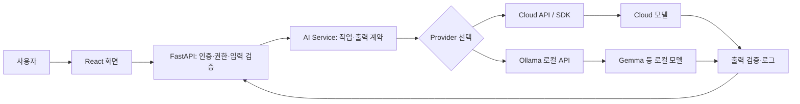

# 04. GPT, Ollama, Gemma

> Phase 1 · AI Service Development
>
> **강의 원칙:** 이 과목은 모델 내부 수학을 깊게 증명하는 과목이 아니라, AI 모델을 **선택하고 실행하고 API로 연결하고 서비스 구조에 배치하는 법**을 배우는 과목이다. Transformer·LLM·Embedding·RAG·Agent·Fine-tuning의 내부 원리는 Phase 2에서 다시 심화한다.

## 전체 학습 흐름

```text
Day 1 — AI와 생성형 AI 생태계
AI의 역사 → AI 전체 지도 → 일반 프로그램 vs AI → ML/DL/생성형 AI
→ Foundation Model → 현대 AI 개발 도구 → OpenAI Cloud API → FastAPI + Structured Output

Day 2 — LLM과 Local Model 실행
Language Model/Token → Tensor/NumPy/PyTorch → Parameter/Training/Inference
→ Hugging Face Hub → Transformers 실행 → Runtime/Serving → Ollama → FastAPI + Ollama

Day 3 — Model 선택과 서비스 통합
Model Family/Gemma → Base vs Instruction → Parameter/Quantization → Hardware
→ Model Card/Selection → LangChain/LlamaIndex 생태계 → Provider 추상화
→ React + FastAPI + Cloud/Local 최종 통합
```

---

# 과목 전체 개요


## 개요

이 강의의 목표는 모델 내부를 직접 구현하는 것이 아니라 **어떤 모델을 어디에서, 어떤 조건으로 실행하고 서비스에 연결할지 설명하는 능력**이다. GPT와 Gemma는 모델 계열이며 Ollama는 로컬 모델을 내려받고 실행·제공하는 소프트웨어다. 이름이 같은 층위의 도구처럼 보이더라도 역할이 다르다.

기술 사실 확인일은 **2026-09-26 (KST)**다. 모델 이름·지원 기능·가격·사용 권한·실행 요구사항은 바뀔 수 있다. 

### 수업 기술 스냅샷(2026-09-26 기준)

이 표는 **원리를 설명하기 위한 영구 지식이 아니라, 현재 실습 환경을 맞추기 위한 시점 정보**다. 이 정보는 계속해서 갱신될 수 있는 정보이다.

| 구분            | 이번 강의의 기준                               | 수업에서 기억할 것                                                      |
| ------------- | --------------------------------------- | --------------------------------------------------------------- |
| OpenAI        | GPT-6 Astra / Sol / Luna, Responses API | 모델명과 API는 바뀔 수 있으므로 설정값으로 분리한다.                                 |
| OpenAI 실습 예시  | `gpt-6-luna`                            | 비용을 고려한 기본 예시이며 프로젝트 요구에 따라 `gpt-6-sol` 또는 `gpt-6-astra`로 교체한다. |
| Google Gemma  | Gemma 4                                 | Model Family와 Variant를 구분한다.                                    |
| Ollama        | `gemma4`, `/api/chat`                   | Ollama는 Model이 아니라 Runtime/Serving 도구다.                         |
| Ollama 호환 API | 일부 OpenAI API 호환                        | 호환된다고 Provider의 품질·기능이 같아지는 것은 아니다.                             |
| Hugging Face  | Hub + Transformers 생태계                  | Repository, Model Card, Library를 구분한다.                          |

Gemma 4는 E2B, E4B, 12B, 26B A4B, 31B 등 여러 Variant가 있고, 로컬 실습에서는 장비를 사전 검증한 뒤 정확한 Ollama 태그를 고른다. 예를 들어 `gemma4:e2b`는 비교적 작은 로컬 실습 후보이지만, **모든 교육생 PC에서 무조건 실행된다는 뜻은 아니다.**

## 학습 목표

1. 일반 프로그램, 학습된 모델, 생성형 AI 애플리케이션을 구분한다.
2. Model, Model Family, Provider, API, SDK, Runtime, Serving의 관계를 설명한다.
3. Cloud API와 Local 실행, 공개 가중치와 비공개 모델의 선택 기준을 말한다.
4. Model Repository와 Model Card에서 사용 조건·한계·평가 정보를 찾는다.
5. 파라미터 수, 양자화, RAM/VRAM, 지연 시간의 관계를 과장 없이 설명한다.
6. 프로젝트 요구사항에서 출발해 모델 후보를 검증하는 절차를 만든다.

## Why — 모델 이름을 아는 것만으로는 서비스가 되지 않는다

“한국어 상담 문서를 요약하자”는 요구에 모델 이름 하나만 적으면 결정이 끝나지 않는다. 문서가 외부로 전송되어도 되는지, 이용자의 권한으로 읽은 문서인지, 응답이 몇 초 안에 와야 하는지, 비용과 장애를 누가 책임지는지까지 정해야 한다. 같은 모델 계열에도 서로 다른 크기·기능·배포 방식의 모델이 있다.

## Concept

### 1. 일반 프로그램, ML 모델, 생성형 AI

| 구분 | 규칙 또는 결과가 만들어지는 방식 | 예 |
|---|---|---|
| 일반 프로그램 | 개발자가 명시한 규칙을 실행 | `age >= 19`이면 성인으로 분류 |
| ML 모델 | 데이터에서 조정된 파라미터로 새 입력을 예측 | 고객 이탈 가능성 추정 |
| 생성형 AI 모델 | 학습된 패턴과 현재 입력을 바탕으로 새 내용을 생성 | 상담 기록의 요약 초안 |

실제 서비스는 셋을 함께 쓴다. 로그인·권한·금액 계산은 일반 코드가 책임지고, 모델은 의미 해석이나 초안 생성을 맡는다. **모델도 프로그램을 통해 실행된다.** ‘AI이므로 규칙이 전혀 없다’는 뜻이 아니다.

텍스트 지시로 새 이미지를 만드는 작업도 생성형 AI의 예다. PDF 요약 서비스라면 일반 코드가 파일 업로드·PDF Parsing/OCR·권한·출력 검증을 담당하고, 추출한 내용을 모델이 요약한 뒤 화면에 전달한다.

**Training**은 모델 파라미터를 데이터와 학습 절차로 조정하는 과정이다. **Inference(추론)**는 이미 준비된 모델에 새 입력을 주어 출력을 얻는 과정이다. 사용자가 요약을 요청할 때마다 모델을 처음부터 학습시키는 것은 아니다. 추론 중에도 애플리케이션의 데이터 조회·검증·기록은 별도로 작동한다.

### 2. 혼동하기 쉬운 이름의 계층

| 이름 | 뜻 | 확인 질문 |
|---|---|---|
| Model | 특정 가중치와 설정의 실행 대상 | 정확한 ID·버전·입출력은? |
| Model Family | 관련 모델들의 계열 | 같은 계열의 크기·용도별 변형인가? |
| Provider | 애플리케이션에 AI 기능을 제공하는 대상 | 외부 서비스인가, 자체 서버인가? |
| API | 서비스와 주고받는 요청·응답 계약 | 어떤 경로·입력·오류를 다루는가? |
| SDK | API 호출을 돕는 라이브러리 | 어떤 언어·버전에서 쓰는가? |
| Runtime | 모델 가중치를 메모리에 올리고 추론하는 실행 환경 | 모델 형식·장비를 지원하는가? |
| Serving | 여러 요청을 안정적으로 받도록 런타임을 운영하는 일 | 동시 요청, 대기열, 시간 제한, 로그는? |

OpenAI SDK는 **모델 자체가 아니고** Cloud API를 호출하는 도구다. Ollama도 모델 자체가 아니라 로컬 모델을 실행하고 API로 제공하는 런타임·서빙 도구다. Gemma는 Ollama에서 실행할 수 있는 모델 계열의 한 예다. Provider를 공통 인터페이스로 감싸더라도 성능·출력·제약이 같아지지는 않는다.

Serving에서는 모델을 한 번 불러오는 것보다 **여러 사용자의 요청을 받는 일**이 중요하다. 모델 로딩, 동시 요청·대기열, 시간 초과, 메모리 관리, 장애 응답, 로그가 운영 항목이다. 요청을 묶는 batching이나 GPU 배정은 사용하는 런타임에 따라 가능 범위가 다르다. 따라서 “로컬에서 한 번 답했다”와 “서비스 트래픽을 감당한다”는 별도로 검증한다.

소스에서 조정할 수 있다는 말이 모두 `generate()`의 옵션이라는 뜻은 아니다. `temperature`·출력 길이는 생성 설정, Tokenizer 전처리·`dtype`·Device는 입력과 모델 준비, Tensor·내부 Layer 관찰과 Parameter 학습은 별도 API·학습 코드의 영역이다.

### 3. Language Model을 사용한다는 뜻

텍스트 모델은 입력을 토큰 단위로 처리하고 출력을 생성한다. 토큰은 항상 단어 하나와 같지 않다. **Context**는 이번 요청에서 모델에 전달된 입력과 그 밖의 관련 내용의 범위다. 모델의 파라미터에 담긴 학습 결과, 지금 전달한 Context, 외부 데이터베이스의 최신 값은 각각 다르다. 모델이 답을 자연스럽게 쓴다고 해서 회사 데이터나 오늘의 사실을 자동으로 안다는 뜻은 아니다.

모델이 사용자 지시를 따르도록 조정된 변형과 일반 사전학습 변형은 사용 목적이 다를 수 있다. 세부 Transformer 구조, 학습 손실, 디코딩 수학은 Phase 2의 LLM 과목에서 다룬다. 여기서는 **모델 카드의 용도와 실제 출력 검사**가 우선이다.

### 4. Cloud·Local과 가중치 공개 범위

| 선택 | 얻는 것 | 확인할 것 |
|---|---|---|
| Cloud API | 서버 운영 부담을 외부 서비스에 맡기고 API로 사용 | 전송 데이터, 접근 권한, 사용료, 가용성, 데이터 처리 조건 |
| Local / 자체 운영 | 실행 환경과 데이터 경로를 직접 통제 가능 | 모델 라이선스, 장비, 설치, 패치, 성능, 운영 책임 |
| Open-weight | 가중치를 내려받을 수 있는 배포 형태 | 라이선스·사용 조건, 코드/데이터 공개 범위, 실행 형식 |
| Closed | 가중치가 제공되지 않는 형태 | API 접근과 제공 조건, 이식 가능성 |

`open-weight`는 **모든 코드·학습 데이터·권리가 공개됐다는 보증이 아니다**. `local`도 자동으로 안전하거나 무료인 선택은 아니다. 반대로 Cloud를 쓴다고 반드시 데이터 처리가 부적절하다는 뜻도 아니다. 전송 내용과 계약·정책을 확인하고 위험을 판단한다.

### 5. Model Repository와 Model Card 읽기

Hugging Face Hub 같은 Model Repository는 모델 파일과 설명을 배포한다. Model Card는 저장소의 `README.md`와 메타데이터로 나타나며, 작성자가 제공한 정보의 양과 형식은 모델마다 다르다.

1. **정확한 모델 ID·계열·변형·revision:** 이름이 비슷해도 크기, 지시 수행 여부, 모달리티가 다를 수 있다.
2. **Intended use·입출력·언어:** 내 작업과 한국어 입력에 맞는지 확인한다.
3. **License·접근 제한:** 다운로드 가능 여부와 상업·재배포 조건을 확인한다.
4. **Limitations·unsupported use:** 제작자가 밝힌 실패, 편향, 안전 제한을 읽는다. 빈 항목은 안전하다는 뜻이 아니다.
5. **Evaluation:** 어떤 데이터, 지표, 하드웨어, 조건에서 얻은 점수인지 본다. 다른 벤치마크의 숫자만 나란히 놓고 우열을 단정하지 않는다.
6. **실행 정보:** 필요한 라이브러리·모델 형식·메모리와 추론 예제를 확인한다.

Model Card의 평가는 **후보 선별 근거**다. 최종 선택은 우리 서비스의 실제 입력과 실패 기준으로 다시 평가한다. 다운로드 수나 좋아요 수는 품질 점수가 아니다. 가중치 파일을 바꿀 때도 파라미터 개수만 같아서는 호환을 보장할 수 없다. 모델 구조·설정·토크나이저가 맞아야 한다. `.safetensors`는 가중치 Tensor를 저장하는 형식이며, 파일 확장자나 파라미터 수만으로 다른 Checkpoint에 끼울 수 있는지는 결정되지 않는다.

Hugging Face의 `AutoModel` 계열은 Model Config를 바탕으로 맞는 Class를 선택한다. `AutoModelFor...`는 언어 생성·분류처럼 Task에 맞는 출력 Head가 있는 Class를 고르는 계열이므로, 모델 용도와 지원 여부를 확인해야 한다. 내부 로딩 코드는 Study에서 다룬다.

### 6. Ollama와 Gemma 사례

Ollama는 모델을 로컬에서 실행하고 HTTP API로 노출한다. 애플리케이션은 `model`과 `messages`를 포함한 채팅 요청을 보낼 수 있다. 공식 API 문서의 `/api/chat`은 기본적으로 스트리밍하므로 **단일 응답 형식을 기대하는 클라이언트라면 `stream: false`를 명시**한다. 이는 요청 형식 설명이며 이 수업 컴퓨터에서 실제로 실행됐다는 뜻은 아니다.

Gemma는 Google의 모델 계열이다. **2026-09-26 공식 릴리스 기준 Gemma 4**가 공개되어 있고 E2B, E4B, 12B, 26B A4B, 31B처럼 변형이 구분된다. 한 계열의 모든 변형이 같은 모달리티·속도·메모리 요구를 갖는다고 가정하지 않는다. 로컬 수업에서는 `gemma4:e2b` 같은 **정확한 Ollama 태그와 모델 digest**, 실제 장비를 확인한 뒤 선택한다.

OpenAI의 **2026-09-26 공식 모델 카탈로그**에서는 GPT-6 Family를 최신 대표 모델군으로 안내한다. `gpt-6-astra`는 가장 높은 Capability가 필요한 복잡한 작업, `gpt-6-sol`은 높은 추론 성능과 비용의 균형, `gpt-6-luna`는 비용 민감·대량 처리 용도로 구분할 수 있다. GPT-5.6 Family도 계속 제공되지만 이 강의의 최신 사례는 GPT-6 Family를 우선 사용한다. 기본 Cloud 실습 예시는 비용을 고려해 `gpt-6-luna`를 사용하고, 복잡한 비교 실습에서는 `gpt-6-sol` 또는 `gpt-6-astra`를 선택할 수 있다. 모델 ID는 코드에 흩어 쓰지 말고 환경변수나 설정값으로 분리한다. 현재 OpenAI의 기본 개발 흐름은 **Responses API**를 사용한다.

> **모델별 API 설정은 동일하지 않다.** 예를 들어 GPT-6 Astra는 `reasoning.effort`를 지원하지만 custom `temperature` / `top_p` 조절은 지원하지 않는다. LLM 과목에서 배우는 Temperature·Top-p는 생성 원리를 이해하기 위한 개념이며, 실제 API에서 노출되는 설정은 Model별 공식 문서를 확인한다.

**Model Capability**는 크기와 별개로 확인한다. 텍스트 생성, 지시 수행, 한국어·다국어, 코드, 복합 추론, 이미지·음성 입출력이 프로젝트에 실제 필요한지 적는다. 같은 Family의 변형이라도 지원 모달리티와 성능은 다를 수 있으며 “multilingual” 표시만으로 한국어 품질을 보장할 수 없다. 모델 카드와 공식 문서의 지원 범위를 확인하고 우리 입력으로 평가한다.

### 7. 파라미터, 양자화, 장비

**Parameter**는 학습 중 조정된 수치다. `4B`는 대략 40억 개 규모의 파라미터 표기이며 파일 크기 4GB를 뜻하지 않는다. 가중치만 단순 계산하면 `파라미터 수 × 표현 비트 / 8`이지만 실제 실행에는 토크나이저, 런타임, 중간 결과, KV cache, 동시 요청 등이 더 필요하다. 파일 크기만 보고 실행 가능 여부를 확정할 수 없다.

**Quantization(양자화)**은 수치를 더 적은 비트로 표현하여 저장·메모리·연산 요구를 줄이는 방법이다. 보통 파라미터의 **개수를 줄이는 것과 다르다**. 형식과 구현에 따라 품질·속도 영향이 달라진다. `4-bit`라고 해서 전체 프로세스 메모리가 정확히 4분의 1이 되지 않는다.

Storage는 파일을 보관하고 RAM은 실행 중 데이터를 담는다. GPU는 병렬 계산을 맡고 VRAM은 GPU가 사용하는 메모리다. CPU만으로도 가능한 모델이 있지만 속도와 사용 경험이 달라질 수 있다. Apple Silicon처럼 메모리 구조가 다른 장비도 있다. GPU·VRAM 숫자만으로 성공을 보증하지 않는다. **모델 변형, 양자화, Context 길이, 동시 사용자 수**를 함께 확인한다. 작은 모델을 뜻하는 `sLLM`에는 보편적으로 합의된 파라미터 경계가 없다. 같은 Task라면 작은 모델이 장비·비용에서 유리할 수 있지만, 실제 품질·지연·메모리는 Quantization, Context, Runtime과 함께 측정해야 한다. 크기가 작다고 언제나 더 빠르거나 충분히 정확한 것은 아니다.

### 8. 모델 선택은 요구사항에서 시작한다

한국어 내부 문서 요약 서비스라면 다음 순서로 결정한다.

1. 작업과 실패 비용을 쓴다: 사실 오류가 허용되는 초안인가, 사람이 확인할 최종 답변인가?
2. 데이터 경계를 정한다: 외부 전송 허용 여부, 개인정보, 접근 권한, 보존 조건은?
3. 후보를 뽑는다: Cloud/Local, 입력 모달리티, 한국어 능력, 라이선스, 장비, 예상 비용을 확인한다.
4. Model Card와 공식 API 문서를 읽는다: 용도·한계·모델 ID·입출력 계약을 기록한다.
5. 대표 사례와 실패 사례로 시험한다: 정확성, 근거, 구조 준수, 지연, 메모리, 운영 비용을 측정한다.
6. 선택·배제 이유와 버전을 남긴다: 모델을 교체하면 프롬프트와 평가를 다시 실행한다.

모델 버전 교체는 단순 문자열 교체가 아니다. 출력 스타일, 정확성, 지연, 메모리, 안전 동작, 프롬프트 호환성이 달라질 수 있다.

## Architecture



FastAPI가 모델 가중치를 직접 계산하는 구조인지, 외부 Provider에 요청하는 구조인지는 구현마다 다르다. 이 그림에서는 **애플리케이션의 비즈니스·권한 판단은 서버가 책임**지고 모델 실행 위치를 분리했다.

## Environment

| 환경 | 수업에서 먼저 확인할 것 | 확정 위치 |
|---|---|---|
| Cloud | 계정 권한, API 키, 모델 접근, 데이터 전송 정책, 비용 한도 | 실습별 환경 명세 |
| Local | Ollama 버전, 모델 태그·digest, RAM/VRAM, OS, 네트워크 없이 실행할 범위 | 실습별 환경 명세 |
| 공통 | Python/SDK/서버 버전, 요청 시간 제한, 로깅, 테스트 데이터 | 실습별 기술환경 검증기록 |

공식 최신 버전은 **설치 성공 버전과 다르다**. 강의용 명령은 검증된 실습 파일을 따른다.

## Implementation — 구현 전에 정할 계약

클라이언트는 `message`를 보내고 서버는 인증·입력 길이·허용 Provider를 검사한 후 모델에 요청한다. 응답은 `answer`, `provider`, `model`, `request_id` 같은 필드로 정리할 수 있다. **필드 이름은 설계 예시**이며 확정 API 계약은 실습에서 정의한다. 빈 입력, 모델 없음, 시간 초과, Provider 장애는 각각 구분해 사용자에게 안전한 오류를 보낸다. Cloud 키는 브라우저에 넣지 않는다.

## Practice — 종이 설계와 확인 질문

**활동 A.** `age >= 19`, 고객 이탈 예측, 상담 문서 요약을 각각 일반 규칙·예측 모델·생성형 모델로 분류하고 이유를 적는다. 답: 규칙의 작성 주체와 출력 종류가 다르다.

**활동 B.** “외부 전송 금지, 16GB RAM 노트북, 한국어 요약, 응답 10초 이내”라는 조건에서 후보 모델을 바로 확정할 수 있는가? 답: 아니다. 후보의 모델 카드, 라이선스, 정확한 태그, 양자화, Context, 실제 지연·메모리를 확인해야 한다. 요구가 충돌하면 제약을 다시 협의한다.

**활동 C.** 모델 카드 A의 90점과 B의 85점만 보였다. 무엇을 더 확인할까? 평가 데이터·언어·지표·측정 조건, 우리 데이터의 오류율과 한계를 확인한다.

**활동 D.** 로컬 API 응답을 한 개의 JSON 객체로 읽는 코드가 스트리밍 조각을 받는다. Ollama 채팅 요청의 `stream` 설정과 클라이언트 파서를 대조한다.

## Best Practice

- 모델 이름 대신 **정확한 ID·버전·revision·태그·digest**를 기록한다.
- Provider마다 같은 테스트 입력을 사용하되, 출력 계약과 오류는 애플리케이션에서 검증한다.
- 모델 카드의 Limitations와 서비스의 실제 실패 사례를 함께 보관한다.
- 새 모델이나 새 양자화 파일은 작은 평가 세트로 재검증하고 나서 교체한다.

## Project Connection

React의 AI Chat UI는 FastAPI에만 요청한다. FastAPI는 Cloud SDK 또는 Ollama API로 분기할 수 있다. 사용자에게는 응답과 오류를 일관되게 보여주되, Provider별 속도·품질이 같다고 약속하지 않는다. 이 과목 이후의 **생성형 AI 활용**은 어떤 문제에 모델을 쓸지, **생성형 AI 보안**은 데이터와 도구 실행을 어떻게 통제할지 다룬다. RAG·Agent·Fine-tuning의 내부 원리는 Phase 2에서 심화한다.

## Summary

> Model은 실행 대상, Model Family는 계열, Provider는 제공 주체, API는 계약, SDK는 호출 도구, Runtime은 추론 환경, Serving은 이를 운영하는 일이다. 모델 선택은 유행보다 요구사항·데이터 경계·검증 결과에 따라 결정한다.

## 실무 팁

한 줄 선택 기록을 남긴다: `작업 / 데이터 등급 / 모델 ID·버전 / Provider / 라이선스·약관 / 장비 / 대표 평가 / 선택 이유 / 재검증일`. 이 기록이 없으면 모델 교체 후 품질 변화를 설명하기 어렵다.

## 주의사항

- 자연스러운 응답은 사실성의 증거가 아니다. 평가와 출력 검증은 다음 강의에서 이어진다.
- 공개 가중치, 로컬 실행, 무료 사용을 같은 뜻으로 쓰지 않는다.
- 파라미터 수와 벤치마크 점수만으로 우리 서비스의 품질·속도를 예측하지 않는다.
- 실제 실행 가능 여부와 환경 pin은 수업 전 실습 환경에서 반드시 검증한다.

## 참고자료

- [OpenAI Models](https://platform.openai.com/docs/models), [OpenAI Developer Quickstart](https://platform.openai.com/docs/quickstart/make-your-first-api-request) — 2026-09-26 확인
- [Ollama API 소개](https://docs.ollama.com/api/introduction), [Chat API](https://docs.ollama.com/api/chat) — 2026-09-26 확인
- [Google Gemma 릴리스](https://ai.google.dev/gemma/docs/releases), [Gemma 4 Model Card](https://ai.google.dev/gemma/docs/core/model_card_4) — 2026-09-26 확인
- [Hugging Face Model Cards](https://huggingface.co/docs/hub/model-cards) — 2026-09-26 확인
- [Hugging Face Auto Classes](https://huggingface.co/docs/transformers/model_doc/auto), [Safetensors](https://huggingface.co/docs/safetensors/index) — 2026-09-26 확인; Class 선택과 Tensor 저장 형식의 원문

## 관련 Wiki Link

[[GPT]] · [[Ollama]] · [[Gemma]] · [[생성형 AI 활용]] · [[생성형 AI 보안]]


---

# 상세 강의안 — Day 1


---

# Day 1 - 1교시. AI의 탄생과 역사

## 개요

이번 교시는 특정 제품인 GPT를 배우기 전에, **AI라는 분야가 왜 등장했고 어떤 문제를 해결하려고 발전해 왔는지** 큰 흐름을 이해하는 시간입니다.

AI의 역사를 연도 암기식으로 배우지 않습니다. 각 시대의 핵심 질문이 어떻게 바뀌었는지를 중심으로 살펴봅니다.

```text
사람의 지능을 기계로 만들 수 있을까?
        ↓
사람의 지식과 규칙을 기계에 넣으면 될까?
        ↓
기계가 데이터에서 규칙을 학습하면 어떨까?
        ↓
신경망이 복잡한 표현까지 학습하면 어떨까?
        ↓
학습한 모델이 새로운 콘텐츠까지 생성할 수 있을까?
```

> **이번 교시의 핵심 질문**
>
> 오늘날의 생성형 AI는 갑자기 등장한 기술일까요?

---

# 1. 학습 목표

이번 교시가 끝나면 학생은 다음 내용을 자신의 말로 설명할 수 있어야 합니다.

1. Artificial Intelligence라는 연구 분야가 어떤 문제의식에서 출발했는지 설명할 수 있다.
2. 초기 Symbolic AI와 현대 Machine Learning 접근의 큰 차이를 설명할 수 있다.
3. AI 발전 과정에서 AI Winter가 발생한 이유를 개략적으로 설명할 수 있다.
4. Machine Learning과 Deep Learning의 발전이 현대 AI에 어떤 변화를 만들었는지 설명할 수 있다.
5. Transformer와 생성형 AI의 등장이 전체 AI 역사에서 어떤 위치에 있는지 설명할 수 있다.
6. ChatGPT와 같은 서비스가 AI 전체와 동일한 개념이 아님을 설명할 수 있다.

---

# 2. 왜 AI의 역사부터 배우는가?

현재 AI를 처음 접하는 사람은 흔히 다음과 같이 생각하기 쉽습니다.

```text
AI = ChatGPT
```

하지만 ChatGPT와 생성형 AI는 긴 AI 발전 과정의 최근 결과 중 하나입니다.

AI의 역사를 먼저 보면 다음 질문에 답하기 쉬워집니다.

- 왜 과거에는 사람이 규칙을 직접 입력했을까?
- 왜 Machine Learning이 필요해졌을까?
- 왜 데이터와 GPU가 중요해졌을까?
- 왜 최근에는 Model이라는 말을 자주 사용할까?
- 왜 생성형 AI는 기존 AI와 다른 경험을 제공할까?

따라서 이번 교시의 목적은 역사 자체를 외우는 것이 아니라 **AI를 만드는 방법이 어떻게 변해왔는지 이해하는 것**입니다.

---

# 3. AI 이전에도 컴퓨터는 똑똑했을까?

컴퓨터는 매우 빠르게 계산할 수 있습니다.

예를 들어 다음 코드는 명확한 규칙을 실행합니다.

```python
score = 75

if score >= 60:
    print("PASS")
else:
    print("FAIL")
```

여기서 컴퓨터가 스스로 합격 기준을 알아낸 것은 아닙니다.

```text
개발자
↓
규칙 작성
↓
프로그램
↓
입력
↓
규칙 실행
↓
출력
```

즉, 전통적인 프로그램에서는 **어떻게 판단할지를 사람이 코드로 작성**합니다.

그렇다면 이런 질문이 생깁니다.

> 사람처럼 판단하거나 문제를 해결하는 능력도 프로그램으로 만들 수 있을까?

이 질문이 AI 연구의 중요한 출발점 중 하나입니다.

---

# 4. 1950년 - "기계가 생각할 수 있는가?"

1950년 Alan Turing은 논문 *Computing Machinery and Intelligence*에서 기계 지능에 관한 중요한 문제를 제기했습니다.

유명한 출발 질문은 다음과 같습니다.

> **Can machines think?**

Turing은 단순히 철학적 정의를 반복하기보다, 기계의 행동을 대화를 통해 평가하는 접근을 논의했습니다. 이후 흔히 **Turing Test**라고 불리는 아이디어와 연결됩니다.

### 강의 포인트

여기서 학생들에게 중요한 것은 "Turing Test를 통과하면 진짜 인간처럼 생각한다"고 단정하는 것이 아닙니다.

핵심은 다음입니다.

```text
컴퓨터를
단순 계산 기계로만 볼 것인가?

아니면
지능적인 행동을 수행할 수 있는 기계로 볼 수 있는가?
```

AI 연구가 다루게 될 질문이 본격적으로 등장하기 시작합니다.

---

# 5. 1956년 - Artificial Intelligence라는 연구 분야

1956년 Dartmouth Summer Research Project on Artificial Intelligence는 AI 역사에서 중요한 사건으로 다뤄집니다.

John McCarthy를 비롯한 연구자들이 참여했고, **Artificial Intelligence**라는 표현이 연구 분야의 이름으로 자리 잡는 데 중요한 계기가 되었습니다.

당시 연구자들은 인간의 학습과 지능의 여러 측면을 기계로 기술하고 구현할 수 있다는 매우 큰 기대를 가지고 있었습니다.

```text
인간의 추론
문제 해결
언어
학습

↓

기계로 구현할 수 있을까?
```

이때부터 AI는 하나의 장기적인 연구 분야로 발전하기 시작합니다.

---

# 6. 초기 AI - 사람이 지식을 규칙으로 넣는다

초기 AI의 중요한 접근 중 하나는 **Symbolic AI**입니다.

사람이 알고 있는 지식과 논리를 Symbol과 Rule로 표현하고, 컴퓨터가 이를 이용해 추론하도록 만드는 방식입니다.

예를 들어 아주 단순화하면 다음과 같습니다.

```text
IF 체온 > 38
AND 기침 = TRUE
THEN 감염 가능성 확인
```

구조적으로 보면 다음과 같습니다.

```text
사람의 지식
↓
Rule
↓
Knowledge Base
↓
Inference
↓
결과
```

### 장점

규칙이 명확한 영역에서는 판단 과정을 사람이 이해하기 쉽습니다.

### 어려움

현실 세계의 모든 상황을 사람이 규칙으로 작성하기는 어렵습니다.

예를 들어 고양이 사진을 판별한다고 생각해봅시다.

```text
귀가 삼각형이면 고양이?
수염이 있으면 고양이?
털이 있으면 고양이?
눈이 두 개면 고양이?
```

개별 규칙만으로 현실의 모든 고양이를 표현하기는 어렵습니다.

여기서 AI 발전의 중요한 문제가 나타납니다.

> **사람이 모든 규칙을 작성하지 않고 컴퓨터가 데이터에서 패턴을 찾게 할 수 없을까?**

---

# 7. Expert System의 시대

1970~1980년대에는 특정 전문 분야의 지식을 규칙으로 구성한 **Expert System**이 큰 관심을 받았습니다.

개념적으로는 다음과 같습니다.

```text
전문가의 지식
↓
Knowledge Base
+
Inference Engine
↓
질문에 대한 판단
```

의료, 화학, 장비 설정 등 제한된 전문 영역에서 연구와 실제 활용이 이루어졌습니다.

하지만 문제가 있었습니다.

### Knowledge Acquisition Bottleneck

전문가가 알고 있는 수많은 지식을 규칙으로 추출하고 지속적으로 관리하는 일이 어렵습니다.

```text
현실 변화
↓
새로운 규칙 필요
↓
전문가 확인
↓
개발자 수정
↓
규칙 증가
↓
관리 복잡도 증가
```

이 문제는 현대 개발에서도 생각해볼 가치가 있습니다.

> 모든 판단 규칙을 사람이 코드로 관리할 수 있는가?

---

# 8. AI Winter - AI는 계속 성공하기만 했을까?

아닙니다.

AI 역사에는 기대가 크게 높아졌다가 연구 투자와 관심이 감소한 시기가 있었으며 이를 흔히 **AI Winter**라고 부릅니다.

원인은 한 가지가 아닙니다.

당시의 높은 기대에 비해 실제 시스템의 능력이 제한적이었고, 컴퓨팅 자원과 데이터, 알고리즘 등의 제약도 컸습니다.

```text
높은 기대
↓
기술적 한계
↓
기대만큼 성과가 나오지 않음
↓
투자와 관심 감소
```

### 강의 포인트

AI 역사는 다음과 같은 직선이 아닙니다.

```text
AI 탄생
↓
계속 발전
↓
ChatGPT
```

실제로는

```text
기대
↗
성과
↘
침체
↗
새로운 기술
↗
다시 기대
```

가 반복되어 왔습니다.

이 관점은 현재 AI 기술을 볼 때도 중요합니다.

---

# 9. Machine Learning - 규칙을 직접 작성하지 않는 방향

AI의 중요한 발전 방향 중 하나는 Machine Learning입니다.

전통적인 프로그램을 단순화하면:

```text
Data + Rules
↓
Program
↓
Answer
```

Machine Learning은 관점을 바꿉니다.

```text
Data + 정답/목표 또는 학습 신호
↓
Learning Algorithm
↓
Model
```

그리고 만들어진 Model을 사용합니다.

```text
새로운 Data
↓
Model
↓
Prediction
```

예를 들어 스팸 메일을 판별한다고 생각해봅시다.

### Rule 방식

사람이 직접 작성합니다.

```text
"무료"가 있으면 +1
"당첨"이 있으면 +2
URL이 많으면 +1
...
```

### Machine Learning 방식

```text
많은 이메일 데이터
+
Spam / Normal Label
↓
학습
↓
Model
↓
새 이메일 분류
```

중요한 변화는 다음입니다.

> **판단 규칙의 일부를 사람이 일일이 작성하는 대신 데이터와 학습 과정으로 Model을 만든다.**

Machine Learning의 세부 유형과 학습 알고리즘은 이후 AI 과정에서 자세히 학습합니다.

관련 Wiki Link: [[머신러닝(Machine Learning)]]

---

# 10. Deep Learning - 표현도 학습한다

Machine Learning에서도 오랫동안 사람이 어떤 Feature를 사용할지 설계하는 일이 중요했습니다.

예를 들어 이미지 판별이라면:

```text
Edge
Shape
Color
Texture
```

같은 특징을 어떻게 표현할지 고민해야 했습니다.

Deep Learning은 여러 층의 Neural Network를 이용하여 데이터에서 유용한 표현을 학습할 수 있게 하면서 이미지, 음성, 자연어 등 다양한 분야의 발전에 크게 기여했습니다.

단순화하면:

```text
Data
↓
Neural Network
↓
여러 단계의 Representation 학습
↓
Output
```

여기서 중요한 것은 Neural Network 내부 수학을 배우는 것이 아닙니다.

이번 교시에서는 다음만 기억합니다.

> **Deep Learning은 현대 AI 발전의 핵심 기반 기술 중 하나이다.**

관련 Wiki Link: [[딥러닝(Deep Learning)]] [[신경망(Neural Network)]]

---

# 11. 2012년 이후 - Deep Learning의 큰 도약

2012년 ImageNet 이미지 분류 대회에서 AlexNet이 뛰어난 성능을 보이며 Deep Learning, 특히 GPU를 활용한 대규모 Neural Network 학습의 가능성을 강하게 보여주었습니다.

이후 이미지 인식뿐 아니라 음성 인식, 자연어 처리 등 다양한 영역에서 Deep Learning이 빠르게 확산됩니다.

여기에는 여러 조건이 함께 작용했습니다.

```text
더 많은 Data
+
더 강력한 Computing 자원
+
GPU 활용
+
Neural Network 연구 발전
+
학습 기법과 Software 생태계 발전
```

즉, AI 발전은 알고리즘 하나만으로 설명할 수 없습니다.

### 실무 팁

현대 AI를 이해할 때 항상 다음 네 요소를 같이 보세요.

```text
Algorithm
Data
Compute
Software / Infrastructure
```

모델 성능과 AI 산업의 변화는 이 요소들이 함께 발전한 결과인 경우가 많습니다.

---

# 12. 자연어 처리의 발전

컴퓨터가 사람의 언어를 다루는 분야를 Natural Language Processing, 즉 NLP라고 합니다.

과거에도 다양한 언어 처리 기술이 존재했습니다.

```text
Rule 기반 언어 처리
↓
통계적 언어 모델
↓
Machine Learning
↓
Neural Network 기반 NLP
↓
RNN / LSTM 등
↓
Transformer
↓
대규모 언어 모델
```

여기서 RNN과 LSTM의 구조를 배우지는 않습니다.

중요한 것은 다음 질문입니다.

> **긴 문맥과 단어 사이의 관계를 더 효과적으로 처리할 방법은 없을까?**

이 흐름에서 Transformer가 중요한 전환점으로 등장합니다.

---

# 13. 2017년 - Transformer

2017년 논문 *Attention Is All You Need*에서 Transformer Architecture가 제안되었습니다.

Transformer는 이후 자연어 처리 발전에 매우 큰 영향을 주었고, 현대의 많은 LLM의 기반 Architecture가 되었습니다.

이번 과정에서는 내부 구조를 학습하지 않습니다.

```text
Transformer
│
├── Attention
├── 여러 Layer
└── 다양한 내부 구조
```

이것은 Phase 2의 [[트랜스포머(Transformer)]] 과정에서 자세히 배웁니다.

이번에는 다음 관계만 기억합니다.

```text
Deep Learning
↓
Transformer의 등장과 발전
↓
대규모 사전학습 언어 모델 발전
↓
현대 LLM / 생성형 AI 발전
```

> **주의사항**
>
> 모든 AI가 Transformer인 것은 아닙니다. Transformer는 현대 AI, 특히 LLM과 여러 Multimodal Model에서 매우 중요한 Architecture이지만 AI 전체와 동일한 개념은 아닙니다.

---

# 14. 2018년 이후 - GPT와 대규모 사전학습 모델

GPT는 **Generative Pre-trained Transformer**의 약자입니다.

이름 안에 중요한 개념이 들어 있습니다.

```text
Generative
→ 생성

Pre-trained
→ 대규모 데이터로 사전 학습

Transformer
→ 기반 Architecture
```

2018년 첫 GPT 연구 이후 GPT-2, GPT-3 등 더 큰 언어 모델 연구가 이어졌습니다.

여기서 중요한 변화는 특정 작업 하나만을 위한 모델보다, 대규모 데이터로 먼저 학습한 모델을 다양한 언어 작업에 활용하는 방향이 강해졌다는 점입니다.

```text
대규모 사전학습
↓
범용적인 언어 능력
↓
다양한 Downstream Task에 활용
```

이 흐름은 이후 Foundation Model이라는 개념을 이해하는 데 연결됩니다.

관련 Wiki Link: [[GPT]] [[대규모 언어 모델(LLM)]] [[Foundation Model]]

---

# 15. 2022년 - ChatGPT와 생성형 AI의 대중화

2022년 ChatGPT 공개 이후 일반 사용자도 자연어 대화를 통해 강력한 언어 모델을 쉽게 경험할 수 있게 되면서 생성형 AI가 빠르게 대중화되었습니다.

중요한 것은 ChatGPT가 AI의 시작이 아니라는 점입니다.

```text
수십 년의 AI 연구
↓
Machine Learning
↓
Deep Learning
↓
Transformer
↓
Large Language Model
↓
대화형 AI Application
↓
ChatGPT의 대중화
```

따라서 다음 표현은 정확하지 않습니다.

```text
AI가 2022년에 등장했다.
```

더 적절한 설명은:

> **AI는 오랜 연구 역사를 가지고 있으며, 2022년 이후 생성형 AI 기반 서비스가 일반 사용자에게 폭발적으로 확산되었다.**

입니다.

---

# 16. 생성형 AI 시대

기존 AI의 대표적인 활용은 다음과 같았습니다.

```text
분류
예측
추천
탐지
인식
```

생성형 AI는 새로운 결과물을 생성하는 능력을 전면에 가져왔습니다.

```text
Text
Image
Code
Audio
Speech
Video
```

예를 들어:

```text
질문 → 답변 생성
문서 → 요약 생성
설명 → 이미지 생성
요구사항 → Code 생성
음성 → 다른 형태의 콘텐츠 생성
```

하지만 여기서도 주의해야 합니다.

> **Generative AI가 기존 AI를 모두 대체한 것은 아닙니다.**

추천, 이상 탐지, 수요 예측, 최적화 등에서는 전통적인 Machine Learning과 다양한 AI 기술이 여전히 사용됩니다.

관련 Wiki Link: [[생성형 AI(Generative AI)]]

---

# 17. 현재 AI는 언어만 다루지 않는다

현대 AI는 다양한 Modality를 처리합니다.

```text
Text
Image
Audio
Video
Sensor Data
```

그리고 여러 형태의 정보를 함께 처리하는 Multimodal AI가 빠르게 발전했습니다.

```text
Text + Image
↓
Multimodal Model
↓
설명 / 분석 / 생성
```

예를 들어:

- 이미지에 대해 질문하기
- 문서 화면 분석하기
- 음성과 텍스트를 함께 처리하기
- 이미지와 텍스트를 함께 입력하여 콘텐츠 생성하기

등이 가능합니다.

Multimodal의 내부 원리와 OCR과의 차이는 이후 [[멀티모달(Multimodal)]] 과정에서 자세히 다룹니다.

---

# 18. AI는 이제 '답변'에서 '행동'으로 확장되고 있다

현대 AI Application에서는 모델이 텍스트를 생성하는 것에 그치지 않고 외부 Tool과 연결되기도 합니다.

```text
사용자 요청
↓
AI Application
↓
Model
↓
필요한 Tool 선택
↓
Search / Database / Calendar / API
↓
결과
```

이러한 흐름은 Agent, Tool Calling, AI Automation 같은 기술로 연결됩니다.

하지만 이번 시간에는 내부 구조를 배우지 않습니다.

중요한 것은 AI가 발전하면서 Application의 범위가 다음과 같이 확장되고 있다는 점입니다.

```text
Prediction
↓
Generation
↓
Multimodal Interaction
↓
Tool Use / Automation
```

관련 Wiki Link: [[AI 에이전트(Agent)]] [[Tool Calling]] [[AI Automation]]

---

# 19. AI 발전을 한 장으로 정리하기

정확한 기술 계보는 여러 연구 흐름이 병렬적으로 발전했기 때문에 하나의 직선으로만 표현할 수 없습니다.

다만 입문 단계에서는 큰 변화를 다음처럼 정리할 수 있습니다.

```text
1950s
기계 지능에 대한 질문
        ↓
Symbolic AI / Rule-based approaches
        ↓
Expert Systems
        ↓
AI Winter를 포함한 기대와 침체의 반복
        ↓
Machine Learning의 확대
        ↓
Deep Learning의 발전
        ↓
대규모 Data + GPU + Software 생태계
        ↓
2017 Transformer
        ↓
대규모 Pre-trained Model
        ↓
LLM / Foundation Model
        ↓
Generative AI 대중화
        ↓
Multimodal / Tool Use / Agent / AI Application
```

이 그림에서 가장 중요한 것은 연도가 아닙니다.

**AI를 구현하는 접근이 변해왔다는 것**입니다.

---

# 20. AI 개발 방식의 변화

## 1단계 - 사람이 규칙을 작성

```text
Knowledge
↓
Human
↓
Rule
↓
Program
```

## 2단계 - 데이터에서 패턴을 학습

```text
Data
↓
Learning
↓
Model
↓
Prediction
```

## 3단계 - 대규모 사전학습 모델 활용

```text
Large-scale Pre-training
↓
Foundation / Generative Model
↓
Instruction / Context
↓
다양한 Task
```

그리고 AI Application 개발자는 반드시 Model을 직접 학습할 필요가 없습니다.

```text
AI Application
↓
API / Runtime / Library
↓
Pre-trained Model
```

이 지점이 앞으로 GPT, Ollama, Gemma를 배우는 이유와 연결됩니다.

---

# 21. 앞으로 우리가 배우게 될 것

이번 3일 과정에서 특정 제품만 배우는 것이 목표가 아닙니다.

GPT, Ollama, Gemma는 현대 AI를 이해하고 직접 사용해보기 위한 도구입니다.

```text
AI
↓
Generative AI
↓
Language Model / LLM
↓
AI Model 생태계
↓
Cloud AI / Local AI
↓
AI 개발 Library / Runtime
↓
AI Application
```

앞으로 다음 질문을 하나씩 해결합니다.

```text
AI Model은 무엇인가?

Model은 어떻게 학습되고 어떻게 사용되는가?

Cloud AI와 Local AI는 무엇이 다른가?

PyTorch, Transformers 같은 Library는 왜 필요한가?

Ollama는 Model인가?

Gemma는 무엇인가?

AI를 FastAPI Application에 어떻게 연결하는가?
```

---

# 22. 강사 시연 / 참여 활동

이번 교시는 학생 실습 시간이 아니라 **개념 수업 + 짧은 참여 활동**으로 운영합니다.

## 활동 1. 이것도 AI일까?

다음 기술을 보여주고 학생에게 AI인지 생각하게 합니다.

```text
계산기
스팸 메일 필터
YouTube 추천
얼굴 인식
OCR
ChatGPT
자동 번역
자동차 차선 인식
상품 수요 예측
이미지 생성
```

### 강사 포인트

AI를 Chatbot으로만 생각하지 않도록 합니다.

---

## 활동 2. Rule로 만들 수 있을까?

질문합니다.

> 고양이 사진을 판별하는 프로그램을 `if` 문만으로 작성한다면 어떤 규칙이 필요할까요?

학생들의 규칙을 받아봅니다.

```text
귀 모양
털
수염
눈
꼬리
크기
```

그리고 반례를 제시합니다.

```text
귀가 안 보이는 고양이
털이 없는 고양이
사진 일부만 나온 고양이
장난감 고양이
```

이를 통해 현실 데이터를 Rule로 완전히 표현하기 어려운 문제를 직관적으로 이해시킵니다.

---

## 활동 3. AI 역사에서 가장 중요한 변화는 무엇이었을까?

학생에게 다음 중 하나를 선택하게 합니다.

```text
더 좋은 Algorithm
더 많은 Data
더 빠른 Hardware
더 좋은 Software
```

정답을 하나로 정하지 않습니다.

현대 AI 발전은 여러 요소의 결합이라는 점을 설명합니다.

---

# 23. 자주 발생하는 오해

## 오해 1. AI는 ChatGPT다

아닙니다.

```text
AI
>
Generative AI
>
LLM 기반 기술/서비스
```

이라는 더 큰 관계가 있습니다.

---

## 오해 2. Machine Learning 이전에는 AI가 없었다

아닙니다.

Symbolic AI, Search, Planning, Expert System 등 다양한 AI 연구가 Machine Learning 중심 시대 이전부터 존재했습니다.

---

## 오해 3. Deep Learning = AI

아닙니다.

Deep Learning은 AI를 구현하는 중요한 접근 중 하나입니다.

---

## 오해 4. Transformer = ChatGPT

아닙니다.

Transformer는 Architecture이고, 이를 기반으로 다양한 Model이 만들어질 수 있습니다.

---

## 오해 5. 생성형 AI가 모든 기존 AI를 대체한다

아닙니다.

문제에 따라 전통적인 Algorithm, Machine Learning, Deep Learning, 생성형 AI를 선택하거나 함께 사용할 수 있습니다.

---

# 24. 실무 팁

AI 프로젝트를 시작할 때 가장 먼저 "어떤 LLM을 사용할까?"부터 결정하지 마세요.

먼저 문제를 정의해야 합니다.

```text
우리가 해결할 문제는 무엇인가?
↓
AI가 정말 필요한가?
↓
분류 / 예측 / 검색 / 생성 중 무엇인가?
↓
기존 Algorithm으로 충분한가?
↓
Machine Learning이 필요한가?
↓
Generative AI가 필요한가?
↓
필요한 Model / Library / Architecture 선택
```

AI는 목적이 아니라 문제를 해결하기 위한 기술입니다.

---

# 25. 핵심 요약

이번 교시에서 반드시 기억해야 할 내용입니다.

1. AI는 ChatGPT와 함께 시작된 기술이 아니라 수십 년의 연구 역사를 가진 분야입니다.
2. 초기 AI에서는 사람이 지식과 Rule을 직접 표현하는 Symbolic 접근이 중요했습니다.
3. Machine Learning은 데이터에서 패턴을 학습하여 Model을 만드는 접근을 크게 확산시켰습니다.
4. Deep Learning은 현대 이미지·음성·언어 AI 발전에 중요한 기반이 되었습니다.
5. Data, Compute, Algorithm, Software 생태계의 발전이 현대 AI 발전을 함께 이끌었습니다.
6. Transformer는 현대 LLM 발전의 핵심 Architecture 중 하나입니다.
7. 생성형 AI는 텍스트뿐 아니라 이미지, 음성, 코드 등 다양한 콘텐츠 생성으로 확장되었습니다.
8. 현대 AI Application은 생성뿐 아니라 Multimodal, Tool Use, Automation으로 범위를 넓히고 있습니다.
9. GPT, Ollama, Gemma는 앞으로 AI를 이해하기 위해 사용할 Model/도구 생태계의 일부이며 AI 전체가 아닙니다.

---

# 26. 이해도 확인

학생이 자신의 말로 답하도록 합니다.

1. 전통적인 프로그램과 Machine Learning의 가장 큰 차이는 무엇인가요?
2. Symbolic AI에서는 지식을 주로 어떤 방식으로 표현했나요?
3. AI Winter라는 표현은 무엇을 의미하나요?
4. Deep Learning의 발전에 Algorithm 외에 어떤 요소들이 영향을 주었나요?
5. Transformer가 AI 역사에서 중요한 이유는 무엇인가요?
6. ChatGPT가 AI 전체와 같은 개념이 아닌 이유를 설명해보세요.
7. 생성형 AI 이전에도 AI가 사용되었던 사례를 세 가지 들어보세요.
8. 현대 AI가 `Prediction → Generation → Tool Use`로 확장된다는 말은 어떤 의미인가요?

---

# 27. 다음 교시 연결

이번 시간에는 AI가 **어떻게 여기까지 왔는지** 살펴봤습니다.

하지만 아직 중요한 질문이 남아 있습니다.

```text
그래서 AI란 정확히 무엇인가?

Machine Learning은 AI와 어떤 관계인가?

Deep Learning은 Machine Learning과 무엇이 다른가?

생성형 AI는 이 지도에서 어디에 있는가?
```

다음 교시에서는 AI 기술의 전체 지도를 그리면서 이 관계를 정리합니다.

```text
Day 1 - 1교시
AI의 탄생과 역사
        ↓
Day 1 - 2교시
AI란 무엇인가 - AI 전체 지도
```

---

# 참고자료

강의 자료의 역사적 사실을 검수할 때 우선 확인할 원문/공식·학술 자료입니다.

- Alan M. Turing, *Computing Machinery and Intelligence*, Mind, 1950.
- Dartmouth Summer Research Project on Artificial Intelligence proposal, 1955/1956.
- Alex Krizhevsky, Ilya Sutskever, Geoffrey E. Hinton, *ImageNet Classification with Deep Convolutional Neural Networks*, 2012.
- Ashish Vaswani et al., *Attention Is All You Need*, 2017.
- Alec Radford et al., *Improving Language Understanding by Generative Pre-Training*, 2018.

---

# 관련 Wiki Link

```text
[[인공지능(Artificial Intelligence)]]
[[AI 역사]]
[[Symbolic AI]]
[[Expert System]]
[[머신러닝(Machine Learning)]]
[[딥러닝(Deep Learning)]]
[[신경망(Neural Network)]]
[[트랜스포머(Transformer)]]
[[대규모 언어 모델(LLM)]]
[[생성형 AI(Generative AI)]]
[[Foundation Model]]
[[멀티모달(Multimodal)]]
[[AI 에이전트(Agent)]]
[[AI Automation]]
```

---

# AIKOS 저장 위치 제안

```text
Academy/
└── 00. 교육과정(curriculum)/
    └── 00. Phase1_Theoretical/
        └── 04. GPT, Ollama, Gemma/
            └── Day1/
                └── 01. AI의 탄생과 역사_강의용.md
```


---

# Day 1 - 2교시. AI란 무엇인가 - AI 전체 지도

## 개요

1교시에서는 AI가 어떤 문제의식에서 출발했고, 규칙 기반 접근에서 Machine
Learning, Deep Learning, 생성형 AI로 발전해 온 큰 흐름을 살펴보았습니다.

이번 교시에서는 그 흐름을 하나의 **AI 전체 지도**로 정리합니다.

학생들이 AI를 처음 배울 때 가장 먼저 해결해야 하는 문제 중 하나는 다음
용어들이 서로 어떤 관계인지 구분하는 것입니다.

``` text
AI
Machine Learning
Deep Learning
Generative AI
Language Model
LLM
GPT
ChatGPT
```

이 용어들은 모두 같은 의미가 아닙니다.

이번 교시에서는 특정 제품이나 모델을 중심으로 설명하지 않고, **AI라는 큰
범위 안에서 각각의 기술이 어디에 위치하는지** 이해합니다.

> **이번 교시의 핵심 질문**
>
> AI는 정확히 무엇이며, 우리가 흔히 말하는 Machine Learning, Deep
> Learning, 생성형 AI는 AI와 어떤 관계일까요?

------------------------------------------------------------------------

# 1. 학습 목표

이번 교시가 끝나면 학생은 다음 내용을 자신의 말로 설명할 수 있어야
합니다.

1.  Artificial Intelligence를 특정 제품이 아닌 넓은 기술·연구 분야로
    설명할 수 있다.
2.  AI, Machine Learning, Deep Learning의 관계를 설명할 수 있다.
3.  생성형 AI가 AI 전체에서 어떤 위치에 있는지 설명할 수 있다.
4.  AI가 수행하는 대표적인 작업을 분류, 예측, 추천, 인식, 생성 등의
    관점에서 구분할 수 있다.
5.  AI Model과 AI Application을 구분할 수 있다.
6.  GPT와 ChatGPT가 AI 전체와 동일한 개념이 아닌 이유를 설명할 수 있다.
7.  앞으로 학습할 AI 기술들을 하나의 전체 지도에서 연결할 수 있다.

------------------------------------------------------------------------

# 2. 지난 시간 연결 - AI는 하나의 기술 이름이 아니다

1교시에서 살펴본 AI의 역사를 아주 크게 정리하면 다음과 같습니다.

``` text
인간의 지능적인 행동을
기계로 구현할 수 있을까?
        ↓
규칙과 논리를 직접 표현
        ↓
데이터에서 패턴을 학습
        ↓
신경망을 이용한 복잡한 표현 학습
        ↓
대규모 사전학습 모델
        ↓
새로운 콘텐츠를 생성하는 AI
```

여기서 중요한 사실이 있습니다.

AI는 특정한 하나의 알고리즘이나 하나의 프로그램 이름이 아닙니다.

AI라는 큰 분야 안에서 여러 접근 방법과 기술이 발전해 왔습니다.

따라서 다음 식으로 이해하면 안 됩니다.

``` text
AI = ChatGPT
AI = GPT
AI = Deep Learning
```

이들은 서로 관련되어 있지만 범위가 다릅니다.

------------------------------------------------------------------------

# 3. Artificial Intelligence란 무엇인가?

Artificial Intelligence, 즉 AI는 일반적으로 **기계가 학습, 추론, 문제
해결, 인식, 언어 처리 등 지능과 관련된 작업을 수행하도록 만드는 기술과
연구 분야**를 가리키는 넓은 개념입니다.

여기서 중요한 단어는 **넓은 개념**입니다.

AI에는 여러 종류의 문제와 접근 방식이 포함됩니다.

``` text
Artificial Intelligence
│
├── 지식 표현과 추론
├── 탐색과 계획
├── Machine Learning
├── Computer Vision
├── Natural Language Processing
├── Robotics
└── Generative AI와 현대 Foundation Model 활용
```

이 그림에서 알 수 있듯이 AI 전체를 Machine Learning 하나로만 설명할 수도
없고, 생성형 AI 하나로만 설명할 수도 없습니다.

------------------------------------------------------------------------

# 4. AI를 결과의 관점에서 바라보기

학생들에게 AI를 처음 설명할 때는 알고리즘 이름보다 **AI가 어떤 일을
하는가**를 먼저 보는 것이 이해하기 쉽습니다.

AI는 실제 서비스에서 다양한 작업에 사용됩니다.

``` text
분류
예측
추천
탐지
인식
검색 보조
언어 처리
생성
의사결정 지원
최적화
제어
```

각각을 살펴보겠습니다.

------------------------------------------------------------------------

# 5. 분류 Classification

분류는 입력이 어떤 범주에 속하는지 판단하는 작업입니다.

예:

``` text
Email
↓
AI Model
↓
Spam / Normal
```

또는:

``` text
Image
↓
AI Model
↓
Cat / Dog
```

실제 사례로는 다음과 같은 것들이 있습니다.

-   스팸 메일 분류
-   문서 종류 분류
-   상품 카테고리 분류
-   이미지 분류
-   고객 문의 유형 분류

생성형 AI가 등장하기 전부터 AI와 Machine Learning에서 매우 중요한
문제였습니다.

------------------------------------------------------------------------

# 6. 예측 Prediction

예측은 현재 또는 과거 데이터를 바탕으로 어떤 값을 추정하는 작업입니다.

예를 들어:

``` text
과거 판매 데이터
날씨
요일
이벤트 정보
        ↓
      Model
        ↓
다음 주 예상 판매량
```

예측 대상은 숫자일 수도 있고 특정 사건의 가능성일 수도 있습니다.

예:

-   매출 예측
-   수요 예측
-   고장 가능성 예측
-   고객 이탈 가능성 예측

AI는 반드시 문장을 생성해야 하는 기술이 아닙니다.

------------------------------------------------------------------------

# 7. 추천 Recommendation

추천 시스템도 대표적인 AI 활용 분야입니다.

``` text
사용자의 행동
+
상품 정보
+
다른 사용자 패턴
        ↓
추천 시스템
        ↓
사용자가 관심을 가질 가능성이 높은 항목
```

예:

-   동영상 추천
-   음악 추천
-   상품 추천
-   뉴스 추천

학생들이 매일 사용하는 서비스 안에도 생성형 AI와는 다른 종류의 AI가 이미
널리 사용되고 있습니다.

------------------------------------------------------------------------

# 8. 인식 Recognition

AI는 이미지, 음성, 문서 등에서 의미 있는 정보를 인식하는 데 사용됩니다.

예를 들어:

``` text
음성
↓
Speech Recognition
↓
Text
```

``` text
문서 이미지
↓
OCR
↓
Text
```

``` text
Image
↓
Computer Vision Model
↓
Object / Feature
```

이 과정에서 다음과 같은 분야가 연결됩니다.

-   Computer Vision
-   Speech Recognition
-   OCR
-   Natural Language Processing

AIKOS의 뒤쪽 과정에서 배우게 될 OCR과 Multimodal AI도 이 흐름과
연결됩니다.

------------------------------------------------------------------------

# 9. 생성 Generation

최근 가장 큰 관심을 받고 있는 영역 중 하나가 **Generative AI**입니다.

생성형 AI는 학습한 패턴을 바탕으로 새로운 콘텐츠를 생성할 수 있습니다.

``` text
Input
↓
Generative Model
↓
New Content
```

생성할 수 있는 대상은 텍스트만이 아닙니다.

``` text
Text
Image
Code
Audio
Speech
Video
```

따라서 다음과 같이 생각해야 합니다.

``` text
AI
└── 여러 분야와 접근 방법
     └── Generative AI도 그중 중요한 영역
```

> 생성형 AI가 현재 매우 중요하다고 해서 AI 전체가 생성형 AI인 것은
> 아닙니다.

------------------------------------------------------------------------

# 10. AI, Machine Learning, Deep Learning의 관계

이제 가장 많이 혼동하는 세 용어를 정리합니다.

입문 수준에서는 다음 관계로 이해할 수 있습니다.

``` text
Artificial Intelligence
└── Machine Learning
    └── Deep Learning
```

하지만 이 그림을 볼 때 주의해야 합니다.

이 그림은 **모든 AI가 Machine Learning이라는 뜻이 아닙니다.**

AI에는 역사적으로 규칙 기반 시스템, 탐색, 계획, 지식 표현 등 Machine
Learning이 아닌 접근도 존재합니다.

따라서 더 정확한 큰 그림은 다음과 같습니다.

``` text
Artificial Intelligence
│
├── Rule-based / Symbolic Approaches
│
├── Search / Planning
│
└── Machine Learning
     │
     └── Deep Learning
```

------------------------------------------------------------------------

# 11. Machine Learning이란 무엇인가?

Machine Learning은 데이터를 이용해 모델의 동작을 학습시키는 접근입니다.

전통적인 프로그램과 비교하면 차이가 더 잘 보입니다.

### 전통적인 프로그램

``` text
Data
+
Rules written by developer
        ↓
Program
        ↓
Result
```

### Machine Learning

``` text
Data
+
Expected Result 또는 학습 신호
        ↓
Learning Algorithm
        ↓
Model
```

그리고 만들어진 모델을 새로운 데이터에 사용합니다.

``` text
New Data
↓
Model
↓
Prediction
```

이 개념은 다음 교시에서 **Program과 AI의 차이**를 다룰 때 더 구체적으로
살펴봅니다.

------------------------------------------------------------------------

# 12. Deep Learning이란 무엇인가?

Deep Learning은 여러 층으로 구성된 Neural Network를 이용하는 Machine
Learning의 중요한 접근입니다.

큰 관계만 보면 다음과 같습니다.

``` text
Machine Learning
        │
        └── Deep Learning
                │
                └── Neural Network
```

Deep Learning은 이미지, 음성, 자연어 등 복잡한 데이터에서 매우 중요한
발전을 만들었습니다.

여기서는 Neural Network의 수학적 구조나 학습 알고리즘을 깊게 다루지
않습니다.

그 내용은 Phase 2에서 다시 학습합니다.

이번 단계에서는 다음 정도를 기억하면 충분합니다.

> **Deep Learning은 Neural Network를 기반으로 복잡한 패턴과 표현을
> 학습하는 Machine Learning 접근이다.**

------------------------------------------------------------------------

# 13. 그렇다면 생성형 AI는 어디에 있는가?

생성형 AI는 **새로운 콘텐츠를 생성하는 모델과 시스템을 중심으로 보는
범주**입니다.

현대의 많은 생성형 AI 모델은 Deep Learning을 기반으로 합니다.

예를 들어:

``` text
Artificial Intelligence
        │
        └── Machine Learning
                │
                └── Deep Learning
                        │
                        ├── 여러 예측/인식 모델
                        │
                        └── 현대 Generative Models
```

다만 `Generative AI = LLM`이라고 생각해서도 안 됩니다.

생성형 AI에는 언어뿐 아니라 이미지, 오디오, 비디오 등 다양한 생성 모델이
포함됩니다.

``` text
Generative AI
│
├── Text Generation
├── Image Generation
├── Code Generation
├── Audio / Speech Generation
└── Video Generation
```

------------------------------------------------------------------------

# 14. Language Model과 LLM

우리가 앞으로 자주 사용할 또 하나의 용어가 **Language Model**입니다.

Language Model은 언어의 패턴을 모델링하는 모델입니다.

현대의 Large Language Model, 즉 LLM은 대규모 데이터와 많은 Parameter를
사용해 학습된 언어 모델 계열을 가리키는 용어로 사용됩니다.

``` text
Language Model
        ↓
Large Language Model
        ↓
Text 이해 및 생성과 관련된 다양한 작업
```

예:

-   질문 답변
-   요약
-   번역
-   정보 추출
-   문서 변환
-   코드 생성
-   대화

이번 교시에서는 LLM 내부 구조를 배우지 않습니다.

Day 2와 Phase 2에서 더 자세히 연결합니다.

------------------------------------------------------------------------

# 15. GPT는 어디에 위치하는가?

이제 GPT를 전체 지도 안에 배치할 수 있습니다.

입문 수준에서 다음처럼 이해할 수 있습니다.

``` text
AI
↓
Machine Learning
↓
Deep Learning
↓
현대 Language Model
↓
LLM
↓
GPT 계열 Model
```

GPT는 AI 전체의 이름이 아닙니다.

GPT는 현대 LLM의 대표적인 모델 계열 중 하나입니다.

따라서:

``` text
GPT ⊂ AI
```

라고 범위의 차이를 생각할 수 있습니다.

단, 이 표기는 수학적 분류 체계를 엄밀하게 정의하기 위한 것이 아니라
**학생이 범위 차이를 이해하기 위한 개념적 표현**입니다.

------------------------------------------------------------------------

# 16. GPT와 ChatGPT는 같은가?

아닙니다.

이 구분은 앞으로 API 개발을 위해서도 중요합니다.

개념적으로 다음처럼 구분합니다.

``` text
Model
↓
AI 기능 제공
↓
Application
```

GPT 계열은 **Model**의 관점에서 이해해야 하고, ChatGPT는 사용자가 AI
기능을 이용할 수 있도록 구성된 **Application / Product**입니다.

따라서:

``` text
GPT
≠
ChatGPT
```

학생들에게 익숙한 화면이 AI 그 자체는 아닙니다.

실제 AI 서비스에는 보통 모델 외에도 많은 구성 요소가 필요합니다.

``` text
User Interface
Backend
Authentication
Database
File Processing
AI Model
Validation
Logging
Monitoring
```

이 관점은 우리가 React와 FastAPI를 배운 이유와 직접 연결됩니다.

------------------------------------------------------------------------

# 17. Model과 Application을 반드시 구분하자

예를 들어 AI Model 하나만 있다고 해서 완성된 서비스가 되는 것은
아닙니다.

``` text
              AI Application
                    │
      ┌─────────────┼─────────────┐
      │             │             │
   Frontend       Backend       AI Model
      │             │             │
    React         FastAPI      GPT / Gemma 등
```

Model은 AI 기능을 담당하는 핵심 구성 요소 중 하나입니다.

Application은 그 Model을 사용자에게 안전하고 유용하게 제공하기 위해 여러
소프트웨어 구성 요소를 결합합니다.

이 차이는 AI 서비스 개발에서 매우 중요합니다.

> **Model을 사용할 수 있는 것과 AI Application을 만들 수 있는 것은 같은
> 능력이 아닙니다.**

------------------------------------------------------------------------

# 18. 우리가 이미 사용하고 있는 AI

AI를 ChatGPT만으로 생각하지 않도록 주변 사례를 분류해봅시다.

  사례                        대표적인 AI 작업
  --------------------------- ------------------
  스팸 메일 필터              분류
  쇼핑 상품 추천              추천
  예상 판매량 계산            예측
  스마트폰 얼굴 인식          인식
  음성을 문자로 변환          음성 인식
  문서 이미지에서 글자 추출   OCR
  외국어 번역                 언어 처리
  문서 요약                   생성 / 변환
  이미지 생성                 생성
  코드 생성                   생성

하나의 서비스에는 여러 종류의 AI가 함께 사용될 수도 있습니다.

예를 들어 Document AI 서비스를 생각해봅시다.

``` text
PDF / Image
↓
OCR 또는 Document Parsing
↓
Text
↓
분류 / 추출 / 검색
↓
Generative AI
↓
요약 / 답변
```

따라서 실제 AI Application에서는 여러 AI 기술을 조합하게 됩니다.

------------------------------------------------------------------------

# 19. AI 기술을 보는 세 가지 관점

앞으로 새로운 AI 기술을 만날 때 다음 세 가지 질문을 사용하면 좋습니다.

## ① 무엇을 해결하는가?

``` text
분류인가?
예측인가?
생성인가?
검색인가?
인식인가?
```

## ② 어떻게 구현하는가?

``` text
Rule인가?
Machine Learning인가?
Deep Learning Model인가?
외부 AI API인가?
Local Model인가?
```

## ③ Application에서는 어디에 위치하는가?

``` text
Frontend?
Backend?
AI Model?
Database?
Runtime?
External API?
```

이 세 질문은 이후 새로운 라이브러리와 모델을 배울 때 계속 사용합니다.

------------------------------------------------------------------------

# 20. AI 개발자는 무엇을 개발하는가?

`AI 개발`이라는 표현도 범위가 매우 넓습니다.

모든 AI 개발자가 직접 Neural Network를 설계하고 대규모 모델을 학습하는
것은 아닙니다.

대략적으로 다음과 같은 역할을 생각할 수 있습니다.

``` text
AI / ML Research & Model Development
        │
        ├── Model Architecture
        ├── Training
        └── Evaluation

ML / AI Engineering
        │
        ├── Data
        ├── Model Training / Serving
        ├── Pipeline
        └── Infrastructure

AI Application Development
        │
        ├── AI API
        ├── Local Model
        ├── Backend
        ├── Frontend
        └── Business Logic
```

우리가 Phase 1에서 집중하는 영역은 특히 **AI Application
Development**입니다.

하지만 Application을 제대로 만들려면 Model, Inference, Token, Runtime
같은 AI 기본 개념도 이해해야 합니다.

그래서 이번 3일 동안 AI 전체 지도를 먼저 배우고 실제 개발로 연결합니다.

------------------------------------------------------------------------

# 21. 앞으로 만나게 될 AI 개발 도구

이번 시간에는 이름과 위치만 먼저 확인합니다.

사용법은 뒤 교시에서 하나씩 연결합니다.

``` text
AI Application
│
├── Data / Numerical Computing
│   ├── NumPy
│   └── pandas
│
├── Machine Learning
│   └── scikit-learn
│
├── Deep Learning
│   └── PyTorch
│
├── Pre-trained Model Ecosystem
│   ├── Hugging Face Hub
│   └── Transformers
│
├── Cloud AI
│   └── OpenAI SDK
│
├── Local AI
│   └── Ollama
│
├── AI Application Framework
│   ├── LangChain
│   └── LlamaIndex
│
└── Web Application
    ├── FastAPI
    └── Pydantic
```

여기서 라이브러리 이름을 외울 필요는 없습니다.

앞으로는 새로운 도구가 등장할 때마다 다음 질문을 합니다.

> **이 도구는 AI 시스템의 어느 위치에 있고, 어떤 문제를 해결하는가?**

------------------------------------------------------------------------

# 22. 중요한 오해 정리

## 오해 1. AI는 ChatGPT다

아닙니다.

ChatGPT는 AI를 활용하는 하나의 Application입니다.

------------------------------------------------------------------------

## 오해 2. AI는 모두 생성형 AI다

아닙니다.

분류, 추천, 예측, 인식 등 다양한 AI 문제가 존재합니다.

------------------------------------------------------------------------

## 오해 3. AI는 모두 Machine Learning이다

아닙니다.

현대 AI에서 Machine Learning의 비중이 매우 크지만 AI에는 역사적으로 규칙
기반, 탐색, 계획 등 다른 접근도 존재합니다.

------------------------------------------------------------------------

## 오해 4. Machine Learning과 Deep Learning은 같은 말이다

Deep Learning은 Machine Learning의 중요한 하위 접근입니다.

``` text
Machine Learning
└── Deep Learning
```

------------------------------------------------------------------------

## 오해 5. LLM이 모든 AI 문제를 해결한다

LLM은 매우 강력하지만 모든 문제에 가장 적합한 방법은 아닙니다.

정형적인 계산, 엄격한 비즈니스 규칙, 데이터베이스 조회, 권한 검사 등은
Application 코드와 다른 시스템이 책임져야 할 수 있습니다.

------------------------------------------------------------------------

## 오해 6. AI 개발자는 모두 모델을 직접 만든다

아닙니다.

기존 모델이나 AI API를 활용하여 서비스를 만드는 AI Application
Development도 매우 중요한 개발 영역입니다.

------------------------------------------------------------------------

# 23. 강사 시연 - 하나의 서비스를 AI 관점에서 분해하기

학생들에게 다음 서비스를 보여준다고 가정합니다.

``` text
"문서를 업로드하면 내용을 요약해주는 AI 서비스"
```

학생들에게 질문합니다.

> 이 서비스에서 AI는 어디에 있을까요?

처음에는 다음과 같이 답할 수 있습니다.

``` text
전부 AI 아닌가요?
```

하지만 시스템을 분해하면 다릅니다.

``` text
사용자
↓
React
↓
File Upload
↓
FastAPI
↓
PDF Text Extraction
↓
AI Model
↓
Summary
↓
Pydantic Validation
↓
JSON Response
↓
React
```

여기서 AI Model은 중요한 구성 요소이지만 **전체 Application 자체는
아닙니다.**

이 구분은 이후 실습 프로젝트의 기본 구조가 됩니다.

------------------------------------------------------------------------

# 24. 학생 활동 - 이것도 AI일까?

다음 사례를 학생들에게 보여주고 분류하게 합니다.

### 사례 A

``` python
if age >= 19:
    result = "adult"
```

질문:

-   이것은 AI인가?
-   누가 판단 규칙을 만들었는가?

### 사례 B

과거 고객 데이터를 학습하여 신규 고객의 이탈 가능성을 예측합니다.

질문:

-   어떤 종류의 AI 문제인가?
-   Machine Learning과 관련이 있는가?

### 사례 C

사용자가 문장을 입력하면 새로운 이미지를 생성합니다.

질문:

-   어떤 종류의 AI인가?

### 사례 D

사용자가 업로드한 계약서를 읽고 핵심 조항을 요약합니다.

질문:

-   하나의 AI 기술만 필요할까?
-   어떤 Application 구성 요소가 추가로 필요할까?

------------------------------------------------------------------------

# 25. 수업 확인 질문

학생들이 다음 질문에 답할 수 있는지 확인합니다.

### Q1.

AI와 ChatGPT는 같은 개념인가?

**예상 답변**

아니다. AI가 더 넓은 분야이며 ChatGPT는 AI 모델과 여러 소프트웨어 구성
요소를 활용해 제공되는 Application/Product이다.

### Q2.

Machine Learning과 Deep Learning의 관계는?

**예상 답변**

Deep Learning은 Neural Network를 기반으로 하는 Machine Learning의 중요한
접근이다.

### Q3.

생성형 AI는 텍스트만 생성하는가?

**예상 답변**

아니다. 이미지, 코드, 오디오, 비디오 등 다양한 콘텐츠 생성이 가능하다.

### Q4.

GPT는 AI 전체를 의미하는가?

**예상 답변**

아니다. GPT 계열은 현대 LLM의 대표적인 모델 계열 중 하나이며 AI 전체보다
훨씬 좁은 범위이다.

### Q5.

AI Model만 있으면 AI 서비스가 완성되는가?

**예상 답변**

아니다. 실제 서비스에는 Frontend, Backend, 인증, 데이터 처리, 검증,
저장, 오류 처리 등 다양한 Application 구성 요소가 필요하다.

------------------------------------------------------------------------

# 26. 실무 팁

AI 기술이나 새로운 라이브러리를 공부할 때 이름부터 외우지 마십시오.

먼저 다음 네 가지를 확인하는 습관이 좋습니다.

``` text
1. 이것은 Model인가?
2. 이것은 Library / Framework인가?
3. 이것은 Runtime / Platform인가?
4. 이것은 Application인가?
```

예를 들어 이후 수업에서 다음과 같은 구분을 하게 됩니다.

``` text
GPT / Gemma
→ Model 또는 Model Family 관점

PyTorch / Transformers
→ 개발 Library / Framework 관점

Ollama
→ Local Model 실행 및 Serving 관점

FastAPI
→ Backend Web Framework 관점

ChatGPT
→ Application / Product 관점
```

이 분류를 할 수 있으면 새로운 AI 기술을 만났을 때 훨씬 빠르게 전체
구조를 이해할 수 있습니다.

------------------------------------------------------------------------

# 27. 이번 교시 핵심 정리

이번 시간의 핵심을 하나의 지도로 정리합니다.

``` text
Artificial Intelligence
│
├── Symbolic / Rule-based Approaches
│
├── Search / Planning
│
└── Machine Learning
     │
     └── Deep Learning
          │
          └── 현대의 다양한 Deep Learning Models
               │
               └── Generative AI의 주요 모델들
                    │
                    ├── Language / LLM
                    ├── Image
                    ├── Audio / Speech
                    └── Multimodal
```

그리고 AI Application 관점에서는:

``` text
AI Model
≠
AI Application

AI Model
+
Backend
+
Frontend
+
Data
+
Validation
+
Security
+
Business Logic
=
AI Application
```

가장 중요한 문장은 다음입니다.

> **AI는 GPT나 ChatGPT 하나를 의미하는 것이 아니라, 기계가 지능적인
> 작업을 수행하도록 만드는 매우 넓은 기술과 연구의 영역입니다.**

------------------------------------------------------------------------

# 28. 다음 교시 연결

지금까지는 AI 전체 지도를 봤습니다.

그런데 아직 중요한 질문이 남아 있습니다.

``` text
일반 프로그램도 입력을 받아 결과를 만든다.

AI도 입력을 받아 결과를 만든다.

그렇다면 둘은 도대체 무엇이 다른가?
```

다음 교시에서는 이 질문을 중심으로 다음 내용을 학습합니다.

``` text
Traditional Programming
vs
Machine Learning

Rule
Data
Training
Model
Parameter
Inference
Prediction
```

그리고 우리가 이미 배운 Python 프로그램과 비교하면서 **AI 프로그램이
만들어지는 방식의 차이**를 살펴봅니다.

------------------------------------------------------------------------

# 참고자료

-   Stuart Russell, Peter Norvig, *Artificial Intelligence: A Modern
    Approach*
-   IBM, Artificial Intelligence / Machine Learning 개요 자료
-   Google for Developers, Machine Learning 기초 자료
-   PyTorch Documentation
-   Hugging Face Documentation

> 실제 라이브러리 사용법과 최신 API는 해당 교시에서 공식 문서를 기준으로
> 별도 확인합니다.

------------------------------------------------------------------------

# 관련 Wiki Link

-   \[\[Artificial Intelligence\]\]
-   \[[Machine Learning](#machine-learning)\]
-   \[\[Deep Learning\]\]
-   \[\[Neural Network\]\]
-   \[\[Generative AI\]\]
-   \[\[Foundation Model\]\]
-   \[\[Language Model\]\]
-   \[\[LLM\]\]
-   \[\[GPT\]\]
-   \[\[AI Model\]\]
-   \[\[AI Application\]\]
-   \[\[PyTorch\]\]
-   \[\[Hugging Face\]\]
-   \[\[Transformers\]\]
-   \[\[Ollama\]\]
-   \[\[FastAPI\]\]

------------------------------------------------------------------------

# 저장 위치 제안

``` text
Academy/
└── 00. 교육과정(curriculum)/
    └── 00. Phase1_Theoretical/
        └── 04. GPT, Ollama, Gemma/
            └── Day1_02교시_AI란_무엇인가_AI_전체_지도_강의용.md
```


---

# Day 1 - 3교시. 일반 프로그램과 AI는 무엇이 다른가

## 개요

앞선 시간에는 AI의 전체 지도를 살펴보았습니다.

``` text
Artificial Intelligence
│
├── 여러 전통적 AI 접근
│
└── Machine Learning
     └── Deep Learning
          └── 현대의 다양한 생성형 AI 모델
```

이번 시간에는 개발자 관점에서 한 단계 더 들어갑니다.

우리가 지금까지 작성했던 Python, React, FastAPI 프로그램도 입력을 받고
결과를 만듭니다.

AI 역시 입력을 받고 결과를 만듭니다.

그렇다면 일반적인 프로그램과 Machine Learning 기반 AI 시스템은 무엇이
다를까요?

이번 교시의 핵심은 **코드와 AI를 대립시키는 것**이 아닙니다.

실제 AI Application에는 일반 프로그램과 AI Model이 함께 존재합니다.

이번 시간에는 그 둘의 역할과 만들어지는 방식의 차이를 이해하고, 이후
계속 등장할 다음 핵심 용어를 정리합니다.

``` text
Data
Feature
Label
Training
Model
Parameter
Inference
Prediction
```

------------------------------------------------------------------------

# 1. 학습 목표

이번 교시가 끝나면 학생은 다음 내용을 설명할 수 있어야 합니다.

1.  일반적인 규칙 기반 프로그램과 Machine Learning의 기본적인 차이를
    설명할 수 있다.
2.  `Data`, `Feature`, `Label`, `Model`, `Parameter`의 의미를 입문
    수준에서 설명할 수 있다.
3.  `Training`과 `Inference`를 구분할 수 있다.
4.  AI Model이 실행되는 과정을 Application 코드와 구분하여 설명할 수
    있다.
5.  AI 서비스에서 일반 프로그램과 AI Model이 함께 사용되는 이유를 설명할
    수 있다.
6.  NumPy, scikit-learn, PyTorch가 AI 개발 생태계에서 대략 어떤 위치에
    있는지 구분할 수 있다.

------------------------------------------------------------------------

# 2. 출발점 - 우리가 지금까지 만든 프로그램

예를 들어 Python으로 다음 코드를 작성했다고 생각해봅시다.

``` python
score = 75

if score >= 60:
    result = "PASS"
else:
    result = "FAIL"

print(result)
```

결과는 다음과 같습니다.

``` text
PASS
```

이 프로그램에서 합격 여부를 결정하는 규칙은 누가 만들었을까요?

개발자입니다.

``` text
score >= 60
```

이라는 판단 기준을 사람이 직접 코드에 작성했습니다.

전체 흐름은 다음처럼 볼 수 있습니다.

``` text
Input
  ↓
Rules written by developer
  ↓
Program
  ↓
Output
```

입력이 같고 프로그램의 상태와 환경도 같다면 이 규칙은 동일하게
적용됩니다.

------------------------------------------------------------------------

# 3. 규칙이 명확한 문제

다음 문제들은 개발자가 규칙을 명확하게 정의하기 쉽습니다.

``` text
나이가 19세 이상인가?
금액이 0보다 큰가?
비밀번호 길이가 8자 이상인가?
파일 확장자가 .pdf인가?
HTTP Status Code가 200인가?
```

예를 들어:

``` python
def is_pdf(filename: str) -> bool:
    return filename.lower().endswith(".pdf")
```

이 경우 개발자는 문제를 해결하는 규칙을 알고 있습니다.

따라서 그 규칙을 코드로 표현하면 됩니다.

------------------------------------------------------------------------

# 4. 그런데 모든 문제의 규칙을 작성할 수 있을까?

다음 문제를 생각해봅시다.

> 사진을 보고 고양이인지 개인지 판단하는 프로그램을 작성하십시오.

처음에는 다음처럼 규칙을 만들려고 할 수 있습니다.

``` text
귀가 뾰족하면 고양이?
수염이 있으면 고양이?
코 모양이 이러면 개?
털 색깔이 이러면 고양이?
```

하지만 실제 사진에는 매우 많은 변화가 있습니다.

``` text
각도
조명
배경
품종
크기
자세
가려짐
카메라 품질
```

사람은 사진을 보고 비교적 쉽게 판단하지만, 모든 경우를 처리하는 규칙을
개발자가 직접 작성하기는 매우 어렵습니다.

이런 문제에서 Machine Learning 접근이 중요해집니다.

------------------------------------------------------------------------

# 5. Machine Learning의 핵심 아이디어

Machine Learning에서는 모든 판단 규칙을 개발자가 직접 작성하는 대신
**데이터와 학습 절차를 통해 모델의 Parameter를 조정하여 패턴을
학습**하게 합니다.

입문 수준에서 다음과 같이 비교할 수 있습니다.

### 전통적인 규칙 기반 프로그램

``` text
Data
+
Rules
      ↓
Program
      ↓
Result
```

### Supervised Machine Learning의 대표적인 학습 흐름

``` text
Training Data
+
Expected Answer(Label)
        ↓
Learning Algorithm
        ↓
Model
```

학습이 끝난 후에는:

``` text
New Data
↓
Trained Model
↓
Prediction
```

이 흐름이 매우 중요합니다.

------------------------------------------------------------------------

# 6. 주의 - Machine Learning도 결국 프로그램이다

여기서 학생들이 자주 하는 오해가 있습니다.

``` text
일반 프로그램
vs
AI

그러므로 AI에는 코드가 없다?
```

아닙니다.

Machine Learning 시스템도 소프트웨어입니다.

학습을 수행하는 코드가 있고, 데이터를 처리하는 코드가 있고, 모델을
저장하고 불러오는 코드가 있으며, 결과를 서비스하는 코드도 있습니다.

차이는 **문제의 판단 규칙을 전부 사람이 `if` 문으로 직접 작성하는
방식과, 데이터로부터 모델의 Parameter를 학습하는 방식**에 있습니다.

따라서 더 정확한 표현은 다음과 같습니다.

> 일반적인 명시적 규칙 기반 프로그래밍과 Machine Learning은 문제 해결
> 방식에 차이가 있다.

------------------------------------------------------------------------

# 7. Data란 무엇인가?

AI와 Machine Learning에서 Data는 학습과 추론에 사용되는 정보입니다.

예를 들어 집값을 예측한다고 가정해봅시다.

``` text
면적
방 개수
지역
건축 연도
실제 거래 가격
```

또는 문서 분류라면:

``` text
문서 내용
문서 종류
```

이미지 분류라면:

``` text
Image
Label
```

Data의 형태는 매우 다양합니다.

``` text
Number
Text
Image
Audio
Video
Table
Document
Sensor Data
```

------------------------------------------------------------------------

# 8. Feature란 무엇인가?

Feature는 모델이 입력으로 사용하는 데이터의 속성이나 표현을 말합니다.

아주 단순한 집값 예측 예제를 생각해봅시다.

    면적   방 개수   가격
  ------ --------- ------
      50         1    200
      70         2    300
      90         3    400

여기서 예측에 사용하는 값이:

``` text
면적
방 개수
```

라면 이들을 Feature로 볼 수 있습니다.

예측하려는 값은:

``` text
가격
```

입니다.

현대 Deep Learning에서는 사람이 모든 Feature를 직접 설계하기보다 모델이
데이터로부터 유용한 표현을 학습하는 경우가 많습니다.

이 부분은 이후 Deep Learning을 이해할 때 다시 연결합니다.

------------------------------------------------------------------------

# 9. Label 또는 Target

Supervised Learning에서는 정답 역할을 하는 값이 필요합니다.

예:

``` text
Email Text → Spam
Email Text → Normal
```

여기서:

``` text
Spam
Normal
```

이 Label입니다.

집값 예측에서는 실제 가격이 Target이 될 수 있습니다.

``` text
Input Feature
↓
Model
↓
Prediction

Prediction
↕ 비교
Target / Label
```

이 차이를 이용해 모델을 학습시킵니다.

------------------------------------------------------------------------

# 10. Model이란 무엇인가?

AI 수업에서 앞으로 `Model`이라는 단어가 매우 많이 등장합니다.

입문 수준에서 Model은 **입력을 받아 학습된 Parameter와 연산을 이용하여
출력을 만드는 계산 구조**로 이해할 수 있습니다.

``` text
Input
↓
Model
↓
Output
```

예를 들어:

``` text
Email
↓
Spam Classification Model
↓
Spam Probability
```

``` text
Image
↓
Image Classification Model
↓
Cat
```

``` text
Text
↓
Language Model
↓
Generated Text
```

모델의 종류에 따라 입력, 출력, 구조, 학습 방법은 달라집니다.

------------------------------------------------------------------------

# 11. Parameter란 무엇인가?

Parameter는 학습 과정에서 조정되는 모델 내부의 값입니다.

매우 단순한 예를 들어보겠습니다.

``` text
y = wx + b
```

여기서 어떤 모델이 `w`, `b`를 학습한다고 생각할 수 있습니다.

처음에는 적절한 값을 모릅니다.

``` text
w = ?
b = ?
```

학습 데이터를 이용해 예측과 실제 값의 차이를 줄이도록 값을 조정합니다.

``` text
Training Data
↓
Prediction
↓
Error 계산
↓
Parameter 조정
↓
다시 Prediction
↓
...
```

현대 Neural Network와 LLM은 훨씬 복잡하지만, **학습을 통해 내부
Parameter가 조정된다**는 기본 아이디어는 연결됩니다.

------------------------------------------------------------------------

# 12. Training이란 무엇인가?

Training은 데이터를 이용하여 모델의 Parameter를 학습시키는 과정입니다.

``` text
Training Data
        ↓
      Model
        ↓
   Prediction
        ↓
정답 또는 학습 목표와 비교
        ↓
      Loss
        ↓
Parameter Update
        ↓
      반복
```

이번 과정에서는 Loss, Gradient, Backpropagation의 수학적 원리를 깊게
다루지 않습니다.

Phase 2에서 Machine Learning과 Deep Learning을 배울 때 다시 다룹니다.

이번에는 다음 문장을 기억하면 됩니다.

> **Training은 데이터를 이용해 모델의 Parameter를 조정하는 과정이다.**

------------------------------------------------------------------------

# 13. Inference란 무엇인가?

학습된 모델을 실제 입력에 사용해 결과를 얻는 과정을 일반적으로
**Inference**라고 합니다.

``` text
Training
↓
Trained Model
↓
저장 / 배포
↓
새로운 Input
↓
Inference
↓
Output
```

예를 들어 우리가 앞으로 GPT나 Gemma 같은 이미 학습된 모델을 사용할 때
대부분의 Application 개발 작업은 **새로운 대규모 모델을 처음부터
Training하는 것**이 아니라 이미 준비된 모델을 **Inference에 활용하는
것**과 관련됩니다.

이 구분은 Ollama와 Gemma를 배울 때 매우 중요합니다.

------------------------------------------------------------------------

# 14. Training과 Inference 비교

  -----------------------------------------------------------------------
  구분                    Training                Inference
  ----------------------- ----------------------- -----------------------
  목적                    모델의 Parameter를      학습된 모델로 결과 생성
                          학습/조정               

  주요 입력               학습 데이터와 학습 목표 새로운 사용자/서비스
                                                  입력

  Parameter               보통 변경됨             일반적인 추론에서는
                                                  변경되지 않음

  계산량                  대체로 큼               상대적으로 작을 수
                                                  있으나 모델에 따라
                                                  상당한 자원 필요

  예                      이미지 분류 모델 학습   새 이미지를 분류

  생성형 AI 예            모델 학습/조정          질문을 넣어 답변 생성
  -----------------------------------------------------------------------

중요:

> Inference가 항상 가볍거나 저렴하다는 뜻은 아닙니다.

대규모 모델의 Inference 역시 많은 GPU 메모리와 계산 자원을 요구할 수
있습니다.

------------------------------------------------------------------------

# 15. Prediction과 Generation

전통적인 Machine Learning 예제에서는 `Prediction`이라는 말을 많이
사용합니다.

``` text
Input
↓
Model
↓
Prediction
```

생성형 AI에서는:

``` text
Prompt / Input
↓
Generative Model
↓
Generated Output
```

처럼 표현하기도 합니다.

하지만 둘 모두 학습된 모델을 새로운 입력에 사용하는 **Inference**라는 큰
관점에서 연결할 수 있습니다.

------------------------------------------------------------------------

# 16. 일반 프로그램과 AI Model은 경쟁 관계가 아니다

실제 서비스에서는 둘을 함께 사용합니다.

예를 들어 문서 요약 서비스를 생각해봅시다.

``` text
사용자
↓
React
↓
FastAPI
↓
파일 형식 검사
↓
Text 추출
↓
AI Model
↓
요약
↓
Schema Validation
↓
Database 저장
↓
Response
```

여기에서 AI가 담당하면 좋은 부분:

``` text
문서 내용 이해
요약
분류
정보 추출
자연어 생성
```

일반 Application 코드가 담당해야 하는 부분:

``` text
인증
권한
파일 검사
API Key 관리
DB 저장
입력 Validation
출력 Validation
오류 처리
비즈니스 규칙
```

따라서 AI Application은 다음처럼 생각해야 합니다.

``` text
Deterministic Application Logic
+
AI Model
=
AI Application
```

------------------------------------------------------------------------

# 17. AI에게 맡기면 안 되는 규칙

예를 들어 결제 시스템에서:

> 10만 원 이상 주문이면 관리자 승인을 받아야 한다.

라는 명확한 비즈니스 규칙이 있다고 생각해봅시다.

이것을 굳이 LLM에게 다음처럼 물어볼 이유는 없습니다.

``` text
"이 주문이 관리자 승인을 받아야 할까요?"
```

Application 코드로 명확하게 처리할 수 있습니다.

``` python
def requires_approval(amount: int) -> bool:
    return amount >= 100_000
```

이런 규칙은 코드가 더 명확하고 테스트하기 쉽습니다.

반대로:

> 고객의 긴 문의 내용을 읽고 문의 유형을 분류하고 핵심 요구사항을
> 요약하라.

같은 작업은 AI를 활용할 가치가 있을 수 있습니다.

------------------------------------------------------------------------

# 18. Deterministic과 Probabilistic의 직관

일반적인 비즈니스 로직에서는 동일한 조건에 대해 동일한 결과를 기대하는
경우가 많습니다.

``` python
def add(a: int, b: int) -> int:
    return a + b
```

``` text
add(10, 20)
→ 항상 30
```

Machine Learning Model은 학습된 통계적 패턴을 바탕으로 결과를
계산합니다.

특히 생성형 모델에서는 생성 설정과 실행 조건 등에 따라 같은 입력에 대해
표현이 달라질 수 있습니다.

``` text
Input
↓
Model
↓
Probability Distribution
↓
Output
```

이 특성은 이후 생성형 AI의 **비결정성**과 **검증 방법**을 배울 때 다시
연결합니다.

------------------------------------------------------------------------

# 19. 간단한 Machine Learning 예제

AI가 어떻게 코드에 등장하는지 매우 작은 예제로 확인해봅시다.

이 예제의 목적은 scikit-learn 사용법을 외우는 것이 아닙니다.

**Training과 Inference를 코드에서 구분하는 것**이 목적입니다.

``` python
from sklearn.linear_model import LinearRegression

# Training Data
x_train = [
    [50],
    [70],
    [90],
]

y_train = [
    200,
    300,
    400,
]

model = LinearRegression()

# Training
model.fit(x_train, y_train)

# Inference
prediction = model.predict([[80]])

print(prediction)
```

흐름을 다시 보면:

``` text
x_train + y_train
        ↓
model.fit()
        ↓
Trained Model
        ↓
model.predict()
        ↓
Prediction
```

`fit()`과 `predict()`의 차이를 이해하는 것이 핵심입니다.

------------------------------------------------------------------------

# 20. scikit-learn은 무엇인가?

위 예제에서 사용한 `scikit-learn`은 Python의 대표적인 Machine Learning
라이브러리입니다.

대표적으로 다음과 같은 기능을 제공합니다.

``` text
Classification
Regression
Clustering
Preprocessing
Model Selection
Metrics
```

AI 개발 도구 지도에서 보면:

``` text
Python
│
├── NumPy
├── pandas
├── scikit-learn
├── PyTorch
└── ...
```

정도의 위치를 가집니다.

scikit-learn과 PyTorch는 모두 Machine Learning에 사용될 수 있지만 목적과
사용 방식이 동일한 라이브러리는 아닙니다.

------------------------------------------------------------------------

# 21. NumPy는 왜 AI에서 많이 보일까?

AI Model은 내부적으로 숫자를 처리합니다.

예를 들어:

``` text
[50, 2, 10]
[70, 3, 5]
[90, 4, 1]
```

같은 수치 데이터가 있을 수 있습니다.

Python에서 수치 배열과 행렬 연산을 효율적으로 처리할 때 자주 등장하는
핵심 라이브러리 중 하나가 NumPy입니다.

``` python
import numpy as np

data = np.array([
    [50, 2],
    [70, 3],
    [90, 4],
])

print(data.shape)
```

AI 전체를 NumPy로 만드는 것은 아니지만, Python 데이터/과학 계산 생태계의
기반 도구 중 하나이기 때문에 AI 코드에서 자주 만나게 됩니다.

------------------------------------------------------------------------

# 22. PyTorch는 어디에 위치하는가?

Deep Learning으로 넘어가면 PyTorch 같은 Framework를 자주 만나게 됩니다.

개념적으로:

``` text
Python
↓
PyTorch
↓
Tensor Operations
Automatic Differentiation
Neural Network Components
Optimization
↓
Deep Learning Model
```

PyTorch를 단순히:

``` text
AI 모델 호출 라이브러리
```

라고 이해하면 부족합니다.

PyTorch는 Tensor 연산, 자동 미분, Neural Network 구성 및 학습 등을
지원하는 Machine Learning / Deep Learning Framework입니다.

이번 교시에서는 이름과 역할만 확인합니다.

Tensor와 PyTorch는 이후 교시에서 다시 연결합니다.

------------------------------------------------------------------------

# 23. 라이브러리 계층을 구분하자

학생들이 AI 공부를 시작하면 다음 이름들을 한꺼번에 만나게 됩니다.

``` text
NumPy
scikit-learn
PyTorch
Transformers
OpenAI SDK
Ollama
FastAPI
```

전부 같은 종류의 도구가 아닙니다.

현재 단계에서는 다음 정도로 구분합니다.

``` text
NumPy
→ 수치 배열 / 계산

scikit-learn
→ 전통적인 Machine Learning을 포함한 ML 도구

PyTorch
→ Tensor / Deep Learning Framework

Transformers
→ Pre-trained Transformer Model 활용 생태계의 주요 Library

OpenAI SDK
→ OpenAI API를 Python 등에서 사용하기 위한 SDK

Ollama
→ Local Model 실행 / Serving 도구

FastAPI
→ Python Backend Web Framework
```

앞으로 각각을 실제 구조 안에서 다시 배웁니다.

------------------------------------------------------------------------

# 24. 강사 시연 - 코드와 AI를 분리해서 보기

다음 요구사항을 생각해봅시다.

> 사용자가 PDF 문서를 업로드하면 요약하고, 5MB를 초과하는 파일은
> 거부한다.

학생들에게 질문합니다.

### 질문 1

5MB 제한은 AI에게 판단시켜야 할까요?

아닙니다.

``` python
MAX_FILE_SIZE = 5 * 1024 * 1024

if file_size > MAX_FILE_SIZE:
    raise ValueError("파일 크기는 5MB를 초과할 수 없습니다.")
```

명확한 Application Rule입니다.

### 질문 2

문서의 핵심 내용을 자연스럽게 요약하는 작업은?

AI Model을 활용할 수 있습니다.

따라서:

``` text
File Upload
↓
[Application] 파일 크기 검사
↓
[Application] 파일 형식 검사
↓
[Application] Text 추출
↓
[AI Model] 문서 요약
↓
[Application] 결과 검증
↓
Response
```

가 됩니다.

이것이 AI Application 설계의 기본적인 사고방식입니다.

------------------------------------------------------------------------

# 25. 학생 활동 - 누가 담당해야 할까?

다음 기능을 `Application Code`와 `AI Model 활용 가능 영역`으로
나누어봅니다.

``` text
1. 사용자가 로그인했는지 확인
2. 문서를 요약
3. 파일 크기가 5MB 이하인지 확인
4. 고객 문의 내용을 카테고리로 분류
5. 결제 금액 계산
6. 상품 설명 초안 생성
7. API Key가 존재하는지 확인
8. 문서에서 핵심 위험 요소 설명
```

예상 분류:

``` text
Application Code
- 로그인 확인
- 파일 크기 확인
- 결제 금액 계산
- API Key 확인

AI 활용 가능
- 문서 요약
- 문의 분류
- 상품 설명 생성
- 문서 내용 분석
```

실제 시스템에서는 AI 결과 역시 Application 코드가 검증해야 할 수
있습니다.

------------------------------------------------------------------------

# 26. 수업 확인 질문

### Q1. Machine Learning에서는 개발자가 아무 규칙도 작성하지 않는가?

아닙니다.

개발자는 데이터 처리, 학습 절차, 모델 선택, 평가, Application 로직 등을
설계합니다.

다만 해결하려는 문제의 판단 규칙을 모두 명시적인 `if` 문으로 직접
작성하는 대신 데이터로부터 모델이 Parameter를 학습하도록 할 수 있습니다.

### Q2. Training과 Inference의 차이는?

``` text
Training
→ 데이터를 이용해 Model Parameter를 학습/조정

Inference
→ 학습된 Model에 새로운 Input을 넣어 결과를 얻음
```

### Q3. Model과 Application은 같은가?

아닙니다.

Model은 AI 기능을 수행하는 핵심 구성 요소 중 하나이며 실제
Application에는 Backend, Frontend, Validation, Security, Storage 등의
요소가 함께 필요합니다.

### Q4. AI가 모든 비즈니스 로직을 처리하면 좋은가?

아닙니다.

명확하고 결정적인 규칙은 일반 Application 코드로 처리하는 것이 적절한
경우가 많습니다.

### Q5. GPT나 Gemma를 사용할 때 매번 우리가 모델을 처음부터 Training하는가?

아닙니다.

이미 학습된 모델을 사용하는 경우 Application에서는 주로 Inference를
수행합니다.

------------------------------------------------------------------------

# 27. 이번 교시 핵심 용어

``` text
Data
→ AI/ML 시스템에서 사용하는 정보

Feature
→ Model의 입력으로 사용하는 데이터의 속성/표현

Label / Target
→ Supervised Learning에서 정답 역할을 하는 값

Model
→ 입력을 받아 학습된 Parameter와 연산으로 출력을 만드는 계산 구조

Parameter
→ Training 과정에서 조정되는 Model 내부 값

Training
→ 데이터를 이용해 Model Parameter를 학습/조정하는 과정

Inference
→ 학습된 Model을 새로운 입력에 사용해 결과를 얻는 과정

Prediction
→ Model이 계산한 예측 결과
```

------------------------------------------------------------------------

# 28. 실무 팁

AI Application을 설계할 때 모든 문제를 AI에게 보내려고 하지 마십시오.

먼저 다음 질문을 합니다.

``` text
이 문제는 명확한 규칙으로 해결할 수 있는가?

        YES
         ↓
Application Code를 우선 검토

        NO
         ↓
데이터 기반 예측이나
AI Model 활용이 적절한지 검토
```

그리고 AI를 사용하더라도:

``` text
Input Validation
↓
AI Inference
↓
Output Validation
↓
Business Rule
```

의 구조를 유지하는 것이 중요합니다.

> **AI는 Application의 모든 책임을 대신하는 것이 아니라, 특정 종류의
> 문제를 해결하는 구성 요소로 사용됩니다.**

------------------------------------------------------------------------

# 29. 이번 교시 요약

일반적인 명시적 규칙 기반 프로그램:

``` text
Input
↓
Developer-written Rules
↓
Output
```

Machine Learning의 대표적인 흐름:

``` text
Data
↓
Training
↓
Model
↓
New Input
↓
Inference
↓
Prediction
```

실제 AI Application:

``` text
Frontend
↓
Backend / Business Logic
↓
AI Model Inference
↓
Validation
↓
Application Result
```

오늘 반드시 기억해야 하는 세 문장입니다.

> **Machine Learning은 데이터로부터 모델의 Parameter를 학습하는
> 접근이다.**

> **Training은 모델을 학습시키는 과정이고, Inference는 학습된 모델을
> 사용하는 과정이다.**

> **실제 AI 서비스에서는 일반 Application 코드와 AI Model이 함께
> 동작한다.**

------------------------------------------------------------------------

# 30. 다음 교시 연결

이제 이런 질문을 할 수 있습니다.

``` text
데이터를 이용해 Model을 학습한다는 것은 알겠다.

그런데 Machine Learning은 어떻게
Deep Learning으로 발전했을까?

그리고 이미지와 언어처럼 복잡한 데이터를
어떻게 다룰 수 있게 되었을까?
```

다음 교시에서는 다음 흐름을 살펴봅니다.

``` text
Machine Learning
↓
Neural Network
↓
Deep Learning
↓
CNN / RNN 계열의 역사적 역할
↓
Transformer의 등장
↓
현대 Generative AI
```

수학적 세부사항보다 **AI 기술이 왜 다음 단계로 발전했는가**를 중심으로
학습합니다.

------------------------------------------------------------------------

# 참고자료

-   scikit-learn Documentation
-   NumPy Documentation
-   PyTorch Documentation
-   Google for Developers, Machine Learning 기초 자료
-   Stuart Russell, Peter Norvig, *Artificial Intelligence: A Modern
    Approach*

> 라이브러리의 구체적인 최신 API는 실제 사용 교시에서 공식 문서를
> 기준으로 확인합니다.

------------------------------------------------------------------------

# 관련 Wiki Link

-   \[\[Artificial Intelligence\]\]
-   \[\[Machine Learning\]\]
-   \[\[Deep Learning\]\]
-   \[\[Data\]\]
-   \[\[Feature\]\]
-   \[\[Label\]\]
-   \[\[Model\]\]
-   \[\[Parameter\]\]
-   \[\[Training\]\]
-   \[\[Inference\]\]
-   \[\[Prediction\]\]
-   \[\[NumPy\]\]
-   \[\[scikit-learn\]\]
-   \[\[PyTorch\]\]
-   \[\[AI Application\]\]
-   \[\[FastAPI\]\]

------------------------------------------------------------------------

# 저장 위치 제안

``` text
Academy/
└── 00. 교육과정(curriculum)/
    └── 00. Phase1_Theoretical/
        └── 04. GPT, Ollama, Gemma/
            └── Day1_03교시_일반_프로그램과_AI의_차이_강의용.md
```


---

# Day 1 - 4교시. Machine Learning에서 Deep Learning과 생성형 AI까지

## 개요

앞선 시간에는 일반적인 규칙 기반 프로그램과 Machine Learning의 차이를
살펴보고 다음 핵심 흐름을 배웠습니다.

``` text
Data
↓
Training
↓
Model
↓
New Input
↓
Inference
↓
Prediction
```

이번 시간에는 이 흐름이 어떻게 **Deep Learning과 현대 생성형 AI**로
이어졌는지 살펴봅니다.

이번 교시의 목적은 Neural Network의 수학식을 배우는 것이 아닙니다.

핵심은 다음 질문에 답하는 것입니다.

> Machine Learning이 이미 존재했는데 왜 Deep Learning이 중요해졌을까?

> 이미지와 자연어처럼 복잡한 데이터를 처리하기 위해 어떤 기술들이
> 발전했을까?

> Transformer의 등장은 현대 생성형 AI와 어떤 관계가 있을까?

이를 위해 다음 흐름을 하나의 기술 발전 과정으로 연결합니다.

``` text
Machine Learning
↓
Feature Engineering
↓
Neural Network
↓
Deep Learning
↓
CNN / RNN / LSTM
↓
Transformer
↓
Large-scale Pre-training
↓
Foundation Model
↓
Generative AI
```

이번 시간에는 각 기술의 내부 수학보다 **왜 등장했고 무엇을
바꾸었는가**를 중심으로 학습합니다.

------------------------------------------------------------------------

# 1. 학습 목표

이번 교시가 끝나면 학생은 다음 내용을 설명할 수 있어야 합니다.

1.  전통적인 Machine Learning과 Deep Learning의 대표적인 차이를 설명할
    수 있다.
2.  Feature Engineering이 무엇인지 설명할 수 있다.
3.  Neural Network와 Deep Learning의 관계를 입문 수준에서 설명할 수
    있다.
4.  CNN, RNN, LSTM이 어떤 종류의 데이터 처리에서 역사적으로 중요했는지
    설명할 수 있다.
5.  Transformer가 현대 언어 모델 발전에서 중요한 전환점이 된 이유를 큰
    그림에서 설명할 수 있다.
6.  Pre-training과 Foundation Model의 개념을 입문 수준에서 설명할 수
    있다.
7.  Deep Learning Framework로서 PyTorch의 위치를 설명할 수 있다.
8.  이번 내용과 Phase 2의 상세 학습 범위를 구분할 수 있다.

------------------------------------------------------------------------

# 2. 지난 시간 복습 - Machine Learning

지난 시간에 Machine Learning을 다음과 같이 설명했습니다.

> **데이터를 이용하여 모델의 Parameter를 학습하는 접근**

예를 들어 집값을 예측한다고 가정합니다.

``` text
면적
방 개수
건축 연도
지역 정보
        ↓
      Model
        ↓
      집값
```

여기서 모델이 입력으로 사용하는 정보나 표현을 `Feature`라고 했습니다.

전통적인 Machine Learning에서는 **어떤 Feature를 사용할 것인지 사람이 잘
설계하는 과정**이 매우 중요할 수 있습니다.

이를 이해하기 위해 이미지 문제를 생각해봅시다.

------------------------------------------------------------------------

# 3. Feature Engineering

고양이와 개를 구분하는 프로그램을 만든다고 가정합니다.

사람은 사진을 보면 비교적 쉽게 판단합니다.

하지만 컴퓨터에게는 이미지가 결국 숫자로 표현됩니다.

``` text
Image
↓
Pixel Values
↓
Numbers
```

과거의 많은 Machine Learning 접근에서는 원본 데이터에서 문제 해결에
도움이 되는 특징을 사람이 설계하거나 추출하는 과정이 중요했습니다.

예를 들어 이미지라면 개념적으로:

``` text
Image
↓
Edge
Shape
Texture
Color
...
↓
Feature
↓
Machine Learning Model
↓
Prediction
```

이처럼 사람이 문제에 유용한 특징을 설계하고 추출하는 작업을 **Feature
Engineering**이라고 부릅니다.

------------------------------------------------------------------------

# 4. Feature Engineering은 나쁜 것인가?

아닙니다.

지금도 Feature Engineering은 많은 Machine Learning 문제에서 중요합니다.

특히 정형 데이터 기반의 문제에서는 도메인 지식을 활용한 좋은 Feature가
성능에 큰 영향을 줄 수 있습니다.

예를 들어 고객 이탈 예측이라면:

``` text
최근 로그인 횟수
최근 구매 후 경과일
월평균 구매 금액
고객 가입 기간
문의 횟수
```

같은 Feature를 구성할 수 있습니다.

중요한 것은:

> Deep Learning이 등장했다고 Feature Engineering이라는 개념이 사라진
> 것이 아니다.

입니다.

다만 이미지, 음성, 자연어처럼 매우 복잡한 데이터에서는 사람이 모든
유용한 표현을 직접 설계하기 어렵습니다.

여기서 Representation Learning과 Deep Learning의 중요성이 커집니다.

------------------------------------------------------------------------

# 5. 사람이 특징까지 모두 만들어야 할까?

이미지를 예로 들어봅시다.

``` text
Pixel
↓
Edge
↓
Simple Shape
↓
Complex Pattern
↓
Object
```

사람이 이 모든 단계의 특징을 직접 정의한다면 매우 복잡합니다.

Deep Learning의 중요한 장점 중 하나는 데이터로부터 문제 해결에 유용한
**여러 수준의 표현을 학습할 수 있다는 것**입니다.

개념적으로:

``` text
Raw Data
↓
Learned Representation
↓
Higher-level Representation
↓
Task Output
```

따라서 Deep Learning을 설명할 때 단순히:

``` text
층이 많아서 Deep Learning
```

이라고만 설명하면 부족합니다.

여러 층을 통해 복잡한 표현을 학습할 수 있다는 점이 중요합니다.

------------------------------------------------------------------------

# 6. Neural Network란 무엇인가?

Neural Network는 여러 계산 단위를 연결하여 입력을 출력으로 변환하는 모델
구조입니다.

가장 단순화하면:

``` text
Input
↓
Layer
↓
Layer
↓
Output
```

조금 더 시각적으로 보면:

``` text
Input Layer
     │
     ▼
Hidden Layer
     │
     ▼
Hidden Layer
     │
     ▼
Output Layer
```

각 연결에는 학습되는 Parameter가 존재할 수 있고, Training을 통해 이
값들이 조정됩니다.

이번 교시에서는 다음 정도만 기억하면 됩니다.

> **Neural Network는 학습 가능한 Parameter를 가진 여러 계산 층을 통해
> 입력을 출력으로 변환하는 모델 구조다.**

------------------------------------------------------------------------

# 7. Deep Learning은 Neural Network와 무슨 관계인가?

Deep Learning은 여러 층의 Neural Network를 활용하여 복잡한 표현을
학습하는 Machine Learning의 중요한 접근입니다.

큰 관계는 다음과 같습니다.

``` text
Artificial Intelligence
└── Machine Learning
    └── Deep Learning
        └── Neural Network 기반 모델
```

주의할 점이 있습니다.

`Neural Network = Deep Learning`이라고 완전히 동일한 용어처럼
설명하기보다는, Deep Learning이 **다층 Neural Network를 중심으로 발전한
Machine Learning 접근**이라고 이해하는 편이 좋습니다.

------------------------------------------------------------------------

# 8. 왜 Deep Learning이 크게 발전했을까?

Deep Learning의 발전에는 한 가지 이유만 있었던 것이 아닙니다.

여러 조건이 함께 영향을 주었습니다.

대표적으로:

``` text
더 많은 Data
+
더 강력한 Computing Hardware
+
GPU 활용
+
학습 방법의 발전
+
Neural Network Architecture 발전
+
Software Framework 발전
```

즉:

``` text
Algorithm만 발전
```

한 것이 아닙니다.

데이터, 하드웨어, 알고리즘, 소프트웨어 생태계가 함께 발전하면서 대규모
Deep Learning이 현실적으로 가능해졌습니다.

------------------------------------------------------------------------

# 9. GPU는 왜 AI에서 자주 등장할까?

CPU와 GPU의 내부 구조를 깊게 공부하지는 않겠습니다.

AI 개발 관점에서 중요한 것은 Neural Network 학습과 추론에 **대량의 수치
연산**, 특히 행렬과 Tensor 연산이 많이 사용된다는 점입니다.

``` text
Data
↓
Large Numerical Operations
↓
Tensor / Matrix Operations
↓
Neural Network
```

GPU는 많은 연산을 병렬적으로 처리하는 데 강점을 가지며 Deep Learning
발전에서 매우 중요한 하드웨어가 되었습니다.

이후 Local AI를 배울 때 다음 용어들이 다시 등장합니다.

``` text
CPU
GPU
RAM
VRAM
Model Size
Quantization
Inference
```

따라서 지금은:

> **현대 AI 모델은 소프트웨어만의 문제가 아니라 하드웨어 자원과도
> 밀접하게 연결되어 있다.**

는 점을 기억합니다.

------------------------------------------------------------------------

# 10. 이미지와 Deep Learning - CNN

Deep Learning 발전 과정에서 이미지 처리에 매우 큰 영향을 준 구조가
**Convolutional Neural Network, CNN**입니다.

CNN은 이미지의 공간적 패턴을 처리하는 데 적합한 구조로 널리 사용되어
왔습니다.

개념적으로:

``` text
Image
↓
Local Visual Patterns
↓
Higher-level Features
↓
Classification / Detection / ...
```

CNN이 발전하면서 다음과 같은 Computer Vision 문제에서 Deep Learning의
활용이 크게 확대되었습니다.

``` text
Image Classification
Object Detection
Face Recognition
Medical Imaging
```

이번 과정에서는 Convolution 수식이나 Filter 계산을 배우지 않습니다.

CNN은 **Deep Learning이 이미지 처리에서 큰 성과를 만든 대표적인 역사적
구조**로 이해하면 됩니다.

------------------------------------------------------------------------

# 11. 언어와 순서 데이터 - RNN

텍스트와 음성처럼 **순서가 중요한 데이터**도 있습니다.

예를 들어:

``` text
나는 학교에 간다
```

와

``` text
학교에 나는 간다
```

는 같은 단어가 포함되어도 순서와 문맥이 중요합니다.

Sequence 데이터를 처리하기 위해 역사적으로 널리 연구되고 사용된 Neural
Network 구조 중 하나가 **Recurrent Neural Network, RNN**입니다.

개념적으로:

``` text
Input 1 → State
           ↓
Input 2 → State
           ↓
Input 3 → State
           ↓
        Output
```

이전 단계의 정보를 다음 단계 처리에 활용하는 구조를 가집니다.

------------------------------------------------------------------------

# 12. LSTM은 왜 등장했을까?

기본적인 RNN은 긴 Sequence에서 오래된 정보를 효과적으로 학습하기 어려운
문제가 있을 수 있습니다.

이런 문제를 완화하기 위해 **LSTM(Long Short-Term Memory)** 같은 구조가
발전했습니다.

``` text
RNN
↓
Long-range Dependency 학습의 어려움
↓
LSTM / GRU 등
```

LSTM은 한동안 자연어 처리, 음성, 시계열 등에서 매우 중요한 구조였습니다.

여기서 중요한 것은 세부 Gate 수식이 아닙니다.

학생들은 다음 역사적 흐름을 이해하면 됩니다.

``` text
Sequence를 처리해야 한다
↓
RNN
↓
긴 관계를 더 잘 다루고 싶다
↓
LSTM / GRU
```

------------------------------------------------------------------------

# 13. 자연어 처리의 어려움

언어는 단순히 단어를 순서대로 읽는 것만으로 해결되지 않습니다.

예를 들어:

``` text
철수는 영희에게 책을 주었다.
그녀는 그것을 읽었다.
```

여기서:

``` text
그녀
그것
```

이 무엇을 가리키는지 이해하려면 문맥 속 관계를 파악해야 합니다.

긴 문장이 되면 더 어려워집니다.

``` text
앞부분의 정보
...
...
...
뒷부분의 단어
```

언어 모델에서는 멀리 떨어진 요소 사이의 관계를 효과적으로 다루는 것이
중요합니다.

이런 배경에서 Attention 계열의 아이디어와 Transformer가 매우 중요한
전환점이 됩니다.

------------------------------------------------------------------------

# 14. Attention이라는 아이디어

이번 시간에는 Attention의 수학을 배우지 않습니다.

직관만 살펴봅니다.

문장을 처리할 때 모든 단어가 현재 단어와 똑같이 중요한 것은 아닐 수
있습니다.

예:

``` text
"The animal didn't cross the street because it was too tired."
```

`it`이 무엇을 가리키는지 이해하려면 문장 안의 관련 요소를 참고해야
합니다.

Attention의 핵심 직관은 입력 요소들 사이의 관련성을 계산하여 **현재
처리에 중요한 정보를 선택적으로 참고할 수 있게 하는 것**입니다.

``` text
Current Representation
        ↓
Which other parts are relevant?
        ↓
Attention
        ↓
Context-aware Representation
```

정확한 Self-Attention 계산은 Phase 2 Transformer 과정에서 학습합니다.

------------------------------------------------------------------------

# 15. 2017년 Transformer의 등장

2017년 논문 **Attention Is All You Need**에서 Transformer Architecture가
제안되었습니다.

Transformer는 기존의 순환 구조에 의존하지 않고 Attention을 중심으로
Sequence를 처리하는 Architecture를 제안했습니다.

이 변화는 이후 자연어 처리와 대규모 언어 모델 발전에 큰 영향을
주었습니다.

큰 역사적 흐름으로 보면:

``` text
RNN
↓
LSTM / GRU
↓
Attention
↓
Transformer
↓
Large-scale Language Models
```

하지만 이 그림을:

``` text
Transformer가 나오자
RNN/CNN은 전부 사라졌다
```

라고 이해하면 안 됩니다.

각 Architecture는 지금도 문제와 시스템에 따라 사용될 수 있습니다.

------------------------------------------------------------------------

# 16. Transformer에서 이번에 알아야 하는 것

이번 교시에서는 딱 세 가지 정도만 기억합니다.

### ① Attention을 핵심 구성 요소로 활용한다

입력 요소 사이의 관계를 계산합니다.

### ② Sequence를 순환 구조 없이 처리할 수 있다

이 특성은 학습의 병렬화 측면에서도 중요한 장점을 제공했습니다.

### ③ 현대 LLM 발전의 핵심 Architecture가 되었다

GPT 계열을 포함한 많은 현대 Language Model이 Transformer 계열
Architecture를 기반으로 발전했습니다.

여기까지만 합니다.

다음 내용은 Phase 2입니다.

``` text
Tokenization
Embedding
Positional Information
Self-Attention
Query / Key / Value
Multi-Head Attention
Feed Forward Network
Residual Connection
Layer Normalization
Transformer Block
```

Phase 1에서 이 내용을 미리 소모하지 않습니다.

------------------------------------------------------------------------

# 17. Language Model이란 무엇인가?

Language Model은 언어의 패턴을 모델링합니다.

매우 단순화한 직관으로 다음 문장을 생각해봅시다.

``` text
대한민국의 수도는
```

뒤에 올 가능성이 높은 표현을 생각하면:

``` text
서울
```

을 예상할 수 있습니다.

현대의 생성형 Language Model은 이런 언어 패턴을 대규모 데이터와
Parameter를 통해 학습합니다.

개념적으로:

``` text
Text
↓
Model
↓
Possible Next Token Distribution
↓
Token Selection
↓
Repeat
↓
Generated Text
```

이 과정은 다음 교시와 LLM 수업에서 더 자세히 연결합니다.

------------------------------------------------------------------------

# 18. Pre-training이란 무엇인가?

현대 생성형 AI를 이해하려면 **Pre-training**이라는 개념이 중요합니다.

과거에는 특정 Task마다 별도의 모델을 만드는 접근이 흔했습니다.

``` text
Spam Classification
→ Model A

Sentiment Analysis
→ Model B

Translation
→ Model C
```

현대 Foundation Model 접근에서는 매우 큰 데이터로 모델을 먼저
사전학습하고, 그 모델을 여러 작업의 기반으로 활용할 수 있습니다.

``` text
Large-scale Data
↓
Pre-training
↓
Pre-trained Model
↓
다양한 Downstream Tasks / Applications
```

이를 **Pre-training**이라고 합니다.

------------------------------------------------------------------------

# 19. Pre-trained Model

Pre-training을 마친 모델을 **Pre-trained Model**이라고 부릅니다.

이 개념은 앞으로 Hugging Face와 Gemma를 배울 때 매우 중요합니다.

우리가 매번 모델을 처음부터 학습하는 것이 아니라:

``` text
이미 학습된 Model
↓
Download 또는 API Access
↓
Inference
↓
Application
```

하는 경우가 많기 때문입니다.

예를 들어 Local AI에서는:

``` text
Pre-trained Model
↓
Local Runtime
↓
Inference
```

라는 구조를 자주 만나게 됩니다.

------------------------------------------------------------------------

# 20. Foundation Model

Foundation Model은 대규모 데이터로 학습되어 다양한 Downstream Task나
Application의 기반으로 활용될 수 있는 모델을 설명할 때 사용되는
개념입니다.

개념적으로 비교하면:

### 특정 작업 중심

``` text
Task A → Model A
Task B → Model B
Task C → Model C
```

### Foundation Model 활용

``` text
             → Task A
             → Task B
Large Model  → Task C
             → Task D
```

중요:

> Foundation Model 하나가 아무 준비 없이 모든 문제를 완벽하게 해결한다는
> 뜻은 아닙니다.

Task에 따라 Prompting, Retrieval, Fine-tuning, Tool, Application Logic
등이 추가될 수 있습니다.

이 기술들은 Phase 2에서 각각 자세히 학습합니다.

------------------------------------------------------------------------

# 21. 생성형 AI로의 연결

이제 전체 흐름을 연결해봅시다.

``` text
Machine Learning
↓
Deep Learning
↓
Neural Network Architecture 발전
↓
CNN / RNN / LSTM
↓
Attention
↓
Transformer
↓
Large-scale Pre-training
↓
Foundation Models
↓
Modern Generative AI
```

생성형 AI는 단순히 Chatbot을 의미하지 않습니다.

생성 대상에 따라 다양한 모델이 있습니다.

``` text
Generative AI
│
├── Text
├── Image
├── Code
├── Audio
├── Speech
└── Video
```

그리고 하나의 모델이 여러 Modalities를 함께 다루는 Multimodal Model도
중요한 흐름입니다.

------------------------------------------------------------------------

# 22. Multimodal이란?

`Modality`는 정보가 표현되는 형태를 생각하면 이해하기 쉽습니다.

``` text
Text
Image
Audio
Video
```

여러 종류의 입력이나 출력을 함께 처리할 수 있는 AI를 Multimodal AI라고
부릅니다.

예:

``` text
Image + Question
↓
Multimodal Model
↓
Text Answer
```

또는:

``` text
Document Image
↓
Multimodal Model
↓
Document Understanding
```

AIKOS Phase 2에서는 OCR과 Multimodal을 별도의 주제로 다시 학습합니다.

이번에는 현대 생성형 AI가 **텍스트 하나에만 제한되지 않는다**는 것을
이해하는 것이 목표입니다.

------------------------------------------------------------------------

# 23. PyTorch는 이 역사에서 어디에 있을까?

Deep Learning 모델을 실제로 개발하려면 많은 Tensor 연산과 Gradient 계산,
Parameter Update 등이 필요합니다.

이를 모두 개발자가 바닥부터 직접 구현한다면 매우 어렵습니다.

PyTorch 같은 Deep Learning Framework는 이런 작업을 지원합니다.

``` text
Python
↓
PyTorch
│
├── Tensor
├── Automatic Differentiation
├── Neural Network Components
├── Optimizer
└── CPU / GPU Execution
↓
Deep Learning Model
```

즉 PyTorch는:

``` text
GPT API를 호출하기 위한 도구
```

가 아닙니다.

보다 근본적으로 **Machine Learning과 Deep Learning Model을 구성하고
학습하고 실행하는 데 사용되는 Framework**입니다.

------------------------------------------------------------------------

# 24. Tensor란 무엇인가?

PyTorch를 보면 `Tensor`라는 단어가 계속 등장합니다.

입문 단계에서는 Tensor를 **다차원 수치 데이터를 표현하는 자료 구조**로
이해할 수 있습니다.

예:

``` text
Scalar
5
```

``` text
Vector
[1, 2, 3]
```

``` text
Matrix
[
  [1, 2],
  [3, 4]
]
```

더 높은 차원의 데이터도 표현할 수 있습니다.

Deep Learning에서는 입력 데이터, Model Parameter, 중간 계산 결과 등이
Tensor 형태로 다뤄집니다.

------------------------------------------------------------------------

# 25. NumPy Array와 PyTorch Tensor

개념적으로 둘은 비슷하게 보일 수 있습니다.

``` python
import numpy as np

array = np.array([1.0, 2.0, 3.0])
```

PyTorch에서는:

``` python
import torch

tensor = torch.tensor([1.0, 2.0, 3.0])
```

하지만 PyTorch Tensor는 Deep Learning을 위해 다음과 같은 기능과
연결됩니다.

``` text
Tensor
↓
Automatic Differentiation
↓
Parameter Update
↓
Neural Network Training
```

그리고 지원되는 환경에서는 GPU 같은 Accelerator를 활용할 수 있습니다.

이번 시간에는 API를 외우지 않습니다.

**NumPy와 PyTorch가 왜 서로 다른 위치에 있는지** 이해하는 것이
목표입니다.

------------------------------------------------------------------------

# 26. Automatic Differentiation

Neural Network Training에서는 Model Parameter를 어떻게 조정할지 계산해야
합니다.

Deep Learning에서는 Gradient 계산이 핵심적으로 사용됩니다.

PyTorch는 계산 과정을 추적하여 필요한 미분 값을 계산할 수 있는
**Automatic Differentiation** 기능을 제공합니다.

개념적으로:

``` text
Input
↓
Model
↓
Prediction
↓
Loss
↓
Gradient
↓
Parameter Update
```

여기서:

``` text
Gradient를 계산하는 과정
```

을 개발자가 모든 수식에 대해 손으로 구현할 필요가 없도록 Framework가
지원합니다.

Backpropagation의 상세 원리는 Phase 2에서 학습합니다.

------------------------------------------------------------------------

# 27. 작은 PyTorch 예제

이번 예제의 목적은 Neural Network를 학습시키는 것이 아닙니다.

`Tensor`가 실제 코드에 어떻게 등장하는지만 확인합니다.

``` python
import torch

x = torch.tensor([
    [1.0, 2.0],
    [3.0, 4.0],
])

print(x)
print(x.shape)
print(x.dtype)
```

예상되는 핵심 정보:

``` text
2 × 2 형태의 Tensor
Data Type
Shape
```

AI Model 내부에서 처리되는 데이터는 이런 Tensor 형태로 표현될 수
있습니다.

------------------------------------------------------------------------

# 28. AI Framework가 왜 필요한가?

만약 Framework가 없다면 개발자는 다음을 직접 구현해야 할 수 있습니다.

``` text
Tensor Operations
Gradient Calculation
Parameter Management
GPU Execution
Model Layers
Optimization
Model Save / Load
```

Framework는 이 반복적인 저수준 작업을 추상화합니다.

``` text
Developer
↓
PyTorch
↓
Tensor / Autograd / NN / Optimizer
↓
CPU / GPU
```

이것이 **Library / Framework가 AI 개발에서 중요한 이유**입니다.

------------------------------------------------------------------------

# 29. 앞으로 Transformers는 어디에 등장할까?

PyTorch가 Deep Learning의 기반 Framework라면, 이후에는 이미 학습된
Transformer Model을 편리하게 활용하기 위한 도구도 만나게 됩니다.

대표적인 예가 Hugging Face의 `Transformers` 라이브러리입니다.

개념적으로:

``` text
Application Code
↓
Transformers
↓
Pre-trained Model
↓
PyTorch 등 Backend
↓
CPU / GPU
```

단, 실제 지원 Backend와 기능은 모델 및 라이브러리 버전에 따라 다를 수
있습니다.

이번 시간에는 구조만 봅니다.

구체적인 `Transformers` 사용은 이후 교시에서 다룹니다.

------------------------------------------------------------------------

# 30. Ollama는 PyTorch와 같은 것일까?

아닙니다.

이 차이를 미리 기억해둡니다.

``` text
PyTorch
→ Machine Learning / Deep Learning Framework

Transformers
→ Pre-trained Transformer Model 활용 Library

Ollama
→ Local Model 실행 및 Serving 도구
```

즉 전부 AI와 관련되어 있지만 **해결하는 문제가 다릅니다.**

이후 Day 2에서 이 차이를 실제 실행 구조로 확인합니다.

------------------------------------------------------------------------

# 31. 강사 설명 활동 - 기술 이름을 시대 흐름에 배치하기

학생들에게 다음 단어를 제공합니다.

``` text
Machine Learning
Deep Learning
CNN
RNN
LSTM
Transformer
Foundation Model
Generative AI
```

그리고 순서와 관계를 배치하게 합니다.

정답을 단순한 일직선으로 외우게 하기보다 다음처럼 설명합니다.

``` text
Machine Learning
        ↓
Deep Learning
        │
        ├── CNN 계열 → Vision에서 큰 발전
        │
        ├── RNN/LSTM 계열 → Sequence 처리
        │
        └── Transformer → 현대 Language Model 등에 큰 영향
                                ↓
                         Large-scale Pre-training
                                ↓
                         Foundation Models
                                ↓
                         Generative AI 활용 확대
```

기술은 완전히 교체되는 것이 아니라 서로 영향을 주고 일부는 지금도 함께
사용됩니다.

------------------------------------------------------------------------

# 32. 학생 활동 - 어떤 기술 계층일까?

다음 항목을 `개념`, `Model Architecture`, `Framework/Library`,
`Application/Runtime` 관점으로 구분해봅니다.

``` text
Deep Learning
CNN
Transformer
PyTorch
NumPy
Ollama
Generative AI
```

예상 분류:

``` text
Deep Learning
→ Machine Learning 접근/분야

CNN
→ Neural Network Architecture 계열

Transformer
→ Model Architecture

PyTorch
→ ML/DL Framework

NumPy
→ Numerical Computing Library

Ollama
→ Local Model Runtime / Serving Tool

Generative AI
→ 생성 작업을 중심으로 보는 AI 범주
```

이 활동의 목적은 이름을 외우는 것이 아니라 **서로 다른 계층의 기술을
섞지 않는 것**입니다.

------------------------------------------------------------------------

# 33. 자주 발생하는 오해

## 오해 1. Deep Learning은 AI와 같은 말이다

아닙니다.

Deep Learning은 AI 전체보다 좁은 범위입니다.

------------------------------------------------------------------------

## 오해 2. Deep Learning에서는 Feature가 없다

아닙니다.

Deep Learning에서도 내부적으로 데이터의 Representation을 사용합니다.

중요한 차이는 모델이 여러 수준의 Representation을 학습할 수 있다는
점입니다.

------------------------------------------------------------------------

## 오해 3. Transformer가 모든 Neural Network를 대체했다

아닙니다.

CNN, RNN 계열을 포함한 다양한 Architecture는 문제와 환경에 따라 여전히
사용됩니다.

------------------------------------------------------------------------

## 오해 4. PyTorch가 AI Model이다

아닙니다.

PyTorch는 Model 개발과 실행을 지원하는 Framework입니다.

------------------------------------------------------------------------

## 오해 5. PyTorch와 Ollama는 비슷한 라이브러리다

아닙니다.

두 도구는 역할과 추상화 수준이 다릅니다.

------------------------------------------------------------------------

## 오해 6. 생성형 AI는 LLM이다

동일한 개념이 아닙니다.

LLM은 언어를 다루는 현대 생성형 AI에서 매우 중요한 모델 계열이지만,
생성형 AI에는 이미지, 오디오, 비디오 생성 모델 등도 포함됩니다.

------------------------------------------------------------------------

# 34. 수업 확인 질문

### Q1. 전통적인 Machine Learning에서 Feature Engineering이 중요한 이유는?

모델이 문제를 해결하는 데 도움이 되는 입력 특징이나 표현을 사람이
설계하고 추출해야 하는 경우가 많기 때문입니다.

### Q2. Deep Learning의 중요한 특징은?

다층 Neural Network를 이용하여 데이터로부터 복잡한 Representation을
학습할 수 있다는 점입니다.

### Q3. CNN은 역사적으로 어떤 분야에서 중요한 역할을 했는가?

Image와 Computer Vision 분야입니다.

### Q4. RNN/LSTM은 어떤 데이터와 관련이 깊은가?

순서가 중요한 Sequence Data입니다.

### Q5. Transformer는 왜 중요한가?

Attention을 중심으로 Sequence를 처리하는 Architecture를 제안했고, 이후
현대 Language Model과 LLM 발전에 핵심적인 기반이 되었기 때문입니다.

### Q6. PyTorch는 Model인가?

아닙니다. Machine Learning / Deep Learning Framework입니다.

### Q7. Pre-trained Model을 사용하는 것은 항상 Training인가?

아닙니다. 이미 학습된 모델에 새로운 입력을 넣어 결과를 얻는다면
일반적으로 Inference입니다.

------------------------------------------------------------------------

# 35. 실무 팁

AI 개발 도구를 배울 때 다음 계층을 항상 구분합니다.

``` text
Concept
↓
Architecture
↓
Model
↓
Framework / Library
↓
Runtime / Serving
↓
API
↓
Application
```

예를 들어:

``` text
Deep Learning
→ Concept / Approach

Transformer
→ Architecture

Gemma
→ Model Family

PyTorch
→ Framework

Transformers
→ Library

Ollama
→ Runtime / Serving

FastAPI
→ Backend Framework

React
→ Frontend Library
```

이렇게 위치를 구분할 수 있으면 새로운 AI 도구가 등장해도 전체 구조
안에서 이해할 수 있습니다.

------------------------------------------------------------------------

# 36. 이번 교시 요약

오늘의 전체 흐름입니다.

``` text
Machine Learning
↓
Feature Engineering
↓
Neural Network
↓
Deep Learning
↓
Representation Learning
↓
CNN / RNN / LSTM
↓
Attention
↓
Transformer
↓
Large-scale Pre-training
↓
Foundation Model
↓
Generative AI
```

그리고 개발 도구의 관점에서는:

``` text
NumPy
→ Numerical Computing

PyTorch
→ Deep Learning Framework

Transformers
→ Pre-trained Transformer Model 활용

Ollama
→ Local Model Runtime / Serving
```

오늘 반드시 기억해야 하는 문장입니다.

> **Deep Learning의 발전은 사람이 모든 특징을 직접 설계하는 부담을
> 줄이고, 모델이 데이터에서 복잡한 표현을 학습할 수 있게 하는 방향으로
> AI의 활용 범위를 크게 확장했습니다.**

> **Transformer는 현대 LLM 발전의 중요한 Architecture이지만, 이번
> 단계에서는 내부 수학보다 AI 기술 발전에서의 위치를 이해하는 것이
> 목표입니다.**

------------------------------------------------------------------------

# 37. 다음 교시 연결

지금까지 AI는 다음과 같이 발전해왔습니다.

``` text
AI
↓
Machine Learning
↓
Deep Learning
↓
Transformer
↓
Large-scale Pre-training
↓
Foundation Model
↓
Generative AI
```

이제 질문이 바뀝니다.

> 생성형 AI는 기존의 분류·예측 AI와 무엇이 다를까요?

> 텍스트를 생성하는 LLM과 이미지를 생성하는 모델은 어떻게 구분할까요?

> 생성형 AI는 무엇을 잘하고, 무엇을 믿으면 안 될까요?

다음 교시에서는 **생성형 AI와 Foundation Model의 현재 모습**을 중심으로
다음 내용을 연결합니다.

``` text
Generative AI
↓
Text / Image / Audio / Video / Code
↓
Foundation Model
↓
Language Model / LLM
↓
Multimodal Model
↓
AI가 잘하는 일과 한계
```

------------------------------------------------------------------------

# 참고자료

-   Vaswani et al., *Attention Is All You Need*, 2017
-   PyTorch Documentation
-   NumPy Documentation
-   Hugging Face Transformers Documentation
-   Stanford CRFM, *On the Opportunities and Risks of Foundation Models*
-   Ian Goodfellow, Yoshua Bengio, Aaron Courville, *Deep Learning*

> 이번 교시에서는 기술 발전의 큰 흐름을 다루며, 각 Architecture와 학습
> 알고리즘의 상세 원리는 Phase 2에서 별도로 학습합니다.

------------------------------------------------------------------------

# 관련 Wiki Link

-   \[\[Artificial Intelligence\]\]
-   \[\[Machine Learning\]\]
-   \[\[Feature Engineering\]\]
-   \[\[Neural Network\]\]
-   \[\[Deep Learning\]\]
-   \[\[Representation Learning\]\]
-   \[\[CNN\]\]
-   \[\[RNN\]\]
-   \[\[LSTM\]\]
-   \[\[Attention\]\]
-   \[\[Transformer\]\]
-   \[\[Pre-training\]\]
-   \[\[Foundation Model\]\]
-   \[\[Generative AI\]\]
-   \[\[Multimodal\]\]
-   \[\[Tensor\]\]
-   \[\[NumPy\]\]
-   \[\[PyTorch\]\]
-   \[\[Transformers\]\]
-   \[\[Ollama\]\]

------------------------------------------------------------------------

# 저장 위치 제안

``` text
Academy/
└── 00. 교육과정(curriculum)/
    └── 00. Phase1_Theoretical/
        └── 04. GPT, Ollama, Gemma/
            └── Day1_04교시_ML에서_Deep_Learning과_생성형_AI까지_강의용.md
```


---

# Day 1 - 5교시. 생성형 AI와 Foundation Model

## 개요

앞선 시간에는 다음 발전 흐름을 살펴보았습니다.

``` text
Machine Learning
↓
Deep Learning
↓
Neural Network Architecture 발전
↓
Transformer
↓
Large-scale Pre-training
↓
Foundation Model
↓
Generative AI
```

이번 시간에는 이제 **현대 생성형 AI 자체**를 조금 더 넓게 바라봅니다.

생성형 AI라고 하면 많은 사람이 ChatGPT부터 떠올립니다.

하지만 생성형 AI의 범위는 훨씬 넓습니다.

``` text
Text
Image
Code
Audio
Speech
Video
Multimodal
```

또한 실제 AI 서비스를 개발하려면 다음 개념들을 구분할 필요가 있습니다.

``` text
AI
Generative AI
Foundation Model
Language Model
LLM
Multimodal Model
Model Family
Model
Application
```

이번 교시는 특정 GPT 제품의 사용법을 배우는 시간이 아닙니다.

**현대 AI 생태계를 이해하기 위한 개념 지도**를 만드는 것이 목적입니다.

------------------------------------------------------------------------

# 1. 학습 목표

이번 교시가 끝나면 학생은 다음 내용을 설명할 수 있어야 합니다.

1.  생성형 AI와 기존의 분류·예측 중심 AI 작업의 차이를 설명할 수 있다.
2.  생성형 AI가 텍스트뿐 아니라 여러 종류의 콘텐츠를 다룬다는 것을
    설명할 수 있다.
3.  Foundation Model과 특정 Task Model의 차이를 입문 수준에서 설명할 수
    있다.
4.  Language Model과 LLM의 관계를 설명할 수 있다.
5.  Multimodal Model의 의미를 설명할 수 있다.
6.  Model, Model Family, Application을 구분할 수 있다.
7.  생성형 AI가 잘하는 작업과 한계를 구분할 수 있다.
8.  생성형 AI의 출력이 데이터베이스 조회 결과와 다른 이유를 설명할 수
    있다.

------------------------------------------------------------------------

# 2. 기존 AI는 결과를 선택하고, 생성형 AI는 결과를 만든다?

입문 단계에서는 다음 비교가 이해에 도움이 됩니다.

### 분류

``` text
Email
↓
Model
↓
Spam / Normal
```

정해진 범주 중 하나를 판단합니다.

### 회귀 / 예측

``` text
House Information
↓
Model
↓
Estimated Price
```

값을 예측합니다.

### 생성

``` text
Instruction
↓
Generative Model
↓
New Content
```

새로운 텍스트, 이미지, 코드 등의 콘텐츠를 생성합니다.

하지만 여기서 주의해야 합니다.

> 기존 AI는 절대로 생성하지 않고 생성형 AI는 절대로 분류하지 않는다는
> 뜻이 아닙니다.

현대 생성형 모델도 Prompt를 이용해 분류, 추출, 변환 등의 작업을 수행할
수 있습니다.

따라서 `Generative AI`는 모델의 생성 능력과 활용 범주를 중심으로
이해해야 합니다.

------------------------------------------------------------------------

# 3. 생성형 AI가 생성할 수 있는 것

생성형 AI는 텍스트만 다루지 않습니다.

``` text
Generative AI
│
├── Text
├── Image
├── Code
├── Audio
├── Speech
├── Video
└── 여러 Modality의 결합
```

예를 들어:

### Text

``` text
Input
"다음 문서를 세 문장으로 요약해줘."
↓
Text Model
↓
Summary
```

### Image

``` text
Text Description
↓
Image Generation Model
↓
Image
```

### Code

``` text
Requirement
↓
Generative Model
↓
Source Code
```

### Speech

``` text
Text
↓
Speech Generation
↓
Audio
```

따라서 생성형 AI를 단순히 `대화형 AI`라고 정의하면 범위를 지나치게
좁히게 됩니다.

------------------------------------------------------------------------

# 4. 생성형 AI가 등장하기 전에도 생성 모델은 있었다

생성 모델이라는 개념 자체가 ChatGPT와 함께 처음 등장한 것은 아닙니다.

Machine Learning과 Deep Learning에서는 이전부터 데이터를 생성하거나
데이터의 분포를 모델링하는 다양한 Generative Model이 연구되어 왔습니다.

예를 들면 역사적으로 다음과 같은 계열이 있습니다.

``` text
Autoregressive Models
Variational Autoencoders
GANs
Diffusion Models
Transformer-based Generative Models
```

이번 과정에서는 각각의 수학적 구조를 배우지 않습니다.

중요한 점은:

> **Generative AI의 역사를 ChatGPT 하나에서 시작하면 안 된다.**

는 것입니다.

ChatGPT의 대중화는 생성형 AI가 일반 사용자와 개발자에게 매우 널리
알려지는 중요한 계기가 되었지만, 생성 모델 연구 자체는 훨씬 이전부터
존재했습니다.

------------------------------------------------------------------------

# 5. 생성형 AI의 핵심 - 학습한 패턴을 바탕으로 생성한다

생성형 AI는 학습 데이터에서 패턴을 학습하고 그 학습 결과를 이용해 새로운
출력을 생성합니다.

``` text
Large-scale Data
↓
Training
↓
Model Parameters
↓
Generative Model
↓
New Input
↓
Generated Output
```

중요한 것은 모델이 학습 데이터를 그대로 저장해 두었다가 필요한 문장을
데이터베이스처럼 검색하는 것으로 단순화하면 안 된다는 점입니다.

모델은 학습을 통해 Parameter를 조정하고, 추론 시 그 Parameter를 이용해
출력을 계산합니다.

------------------------------------------------------------------------

# 6. Language Model

Language Model은 언어의 패턴을 모델링합니다.

현대 생성형 Language Model을 이해하기 위한 가장 중요한 직관 중 하나는
다음입니다.

``` text
Context
↓
Model
↓
다음에 올 Token들의 가능성
```

예를 들어:

``` text
대한민국의 수도는
```

이라는 문맥이 주어졌을 때 모델은 다음에 올 수 있는 Token의 확률 분포를
계산합니다.

개념적으로:

``` text
서울      0.82
부산      0.04
대한      0.02
...
```

실제 모델의 Token과 확률은 이 예시와 다릅니다.

이 숫자는 **원리를 설명하기 위한 가상의 예시**입니다.

------------------------------------------------------------------------

# 7. Token은 단어와 같은가?

반드시 그렇지는 않습니다.

Token은 모델이 텍스트를 처리하는 단위입니다.

한 Token이:

``` text
한 단어
```

일 수도 있지만,

``` text
단어의 일부
문자 일부
기호
공백을 포함한 조각
```

등이 될 수도 있습니다.

개념적으로:

``` text
Text
↓
Tokenizer
↓
Tokens
↓
Model
```

정확한 Token 분할 방식은 사용하는 Tokenizer와 Model에 따라 달라집니다.

Tokenization의 상세 원리는 Phase 2 LLM 과정에서 다시 다룹니다.

------------------------------------------------------------------------

# 8. 텍스트는 어떻게 계속 생성될까?

매우 단순화하면 다음과 같습니다.

``` text
Input Text
↓
Tokenization
↓
Model
↓
Next Token Distribution
↓
Token 선택
↓
기존 Context에 추가
↓
다시 Model
↓
다음 Token
↓
...
```

예:

``` text
대한민국의 수도는
↓
서울
```

다음에는:

``` text
대한민국의 수도는 서울
↓
입니다
```

와 같이 이어질 수 있습니다.

이를 반복하여 문장을 생성합니다.

------------------------------------------------------------------------

# 9. 이것이 왜 중요한가?

이 원리를 알면 생성형 AI의 여러 특성을 이해하기 쉬워집니다.

### 첫 번째

AI는 일반적인 Database Query처럼 저장된 정답 한 줄을 단순 조회하는
시스템과 다릅니다.

### 두 번째

출력은 확률적 생성 과정의 영향을 받을 수 있습니다.

### 세 번째

그럴듯한 문장을 생성하는 능력과 사실을 항상 정확하게 말하는 능력은
동일하지 않습니다.

### 네 번째

입력과 출력의 길이는 Token과 관련됩니다.

이 네 가지는 AI Application 개발에서 매우 중요합니다.

------------------------------------------------------------------------

# 10. LLM이란 무엇인가?

LLM은 **Large Language Model**의 약자입니다.

입문 단계에서는 다음처럼 이해할 수 있습니다.

> **대규모 데이터와 많은 Parameter를 이용해 학습되어 다양한 언어 작업에
> 활용할 수 있는 대규모 Language Model**

현대 LLM은 다음과 같은 다양한 작업에 활용됩니다.

``` text
Question Answering
Summarization
Translation
Classification
Information Extraction
Text Transformation
Code Generation
Conversation
Reasoning-oriented Tasks
```

하나의 모델을 여러 종류의 언어 작업에 활용할 수 있다는 점이 과거의
Task-specific Model 중심 접근과 비교해 매우 중요한 변화입니다.

------------------------------------------------------------------------

# 11. Parameter가 많으면 무조건 좋은가?

아닙니다.

Model Parameter 수는 모델 규모를 설명하는 중요한 요소 중 하나이지만:

``` text
Parameter 수가 많다
=
모든 상황에서 무조건 더 좋은 Model
```

은 아닙니다.

실제 Model 선택에는 여러 요소가 필요합니다.

``` text
Task Performance
Latency
Memory
Hardware
Cost
Context Length
Language Support
License
Privacy
Deployment Environment
```

이 관점은 Day 3에서 Gemma와 Model 선택을 다룰 때 중요하게 사용합니다.

------------------------------------------------------------------------

# 12. Foundation Model 다시 보기

Foundation Model은 대규모 데이터로 학습되어 다양한 Downstream Task와
Application의 기반으로 활용될 수 있는 모델을 설명하는 개념입니다.

과거의 Task-specific 접근을 단순화하면:

``` text
Translation
→ Translation Model

Classification
→ Classification Model

Summarization
→ Summarization Model
```

Foundation Model 활용에서는:

``` text
                 ┌→ Summarization
                 ├→ Classification
Foundation Model ├→ Extraction
                 ├→ Question Answering
                 └→ Generation
```

처럼 하나의 큰 모델을 다양한 작업의 기반으로 활용할 수 있습니다.

------------------------------------------------------------------------

# 13. Foundation Model = LLM인가?

동일한 개념이 아닙니다.

Foundation Model은 더 넓은 개념으로 사용할 수 있습니다.

예를 들어 Foundation Model은 언어뿐 아니라 Vision, Multimodal 등 다른
영역에서도 논의됩니다.

``` text
Foundation Models
│
├── Language
├── Vision
├── Multimodal
└── 기타 영역
```

LLM은 그중 **Language를 중심으로 하는 대규모 모델**입니다.

따라서:

``` text
Foundation Model
=
LLM
```

이라고 외우면 안 됩니다.

------------------------------------------------------------------------

# 14. Base Model과 Instruction-tuned Model

앞으로 Model을 직접 다운로드하거나 Model Hub를 보면 다음과 같은 용어를
만나게 됩니다.

``` text
Base Model
Instruction Model
Instruct Model
Chat Model
```

입문 수준에서 구분해봅시다.

### Base Model

대규모 Pre-training을 통해 기본적인 패턴과 능력을 학습한 모델입니다.

### Instruction-tuned Model

사람의 지시를 더 잘 따르도록 추가적인 학습 과정을 거친 모델입니다.

개념적으로:

``` text
Pre-training
↓
Base Model
↓
Instruction Tuning 등
↓
Instruction-following Model
```

정확한 학습 방법은 모델마다 다를 수 있습니다.

Fine-tuning의 상세한 방법은 Phase 2에서 별도로 학습합니다.

------------------------------------------------------------------------

# 15. 왜 이 구분이 실무에서 중요한가?

학생이 Local Model을 다운로드한다고 생각해봅시다.

Model 이름만 보고 아무 Variant나 선택하면 원하는 대화형 동작이 나오지
않을 수 있습니다.

예를 들어 사용 목적이:

``` text
사용자의 지시를 받고
질문에 대답하는 Chat Application
```

이라면 Instruction-following 용도로 준비된 Variant가 더 적합할 수
있습니다.

따라서 Model을 선택할 때는 반드시 Model Card와 공식 설명을 확인해야
합니다.

------------------------------------------------------------------------

# 16. Multimodal Model

현대 AI에서는 하나의 Model이 여러 종류의 정보를 다루는 경우가 늘고
있습니다.

예를 들어:

``` text
Text
+
Image
↓
Multimodal Model
↓
Text
```

사용자가 영수증 사진을 올리고:

``` text
"총 결제 금액이 얼마야?"
```

라고 질문할 수 있습니다.

또는:

``` text
Document Image
+
Question
↓
Model
↓
Answer
```

같은 형태도 가능합니다.

------------------------------------------------------------------------

# 17. OCR과 Multimodal은 같은가?

아닙니다.

OCR은 이미지나 스캔 문서에서 문자 정보를 인식하여 텍스트로 변환하는
기술입니다.

``` text
Image
↓
OCR
↓
Text
```

Multimodal Model은 이미지 자체의 시각적 정보와 텍스트 등의 여러
Modality를 함께 처리할 수 있습니다.

``` text
Image + Text
↓
Multimodal Model
↓
Response
```

두 기술은 목적과 처리 방식이 다르며 실제 Document AI에서는 함께
사용되거나 상황에 따라 선택될 수 있습니다.

상세 내용은 Phase 2의 OCR / Multimodal 과정에서 학습합니다.

------------------------------------------------------------------------

# 18. 생성형 AI는 무엇을 잘하는가?

생성형 AI, 특히 LLM은 다음과 같은 언어 중심 작업에 매우 유용할 수
있습니다.

``` text
요약
분류
정보 추출
변환
번역
질문 답변
초안 작성
코드 생성
아이디어 생성
문서 구조화
```

예를 들어:

``` text
Long Document
↓
LLM
↓
Summary
```

``` text
Customer Inquiry
↓
LLM
↓
Category
```

``` text
Unstructured Text
↓
LLM
↓
Structured Information
```

이러한 능력은 AI Application 개발에서 매우 유용합니다.

------------------------------------------------------------------------

# 19. 생성형 AI가 항상 적합한 것은 아니다

다음 작업을 생각해봅시다.

``` text
10,000원 + 20,000원
```

단순한 계산이라면 일반 프로그램이 더 명확합니다.

``` python
total = 10_000 + 20_000
```

또:

``` text
사용자의 실제 계좌 잔액
```

을 알고 싶다면 모델에게 추측하게 하는 것이 아니라 권한이 있는 실제
데이터 소스를 조회해야 합니다.

``` text
User
↓
Application
↓
Bank API / Database
↓
Actual Data
```

즉:

> **AI가 할 수 있는 것과 AI에게 맡겨야 하는 것은 다른 문제입니다.**

------------------------------------------------------------------------

# 20. LLM은 Database가 아니다

이 구분은 매우 중요합니다.

Database:

``` text
Query
↓
Stored Data
↓
Exact Record
```

LLM:

``` text
Input Context
↓
Model Parameters
↓
Generation
↓
Output
```

따라서 LLM에게:

``` text
"우리 회사의 오늘 매출을 알려줘."
```

라고 질문한다고 해서 실제 회사 Database의 최신 매출을 자동으로 알 수
있는 것은 아닙니다.

모델이 해당 데이터에 접근할 수 있도록 별도의 시스템 연결이 필요합니다.

이 문제는 이후 RAG, Tool Calling, Agent, AI Service Architecture로
연결됩니다.

------------------------------------------------------------------------

# 21. LLM은 Search Engine과 같은가?

동일하지 않습니다.

Search System의 핵심 역할은 관련 정보나 문서를 찾는 것입니다.

``` text
Query
↓
Search
↓
Documents / Results
```

LLM의 핵심 역할 중 하나는 입력 Context와 학습된 Parameter를 바탕으로
언어 출력을 생성하는 것입니다.

``` text
Input
↓
LLM
↓
Generated Response
```

실제 서비스에서는 둘을 결합할 수 있습니다.

``` text
Search / Retrieval
↓
Relevant Information
↓
LLM
↓
Answer
```

이 구조가 이후 RAG를 이해하는 출발점이 됩니다.

지금은 이름만 기억합니다.

------------------------------------------------------------------------

# 22. Hallucination

생성형 AI의 중요한 한계 중 하나로 **Hallucination**이라는 표현이
사용됩니다.

이는 모델이 생성한 내용이 자연스럽고 그럴듯해 보이지만 사실과 맞지
않거나 근거가 부족한 경우를 가리킵니다.

중요한 것은 이를:

``` text
AI가 거짓말한다
```

라고만 설명하지 않는 것입니다.

LLM은 기본적으로 언어 출력을 생성하는 모델입니다.

``` text
Context
↓
Probability-based Generation
↓
Plausible Output
```

따라서:

``` text
문장이 자연스럽다
≠
사실이 정확하다
```

입니다.

------------------------------------------------------------------------

# 23. Hallucination은 왜 서비스 개발에서 중요한가?

일반 Chat에서는 사용자가 답변을 읽고 판단할 수 있습니다.

하지만 Application에서 AI 결과가 바로 다음 시스템으로 넘어가면 문제가 더
커질 수 있습니다.

``` text
AI Output
↓
자동 승인
↓
Database 변경
↓
결제
```

이런 구조에서는 잘못된 AI 출력이 실제 시스템 동작으로 이어질 수
있습니다.

따라서 AI Application에서는:

``` text
AI Output
↓
Validation
↓
Business Rule
↓
Human Review 또는 다음 Process
```

같은 안전장치를 고려해야 합니다.

------------------------------------------------------------------------

# 24. Non-determinism

일반적인 프로그램에서는 같은 입력과 같은 상태라면 동일한 결과를 기대하는
경우가 많습니다.

생성형 모델은 Sampling 설정 등 여러 요인에 따라 같은 입력에도 출력
표현이 달라질 수 있습니다.

예:

``` text
Prompt:
"AI를 한 문장으로 설명해줘."
```

실행 1:

``` text
AI는 컴퓨터가 지능적인 작업을 수행하도록 만드는 기술입니다.
```

실행 2:

``` text
AI는 기계가 학습, 추론, 생성 등의 작업을 수행하도록 하는 기술 분야입니다.
```

둘 다 요구사항을 만족할 수 있습니다.

따라서 생성형 AI 테스트에서:

``` text
전체 문자열이 완전히 동일한가?
```

만 검사하는 것은 적절하지 않을 수 있습니다.

------------------------------------------------------------------------

# 25. 그러면 AI 결과를 어떻게 검사할까?

AI Application에서는 결과의 목적에 맞는 검증 기준을 설계해야 합니다.

예를 들어 문서 요약이라면:

``` text
필수 내용이 포함되었는가?
문서에 없는 핵심 사실을 추가하지 않았는가?
길이 제한을 지켰는가?
요구한 형식을 지켰는가?
```

정보 추출이라면:

``` text
Schema를 만족하는가?
필수 Field가 존재하는가?
Data Type이 맞는가?
허용 범위를 벗어나지 않는가?
```

따라서:

``` text
AI Generation
+
Software Validation
```

이 함께 필요합니다.

------------------------------------------------------------------------

# 26. Structured Output의 필요성

사람에게 보여줄 답변이라면 자연어가 편할 수 있습니다.

하지만 프로그램이 AI 결과를 사용해야 한다면 구조화된 데이터가 더 유용한
경우가 많습니다.

예를 들어:

``` text
"금액은 십만 원이고 통화는 원화입니다."
```

보다:

``` json
{
  "amount": 100000,
  "currency": "KRW"
}
```

가 프로그램에서 처리하기 쉽습니다.

흐름은 다음과 같습니다.

``` text
AI
↓
Structured Output
↓
Schema Validation
↓
Application
```

이 개념은 Day 1 실습에서 Pydantic과 연결됩니다.

------------------------------------------------------------------------

# 27. 생성형 AI의 Context

생성형 AI에게 입력되는 정보는 무한하지 않습니다.

Model은 한 번의 처리에서 다룰 수 있는 Context 범위를 가집니다.

개념적으로:

``` text
System Instruction
+
User Input
+
Conversation
+
Document
+
Tool Result
        ↓
     Context
        ↓
      Model
```

이 범위는 Model마다 다릅니다.

그리고 Context 사용량은 성능, 비용, Latency와도 연결될 수 있습니다.

상세한 Context Window와 Token 계산은 LLM 과정에서 다시 학습합니다.

------------------------------------------------------------------------

# 28. 생성형 AI 서비스에서 중요한 네 가지 질문

생성형 AI를 Application에 넣기 전에 다음을 생각해야 합니다.

### ① AI가 이 작업에 적합한가?

``` text
명확한 Rule?
정확한 계산?
자연어 이해?
생성?
분류?
```

### ② AI가 필요한 정보를 가지고 있는가?

``` text
User Input?
Document?
Database?
Search?
External API?
```

### ③ AI 결과를 믿어도 되는가?

``` text
Validation?
Grounding?
Human Review?
```

### ④ 실패하면 어떻게 할 것인가?

``` text
Retry?
Fallback?
Error Response?
Manual Process?
```

이 네 질문은 이후 AI Application Architecture에서 계속 사용합니다.

------------------------------------------------------------------------

# 29. Model Family와 Model

AI 생태계에서는 `Model Family`라는 표현도 자주 사용합니다.

개념적으로:

``` text
Model Family
│
├── Model / Variant A
├── Model / Variant B
└── Model / Variant C
```

같은 Family 안에서도:

``` text
Parameter Scale
Instruction Tuning 여부
Context 지원
Modality
Deployment 목적
```

등이 다른 Variant가 존재할 수 있습니다.

앞으로 Gemma를 배울 때 이 개념을 실제 Model 선택과 연결합니다.

------------------------------------------------------------------------

# 30. Model과 Application 다시 구분하기

예를 들어:

``` text
Model
↓
Language Generation
```

만으로는 사용자가 이용하는 완전한 서비스가 아닙니다.

실제 Application은:

``` text
User
↓
Frontend
↓
Backend
↓
Authentication
↓
Business Logic
↓
AI Model
↓
Validation
↓
Storage
↓
Response
```

같은 구조를 가질 수 있습니다.

따라서:

``` text
Generative AI Model
≠
Generative AI Application
```

입니다.

------------------------------------------------------------------------

# 31. 현대 생성형 AI 개발의 두 가지 큰 사용 방식

Application 개발자의 입장에서 생성형 AI를 사용하는 방식을 아주 크게 두
가지로 나누어볼 수 있습니다.

### Cloud AI Service 사용

``` text
Application
↓
Internet
↓
AI Provider API
↓
Hosted Model
```

### Local / Self-managed Model 사용

``` text
Application
↓
Local / Own Infrastructure
↓
Model Runtime / Serving
↓
Model
```

이 차이는 Day 2 Ollama 수업의 핵심으로 이어집니다.

------------------------------------------------------------------------

# 32. Cloud AI의 장점과 고려사항

대표적인 장점:

``` text
직접 대규모 Model Infrastructure를 운영하지 않아도 됨
API로 빠르게 개발 가능
Provider가 Serving Infrastructure 관리
```

고려사항:

``` text
Network
Cost
Rate Limit
Latency
Data / Privacy Policy
Provider Dependency
API Changes
```

실제 조건은 Provider와 서비스 정책에 따라 달라집니다.

------------------------------------------------------------------------

# 33. Local AI의 장점과 고려사항

Local 또는 자체 환경에서 Model을 실행할 수도 있습니다.

대표적인 장점:

``` text
데이터 처리 위치를 직접 통제 가능
Internet 없이 가능한 구성도 존재
Model과 Runtime 선택 가능
```

고려사항:

``` text
Hardware
RAM / VRAM
Model Size
Performance
Model License
Operations
Security
Updates
```

따라서:

``` text
Cloud가 항상 좋다
Local이 항상 좋다
```

라는 정답은 없습니다.

요구사항에 따라 선택합니다.

------------------------------------------------------------------------

# 34. 강사 시연 - 같은 문제를 서로 다른 시스템으로 보기

요구사항:

> PDF 문서를 세 줄로 요약한다.

### 방법 A - Cloud Model

``` text
PDF
↓
FastAPI
↓
Text Extraction
↓
Cloud AI API
↓
Hosted Model
↓
Summary
```

### 방법 B - Local Model

``` text
PDF
↓
FastAPI
↓
Text Extraction
↓
Local Model Runtime
↓
Local Model
↓
Summary
```

사용자가 보는 기능은 같을 수 있습니다.

하지만 내부 Architecture는 다릅니다.

이 차이를 이해하면 이후 GPT, Ollama, Gemma를 각각 별개의 제품 이름으로
외우는 대신 **AI System Architecture의 구성 요소**로 이해할 수 있습니다.

------------------------------------------------------------------------

# 35. 학생 활동 - 어떤 문제인가?

다음 요구사항을 보고 어떤 접근이 필요한지 이야기합니다.

### A

> 고객 리뷰가 긍정인지 부정인지 분류한다.

``` text
Classification
```

### B

> 상품 설명 초안을 작성한다.

``` text
Generation
```

### C

> 실제 재고 수량을 알려준다.

``` text
Database / Inventory System 조회 필요
```

### D

> 회사 내부 문서를 바탕으로 질문에 답한다.

``` text
Private Knowledge Access가 필요
→ 이후 Retrieval / RAG와 연결
```

### E

> 결제 금액이 100만 원을 넘으면 승인을 요구한다.

``` text
명확한 Business Rule
→ Application Code
```

이 활동을 통해 AI가 모든 문제의 답이 아니라는 점을 확인합니다.

------------------------------------------------------------------------

# 36. 자주 발생하는 오해

## 오해 1. 생성형 AI = ChatGPT

아닙니다.

ChatGPT는 생성형 AI 기술을 활용하는 Application/Product입니다.

## 오해 2. 생성형 AI = LLM

아닙니다.

LLM은 Language 중심의 대규모 모델이며 생성형 AI에는 이미지, 오디오,
비디오 등의 영역도 있습니다.

## 오해 3. LLM은 Database다

아닙니다.

모델의 Parameter와 입력 Context를 바탕으로 출력을 생성합니다.

## 오해 4. LLM은 Search Engine이다

동일하지 않습니다.

Search/Retrieval과 LLM Generation은 다른 역할이며 결합할 수 있습니다.

## 오해 5. 자연스러운 답변은 정확한 답변이다

아닙니다.

Fluency와 Factual Accuracy는 구분해야 합니다.

## 오해 6. Parameter가 많으면 무조건 좋은 Model이다

아닙니다.

Task, 비용, Latency, Hardware, License 등 여러 요소를 함께 봐야 합니다.

## 오해 7. Foundation Model은 LLM만 의미한다

아닙니다.

Foundation Model 개념은 언어 이외의 영역에도 적용될 수 있습니다.

------------------------------------------------------------------------

# 37. 수업 확인 질문

### Q1. 생성형 AI는 무엇을 생성할 수 있는가?

Text, Image, Code, Audio, Speech, Video 등 다양한 콘텐츠를 생성할 수
있습니다.

### Q2. LLM은 무엇인가?

대규모 데이터와 많은 Parameter를 이용해 학습되어 다양한 언어 작업에
활용되는 Large Language Model입니다.

### Q3. Foundation Model과 LLM은 같은가?

동일하지 않습니다. Foundation Model은 더 넓은 개념이며 LLM은 Language
중심의 대규모 모델입니다.

### Q4. Hallucination이란?

모델의 출력이 자연스럽고 그럴듯하지만 사실과 맞지 않거나 근거가 부족한
경우를 의미합니다.

### Q5. AI가 회사의 실시간 재고를 자동으로 아는가?

아닙니다. 실제 데이터에 접근할 수 있도록 Database, API, Retrieval 등의
연결이 필요합니다.

### Q6. Model과 Application은 같은가?

아닙니다. Model은 Application을 구성하는 핵심 요소 중 하나입니다.

------------------------------------------------------------------------

# 38. 실무 팁

생성형 AI를 사용할 때 가장 위험한 사고방식 중 하나는:

``` text
AI가 답했으니까 맞겠지.
```

입니다.

Application 개발자는 AI 결과를 **신뢰의 대상**이 아니라 **검증해야 하는
외부 계산 결과**처럼 다루는 습관이 필요합니다.

``` text
Input
↓
AI Model
↓
Output
↓
Validation
↓
Business Logic
↓
Result
```

그리고 최신 정보나 사내 데이터가 필요하다면:

``` text
Model이 알고 있겠지
```

라고 가정하지 말고 **어떤 데이터 소스와 어떻게 연결할 것인지**를
설계해야 합니다.

------------------------------------------------------------------------

# 39. 이번 교시 요약

오늘의 핵심 지도입니다.

``` text
Artificial Intelligence
        ↓
Machine Learning
        ↓
Deep Learning
        ↓
Foundation Model 시대
        ↓
Generative AI
        │
        ├── Language / LLM
        ├── Image
        ├── Code
        ├── Audio
        ├── Video
        └── Multimodal
```

Language Model의 생성 직관:

``` text
Text
↓
Tokens
↓
Model
↓
Next Token Distribution
↓
Token
↓
Repeat
↓
Generated Text
```

AI Application 관점:

``` text
AI Model
+
Data Access
+
Application Logic
+
Validation
+
Security
+
Frontend / Backend
=
AI Application
```

오늘 반드시 기억해야 하는 문장은 다음과 같습니다.

> **생성형 AI는 ChatGPT 하나를 의미하지 않으며,
> 텍스트·이미지·코드·음성·영상 등 새로운 콘텐츠를 생성하는 현대 AI의
> 넓은 영역입니다.**

> **LLM은 Database나 Search Engine 그 자체가 아니며, 실제 AI
> 서비스에서는 모델과 데이터·Application Logic·Validation을 함께
> 설계해야 합니다.**

------------------------------------------------------------------------

# 40. 다음 교시 연결

이제 우리는 AI가 어떻게 현대 생성형 AI까지 발전했는지 알게 되었습니다.

하지만 실제 개발을 시작하면 새로운 이름들이 한꺼번에 등장합니다.

``` text
NumPy
pandas
scikit-learn
PyTorch
Hugging Face
Transformers
OpenAI SDK
Ollama
LangChain
LlamaIndex
FastAPI
Pydantic
```

처음 보면 전부 `AI 라이브러리`처럼 보입니다.

하지만 역할은 전혀 다릅니다.

다음 교시에서는 이 도구들을 하나의 Architecture 위에 배치합니다.

``` text
Data
↓
Model Development
↓
Model Distribution
↓
Inference / Serving
↓
AI API
↓
AI Application Framework
↓
Backend
↓
Frontend
```

그리고 다음 질문에 답합니다.

> **이 도구는 AI 시스템의 어느 위치에서 어떤 문제를 해결하는가?**

------------------------------------------------------------------------

# 참고자료

-   Stanford CRFM, *On the Opportunities and Risks of Foundation Models*
-   Vaswani et al., *Attention Is All You Need*
-   Hugging Face Documentation
-   PyTorch Documentation
-   AIKOS Phase 2의 \[\[LLM\]\], \[\[RAG\]\], \[\[Fine-tuning\]\],
    \[\[OCR_Multimodal\]\] 과정과 연결

> 이번 교시의 목적은 생성형 AI 전체 지도를 만드는 것이며 Tokenization,
> Transformer 내부 구조, RAG, Fine-tuning 등의 상세 원리는 Phase 2에서
> 별도로 학습합니다.

------------------------------------------------------------------------

# 관련 Wiki Link

-   \[\[Artificial Intelligence\]\]
-   \[\[Machine Learning\]\]
-   \[\[Deep Learning\]\]
-   \[\[Generative AI\]\]
-   \[\[Generative Model\]\]
-   \[\[Foundation Model\]\]
-   \[\[Language Model\]\]
-   \[\[LLM\]\]
-   \[\[Token\]\]
-   \[\[Tokenizer\]\]
-   \[\[Pre-training\]\]
-   \[[Base Model](#base-model)\]
-   \[\[Instruction Tuning\]\]
-   \[\[Multimodal\]\]
-   \[\[Hallucination\]\]
-   \[\[Context Window\]\]
-   \[\[Structured Output\]\]
-   \[\[Cloud AI\]\]
-   \[\[Local AI\]\]
-   \[\[AI Model\]\]
-   \[\[AI Application\]\]
-   \[\[RAG\]\]
-   \[\[OCR_Multimodal\]\]

------------------------------------------------------------------------

# 저장 위치 제안

``` text
Academy/
└── 00. 교육과정(curriculum)/
    └── 00. Phase1_Theoretical/
        └── 04. GPT, Ollama, Gemma/
            └── Day1_05교시_생성형_AI와_Foundation_Model_강의용.md
```


---

# Day 1 - 6교시. 현대 AI 개발 생태계와 핵심 라이브러리

## 개요

지금까지는 AI의 역사와 전체 구조를 살펴보았습니다.

``` text
AI
↓
Machine Learning
↓
Deep Learning
↓
Transformer
↓
Foundation Model
↓
Generative AI
↓
LLM / Multimodal
```

이제 개발자의 관점으로 이동합니다.

AI 개발을 시작하면 다음 이름들을 매우 자주 만나게 됩니다.

``` text
NumPy
pandas
scikit-learn
PyTorch
Hugging Face Hub
Transformers
Datasets
Tokenizers
PEFT
Accelerate
OpenAI SDK
Ollama
LangChain
LlamaIndex
FastAPI
Pydantic
httpx
```

처음에는 모두 비슷한 `AI 라이브러리`처럼 보일 수 있습니다.

하지만 실제로는 역할과 추상화 수준이 전혀 다릅니다.

이번 교시의 목표는 라이브러리 사용법을 암기하는 것이 아닙니다.

> **각 도구가 AI 시스템의 어느 위치에 있고, 어떤 문제를 해결하는지
> 이해하는 것**

이것이 핵심입니다.

------------------------------------------------------------------------

# 1. 학습 목표

이번 교시가 끝나면 학생은 다음을 설명할 수 있어야 합니다.

1.  AI Model, Library, Framework, SDK, Runtime, API, Platform을 구분할
    수 있다.
2.  NumPy, pandas, scikit-learn의 대표적인 역할을 설명할 수 있다.
3.  PyTorch가 Deep Learning 생태계에서 어떤 역할을 하는지 설명할 수
    있다.
4.  Hugging Face와 Transformers를 서로 구분할 수 있다.
5.  OpenAI SDK와 OpenAI API의 차이를 설명할 수 있다.
6.  Ollama와 AI Model의 차이를 설명할 수 있다.
7.  LangChain과 LlamaIndex가 어떤 종류의 문제를 추상화하는지 설명할 수
    있다.
8.  FastAPI와 Pydantic이 AI Application에서 담당하는 역할을 설명할 수
    있다.
9.  새로운 AI 도구를 만났을 때 전체 Architecture 안에서 위치를 판단할 수
    있다.

------------------------------------------------------------------------

# 2. AI 개발 = 하나의 라이브러리를 배우는 것?

아닙니다.

실제 AI Application에는 여러 계층이 존재합니다.

``` text
Data
↓
Numerical Computing
↓
Machine Learning / Deep Learning
↓
Model
↓
Model Distribution
↓
Inference / Serving
↓
API / SDK
↓
AI Application Logic
↓
Backend
↓
Frontend
```

각 계층에서 서로 다른 도구를 사용할 수 있습니다.

예를 들어:

``` text
Data / Numerical
→ NumPy, pandas

Machine Learning
→ scikit-learn

Deep Learning
→ PyTorch

Pre-trained Model
→ Transformers

Model Distribution
→ Hugging Face Hub

Cloud AI API
→ OpenAI API / SDK

Local Model Serving
→ Ollama

AI Application Orchestration
→ LangChain, LlamaIndex 등

Backend
→ FastAPI

Validation
→ Pydantic

HTTP Client
→ httpx
```

------------------------------------------------------------------------

# 3. 가장 먼저 구분해야 할 용어

## Model

학습된 Parameter와 계산 구조를 이용해 입력을 출력으로 변환합니다.

``` text
Input
↓
Model
↓
Output
```

예:

``` text
GPT 계열
Gemma 계열
```

------------------------------------------------------------------------

## Library

특정 기능을 코드에서 사용할 수 있도록 제공하는 재사용 가능한 소프트웨어
구성 요소입니다.

예:

``` text
NumPy
pandas
Transformers
httpx
```

------------------------------------------------------------------------

## Framework

Application이나 Model을 구성하기 위한 구조와 기능을 보다 폭넓게
제공합니다.

예:

``` text
PyTorch
FastAPI
```

`Library`와 `Framework`라는 표현은 문맥과 프로젝트에 따라 다소 유연하게
사용되므로 이름 자체보다 실제 책임을 확인하는 것이 중요합니다.

------------------------------------------------------------------------

## SDK

Software Development Kit입니다.

특정 서비스나 플랫폼의 기능을 개발 언어에서 편리하게 사용할 수 있도록
제공하는 개발 도구 모음입니다.

예:

``` text
OpenAI Python SDK
```

------------------------------------------------------------------------

## API

서로 다른 소프트웨어가 기능을 요청하고 결과를 주고받기 위한
인터페이스입니다.

``` text
Application
↓
HTTP Request
↓
API
↓
Service
↓
HTTP Response
```

------------------------------------------------------------------------

## Runtime / Serving

Model을 실제로 메모리에 올리고 Inference 요청을 처리하는 실행 환경 또는
Serving 계층입니다.

예:

``` text
Ollama
```

------------------------------------------------------------------------

## Platform / Hub

Model, Dataset 등 AI 자산을 검색하고 공유하고 배포하는 플랫폼 역할을 할
수 있습니다.

대표적으로 Hugging Face Hub를 만나게 됩니다.

------------------------------------------------------------------------

# 4. 전체 AI 개발 도구 지도

``` text
                    AI Application
                          │
         ┌────────────────┼────────────────┐
         │                │                │
       Data             Model          Application
         │                │                │
   NumPy / pandas       PyTorch          FastAPI
   Datasets             Transformers     Pydantic
         │                │              httpx
         │           Hugging Face Hub      │
         │                │                │
         └────────────────┼────────────────┘
                          │
                     Inference
                          │
                ┌─────────┴─────────┐
                │                   │
              Cloud               Local
                │                   │
          OpenAI API             Ollama
                │                   │
           Hosted Model         Local Model
```

실제 시스템은 이 그림보다 훨씬 다양할 수 있습니다.

이 그림은 학생들이 도구의 역할을 구분하기 위한 **개념 지도**입니다.

------------------------------------------------------------------------

# 5. NumPy - AI의 숫자 세계와 연결

NumPy는 Python에서 다차원 배열과 수치 계산을 효율적으로 다루기 위한 핵심
라이브러리입니다.

AI와 Machine Learning에서는 데이터가 결국 수치 표현으로 처리되는 경우가
많습니다.

``` text
Data
↓
Numerical Representation
↓
Array / Matrix / Tensor
↓
Calculation
```

예:

``` python
import numpy as np

scores = np.array([80, 90, 70, 100])

print(scores.mean())
```

NumPy가 제공하는 대표적인 기능:

``` text
ndarray
Vectorized Operations
Linear Algebra
Statistics
Random Number Utilities
Shape / Reshape
```

------------------------------------------------------------------------

# 6. NumPy가 왜 중요한가?

Python 기본 `list`로도 숫자를 저장할 수 있습니다.

하지만 Machine Learning에서는 대량의 수치 데이터를 효율적으로 처리해야
합니다.

예를 들어:

``` text
100,000개의 데이터
×
수백 개의 Feature
```

를 다룰 수 있습니다.

NumPy의 배열 연산은 Python 과학 계산 생태계의 중요한 기반입니다.

또한 많은 데이터 분석 및 Machine Learning 라이브러리와 연결됩니다.

------------------------------------------------------------------------

# 7. pandas - Table 형태의 Data 처리

pandas는 표 형태의 데이터를 처리할 때 널리 사용하는 Python
라이브러리입니다.

핵심 자료 구조:

``` text
Series
DataFrame
```

예:

``` python
import pandas as pd

df = pd.DataFrame(
    {
        "document": ["a.pdf", "b.pdf", "c.pdf"],
        "pages": [10, 20, 5],
        "category": ["report", "manual", "report"],
    }
)

print(df)
```

Machine Learning 프로젝트에서는 다음과 같은 작업에 자주 사용됩니다.

``` text
CSV 읽기
Data Cleaning
Filtering
Missing Value 처리
Column 변환
Dataset 분석
```

------------------------------------------------------------------------

# 8. NumPy와 pandas의 관계

아주 단순하게 구분하면:

``` text
NumPy
→ 수치 배열과 계산

pandas
→ Table / Dataset 처리
```

실제 내부 구현과 기능 관계는 더 복잡하지만 입문 단계에서는 이 정도로
구분하면 충분합니다.

예:

``` text
CSV Dataset
↓
pandas
↓
Data Cleaning
↓
NumPy / ML Library
↓
Model
```

------------------------------------------------------------------------

# 9. scikit-learn - Machine Learning

앞선 교시에서 사용한 scikit-learn은 Python의 대표적인 Machine Learning
라이브러리입니다.

대표 기능:

``` text
Classification
Regression
Clustering
Preprocessing
Feature Extraction
Model Selection
Metrics
Pipeline
```

전형적인 흐름:

``` text
Data
↓
Preprocessing
↓
Train / Test Split
↓
Model
↓
fit()
↓
predict()
↓
Evaluation
```

예:

``` python
from sklearn.linear_model import LinearRegression

model = LinearRegression()
model.fit(x_train, y_train)

prediction = model.predict(x_test)
```

------------------------------------------------------------------------

# 10. scikit-learn과 PyTorch는 같은가?

아닙니다.

둘 모두 Machine Learning에 사용할 수 있지만 주요 사용 방식과 추상화가
다릅니다.

입문 관점에서:

``` text
scikit-learn
→ 전통적인 ML 알고리즘과 데이터 처리/평가 도구를
  매우 편리하게 사용

PyTorch
→ Tensor 연산, 자동 미분,
  Neural Network 구성과 학습을 지원
```

예를 들어:

``` text
Linear Regression
Decision Tree
Random Forest
SVM
Clustering
```

같은 문제를 학습할 때 scikit-learn을 자주 만나게 됩니다.

Deep Neural Network를 직접 구성하고 학습한다면 PyTorch 같은 Framework가
중요해집니다.

------------------------------------------------------------------------

# 11. PyTorch - Deep Learning Framework

PyTorch는 현대 AI 개발에서 매우 중요한 Machine Learning Framework 중
하나입니다.

핵심 구성 요소를 단순화하면:

``` text
PyTorch
│
├── Tensor
├── Automatic Differentiation
├── Neural Network Components
├── Optimizers
├── Data Utilities
└── Accelerator 활용
```

전체 흐름:

``` text
Data
↓
Tensor
↓
Neural Network
↓
Forward Calculation
↓
Loss
↓
Gradient
↓
Parameter Update
```

------------------------------------------------------------------------

# 12. PyTorch가 해결하는 문제

Deep Learning Model을 바닥부터 구현한다고 생각해봅시다.

개발자는 다음을 모두 직접 처리해야 할 수 있습니다.

``` text
Matrix / Tensor Operations
Gradient Calculation
Parameter Management
Neural Network Layers
Optimizer
CPU / GPU Execution
Model Save / Load
```

PyTorch는 이러한 작업을 위한 기능을 제공합니다.

``` text
Developer
↓
PyTorch
↓
CPU / GPU
```

------------------------------------------------------------------------

# 13. PyTorch가 GPT나 Gemma인가?

아닙니다.

이 구분은 매우 중요합니다.

``` text
PyTorch
=
Framework

GPT / Gemma
=
Model 또는 Model Family
```

Model은 PyTorch 같은 Framework를 이용해 개발되거나 실행될 수 있지만,
Framework와 Model은 같은 개념이 아닙니다.

------------------------------------------------------------------------

# 14. Hugging Face는 무엇인가?

AI를 공부하면 `Hugging Face`라는 이름을 매우 자주 만나게 됩니다.

여기서도 하나의 개념으로 뭉뚱그리면 안 됩니다.

Hugging Face 생태계에는 여러 서비스와 오픈소스 라이브러리가 있습니다.

대표적으로:

``` text
Hugging Face
│
├── Hub
├── Transformers
├── Datasets
├── Tokenizers
├── PEFT
└── Accelerate
```

각각 역할이 다릅니다.

------------------------------------------------------------------------

# 15. Hugging Face Hub

Hugging Face Hub는 Model, Dataset 등 Machine Learning 자산을 공유하고
배포하는 플랫폼입니다.

개념적으로:

``` text
Developer / Organization
↓
Model Repository
↓
Hugging Face Hub
↓
Other Developers
↓
Download / Use
```

Model을 찾을 때는 단순히 이름만 확인하면 안 됩니다.

다음과 같은 정보가 중요합니다.

``` text
Model Card
License
Task
Model Size
Architecture
Language
Usage Example
Limitations
```

------------------------------------------------------------------------

# 16. Model Card

Model Card는 Model의 특성과 사용 방법, 제한사항 등을 설명하는
문서입니다.

Model을 선택할 때 확인할 내용:

``` text
이 Model은 무엇을 위한 것인가?
누가 만들었는가?
어떤 License인가?
어떤 입력을 받는가?
어떤 Hardware가 필요한가?
어떤 한계가 있는가?
어떻게 사용해야 하는가?
```

AI 개발자는 Model 이름만 보고 선택하지 말고 **Model Card를 읽는 습관**이
필요합니다.

------------------------------------------------------------------------

# 17. Transformers Library

`Transformers`는 Hugging Face의 대표적인 오픈소스 라이브러리입니다.

다양한 Pre-trained Transformer Model을 불러오고 추론하거나 학습하는 데
필요한 기능을 제공합니다.

개념적으로:

``` text
Hugging Face Hub
↓
Pre-trained Model
↓
Transformers
↓
Python Application
```

또는:

``` text
Text
↓
Tokenizer
↓
Model
↓
Output
```

------------------------------------------------------------------------

# 18. Transformers와 Transformer는 다르다

학생들이 반드시 구분해야 합니다.

``` text
Transformer
=
Model Architecture

Transformers
=
Hugging Face Library
```

`s` 하나 차이처럼 보이지만 완전히 다른 범주의 용어입니다.

``` text
Transformer
→ AI Architecture 개념

Transformers
→ Python Library
```

------------------------------------------------------------------------

# 19. Tokenizers

Model이 Text를 직접 문자열 상태로 계산하는 것은 아닙니다.

텍스트를 Model이 처리할 수 있는 Token 단위와 ID로 변환하는 과정이
필요합니다.

``` text
Text
↓
Tokenizer
↓
Token IDs
↓
Model
```

Hugging Face 생태계에는 Tokenization을 위한 도구가 존재합니다.

이번 과정에서는 Tokenizer의 내부 알고리즘까지 다루지 않습니다.

Phase 2 LLM 과정에서 상세하게 연결합니다.

------------------------------------------------------------------------

# 20. Datasets

Hugging Face `datasets` 라이브러리는 Machine Learning Dataset을 로딩하고
처리하는 작업을 지원합니다.

개념적으로:

``` text
Dataset
↓
Load
↓
Transform / Map
↓
Train / Validation / Test
↓
Model Training / Evaluation
```

이 라이브러리는 이후 Fine-tuning을 공부할 때 다시 만나게 됩니다.

이번에는:

``` text
Transformers
→ Model 활용

Datasets
→ Dataset 활용
```

정도로 역할을 구분합니다.

------------------------------------------------------------------------

# 21. PEFT

PEFT는 **Parameter-Efficient Fine-Tuning**과 관련된 라이브러리입니다.

대규모 모델의 모든 Parameter를 직접 변경하는 대신 비교적 적은 수의
추가/선택 Parameter를 학습하는 방법들을 지원합니다.

대표적으로 이후 만나게 될 개념:

``` text
LoRA
```

이번 시간에는 사용법을 배우지 않습니다.

왜냐하면 Fine-tuning은 Phase 2에서 별도 과정으로 학습하기 때문입니다.

현재는 위치만 확인합니다.

``` text
Pre-trained Model
↓
PEFT
↓
Efficient Adaptation / Fine-tuning
```

------------------------------------------------------------------------

# 22. Accelerate

`Accelerate`는 PyTorch 기반 학습/실행 코드를 다양한 하드웨어 및 분산
환경에서 보다 쉽게 실행할 수 있도록 돕는 Hugging Face의 도구입니다.

입문 단계에서는:

``` text
Training / Execution
↓
Accelerate
↓
CPU / GPU / Multi-device 환경
```

정도로 위치를 이해합니다.

PEFT와 마찬가지로 Day 1에서 사용법을 외울 필요는 없습니다.

------------------------------------------------------------------------

# 23. Hugging Face 생태계 한 번에 정리

``` text
Hugging Face
│
├── Hub
│    └── Model / Dataset 공유와 배포
│
├── Transformers
│    └── Pre-trained Transformer Model 활용
│
├── Tokenizers
│    └── Text → Token 처리
│
├── Datasets
│    └── Dataset 로딩 / 처리
│
├── PEFT
│    └── Parameter-efficient Fine-tuning 지원
│
└── Accelerate
     └── 다양한 Hardware / Distributed 실행 지원
```

이 구조를 기억하면 `Hugging Face`를 하나의 Python Library 이름으로
오해하지 않게 됩니다.

------------------------------------------------------------------------

# 24. Cloud AI를 사용하려면?

지금까지는 Model을 직접 다루는 생태계를 살펴봤습니다.

하지만 AI Application 개발자는 Model을 직접 다운로드하지 않고 **외부 AI
Service의 API**를 사용할 수도 있습니다.

``` text
Python Application
↓
Internet
↓
AI Provider API
↓
Hosted Model
```

이것이 Cloud AI를 활용하는 대표적인 방식입니다.

------------------------------------------------------------------------

# 25. API란 무엇인가?

API는 소프트웨어가 다른 소프트웨어의 기능을 사용할 수 있도록 제공되는
인터페이스입니다.

웹 API에서는 흔히 HTTP를 이용합니다.

``` text
Client
↓
HTTP Request
↓
API Server
↓
Processing
↓
HTTP Response
↓
Client
```

학생들은 FastAPI에서 이미 이 구조를 경험했습니다.

AI API도 기본적인 관점은 같습니다.

``` text
Our Backend
↓
HTTP Request
↓
AI API
↓
Model Inference
↓
HTTP Response
```

------------------------------------------------------------------------

# 26. SDK는 왜 필요한가?

HTTP API를 직접 호출할 수도 있습니다.

개념적으로:

``` python
# 개념 예시
response = http_client.post(
    "https://provider.example/api",
    headers={...},
    json={...},
)
```

하지만 Provider가 공식 SDK를 제공하면 인증, Request 구성, Response 객체
처리 등을 더 편리하게 사용할 수 있습니다.

``` text
Our Python Code
↓
SDK
↓
HTTP API
↓
AI Service
```

따라서:

``` text
API
≠
SDK
```

입니다.

------------------------------------------------------------------------

# 27. OpenAI SDK의 위치

OpenAI의 AI 서비스를 Python Application에서 사용할 때 공식 SDK를 사용할
수 있습니다.

Architecture 관점:

``` text
Python
↓
OpenAI SDK
↓
OpenAI API
↓
Hosted AI Service / Model
```

중요:

``` text
OpenAI SDK
=
AI Model 자체가 아님
```

SDK는 API를 편리하게 호출하기 위한 개발 도구입니다.

실제 최신 SDK 사용 방법은 다음 실습에서 공식 문서를 기준으로 확인합니다.

------------------------------------------------------------------------

# 28. httpx는 어디에 있을까?

`httpx`는 Python의 HTTP Client Library입니다.

AI 전용 Library가 아닙니다.

하지만 AI Application에서 외부 API를 호출해야 할 때 사용할 수 있습니다.

``` text
Python
↓
httpx
↓
HTTP
↓
External API
```

예:

``` text
AI API
Search API
OCR API
Internal Service
```

따라서 `AI 개발에 많이 사용된다`고 해서 반드시 AI 전용 라이브러리인 것은
아닙니다.

------------------------------------------------------------------------

# 29. Local AI와 Ollama

Cloud API 대신 Model을 Local 환경에서 실행할 수도 있습니다.

이때 만나게 되는 도구 중 하나가 Ollama입니다.

개념적으로:

``` text
Application
↓
Ollama
↓
Local Model
↓
CPU / GPU
```

Ollama는 Model 자체가 아닙니다.

``` text
Ollama
≠
Gemma
```

예를 들어:

``` text
Gemma
→ Model Family

Ollama
→ Local Model을 실행하고 API 형태로 사용할 수 있게 하는 Runtime / Serving Tool
```

이 차이는 Day 2에서 실제로 확인합니다.

------------------------------------------------------------------------

# 30. Transformers와 Ollama의 차이

둘 다 Local Model을 사용할 때 등장할 수 있지만 역할과 사용 방식이
다릅니다.

개념적인 비교:

``` text
Python Code
↓
Transformers
↓
Model
↓
PyTorch 등
↓
Hardware
```

반면:

``` text
Application
↓
HTTP / Client
↓
Ollama Server
↓
Model
↓
Hardware
```

Transformers는 Python 코드에서 Model과 Tokenizer를 직접 다루는 방식에
가깝고, Ollama는 Local Model 실행과 Serving을 더 높은 수준에서 제공하는
도구입니다.

------------------------------------------------------------------------

# 31. AI Application이 복잡해지면?

처음에는 AI 호출이 단순할 수 있습니다.

``` text
User Input
↓
Model
↓
Response
```

하지만 실제 서비스는 점점 복잡해집니다.

``` text
Prompt
Model
Structured Output
Conversation
Document
Retrieval
Tool
External API
State
Workflow
```

이 연결을 직접 구현할 수도 있습니다.

하지만 반복적인 패턴을 추상화하기 위한 Framework와 Library들도
존재합니다.

대표적으로:

``` text
LangChain
LlamaIndex
```

를 만나게 됩니다.

------------------------------------------------------------------------

# 32. LangChain

LangChain은 LLM 기반 Application을 구성할 때 Model, Tool, Retrieval,
Agent/Workflow 관련 구성 요소 등을 연결하기 위한 기능을 제공하는
Framework 생태계입니다.

개념적으로:

``` text
Application
↓
LangChain Components
├── Model
├── Prompt
├── Tool
├── Retrieval
└── Workflow / Agent 관련 구성
```

중요한 점:

> LangChain은 AI Application 개발의 필수 조건이 아닙니다.

단순한 AI API 호출이라면 SDK를 직접 사용하는 것이 더 단순할 수 있습니다.

``` text
Simple Application
→ SDK 직접 사용 가능

Complex LLM Application
→ Framework 도입 검토
```

------------------------------------------------------------------------

# 33. LlamaIndex

LlamaIndex는 외부 데이터와 LLM Application을 연결하는 데이터 중심 기능과
Retrieval 관련 구성 요소를 제공하는 Framework입니다.

개념적으로:

``` text
Documents / Data
↓
Index / Retrieval Components
↓
LLM Application
```

특히 Document와 Retrieval 중심 AI Application을 공부하면 자주 만나게
됩니다.

다만 RAG의 원리를 Framework 사용법으로 대신해서는 안 됩니다.

Phase 2에서는 먼저:

``` text
Chunking
↓
Embedding
↓
Vector Search
↓
Retrieval
↓
Generation
```

의 원리를 이해한 뒤 Framework를 바라보는 것이 중요합니다.

------------------------------------------------------------------------

# 34. Framework를 먼저 배우면 생기는 문제

예를 들어 학생이 처음부터:

``` python
chain = ...
retriever = ...
agent = ...
```

만 외우면 실제 내부에서 무엇이 일어나는지 이해하기 어렵습니다.

따라서 AIKOS에서는 다음 순서를 사용합니다.

``` text
Principle
↓
Direct Implementation
↓
Framework
```

예:

``` text
API 호출 원리
↓
OpenAI SDK 직접 사용
↓
필요할 때 LangChain 같은 Framework 검토
```

이렇게 해야 Framework가 바뀌어도 원리를 이해할 수 있습니다.

------------------------------------------------------------------------

# 35. FastAPI - AI를 서비스로 만드는 Backend

AI Model을 Python에서 호출하는 것만으로는 Web Application이 완성되지
않습니다.

예를 들어:

``` python
result = model(...)
```

은 Python 내부 실행입니다.

React Application에서 사용하려면 Backend API가 필요할 수 있습니다.

``` text
React
↓
HTTP
↓
FastAPI
↓
AI Service Code
↓
Model / External AI API
```

FastAPI는 AI 전용 Framework가 아닙니다.

Python Web API Framework입니다.

하지만 Python AI 생태계와 연결하기 편리하기 때문에 AI Backend에서 자주
사용됩니다.

------------------------------------------------------------------------

# 36. Pydantic - AI 결과도 검증해야 한다

생성형 AI는 자연어를 생성할 수 있습니다.

하지만 Application에서는 구조화된 결과가 필요할 수 있습니다.

예:

``` json
{
  "title": "AI Report",
  "summary": "...",
  "keywords": ["AI", "LLM"]
}
```

이 결과를 그대로 믿지 않고 Schema를 기준으로 검증할 수 있습니다.

``` text
AI Output
↓
Pydantic Model
↓
Validation
↓
Application
```

FastAPI 역시 Request/Response Data Validation에 Pydantic을 활용합니다.

------------------------------------------------------------------------

# 37. Pydantic의 역할

예를 들어:

``` python
from pydantic import BaseModel

class SummaryResult(BaseModel):
    title: str
    summary: str
    keywords: list[str]
```

이 Schema는 다음과 같은 계약을 표현합니다.

``` text
title
→ string

summary
→ string

keywords
→ list of strings
```

AI가 반환한 데이터를 Application에서 사용하기 전에 예상한 구조인지
확인하는 데 활용할 수 있습니다.

------------------------------------------------------------------------

# 38. React는 AI Library인가?

아닙니다.

React는 UI를 만들기 위한 JavaScript Library입니다.

하지만 AI Application 전체 Architecture에서는 중요한 역할을 할 수
있습니다.

``` text
User
↓
React
↓
FastAPI
↓
AI Service
↓
Model
```

AI Application은 AI Library만으로 만들어지는 것이 아닙니다.

기존 Software Engineering 기술과 AI 기술이 결합됩니다.

------------------------------------------------------------------------

# 39. 우리가 배운 기술을 한 시스템에 넣어보기

예를 들어 AI 문서 요약 Application:

``` text
User
↓
React
↓
FastAPI
↓
Pydantic Request Validation
↓
Document Processing
↓
AI Provider Layer
        │
        ├── OpenAI SDK → Cloud Model
        │
        └── Ollama → Local Model
↓
Pydantic Response Validation
↓
React
```

Model을 직접 다룬다면:

``` text
Python
↓
Transformers
↓
Pre-trained Model
↓
PyTorch
↓
CPU / GPU
```

같은 별도의 실행 경로도 생각할 수 있습니다.

------------------------------------------------------------------------

# 40. AI 개발자 유형에 따라 도구도 다르다

모든 AI 개발자가 모든 라이브러리를 사용하지 않습니다.

## Data / Machine Learning 중심

``` text
NumPy
pandas
scikit-learn
Jupyter
```

## Deep Learning / Model 중심

``` text
PyTorch
Transformers
Datasets
Accelerate
PEFT
```

## Generative AI Application 중심

``` text
OpenAI SDK
Ollama
Transformers
FastAPI
Pydantic
httpx
```

## 복합 LLM Application

필요에 따라:

``` text
LangChain
LlamaIndex
Vector Database Client
Observability / Evaluation Tools
```

등이 추가될 수 있습니다.

------------------------------------------------------------------------

# 41. 어떤 라이브러리를 먼저 배워야 할까?

목표에 따라 다릅니다.

AI Application을 만드는 것이 목표라면:

``` text
Python
↓
HTTP / API
↓
FastAPI
↓
Pydantic
↓
AI SDK
↓
Local Runtime
```

부터 실제 서비스를 만들 수 있습니다.

반대로 Model을 직접 학습하고 연구하는 것이 목표라면:

``` text
Python
↓
NumPy
↓
Machine Learning
↓
Linear Algebra / Statistics
↓
PyTorch
↓
Deep Learning
```

등의 비중이 더 커집니다.

AIKOS Phase 1은 **AI Application Development**가 중심이므로 모델 연구에
필요한 모든 내용을 먼저 공부하지 않습니다.

------------------------------------------------------------------------

# 42. 새로운 AI Library를 만났을 때 질문하는 방법

앞으로 새로운 이름을 만나면 다음 질문을 합니다.

``` text
1. Model인가?

2. Library인가?

3. Framework인가?

4. Runtime / Serving Tool인가?

5. API인가?

6. SDK인가?

7. Platform인가?

8. 시스템의 어느 계층에서 사용하는가?

9. 어떤 문제를 해결하기 위해 필요한가?

10. 이것 없이 직접 구현할 수 있는가?
```

이 질문만 습관화해도 AI 생태계가 훨씬 덜 복잡하게 보입니다.

------------------------------------------------------------------------

# 43. 학생 활동 - 도구를 분류해보자

다음 이름을 분류합니다.

``` text
NumPy
PyTorch
Gemma
Transformers
Hugging Face Hub
OpenAI SDK
Ollama
FastAPI
Pydantic
LangChain
```

예상 답변:

  이름               대표적인 위치
  ------------------ --------------------------------------------
  NumPy              Numerical Computing Library
  PyTorch            Machine Learning / Deep Learning Framework
  Gemma              Model Family
  Transformers       Pre-trained Transformer Model 활용 Library
  Hugging Face Hub   Model / Dataset Platform
  OpenAI SDK         API Client SDK
  Ollama             Local Model Runtime / Serving
  FastAPI            Backend Web Framework
  Pydantic           Data Validation / Schema
  LangChain          LLM Application Framework 생태계

------------------------------------------------------------------------

# 44. 학생 활동 - Architecture에 배치하기

다음 시스템을 완성합니다.

``` text
[          ]
↓
[          ]
↓
[          ]
↓
OpenAI SDK
↓
Cloud AI API
```

가능한 답:

``` text
React
↓
FastAPI
↓
AI Service Code
↓
OpenAI SDK
↓
Cloud AI API
```

Local Model이라면:

``` text
React
↓
FastAPI
↓
AI Service Code
↓
Ollama
↓
Local Model
```

직접 Model을 Python에서 실행한다면:

``` text
Python
↓
Transformers
↓
Model
↓
PyTorch
↓
Hardware
```

------------------------------------------------------------------------

# 45. 자주 발생하는 오해

## 오해 1. Hugging Face는 Python Library 하나다

아닙니다.

Hub와 여러 오픈소스 Library를 포함하는 생태계로 이해해야 합니다.

## 오해 2. Transformers가 Transformer Model 자체다

아닙니다.

Transformers는 Library이고 Transformer는 Architecture입니다.

## 오해 3. PyTorch는 GPT 같은 AI Model이다

아닙니다.

PyTorch는 Machine Learning Framework입니다.

## 오해 4. Ollama가 LLM이다

아닙니다.

Ollama는 Local Model을 실행하고 Serving하는 도구입니다.

## 오해 5. OpenAI SDK와 API는 같은 것이다

아닙니다.

SDK는 API를 개발 언어에서 편리하게 사용할 수 있도록 도와주는 개발
도구입니다.

## 오해 6. LangChain이 없으면 LLM Application을 만들 수 없다

아닙니다.

SDK나 HTTP API를 직접 사용하여 충분히 만들 수 있습니다.

## 오해 7. FastAPI는 AI Framework다

아닙니다.

Python Web Framework이며 AI 기능을 Web API로 제공할 때 자주 사용됩니다.

------------------------------------------------------------------------

# 46. 수업 확인 질문

### Q1. PyTorch와 Gemma의 차이는?

PyTorch는 Machine Learning / Deep Learning Framework이고 Gemma는 Model
Family입니다.

### Q2. Hugging Face Hub와 Transformers의 차이는?

Hub는 Model과 Dataset 등의 AI 자산을 공유하고 배포하는 플랫폼이며
Transformers는 Pre-trained Transformer Model을 활용하기 위한
Library입니다.

### Q3. Ollama와 Gemma의 관계는?

Gemma 같은 Model을 Ollama를 통해 Local 환경에서 실행하고 Serving할 수
있습니다. 둘은 Model과 Runtime/Serving Tool이라는 서로 다른 역할입니다.

### Q4. OpenAI API와 SDK의 차이는?

API는 서비스가 제공하는 인터페이스이고 SDK는 그 API를 특정 개발 언어에서
편리하게 사용할 수 있도록 제공되는 개발 도구입니다.

### Q5. LangChain은 반드시 필요한가?

아닙니다. Application의 복잡도와 요구사항에 따라 선택할 수 있습니다.

### Q6. FastAPI는 왜 AI 서비스에서 자주 보이는가?

Python AI 코드와 연결하여 AI 기능을 HTTP API로 제공하기 편리하기
때문입니다.

------------------------------------------------------------------------

# 47. 실무 팁

AI 프로젝트에서 Library를 선정할 때 인기만 보고 추가하지 마십시오.

각 Dependency는 다음 비용을 만듭니다.

``` text
Learning Cost
Version Compatibility
Security Updates
Deployment Size
Debugging Complexity
Maintenance
```

따라서:

``` text
필요한 기능
↓
직접 구현 가능한가?
↓
Library가 주는 가치가 충분한가?
↓
Dependency 추가
```

순서로 판단하는 것이 좋습니다.

특히 AI Framework는 빠르게 변화할 수 있으므로 **Framework 사용법보다
HTTP, API, Model, Retrieval, Validation 같은 기본 원리를 먼저 이해하는
것**이 중요합니다.

------------------------------------------------------------------------

# 48. 이번 교시 최종 지도

``` text
                       AI DEVELOPMENT
                              │
        ┌─────────────────────┼──────────────────────┐
        │                     │                      │
       DATA                  MODEL               APPLICATION
        │                     │                      │
 NumPy / pandas          PyTorch               FastAPI
 scikit-learn               │                  Pydantic
 Datasets                    │                  httpx
        │               Transformers                │
        │                     │                     │
        │              Hugging Face Hub             │
        │                     │                     │
        └─────────────────────┼─────────────────────┘
                              │
                         INFERENCE
                              │
                 ┌────────────┴────────────┐
                 │                         │
               CLOUD                     LOCAL
                 │                         │
          Provider SDK/API               Ollama
                 │                         │
          Hosted Model                Local Model
```

복합 Application에서는 필요에 따라:

``` text
LangChain
LlamaIndex
Retrieval
Vector DB
Tools
Agent
```

등의 계층이 추가될 수 있습니다.

------------------------------------------------------------------------

# 49. 오늘 반드시 기억할 문장

> **AI 개발 도구는 모두 같은 종류의 라이브러리가 아니다.**

> **Model, Framework, Library, SDK, API, Runtime, Platform은 서로 다른
> 역할을 가진다.**

> **새로운 AI 기술을 배울 때 이름부터 외우지 말고 시스템의 어느 계층에서
> 어떤 문제를 해결하는지 먼저 확인한다.**

그리고 가장 중요한 연결:

``` text
AI Model을 이해한다
+
AI 개발 도구의 역할을 이해한다
+
기존 Software Engineering 기술을 연결한다
=
AI Application을 설계할 수 있다
```

------------------------------------------------------------------------

# 50. 다음 교시 연결

지금까지 1\~6교시에서 다음 내용을 배웠습니다.

``` text
AI의 역사
↓
AI 전체 지도
↓
Program vs Machine Learning
↓
Deep Learning
↓
Generative AI
↓
Foundation Model / LLM
↓
AI 개발 생태계
```

이제 실제로 사용합니다.

Day 1의 마지막 2교시는 새로운 이론을 계속 추가하는 대신 지금까지 배운
구조를 코드에서 확인합니다.

``` text
Python
↓
OpenAI SDK
↓
Cloud AI API
↓
Model
↓
Response
```

그리고:

``` text
AI Output
↓
Structured Data
↓
Pydantic Validation
```

까지 연결합니다.

다음 교시의 핵심 질문은 하나입니다.

> **AI Model을 우리 Python 프로그램에서 실제로 어떻게 사용할까?**

------------------------------------------------------------------------

# 참고자료

실제 사용 교시에서는 각 프로젝트의 최신 공식 문서를 기준으로 API와 설치
방법을 확인합니다.

-   NumPy Documentation
-   pandas Documentation
-   scikit-learn Documentation
-   PyTorch Documentation
-   Hugging Face Documentation
-   Hugging Face Transformers Documentation
-   Hugging Face Datasets Documentation
-   Hugging Face PEFT Documentation
-   Hugging Face Accelerate Documentation
-   OpenAI API / SDK Documentation
-   Ollama Documentation
-   LangChain Documentation
-   LlamaIndex Documentation
-   FastAPI Documentation
-   Pydantic Documentation
-   HTTPX Documentation

------------------------------------------------------------------------

# 관련 Wiki Link

-   \[\[AI Development Ecosystem\]\]
-   \[\[NumPy\]\]
-   \[\[pandas\]\]
-   \[\[scikit-learn\]\]
-   \[\[PyTorch\]\]
-   \[\[Tensor\]\]
-   \[\[Hugging Face\]\]
-   \[\[Hugging Face Hub\]\]
-   \[\[Transformers\]\]
-   \[\[Tokenizers\]\]
-   \[\[Datasets\]\]
-   \[\[PEFT\]\]
-   \[\[Accelerate\]\]
-   \[\[OpenAI API\]\]
-   \[\[OpenAI SDK\]\]
-   \[\[Ollama\]\]
-   \[\[LangChain\]\]
-   \[\[LlamaIndex\]\]
-   \[\[FastAPI\]\]
-   \[\[Pydantic\]\]
-   \[\[httpx\]\]
-   \[\[AI Model\]\]
-   \[\[AI Application\]\]
-   \[\[Cloud AI\]\]
-   \[\[Local AI\]\]

------------------------------------------------------------------------

# 저장 위치 제안

``` text
Academy/
└── 00. 교육과정(curriculum)/
    └── 00. Phase1_Theoretical/
        └── 04. GPT, Ollama, Gemma/
            └── Day1_06교시_현대_AI_개발_생태계와_핵심_라이브러리_강의용.md
```


---

# Day 1 - 7교시. Cloud AI API와 OpenAI SDK 실습

## 개요

> **실습 기준:** OpenAI 공식 개발 흐름은 Responses API를 사용한다. 이 문서의 Cloud 실습 기본 예시는 `gpt-6-luna`로 통일한다. 모델 ID는 언제든 바뀔 수 있으므로 실제 프로젝트에서는 환경변수로 분리한다.


1\~6교시에서는 AI의 역사, Machine Learning, Deep Learning, 생성형 AI,
Foundation Model, 그리고 AI 개발 생태계를 살펴보았습니다.

이제 처음으로 실제 Cloud AI Model을 Python 프로그램에서 호출합니다.

이번 실습의 핵심은 특정 모델의 사용법을 암기하는 것이 아닙니다.

``` text
Python Application
↓
SDK
↓
HTTP API
↓
Cloud AI Service
↓
Model Inference
↓
Response
```

이 구조를 실제 코드로 확인하는 것이 목표입니다.

OpenAI의 현재 Responses API는 `POST /responses`를 통해 모델 응답을
생성하며, 입력으로 텍스트·이미지·파일 등을 사용할 수 있고 텍스트 또는
JSON 출력을 생성할 수 있습니다. Python SDK에서는 `OpenAI()` Client를
만들고 `client.responses.create(...)` 형태로 호출할 수 있습니다.

> 이 실습의 API 예제는 작성 시점의 OpenAI 공식 API 문서를 기준으로
> 합니다. 실제 수업 시점에는 공식 문서를 다시 확인합니다.

------------------------------------------------------------------------

# 1. 실습 목표

이번 실습이 끝나면 학생은 다음을 수행할 수 있어야 합니다.

1.  API와 SDK의 차이를 설명한다.
2.  API Key를 Source Code에 직접 작성하면 안 되는 이유를 설명한다.
3.  Python에서 OpenAI SDK Client를 생성한다.
4.  Responses API를 이용해 Model에 Text Input을 전달한다.
5.  `response.output_text`로 생성 결과를 확인한다.
6.  Response 객체와 생성된 Text가 같은 개념이 아님을 설명한다.
7.  입력을 변경하여 생성 결과의 차이를 관찰한다.
8.  API 호출에서 발생할 수 있는 오류를 Application 관점에서 분류한다.

------------------------------------------------------------------------

# 2. 실습 환경

권장 환경:

``` text
Python 3.11+
Virtual Environment
OpenAI Python SDK
환경 변수 사용 가능한 Terminal
Internet Connection
OpenAI API 사용이 가능한 계정/교육용 실행 환경
```

프로젝트 예시:

``` text
day1_cloud_ai/
├── .venv/
├── app/
│   ├── basic_call.py
│   ├── instruction_call.py
│   └── error_handling.py
└── requirements.txt
```

`API Key`는 Git Repository나 학생에게 배포되는 Source Code에 포함하지
않습니다.

------------------------------------------------------------------------

# 3. API와 SDK 다시 확인

## API

``` text
우리 프로그램
↓
HTTP Request
↓
OpenAI API
↓
AI Service
↓
HTTP Response
```

API는 서비스와 통신하기 위한 인터페이스입니다.

## SDK

``` text
Python Code
↓
OpenAI Python SDK
↓
OpenAI API
```

SDK는 Python에서 API를 더 편리하게 사용하도록 돕습니다.

따라서:

``` text
OpenAI SDK
≠
OpenAI API
≠
AI Model
```

입니다.

------------------------------------------------------------------------

# 4. Virtual Environment 생성

Windows PowerShell:

``` bash
python -m venv .venv
.venv\Scripts\Activate.ps1
```

macOS / Linux:

``` bash
python3 -m venv .venv
source .venv/bin/activate
```

정상 활성화되면 Terminal 앞에 다음과 비슷한 표시가 나타날 수 있습니다.

``` text
(.venv)
```

------------------------------------------------------------------------

# 5. OpenAI SDK 설치

``` bash
pip install openai
```

설치 확인:

``` bash
pip show openai
```

`requirements.txt`를 만들 경우 실습에서 실제 검증한 버전을 고정하는
방식을 권장합니다.

예:

``` text
openai==<수업에서 검증한 버전>
```

강의안을 오래 사용할 경우 임의의 오래된 버전을 문서에 고정하기보다
**배포 직전 공식 문서와 실행 검증 결과를 기준으로 버전을 확정**합니다.

------------------------------------------------------------------------

# 6. API Key

Cloud AI API를 사용하려면 인증 정보가 필요합니다.

개념적으로:

``` text
Application
+
API Key
↓
Provider API
```

API Key는 비밀번호와 비슷한 민감한 인증 정보로 취급합니다.

다음처럼 작성하지 않습니다.

``` python
# 금지
api_key = "sk-xxxxxxxxxxxxxxxx"
```

GitHub 등에 Source Code가 올라가면 Key가 노출될 수 있습니다.

------------------------------------------------------------------------

# 7. 환경 변수로 API Key 설정

Windows PowerShell의 현재 Session 예:

``` powershell
$env:OPENAI_API_KEY="..."
```

macOS / Linux의 현재 Shell 예:

``` bash
export OPENAI_API_KEY="..."
```

실제 Key 문자열은 강사가 제공하는 안전한 방식 또는 개인 환경에서
설정합니다.

OpenAI SDK는 표준 환경 변수 `OPENAI_API_KEY`를 사용할 수 있습니다.

------------------------------------------------------------------------

# 8. Key가 Source Code에 없는지 확인

좋은 구조:

``` text
Source Code
    │
    │  Key 없음
    ▼
Environment Variable
    │
    ▼
OpenAI SDK
```

Repository에는 다음과 같은 값이 들어가면 안 됩니다.

``` text
실제 API Key
Password
Access Token
Secret
```

AI 개발에서도 Secret Management는 일반 Software Engineering과 동일하게
중요합니다.

------------------------------------------------------------------------

# 9. 첫 번째 API 호출

`app/basic_call.py`

``` python
from openai import OpenAI


def main() -> None:
    client = OpenAI()

    response = client.responses.create(
        model="gpt-6-luna",
        input="생성형 AI를 입문 개발자에게 두 문장으로 설명해줘.",
    )

    print(response.output_text)


if __name__ == "__main__":
    main()
```

실행:

``` bash
python app/basic_call.py
```

> `model` 값은 수업 환경에서 실제 사용 가능한 모델로 지정합니다. 모델
> 가용성은 계정, 프로젝트, 시점에 따라 달라질 수 있으므로 배포 직전 공식
> Model 문서를 확인합니다.

------------------------------------------------------------------------

# 10. 코드 한 줄씩 보기

``` python
from openai import OpenAI
```

OpenAI Python SDK에서 Client Class를 가져옵니다.

``` python
client = OpenAI()
```

API 요청을 수행할 Client를 생성합니다.

``` python
response = client.responses.create(...)
```

Responses API를 이용하여 Model Response 생성을 요청합니다.

``` python
model="gpt-6-luna"
```

사용할 Model을 지정합니다.

``` python
input="..."
```

Model에 전달할 입력입니다.

``` python
response.output_text
```

SDK에서 지원되는 경우 생성된 Text Output을 편리하게 얻기 위한
속성입니다.

------------------------------------------------------------------------

# 11. 실제로 어디에서 실행되었을까?

Python에서 다음 코드를 실행했다고 해서:

``` python
client.responses.create(...)
```

우리 PC에서 GPT Model 자체가 실행된 것은 아닙니다.

Architecture는 다음과 같습니다.

``` text
Student PC
│
│ Python
│
│ OpenAI SDK
│
▼
Internet
│
▼
OpenAI API
│
▼
Cloud Infrastructure
│
▼
Hosted Model Inference
│
▼
Response
```

이것이 **Cloud AI**입니다.

Day 2에서는 이 구조와 Local AI를 비교합니다.

------------------------------------------------------------------------

# 12. Response와 Text Output은 다르다

다음 코드:

``` python
response = client.responses.create(...)
```

에서 `response`는 단순 문자열 하나라고 생각하면 안 됩니다.

API Response에는 생성된 Output 외에도 여러 Metadata가 포함될 수
있습니다.

개념적으로:

``` text
Response
│
├── id
├── status
├── model
├── output
├── usage
└── ...
```

우리가 화면에 출력하고 싶은 생성 Text만 편리하게 얻을 때:

``` python
response.output_text
```

를 사용할 수 있습니다.

------------------------------------------------------------------------

# 13. Response 객체 확인

학습을 위해 한 번 전체 객체를 출력해봅니다.

``` python
from openai import OpenAI


client = OpenAI()

response = client.responses.create(
    model="gpt-6-luna",
    input="AI와 Machine Learning의 관계를 한 문장으로 설명해줘.",
)

print(response)
```

그리고:

``` python
print(response.output_text)
```

와 비교합니다.

학생이 확인할 내용:

``` text
전체 Response Object
≠
사용자에게 보여줄 Text
```

------------------------------------------------------------------------

# 14. 입력을 변경해보기

첫 번째 입력:

``` text
생성형 AI를 설명해줘.
```

두 번째 입력:

``` text
생성형 AI를 Python을 처음 배우는 학생에게
두 문장으로 쉽게 설명해줘.
```

세 번째 입력:

``` text
생성형 AI와 일반적인 분류 모델의 차이를
표가 아니라 세 개의 짧은 문장으로 설명해줘.
```

학생은 결과를 비교합니다.

확인할 것:

``` text
대상 독자
길이
출력 형식
요구사항
```

을 명확하게 지정했을 때 결과가 어떻게 달라지는가?

------------------------------------------------------------------------

# 15. 이것이 Prompt Engineering 수업인가?

아직 아닙니다.

이번 실습에서는 Application 개발자가 API에 **명확한 입력을 전달해야
한다**는 사실만 확인합니다.

Prompt Engineering의 상세 내용:

``` text
Instruction
Context
Few-shot
Structured Output
Prompt Injection
Prompt Evaluation
Prompt Versioning
```

등은 Phase 2에서 별도로 학습합니다.

현재 목표는:

``` text
Python
→ API
→ Model
→ Response
```

입니다.

------------------------------------------------------------------------

# 16. instructions와 input의 역할

현재 Responses API에는 `instructions`와 `input` 같은 입력 방식을 사용할
수 있습니다.

예:

``` python
from openai import OpenAI


client = OpenAI()

response = client.responses.create(
    model="gpt-6-luna",
    instructions=(
        "당신은 AI 입문 교육을 돕는 조교입니다. "
        "전문 용어를 사용하면 바로 뒤에서 쉽게 설명하세요."
    ),
    input="Machine Learning과 Deep Learning의 차이를 설명해줘.",
)

print(response.output_text)
```

개념적으로:

``` text
instructions
→ 응답 전반에 적용할 지시

input
→ 현재 처리할 사용자 입력
```

실제 Conversation 설계와 Instruction 우선순위 등은 더 복잡할 수 있으며
이후 과정에서 다룹니다.

------------------------------------------------------------------------

# 17. 함수를 이용해 AI 호출 분리하기

Application Code에서 API 호출을 여기저기 직접 작성하지 않는 편이
좋습니다.

`app/instruction_call.py`

``` python
from openai import OpenAI


client = OpenAI()


def ask_ai(user_input: str) -> str:
    response = client.responses.create(
        model="gpt-6-luna",
        instructions=(
            "당신은 AI 입문자를 돕는 교육 조교입니다. "
            "답변은 한국어로 간결하게 작성하세요."
        ),
        input=user_input,
    )

    return response.output_text


def main() -> None:
    result = ask_ai("Inference가 무엇인지 설명해줘.")
    print(result)


if __name__ == "__main__":
    main()
```

구조:

``` text
main()
↓
ask_ai()
↓
OpenAI SDK
↓
API
↓
Model
```

이 분리는 다음 교시 FastAPI 통합에서 그대로 사용합니다.

------------------------------------------------------------------------

# 18. Model 이름을 상수로 분리

``` python
from openai import OpenAI


MODEL_NAME = "gpt-6-luna"

client = OpenAI()


def ask_ai(user_input: str) -> str:
    response = client.responses.create(
        model=MODEL_NAME,
        input=user_input,
    )

    return response.output_text
```

Model 이름을 여러 함수에 반복해서 작성하는 것보다 관리하기 쉽습니다.

실제 프로젝트에서는 Configuration이나 환경 변수 등으로 관리할 수도
있습니다.

------------------------------------------------------------------------

# 19. 빈 입력 처리

AI API를 호출하기 전에 Application에서 처리할 수 있는 것은 먼저
처리합니다.

``` python
def ask_ai(user_input: str) -> str:
    if not user_input.strip():
        raise ValueError("입력 내용이 비어 있습니다.")

    response = client.responses.create(
        model=MODEL_NAME,
        input=user_input,
    )

    return response.output_text
```

흐름:

``` text
User Input
↓
Application Validation
↓
AI API
```

잘못된 입력까지 무조건 AI API로 보내지 않습니다.

------------------------------------------------------------------------

# 20. 오류는 어디에서 발생할 수 있을까?

Cloud AI 호출에는 여러 실패 지점이 존재합니다.

``` text
Python Application
↓
SDK
↓
Network
↓
Authentication
↓
Rate Limit
↓
Provider Service
↓
Model
```

따라서 오류 원인도 다양합니다.

대표적인 범주:

``` text
API Key 문제
Network 문제
잘못된 Request
사용할 수 없는 Model
Rate Limit
Service Error
Timeout
```

모든 오류를:

``` text
AI가 고장났다.
```

라고 부르면 원인을 찾기 어렵습니다.

------------------------------------------------------------------------

# 21. 기본 오류 처리

교육용으로 먼저 구조를 단순하게 확인합니다.

`app/error_handling.py`

``` python
from openai import OpenAI


MODEL_NAME = "gpt-6-luna"

client = OpenAI()


def ask_ai(user_input: str) -> str:
    if not user_input.strip():
        raise ValueError("입력 내용이 비어 있습니다.")

    try:
        response = client.responses.create(
            model=MODEL_NAME,
            input=user_input,
        )
    except Exception as error:
        raise RuntimeError("AI API 호출에 실패했습니다.") from error

    return response.output_text


def main() -> None:
    try:
        result = ask_ai("Cloud AI와 Local AI의 차이를 설명해줘.")
        print(result)
    except (ValueError, RuntimeError) as error:
        print(f"오류: {error}")


if __name__ == "__main__":
    main()
```

주의:

> 실제 서비스에서 모든 SDK 예외를 `Exception` 하나로 처리하는 것이
> 최선이라는 뜻은 아닙니다.

실무에서는 SDK가 제공하는 구체적인 예외 유형과 HTTP 상태, Retry 가능
여부 등을 확인하여 세분화합니다.

이번 예제는 **오류가 발생할 수 있는 경계를 분리하는 입문 실습**입니다.

------------------------------------------------------------------------

# 22. 일부러 오류 만들어보기

오류를 경험하는 것도 실습입니다.

다음 중 하나를 강사가 안전한 환경에서 시연합니다.

``` text
API Key 제거
잘못된 Model ID 사용
Network 연결 차단
빈 입력 전달
```

그리고 학생에게 질문합니다.

``` text
어느 계층에서 실패했는가?
```

예:

``` text
빈 입력
→ Application Validation

API Key 오류
→ Authentication

Network 차단
→ Network

잘못된 Model
→ API Request / Model Selection
```

이렇게 분류하는 습관이 Debugging에서 중요합니다.

------------------------------------------------------------------------

# 23. Usage 확인

API Response에는 사용량 정보가 포함될 수 있습니다.

예:

``` python
response = client.responses.create(
    model=MODEL_NAME,
    input="Token이 무엇인지 짧게 설명해줘.",
)

print(response.output_text)
print(response.usage)
```

Responses API의 Usage 객체는 입력 Token, 출력 Token 및 총 사용량과
관련된 정보를 제공합니다.

학생은 여기서 Day 1 이론과 연결합니다.

``` text
Text
↓
Token
↓
Model
↓
Generated Tokens
```

그리고 Cloud API에서는 이러한 사용량이 비용 및 Rate Limit과 연결될 수
있다는 점을 이해합니다.

------------------------------------------------------------------------

# 24. Token 수를 문자 수와 같다고 생각하면 안 된다

다음은 틀린 생각입니다.

``` text
100글자
=
100 Token
```

Tokenization은 Model과 Tokenizer에 따라 달라집니다.

따라서 Application에서 비용이나 Context를 계산할 때 단순히 문자 수와
Token 수를 동일하게 취급하면 안 됩니다.

정확한 Tokenization은 이후 LLM 과정에서 다룹니다.

------------------------------------------------------------------------

# 25. Model Output은 항상 동일할까?

다음 코드를 여러 번 실행해봅니다.

``` python
result = ask_ai(
    "AI Application 개발에서 중요한 점 세 가지를 짧게 설명해줘."
)

print(result)
```

표현이나 내용의 선택이 달라질 수 있는지 관찰합니다.

이것이 앞선 교시에서 배운 생성형 AI의 특성과 연결됩니다.

``` text
Same Input
↓
Generative Model
↓
Output may vary
```

따라서 AI Application 테스트는 일반 함수의 문자열 결과 비교와 다른
전략이 필요할 수 있습니다.

------------------------------------------------------------------------

# 26. 프로그램에서 사용하기 어려운 출력

예를 들어 AI가 다음처럼 답했다고 생각해봅시다.

``` text
이 문서는 AI 서비스 개발에 대한 보고서입니다.
중요 키워드는 AI, FastAPI, LLM 정도입니다.
```

사람은 읽기 쉽습니다.

하지만 프로그램에서:

``` text
제목
요약
키워드
```

를 각각 사용하려면 Parsing이 필요합니다.

그래서 다음 구조가 필요해집니다.

``` text
AI
↓
Structured Output
↓
Validation
↓
Application
```

이 부분을 다음 교시에서 FastAPI와 Pydantic으로 연결합니다.

------------------------------------------------------------------------

# 27. 실습 과제 1 - 설명 대상 변경

다음 코드를 사용합니다.

``` python
result = ask_ai(
    "Machine Learning을 초등학생에게 설명해줘."
)
```

그리고 다음처럼 변경합니다.

``` text
초등학생
고등학생
Python 개발자
기업 관리자
```

결과의 차이를 관찰합니다.

확인할 내용:

``` text
같은 개념
+
다른 대상
=
설명 방식 변화
```

------------------------------------------------------------------------

# 28. 실습 과제 2 - 출력 제약 추가

기본:

``` text
AI와 Machine Learning의 차이를 설명해줘.
```

변경:

``` text
AI와 Machine Learning의 차이를
각각 한 문장으로 설명하고
마지막에 관계를 한 문장으로 정리해줘.
```

학생은 요구사항이 결과 구조에 어떤 영향을 주는지 확인합니다.

------------------------------------------------------------------------

# 29. 실습 과제 3 - Application Validation

다음 함수를 완성합니다.

``` python
def ask_ai(user_input: str) -> str:
    # TODO
    # 1. 공백 입력 검사
    # 2. 너무 짧은 입력 검사
    # 3. API 호출
    # 4. 결과 반환
    ...
```

예시 기준:

``` text
빈 문자열 → 거부
공백만 존재 → 거부
정상 문자열 → API 호출
```

AI 호출 전에 처리 가능한 규칙을 Application에서 처리하는 것이
핵심입니다.

------------------------------------------------------------------------

# 30. 예상 결과

정상 실행 시 학생은 다음과 같은 구조를 확인할 수 있어야 합니다.

``` text
Python
↓
OpenAI SDK
↓
Responses API
↓
Cloud Model
↓
Generated Text
```

또한 다음 차이를 설명할 수 있어야 합니다.

``` text
API
≠ SDK

SDK
≠ Model

Response Object
≠ output_text

Training
≠ Inference
```

이번 실습에서 수행한 것은 Model Training이 아니라 **Cloud Model
Inference 요청**입니다.

------------------------------------------------------------------------

# 31. 실습 확인

학생 스스로 다음 항목을 체크합니다.

-   [ ] Virtual Environment를 활성화했다.
-   [ ] OpenAI SDK를 설치했다.
-   [ ] API Key를 Source Code에 직접 작성하지 않았다.
-   [ ] `OpenAI()` Client를 생성했다.
-   [ ] `client.responses.create()`를 호출했다.
-   [ ] `response.output_text`를 확인했다.
-   [ ] 전체 Response 객체와 Text Output을 비교했다.
-   [ ] 입력을 최소 세 번 변경했다.
-   [ ] Application Validation을 추가했다.
-   [ ] 오류를 한 번 이상 발생시키고 원인을 분류했다.
-   [ ] Training과 Inference의 차이를 설명할 수 있다.

------------------------------------------------------------------------

# 32. 응용 과제

다음 요구사항을 만족하는 `ai_explainer.py`를 작성합니다.

## 요구사항

사용자가 AI 용어를 입력합니다.

예:

``` text
Embedding
```

프로그램은 Cloud AI API를 사용하여 다음 형식의 설명을 생성합니다.

``` text
용어:
한 줄 정의:
쉬운 설명:
실무에서 만나는 위치:
```

추가 조건:

``` text
빈 입력 금지
API Key Source Code 저장 금지
AI 호출 함수 분리
오류 처리
```

이번에는 JSON 구조화까지 하지 않습니다.

다음 교시에서 Pydantic과 Structured Data를 이용해 개선합니다.

------------------------------------------------------------------------

# 33. 실무 팁

Cloud AI API를 실제 서비스에 연결할 때는 최소한 다음을 고려합니다.

``` text
Secret Management
Timeout
Retry
Rate Limit
Logging
Cost
Input Validation
Output Validation
Model Configuration
Fallback
```

특히 Client Browser에서 Provider Secret을 직접 노출하는 구조는 피해야
합니다.

권장되는 기본 구조는:

``` text
React
↓
Our Backend
↓
Secret 보관
↓
AI Provider API
```

입니다.

다음 교시에서 FastAPI가 이 Backend 역할을 담당합니다.

------------------------------------------------------------------------

# 34. 이번 실습 요약

오늘 처음으로 AI Model을 Application Code에서 실제 사용했습니다.

``` text
Python
↓
OpenAI Python SDK
↓
Responses API
↓
Cloud AI Service
↓
Model Inference
↓
Response
```

그리고 다음 Software Engineering 원칙도 확인했습니다.

``` text
Secret은 Source Code에서 분리
입력은 API 호출 전에 검증
AI 호출은 함수/Service 경계로 분리
오류 발생 계층을 구분
Response와 사용자 출력 분리
Usage 확인
```

가장 중요한 문장:

> **이번 실습은 GPT 사용법을 외우는 실습이 아니라, Application이 Cloud
> AI Model을 API를 통해 사용하는 구조를 이해하는 실습입니다.**

------------------------------------------------------------------------

# 35. 다음 교시 연결

현재 구조:

``` text
Python
↓
OpenAI SDK
↓
AI API
↓
Model
```

다음에는 이를 Web Application 구조로 확장합니다.

``` text
React
↓
HTTP
↓
FastAPI
↓
AI Service
↓
OpenAI SDK
↓
Cloud AI Model
```

그리고 자연어 결과를 그대로 반환하는 것에서 한 단계 더 나아갑니다.

``` text
AI Output
↓
Structured Data
↓
Pydantic Validation
↓
JSON Response
```

Day 1 마지막 교시의 목표는:

> **지금까지 배운 React와 FastAPI를 실제 AI Application Architecture로
> 연결하는 것**

입니다.

------------------------------------------------------------------------

# 참고자료

-   OpenAI API 공식 문서 - Responses API
-   OpenAI API 공식 문서 - Model Guide
-   OpenAI Python SDK 공식 자료
-   Python 공식 문서 - Virtual Environments
-   \[\[FastAPI\]\]
-   \[\[Pydantic\]\]

> OpenAI API와 Model은 변경될 수 있으므로 수업 배포 직전 공식 문서와
> 실제 실행 환경을 다시 검증합니다.

------------------------------------------------------------------------

# 관련 Wiki Link

-   \[\[Cloud AI\]\]
-   \[\[OpenAI API\]\]
-   \[\[OpenAI SDK\]\]
-   \[\[Responses API\]\]
-   \[\[API Key\]\]
-   \[\[Environment Variable\]\]
-   \[\[Inference\]\]
-   \[\[Token\]\]
-   \[\[AI Response\]\]
-   \[\[Structured Output\]\]
-   \[\[Pydantic\]\]
-   \[\[FastAPI\]\]
-   \[\[AI Application\]\]

------------------------------------------------------------------------

# 저장 위치 제안

강의 개념 설명은 기존 강의 디렉토리와 연결하고, 이번 파일은 실습
자료이므로 다음 위치를 권장합니다.

``` text
Academy/
└── 03. 실습/
    └── 00. Phase1_Theoretical/
        └── 04. GPT, Ollama, Gemma/
            └── Day1_07교시_Cloud_AI_API와_OpenAI_SDK_실습.md
```

실행 Source를 별도 관리한다면:

``` text
Academy/
└── 03. 실습/
    └── 00. Phase1_Theoretical/
        └── 04. GPT, Ollama, Gemma/
            └── day1_cloud_ai/
                ├── app/
                │   ├── basic_call.py
                │   ├── instruction_call.py
                │   └── error_handling.py
                └── requirements.txt
```


---

# Day 1 - 8교시. FastAPI와 AI 통합 - Structured Output 실습

## 개요

> **실습 기준:** Structured Output은 단순히 "JSON처럼 답해줘"라고 프롬프트에 쓰는 것과 다르다. 가능하면 API가 제공하는 Schema 기반 Structured Output을 사용하고, 애플리케이션에서는 Pydantic으로 다시 검증한다. Cloud 모델 예시는 `gpt-6-luna`를 사용한다.


Day 1의 마지막 교시입니다.

7교시에서는 Python 프로그램에서 Cloud AI API를 호출했습니다.

``` text
Python
↓
OpenAI SDK
↓
OpenAI API
↓
Cloud Model
↓
Response
```

이번에는 이 코드를 실제 AI Web Application 구조로 확장합니다.

``` text
Client
↓
HTTP POST
↓
FastAPI
↓
Pydantic Request Validation
↓
AI Service
↓
OpenAI SDK
↓
Cloud Model
↓
Structured Output
↓
Pydantic
↓
JSON Response
```

핵심은 단순히 FastAPI Route 안에서 AI를 한 번 호출하는 것이 아닙니다.

이번 실습을 통해 학생은 다음 세 가지 경계를 구분해야 합니다.

``` text
Web API
AI Service
AI Provider
```

그리고 생성형 AI의 자연어 출력을 프로그램이 안정적으로 사용할 수 있도록
**구조화된 결과와 Schema Validation**을 연결합니다.

> OpenAI API와 Model은 변경될 수 있습니다. 이 실습의 OpenAI 관련 코드는
> 작성 시점의 공식 문서 구조를 기준으로 하며, 실제 배포 전 공식 문서와
> 실행 환경에서 다시 검증합니다.

------------------------------------------------------------------------

# 1. 실습 목표

이번 실습이 끝나면 학생은 다음을 수행할 수 있어야 합니다.

1.  FastAPI와 AI Provider의 역할을 구분한다.
2.  Request Schema와 AI Output Schema를 구분한다.
3.  AI 호출 코드를 Route에서 분리한다.
4.  OpenAI SDK를 Backend 내부에서 호출한다.
5.  Pydantic Model을 이용해 구조화된 AI 결과를 다룬다.
6.  AI Provider 오류를 HTTP 오류와 구분한다.
7.  FastAPI가 JSON Response를 반환하는 흐름을 설명한다.
8.  React가 연결될 최종 AI Application Architecture를 설명한다.

------------------------------------------------------------------------

# 2. 실습 환경

권장 환경:

``` text
Python 3.11+
Virtual Environment
FastAPI
Uvicorn
Pydantic
OpenAI Python SDK
Internet Connection
OpenAI API 사용 환경
```

프로젝트 구조:

``` text
day1_ai_api/
├── .venv/
├── app/
│   ├── __init__.py
│   ├── main.py
│   ├── schemas.py
│   └── ai_service.py
└── requirements.txt
```

------------------------------------------------------------------------

# 3. 오늘 만들 API

사용자는 AI 용어를 전달합니다.

Request:

``` json
{
  "term": "Inference"
}
```

Backend는 AI에게 설명 생성을 요청합니다.

최종 Response:

``` json
{
  "term": "Inference",
  "definition": "학습된 모델을 새로운 입력에 사용해 결과를 얻는 과정입니다.",
  "easy_explanation": "이미 공부를 마친 AI에게 새 문제를 풀게 하는 단계라고 생각할 수 있습니다.",
  "practical_position": "AI Application이 학습된 모델이나 AI API를 호출할 때 발생합니다."
}
```

실제 생성 문장은 실행마다 달라질 수 있습니다.

중요한 것은 **Field 구조가 일정한 형태로 유지되는 것**입니다.

------------------------------------------------------------------------

# 4. Architecture

``` text
Client
│
│ POST /ai/explain
▼
FastAPI
│
├── Request Validation
│
▼
AI Service
│
▼
OpenAI SDK
│
▼
OpenAI API
│
▼
Cloud Model
│
▼
Structured Result
│
▼
Pydantic
│
▼
FastAPI JSON Response
```

여기서 각 구성 요소의 책임이 다릅니다.

------------------------------------------------------------------------

# 5. FastAPI의 책임

FastAPI는 다음과 같은 Web Application 책임을 담당합니다.

``` text
HTTP Request 수신
Routing
Request Validation
Dependency 연결
HTTP Status Code
Response 생성
```

FastAPI가 AI Model 자체인 것은 아닙니다.

------------------------------------------------------------------------

# 6. Pydantic의 책임

Pydantic은 데이터의 구조와 Type을 정의하고 검증하는 데 사용합니다.

예:

``` python
from pydantic import BaseModel


class ExplainRequest(BaseModel):
    term: str
```

이 Schema는:

``` text
Request Body에는
term이라는 문자열 Field가 필요하다.
```

라는 Application 계약을 표현합니다.

------------------------------------------------------------------------

# 7. AI Service의 책임

AI Service는 AI Provider와 통신하는 책임을 가집니다.

``` text
FastAPI Route
↓
AI Service
↓
OpenAI SDK
```

Route가 다음처럼 모든 책임을 가지게 만들지 않습니다.

``` text
Request Validation
Prompt 구성
Provider 호출
Response Parsing
Error Handling
Business Logic
```

작은 실습이라도 책임을 분리해봅니다.

------------------------------------------------------------------------

# 8. 패키지 설치

``` bash
pip install fastapi uvicorn openai
```

설치 확인:

``` bash
pip show fastapi
pip show uvicorn
pip show openai
```

`requirements.txt`에는 수업에서 실제 검증한 버전을 기록합니다.

``` text
fastapi==<검증 버전>
uvicorn==<검증 버전>
openai==<검증 버전>
```

------------------------------------------------------------------------

# 9. API Key

7교시와 동일하게 Source Code에 실제 Key를 작성하지 않습니다.

Windows PowerShell:

``` powershell
$env:OPENAI_API_KEY="..."
```

macOS / Linux:

``` bash
export OPENAI_API_KEY="..."
```

구조:

``` text
Environment Variable
↓
Backend
↓
OpenAI SDK
```

React 같은 Browser Client에 Provider Secret을 넣지 않습니다.

------------------------------------------------------------------------

# 10. Request Schema 작성

`app/schemas.py`

``` python
from pydantic import BaseModel, Field


class ExplainRequest(BaseModel):
    term: str = Field(min_length=1, max_length=100)
```

이제 다음 Request는 정상입니다.

``` json
{
  "term": "Transformer"
}
```

하지만 다음과 같은 입력은 Validation 대상이 됩니다.

``` json
{
  "term": ""
}
```

------------------------------------------------------------------------

# 11. AI Output Schema 작성

같은 파일에 추가합니다.

``` python
from pydantic import BaseModel, Field


class ExplainRequest(BaseModel):
    term: str = Field(min_length=1, max_length=100)


class AIExplanation(BaseModel):
    term: str
    definition: str
    easy_explanation: str
    practical_position: str
```

`AIExplanation`은 AI 결과를 Application에서 어떤 구조로 사용하고
싶은지를 표현합니다.

------------------------------------------------------------------------

# 12. Request Schema와 Output Schema

둘은 목적이 다릅니다.

``` text
ExplainRequest
↓
Client가 우리 API에 보내는 데이터

AIExplanation
↓
AI Provider에서 얻고 싶은 구조화된 결과
```

따라서:

``` text
Request Validation
≠
AI Output Validation
```

입니다.

------------------------------------------------------------------------

# 13. AI Service 작성

`app/ai_service.py`

``` python
from openai import OpenAI

from app.schemas import AIExplanation


MODEL_NAME = "gpt-6-luna"

client = OpenAI()


def explain_ai_term(term: str) -> AIExplanation:
    response = client.responses.parse(
        model=MODEL_NAME,
        instructions=(
            "당신은 AI 입문 교육 조교입니다. "
            "학생이 이해할 수 있는 정확하고 간결한 한국어로 설명하세요."
        ),
        input=f"다음 AI 용어를 설명하세요: {term}",
        text_format=AIExplanation,
    )

    if response.output_parsed is None:
        raise RuntimeError("구조화된 AI 결과를 얻지 못했습니다.")

    return response.output_parsed
```

이 예제는 OpenAI SDK의 Structured Output용 Pydantic parsing 방식을
사용합니다.

------------------------------------------------------------------------

# 14. 왜 문자열을 직접 JSON으로 만들라고 하지 않는가?

다음처럼 Prompt만 작성할 수도 있습니다.

``` text
JSON 형식으로 답해줘.
```

하지만 자연어 지시만으로 Application Schema 준수를 보장하려고 하는
것보다 Provider가 지원하는 Structured Output 기능과 Schema를 사용하는
편이 적합합니다.

우리가 원하는 구조:

``` python
class AIExplanation(BaseModel):
    term: str
    definition: str
    easy_explanation: str
    practical_position: str
```

이 Schema를 AI Output 형식과 연결합니다.

------------------------------------------------------------------------

# 15. Pydantic이 중요한 이유

AI Application에서는 다음과 같은 데이터가 필요할 수 있습니다.

``` text
title: string
summary: string
keywords: list[string]
risk_level: enum
amount: number
```

자연어만 반환하면 후속 프로그램이 처리하기 어렵습니다.

``` text
Natural Language
↓
Parsing 필요
↓
불안정할 수 있음
```

구조화된 결과:

``` text
AI
↓
Schema
↓
Structured Data
↓
Application
```

로 만들면 후속 코드와 연결하기 쉬워집니다.

------------------------------------------------------------------------

# 16. FastAPI Route 작성

`app/main.py`

``` python
from fastapi import FastAPI, HTTPException

from app.ai_service import explain_ai_term
from app.schemas import AIExplanation, ExplainRequest


app = FastAPI(title="AI Term Explainer")


@app.get("/health")
def health() -> dict[str, str]:
    return {"status": "ok"}


@app.post("/ai/explain", response_model=AIExplanation)
def explain(
    request: ExplainRequest,
) -> AIExplanation:
    try:
        return explain_ai_term(request.term)
    except RuntimeError as error:
        raise HTTPException(
            status_code=502,
            detail=str(error),
        ) from error
```

------------------------------------------------------------------------

# 17. 전체 Source 확인

## `app/schemas.py`

``` python
from pydantic import BaseModel, Field


class ExplainRequest(BaseModel):
    term: str = Field(min_length=1, max_length=100)


class AIExplanation(BaseModel):
    term: str
    definition: str
    easy_explanation: str
    practical_position: str
```

## `app/ai_service.py`

``` python
from openai import OpenAI

from app.schemas import AIExplanation


MODEL_NAME = "gpt-6-luna"

client = OpenAI()


def explain_ai_term(term: str) -> AIExplanation:
    response = client.responses.parse(
        model=MODEL_NAME,
        instructions=(
            "당신은 AI 입문 교육 조교입니다. "
            "학생이 이해할 수 있는 정확하고 간결한 한국어로 설명하세요."
        ),
        input=f"다음 AI 용어를 설명하세요: {term}",
        text_format=AIExplanation,
    )

    if response.output_parsed is None:
        raise RuntimeError("구조화된 AI 결과를 얻지 못했습니다.")

    return response.output_parsed
```

## `app/main.py`

``` python
from fastapi import FastAPI, HTTPException

from app.ai_service import explain_ai_term
from app.schemas import AIExplanation, ExplainRequest


app = FastAPI(title="AI Term Explainer")


@app.get("/health")
def health() -> dict[str, str]:
    return {"status": "ok"}


@app.post("/ai/explain", response_model=AIExplanation)
def explain(
    request: ExplainRequest,
) -> AIExplanation:
    try:
        return explain_ai_term(request.term)
    except RuntimeError as error:
        raise HTTPException(
            status_code=502,
            detail=str(error),
        ) from error
```

------------------------------------------------------------------------

# 18. 서버 실행

프로젝트 Root에서:

``` bash
uvicorn app.main:app --reload
```

정상 실행 후 기본 주소:

``` text
http://127.0.0.1:8000
```

Health Check:

``` text
GET /health
```

예상 Response:

``` json
{
  "status": "ok"
}
```

------------------------------------------------------------------------

# 19. Swagger UI에서 테스트

FastAPI의 기본 Interactive API 문서를 이용할 수 있습니다.

Browser에서:

``` text
http://127.0.0.1:8000/docs
```

`POST /ai/explain`을 선택합니다.

Request Body:

``` json
{
  "term": "Inference"
}
```

실행합니다.

------------------------------------------------------------------------

# 20. 예상 Response

예시:

``` json
{
  "term": "Inference",
  "definition": "학습된 모델을 새로운 입력에 적용해 결과를 얻는 과정입니다.",
  "easy_explanation": "공부를 끝낸 AI에게 새 문제를 풀게 하는 단계라고 생각하면 됩니다.",
  "practical_position": "AI 서비스가 학습된 모델이나 외부 AI API를 호출하는 실행 단계에서 사용됩니다."
}
```

실제 문장은 Model의 생성 결과에 따라 달라질 수 있습니다.

하지만 JSON의 Field 구조는 Application이 기대하는 Schema와 맞아야
합니다.

------------------------------------------------------------------------

# 21. 요청부터 응답까지 추적

학생이 반드시 설명해야 하는 부분입니다.

``` text
① Client

{
  "term": "Inference"
}

        ↓

② FastAPI

ExplainRequest

        ↓

③ Route

explain()

        ↓

④ AI Service

explain_ai_term()

        ↓

⑤ OpenAI SDK

responses.parse()

        ↓

⑥ OpenAI API

        ↓

⑦ Cloud Model Inference

        ↓

⑧ Structured Output

AIExplanation

        ↓

⑨ FastAPI

response_model

        ↓

⑩ JSON Response
```

------------------------------------------------------------------------

# 22. 왜 HTTP Response는 JSON으로 보이는가?

우리 함수는 다음 객체를 반환합니다.

``` python
AIExplanation(...)
```

하지만 Browser나 React가 Python 객체 자체를 받는 것은 아닙니다.

네트워크를 통해 전달되는 HTTP Response Body는 전송 가능한 형태로
직렬화되어야 합니다.

FastAPI는 Pydantic Model 등의 반환값을 JSON으로 표현 가능한 데이터로
변환하고 HTTP Response로 보냅니다.

개념적으로:

``` text
Python Object
↓
Serialization
↓
JSON-compatible Data
↓
HTTP Response Body
↓
Client
```

따라서:

> Python 메모리 안의 객체가 네트워크를 통해 그대로 이동하는 것이
> 아닙니다.

------------------------------------------------------------------------

# 23. JSON-compatible Data

JSON은 다음과 같은 데이터 형태를 표현할 수 있습니다.

``` text
Object
Array
String
Number
Boolean
null
```

Python에서는 대략 다음과 연결할 수 있습니다.

``` text
dict
list
str
int / float
bool
None
```

하지만 모든 Python 객체가 자동으로 JSON으로 표현 가능한 것은 아닙니다.

예를 들어 임의의 Custom Object를 그대로 HTTP JSON Body에 넣으려면 적절한
직렬화 과정이 필요합니다.

Pydantic과 FastAPI가 이 과정을 편리하게 지원합니다.

------------------------------------------------------------------------

# 24. 왜 AI 결과를 바로 반환하지 않을까?

다음 구조:

``` text
AI Output
↓
그대로 Client에 전달
```

은 단순하지만 실제 Application에서는 위험할 수 있습니다.

AI 결과가 예상한 구조인지 확인하지 않으면:

``` text
Field 누락
Type 불일치
예상하지 못한 Text
후속 처리 실패
```

가 발생할 수 있습니다.

따라서:

``` text
AI Output
↓
Schema
↓
Validation
↓
Application Response
```

구조를 고려합니다.

------------------------------------------------------------------------

# 25. 오류의 경계

이번 시스템에는 최소 세 종류의 오류가 있습니다.

## Client 오류

예:

``` json
{
  "term": ""
}
```

Request Schema를 만족하지 않습니다.

FastAPI/Pydantic Validation 단계에서 처리됩니다.

------------------------------------------------------------------------

## AI Provider 오류

예:

``` text
Authentication
Network
Rate Limit
Provider Service
Model Availability
```

AI Service 계층에서 발생합니다.

------------------------------------------------------------------------

## Application 오류

예:

``` text
AI 결과가 기대한 구조로 처리되지 않음
내부 Logic 오류
Configuration 오류
```

Application에서 적절히 처리해야 합니다.

------------------------------------------------------------------------

# 26. 모든 오류를 500으로 보내면 안 되는 이유

예를 들어:

``` text
사용자 입력 오류
```

와:

``` text
외부 AI Provider 실패
```

는 원인이 다릅니다.

HTTP API에서는 오류의 의미에 맞는 Status Code와 일관된 오류 Body를
설계하는 것이 중요합니다.

이번 예제에서는 외부 AI 처리 실패를 단순화하여:

``` text
502 Bad Gateway
```

로 표현했습니다.

실제 서비스에서는 오류 유형, Retry 정책, Provider 응답, 보안 정책에 따라
더 세밀하게 설계해야 합니다.

------------------------------------------------------------------------

# 27. 왜 Route는 `def`인가?

이번 예제:

``` python
@app.post("/ai/explain")
def explain(...):
```

에서는 동기 방식의 OpenAI SDK 호출을 사용했습니다.

FastAPI는 일반 `def`와 `async def` Path Operation Function을 모두
지원합니다.

중요한 것은:

``` text
FastAPI니까 무조건 async def
```

가 아닙니다.

실제 호출하는 Library의 동기/비동기 방식과 I/O 구조에 맞춰 선택해야
합니다.

비동기 OpenAI Client를 사용하도록 설계한다면 별도의 async 구조를 적용할
수 있습니다.

------------------------------------------------------------------------

# 28. Route에서 Provider SDK를 직접 호출하면 안 되는가?

작은 Demo에서는 가능할 수 있습니다.

예:

``` python
@app.post("/ai/explain")
def explain(...):
    client.responses.create(...)
```

하지만 기능이 커지면 Route가 다음 책임을 모두 가지게 됩니다.

``` text
HTTP
Prompt
Provider
Parsing
Validation
Error Handling
```

그래서 이번 실습에서는:

``` text
Route
↓
AI Service
↓
Provider SDK
```

로 분리했습니다.

------------------------------------------------------------------------

# 29. Provider가 바뀌면?

현재:

``` text
FastAPI
↓
OpenAI SDK
↓
OpenAI Model
```

Day 2에서는 다음 구조를 만들 수 있습니다.

``` text
FastAPI
↓
Ollama Client / HTTP
↓
Local Model
```

최종적으로는:

``` text
FastAPI
↓
AI Provider Interface
        │
        ├── Cloud Provider
        └── Local Provider
```

같은 구조로 확장할 수 있습니다.

이것이 AI Application Architecture의 핵심 연결입니다.

------------------------------------------------------------------------

# 30. React와 연결하면?

React에서는 우리 FastAPI만 호출합니다.

``` text
React
↓
POST /ai/explain
↓
FastAPI
↓
AI Service
↓
OpenAI API
```

React가 OpenAI Secret을 가지고 Provider를 직접 호출하는 구조를 기본
설계로 사용하지 않습니다.

Backend가 다음을 통제할 수 있습니다.

``` text
Authentication
Authorization
Secret
Input Validation
Rate Limit
Logging
Provider Selection
Output Validation
```

------------------------------------------------------------------------

# 31. React에서 받게 되는 데이터

FastAPI Response:

``` json
{
  "term": "Inference",
  "definition": "...",
  "easy_explanation": "...",
  "practical_position": "..."
}
```

React에서는 일반적인 API Response와 동일하게 처리할 수 있습니다.

개념적으로:

``` javascript
const response = await fetch("/ai/explain", {
  method: "POST",
  headers: {
    "Content-Type": "application/json",
  },
  body: JSON.stringify({
    term: "Inference",
  }),
});

const data = await response.json();
```

이 시점에서 React는 내부 AI Provider가 OpenAI인지 Local Model인지 알
필요가 없도록 설계할 수도 있습니다.

------------------------------------------------------------------------

# 32. 이것이 AI Application Architecture다

학생들이 Day 1에서 최종적으로 이해해야 할 그림입니다.

``` text
┌───────────────┐
│     User      │
└───────┬───────┘
        │
        ▼
┌───────────────┐
│     React     │
└───────┬───────┘
        │ HTTP / JSON
        ▼
┌───────────────┐
│    FastAPI    │
│               │
│ Validation    │
│ Business Rule │
└───────┬───────┘
        │
        ▼
┌───────────────┐
│  AI Service   │
└───────┬───────┘
        │
        ▼
┌───────────────┐
│  OpenAI SDK   │
└───────┬───────┘
        │ HTTPS
        ▼
┌───────────────┐
│  Cloud AI API │
└───────┬───────┘
        │
        ▼
┌───────────────┐
│     Model     │
└───────────────┘
```

------------------------------------------------------------------------

# 33. 학생 실습 1 - 다른 용어 요청

다음을 차례로 요청합니다.

``` text
Machine Learning
Deep Learning
Transformer
LLM
Inference
Foundation Model
```

확인할 내용:

``` text
JSON Field 구조가 유지되는가?
내용은 용어에 맞게 달라지는가?
```

------------------------------------------------------------------------

# 34. 학생 실습 2 - Schema 변경

다음 Field를 추가합니다.

``` python
example: str
```

변경:

``` python
class AIExplanation(BaseModel):
    term: str
    definition: str
    easy_explanation: str
    practical_position: str
    example: str
```

AI Service와 Response가 새 Schema를 따르는지 확인합니다.

------------------------------------------------------------------------

# 35. 학생 실습 3 - Request Validation

다음 조건을 추가합니다.

``` text
term 최소 2자
term 최대 50자
```

``` python
class ExplainRequest(BaseModel):
    term: str = Field(
        min_length=2,
        max_length=50,
    )
```

잘못된 Request를 전송합니다.

``` json
{
  "term": ""
}
```

``` json
{
  "term": "A"
}
```

FastAPI가 AI Provider를 호출하기 전에 Request를 거부하는지 확인합니다.

------------------------------------------------------------------------

# 36. 학생 실습 4 - AI Provider 실패 관찰

강사가 안전한 환경에서 다음 중 하나를 시연합니다.

``` text
API Key 제거
잘못된 Model ID
Network 차단
```

학생은 다음을 확인합니다.

``` text
FastAPI Server 자체가 시작되지 않은 것인가?

Request Validation 실패인가?

AI Provider 호출 단계 실패인가?

어떤 HTTP Response를 Client에게 보낼 것인가?
```

------------------------------------------------------------------------

# 37. 예상 결과

학생은 다음 요청을 보낼 수 있습니다.

``` http
POST /ai/explain
Content-Type: application/json
```

``` json
{
  "term": "Inference"
}
```

그리고 구조화된 JSON Response를 얻습니다.

또한 다음 흐름을 설명할 수 있어야 합니다.

``` text
Request JSON
↓
Pydantic
↓
FastAPI
↓
AI Service
↓
OpenAI SDK
↓
Cloud Model
↓
Structured AI Result
↓
Pydantic
↓
JSON Response
```

------------------------------------------------------------------------

# 38. 실습 확인

-   [ ] FastAPI Server가 실행된다.
-   [ ] `/health`가 정상 응답한다.
-   [ ] `/docs`에서 API를 확인했다.
-   [ ] `POST /ai/explain`을 호출했다.
-   [ ] Request Schema를 사용했다.
-   [ ] AI Output Schema를 사용했다.
-   [ ] AI 호출 코드를 별도 Service로 분리했다.
-   [ ] API Key를 Source Code에 저장하지 않았다.
-   [ ] 구조화된 AI 결과를 JSON Response로 받았다.
-   [ ] 잘못된 Request를 보내 Validation을 확인했다.
-   [ ] AI Provider 오류와 Client 오류를 구분했다.
-   [ ] React가 어디에 연결되는지 설명할 수 있다.

------------------------------------------------------------------------

# 39. 응용 과제

현재 `AI Term Explainer`를 **Document Summary API의 축소 버전**으로
확장해봅니다.

Request:

``` json
{
  "text": "긴 문서 내용..."
}
```

Response:

``` json
{
  "summary": "...",
  "keywords": [
    "...",
    "...",
    "..."
  ]
}
```

조건:

``` text
1. Request Schema 작성
2. Output Schema 작성
3. 빈 Text 거부
4. AI Service 분리
5. Structured Output 사용
6. HTTP 오류 처리
7. 실제 Secret Source Code 저장 금지
```

이 과제는 이후 Document AI 프로젝트의 기반 구조가 됩니다.

------------------------------------------------------------------------

# 40. 실무 팁

AI API를 Route에 연결했다고 해서 Production-ready AI 서비스가 완성되는
것은 아닙니다.

실제 서비스에서는 다음을 추가로 검토해야 합니다.

``` text
Authentication
Authorization
Rate Limiting
Timeout
Retry
Provider Error Mapping
Logging
Tracing
Cost Monitoring
Input Size Limit
Output Validation
Prompt / Instruction Versioning
Security
Privacy
Fallback
Evaluation
```

Phase 1에서는 먼저 실행 가능한 작은 Architecture를 만들고, 이후
프로젝트에서 하나씩 확장합니다.

------------------------------------------------------------------------

# 41. Day 1 전체 연결

오늘 하루 동안 배운 내용을 하나로 연결합니다.

``` text
AI의 역사
↓
Artificial Intelligence
↓
Machine Learning
↓
Deep Learning
↓
Transformer
↓
Foundation Model
↓
Generative AI
↓
AI Development Ecosystem
↓
Cloud AI API
↓
FastAPI Integration
↓
AI Application
```

이제 학생은 단순히 ChatGPT를 사용하는 사용자가 아니라:

``` text
AI Model이 무엇인지 알고
↓
API가 무엇인지 알고
↓
SDK가 무엇인지 알고
↓
Backend가 왜 필요한지 알고
↓
AI 결과를 Application Data로 연결하는
```

개발 흐름을 경험했습니다.

------------------------------------------------------------------------

# 42. Day 2 연결

Day 1에서는 Model이 Cloud에 있었습니다.

``` text
FastAPI
↓
Internet
↓
Cloud AI API
↓
Hosted Model
```

Day 2에서는 질문을 바꿉니다.

> Model을 내 PC 또는 내가 관리하는 환경에서 직접 실행하면 어떻게 될까?

다음 구조를 배웁니다.

``` text
Application
↓
Local Runtime
↓
Local Model
↓
CPU / GPU
```

그리고 다음 개념을 실제로 연결합니다.

``` text
Language Model
Token
Tensor
Parameter
Pre-trained Model
Hugging Face
Transformers
Ollama
Local Inference
```

Day 1의 Cloud AI와 비교하면서 **Local AI가 무엇인지** 이해하는 것이 Day
2의 핵심입니다.

------------------------------------------------------------------------

# 참고자료

-   OpenAI API 공식 문서
-   OpenAI Structured Outputs 공식 가이드
-   OpenAI Models 공식 문서
-   FastAPI 공식 문서
-   Pydantic 공식 문서

> OpenAI API의 Model ID와 SDK 인터페이스는 변경될 수 있으므로 실제 수업
> 배포 전 최신 공식 문서를 확인하고 예제 전체를 실행 검증합니다.

------------------------------------------------------------------------

# 관련 Wiki Link

-   \[\[AI Application\]\]
-   \[\[Cloud AI\]\]
-   \[\[OpenAI API\]\]
-   \[\[OpenAI SDK\]\]
-   \[\[Structured Output\]\]
-   \[\[Pydantic\]\]
-   \[\[FastAPI\]\]
-   \[\[JSON\]\]
-   \[\[Serialization\]\]
-   \[\[HTTP\]\]
-   \[\[AI Service Architecture\]\]
-   \[\[AI Provider\]\]
-   \[\[Inference\]\]
-   \[\[Local AI\]\]
-   \[\[Ollama\]\]

------------------------------------------------------------------------

# 저장 위치 제안

``` text
Academy/
└── 03. 실습/
    └── 00. Phase1_Theoretical/
        └── 04. GPT, Ollama, Gemma/
            └── Day1_08교시_FastAPI와_AI_통합_Structured_Output_실습.md
```

실행 Source 구조:

``` text
Academy/
└── 03. 실습/
    └── 00. Phase1_Theoretical/
        └── 04. GPT, Ollama, Gemma/
            └── day1_ai_api/
                ├── app/
                │   ├── __init__.py
                │   ├── main.py
                │   ├── schemas.py
                │   └── ai_service.py
                └── requirements.txt
```


---

# 상세 강의안 — Day 2


---

# Day 2 - 1교시. Language Model, LLM과 Token

## 개요

Day 1에서는 AI가 어떻게 발전해 현대 생성형 AI까지 왔는지 살펴보고,
마지막에는 Cloud AI를 실제 Application에 연결했습니다.

``` text
React
↓
FastAPI
↓
AI Service
↓
Cloud AI API
↓
Model
```

Day 2에서는 시선을 **Model이 실제로 처리하는 데이터** 쪽으로 옮깁니다.

우리는 AI에게 다음과 같이 문자열을 전달합니다.

``` text
"생성형 AI가 무엇인가요?"
```

하지만 Language Model이 이 Python 문자열을 사람처럼 그대로 읽는다고
생각하면 안 됩니다.

개념적인 처리 흐름은 다음과 같습니다.

``` text
Text
↓
Tokenizer
↓
Token
↓
Token ID
↓
Tensor
↓
Model
↓
Output Token IDs
↓
Tokenizer
↓
Text
```

이번 교시에서는 이 흐름 중:

``` text
Language Model
LLM
Token
Tokenizer
Token ID
Vocabulary
Encode / Decode
```

를 이해합니다.

Transformer 내부의 Attention 계산이나 수학은 아직 다루지 않습니다.

------------------------------------------------------------------------

# 1. 학습 목표

이번 교시가 끝나면 학생은 다음을 설명할 수 있어야 합니다.

1.  Language Model의 역할을 설명할 수 있다.
2.  LLM과 Language Model의 관계를 설명할 수 있다.
3.  Token이 반드시 단어와 같은 것은 아니라는 것을 설명할 수 있다.
4.  Tokenizer의 역할을 설명할 수 있다.
5.  Token과 Token ID를 구분할 수 있다.
6.  Vocabulary의 의미를 설명할 수 있다.
7.  Encoding과 Decoding의 흐름을 설명할 수 있다.
8.  Text가 Model Input으로 변환되는 전체 흐름을 설명할 수 있다.
9.  Token이 Context와 API 사용량에 왜 중요한지 설명할 수 있다.

------------------------------------------------------------------------

# 2. Language Model이란?

Language Model은 언어 데이터의 패턴을 모델링합니다.

현대의 생성형 Language Model을 이해하기 위한 핵심 직관은:

``` text
현재 Context
↓
Language Model
↓
다음 Token에 대한 가능성
```

입니다.

예를 들어:

``` text
대한민국의 수도는
```

이라는 Context가 있다면 다음에 이어질 Token에 대한 가능성을 계산합니다.

개념 예시:

``` text
서울    높은 가능성
부산    낮은 가능성
도쿄    더 낮은 가능성
...
```

실제 확률 값과 Token 분할은 Model에 따라 다릅니다.

------------------------------------------------------------------------

# 3. Language Model은 문장을 통째로 꺼내는가?

입문자가 자주 하는 오해입니다.

``` text
질문
↓
Model 내부 Database 검색
↓
완성된 답변 꺼내기
```

처럼 단순하게 이해하면 안 됩니다.

생성형 Language Model의 Text Generation을 매우 단순화하면:

``` text
Context
↓
Next Token 계산
↓
Token 선택
↓
Context에 추가
↓
다시 계산
↓
다음 Token
↓
...
```

입니다.

------------------------------------------------------------------------

# 4. 예제로 보기

입력:

``` text
AI는
```

Model이 다음 Token 후보에 대한 점수/확률 분포를 계산합니다.

개념적으로:

``` text
기술
인공
사람
컴퓨터
...
```

중 하나가 선택되었다고 가정합니다.

``` text
AI는 기술
```

이제 이 결과가 다시 Context에 포함됩니다.

``` text
AI는 기술
↓
Model
↓
다음 Token
```

이 과정을 반복하면서 Text가 생성됩니다.

------------------------------------------------------------------------

# 5. 그러면 LLM은 무엇인가?

LLM은:

``` text
Large Language Model
```

입니다.

즉 Language Model이라는 더 큰 개념 안에서 **대규모 데이터와 많은
Parameter를 기반으로 학습되어 다양한 언어 작업에 활용되는 대규모
모델**을 가리킵니다.

개념적으로:

``` text
Language Model
└── Large Language Model
```

이라고 이해할 수 있습니다.

------------------------------------------------------------------------

# 6. LLM이 할 수 있는 작업

현대 LLM은 단순한 문장 이어쓰기만 사용자에게 제공하는 것은 아닙니다.

같은 기반 능력을 이용해 다양한 Application Task를 수행할 수 있습니다.

``` text
Question Answering
Summarization
Classification
Translation
Information Extraction
Text Generation
Code Generation
Conversation
```

예:

``` text
긴 문서
↓
LLM
↓
요약
```

``` text
고객 문의
↓
LLM
↓
문의 유형
```

``` text
자연어 요구사항
↓
LLM
↓
Source Code
```

------------------------------------------------------------------------

# 7. Text가 바로 Model로 들어갈까?

여기서 중요한 문제가 생깁니다.

우리는 다음 문자열을 가지고 있습니다.

``` python
text = "AI를 공부합니다."
```

하지만 Neural Network 내부의 계산은 수치 계산입니다.

따라서 개념적으로:

``` text
Text
↓
?
↓
Numbers
↓
Model
```

변환 과정이 필요합니다.

여기에서 등장하는 것이 **Tokenizer**입니다.

------------------------------------------------------------------------

# 8. Tokenizer

Tokenizer는 Text를 Model이 처리할 입력 형태로 준비합니다.

Hugging Face Transformers 공식 문서에서도 Tokenizer는 Model Input을
준비하는 역할을 하며, 문자열을 Token으로 나누고 Token 문자열을 ID로
변환하는 기능을 제공합니다. citeturn0search3turn0search4

개념적으로:

``` text
Text
↓
Tokenizer
↓
Tokens
↓
Token IDs
```

입니다.

------------------------------------------------------------------------

# 9. Token이란?

Token은 Model이 Text를 처리할 때 사용하는 단위입니다.

중요:

``` text
Token
≠
항상 단어
```

입니다.

Tokenizer에 따라 Token은:

``` text
단어
단어 일부
Subword
문자 일부
기호
공백과 결합된 조각
```

등이 될 수 있습니다.

------------------------------------------------------------------------

# 10. 왜 그냥 공백으로 나누지 않을까?

예를 들어:

``` text
나는 인공지능을 공부한다
```

를 공백으로 나누면:

``` text
나는
인공지능을
공부한다
```

가 됩니다.

하지만 실제 Language Model Tokenizer는 단순한 공백 분리기가 아닙니다.

예를 들어 어떤 Tokenizer에서는 단어를 더 작은 Subword 단위로 나눌 수
있습니다.

``` text
unbelievable
```

가 개념적으로:

``` text
un
believ
able
```

처럼 나뉠 수도 있습니다.

실제 분할 결과는 사용하는 Tokenizer에 따라 달라집니다.

------------------------------------------------------------------------

# 11. 왜 Subword를 사용할까?

모든 가능한 단어를 Vocabulary에 하나씩 저장하려고 하면 문제가 생깁니다.

언어에는 매우 많은 단어가 존재합니다.

또 새로운 단어도 계속 생깁니다.

``` text
AIKOS
ChatGPT
FastAPI
새로운 제품명
사람 이름
합성어
오타
```

따라서 더 작은 단위들을 조합할 수 있도록 하면 Vocabulary를 보다
효율적으로 구성할 수 있습니다.

------------------------------------------------------------------------

# 12. Vocabulary

Tokenizer는 Model과 연결된 Vocabulary를 사용합니다.

Vocabulary는 Token과 ID의 대응 관계를 포함합니다.

개념 예:

``` text
Token          ID
-----------------
AI             1024
Model          3912
Fast           8821
API            5510
```

이 숫자는 설명을 위한 가상 예시입니다.

실제 ID는 Model/Tokenizer마다 다릅니다.

------------------------------------------------------------------------

# 13. Token ID

Model은 `"AI"`라는 문자열 자체보다 숫자로 표현된 Token ID를 입력으로
사용합니다.

``` text
"AI"
↓
Tokenizer
↓
Token
↓
1024
```

여러 Token이 있다면:

``` text
"AI Model"
↓
Tokenizer
↓
["AI", " Model"]
↓
[1024, 3912]
```

처럼 표현할 수 있습니다.

이 역시 개념 예시이며 실제 Token 분할과 ID는 Tokenizer에 따라 다릅니다.

------------------------------------------------------------------------

# 14. Encoding

Text를 Model Input에 사용할 수 있는 ID 형태로 변환하는 과정을
Encoding이라고 부를 수 있습니다.

``` text
Text
↓
Tokenizer
↓
Token
↓
Token ID
```

예:

``` text
"Hello AI"
↓
[15496, 9552]
```

숫자는 가상 예시입니다.

Hugging Face Tokenizer는 Text를 Tokenize하고 Token 문자열을 ID로
변환하며, Model Input에 사용할 `input_ids` 등을 생성합니다.
citeturn0search3

------------------------------------------------------------------------

# 15. Decoding

반대 방향도 필요합니다.

``` text
Token IDs
↓
Tokenizer
↓
Text
```

이것을 Decoding이라고 합니다.

개념적으로:

``` text
[1024, 3912]
↓
Tokenizer
↓
"AI Model"
```

생성형 Model이 출력한 Token ID들을 최종적으로 사람이 읽을 Text로 변환할
때 필요합니다.

------------------------------------------------------------------------

# 16. 전체 흐름

이제 Text Generation의 흐름을 조금 더 정확하게 그릴 수 있습니다.

``` text
User Text
↓
Tokenizer
↓
Input Token IDs
↓
Model
↓
Next Token ID
↓
기존 Input에 추가
↓
Model
↓
Next Token ID
↓
...
↓
Generated Token IDs
↓
Tokenizer Decode
↓
Generated Text
```

------------------------------------------------------------------------

# 17. 그런데 Model은 Token ID 숫자 자체의 의미를 아는가?

아닙니다.

예를 들어:

``` text
AI → 1024
```

라고 해도 숫자 `1024` 자체에 AI라는 의미가 들어 있는 것은 아닙니다.

Token ID는 Vocabulary 안에서 Token을 식별하기 위한 번호에 가깝습니다.

Model에서는 이 ID를 다시 **Vector Representation**으로 변환합니다.

``` text
Token ID
↓
Embedding
↓
Vector
↓
Model Layers
```

Embedding의 상세 원리는 Phase 2에서 별도로 다룹니다.

이번에는:

> Token ID는 의미 그 자체가 아니라 Token을 식별하는 숫자이며, Model
> 내부에서는 수치 Vector 표현으로 변환되어 계산된다.

정도로 이해합니다.

------------------------------------------------------------------------

# 18. Text에서 Tensor까지

Day 2에서 앞으로 연결할 핵심 흐름입니다.

``` text
Text
↓
Tokenizer
↓
Token IDs
↓
Tensor
↓
Model
```

Hugging Face의 현재 Tokenizer 가이드에서도 Tokenizer가 Text를
`input_ids`와 같은 Model Input으로 변환하고, `return_tensors` 옵션을
통해 Framework Tensor 형태로 반환할 수 있음을 설명합니다.
citeturn0search4

다음 교시에서 이 **Tensor**를 직접 확인합니다.

------------------------------------------------------------------------

# 19. Tensor란?

아직 상세하게 배우지는 않습니다.

입문 수준에서는:

``` text
Model이 계산에 사용하는 다차원 수치 데이터 구조
```

라고 이해하면 됩니다.

PyTorch 공식 문서는 Tensor를 Model의 Input, Output, Parameter를 표현하는
데 사용하는 핵심 데이터 구조로 설명합니다.
citeturn0search5turn0search11

예:

``` text
Token IDs
[2, 314, 992, 7]
↓
Tensor
tensor([[2, 314, 992, 7]])
```

다음 교시에서 직접 실행합니다.

------------------------------------------------------------------------

# 20. Tokenizer는 모든 Model이 같은 것을 쓰는가?

아닙니다.

Model은 자신과 호환되는 Tokenizer 및 Vocabulary를 사용해야 합니다.

``` text
Model A
↔
Tokenizer A

Model B
↔
Tokenizer B
```

따라서:

``` text
모든 LLM은 Token ID가 같다.
```

라고 생각하면 안 됩니다.

같은 문자열이라도 Model/Tokenizer에 따라 Token 개수와 ID가 달라질 수
있습니다.

------------------------------------------------------------------------

# 21. 같은 문장인데 Token 수가 다를 수 있다

예:

``` text
Generative AI is useful.
```

Tokenizer A:

``` text
[Generative] [ AI] [ is] [ useful] [.]
```

Tokenizer B:

``` text
[Gener] [ative] [ AI] [ is] [ use] [ful] [.]
```

처럼 다를 수 있습니다.

위 분할은 원리를 설명하기 위한 예시입니다.

핵심은:

``` text
문자 수
≠
단어 수
≠
Token 수
```

입니다.

------------------------------------------------------------------------

# 22. 한국어도 마찬가지다

예:

``` text
인공지능을 공부합니다.
```

사람은 자연스럽게:

``` text
인공지능을
공부합니다
```

처럼 읽을 수 있습니다.

하지만 Tokenizer는 반드시 한국어의 어절이나 형태소 단위로 나누는 것이
아닙니다.

Model의 Tokenization 방식에 따라 더 작은 단위로 나뉠 수 있습니다.

따라서:

``` text
한글 10글자
=
10 Token
```

이라고 계산하면 안 됩니다.

------------------------------------------------------------------------

# 23. Special Token

Tokenizer는 일반 Text 조각 외에도 Model이 특별한 의미로 사용하는 Token을
다룰 수 있습니다.

예:

``` text
Beginning of Sequence
End of Sequence
Padding
Unknown
```

등입니다.

정확히 어떤 Special Token을 사용하는지는 Model에 따라 다릅니다.

Hugging Face Tokenizer API도 시작/종료, Mask 등의 Special Token 관리
기능을 제공합니다. citeturn0search3

------------------------------------------------------------------------

# 24. BOS / EOS

자주 보게 되는 용어입니다.

``` text
BOS
=
Beginning Of Sequence

EOS
=
End Of Sequence
```

개념적으로:

``` text
<BOS>
안녕하세요
저는
AI입니다
<EOS>
```

처럼 Sequence의 시작과 끝을 나타낼 수 있습니다.

모든 Model이 동일한 문자열이나 동일한 방식으로 사용하지는 않습니다.

------------------------------------------------------------------------

# 25. Padding

Batch로 여러 문장을 함께 처리한다고 생각해봅시다.

문장 A:

``` text
AI is useful
```

문장 B:

``` text
AI
```

길이가 다릅니다.

Tensor 연산을 위해 Sequence 길이를 맞춰야 하는 경우가 있습니다.

개념적으로:

``` text
A: [11, 25, 39]
B: [11, PAD, PAD]
```

처럼 Padding Token을 사용할 수 있습니다.

------------------------------------------------------------------------

# 26. Attention Mask

Padding이 들어가면 Model에게:

``` text
어디까지 실제 입력이고
어디가 Padding인가?
```

를 알려줄 필요가 있습니다.

개념적으로:

``` text
input_ids

[11, 25, 39]
[11,  0,  0]

attention_mask

[1, 1, 1]
[1, 0, 0]
```

Hugging Face Tokenizer는 `input_ids`와 함께 `attention_mask` 같은 Model
Input을 생성할 수 있습니다. citeturn0search4

Attention의 수학적 동작은 이번 시간에 다루지 않습니다.

------------------------------------------------------------------------

# 27. Context란?

Language Model은 현재 입력과 필요한 이전 정보를 일정한 범위 안에서
처리합니다.

이 범위를 이해할 때 Token이 중요합니다.

개념적으로:

``` text
Instruction
+
Conversation
+
User Input
+
Document
+
Tool Result
↓
Tokens
↓
Model Context
```

즉 Context의 크기를 생각할 때 단순히:

``` text
몇 글자?
```

보다:

``` text
몇 Token?
```

이라는 관점이 중요해집니다.

------------------------------------------------------------------------

# 28. Context Window

Model이 한 번의 처리에서 다룰 수 있는 Context의 범위를 흔히 Context
Window라고 부릅니다.

개념적으로:

``` text
Context Window
┌──────────────────────────────┐
│ Instruction                  │
│ Previous Conversation        │
│ User Input                   │
│ Retrieved Document           │
│ ...                          │
└──────────────────────────────┘
```

구체적인 Token 한도와 입력/출력 제약은 Model마다 다를 수 있으므로 실제
사용 시 Model 공식 문서를 확인해야 합니다.

------------------------------------------------------------------------

# 29. 왜 Token이 비용과 연결될까?

Cloud AI API에서는 Provider와 Model에 따라 Token 사용량이 과금이나 사용
제한의 기준에 포함될 수 있습니다.

개념적으로:

``` text
Input Tokens
+
Output Tokens
↓
Usage
```

따라서 긴 문서를 무조건 전부 Model에 넣는 것은:

``` text
Context
Latency
Cost
```

측면에서 영향을 줄 수 있습니다.

정확한 가격은 Provider와 Model에 따라 변경되므로 공식 가격 문서를
확인해야 합니다.

------------------------------------------------------------------------

# 30. Token이 많으면 무조건 더 좋은가?

아닙니다.

많은 Context를 넣는 것과 필요한 Context를 잘 제공하는 것은 다른
문제입니다.

``` text
필요한 정보
+
관련 없는 정보
+
중복 정보
+
매우 긴 문서
```

를 전부 넣는 것이 항상 더 좋은 결과를 보장하지는 않습니다.

이 문제는 이후:

``` text
Prompt Engineering
RAG
Context Engineering
```

과 연결됩니다.

------------------------------------------------------------------------

# 31. Token과 Chunking의 연결

긴 문서를 AI에 사용할 때 문서를 여러 부분으로 나누는 경우가 있습니다.

``` text
Long Document
↓
Chunk 1
Chunk 2
Chunk 3
...
```

왜 나눌까요?

여러 이유 중 하나는 Model이 처리하는 Context가 유한하기 때문입니다.

이후 RAG에서는:

``` text
Document
↓
Chunk
↓
Embedding
↓
Vector DB
↓
Relevant Chunk Retrieval
↓
LLM Context
```

로 연결됩니다.

이번에는 이 흐름의 존재만 확인합니다.

------------------------------------------------------------------------

# 32. Tokenizer를 직접 확인하는 이유

API만 사용할 때는 Tokenizer가 보이지 않을 수 있습니다.

``` text
Python
↓
Cloud API
↓
Provider 내부 처리
```

하지만 Local Model을 직접 사용하면:

``` text
Python
↓
Tokenizer
↓
Model
```

을 더 직접적으로 만나게 됩니다.

Day 2에서는 이 내부 흐름을 눈으로 확인하는 것이 중요합니다.

------------------------------------------------------------------------

# 33. Hugging Face에서 Tokenizer 불러오기

대표적인 패턴:

``` python
from transformers import AutoTokenizer


tokenizer = AutoTokenizer.from_pretrained(
    "MODEL_ID"
)
```

`AutoTokenizer.from_pretrained()`는 Model Configuration을 바탕으로
적절한 Tokenizer Class를 로드하는 대표적인 방법입니다.
citeturn0search4

실제 `MODEL_ID`는 실습 환경에서 사용할 Model에 맞게 지정합니다.

------------------------------------------------------------------------

# 34. Tokenize 결과 보기

개념 예제:

``` python
tokens = tokenizer.tokenize(
    "AI Application을 개발합니다."
)

print(tokens)
```

실행 결과는 사용하는 Tokenizer에 따라 다릅니다.

학생이 확인해야 할 것은:

``` text
사람이 생각하는 단어 분리
≠
Model Tokenizer의 Token 분리
```

입니다.

------------------------------------------------------------------------

# 35. Token ID 확인

``` python
encoded = tokenizer(
    "AI Application을 개발합니다."
)

print(encoded["input_ids"])
```

결과는 숫자 배열 형태입니다.

``` text
Text
↓
Tokenizer
↓
Token IDs
```

이제 Model이 문자열 대신 수치화된 Input을 처리한다는 것이 보이기
시작합니다.

------------------------------------------------------------------------

# 36. PyTorch Tensor로 반환

Transformers Tokenizer는 PyTorch Tensor 형태로 반환하도록 요청할 수도
있습니다.

``` python
encoded = tokenizer(
    "AI Application을 개발합니다.",
    return_tensors="pt",
)

print(encoded["input_ids"])
print(type(encoded["input_ids"]))
```

개념적인 출력:

``` text
tensor([[..., ..., ...]])

<class 'torch.Tensor'>
```

PyTorch Tensor는 다차원 수치 데이터를 표현하며 CPU/GPU 등의 Device에서
계산할 수 있습니다. citeturn0search0turn0search8

------------------------------------------------------------------------

# 37. 여기서 중요한 연결

Day 1에서는:

``` text
User Text
↓
Cloud API
↓
Model
```

정도로 보았습니다.

Day 2에서는 한 단계 안으로 들어갑니다.

``` text
User Text
↓
Tokenizer
↓
Token IDs
↓
Tensor
↓
Model
```

그리고 다음 교시에는:

``` text
Tensor
Shape
Dimension
dtype
Device
CPU / GPU
```

를 직접 확인합니다.

------------------------------------------------------------------------

# 38. 학생 활동 1 - Token을 예상해보기

다음 문장을 보고 먼저 학생이 Token을 예상합니다.

``` text
AIKOS는 AI Application을 개발합니다.
```

질문:

``` text
몇 Token일까?
공백 기준일까?
AIKOS는 하나의 Token일까?
Application은 하나의 Token일까?
```

그 후 실제 Tokenizer 결과와 비교합니다.

핵심은 정답을 맞히는 것이 아니라:

> **Tokenization 결과를 사람이 단어 기준으로 정확하게 예측하기 어렵다는
> 점**

을 확인하는 것입니다.

------------------------------------------------------------------------

# 39. 학생 활동 2 - 언어 비교

다음 문장을 비교합니다.

``` text
Artificial intelligence is useful.
```

``` text
인공지능은 유용합니다.
```

``` text
人工知能は便利です。
```

같은 의미라도 언어와 Tokenizer에 따라 Tokenization 결과가 다를 수
있습니다.

학생은 다음을 기록합니다.

``` text
Text
Token List
Token Count
Token IDs
```

------------------------------------------------------------------------

# 40. 학생 활동 3 - Encode / Decode

``` python
text = "AI를 공부합니다."

encoded = tokenizer.encode(text)
decoded = tokenizer.decode(encoded)

print(encoded)
print(decoded)
```

확인할 내용:

``` text
Text
↓ Encode
IDs
↓ Decode
Text
```

Special Token 포함 여부 등에 따라 원문과 출력 형태가 조금 달라질 수
있습니다.

------------------------------------------------------------------------

# 41. 자주 발생하는 오해

## 오해 1. Token은 단어다

항상 그렇지 않습니다.

## 오해 2. Token ID 숫자 자체에 의미가 있다

아닙니다. Vocabulary에서 Token을 식별하는 ID입니다.

## 오해 3. 모든 Model은 같은 Tokenizer를 쓴다

아닙니다.

## 오해 4. 글자 수와 Token 수는 같다

아닙니다.

## 오해 5. Tokenizer는 단순히 `split(" ")`을 한다

아닙니다.

## 오해 6. LLM은 완성된 답을 Database에서 검색한다

그렇게 단순화하면 안 됩니다. 생성형 Language Model은 Context를 기반으로
Token 출력을 계산하며 생성합니다.

------------------------------------------------------------------------

# 42. 수업 확인 질문

### Q1. Tokenizer는 무엇을 하는가?

Text를 Token으로 처리하고 Model이 사용할 Token ID 등의 입력 형태로
변환합니다.

### Q2. Token과 Token ID는 같은가?

아닙니다. Token은 Text 처리 단위이고 Token ID는 Vocabulary에서 그
Token을 식별하는 숫자입니다.

### Q3. Token ID가 바로 의미 Vector인가?

아닙니다. Token ID는 식별 번호이고 Model 내부에서 Embedding 등을 통해
Vector 표현으로 변환됩니다.

### Q4. 모든 LLM은 같은 Token ID를 사용하는가?

아닙니다. Model과 Tokenizer의 Vocabulary에 따라 다릅니다.

### Q5. 왜 Token이 API 개발에서도 중요한가?

Context 사용량, 입력/출력 크기, Provider에 따른 사용량과 비용 등을
이해하는 기준이 될 수 있기 때문입니다.

------------------------------------------------------------------------

# 43. 실무 팁

AI Application에서 긴 Text를 다룰 때 다음처럼 생각하면 안 됩니다.

``` text
문자열이니까 그냥 전부 넣자.
```

먼저 확인해야 합니다.

``` text
Model Context 제한
Token 사용량
필요한 정보인지
중복 정보인지
Latency
비용
```

그리고 Local Model을 직접 사용할 때는:

``` text
Model
+
Compatible Tokenizer
```

를 하나의 세트처럼 확인하는 습관이 필요합니다.

------------------------------------------------------------------------

# 44. 이번 교시 요약

오늘의 핵심 흐름:

``` text
Text
↓
Tokenizer
↓
Tokens
↓
Vocabulary
↓
Token IDs
↓
Tensor
↓
Language Model
↓
Generated Token IDs
↓
Decode
↓
Text
```

핵심 개념:

``` text
Language Model
→ 언어 패턴을 모델링

LLM
→ Large Language Model

Token
→ Model의 Text 처리 단위

Tokenizer
→ Text를 Model Input으로 준비

Vocabulary
→ Token과 ID의 대응 체계

Token ID
→ Token 식별 번호

Encoding
→ Text → IDs

Decoding
→ IDs → Text
```

가장 중요한 문장:

> **LLM은 Python 문자열을 사람처럼 그대로 읽는 것이 아니라, Tokenizer를
> 통해 Text를 Model이 계산할 수 있는 수치 입력으로 변환하여
> 처리합니다.**

------------------------------------------------------------------------

# 45. 다음 교시 연결

현재까지:

``` text
Text
↓
Tokenizer
↓
Token IDs
↓
?
↓
Model
```

이 `?`에 들어가는 핵심 데이터 구조가 **Tensor**입니다.

다음 교시에서는 직접 PyTorch를 사용합니다.

``` text
Scalar
↓
Vector
↓
Matrix
↓
Tensor
```

그리고 다음을 확인합니다.

``` text
shape
dimension
dtype
device
CPU
GPU
```

다음 교시의 핵심 질문:

> **AI Model은 숫자를 어떤 형태로 담아서 계산하는가?**

------------------------------------------------------------------------

# 참고자료

-   Hugging Face Transformers 공식 문서 - Tokenizer
-   Hugging Face Transformers 공식 문서 - Tokenizers
-   PyTorch 공식 문서 - Tensor
-   PyTorch Tutorials - Tensors

공식 문서 기준으로 Hugging Face Tokenizer는 Text를 Tokenize하고 ID로
변환해 Model Input을 준비하며, PyTorch Tensor는 Model
Input·Output·Parameter를 표현하는 핵심 수치 데이터 구조입니다.
citeturn0search3turn0search4turn0search5

------------------------------------------------------------------------

# 관련 Wiki Link

-   \[\[Language Model\]\]
-   \[\[LLM\]\]
-   \[\[Token\]\]
-   \[\[Tokenizer\]\]
-   \[\[Vocabulary\]\]
-   \[\[Token ID\]\]
-   \[\[Encoding\]\]
-   \[\[Decoding\]\]
-   \[\[Special Token\]\]
-   \[\[Context Window\]\]
-   \[\[Tensor\]\]
-   \[\[PyTorch\]\]
-   \[\[Hugging Face\]\]
-   \[\[Transformers\]\]
-   \[\[Embedding\]\]
-   \[\[RAG\]\]

------------------------------------------------------------------------

# 저장 위치 제안

``` text
Academy/
└── 00. 교육과정(curriculum)/
    └── 00. Phase1_Theoretical/
        └── 04. GPT, Ollama, Gemma/
            └── Day2_01교시_Language_Model_LLM과_Token_강의용.md
```


---

# Day 2 - 2교시. AI의 데이터와 Tensor - NumPy와 PyTorch

## 개요

앞선 교시에서는 Text가 Language Model에 들어가기 전에 다음과 같은 변환을
거친다는 것을 배웠습니다.

``` text
Text
↓
Tokenizer
↓
Token
↓
Token ID
↓
Tensor
↓
Model
```

이번 시간에는 여기서 등장한 **Tensor**를 직접 이해합니다.

AI Model 내부에서는 Text, Image, Audio 같은 데이터도 결국 계산 가능한
숫자 형태로 표현되어 처리됩니다.

``` text
Real-world Data
↓
Numerical Representation
↓
Array / Tensor
↓
Mathematical Operations
↓
Model
```

이번 교시에서는 다음 두 도구를 중심으로 살펴봅니다.

``` text
NumPy
PyTorch
```

목표는 수학을 깊게 공부하는 것이 아니라 다음 질문에 답하는 것입니다.

> AI Model은 데이터를 어떤 형태로 담아 계산하는가?

> NumPy Array와 PyTorch Tensor는 어떤 관계가 있는가?

> Shape, Dimension, dtype, Device는 왜 중요한가?

------------------------------------------------------------------------

# 1. 학습 목표

이번 교시가 끝나면 학생은 다음을 설명할 수 있어야 합니다.

1.  AI에서 데이터를 숫자로 표현해야 하는 이유를 설명할 수 있다.
2.  Scalar, Vector, Matrix, Tensor의 관계를 설명할 수 있다.
3.  NumPy `ndarray`를 생성하고 Shape를 확인할 수 있다.
4.  PyTorch `Tensor`를 생성하고 Shape, Dimension, dtype을 확인할 수
    있다.
5.  NumPy Array와 PyTorch Tensor의 역할 차이를 입문 수준에서 설명할 수
    있다.
6.  Tensor의 Device 개념을 설명할 수 있다.
7.  CPU와 GPU가 AI 계산에서 어떻게 연결되는지 설명할 수 있다.
8.  Token ID가 Tensor 형태로 Model에 전달되는 흐름을 설명할 수 있다.

------------------------------------------------------------------------

# 2. AI는 결국 숫자를 계산한다

사람이 보는 데이터:

``` text
"안녕하세요"
```

``` text
고양이 사진
```

``` text
사람의 음성
```

컴퓨터 내부에서는 모두 계산 가능한 형태로 표현되어야 합니다.

예:

``` text
Text
↓
Token IDs
↓
Numbers
```

``` text
Image
↓
Pixel Values
↓
Numbers
```

``` text
Audio
↓
Sample / Feature Representation
↓
Numbers
```

따라서 AI Model 내부의 핵심 작업은 대규모 **수치 계산**입니다.

------------------------------------------------------------------------

# 3. Scalar

Scalar는 하나의 숫자 값으로 생각할 수 있습니다.

``` text
5
```

Python:

``` python
score = 5
```

개념적으로:

``` text
Scalar
→ 하나의 값
```

예:

``` text
Temperature = 25.3
Probability = 0.91
Loss = 0.42
```

------------------------------------------------------------------------

# 4. Vector

Vector는 여러 값을 한 줄로 모아놓은 형태로 생각할 수 있습니다.

``` text
[1, 2, 3]
```

예를 들어 한 고객을 다음 Feature로 표현한다고 생각해봅시다.

``` text
나이
구매 횟수
평균 구매 금액
```

숫자로:

``` text
[32, 12, 45000]
```

이렇게 하나의 대상이나 상태를 여러 숫자로 표현할 수 있습니다.

------------------------------------------------------------------------

# 5. Matrix

Matrix는 행과 열로 구성된 2차원 숫자 구조입니다.

``` text
[
  [1, 2, 3],
  [4, 5, 6]
]
```

예를 들어 여러 고객의 Feature:

``` text
[
  [32, 12, 45000],
  [25,  3, 18000],
  [41, 20, 72000]
]
```

처럼 표현할 수 있습니다.

------------------------------------------------------------------------

# 6. Tensor

Tensor는 Scalar, Vector, Matrix를 포함하여 더 높은 차원의 수치 데이터를
다룰 수 있는 개념입니다.

입문 단계에서는 다음처럼 이해하면 됩니다.

``` text
0차원 Tensor
→ Scalar

1차원 Tensor
→ Vector

2차원 Tensor
→ Matrix

3차원 이상
→ Higher-dimensional Tensor
```

Deep Learning Framework에서는 이런 Tensor가 기본 데이터 구조로
사용됩니다.

------------------------------------------------------------------------

# 7. 차원과 Shape는 다르다

예:

``` text
[1, 2, 3]
```

이 데이터는 1차원입니다.

Shape:

``` text
(3,)
```

즉:

``` text
Dimension
→ 축이 몇 개인가?

Shape
→ 각 축의 크기가 얼마인가?
```

입니다.

------------------------------------------------------------------------

# 8. 2차원 데이터의 Shape

``` text
[
  [1, 2, 3],
  [4, 5, 6]
]
```

Dimension:

``` text
2
```

Shape:

``` text
(2, 3)
```

의미:

``` text
2 rows
3 columns
```

------------------------------------------------------------------------

# 9. 3차원 Tensor

예:

``` text
[
  [
    [1, 2],
    [3, 4]
  ],
  [
    [5, 6],
    [7, 8]
  ]
]
```

Shape:

``` text
(2, 2, 2)
```

AI에서는 더 높은 차원의 Tensor도 매우 흔합니다.

------------------------------------------------------------------------

# 10. 이미지와 Tensor

Color Image를 단순화하면:

``` text
Height
×
Width
×
Color Channels
```

형태의 숫자 데이터로 표현할 수 있습니다.

예:

``` text
224 × 224 × 3
```

또 Framework와 Model에 따라 Channel 축의 위치가 달라질 수 있습니다.

예:

``` text
3 × 224 × 224
```

따라서 AI 개발에서 Shape를 확인하는 습관이 중요합니다.

------------------------------------------------------------------------

# 11. Text와 Tensor

앞선 시간의 Tokenization 결과를 생각해봅시다.

``` text
"AI를 공부합니다."
↓
Tokenizer
↓
[102, 518, 991, 77]
```

숫자는 가상의 예시입니다.

Model에 전달할 때는 다음과 같은 Tensor 형태가 될 수 있습니다.

``` text
[[102, 518, 991, 77]]
```

Shape:

``` text
(1, 4)
```

첫 번째 축:

``` text
Batch Size
```

두 번째 축:

``` text
Sequence Length
```

로 이해할 수 있습니다.

------------------------------------------------------------------------

# 12. Batch란?

Model에 데이터를 하나씩 처리할 수도 있지만 여러 개를 묶어서 처리할 수도
있습니다.

``` text
Sample 1
Sample 2
Sample 3
Sample 4
```

를 한 번에 묶은 것을 Batch라고 부릅니다.

개념적으로:

``` text
Batch
↓
Tensor
↓
Model
```

예:

``` text
Batch Size = 2
Sequence Length = 4
```

이면:

``` text
[
  [10, 20, 30, 40],
  [11, 21, 31, 41]
]
```

Shape:

``` text
(2, 4)
```

입니다.

------------------------------------------------------------------------

# 13. NumPy

NumPy는 Python의 대표적인 Numerical Computing Library입니다.

핵심 데이터 구조:

``` text
ndarray
```

입니다.

설치:

``` bash
pip install numpy
```

예:

``` python
import numpy as np


data = np.array([1, 2, 3, 4])

print(data)
print(type(data))
```

------------------------------------------------------------------------

# 14. NumPy Shape 확인

``` python
import numpy as np


data = np.array([
    [1, 2, 3],
    [4, 5, 6],
])

print(data.shape)
```

출력:

``` text
(2, 3)
```

------------------------------------------------------------------------

# 15. NumPy Dimension 확인

``` python
print(data.ndim)
```

출력:

``` text
2
```

정리:

``` text
data.ndim
→ Dimension 수

data.shape
→ 각 Dimension의 크기
```

------------------------------------------------------------------------

# 16. NumPy dtype

숫자라고 모두 같은 Type은 아닙니다.

``` python
import numpy as np


integers = np.array([1, 2, 3])
floats = np.array([1.0, 2.0, 3.0])

print(integers.dtype)
print(floats.dtype)
```

환경에 따라 구체적인 dtype 표시는 달라질 수 있습니다.

AI 계산에서는 dtype이 다음과 연결됩니다.

``` text
Memory
Precision
Performance
Hardware Support
```

------------------------------------------------------------------------

# 17. Vectorized Operation

NumPy의 중요한 특징 중 하나는 배열 단위 연산입니다.

Python List:

``` python
numbers = [1, 2, 3]

result = []

for number in numbers:
    result.append(number * 2)

print(result)
```

NumPy:

``` python
import numpy as np


numbers = np.array([1, 2, 3])

result = numbers * 2

print(result)
```

출력:

``` text
[2 4 6]
```

이런 배열 중심 연산은 Machine Learning과 Scientific Computing에서 매우
중요합니다.

------------------------------------------------------------------------

# 18. Matrix 연산

AI에서는 행렬 연산을 매우 자주 만납니다.

예:

``` python
import numpy as np


a = np.array([
    [1, 2],
    [3, 4],
])

b = np.array([
    [5, 6],
    [7, 8],
])

result = a @ b

print(result)
```

`@`는 Matrix Multiplication에 사용할 수 있습니다.

이번 교시에서는 행렬 곱셈 공식을 깊게 다루지 않습니다.

중요한 것은:

> Neural Network 계산에서 Matrix/Tensor 연산이 매우 많이 사용된다.

입니다.

------------------------------------------------------------------------

# 19. PyTorch

PyTorch는 Tensor 계산과 Neural Network 개발을 지원하는 Machine Learning
Framework입니다.

설치 방식은 운영체제와 GPU 환경에 따라 달라질 수 있습니다.

CPU 중심 기본 환경에서는 프로젝트 요구에 맞는 공식 설치 안내를
확인합니다.

코드에서는:

``` python
import torch
```

로 사용합니다.

------------------------------------------------------------------------

# 20. 첫 번째 PyTorch Tensor

``` python
import torch


data = torch.tensor([1, 2, 3, 4])

print(data)
print(type(data))
```

개념적인 출력:

``` text
tensor([1, 2, 3, 4])

<class 'torch.Tensor'>
```

------------------------------------------------------------------------

# 21. Tensor Shape

``` python
import torch


data = torch.tensor([
    [1, 2, 3],
    [4, 5, 6],
])

print(data.shape)
```

출력:

``` text
torch.Size([2, 3])
```

NumPy의:

``` text
(2, 3)
```

와 표현 방식은 조금 다르지만 같은 Shape 정보를 나타냅니다.

------------------------------------------------------------------------

# 22. Tensor Dimension

``` python
print(data.ndim)
```

또는:

``` python
print(data.dim())
```

출력:

``` text
2
```

즉:

``` text
Shape
→ [2, 3]

Dimension
→ 2
```

입니다.

------------------------------------------------------------------------

# 23. Tensor dtype

``` python
import torch


a = torch.tensor([1, 2, 3])
b = torch.tensor([1.0, 2.0, 3.0])

print(a.dtype)
print(b.dtype)
```

대표적으로 다음과 같은 dtype을 만날 수 있습니다.

``` text
torch.int64
torch.float32
torch.float16
torch.bfloat16
```

모델과 Hardware에 따라 적합한 dtype이 달라질 수 있습니다.

------------------------------------------------------------------------

# 24. 왜 dtype이 중요한가?

예를 들어 큰 Model의 Parameter가 수십억 개라면 각 Parameter를 몇 Byte로
저장하는지가 전체 Memory 사용량에 큰 영향을 줍니다.

매우 단순화하면:

``` text
Parameter Count
×
Bytes per Parameter
≈
Parameter Memory
```

따라서:

``` text
float32
float16
bfloat16
int8
int4
```

같은 표현 방식이 Model Size, Memory, 성능과 연결됩니다.

정확한 Quantization 원리는 Day 3에서 다룹니다.

------------------------------------------------------------------------

# 25. NumPy Array를 Tensor로 변환

``` python
import numpy as np
import torch


array = np.array([1.0, 2.0, 3.0])

tensor = torch.from_numpy(array)

print(array)
print(tensor)
```

NumPy와 PyTorch는 서로 데이터를 변환할 수 있습니다.

하지만 두 자료 구조가 완전히 같은 역할을 하는 것은 아닙니다.

------------------------------------------------------------------------

# 26. Tensor를 NumPy로 변환

CPU Tensor라면 다음과 같이 변환할 수 있습니다.

``` python
import torch


tensor = torch.tensor([1.0, 2.0, 3.0])

array = tensor.numpy()

print(array)
```

GPU 등 다른 Device에 있는 Tensor는 CPU로 이동하는 과정 등이 필요할 수
있습니다.

------------------------------------------------------------------------

# 27. NumPy와 PyTorch의 핵심 차이

입문 수준에서 다음처럼 구분합니다.

``` text
NumPy
→ 범용 Numerical Computing
→ ndarray
→ 데이터 처리 / 수치 연산

PyTorch
→ Machine Learning / Deep Learning Framework
→ Tensor
→ Autograd
→ Neural Network
→ Accelerator 활용
```

즉:

``` text
PyTorch = GPU를 지원하는 NumPy
```

라고만 설명하면 부족합니다.

PyTorch에는 Deep Learning Training을 위한 더 많은 기능이 있습니다.

------------------------------------------------------------------------

# 28. Automatic Differentiation

PyTorch의 중요한 기능 중 하나입니다.

Training에서는 Model Parameter를 어떻게 수정해야 하는지 계산하기 위해
Gradient가 필요합니다.

개념적으로:

``` text
Input
↓
Model
↓
Prediction
↓
Loss
↓
Gradient
↓
Parameter Update
```

PyTorch는 계산 그래프를 이용해 필요한 Gradient 계산을 지원합니다.

------------------------------------------------------------------------

# 29. 아주 작은 Gradient 예제

``` python
import torch


x = torch.tensor(
    2.0,
    requires_grad=True,
)

y = x ** 2

y.backward()

print(x.grad)
```

수학적으로:

``` text
y = x²
dy/dx = 2x
```

`x = 2`이므로 Gradient는:

``` text
4
```

입니다.

이번 예제의 목적은 미분 수업이 아닙니다.

> PyTorch Tensor가 단순 숫자 저장소를 넘어 Training 계산과 연결될 수
> 있다.

는 것을 확인하는 것입니다.

------------------------------------------------------------------------

# 30. Device

PyTorch Tensor는 어떤 Device에서 계산할 것인지와 연결됩니다.

대표적으로:

``` text
CPU
CUDA GPU
```

환경에 따라 다른 Accelerator Backend도 사용할 수 있습니다.

확인:

``` python
import torch


print(torch.cuda.is_available())
```

CUDA 사용 가능한 GPU 환경이면:

``` text
True
```

가 나올 수 있습니다.

없으면:

``` text
False
```

입니다.

------------------------------------------------------------------------

# 31. Tensor를 GPU로 이동

CUDA 환경이 있을 때:

``` python
import torch


device = torch.device(
    "cuda" if torch.cuda.is_available() else "cpu"
)

tensor = torch.tensor(
    [1.0, 2.0, 3.0],
    device=device,
)

print(tensor)
print(tensor.device)
```

이 코드는 실행 환경에 따라 CPU 또는 CUDA Device를 선택합니다.

------------------------------------------------------------------------

# 32. CPU와 GPU

입문 수준에서 다음처럼 이해합니다.

``` text
CPU
→ 범용 연산에 강함

GPU
→ 대규모 병렬 수치 연산에 강점
```

Deep Learning에서는 많은 Tensor 연산이 필요하기 때문에 GPU가 자주
사용됩니다.

하지만:

``` text
AI = 반드시 GPU 필요
```

는 아닙니다.

작은 Model이나 일부 Inference는 CPU에서도 실행할 수 있습니다.

------------------------------------------------------------------------

# 33. GPU가 있다고 무조건 빠른가?

아닙니다.

다음 요소에 따라 달라집니다.

``` text
Model Size
Batch Size
Data Transfer
Operation 종류
GPU 성능
Memory
Framework 지원
```

매우 작은 연산에서는 CPU가 충분할 수도 있습니다.

따라서:

``` text
GPU 사용
=
무조건 모든 코드가 빨라짐
```

이라고 설명하면 안 됩니다.

------------------------------------------------------------------------

# 34. RAM과 VRAM

Local AI에서 자주 만나는 두 용어입니다.

``` text
RAM
→ System Memory

VRAM
→ GPU Memory
```

Model을 CPU 중심으로 실행하면 System RAM이 중요할 수 있습니다.

GPU에서 Model을 실행하면 VRAM이 중요한 제한 요소가 됩니다.

Day 3에서 Model Size와 함께 더 자세히 연결합니다.

------------------------------------------------------------------------

# 35. Model Parameter도 Tensor다

Neural Network의 Weight와 Bias 같은 Parameter도 Tensor로 저장됩니다.

개념적으로:

``` text
Model
│
├── Weight Tensor
├── Bias Tensor
├── Weight Tensor
└── ...
```

Training:

``` text
Parameter Tensor
↓
Gradient
↓
Update
```

Inference:

``` text
Input Tensor
↓
Parameter Tensors
↓
Calculation
↓
Output Tensor
```

------------------------------------------------------------------------

# 36. Token ID에서 Model Input까지

이제 앞선 교시와 연결합니다.

``` text
Text
↓
Tokenizer
↓
Token IDs
↓
PyTorch Tensor
↓
Model
```

예:

``` python
encoded = tokenizer(
    "AI를 공부합니다.",
    return_tensors="pt",
)

print(encoded["input_ids"])
print(encoded["input_ids"].shape)
```

출력 형태는 대략:

``` text
tensor([[..., ..., ..., ...]])
```

Shape:

``` text
[1, sequence_length]
```

가 됩니다.

------------------------------------------------------------------------

# 37. Embedding 이후에는?

Model은 Token ID를 그대로 의미로 사용하지 않습니다.

``` text
Token ID
↓
Embedding
↓
Vector
```

예를 들어:

``` text
Input IDs Shape
[Batch, Sequence]

↓ Embedding

Hidden Representation
[Batch, Sequence, Hidden Size]
```

처럼 Dimension이 확장될 수 있습니다.

정확한 Embedding 원리와 Vector 의미는 Phase 2에서 다룹니다.

------------------------------------------------------------------------

# 38. Shape가 왜 그렇게 중요한가?

AI 코드에서 매우 자주 만나는 오류 중 하나가 Shape 불일치입니다.

예:

``` text
Expected:
[Batch, 768]

Actual:
[Batch, 512]
```

또는 Matrix Multiplication에서 호환되지 않는 Shape가 들어갈 수 있습니다.

따라서 Debugging할 때:

``` python
print(tensor.shape)
print(tensor.dtype)
print(tensor.device)
```

를 확인하는 습관이 매우 중요합니다.

------------------------------------------------------------------------

# 39. AI Tensor Debugging 기본 3종

문제가 생기면 먼저:

``` python
print(tensor.shape)
print(tensor.dtype)
print(tensor.device)
```

확인합니다.

즉:

``` text
Shape
→ 데이터 구조가 예상과 같은가?

dtype
→ 숫자 Type이 맞는가?

device
→ CPU/GPU 위치가 맞는가?
```

를 확인합니다.

------------------------------------------------------------------------

# 40. 간단한 실습 코드

`tensor_basics.py`

``` python
import torch


def main() -> None:
    tensor = torch.tensor([
        [1.0, 2.0, 3.0],
        [4.0, 5.0, 6.0],
    ])

    print("Tensor:")
    print(tensor)

    print("Shape:", tensor.shape)
    print("Dimension:", tensor.ndim)
    print("dtype:", tensor.dtype)
    print("Device:", tensor.device)


if __name__ == "__main__":
    main()
```

예상 핵심 결과:

``` text
Shape: torch.Size([2, 3])
Dimension: 2
dtype: torch.float32
Device: cpu
```

환경과 생성 방식에 따라 세부 출력은 달라질 수 있습니다.

------------------------------------------------------------------------

# 41. NumPy와 PyTorch 비교 실습

`numpy_vs_torch.py`

``` python
import numpy as np
import torch


def main() -> None:
    values = [
        [1.0, 2.0],
        [3.0, 4.0],
    ]

    array = np.array(values)
    tensor = torch.tensor(values)

    print("[NumPy]")
    print(array)
    print("shape:", array.shape)
    print("dtype:", array.dtype)

    print()

    print("[PyTorch]")
    print(tensor)
    print("shape:", tensor.shape)
    print("dtype:", tensor.dtype)
    print("device:", tensor.device)


if __name__ == "__main__":
    main()
```

학생은 두 구조를 직접 비교합니다.

------------------------------------------------------------------------

# 42. 학생 활동 - Shape 맞히기

다음 데이터의 Shape를 먼저 예상합니다.

### A

``` python
torch.tensor([1, 2, 3])
```

정답:

``` text
[3]
```

### B

``` python
torch.tensor([
    [1, 2, 3],
    [4, 5, 6],
])
```

정답:

``` text
[2, 3]
```

### C

``` python
torch.zeros(4, 10, 768)
```

정답:

``` text
[4, 10, 768]
```

이 Shape를 개념적으로:

``` text
Batch
Sequence
Hidden Dimension
```

과 연결해볼 수 있습니다.

------------------------------------------------------------------------

# 43. 학생 활동 - dtype 변경

``` python
import torch


tensor = torch.tensor(
    [1, 2, 3],
    dtype=torch.float32,
)

print(tensor)
print(tensor.dtype)
```

다음으로 변경:

``` python
dtype=torch.float64
```

두 결과를 비교합니다.

이번에는 성능 차이를 측정하는 것이 아니라 **같은 숫자라도 표현 Type이
존재한다**는 점을 확인합니다.

------------------------------------------------------------------------

# 44. 학생 활동 - Device 확인

``` python
import torch


device = torch.device(
    "cuda" if torch.cuda.is_available() else "cpu"
)

print("Selected Device:", device)
```

학생 PC에서 결과를 확인합니다.

GPU가 없는 학생이:

``` text
cpu
```

가 나온다고 해서 실습 실패가 아닙니다.

------------------------------------------------------------------------

# 45. 자주 발생하는 오해

## 오해 1. Tensor는 AI 전용 수학 공식이다

아닙니다.

Tensor는 다차원 수치 데이터를 표현하는 핵심 데이터 구조/개념으로 이해할
수 있습니다.

## 오해 2. Matrix와 Tensor는 완전히 관계없는 개념이다

아닙니다.

입문적으로 Scalar, Vector, Matrix를 Tensor의 차원별 형태와 연결해 이해할
수 있습니다.

## 오해 3. NumPy와 PyTorch는 같은 라이브러리다

아닙니다.

NumPy는 범용 수치 계산 라이브러리이고 PyTorch는 Tensor 연산과 Autograd,
Neural Network 개발 등을 지원하는 Machine Learning Framework입니다.

## 오해 4. GPU가 없으면 AI를 전혀 실행할 수 없다

아닙니다.

Model과 작업에 따라 CPU Inference도 가능합니다.

## 오해 5. Token ID 숫자가 크면 더 중요한 Token이다

아닙니다.

Token ID는 Vocabulary에서 Token을 식별하는 번호입니다.

## 오해 6. Shape는 출력 모양을 예쁘게 표시하는 정보다

아닙니다.

Tensor 연산 가능 여부와 Model 입력 구조에 직접 영향을 주는 핵심
정보입니다.

------------------------------------------------------------------------

# 46. 수업 확인 질문

### Q1. Tensor는 왜 AI에서 중요한가?

AI Model의 Input, Output, Parameter 및 중간 계산 결과가 Tensor 형태의
수치 데이터로 표현되기 때문입니다.

### Q2. Shape `(2, 3)`은 무엇을 의미하는가?

두 개의 축이 있고 첫 번째 축 크기가 2, 두 번째 축 크기가 3이라는
의미입니다.

### Q3. dtype은 왜 중요한가?

Memory 사용량, 정밀도, 성능 및 Hardware 지원과 연결되기 때문입니다.

### Q4. Device는 무엇인가?

Tensor가 어느 계산 장치에서 처리되는지를 나타냅니다.

### Q5. NumPy와 PyTorch의 가장 큰 입문 수준 차이는?

NumPy는 범용 수치 계산에 초점이 있고 PyTorch는 Tensor 연산뿐 아니라 자동
미분, Neural Network, Accelerator 활용 등 Machine Learning/Deep Learning
개발 기능을 제공합니다.

------------------------------------------------------------------------

# 47. 실무 팁

AI 코드가 동작하지 않을 때 Model부터 의심하지 마십시오.

먼저 데이터 상태를 확인합니다.

``` python
print(tensor.shape)
print(tensor.dtype)
print(tensor.device)
```

특히 다음 오류는 매우 흔합니다.

``` text
잘못된 Shape
잘못된 dtype
CPU Tensor와 GPU Tensor 혼합
Memory 부족
```

AI Debugging의 시작은 **데이터가 어떤 형태로 어디에 존재하는지 확인하는
것**입니다.

------------------------------------------------------------------------

# 48. 이번 교시 요약

전체 흐름:

``` text
Real-world Data
↓
Numerical Representation
↓
Array / Tensor
↓
Mathematical Operations
↓
Model
```

데이터 차원:

``` text
Scalar
↓
Vector
↓
Matrix
↓
Higher-dimensional Tensor
```

도구:

``` text
NumPy
→ ndarray
→ Numerical Computing

PyTorch
→ Tensor
→ Autograd
→ Neural Network
→ CPU / GPU
```

AI Model:

``` text
Input Tensor
+
Parameter Tensors
↓
Tensor Operations
↓
Output Tensor
```

가장 중요한 문장:

> **AI Model은 결국 숫자로 표현된 데이터를 계산하며, PyTorch에서 그
> 계산의 기본 단위로 사용하는 핵심 데이터 구조가 Tensor입니다.**

------------------------------------------------------------------------

# 49. 다음 교시 연결

이제 다음 구조까지 이해했습니다.

``` text
Text
↓
Tokenizer
↓
Token IDs
↓
Tensor
↓
Model
```

하지만 아직 중요한 질문이 남았습니다.

> Model은 무엇인가?

> Parameter는 정확히 어디에 있는가?

> Training에서 무엇이 바뀌고 Inference에서는 무엇이 바뀌지 않는가?

다음 교시에서는 작은 PyTorch Model을 이용해 다음 구조를 확인합니다.

``` text
Input Tensor
↓
Model
↓
Parameter
↓
Output
↓
Loss
↓
Training
```

그리고 현대 LLM의 수십억 Parameter라는 표현이 무엇을 의미하는지
연결합니다.

------------------------------------------------------------------------

# 참고자료

-   NumPy 공식 문서
-   PyTorch 공식 문서
-   PyTorch Tutorials - Tensors
-   PyTorch Tutorials - Automatic Differentiation
-   Hugging Face Transformers 공식 문서

------------------------------------------------------------------------

# 관련 Wiki Link

-   \[\[NumPy\]\]
-   \[\[PyTorch\]\]
-   \[\[Tensor\]\]
-   \[\[Scalar\]\]
-   \[\[Vector\]\]
-   \[\[Matrix\]\]
-   \[\[Shape\]\]
-   \[\[dtype\]\]
-   \[\[Device\]\]
-   \[\[CPU\]\]
-   \[\[GPU\]\]
-   \[\[RAM\]\]
-   \[\[VRAM\]\]
-   \[\[Automatic Differentiation\]\]
-   \[\[Token ID\]\]
-   \[\[Embedding\]\]
-   \[\[Parameter\]\]
-   \[\[Inference\]\]

------------------------------------------------------------------------

# 저장 위치 제안

``` text
Academy/
└── 00. 교육과정(curriculum)/
    └── 00. Phase1_Theoretical/
        └── 04. GPT, Ollama, Gemma/
            └── Day2_02교시_AI의_데이터와_Tensor_NumPy와_PyTorch_강의용.md
```


---

# Day 2 - 3교시. AI Model과 Parameter - Training과 Inference

## 개요

앞선 시간까지 다음 흐름을 만들었습니다.

``` text
Text
↓
Tokenizer
↓
Token IDs
↓
Tensor
↓
Model
```

이번 시간에는 가장 중요한 질문으로 들어갑니다.

> **Model은 도대체 무엇인가?**

그리고 다음 용어를 서로 연결합니다.

``` text
Model
Parameter
Weight
Bias
Training
Loss
Gradient
Optimizer
Inference
```

이번 시간의 목표는 Neural Network 수학을 깊게 공부하는 것이 아닙니다.

작은 PyTorch Model을 직접 실행하면서:

``` text
Training에서 무엇이 변하는가?
Inference에서는 무엇이 변하지 않는가?
```

를 확인합니다.

------------------------------------------------------------------------

# 1. 학습 목표

이번 교시가 끝나면 학생은 다음을 설명할 수 있어야 합니다.

1.  AI Model을 단순한 프로그램 코드와 구분하여 설명할 수 있다.
2.  Parameter의 의미를 설명할 수 있다.
3.  Weight와 Bias를 Parameter의 대표적인 예로 설명할 수 있다.
4.  Training의 목적을 설명할 수 있다.
5.  Loss의 역할을 설명할 수 있다.
6.  Gradient와 Optimizer의 역할을 입문 수준에서 설명할 수 있다.
7.  Training과 Inference를 구분할 수 있다.
8.  PyTorch Model의 Parameter가 Training 전후 어떻게 변하는지 확인할 수
    있다.
9.  LLM의 Parameter 수가 의미하는 바를 입문 수준에서 설명할 수 있다.

------------------------------------------------------------------------

# 2. 일반 프로그램 다시 보기

일반적인 프로그램은 개발자가 규칙을 코드로 작성합니다.

예:

``` python
def shipping_fee(amount: int) -> int:
    if amount >= 50000:
        return 0

    return 3000
```

규칙:

``` text
구매 금액 >= 50,000
→ 배송비 0원

그 외
→ 배송비 3,000원
```

이 규칙은 개발자가 직접 작성했습니다.

------------------------------------------------------------------------

# 3. Machine Learning Model에서는?

Machine Learning에서는 모든 판단 규칙을 사람이 직접 `if` 문으로 작성하지
않습니다.

개념적으로:

``` text
Data
↓
Training
↓
Model Parameters
↓
Prediction Rule
```

Model은 학습 과정에서 Data의 패턴을 반영한 Parameter 값을 갖게 됩니다.

------------------------------------------------------------------------

# 4. Model이란?

입문 단계에서는 AI/ML Model을 다음처럼 이해할 수 있습니다.

> **입력을 받아 학습된 Parameter를 이용해 계산하고 결과를 출력하는 계산
> 구조**

개념적으로:

``` text
Input
↓
Model Structure
+
Parameters
↓
Calculation
↓
Output
```

즉 Model은 단순히:

``` text
Source Code
```

만을 의미하지 않습니다.

실제 Model을 사용할 때는 Architecture와 학습된 Parameter가 함께
중요합니다.

------------------------------------------------------------------------

# 5. Parameter

Parameter는 Model이 학습 과정에서 조정하는 값입니다.

대표적으로 Neural Network에서는:

``` text
Weight
Bias
```

를 만나게 됩니다.

개념적으로:

``` text
Input
↓
Weight / Bias
↓
Calculation
↓
Output
```

Training의 핵심은 이러한 Parameter를 Data에 맞게 조정하는 것입니다.

------------------------------------------------------------------------

# 6. 아주 단순한 Model

다음 식을 생각해봅시다.

``` text
y = wx + b
```

여기서:

``` text
x
→ Input

y
→ Output

w
→ Weight

b
→ Bias
```

입니다.

`w`와 `b`가 Model의 Parameter입니다.

------------------------------------------------------------------------

# 7. Parameter가 바뀌면 결과가 바뀐다

예:

``` text
x = 2
```

Model A:

``` text
w = 1
b = 0

y = 1 × 2 + 0
  = 2
```

Model B:

``` text
w = 3
b = 1

y = 3 × 2 + 1
  = 7
```

같은 Input이어도 Parameter가 다르면 Output이 달라집니다.

------------------------------------------------------------------------

# 8. Training이 필요한 이유

처음부터 좋은 Parameter 값을 알고 있다면 Training이 필요 없을 것입니다.

하지만 현실의 복잡한 문제에서는 사람이 수많은 Parameter 값을 직접 결정할
수 없습니다.

따라서:

``` text
Initial Parameters
↓
Data
↓
Prediction
↓
Error 측정
↓
Parameter Update
↓
반복
```

과정을 이용해 Parameter를 조정합니다.

이것이 Training의 핵심 구조입니다.

------------------------------------------------------------------------

# 9. Training 전체 흐름

``` text
Training Data
↓
Input
↓
Model
↓
Prediction
↓
정답과 비교
↓
Loss
↓
Gradient
↓
Optimizer
↓
Parameter Update
↓
다시 반복
```

이 흐름은 매우 중요합니다.

------------------------------------------------------------------------

# 10. Dataset

Supervised Learning 예제를 생각해봅시다.

``` text
Input       Target
------------------
1           2
2           4
3           6
4           8
```

우리가 원하는 관계는:

``` text
y = 2x
```

입니다.

하지만 Model은 처음부터 `2`라는 Weight를 알고 있지 않습니다.

Training을 통해 적절한 Parameter를 찾습니다.

------------------------------------------------------------------------

# 11. Prediction

Model의 현재 Parameter로 Output을 계산합니다.

예:

``` text
현재 w = 0.5
```

Input:

``` text
x = 2
```

Prediction:

``` text
y = 0.5 × 2
  = 1
```

하지만 Target은:

``` text
4
```

입니다.

Model의 Prediction과 Target 사이에 차이가 있습니다.

------------------------------------------------------------------------

# 12. Loss

Loss는 Model의 Prediction이 목표와 얼마나 차이가 있는지를 Training
과정에서 측정하기 위한 값입니다.

개념적으로:

``` text
Prediction
+
Target
↓
Loss Function
↓
Loss
```

예:

``` text
Prediction = 1
Target = 4
```

차이가 큽니다.

Training은 이 Loss를 줄이는 방향으로 Parameter를 조정합니다.

------------------------------------------------------------------------

# 13. Loss가 0이면 항상 완벽한 Model인가?

그렇게 단순하게 설명하면 안 됩니다.

Training Data에 대한 Loss가 매우 작더라도 새로운 Data에서 잘 동작하지
않을 수 있습니다.

``` text
Training Performance
≠
Generalization Performance
```

이 문제는 이후:

``` text
Validation
Test
Overfitting
Evaluation
```

과 연결됩니다.

이번 시간에는:

> Training은 Loss를 이용해 Parameter를 조정한다.

라는 구조에 집중합니다.

------------------------------------------------------------------------

# 14. Gradient

Loss가 크다는 사실만 알아서는 Parameter를 어느 방향으로 얼마나 바꿀지
알기 어렵습니다.

Gradient는 Parameter 변화가 Loss에 어떤 영향을 주는지를 계산하는 데
사용됩니다.

개념적으로:

``` text
Loss
↓
Backward
↓
Gradient
↓
Parameter Update 방향 결정에 사용
```

PyTorch의 Automatic Differentiation 기능이 이 계산을 지원합니다.

------------------------------------------------------------------------

# 15. Optimizer

Optimizer는 계산된 Gradient 등을 이용해 Parameter를 업데이트합니다.

대표적으로 다음 이름을 만나게 됩니다.

``` text
SGD
Adam
AdamW
```

이번 시간에는 알고리즘 내부 수식까지 배우지 않습니다.

개념적으로:

``` text
Gradient
↓
Optimizer
↓
Parameter Update
```

라고 이해합니다.

------------------------------------------------------------------------

# 16. Learning Rate

Optimizer가 Parameter를 얼마나 크게 조정할지에 영향을 주는 중요한
Hyperparameter입니다.

개념적으로:

``` text
Learning Rate 너무 큼
→ Update가 너무 클 수 있음

Learning Rate 너무 작음
→ Training이 매우 느릴 수 있음
```

Parameter와 Hyperparameter는 구분해야 합니다.

------------------------------------------------------------------------

# 17. Parameter와 Hyperparameter

## Parameter

Training 과정에서 Model이 학습하는 값:

``` text
Weight
Bias
```

## Hyperparameter

개발자 또는 Training 설정에서 결정하는 값:

``` text
Learning Rate
Batch Size
Epoch 수
```

따라서:

``` text
Parameter
≠
Hyperparameter
```

입니다.

------------------------------------------------------------------------

# 18. Epoch

Training Dataset 전체를 한 번 사용하는 과정을 하나의 Epoch라고
표현합니다.

예:

``` text
Dataset 전체
↓
1회 Training
=
1 Epoch
```

10 Epoch라면 Dataset을 여러 번 반복하여 학습합니다.

다만 실제 Training에서는 Batch, Shuffle, Distributed Training 등 여러
요소가 추가됩니다.

------------------------------------------------------------------------

# 19. Batch

Dataset 전체를 한 번에 처리하지 않고 작은 묶음으로 나누어 Training할 수
있습니다.

``` text
Dataset
↓
Batch 1
Batch 2
Batch 3
...
```

예:

``` text
Dataset Size = 1000
Batch Size = 100
```

단순한 경우 한 Epoch에서 약 10개의 Batch를 처리하게 됩니다.

------------------------------------------------------------------------

# 20. Training Step

각 Batch를 이용해:

``` text
Forward
↓
Loss
↓
Backward
↓
Optimizer Step
```

을 수행합니다.

개념적으로:

``` text
Batch
↓
Model
↓
Loss
↓
Gradient
↓
Parameter Update
```

가 반복됩니다.

------------------------------------------------------------------------

# 21. Forward

Input을 Model에 넣고 Output을 계산하는 과정입니다.

``` text
Input Tensor
↓
Model
↓
Output Tensor
```

PyTorch 코드에서는 흔히:

``` python
prediction = model(x)
```

형태로 보게 됩니다.

------------------------------------------------------------------------

# 22. Backward

Loss에서 시작해 Gradient를 계산하는 과정입니다.

PyTorch에서는:

``` python
loss.backward()
```

와 같은 형태를 사용합니다.

개념적으로:

``` text
Loss
↓
Backward
↓
Parameter Gradients
```

입니다.

------------------------------------------------------------------------

# 23. Optimizer Step

Gradient 계산 후 Parameter를 실제로 업데이트합니다.

``` python
optimizer.step()
```

개념적으로:

``` text
Old Parameters
+
Gradient 정보
+
Optimizer Rule
↓
New Parameters
```

입니다.

------------------------------------------------------------------------

# 24. Gradient 초기화

PyTorch Training Loop에서는 다음 Step을 수행하기 전에 이전 Gradient를
초기화하는 패턴을 자주 봅니다.

``` python
optimizer.zero_grad()
```

일반적인 구조:

``` python
optimizer.zero_grad()

prediction = model(x)
loss = loss_function(prediction, y)

loss.backward()
optimizer.step()
```

이 네 줄은 앞으로 매우 자주 만나게 됩니다.

------------------------------------------------------------------------

# 25. 작은 PyTorch Model 만들기

이제 실제로 확인합니다.

`simple_model.py`

``` python
import torch
from torch import nn


model = nn.Linear(
    in_features=1,
    out_features=1,
)

print(model)
```

`nn.Linear`는 선형 변환을 수행하는 Layer입니다.

개념적으로:

``` text
y = wx + b
```

와 연결해서 이해할 수 있습니다.

------------------------------------------------------------------------

# 26. Parameter 확인

``` python
import torch
from torch import nn


model = nn.Linear(1, 1)

for name, parameter in model.named_parameters():
    print(name)
    print(parameter)
```

대표적으로 다음 Parameter를 확인할 수 있습니다.

``` text
weight
bias
```

초기 값은 실행할 때마다 달라질 수 있습니다.

------------------------------------------------------------------------

# 27. Parameter도 Tensor

출력을 자세히 보면:

``` text
Parameter containing:
tensor(...)
```

형태를 볼 수 있습니다.

즉 앞선 교시와 연결됩니다.

``` text
Model Parameter
↓
PyTorch Tensor
```

Model은 수많은 Parameter Tensor를 가지고 있을 수 있습니다.

------------------------------------------------------------------------

# 28. 학습 데이터 만들기

이번에는 매우 단순한 관계를 학습합니다.

``` text
y = 2x
```

Dataset:

``` python
import torch


x = torch.tensor(
    [[1.0], [2.0], [3.0], [4.0]]
)

y = torch.tensor(
    [[2.0], [4.0], [6.0], [8.0]]
)
```

Shape:

``` text
x: [4, 1]
y: [4, 1]
```

------------------------------------------------------------------------

# 29. Loss Function

Regression 예제이므로 Mean Squared Error를 사용해봅니다.

``` python
loss_function = nn.MSELoss()
```

개념적으로:

``` text
Prediction
-
Target
↓
Squared Error
↓
Average
```

입니다.

수학적 세부 내용은 이후 Machine Learning 과정에서 더 깊게 다룰 수
있습니다.

------------------------------------------------------------------------

# 30. Optimizer 생성

``` python
optimizer = torch.optim.SGD(
    model.parameters(),
    lr=0.01,
)
```

여기서:

``` text
model.parameters()
→ Update할 Parameter

lr
→ Learning Rate
```

입니다.

------------------------------------------------------------------------

# 31. Training Loop

``` python
for epoch in range(1000):
    optimizer.zero_grad()

    prediction = model(x)

    loss = loss_function(
        prediction,
        y,
    )

    loss.backward()

    optimizer.step()
```

이 코드가 작은 Training Loop입니다.

------------------------------------------------------------------------

# 32. Training Loop를 말로 설명하기

``` text
1. 이전 Gradient 초기화

2. Input으로 Prediction 계산

3. Target과 비교해 Loss 계산

4. Backward로 Gradient 계산

5. Optimizer가 Parameter Update

6. 반복
```

이 구조를 학생이 자신의 말로 설명할 수 있어야 합니다.

------------------------------------------------------------------------

# 33. 완전한 실행 예제

`train_linear_model.py`

``` python
import torch
from torch import nn


def main() -> None:
    torch.manual_seed(42)

    x = torch.tensor(
        [[1.0], [2.0], [3.0], [4.0]]
    )

    y = torch.tensor(
        [[2.0], [4.0], [6.0], [8.0]]
    )

    model = nn.Linear(1, 1)

    loss_function = nn.MSELoss()

    optimizer = torch.optim.SGD(
        model.parameters(),
        lr=0.01,
    )

    print("[Before Training]")

    for name, parameter in model.named_parameters():
        print(name, parameter.detach())

    for epoch in range(1000):
        optimizer.zero_grad()

        prediction = model(x)

        loss = loss_function(
            prediction,
            y,
        )

        loss.backward()

        optimizer.step()

    print()
    print("[After Training]")

    for name, parameter in model.named_parameters():
        print(name, parameter.detach())

    print()
    print("Loss:", loss.item())


if __name__ == "__main__":
    main()
```

------------------------------------------------------------------------

# 34. 무엇을 확인해야 하는가?

실행 전:

``` text
weight
bias
```

실행 후:

``` text
weight
bias
```

를 비교합니다.

Training을 통해 Parameter가 변경됩니다.

우리가 원하는 관계:

``` text
y = 2x
```

에 가까워지므로 Weight가 `2`에 가까운 값으로 학습되는 것을 관찰할 수
있습니다.

Bias 역시 `0`에 가까운 방향으로 학습될 수 있습니다.

실제 값은 Training 설정과 실행 환경에 따라 달라질 수 있습니다.

------------------------------------------------------------------------

# 35. Training에서 실제로 변한 것

Source Code가 바뀐 것이 아닙니다.

``` python
model = nn.Linear(1, 1)
```

코드는 그대로입니다.

Training에서 변한 것은:

``` text
Model Parameters
```

입니다.

즉:

``` text
Training
=
Source Code 자동 수정
```

이 아닙니다.

------------------------------------------------------------------------

# 36. Inference

Training이 끝난 Model을 새로운 Input에 사용해 결과를 얻는 과정을
Inference라고 합니다.

``` text
New Input
↓
Trained Model
↓
Prediction
```

예:

``` python
test_input = torch.tensor([[5.0]])

prediction = model(test_input)

print(prediction)
```

학습이 잘 되었다면:

``` text
약 10
```

에 가까운 값이 나올 수 있습니다.

------------------------------------------------------------------------

# 37. Inference에서는 Parameter를 학습하는가?

일반적인 Inference에서는 Model Parameter를 업데이트하지 않습니다.

``` text
Training

Input
↓
Prediction
↓
Loss
↓
Backward
↓
Parameter Update
```

반면:

``` text
Inference

Input
↓
Model
↓
Output
```

입니다.

------------------------------------------------------------------------

# 38. `torch.no_grad()`

Inference에서 Gradient 계산이 필요하지 않다면:

``` python
with torch.no_grad():
    prediction = model(test_input)
```

처럼 Gradient 추적을 비활성화할 수 있습니다.

또한 PyTorch에는 Inference용으로 더 강한 제약을 제공하는
`torch.inference_mode()`도 있습니다.

입문 단계에서는:

> Inference에서는 Training을 위한 Gradient 계산이 필요하지 않은 경우가
> 많다.

라고 이해하면 됩니다.

------------------------------------------------------------------------

# 39. `model.train()`과 `model.eval()`

PyTorch Model에는 Training Mode와 Evaluation Mode가 있습니다.

``` python
model.train()
```

``` python
model.eval()
```

일부 Layer는 Training과 Evaluation에서 동작이 달라질 수 있습니다.

대표적으로:

``` text
Dropout
Batch Normalization
```

등이 있습니다.

중요:

``` text
model.eval()
=
Parameter를 자동으로 학습한다
```

가 아닙니다.

오히려 Evaluation/Inference 동작에 맞게 Model Mode를 변경하는 것입니다.

------------------------------------------------------------------------

# 40. Inference 예제 개선

``` python
model.eval()

test_input = torch.tensor([[5.0]])

with torch.no_grad():
    prediction = model(test_input)

print(prediction.item())
```

이것이 기본적인 Inference 형태입니다.

------------------------------------------------------------------------

# 41. Training과 Inference 비교

  구분               Training         Inference
  ------------------ ---------------- -------------------------------------------------
  목적               Parameter 학습   학습된 Model 사용
  Input              Training Data    새로운 Input
  Target             보통 필요        보통 불필요
  Loss               학습에 사용      일반적으로 Parameter Update용으로 사용하지 않음
  Gradient           계산             보통 계산하지 않음
  Optimizer          사용             사용하지 않음
  Parameter Update   발생             일반적으로 없음
  결과               Trained Model    Prediction / Generation

------------------------------------------------------------------------

# 42. 우리가 Cloud AI API에서 한 것은?

Day 1 실습:

``` text
Python
↓
OpenAI API
↓
Model
↓
Response
```

이 과정은 Model을 새로 Training한 것이 아닙니다.

우리는 이미 학습된 Model에 Input을 전달하여 결과를 얻었습니다.

즉:

``` text
Inference
```

를 요청한 것입니다.

------------------------------------------------------------------------

# 43. Ollama에서 Model을 실행하는 것도?

Day 2 후반에 Ollama로 Local Model을 실행합니다.

``` text
Application
↓
Ollama
↓
Local Model
↓
Response
```

이 역시 기본적인 사용 흐름에서는:

``` text
Inference
```

입니다.

Model을 다운로드했다고 해서 Training을 수행한 것은 아닙니다.

------------------------------------------------------------------------

# 44. Pre-trained Model

이미 대규모 Data로 Training된 Model을 Pre-trained Model이라고 부릅니다.

``` text
Large Dataset
↓
Training
↓
Pre-trained Model
```

개발자는 이 Model을 가져와:

``` text
Inference
```

에 사용할 수 있습니다.

또 필요에 따라 추가 학습/조정을 할 수도 있지만 그 내용은 Fine-tuning
과정에서 별도로 다룹니다.

------------------------------------------------------------------------

# 45. Model File에는 무엇이 있을까?

Model 배포 형식은 생태계마다 다르지만 개념적으로 중요한 것은:

``` text
Model Configuration
+
Learned Parameters
+
Tokenizer 관련 정보
+
Metadata
```

등입니다.

Model을 다운로드한다는 것은 단순 Source Code 하나를 받는 것과는
다릅니다.

------------------------------------------------------------------------

# 46. Parameter 수

현대 AI Model 설명에서 다음 표현을 자주 봅니다.

``` text
7B
27B
70B
```

여기서 `B`는 일반적으로 Billion을 의미합니다.

예:

``` text
7B
≈
7 Billion Parameters
```

즉 약 70억 개 규모의 Parameter를 의미하는 표현입니다.

------------------------------------------------------------------------

# 47. Parameter가 많으면 무조건 좋은가?

아닙니다.

Parameter 수는 Model 규모를 설명하는 중요한 요소 중 하나이지만 성능은
다음과 같은 여러 요소와 관련됩니다.

``` text
Architecture
Training Data
Training Method
Tokenizer
Context
Post-training
Task
Evaluation
Inference Setting
```

따라서:

``` text
Parameter가 많다
=
모든 Task에서 무조건 더 좋다
```

라고 설명하면 안 됩니다.

------------------------------------------------------------------------

# 48. Parameter 수와 Memory

Model Parameter를 Memory에 저장해야 합니다.

매우 단순화하면:

``` text
Parameter Count
×
Parameter당 Byte
≈
Parameter Memory
```

예를 들어 Parameter를 더 적은 Bit로 표현하면 필요한 Memory를 줄일 수
있습니다.

이것이 Day 3에서 배울:

``` text
Quantization
```

과 연결됩니다.

------------------------------------------------------------------------

# 49. LLM에서는 무엇이 다른가?

작은 Linear Model:

``` text
Parameter 2개 수준
```

현대 LLM:

``` text
수십억 개 이상의 Parameter를 가질 수 있음
```

규모는 엄청나게 다릅니다.

하지만 입문 관점에서 핵심 구조는 연결됩니다.

``` text
Input
↓
Model
↓
Learned Parameters를 이용한 계산
↓
Output
```

Training:

``` text
Loss
↓
Gradient
↓
Parameter Update
```

Inference:

``` text
Learned Parameters 사용
↓
Output 생성
```

------------------------------------------------------------------------

# 50. LLM Training을 지금 직접 하지 않는 이유

대규모 Language Model Training에는 매우 많은 Data와 Computing Resource가
필요할 수 있습니다.

Phase 1의 목표는:

``` text
대규모 Model을 처음부터 Training
```

하는 것이 아닙니다.

목표는:

``` text
Pre-trained Model을 이해하고
↓
가져와서 사용하고
↓
Application에 연결
```

하는 것입니다.

------------------------------------------------------------------------

# 51. Fine-tuning은?

Fine-tuning도 Parameter를 변경하는 학습 과정의 한 종류입니다.

하지만 다음 내용:

``` text
SFT
LoRA
QLoRA
PEFT
Preference Tuning
```

등은 Phase 2의 Fine-tuning 과정에서 상세하게 다룹니다.

현재는:

``` text
Training
→ Parameter를 학습

Inference
→ 학습된 Parameter를 사용

Fine-tuning
→ 이미 학습된 Model을 추가적으로 조정
```

정도로 구분합니다.

------------------------------------------------------------------------

# 52. 학생 활동 - Training 단계 정렬

다음을 올바른 순서로 정렬합니다.

``` text
Optimizer Step
Input
Loss
Prediction
Backward
```

정답:

``` text
Input
↓
Prediction
↓
Loss
↓
Backward
↓
Optimizer Step
```

------------------------------------------------------------------------

# 53. 학생 활동 - 무엇이 변하는가?

다음 중 Training 중 일반적으로 변하는 것을 고릅니다.

``` text
A. Python 파일 이름
B. Model Parameter
C. HTTP Method
D. React Component 이름
```

정답:

``` text
B. Model Parameter
```

------------------------------------------------------------------------

# 54. 학생 활동 - Parameter 직접 비교

Training 전에:

``` python
before = {
    name: parameter.detach().clone()
    for name, parameter in model.named_parameters()
}
```

Training 후:

``` python
for name, parameter in model.named_parameters():
    print(name)
    print("Before:", before[name])
    print("After :", parameter.detach())
```

학생이 Parameter가 실제로 바뀌었음을 눈으로 확인합니다.

------------------------------------------------------------------------

# 55. 자주 발생하는 오해

## 오해 1. Model은 Python Source Code다

Model 구현 코드도 필요하지만 학습된 Model에서는 학습된 Parameter가 핵심
구성 요소입니다.

## 오해 2. Training은 Source Code를 자동 수정하는 과정이다

아닙니다. Model Parameter를 Data에 맞게 조정하는 과정입니다.

## 오해 3. Inference할 때마다 Model이 자동으로 학습한다

일반적인 Inference에서는 Parameter를 업데이트하지 않습니다.

## 오해 4. Loss가 작으면 모든 상황에서 완벽하다

아닙니다. 새로운 Data에 대한 Generalization을 별도로 평가해야 합니다.

## 오해 5. Parameter가 많으면 무조건 더 좋은 Model이다

아닙니다.

## 오해 6. Model 다운로드는 Training이다

아닙니다. 이미 학습된 Parameter를 가져오는 것입니다.

------------------------------------------------------------------------

# 56. 수업 확인 질문

### Q1. Parameter란 무엇인가?

Training 과정에서 Model이 학습하고 조정하는 값입니다.

### Q2. Weight와 Bias는 무엇인가?

Neural Network에서 흔히 볼 수 있는 Model Parameter입니다.

### Q3. Loss의 역할은?

Model Prediction과 목표 사이의 차이를 Training이 최적화할 수 있는 값으로
측정합니다.

### Q4. Gradient는 왜 필요한가?

Parameter를 어느 방향으로 조정해야 Loss를 줄일 수 있는지 계산하는 데
사용됩니다.

### Q5. Training과 Inference의 가장 중요한 차이는?

Training은 Parameter를 학습하고, Inference는 일반적으로 학습된
Parameter를 변경하지 않고 사용합니다.

------------------------------------------------------------------------

# 57. 실무 팁

AI Library를 사용할 때 다음 세 가지를 항상 구분하십시오.

``` text
Model Definition
Model Parameters
Runtime State
```

그리고 Debugging 시:

``` text
현재 Training Mode인가?
Evaluation Mode인가?

Gradient가 필요한가?
불필요한가?

Parameter가 실제로 Update되고 있는가?
```

를 확인해야 합니다.

특히:

``` text
model.eval()
```

과:

``` text
torch.no_grad()
```

는 같은 기능이 아닙니다.

`model.eval()`은 일부 Module의 동작 Mode를 Evaluation으로 변경하고,
`torch.no_grad()`는 Gradient 계산 추적을 비활성화합니다.

------------------------------------------------------------------------

# 58. 이번 교시 요약

Model:

``` text
Input
↓
Structure + Parameters
↓
Calculation
↓
Output
```

Training:

``` text
Data
↓
Prediction
↓
Loss
↓
Gradient
↓
Optimizer
↓
Parameter Update
```

Inference:

``` text
New Input
↓
Trained Model
↓
Output
```

핵심 관계:

``` text
Parameter
→ Model이 학습한 값

Training
→ Parameter를 조정

Inference
→ 학습된 Parameter를 사용
```

가장 중요한 문장:

> **Training에서 학습되는 것은 Model의 Parameter이며, 일반적인
> Inference에서는 그 학습된 Parameter를 사용해 새로운 입력의 결과를
> 계산합니다.**

------------------------------------------------------------------------

# 59. 다음 교시 연결

이제 우리는 Model의 정체를 조금 더 이해했습니다.

``` text
Model
=
Architecture
+
Learned Parameters
```

다음 질문은:

> 이미 누군가 학습한 Model을 우리는 어디에서 가져오는가?

입니다.

다음 교시에서는 **Pre-trained Model 생태계와 Hugging Face Hub**를
살펴봅니다.

``` text
Model Developer
↓
Pre-trained Model
↓
Model Repository
↓
Hugging Face Hub
↓
Application Developer
```

그리고 실제 Model을 선택할 때:

``` text
Model Card
License
Task
Model Size
Parameter Count
Files
Tokenizer
```

를 어떻게 읽어야 하는지 연결합니다.

------------------------------------------------------------------------

# 참고자료

-   PyTorch 공식 문서
-   PyTorch Tutorials - Building Models
-   PyTorch Tutorials - Automatic Differentiation
-   PyTorch Documentation - `torch.nn`
-   PyTorch Documentation - Optimizers

------------------------------------------------------------------------

# 관련 Wiki Link

-   \[\[AI Model\]\]
-   \[[Parameter](#parameter-1)\]
-   \[\[Weight\]\]
-   \[\[Bias\]\]
-   \[\[Training\]\]
-   \[\[Inference\]\]
-   \[\[Loss\]\]
-   \[\[Gradient\]\]
-   \[\[Optimizer\]\]
-   \[\[Learning Rate\]\]
-   \[\[Epoch\]\]
-   \[\[Batch\]\]
-   \[\[PyTorch\]\]
-   \[\[Tensor\]\]
-   \[\[Pre-trained Model\]\]
-   \[\[Fine-tuning\]\]
-   \[\[Quantization\]\]
-   \[\[Hugging Face Hub\]\]

------------------------------------------------------------------------

# 저장 위치 제안

``` text
Academy/
└── 00. 교육과정(curriculum)/
    └── 00. Phase1_Theoretical/
        └── 04. GPT, Ollama, Gemma/
            └── Day2_03교시_AI_Model과_Parameter_Training과_Inference_강의용.md
```


---

# Day 2 - 4교시. Pre-trained Model 생태계와 Hugging Face Hub

## 개요

앞선 교시에서는 다음을 배웠습니다.

``` text
Training
↓
Parameter Update
↓
Trained Model
```

그리고 실제 AI Application 개발에서는 대규모 Model을 매번 처음부터
Training하지 않고, 이미 학습된 **Pre-trained Model**을 가져와 사용하는
경우가 많다는 것을 확인했습니다.

이번 시간의 핵심 질문은 다음입니다.

> 누군가 학습한 AI Model을 우리는 어디에서 찾고, 무엇을 확인한 뒤,
> 어떻게 가져와 사용하는가?

이를 위해 **Hugging Face Hub**를 살펴봅니다.

``` text
Model Developer
↓
Model Repository
↓
Hugging Face Hub
↓
Application Developer
↓
Transformers / Other Libraries
↓
Local Inference
```

이번 시간은 특정 Model 하나를 외우는 시간이 아닙니다.

학생들이 실제 프로젝트에서 Model을 선택할 때 확인해야 할 기준을 익히는
것이 목표입니다.

------------------------------------------------------------------------

# 1. 학습 목표

이번 교시가 끝나면 학생은 다음을 설명할 수 있어야 합니다.

1.  Pre-trained Model의 의미를 설명할 수 있다.
2.  Hugging Face와 Hugging Face Hub를 구분해서 설명할 수 있다.
3.  Hub의 Model, Dataset, Space 개념을 구분할 수 있다.
4.  Model Repository가 무엇인지 설명할 수 있다.
5.  Model Card의 목적을 설명할 수 있다.
6.  Model 선택 시 Task, License, Language, Model Size, Library,
    Limitation 등을 확인할 수 있다.
7.  Architecture와 Checkpoint의 차이를 입문 수준에서 설명할 수 있다.
8.  Model ID의 의미를 설명할 수 있다.
9.  `from_pretrained()`가 어떤 역할을 하는지 설명할 수 있다.
10. Hub와 Transformers의 역할을 구분할 수 있다.

------------------------------------------------------------------------

# 2. Pre-trained Model

Pre-trained Model은 이미 Data를 이용해 Training된 Model입니다.

``` text
Large Dataset
↓
Training
↓
Learned Parameters
↓
Pre-trained Model
```

Application Developer는 이 Model을 가져와 사용할 수 있습니다.

``` text
Pre-trained Model
↓
Application
↓
Inference
```

즉 우리가 Model을 사용하기 위해 반드시 처음부터 Training해야 하는 것은
아닙니다.

------------------------------------------------------------------------

# 3. 왜 Pre-trained Model을 사용하는가?

대규모 Model을 처음부터 Training하려면 다음과 같은 자원이 필요할 수
있습니다.

``` text
Large Dataset
Compute Resource
GPU / Accelerator
Storage
Training Time
Engineering
Evaluation
Cost
```

따라서 많은 AI Application 개발자는:

``` text
이미 학습된 Model 선택
↓
Download / API / Runtime
↓
Inference
↓
Application Integration
```

방식으로 개발합니다.

------------------------------------------------------------------------

# 4. Pre-trained Model을 가져오는 것은 Training인가?

아닙니다.

``` text
Model Download
≠
Training
```

Model을 다운로드하는 것은 이미 학습된 Parameter와 관련 파일을 가져오는
것입니다.

그 Model에 Input을 넣어 결과를 얻는 것은:

``` text
Inference
```

입니다.

추가로 Parameter를 학습시키는 경우에만 Fine-tuning 등의 Training 과정이
발생합니다.

------------------------------------------------------------------------

# 5. AI Model 생태계

현대 AI 개발에서는 다음과 같은 생태계를 자주 만나게 됩니다.

``` text
Model Developer
        │
        ▼
Pre-trained Model
        │
        ▼
Model Platform / Hub
        │
        ▼
Library / Runtime
        │
        ▼
Application
```

예:

``` text
Model
↓
Hugging Face Hub
↓
Transformers
↓
PyTorch
↓
Python Application
```

또는:

``` text
Model
↓
Ollama Model Distribution
↓
Ollama Runtime
↓
Application
```

도구마다 역할이 다릅니다.

------------------------------------------------------------------------

# 6. Hugging Face란?

Hugging Face는 AI/ML 생태계에서 다음과 같은 여러 제품과 Open Source
Library를 제공하는 조직 및 플랫폼 생태계입니다.

대표적으로:

``` text
Hugging Face Hub
Transformers
Datasets
Tokenizers
PEFT
Accelerate
huggingface_hub
```

따라서:

``` text
Hugging Face
=
Transformers 하나
```

라고 이해하면 안 됩니다.

------------------------------------------------------------------------

# 7. Hugging Face Hub

Hugging Face Hub는 Model, Dataset, AI Application 등을 공유하고 탐색하며
협업할 수 있는 플랫폼입니다.

대표적인 자원:

``` text
Models
Datasets
Spaces
```

Hub의 Model은 Repository 형태로 관리됩니다.

------------------------------------------------------------------------

# 8. Hub와 Library를 구분하자

매우 중요합니다.

``` text
Hugging Face Hub
→ Model / Dataset 등을 저장·공유·탐색하는 Platform

Transformers
→ Pre-trained Transformer Model을 Python에서 사용하기 위한 Library

huggingface_hub
→ Hub Repository와 파일 등에 접근하기 위한 Client Library
```

즉:

``` text
Hub
≠
Transformers
```

입니다.

------------------------------------------------------------------------

# 9. GitHub와 비슷한가?

개념적인 비교는 도움이 됩니다.

``` text
GitHub
→ Source Code Repository 중심

Hugging Face Hub
→ AI Model / Dataset / AI App Repository 중심
```

Hugging Face Hub Repository도 Versioning, Commit History, Branch 등의
기능을 제공합니다.

하지만 Hub는 AI 자산을 다루기 위한 Model Card, Dataset Card, Model
Metadata, Inference 관련 기능 등을 추가로 제공합니다.

------------------------------------------------------------------------

# 10. Model Repository

Model은 Hub에서 Repository 형태로 관리될 수 있습니다.

개념적으로:

``` text
Model Repository
├── Model Card
├── Configuration
├── Model Weights
├── Tokenizer Files
└── 기타 Metadata / Files
```

모든 Model Repository가 정확히 같은 파일 구성을 갖는 것은 아닙니다.

Model Architecture와 Library에 따라 파일이 달라질 수 있습니다.

------------------------------------------------------------------------

# 11. Model ID

Hub의 Model은 일반적으로 다음과 같은 식별자를 사용합니다.

``` text
owner/model-name
```

예시 형태:

``` text
organization/model-name
```

이 문자열을 Model ID로 사용하여 Library에서 Model을 지정할 수 있습니다.

``` python
MODEL_ID = "organization/model-name"
```

실제 실습에서는 선택한 Model Repository의 정확한 ID를 사용합니다.

------------------------------------------------------------------------

# 12. Model ID가 URL인가?

Model ID는 Model Repository를 식별하는 이름으로 사용됩니다.

예:

``` text
google-bert/bert-base-cased
```

Transformers에서는 이 Model ID를:

``` python
AutoTokenizer.from_pretrained(
    "google-bert/bert-base-cased"
)
```

처럼 전달할 수 있습니다.

Library가 Hub에서 필요한 Repository 파일을 찾아 로드합니다.

------------------------------------------------------------------------

# 13. Architecture와 Checkpoint

이 구분은 매우 중요합니다.

## Architecture

Model의 계산 구조 또는 설계입니다.

예:

``` text
BERT Architecture
Transformer-based Architecture
```

## Checkpoint

특정 Architecture에서 학습된 Parameter 상태를 저장한 결과물입니다.

개념적으로:

``` text
Architecture
+
Learned Weights
=
Checkpoint
```

실제 AI 생태계에서는 `Model`이라는 단어가 Architecture 또는 학습된
Checkpoint를 넓게 가리키기도 하므로 문맥을 확인해야 합니다.

------------------------------------------------------------------------

# 14. 왜 Checkpoint라는 말을 사용할까?

Training 중 Model Parameter 상태를 저장할 수 있습니다.

``` text
Training Step 1000
↓
Checkpoint

Training Step 2000
↓
Checkpoint

Training Complete
↓
Final Checkpoint
```

따라서 Checkpoint는 특정 시점의 Model Parameter 상태와 관련 설정을
저장한 결과를 의미할 수 있습니다.

------------------------------------------------------------------------

# 15. Model Family

하나의 Model Family 안에도 여러 Variant가 있을 수 있습니다.

개념 예:

``` text
Model Family
├── Small
├── Medium
├── Large
├── Base
└── Instruction-tuned
```

따라서:

``` text
Gemma
Llama
Qwen
```

같은 이름만 보고 Model을 선택하면 부족합니다.

정확한 Variant를 확인해야 합니다.

------------------------------------------------------------------------

# 16. Base Model과 Instruction Model

Model Repository를 살펴보면 다음과 같은 구분을 자주 만날 수 있습니다.

``` text
Base Model
Instruction-tuned Model
```

입문 수준에서는:

``` text
Base Model
→ 기본 Pre-training 결과에 가까운 Model

Instruction-tuned Model
→ 사용자 Instruction을 더 잘 따르도록 추가 학습된 Model
```

로 이해합니다.

정확한 Training 방식은 Model마다 다르므로 Model Card를 확인해야 합니다.

------------------------------------------------------------------------

# 17. Model Card

Model Card는 Model을 이해하고 사용할 때 확인해야 하는 중요한 문서입니다.

Hugging Face Hub에서 Model Card는 Model Repository의 `README.md`를
기반으로 제공되며, Model에 대한 설명과 Metadata를 담을 수 있습니다.

Model을 다운로드하기 전에 먼저 Model Card를 읽는 습관이 중요합니다.

------------------------------------------------------------------------

# 18. Model Card에서 무엇을 확인할까?

대표적으로 다음을 확인합니다.

``` text
Model Description
Task
Language
License
Model Size
Architecture
Training Information
Intended Use
Limitations
Evaluation
Usage Example
Library
Hardware Requirement
```

모든 Model Card가 이 내용을 전부 제공하는 것은 아닙니다.

정보가 부족하면 그것 자체가 Model 선택 시 고려해야 할 요소입니다.

------------------------------------------------------------------------

# 19. 첫 번째: Task

Model이 어떤 작업을 위해 만들어졌는지 확인합니다.

예:

``` text
Text Generation
Text Classification
Image Classification
Automatic Speech Recognition
Text-to-Image
Embedding
```

LLM을 찾는다고 해서 모든 Model이 Chat 형태의 Text Generation Model인
것은 아닙니다.

------------------------------------------------------------------------

# 20. 두 번째: Language

Model이 어떤 언어를 중심으로 학습되었거나 지원하도록 설계되었는지
확인합니다.

예:

``` text
English
Korean
Multilingual
```

한국어 Application이라면:

``` text
Model이 한국어를 실제로 얼마나 잘 처리하는가?
```

를 확인해야 합니다.

단순히 Multilingual이라는 Tag만으로 실제 품질을 단정하면 안 됩니다.

------------------------------------------------------------------------

# 21. 세 번째: License

실무에서 매우 중요합니다.

``` text
Open Weight
=
아무 제한 없이 상업적으로 사용 가능
```

이라고 생각하면 안 됩니다.

Model마다 License와 사용 조건이 다를 수 있습니다.

확인:

``` text
Commercial Use 가능 여부
Redistribution 조건
Attribution
Acceptable Use Policy
Derivative Model 조건
기타 Restriction
```

법률 판단이 필요한 경우에는 License 원문과 조직의 법무 정책을 확인해야
합니다.

------------------------------------------------------------------------

# 22. 네 번째: Model Size

Model 이름이나 Card에서 다음 표현을 볼 수 있습니다.

``` text
1B
3B
7B
12B
27B
70B
```

일반적으로 Parameter 규모를 나타내는 데 사용될 수 있습니다.

Model Size가 커지면 보통 더 많은 Memory와 Computing Resource가 필요할
가능성이 있습니다.

하지만:

``` text
큰 Model
=
무조건 내 Task에서 최고
```

는 아닙니다.

------------------------------------------------------------------------

# 23. 다섯 번째: Model Type

다음을 구분합니다.

``` text
Base
Instruction
Chat
Embedding
Classification
Vision
Multimodal
```

예를 들어 Chat Application을 만들면서 Embedding Model을 선택하면 목적이
맞지 않습니다.

------------------------------------------------------------------------

# 24. 여섯 번째: Context 관련 정보

Language Model에서는 Model이 지원하는 Context 관련 제한도 확인해야
합니다.

``` text
Context Length
Maximum Sequence Length
Input / Output 제한
```

구체적인 의미와 제한 방식은 Model마다 다를 수 있습니다.

Model Card와 공식 문서를 함께 확인합니다.

------------------------------------------------------------------------

# 25. 일곱 번째: Hardware Requirement

Local Model을 실행하려면 다음을 고려해야 합니다.

``` text
RAM
VRAM
CPU
GPU
dtype
Quantization
Model Size
```

Model Card에 Hardware 정보가 있다면 참고합니다.

없다면 실제 Runtime/Library 문서와 Community Benchmark 등을 추가
확인해야 합니다.

------------------------------------------------------------------------

# 26. 여덟 번째: Limitation

Model이 무엇을 잘하는지만 보면 안 됩니다.

다음도 확인합니다.

``` text
Known Limitations
Bias
Unsupported Use
Safety Considerations
Accuracy Limitation
Language Limitation
Domain Limitation
```

Model Card는 Model의 한계와 적절한 사용 범위를 이해하는 데 중요한
자료입니다.

------------------------------------------------------------------------

# 27. 아홉 번째: Evaluation

Model Card에는 Benchmark나 Evaluation 결과가 포함될 수 있습니다.

하지만 숫자 하나만 보고 Model을 선택하면 안 됩니다.

확인해야 할 것:

``` text
어떤 Dataset인가?
어떤 Metric인가?
어떤 Prompt / Setting인가?
어떤 Model Version인가?
내 Task와 관련 있는가?
```

실제 프로젝트에서는 자체 Evaluation Dataset이 필요할 수 있습니다.

------------------------------------------------------------------------

# 28. Model Ranking만 보면 안 되는 이유

Leaderboard는 Model 비교에 도움이 될 수 있습니다.

하지만 실제 Application의 요구사항은 다릅니다.

``` text
우리 회사 문서 요약
한국어 고객 문의
OCR 후 정보 추출
Code Generation
Local CPU 실행
개인정보 외부 전송 금지
```

따라서 최종 선택은:

``` text
Public Benchmark
+
Project Requirement
+
Own Evaluation
```

을 함께 봐야 합니다.

------------------------------------------------------------------------

# 29. Model File

Repository의 Files 영역에서는 Model 관련 파일을 확인할 수 있습니다.

대표적으로 볼 수 있는 파일 예:

``` text
config.json
tokenizer.json
tokenizer_config.json
model.safetensors
generation_config.json
README.md
```

실제 파일 이름과 구성은 Model에 따라 달라집니다.

------------------------------------------------------------------------

# 30. `config.json`

Model Configuration을 담는 파일을 만날 수 있습니다.

예를 들어 다음과 같은 Model 구조 정보가 포함될 수 있습니다.

``` text
Architecture
Hidden Size
Number of Layers
Vocabulary Size
Special Token ID
```

정확한 Field는 Architecture에 따라 다릅니다.

------------------------------------------------------------------------

# 31. Model Weight File

학습된 Parameter를 저장하는 파일입니다.

대표적인 형식 중 하나:

``` text
*.safetensors
```

큰 Model에서는 Weight가 여러 파일로 나뉠 수도 있습니다.

``` text
model-00001-of-00004.safetensors
model-00002-of-00004.safetensors
...
```

------------------------------------------------------------------------

# 32. Safetensors

Safetensors는 Tensor를 저장하기 위한 Format입니다.

Transformers는 사용 가능한 경우 Safetensors Weight를 로드할 수 있습니다.

중요한 것은 학생이 다음 관계를 이해하는 것입니다.

``` text
Model Weight File
↓
Learned Parameter Tensors
↓
Memory에 Load
↓
Inference
```

------------------------------------------------------------------------

# 33. Tokenizer File

Language Model Repository에서는 Tokenizer 관련 파일도 중요합니다.

예:

``` text
tokenizer.json
tokenizer_config.json
special_tokens_map.json
```

Model에 따라 구성은 달라집니다.

앞선 교시와 연결하면:

``` text
Text
↓
Tokenizer
↓
Token IDs
↓
Model
```

이므로 Model과 호환되는 Tokenizer가 필요합니다.

------------------------------------------------------------------------

# 34. Transformers

Transformers는 Hugging Face의 Library입니다.

대표적으로 Pre-trained Model과 Tokenizer를 Python에서 불러와 사용할 수
있습니다.

개념:

``` text
Python
↓
Transformers
↓
Hugging Face Hub
↓
Model Files Download / Cache
↓
Model Load
↓
Inference
```

------------------------------------------------------------------------

# 35. `from_pretrained()`

Transformers에서 매우 자주 보게 되는 Method입니다.

예:

``` python
from transformers import AutoTokenizer


tokenizer = AutoTokenizer.from_pretrained(
    "google-bert/bert-base-cased"
)
```

`from_pretrained()`는 Model ID 또는 Local Path를 이용해 이미 저장된
Pre-trained 자원을 불러오는 대표적인 인터페이스입니다.

------------------------------------------------------------------------

# 36. `AutoTokenizer`

``` python
from transformers import AutoTokenizer


tokenizer = AutoTokenizer.from_pretrained(
    MODEL_ID
)
```

`AutoTokenizer`는 지정된 Pre-trained Model/Tokenizer 정보에 맞는
Tokenizer Class를 선택해 로드할 수 있도록 도와줍니다.

학생 입장에서는:

``` text
Model ID
↓
AutoTokenizer
↓
Compatible Tokenizer
```

로 이해하면 됩니다.

------------------------------------------------------------------------

# 37. `AutoModel`

대표적인 형태:

``` python
from transformers import AutoModel


model = AutoModel.from_pretrained(
    MODEL_ID
)
```

Auto Class는 Configuration을 기반으로 적절한 Model Class를 선택해주는
편의 기능을 제공합니다.

하지만 Task에 따라 더 구체적인 Auto Class를 사용합니다.

------------------------------------------------------------------------

# 38. Task별 AutoModel

예:

``` text
AutoModelForCausalLM
AutoModelForSequenceClassification
AutoModelForQuestionAnswering
```

즉:

``` text
어떤 Model을 사용하는가?
+
어떤 Task로 사용하는가?
```

가 중요합니다.

Text Generation용 Causal Language Model에서는 다음 형태를 자주 보게
됩니다.

``` python
from transformers import AutoModelForCausalLM
```

------------------------------------------------------------------------

# 39. Hub에서 Model을 가져오는 전체 흐름

``` text
Model ID
↓
Transformers
↓
Hugging Face Hub
↓
Configuration
↓
Tokenizer
↓
Weights
↓
Local Cache
↓
PyTorch Model
↓
Memory
↓
Inference
```

이 흐름을 학생이 설명할 수 있어야 합니다.

------------------------------------------------------------------------

# 40. 다운로드 후 매번 인터넷이 필요한가?

일단 필요한 파일이 Local Cache에 저장되면 같은 Revision과 파일이 Cache에
존재하는 경우 이를 재사용할 수 있습니다.

하지만 다음 상황에서는 추가 다운로드나 네트워크 접근이 필요할 수
있습니다.

``` text
처음 다운로드
새로운 Revision
Cache 삭제
필요한 파일 미존재
Gated Model 인증
```

Offline 환경을 구성할 때는 사전에 필요한 Model 파일과 설정을 준비해야
합니다.

------------------------------------------------------------------------

# 41. Gated Model

일부 Model은 다운로드 전에 추가 절차가 필요할 수 있습니다.

예:

``` text
Login
Access Request
License Agreement
사용 조건 동의
```

따라서 Hub에 Model이 보인다고 해서 모든 Model을 즉시 익명 다운로드할 수
있는 것은 아닙니다.

------------------------------------------------------------------------

# 42. Authentication

Private Repository 또는 Gated Model 등에서는 Hugging Face Account와
Access Token이 필요할 수 있습니다.

이 Token 역시 Secret입니다.

``` text
HF Token
↓
Environment / Secure Credential
↓
Application
```

Source Code에 실제 Token을 Hard Coding하지 않습니다.

------------------------------------------------------------------------

# 43. Model을 선택하는 실무 순서

Model을 발견했다고 바로 다운로드하지 않습니다.

다음 순서로 확인합니다.

``` text
1. Task
2. Model Type
3. Language
4. License
5. Model Size
6. Context
7. Hardware Requirement
8. Library / Runtime Compatibility
9. Limitation
10. Evaluation
11. 실제 Project Test
```

------------------------------------------------------------------------

# 44. 예: 한국어 문서 요약 Model 선택

요구사항:

``` text
한국어 문서
↓
요약
↓
Local 실행
↓
16GB RAM 환경
```

Model을 볼 때:

``` text
한국어 성능?
Instruction Model인가?
Model Size?
Quantization 가능?
License?
Context Length?
Transformers 지원?
Ollama 지원?
실제 Memory 요구량?
```

을 확인해야 합니다.

------------------------------------------------------------------------

# 45. 예: Embedding Model 선택

Embedding Model이라면 질문이 달라집니다.

``` text
Text Generation 성능?
```

보다:

``` text
Retrieval Task?
Supported Language?
Embedding Dimension?
Maximum Input?
Similarity 방식?
Evaluation Dataset?
License?
```

등을 봅니다.

즉 Model 선택 기준은 Task에 따라 달라집니다.

------------------------------------------------------------------------

# 46. Hub와 Ollama의 차이 미리 보기

둘은 동일한 종류의 도구가 아닙니다.

``` text
Hugging Face Hub
→ AI Model/Dataset 등의 Platform

Transformers
→ Model 사용 Library

Ollama
→ Local Model Runtime / Serving Tool
```

Day 2 후반에는 같은 Local AI라도:

``` text
Transformers로 직접 Model Load

vs

Ollama Runtime을 통해 Model 실행
```

의 차이를 비교합니다.

------------------------------------------------------------------------

# 47. 학생 활동 1 - Model Card 읽기

강사가 실제 Model Repository 하나를 선택합니다.

학생은 다음 표를 채웁니다.

  항목                  확인 내용
  --------------------- -----------
  Model ID              
  Model Family          
  Task                  
  Model Type            
  Language              
  Parameter Size        
  License               
  Library               
  Context 관련 정보     
  Limitation            
  사용 예제 존재 여부   

중요:

> Model 이름만 보고 추측하지 말고 Model Card에서 근거를 찾습니다.

------------------------------------------------------------------------

# 48. 학생 활동 2 - Repository File 분류

Repository에서 보이는 파일을 다음 역할로 분류합니다.

``` text
Documentation
Configuration
Tokenizer
Weights
Generation Configuration
Other
```

예:

``` text
README.md
config.json
tokenizer.json
model.safetensors
generation_config.json
```

Model마다 파일 구성이 다르다는 점도 확인합니다.

------------------------------------------------------------------------

# 49. 학생 활동 3 - Model 비교

비슷한 Model Family의 두 Variant를 선택합니다.

예:

``` text
Small Model
vs
Large Model
```

비교:

``` text
Parameter Count
File Size
Memory 예상
License
Task
Context
Language
Expected Quality
Execution Environment
```

그리고 질문합니다.

> 내 노트북에서 실행해야 한다면 어느 쪽을 선택할 것인가?

정답은 Model 크기 하나만으로 결정하지 않습니다.

------------------------------------------------------------------------

# 50. 학생 활동 4 - 잘못된 Model 선택 찾기

요구사항:

``` text
한국어 고객 문의에 자연어 답변을 생성한다.
```

후보:

``` text
A. Image Classification Model
B. Embedding Model
C. Instruction-tuned Language Model
D. Speech Recognition Model
```

가장 직접적인 후보:

``` text
C
```

이 활동의 목적은 Model 이름보다 **Task를 먼저 확인하는 습관**을 만드는
것입니다.

------------------------------------------------------------------------

# 51. 자주 발생하는 오해

## 오해 1. Hugging Face는 Model이다

아닙니다.

Hugging Face는 조직/생태계이며 Hub와 여러 Library를 제공합니다.

## 오해 2. Hugging Face Hub와 Transformers는 같다

아닙니다.

Hub는 Platform이고 Transformers는 Library입니다.

## 오해 3. Model을 다운로드하면 Training한 것이다

아닙니다.

Pre-trained Parameter를 가져온 것입니다.

## 오해 4. Model Card는 홍보 페이지다

단순 홍보 페이지가 아닙니다. 사용 목적, Training 정보, License,
Limitation, Evaluation 등 Model 사용 판단에 필요한 문서입니다.

## 오해 5. 가장 큰 Model을 고르면 된다

아닙니다.

Task, Hardware, License, Language, Latency, Quality 등 여러 조건을
고려해야 합니다.

## 오해 6. Open Weight Model이면 아무 조건 없이 사용할 수 있다

아닙니다.

반드시 해당 Model의 License와 사용 조건을 확인해야 합니다.

------------------------------------------------------------------------

# 52. 수업 확인 질문

### Q1. Pre-trained Model이란?

이미 Data를 이용해 Training되어 학습된 Parameter를 가진 Model입니다.

### Q2. Hugging Face Hub의 역할은?

Model, Dataset, AI Application 등의 AI 자산을 탐색·공유·관리할 수 있는
Platform입니다.

### Q3. Transformers의 역할은?

Pre-trained Transformer Model과 관련 Processor/Tokenizer 등을 Python에서
로드하고 사용하는 데 도움을 주는 Library입니다.

### Q4. Model Card를 왜 읽어야 하는가?

Model의 목적, 사용법, License, Limitation, Evaluation 등 실제 사용
가능성을 판단하기 위해서입니다.

### Q5. `from_pretrained()`는 무엇을 의미하는가?

이미 저장된 Pre-trained Model 또는 Tokenizer 자원을 Model ID나 Local
Path를 통해 불러오는 대표적인 인터페이스입니다.

------------------------------------------------------------------------

# 53. 실무 팁

Model 선택은 다음과 같이 하지 않습니다.

``` text
요즘 유명함
↓
Download
↓
Project 적용
```

다음 순서를 권장합니다.

``` text
Project Requirement
↓
Task 정의
↓
Candidate Model 탐색
↓
Model Card 검토
↓
License 검토
↓
Hardware 검토
↓
Small Test
↓
Evaluation
↓
최종 선택
```

또한 Model Repository는 외부 실행 코드나 Custom Code를 포함할 수
있으므로, 알 수 없는 Repository의 코드를 무조건 신뢰해 실행하지
않습니다.

------------------------------------------------------------------------

# 54. 이번 교시 요약

Pre-trained Model:

``` text
Data
↓
Training
↓
Learned Parameters
↓
Pre-trained Model
```

Hugging Face 생태계:

``` text
Hugging Face
├── Hub
├── Transformers
├── Datasets
├── Tokenizers
├── PEFT
└── Accelerate
```

Hub:

``` text
Models
Datasets
Spaces
```

Model Repository:

``` text
Model Card
Configuration
Weights
Tokenizer
Metadata
```

Application:

``` text
Model ID
↓
Transformers
↓
Hub
↓
Download / Cache
↓
PyTorch
↓
Inference
```

가장 중요한 문장:

> **Hugging Face Hub는 Model 자체가 아니라 Model을 포함한 AI 자산을
> 탐색·공유·관리하는 Platform이며, Transformers는 그중 호환되는
> Pre-trained Model을 Python에서 불러와 사용할 수 있게 도와주는
> Library입니다.**

------------------------------------------------------------------------

# 55. 다음 교시 연결

이제 Model을 찾을 수 있습니다.

다음 질문은:

> 찾은 Model을 Python Program 안에서 실제로 어떻게 실행하는가?

입니다.

다음 교시에서는 **Transformers를 이용해 Pre-trained Model을 직접
로드하고 Inference**합니다.

``` text
Text
↓
AutoTokenizer
↓
Token IDs
↓
PyTorch Tensor
↓
AutoModelForCausalLM
↓
Generation
↓
Token IDs
↓
Decode
↓
Text
```

즉 지금까지 따로 배웠던:

``` text
Tokenizer
Tensor
Model
Parameter
Inference
Hugging Face Hub
```

가 하나의 실행 코드로 합쳐집니다.

------------------------------------------------------------------------

# 참고자료

-   Hugging Face Hub 공식 문서
-   Hugging Face Model Hub 공식 문서
-   Hugging Face Model Card 공식 문서
-   Hugging Face Transformers Auto Classes 공식 문서
-   Hugging Face Transformers Model Loading 공식 문서

------------------------------------------------------------------------

# 관련 Wiki Link

-   \[\[Pre-trained Model\]\]
-   \[\[Hugging Face\]\]
-   \[\[Hugging Face Hub\]\]
-   \[\[Model Hub\]\]
-   \[\[Model Repository\]\]
-   \[\[Model Card\]\]
-   \[\[Model ID\]\]
-   \[\[Model Family\]\]
-   \[[Architecture](#architecture)\]
-   \[[Checkpoint](#checkpoint)\]
-   \[\[Transformers\]\]
-   \[\[AutoTokenizer\]\]
-   \[\[AutoModel\]\]
-   \[\[PyTorch\]\]
-   \[\[Safetensors\]\]
-   \[\[License\]\]
-   \[\[Inference\]\]
-   \[\[Ollama\]\]

------------------------------------------------------------------------

# 저장 위치 제안

``` text
Academy/
└── 00. 교육과정(curriculum)/
    └── 00. Phase1_Theoretical/
        └── 04. GPT, Ollama, Gemma/
            └── Day2_04교시_Pretrained_Model_생태계와_Hugging_Face_Hub_강의용.md
```


---

# Day 2 - 5교시. Transformers로 Pre-trained Model 직접 실행하기

## 개요

지금까지 다음 개념을 따로 배웠습니다.

``` text
Language Model
Token
Tokenizer
Token ID
Tensor
PyTorch
Model
Parameter
Inference
Pre-trained Model
Hugging Face Hub
```

이번 시간에는 이 개념들을 **하나의 실행 흐름**으로 연결합니다.

``` text
Text
↓
Tokenizer
↓
Token IDs
↓
PyTorch Tensor
↓
Pre-trained Model
↓
Generation
↓
Generated Token IDs
↓
Decode
↓
Text
```

이번 교시의 핵심 도구는 Hugging Face의 **Transformers**입니다.

중요한 목표는 단순히 코드를 복사해 Model을 실행하는 것이 아닙니다.

학생이 다음 질문에 답할 수 있어야 합니다.

> `AutoTokenizer`는 무엇을 하는가?

> `AutoModelForCausalLM`은 무엇을 하는가?

> `from_pretrained()`는 어디에서 무엇을 가져오는가?

> `model.generate()` 전후에 데이터가 어떤 형태로 바뀌는가?

------------------------------------------------------------------------

# 1. 학습 목표

이번 교시가 끝나면 학생은 다음을 수행할 수 있어야 합니다.

1.  Transformers Library의 역할을 설명한다.
2.  Hugging Face Hub와 Transformers를 구분한다.
3.  `AutoTokenizer.from_pretrained()`의 역할을 설명한다.
4.  `AutoModelForCausalLM.from_pretrained()`의 역할을 설명한다.
5.  Text를 PyTorch Tensor 형태의 Model Input으로 변환한다.
6.  `input_ids`, `attention_mask`의 역할을 입문 수준에서 설명한다.
7.  Model을 Evaluation Mode로 전환한다.
8.  `torch.inference_mode()`에서 Inference를 수행한다.
9.  `model.generate()`의 결과가 Token ID임을 확인한다.
10. Generated Token IDs를 Text로 Decode한다.
11. Model Download와 Model Load, Inference를 구분한다.

------------------------------------------------------------------------

# 2. Transformers란?

Transformers는 Hugging Face가 제공하는 Open Source Machine Learning
Library입니다.

대표적으로 다음 작업을 지원합니다.

``` text
Pre-trained Model Loading
Tokenizer / Processor Loading
Inference
Generation
Training 지원
Model Configuration
```

이번 Phase 1에서는 그중:

``` text
Pre-trained Model Loading
Tokenizer
Inference
Generation
```

에 집중합니다.

------------------------------------------------------------------------

# 3. 다시 구분하기

다음 세 가지를 구분해야 합니다.

``` text
Hugging Face Hub
→ Model Repository가 있는 Platform

Transformers
→ Model과 Tokenizer 등을 Python에서 다루는 Library

PyTorch
→ Tensor 계산과 Model 실행을 담당하는 ML Framework
```

전체 흐름:

``` text
Python
↓
Transformers
↓
Hugging Face Hub
↓
Model / Tokenizer Files
↓
PyTorch
↓
Inference
```

------------------------------------------------------------------------

# 4. 이번 실습의 Model 선택 기준

수업용 Local Model은 다음 조건이 중요합니다.

``` text
작은 Model
공개된 Model Card
Transformers 지원
Text Generation 가능
CPU에서도 최소 실행 가능
다운로드 크기가 지나치게 크지 않음
```

실습 시점에는 강사가 실제 교육장 PC 사양과 Model Card를 확인해 Model을
고정해야 합니다.

이 문서에서는 코드 구조를 설명하기 위해 다음 상수를 사용합니다.

``` python
MODEL_ID = "수업에서_검증한_Model_ID"
```

Model ID를 문서에 임의로 고정해 학생 환경에서 다운로드 실패나 과도한
Memory 사용이 발생하지 않도록 합니다.

------------------------------------------------------------------------

# 5. 설치

가상환경을 활성화한 뒤:

``` bash
pip install torch transformers
```

실제 수업 배포용 `requirements.txt`에는 강사가 실행 검증한 버전을
고정합니다.

예:

``` text
torch==<검증 버전>
transformers==<검증 버전>
```

PyTorch는 GPU 환경에 따라 설치 방식이 달라질 수 있으므로 GPU 실습
환경에서는 PyTorch 공식 설치 안내에 맞춰 설치합니다.

------------------------------------------------------------------------

# 6. 첫 번째 단계 - Tokenizer

``` python
from transformers import AutoTokenizer


MODEL_ID = "수업에서_검증한_Model_ID"

tokenizer = AutoTokenizer.from_pretrained(
    MODEL_ID
)
```

여기서:

``` text
MODEL_ID
↓
Hugging Face Hub Repository
↓
Tokenizer 관련 설정/파일
↓
AutoTokenizer
```

가 연결됩니다.

------------------------------------------------------------------------

# 7. 왜 `AutoTokenizer`인가?

Model마다 Tokenizer 구현이 다를 수 있습니다.

개발자가 모든 Tokenizer Class를 직접 선택하는 대신 `AutoTokenizer`를
사용하면 Pre-trained Model의 Configuration을 바탕으로 적절한 Tokenizer
Class를 선택할 수 있습니다.

개념적으로:

``` text
MODEL_ID
↓
Configuration
↓
AutoTokenizer
↓
Compatible Tokenizer Class
```

입니다.

------------------------------------------------------------------------

# 8. `from_pretrained()`는 무엇인가?

이 이름을 정확히 이해해야 합니다.

``` python
AutoTokenizer.from_pretrained(MODEL_ID)
```

의 의미는:

``` text
이미 준비된 Pre-trained 자원
↓
Model ID 또는 Local Path로 찾기
↓
필요한 Configuration/File Load
↓
Python Object 생성
```

입니다.

`from_pretrained()`를 호출했다고 Training이 수행되는 것이 아닙니다.

------------------------------------------------------------------------

# 9. Tokenizer 확인

``` python
print(type(tokenizer))
```

학생마다 선택한 Model에 따라 실제 Tokenizer Class가 다를 수 있습니다.

이것이 `Auto` Class를 사용하는 이유를 보여줍니다.

------------------------------------------------------------------------

# 10. Text Tokenization

``` python
text = "Artificial intelligence is useful."

tokens = tokenizer.tokenize(text)

print(tokens)
```

결과는 Model/Tokenizer에 따라 다릅니다.

확인:

``` text
사람이 생각하는 단어
≠
Tokenizer의 Token
```

------------------------------------------------------------------------

# 11. Text를 Model Input으로 변환

``` python
inputs = tokenizer(
    text,
    return_tensors="pt",
)
```

여기서:

``` text
pt
=
PyTorch
```

를 의미합니다.

즉:

``` text
Text
↓
Tokenizer
↓
Token IDs
↓
PyTorch Tensor
```

형태로 변환합니다.

------------------------------------------------------------------------

# 12. 입력 확인

``` python
print(inputs)
```

Model에 따라 다음과 같은 Key를 볼 수 있습니다.

``` text
input_ids
attention_mask
```

모든 Model이 정확히 같은 Input Field를 사용하는 것은 아닙니다.

------------------------------------------------------------------------

# 13. `input_ids`

``` python
print(inputs["input_ids"])
```

출력 형태:

``` text
tensor([[..., ..., ..., ...]])
```

즉:

``` text
Text
↓
Token
↓
Token ID
↓
Tensor
```

입니다.

------------------------------------------------------------------------

# 14. Shape 확인

``` python
print(inputs["input_ids"].shape)
```

예:

``` text
torch.Size([1, 7])
```

개념적으로:

``` text
1
→ Batch Size

7
→ Sequence Length
```

입니다.

실제 길이는 Tokenizer 결과에 따라 달라집니다.

------------------------------------------------------------------------

# 15. `attention_mask`

``` python
print(inputs["attention_mask"])
```

개념적으로:

``` text
1
→ 실제 입력으로 처리할 위치

0
→ Padding 등 무시해야 할 위치
```

를 나타내는 데 사용될 수 있습니다.

Attention 자체의 내부 수학은 Phase 2 Transformer 과정에서 다룹니다.

------------------------------------------------------------------------

# 16. 두 번째 단계 - Model

Text Generation용 Causal Language Model을 불러오는 대표적인 형태:

``` python
from transformers import AutoModelForCausalLM


model = AutoModelForCausalLM.from_pretrained(
    MODEL_ID
)
```

이제:

``` text
Model ID
↓
Configuration
↓
Model Architecture
↓
Pre-trained Weights
↓
PyTorch Model Object
```

가 만들어집니다.

------------------------------------------------------------------------

# 17. 왜 `AutoModelForCausalLM`인가?

`AutoModel` 하나만 있는 것이 아닙니다.

Task에 따라 여러 Auto Class가 있습니다.

예:

``` text
AutoModelForCausalLM
AutoModelForSequenceClassification
AutoModelForQuestionAnswering
```

이번에는 **Text Generation**을 위해 Causal Language Modeling용 Class를
사용합니다.

------------------------------------------------------------------------

# 18. Causal Language Model

입문 수준에서는 다음과 같이 이해합니다.

``` text
앞의 Context
↓
다음 Token 예측
↓
생성
```

예:

``` text
AI is
↓
useful
↓
AI is useful
↓
...
```

정확한 Attention Masking과 학습 원리는 Phase 2에서 다룹니다.

------------------------------------------------------------------------

# 19. Model 확인

``` python
print(type(model))
```

실제 Class는 선택한 Model Architecture에 따라 달라질 수 있습니다.

또:

``` python
print(model)
```

을 실행하면 Model Layer 구조가 매우 길게 출력될 수 있습니다.

입문 수업에서는 전체 구조를 해석하려 하지 않습니다.

------------------------------------------------------------------------

# 20. Parameter 개수 확인

``` python
parameter_count = sum(
    parameter.numel()
    for parameter in model.parameters()
)

print(parameter_count)
```

이 값은 Model이 가진 전체 Parameter Element 수를 세는 간단한 방법입니다.

앞선 시간의:

``` text
Parameter
```

개념이 실제 PyTorch Model에 연결됩니다.

------------------------------------------------------------------------

# 21. Trainable Parameter

``` python
trainable_parameter_count = sum(
    parameter.numel()
    for parameter in model.parameters()
    if parameter.requires_grad
)

print(trainable_parameter_count)
```

이번에는 Training하지 않지만:

``` text
전체 Parameter
Trainable Parameter
```

를 코드로 확인할 수 있습니다.

------------------------------------------------------------------------

# 22. Evaluation Mode

Inference 전에:

``` python
model.eval()
```

을 사용합니다.

앞선 교시에서 배운 것처럼 `model.eval()`은 일부 Layer를 Evaluation
동작으로 전환합니다.

중요:

``` text
model.eval()
≠
Gradient 자동 비활성화
```

입니다.

------------------------------------------------------------------------

# 23. Inference Mode

Gradient 계산이 필요하지 않은 Inference에서는:

``` python
import torch


with torch.inference_mode():
    ...
```

를 사용할 수 있습니다.

개념적으로:

``` text
Training용 Gradient 계산 없이
↓
Model Inference 수행
```

입니다.

------------------------------------------------------------------------

# 24. 세 번째 단계 - Generation

``` python
with torch.inference_mode():
    output_ids = model.generate(
        **inputs,
        max_new_tokens=30,
    )
```

여기서 중요한 것은:

``` text
model.generate()
↓
문자열을 바로 반환
```

한다고 생각하면 안 된다는 것입니다.

출력은 Token ID Tensor 형태입니다.

------------------------------------------------------------------------

# 25. Output 확인

``` python
print(output_ids)
print(output_ids.shape)
```

예:

``` text
tensor([[..., ..., ..., ...]])
```

즉:

``` text
Model
↓
Generated Token IDs
```

입니다.

------------------------------------------------------------------------

# 26. 네 번째 단계 - Decode

사람이 읽을 Text로 바꿉니다.

``` python
generated_text = tokenizer.decode(
    output_ids[0],
    skip_special_tokens=True,
)

print(generated_text)
```

전체 흐름:

``` text
Token IDs
↓
Tokenizer Decode
↓
Text
```

입니다.

------------------------------------------------------------------------

# 27. 전체 코드

`basic_generation.py`

``` python
import torch
from transformers import (
    AutoModelForCausalLM,
    AutoTokenizer,
)


MODEL_ID = "수업에서_검증한_Model_ID"


def main() -> None:
    tokenizer = AutoTokenizer.from_pretrained(
        MODEL_ID
    )

    model = AutoModelForCausalLM.from_pretrained(
        MODEL_ID
    )

    model.eval()

    text = "Artificial intelligence is"

    inputs = tokenizer(
        text,
        return_tensors="pt",
    )

    print("[Input IDs]")
    print(inputs["input_ids"])

    print()
    print("[Input Shape]")
    print(inputs["input_ids"].shape)

    with torch.inference_mode():
        output_ids = model.generate(
            **inputs,
            max_new_tokens=30,
        )

    print()
    print("[Output IDs]")
    print(output_ids)

    generated_text = tokenizer.decode(
        output_ids[0],
        skip_special_tokens=True,
    )

    print()
    print("[Generated Text]")
    print(generated_text)


if __name__ == "__main__":
    main()
```

------------------------------------------------------------------------

# 28. 실행 흐름을 코드와 연결하기

``` text
MODEL_ID
↓
AutoTokenizer.from_pretrained()
↓
Tokenizer

MODEL_ID
↓
AutoModelForCausalLM.from_pretrained()
↓
Model
```

그 다음:

``` text
Text
↓
tokenizer(...)
↓
input_ids Tensor
↓
model.generate(...)
↓
output_ids Tensor
↓
tokenizer.decode(...)
↓
Text
```

입니다.

------------------------------------------------------------------------

# 29. `**inputs`는 무엇인가?

Tokenizer 결과는 Dictionary와 유사한 구조입니다.

개념적으로:

``` python
{
    "input_ids": ...,
    "attention_mask": ...,
}
```

다음 코드:

``` python
model.generate(**inputs)
```

는 Dictionary의 Key/Value를 Keyword Argument 형태로 전달합니다.

개념적으로:

``` python
model.generate(
    input_ids=inputs["input_ids"],
    attention_mask=inputs["attention_mask"],
)
```

와 연결해 이해할 수 있습니다.

------------------------------------------------------------------------

# 30. `max_new_tokens`

``` python
max_new_tokens=30
```

은 새로 생성할 Token 수를 제한하는 Generation Parameter입니다.

중요:

``` text
30 Token
≠
30 글자
≠
30 단어
```

입니다.

Token의 개념이 실제 Model Generation 설정과 연결됩니다.

------------------------------------------------------------------------

# 31. Input Token과 Output Token

Generation 결과에는 입력 Sequence와 새로 생성된 Token이 함께 포함될 수
있습니다.

개념적으로:

``` text
Input IDs
[10, 20, 30]

Generated New IDs
[40, 50]

Output IDs
[10, 20, 30, 40, 50]
```

따라서 새로 생성된 부분만 확인하려면 Input Length를 이용할 수 있습니다.

------------------------------------------------------------------------

# 32. 새로 생성된 Token만 Decode

``` python
input_length = inputs["input_ids"].shape[1]

new_token_ids = output_ids[0][input_length:]

generated_only = tokenizer.decode(
    new_token_ids,
    skip_special_tokens=True,
)

print(generated_only)
```

이제 Prompt 이후 새로 생성된 부분만 확인할 수 있습니다.

------------------------------------------------------------------------

# 33. Generation은 항상 같은가?

Generation 설정에 따라 결과의 결정성이 달라질 수 있습니다.

예를 들어 Sampling을 사용하는 경우:

``` text
같은 Input
↓
다른 Output 가능
```

반면 특정 Decoding 설정에서는 같은 환경에서 보다 결정적인 결과를 얻을 수
있습니다.

이번 시간에는 Generation Algorithm을 깊게 다루지 않습니다.

------------------------------------------------------------------------

# 34. `do_sample`

예:

``` python
output_ids = model.generate(
    **inputs,
    max_new_tokens=30,
    do_sample=False,
)
```

이 설정은 Sampling을 사용하지 않는 Generation을 요청합니다.

반대로 Sampling을 사용할 때는 Temperature, Top-k, Top-p 등의 설정을 함께
만나게 됩니다.

이 내용은 LLM Generation 설정에서 추가 학습할 수 있습니다.

------------------------------------------------------------------------

# 35. Chat Model은 조금 다를 수 있다

Instruction/Chat Model은 단순 문자열 연결보다 Model이 기대하는 **Chat
Template**을 사용하는 것이 중요할 수 있습니다.

개념적으로:

``` text
System
User
Assistant
```

Message 구조:

``` python
messages = [
    {
        "role": "user",
        "content": "AI가 무엇인지 설명해줘.",
    }
]
```

Tokenizer가 제공하는 Chat Template을 적용하는 방식이 사용될 수 있습니다.

------------------------------------------------------------------------

# 36. Chat Template이 필요한 이유

Chat Model은 Training/Post-training 과정에서 특정 Conversation Format을
사용했을 수 있습니다.

따라서 단순히:

``` text
User: ...
Assistant:
```

문자열을 임의로 만드는 것보다 해당 Model의 공식 사용 예제와 Chat
Template을 따르는 것이 중요합니다.

Model마다 Template이 다를 수 있습니다.

------------------------------------------------------------------------

# 37. `apply_chat_template`

지원되는 Tokenizer에서는 다음과 같은 형태를 볼 수 있습니다.

``` python
formatted = tokenizer.apply_chat_template(
    messages,
    tokenize=False,
    add_generation_prompt=True,
)
```

또는 Tokenization까지 함께 수행하는 방식도 사용할 수 있습니다.

정확한 Argument와 사용 방식은 선택한 Model의 Model Card와 Transformers
문서를 확인합니다.

------------------------------------------------------------------------

# 38. Model Card를 다시 봐야 하는 이유

같은 Transformers Library를 사용해도 Model마다 다음이 다를 수 있습니다.

``` text
Recommended Class
Chat Template
dtype
Device
Generation Config
Special Token
Trust Remote Code 필요 여부
License
Memory Requirement
```

따라서:

``` text
Model 선택
↓
Model Card 확인
↓
공식 Usage Example 확인
↓
코드 작성
```

순서가 중요합니다.

------------------------------------------------------------------------

# 39. Download와 Load를 구분하자

처음 실행:

``` text
from_pretrained()
↓
필요한 파일 확인
↓
Hub에서 Download
↓
Local Cache
↓
Memory에 Model Load
```

이후 Cache가 있으면:

``` text
Local Cache
↓
Memory에 Load
```

할 수 있습니다.

즉:

``` text
Download
≠
Memory Load
```

입니다.

------------------------------------------------------------------------

# 40. Model이 Memory에 올라간다는 의미

Weight File은 Storage에 있습니다.

``` text
SSD / HDD
↓
Model Weight Files
```

Inference를 위해 필요한 Parameter를 RAM 또는 VRAM 등 실행 Memory에
Load합니다.

``` text
Storage
↓
RAM / VRAM
↓
Model Computation
```

그래서 Model File Size와 실행 시 Memory 사용량은 완전히 같은 개념이
아닙니다.

------------------------------------------------------------------------

# 41. Device 확인

``` python
parameter = next(model.parameters())

print(parameter.device)
print(parameter.dtype)
```

확인:

``` text
Model Parameter가 어느 Device에 있는가?
어떤 dtype인가?
```

앞선 Tensor 수업과 연결됩니다.

------------------------------------------------------------------------

# 42. Input과 Model의 Device

Model이 GPU에 있고 Input Tensor가 CPU에 있으면 문제가 발생할 수
있습니다.

개념적으로:

``` text
Model
→ cuda

Input
→ cpu

=
Device mismatch
```

따라서 Input도 적절한 Device로 이동해야 합니다.

------------------------------------------------------------------------

# 43. 간단한 Device 이동

``` python
device = torch.device(
    "cuda" if torch.cuda.is_available() else "cpu"
)

model = model.to(device)

inputs = {
    key: value.to(device)
    for key, value in inputs.items()
}
```

이제:

``` text
Model
Input Tensor
```

가 같은 Device에 위치하도록 맞춥니다.

------------------------------------------------------------------------

# 44. 왜 큰 Model에서는 단순 `.to("cuda")`가 부족할 수 있는가?

큰 Model은 하나의 GPU Memory에 들어가지 않을 수 있습니다.

실무에서는:

``` text
Device Mapping
Quantization
CPU Offload
Multiple GPU
Accelerate
```

등의 기술을 사용할 수 있습니다.

하지만 Phase 1에서는 직접 구현하지 않습니다.

Day 3에서 Model Size와 Quantization 개념을 연결합니다.

------------------------------------------------------------------------

# 45. Pipeline

Transformers에는 더 높은 수준의 편의 API인 `pipeline`도 있습니다.

개념적으로:

``` python
from transformers import pipeline
```

를 이용해 Tokenization, Model Inference, 후처리 과정을 더 간단하게
사용할 수 있습니다.

하지만 이번 교시에서는 일부러:

``` text
Tokenizer
↓
Tensor
↓
Model
↓
Generate
↓
Decode
```

를 직접 작성했습니다.

------------------------------------------------------------------------

# 46. 왜 처음부터 Pipeline을 사용하지 않았는가?

학생이 내부 흐름을 보지 못할 수 있기 때문입니다.

``` text
pipeline(...)
↓
결과
```

만 보면:

``` text
Tokenizer는 어디 있는가?
Tensor는 언제 만들어지는가?
Model은 언제 호출되는가?
Decode는 누가 하는가?
```

가 보이지 않습니다.

따라서 학습 순서는:

``` text
직접 구조 이해
↓
편의 API 사용
```

가 적합합니다.

------------------------------------------------------------------------

# 47. Pipeline의 역할

내부 구조를 이해한 뒤에는 편리하게 사용할 수 있습니다.

개념:

``` text
Input
↓
Preprocessing
↓
Model
↓
Postprocessing
↓
Result
```

즉 Pipeline은 여러 단계를 하나의 높은 수준 Interface로 묶어주는 역할을
합니다.

------------------------------------------------------------------------

# 48. Cloud API와 비교

Day 1:

``` text
Python
↓
OpenAI SDK
↓
Network
↓
Cloud Model
↓
Response
```

이번 시간:

``` text
Python
↓
Transformers
↓
Local Model
↓
PyTorch
↓
CPU / GPU
↓
Response
```

차이가 보입니다.

------------------------------------------------------------------------

# 49. Cloud Model에서는 무엇이 숨겨져 있었나?

Cloud API를 사용할 때는 Provider 내부에 다음 과정이 숨겨져 있습니다.

``` text
Tokenizer
Model Load
GPU
Inference Runtime
Generation
Scaling
Serving
```

우리는 API만 호출했습니다.

Local Model을 직접 다루면 이 중 일부를 직접 관리하게 됩니다.

------------------------------------------------------------------------

# 50. Transformers와 Ollama 비교 예고

Transformers:

``` text
Python Application
↓
Tokenizer
↓
PyTorch Model
↓
Inference
```

Ollama:

``` text
Application
↓
Ollama API
↓
Ollama Runtime
↓
Local Model
↓
Inference
```

Ollama에서는 Model 실행과 Serving을 Runtime이 더 많이 담당합니다.

다음 교시에서 이 차이를 본격적으로 비교합니다.

------------------------------------------------------------------------

# 51. 학생 실습 1 - Token 흐름 추적

다음 항목을 출력합니다.

``` python
print(tokenizer.tokenize(text))
print(inputs["input_ids"])
print(inputs["input_ids"].shape)
print(output_ids)
print(generated_text)
```

학생은 각 출력이 다음 중 무엇인지 표시합니다.

``` text
Token
Token ID
Tensor
Generated Token ID
Decoded Text
```

------------------------------------------------------------------------

# 52. 학생 실습 2 - Input 변경

다음 Input을 차례로 실행합니다.

``` text
Artificial intelligence is

Machine learning is

A language model is
```

확인:

``` text
Token Count
Input Shape
Generated Text
```

------------------------------------------------------------------------

# 53. 학생 실습 3 - 생성 길이 변경

``` python
max_new_tokens=10
```

``` python
max_new_tokens=30
```

``` python
max_new_tokens=50
```

을 비교합니다.

질문:

``` text
max_new_tokens는 글자 수인가?
단어 수인가?
```

정답:

``` text
새로 생성할 Token 수와 관련된 제한
```

입니다.

------------------------------------------------------------------------

# 54. 학생 실습 4 - Parameter Count 확인

``` python
parameter_count = sum(
    p.numel()
    for p in model.parameters()
)

print(f"{parameter_count:,}")
```

Model Card의 Parameter 규모 정보와 비교합니다.

표기 방식이나 Counting 방식에 따라 차이가 있을 수 있으므로 정확한 비교
시 Model 공식 설명을 기준으로 합니다.

------------------------------------------------------------------------

# 55. 학생 실습 5 - Cache 관찰

첫 실행과 두 번째 실행을 비교합니다.

첫 실행:

``` text
Model Files Download 가능
↓
Load
↓
Inference
```

두 번째 실행:

``` text
Cache 재사용
↓
Load
↓
Inference
```

질문:

> 두 번째 실행에서 다운로드가 없다고 Model이 Memory에 항상 올라가 있었던
> 것인가?

아닙니다.

Cache Storage와 Runtime Memory는 다른 개념입니다.

------------------------------------------------------------------------

# 56. 예상 결과

학생은 다음 흐름을 실제 코드와 연결할 수 있어야 합니다.

``` text
MODEL_ID
↓
AutoTokenizer
↓
AutoModelForCausalLM
↓
Text
↓
Token IDs
↓
Tensor
↓
Model
↓
Generated IDs
↓
Decode
↓
Text
```

또한 다음을 설명할 수 있어야 합니다.

``` text
Hub
→ Model 저장/공유 Platform

Transformers
→ Model 사용 Library

PyTorch
→ Tensor / Model 계산 Framework
```

------------------------------------------------------------------------

# 57. 자주 발생하는 오류

## Model ID 오류

``` text
Repository Not Found
```

Model ID를 확인합니다.

## Network 오류

첫 다운로드 시 Internet 연결이 필요할 수 있습니다.

## Authentication 오류

Gated/Private Model은 인증이 필요할 수 있습니다.

## Memory 부족

Model이 RAM/VRAM에 비해 너무 클 수 있습니다.

## Device 오류

Model과 Input Tensor의 Device가 다를 수 있습니다.

## Tokenizer 관련 오류

Model에 맞는 Tokenizer/Chat Template을 사용했는지 확인합니다.

------------------------------------------------------------------------

# 58. 자주 발생하는 오해

## 오해 1. Transformers가 Model이다

아닙니다. Library입니다.

## 오해 2. `from_pretrained()`가 Training한다

아닙니다. Pre-trained 자원을 불러옵니다.

## 오해 3. `generate()`는 바로 문자열을 반환한다

Low-level 흐름에서는 Token ID Tensor가 반환되고 이를 Decode합니다.

## 오해 4. Model을 다운로드하면 GPU에 올라간다

아닙니다. Storage Download와 Runtime Memory Load는 다른 단계입니다.

## 오해 5. `model.eval()`이면 Gradient가 자동으로 완전히 꺼진다

아닙니다. Evaluation Mode와 Gradient 추적 제어는 다른 개념입니다.

## 오해 6. 모든 Chat Model에 같은 Prompt Format을 쓰면 된다

아닙니다. Model Card와 Chat Template을 확인해야 합니다.

------------------------------------------------------------------------

# 59. 실무 팁

Local Model 문제를 Debugging할 때 다음 순서로 확인합니다.

``` text
1. Model ID
2. Model Card
3. Library Version
4. Download / Cache
5. Tokenizer
6. Input Shape
7. dtype
8. Device
9. Memory
10. Generation Settings
```

그리고 처음 사용하는 Model에서는 반드시 공식 Model Card의 Usage
Example을 먼저 실행합니다.

그 뒤 Application 구조에 맞게 코드를 변경합니다.

------------------------------------------------------------------------

# 60. 이번 교시 요약

전체 실행 흐름:

``` text
Hugging Face Hub
↓
Model Repository
↓
from_pretrained()
↓
Tokenizer + Model
↓
Text
↓
Token IDs
↓
PyTorch Tensor
↓
Pre-trained Parameters
↓
Inference
↓
Generated Token IDs
↓
Decode
↓
Text
```

Library 역할:

``` text
Hugging Face Hub
→ Platform

Transformers
→ Pre-trained Model 사용 Library

PyTorch
→ Tensor / Model 계산 Framework
```

가장 중요한 문장:

> **Transformers를 사용하면 Hugging Face Hub의 Pre-trained Model과
> Tokenizer를 Python에서 불러와 사용할 수 있으며, 실제 Model 계산은
> Tensor를 기반으로 수행됩니다.**

------------------------------------------------------------------------

# 61. 다음 교시 연결

이번 시간에는 Python Process가 Model을 직접 Load했습니다.

``` text
Python
↓
Transformers
↓
PyTorch
↓
Model
```

하지만 AI Application마다 직접 Model을 Load하면 운영이 복잡해질 수
있습니다.

다음 질문:

> Model 실행을 별도의 Runtime/Server가 담당하게 만들 수는 없을까?

다음 교시에서는:

``` text
Inference
Runtime
Serving
Cloud AI
Local AI
Transformers
Ollama
```

를 비교합니다.

핵심 구조:

``` text
Direct Model Execution

Python
↓
Transformers
↓
Model
```

대:

``` text
Model Serving

Application
↓
HTTP / Client
↓
Ollama Runtime
↓
Model
```

입니다.

------------------------------------------------------------------------

# 참고자료

-   Hugging Face Transformers 공식 문서
-   Hugging Face Auto Classes 공식 문서
-   Hugging Face Text Generation 공식 문서
-   Hugging Face Chat Templates 공식 문서
-   PyTorch 공식 문서

------------------------------------------------------------------------

# 관련 Wiki Link

-   \[\[Transformers\]\]
-   \[\[Hugging Face Hub\]\]
-   \[\[Pre-trained Model\]\]
-   \[\[AutoTokenizer\]\]
-   \[\[AutoModelForCausalLM\]\]
-   \[\[Tokenizer\]\]
-   \[\[Token ID\]\]
-   \[\[Tensor\]\]
-   \[\[PyTorch\]\]
-   \[\[Inference\]\]
-   \[\[Generation\]\]
-   \[\[Chat Template\]\]
-   \[\[Model Cache\]\]
-   \[\[Model Serving\]\]
-   \[\[Ollama\]\]
-   \[\[Local AI\]\]

------------------------------------------------------------------------

# 저장 위치 제안

``` text
Academy/
└── 00. 교육과정(curriculum)/
    └── 00. Phase1_Theoretical/
        └── 04. GPT, Ollama, Gemma/
            └── Day2_05교시_Transformers로_Pretrained_Model_직접_실행하기_강의용.md
```


---

# Day 2 - 6교시. Inference, Runtime, Model Serving - Transformers와 Ollama의 차이

## 개요

앞선 교시에서는 Python Process 안에서 Pre-trained Model을 직접 불러와
실행했습니다.

``` text
Python
↓
Transformers
↓
Tokenizer
↓
PyTorch
↓
Model
↓
Inference
```

이번 시간에는 관점을 **AI Application Architecture**로 확장합니다.

핵심 질문은 다음입니다.

> Model을 실행한다는 것은 정확히 무엇인가?

> Runtime은 무엇인가?

> Model Serving은 무엇인가?

> Transformers로 직접 Model을 실행하는 것과 Ollama를 통해 실행하는 것은
> 무엇이 다른가?

이를 이해하면 다음 구조를 구분할 수 있습니다.

``` text
Direct Model Execution

Application Process
↓
Transformers
↓
PyTorch
↓
Model
```

그리고:

``` text
Model Serving

Application
↓
HTTP / Client
↓
Model Runtime / Server
↓
Model
```

이번 교시의 핵심은 **Ollama 명령어 암기**가 아닙니다.

AI Model이 Application에서 어떤 방식으로 실행되고 제공되는지를 이해하는
것이 목표입니다.

------------------------------------------------------------------------

# 1. 학습 목표

이번 교시가 끝나면 학생은 다음을 설명할 수 있어야 합니다.

1.  Training과 Inference를 구분할 수 있다.
2.  Runtime의 의미를 AI Model 실행 관점에서 설명할 수 있다.
3.  Model Serving의 의미를 설명할 수 있다.
4.  Direct Model Execution과 Model Serving을 구분할 수 있다.
5.  Transformers와 Ollama의 역할 차이를 설명할 수 있다.
6.  Cloud AI와 Local AI의 실행 위치 차이를 설명할 수 있다.
7.  Client와 Model Server가 분리되는 이유를 설명할 수 있다.
8.  HTTP API가 Local AI에서도 사용될 수 있음을 설명할 수 있다.
9.  Model Process와 Application Process의 관계를 설명할 수 있다.
10. AI Application Architecture에서 Provider/Runtime을 교체하는 구조를
    설명할 수 있다.

------------------------------------------------------------------------

# 2. 먼저 Inference 다시 보기

Training:

``` text
Training Data
↓
Model
↓
Prediction
↓
Loss
↓
Gradient
↓
Parameter Update
```

Inference:

``` text
Input
↓
Trained Model
↓
Output
```

우리가 Day 1 Cloud AI API와 Day 2 Transformers에서 수행한 핵심 작업은
**Inference**입니다.

------------------------------------------------------------------------

# 3. Inference는 어디에서 실행되는가?

Day 1:

``` text
Student PC
↓
Internet
↓
Cloud Provider
↓
Model Inference
```

Day 2:

``` text
Student PC
↓
Python
↓
Transformers
↓
Local Model Inference
```

같은 Inference라도 **실행 위치**가 다릅니다.

------------------------------------------------------------------------

# 4. Cloud AI

Cloud AI API를 사용하는 경우:

``` text
Application
↓
Network
↓
Cloud AI API
↓
Provider Infrastructure
↓
Model
```

Application 개발자는 일반적으로 다음을 직접 관리하지 않습니다.

``` text
Model Process
GPU Allocation
Model Weight Loading
Scaling Infrastructure
Serving Runtime
```

Provider가 많은 부분을 관리합니다.

------------------------------------------------------------------------

# 5. Local AI

Local AI에서는 Model이 사용자가 관리하는 PC, Workstation 또는 Server
환경에서 실행될 수 있습니다.

``` text
Application
↓
Local Runtime
↓
Local Model
↓
CPU / GPU
```

중요:

``` text
Local AI
=
반드시 인터넷이 전혀 필요 없는 모든 상황
```

이라는 뜻으로 단정하면 안 됩니다.

Model 다운로드나 Package 설치에는 Network가 필요할 수 있습니다.

다만 필요한 자원을 미리 준비하면 Inference 자체를 Local 환경에서 수행할
수 있는 구성이 가능합니다.

------------------------------------------------------------------------

# 6. Runtime이란?

Runtime은 프로그램이나 Model이 실제로 실행될 수 있도록 필요한 실행
환경과 기능을 제공하는 계층으로 이해할 수 있습니다.

AI Model 관점에서는 Runtime이 다음과 같은 일을 담당할 수 있습니다.

``` text
Model Load
Memory Management
CPU / GPU 사용
Inference Execution
Request Processing
Generation
```

도구마다 Runtime이 담당하는 범위는 다릅니다.

------------------------------------------------------------------------

# 7. Runtime과 Model은 다르다

예:

``` text
Gemma
→ Model Family

Ollama
→ Local Model 실행/Serving 도구
```

따라서:

``` text
Ollama Model
```

이라고 일상적으로 표현할 수는 있어도 개념적으로:

``` text
Ollama
=
AI Model 자체
```

라고 설명하면 부정확합니다.

------------------------------------------------------------------------

# 8. Runtime과 Library도 다르다

Transformers:

``` text
Python Library
```

Ollama:

``` text
Local Model Runtime / Serving Tool
```

둘 다 Model 사용에 도움을 주지만 Application Architecture에서 맡는
역할이 다릅니다.

------------------------------------------------------------------------

# 9. Transformers 방식 다시 보기

앞선 시간:

``` python
tokenizer = AutoTokenizer.from_pretrained(
    MODEL_ID
)

model = AutoModelForCausalLM.from_pretrained(
    MODEL_ID
)
```

Python Process가 직접:

``` text
Tokenizer Load
Model Load
Tensor 생성
Model Inference
Generation
Decode
```

과정을 관리했습니다.

------------------------------------------------------------------------

# 10. Transformers Direct Execution

Architecture:

``` text
┌──────────────────────────────┐
│       Python Process         │
│                              │
│ Application Logic            │
│        ↓                     │
│ Transformers                 │
│        ↓                     │
│ Tokenizer                    │
│        ↓                     │
│ PyTorch                      │
│        ↓                     │
│ Model Parameters             │
└──────────────────────────────┘
              │
              ▼
          CPU / GPU
```

Application과 Model 실행 코드가 같은 Process 안에 존재할 수 있습니다.

------------------------------------------------------------------------

# 11. 이 방식의 장점

직접 Model을 다루기 때문에 다음을 세밀하게 제어할 수 있습니다.

``` text
Tokenizer
Tensor
dtype
Device
Generation
Model Layer
Training
Fine-tuning
Intermediate Output
```

따라서:

``` text
Research
Model Development
Custom Inference
Fine-tuning
```

등에서 강력합니다.

------------------------------------------------------------------------

# 12. 이 방식에서 개발자가 관리할 것

반대로 Application Developer가 더 많은 것을 직접 다뤄야 합니다.

``` text
Model Download
Model Load
Memory
Device
Tokenizer
Library Compatibility
Generation Settings
Process Lifecycle
Serving
Concurrency
```

즉 제어권이 큰 만큼 관리할 것도 많습니다.

------------------------------------------------------------------------

# 13. 여러 Application이 Model을 사용한다면?

예를 들어:

``` text
Document Summary App
Chat App
Classification App
```

세 Application이 같은 Local Model을 사용한다고 생각해봅시다.

각 Process가 각각 Model을 Load하면:

``` text
App A
└ Model

App B
└ Model

App C
└ Model
```

구조가 될 수 있습니다.

Model이 크다면 Memory 사용과 운영이 복잡해질 수 있습니다.

------------------------------------------------------------------------

# 14. Model Server라는 생각

Model 실행을 별도 Process가 담당하게 만들 수 있습니다.

``` text
App A ─┐
App B ─┼─→ Model Server → Model
App C ─┘
```

Application은 Model을 직접 Load하지 않습니다.

대신 Model Server에 Request를 보냅니다.

------------------------------------------------------------------------

# 15. Model Serving

Model Serving은 학습된 Model을 Application이나 Client가 사용할 수 있도록
실행 상태로 제공하고 Request를 받아 Inference 결과를 반환하는 구조를
의미합니다.

개념:

``` text
Client Request
↓
Model Server
↓
Model Inference
↓
Response
```

즉:

``` text
Model을 가지고 있다
```

와:

``` text
Model을 Service 형태로 제공한다
```

는 다른 문제입니다.

------------------------------------------------------------------------

# 16. Serving에서 필요한 것

실제 Model Serving 시스템에서는 다음이 중요해질 수 있습니다.

``` text
Request Handling
Model Loading
Concurrency
Batching
Timeout
Queue
Memory Management
GPU Scheduling
Logging
Monitoring
Scaling
Authentication
```

Phase 1에서는 이런 운영 기술을 깊게 구현하지 않습니다.

------------------------------------------------------------------------

# 17. HTTP API로 Model 사용

Model Server가 HTTP API를 제공한다면:

``` text
Application
↓
HTTP Request
↓
Model Server
↓
Inference
↓
HTTP Response
```

구조가 됩니다.

이제 Application은 Model Library를 직접 사용할 필요가 없을 수도
있습니다.

------------------------------------------------------------------------

# 18. Local인데 HTTP를 쓰는 이유

학생들이 자주 묻습니다.

> Local인데 왜 HTTP를 사용하나요?

HTTP는 Internet 전용 Protocol이 아닙니다.

같은 PC 안의 Process끼리도 Localhost를 통해 HTTP로 통신할 수 있습니다.

``` text
Application Process
↓
localhost HTTP
↓
Model Server Process
```

예:

``` text
127.0.0.1
localhost
```

입니다.

------------------------------------------------------------------------

# 19. Process 분리

개념적으로:

``` text
Process A
FastAPI Application

Process B
Ollama Runtime
```

두 Process는 서로 다른 프로그램입니다.

``` text
FastAPI
↓
HTTP
↓
Ollama
```

FastAPI가 Ollama 내부 함수를 직접 호출하는 것이 아니라 API를 통해 통신할
수 있습니다.

------------------------------------------------------------------------

# 20. Uvicorn과 비교

이미 FastAPI에서 비슷한 구조를 경험했습니다.

``` text
Browser
↓
HTTP
↓
Uvicorn
↓
FastAPI Application
```

Uvicorn은 ASGI Application을 Network를 통해 사용할 수 있도록 실행하는
Server입니다.

AI Model Serving에서도 비슷한 관점으로:

``` text
Client
↓
HTTP
↓
Model Serving Runtime
↓
Model
```

을 이해할 수 있습니다.

역할은 동일하지 않지만 **Process와 Network Interface를 통해 기능을
제공한다**는 Architecture 관점에서 비교할 수 있습니다.

------------------------------------------------------------------------

# 21. Ollama

Ollama는 Local 환경에서 Model을 실행하고 API를 통해 사용할 수 있도록
지원하는 도구입니다.

개념적으로:

``` text
Application
↓
Ollama API
↓
Ollama Runtime
↓
Local Model
↓
CPU / GPU
```

Application 개발자는 Transformers를 직접 사용하는 경우보다 Model 실행
세부사항을 덜 다룰 수 있습니다.

------------------------------------------------------------------------

# 22. Ollama가 해주는 일

입문 관점에서는 다음과 같이 이해합니다.

``` text
Model 관리
Model 실행
Local Inference
API 제공
Generation 요청 처리
```

정확한 지원 기능은 Ollama 버전에 따라 달라질 수 있으므로 실제 수업에서는
공식 문서를 확인합니다.

------------------------------------------------------------------------

# 23. Ollama는 Python Library인가?

Ollama에는 Python에서 사용할 수 있는 Client Library가 존재할 수 있지만,
Ollama 자체의 핵심 개념은 단순 Python Library가 아닙니다.

구분:

``` text
Ollama Runtime / Server
→ Model 실행

Ollama Python Client
→ Python에서 Ollama API 사용
```

입니다.

------------------------------------------------------------------------

# 24. Ollama Python Client를 사용하면?

개념:

``` text
Python
↓
Ollama Python Client
↓
HTTP
↓
Ollama Server
↓
Model
```

Client Library는 HTTP 통신을 편리하게 감싸주는 역할을 할 수 있습니다.

Day 1의 OpenAI SDK와 구조적으로 비교할 수 있습니다.

------------------------------------------------------------------------

# 25. OpenAI SDK와 Ollama Client 비교

Cloud:

``` text
Python
↓
OpenAI SDK
↓
Internet
↓
OpenAI API
↓
Cloud Model
```

Local:

``` text
Python
↓
Ollama Client
↓
localhost
↓
Ollama API
↓
Local Model
```

Application 코드 입장에서는 둘 다:

``` text
Client Library
↓
API
↓
Model
```

형태로 볼 수 있습니다.

하지만 Model 실행 위치와 운영 주체가 다릅니다.

------------------------------------------------------------------------

# 26. Provider라는 추상화

AI Application에서는 다음처럼 생각할 수 있습니다.

``` text
AI Provider
├── Cloud Provider
└── Local Provider
```

예:

``` text
AI Service
↓
Provider
    ├── OpenAI
    └── Ollama
```

이 구조를 사용하면 Application의 Business Logic과 Model 실행 방식을
분리할 수 있습니다.

------------------------------------------------------------------------

# 27. Day 1 Architecture 확장

Day 1:

``` text
React
↓
FastAPI
↓
AI Service
↓
OpenAI SDK
↓
Cloud AI
```

Day 2:

``` text
React
↓
FastAPI
↓
AI Service
↓
Ollama
↓
Local Model
```

Frontend와 FastAPI의 큰 구조는 유지하면서 Provider를 변경할 수 있습니다.

------------------------------------------------------------------------

# 28. 이것이 중요한 이유

Application이 Provider에 너무 강하게 결합되면:

``` text
Provider 변경
↓
Route 수정
Business Logic 수정
Frontend 수정
```

같은 문제가 생길 수 있습니다.

반면 역할을 분리하면:

``` text
Frontend
↓
Backend API
↓
AI Service
↓
Provider Adapter
```

처럼 설계할 수 있습니다.

------------------------------------------------------------------------

# 29. Direct Execution과 Serving 비교

  항목                   Transformers 직접 실행     Ollama Serving
  ---------------------- -------------------------- -----------------------------
  주요 형태              Python Library 중심        별도 Runtime/Server 중심
  Model Load             Python Process가 직접      Runtime이 관리
  Tokenizer 제어         직접 접근 가능             Runtime이 많은 부분 처리
  Tensor 접근            직접 가능                  일반 App에서는 추상화됨
  HTTP 필요              반드시 필요하지 않음       API 사용 시 사용
  Training/Fine-tuning   Framework 수준 접근 가능   주 목적이 아님
  Application 분리       직접 설계                  Runtime Process가 기본 분리
  입문 App 개발          세부 제어 많음             비교적 단순한 사용 가능

실제 기능 범위는 버전과 Model에 따라 달라질 수 있습니다.

------------------------------------------------------------------------

# 30. 무엇이 더 좋은가?

정답은 없습니다.

목적에 따라 다릅니다.

Transformers가 적합한 경우:

``` text
Model 내부를 직접 제어
Research
Custom Inference
Training
Fine-tuning
Tensor 접근
```

Ollama가 편리한 경우:

``` text
Local Model 빠르게 실행
Application에서 API로 사용
Model Serving
Cloud API와 유사한 개발 경험
```

------------------------------------------------------------------------

# 31. Runtime 선택도 Architecture 결정이다

AI Application에서 Model만 선택하는 것이 아닙니다.

다음을 함께 선택합니다.

``` text
Model
+
Runtime
+
Hardware
+
Serving 방식
+
Application Interface
```

예:

``` text
Gemma
+
Transformers
+
PyTorch
+
GPU
```

또는:

``` text
Gemma
+
Ollama
+
Local CPU/GPU
+
HTTP API
```

처럼 구성할 수 있습니다.

------------------------------------------------------------------------

# 32. Model과 Runtime 호환성

모든 Runtime이 모든 Model Format과 Architecture를 동일하게 지원하는 것은
아닙니다.

따라서 Model 선택 시:

``` text
이 Model을
어떤 Runtime에서
어떤 Format으로
실행할 수 있는가?
```

를 확인해야 합니다.

------------------------------------------------------------------------

# 33. Model Format

AI 생태계에서는 다양한 Model Weight/Distribution Format을 만날 수
있습니다.

예:

``` text
Safetensors
GGUF
기타 Framework-specific Format
```

이번 시간에는 Format 내부 구조를 다루지 않습니다.

중요한 것은:

``` text
Model
↓
Runtime이 이해할 수 있는 Format
↓
Load
↓
Inference
```

가 필요하다는 점입니다.

------------------------------------------------------------------------

# 34. GGUF 미리 보기

Local LLM 생태계에서 GGUF라는 Format을 자주 볼 수 있습니다.

이는 llama.cpp 생태계와 관련된 Model 저장/배포 Format입니다.

Ollama 등 Local Model 도구를 사용할 때 관련 개념을 접할 수 있습니다.

Day 3의 Quantization과 함께 다시 연결합니다.

------------------------------------------------------------------------

# 35. Quantized Model

Local 환경에서는 Memory 요구량을 줄이기 위해 Quantized Model을 사용하는
경우가 많습니다.

개념:

``` text
Original Precision
↓
Lower Precision Representation
↓
Memory 감소 가능
↓
Local 실행 접근성 향상
```

하지만 품질과 성능 Trade-off가 있을 수 있습니다.

상세 원리는 Day 3에서 다룹니다.

------------------------------------------------------------------------

# 36. Model Load 시간

Local Model은 실행할 때 Weight를 Storage에서 Memory로 읽어야 합니다.

``` text
SSD
↓
Model Weight
↓
RAM / VRAM
↓
Ready
```

따라서 첫 요청 또는 Model Load 시 시간이 걸릴 수 있습니다.

------------------------------------------------------------------------

# 37. Warm Model

Model이 이미 Memory에 Load되어 요청을 받을 준비가 된 상태라면 초기 Load
비용을 줄일 수 있습니다.

개념적으로:

``` text
Cold
→ Model Load 필요

Warm
→ 이미 Load됨
```

실제 Runtime의 Model 유지 정책은 도구별로 다릅니다.

------------------------------------------------------------------------

# 38. Latency

AI Response 시간에는 여러 요소가 포함될 수 있습니다.

Cloud:

``` text
Network
Queue
Model Inference
Generation
Response Transfer
```

Local:

``` text
Model Load
CPU/GPU
Prompt Processing
Generation
```

따라서:

``` text
Local
=
항상 Cloud보다 빠름
```

이라고 단정할 수 없습니다.

------------------------------------------------------------------------

# 39. Throughput

Latency와 Throughput은 다른 개념입니다.

``` text
Latency
→ 한 Request가 완료되는 데 걸리는 시간

Throughput
→ 일정 시간 동안 처리할 수 있는 작업량
```

Model Serving에서는 둘 다 중요합니다.

------------------------------------------------------------------------

# 40. Concurrency

여러 사용자가 동시에 요청한다면:

``` text
User A ─┐
User B ─┼→ Model Server
User C ─┘
```

Runtime이 여러 Request를 어떻게 처리할지도 중요해집니다.

Local 개발 PC에서 한 명이 사용하는 것과 Production Server는 요구사항이
다릅니다.

------------------------------------------------------------------------

# 41. Streaming

LLM은 전체 답변 생성이 끝난 뒤 한 번에 반환할 수도 있고 생성되는 Token을
순차적으로 전달할 수도 있습니다.

``` text
Non-streaming

Request
↓
전체 생성
↓
Response
```

``` text
Streaming

Request
↓
Token
↓
Token
↓
Token
↓
...
```

Chat UI에서는 Streaming이 사용자 경험에 중요할 수 있습니다.

------------------------------------------------------------------------

# 42. Streaming은 Model이 더 빨라지는가?

반드시 그렇지는 않습니다.

Streaming은 사용자가 첫 결과를 더 일찍 보기 시작하게 할 수 있습니다.

``` text
Time to First Token
```

과 전체 생성 완료 시간은 구분해야 합니다.

즉:

``` text
Streaming
=
Model 계산 자체가 무조건 빨라짐
```

은 아닙니다.

------------------------------------------------------------------------

# 43. API가 있으면 Model인가?

아닙니다.

다음 계층을 구분합니다.

``` text
API
→ 통신 Interface

Runtime / Server
→ Request 처리와 Model 실행

Model
→ 학습된 Parameter를 이용해 계산
```

예:

``` text
HTTP API
↓
Ollama
↓
Model
```

API 자체가 Model은 아닙니다.

------------------------------------------------------------------------

# 44. Server가 있으면 Cloud인가?

아닙니다.

Server는 역할을 의미합니다.

같은 PC에서도 Server Process를 실행할 수 있습니다.

``` text
Laptop

FastAPI Client
↓
localhost
↓
Ollama Server
```

따라서:

``` text
Server
=
반드시 인터넷의 원격 컴퓨터
```

가 아닙니다.

------------------------------------------------------------------------

# 45. Localhost Architecture

한 대의 PC:

``` text
┌───────────────────────────────┐
│           Computer            │
│                               │
│  FastAPI Process              │
│       │                       │
│       │ HTTP localhost        │
│       ▼                       │
│  Ollama Process               │
│       │                       │
│       ▼                       │
│  Local Model                  │
│       │                       │
│       ▼                       │
│  CPU / GPU                    │
└───────────────────────────────┘
```

Network Protocol을 사용하지만 모두 같은 Machine 안에 있을 수 있습니다.

------------------------------------------------------------------------

# 46. Remote Local-AI Server

Model Server를 별도 Machine에 둘 수도 있습니다.

``` text
Developer PC
↓
LAN
↓
AI Server
↓
Ollama / Other Runtime
↓
GPU
↓
Model
```

이 경우 외부 Cloud Provider를 사용하지 않으면서 조직 내부 AI Server를
구성할 수도 있습니다.

보안과 운영 설정은 별도로 필요합니다.

------------------------------------------------------------------------

# 47. Private AI와 Local AI

두 표현을 완전히 같은 의미로 사용하면 안 됩니다.

``` text
Local AI
→ 실행 위치 관점

Private AI
→ 데이터/인프라 통제 및 보안 요구 관점
```

Local에서 실행한다고 자동으로 모든 보안 요구사항이 충족되는 것은
아닙니다.

------------------------------------------------------------------------

# 48. 학생 활동 1 - Architecture 분류

다음 구조가 Direct Execution인지 Serving인지 구분합니다.

### A

``` text
Python
↓
Transformers
↓
PyTorch
↓
Model
```

정답:

``` text
Direct Model Execution
```

### B

``` text
Python
↓
HTTP
↓
Ollama
↓
Model
```

정답:

``` text
Model Serving
```

------------------------------------------------------------------------

# 49. 학생 활동 2 - 역할 분류

다음 항목을 분류합니다.

``` text
Gemma
Transformers
PyTorch
Ollama
FastAPI
OpenAI SDK
```

예상:

``` text
Gemma
→ Model Family

Transformers
→ Model Library

PyTorch
→ ML Framework

Ollama
→ Local Model Runtime / Serving

FastAPI
→ Web API Framework

OpenAI SDK
→ Cloud AI API Client SDK
```

------------------------------------------------------------------------

# 50. 학생 활동 3 - Cloud와 Local 비교

다음 표를 채웁니다.

  항목               Cloud API   Local Model
  ------------------ ----------- -------------
  Model 실행 위치                
  GPU 직접 관리                  
  Model Download                 
  Network 의존                   
  데이터 전송 위치               
  초기 구축 난이도               
  Hardware 요구                  

정답을 절대적인 장단점으로 외우지 않습니다.

Provider, Model, Infrastructure에 따라 달라질 수 있습니다.

------------------------------------------------------------------------

# 51. 학생 활동 4 - Architecture 설계

요구사항:

``` text
회사 내부 PDF에는 외부 전송이 금지된 정보가 있다.
직원 PC는 성능이 낮다.
회사 내부에는 GPU Server가 한 대 있다.
```

학생이 Architecture를 설계합니다.

예:

``` text
Employee Browser
↓
Internal FastAPI
↓
Internal Network
↓
AI Model Server
↓
Local Model
↓
GPU
```

이 활동은:

``` text
Local Model
=
반드시 사용자 노트북에서 실행
```

이라는 오해를 없애기 위한 것입니다.

------------------------------------------------------------------------

# 52. 자주 발생하는 오해

## 오해 1. Ollama는 Model이다

아닙니다. Model을 실행하고 제공하는 Runtime/Serving 도구입니다.

## 오해 2. Transformers와 Ollama는 같은 종류의 Library다

역할과 사용 Architecture가 다릅니다.

## 오해 3. Local AI에서는 HTTP를 사용하지 않는다

같은 Machine의 Process 사이에서도 localhost HTTP를 사용할 수 있습니다.

## 오해 4. Server는 반드시 Cloud에 있다

아닙니다. Local PC에서도 Server Process를 실행할 수 있습니다.

## 오해 5. Local Model은 항상 Cloud보다 빠르다

Hardware, Model Size, Runtime, Network 등 여러 조건에 따라 다릅니다.

## 오해 6. Model Serving은 Training이다

아닙니다. 학습된 Model을 Inference에 사용할 수 있도록 제공하는 것입니다.

------------------------------------------------------------------------

# 53. 수업 확인 질문

### Q1. Runtime은 무엇인가?

Model이 실제 Hardware에서 실행될 수 있도록 Model Load, Memory 사용,
Inference 등의 실행 기능을 제공하는 계층으로 이해할 수 있습니다.

### Q2. Model Serving은 무엇인가?

학습된 Model을 Client/Application이 Request를 통해 사용할 수 있도록 실행
상태로 제공하고 Inference 결과를 반환하는 구조입니다.

### Q3. Transformers와 Ollama의 핵심 차이는?

Transformers는 Python에서 Model과 Tokenizer 등을 직접 다룰 수 있는
Library이고, Ollama는 Local Model 실행과 API Serving을 지원하는
Runtime/도구입니다.

### Q4. Local AI에서도 API를 사용할 수 있는가?

가능합니다. 같은 PC의 localhost 또는 내부 Network를 통해 Model Server
API를 사용할 수 있습니다.

### Q5. Cloud와 Local의 가장 중요한 차이는?

Model이 어디에서 실행되고 누가 Infrastructure와 Runtime을 관리하는지의
차이가 핵심입니다.

------------------------------------------------------------------------

# 54. 실무 팁

AI Application Architecture를 설계할 때 다음을 한 번에 묶어 생각합니다.

``` text
Model
Runtime
Hardware
Serving
API
Security
Cost
Latency
Operations
```

특히:

``` text
어떤 Model이 제일 좋은가?
```

보다 먼저:

``` text
어디에서 실행할 것인가?
누가 운영할 것인가?
어떤 Application이 사용할 것인가?
어떤 데이터가 전달되는가?
```

를 함께 질문해야 합니다.

------------------------------------------------------------------------

# 55. 이번 교시 요약

Direct Execution:

``` text
Application
↓
Transformers
↓
PyTorch
↓
Model
↓
CPU / GPU
```

Model Serving:

``` text
Application
↓
API
↓
Runtime / Model Server
↓
Model
↓
CPU / GPU
```

Cloud:

``` text
Application
↓
Internet
↓
Provider Runtime
↓
Cloud Model
```

Local:

``` text
Application
↓
Local / Internal Network
↓
Local Runtime
↓
Local Model
```

핵심 역할:

``` text
Model
→ 학습된 Parameter를 이용한 계산

Runtime
→ Model 실행 환경

Serving
→ Model을 Request 가능한 Service로 제공

API
→ Application과 Service의 통신 Interface
```

가장 중요한 문장:

> **Transformers는 Python Process에서 Model을 직접 다룰 수 있게 해주는
> Library이고, Ollama는 Local Model의 실행과 API 기반 사용을 더 높은
> 수준에서 제공하는 Runtime/Serving 도구입니다.**

------------------------------------------------------------------------

# 56. 다음 교시 연결

이제 Ollama가 왜 필요한지 이해했습니다.

다음 시간에는 실제로 Local Model을 실행합니다.

``` text
Ollama 설치
↓
Model 확인
↓
Model Download
↓
Local Runtime
↓
Prompt
↓
Inference
↓
Response
```

그리고 실행하면서 다음을 확인합니다.

``` text
Model은 어디에 있는가?
Runtime은 언제 실행되는가?
CPU/GPU는 누가 사용하는가?
Internet을 끊으면 무엇이 가능한가?
Model 변경은 어떻게 하는가?
```

Day 2 - 7교시는 **Ollama로 Local LLM 실행하기 실습**입니다.

------------------------------------------------------------------------

# 참고자료

-   Ollama 공식 문서
-   Ollama API 공식 문서
-   Hugging Face Transformers 공식 문서
-   PyTorch 공식 문서
-   FastAPI 공식 문서

> Ollama의 지원 Model, API, CLI 및 Runtime 기능은 버전에 따라 변경될 수
> 있으므로 실제 강의 배포 전 공식 문서를 기준으로 명령어와 예제를 실행
> 검증합니다.

------------------------------------------------------------------------

# 관련 Wiki Link

-   \[\[Inference\]\]
-   \[\[Runtime\]\]
-   \[\[Model Serving\]\]
-   \[\[Model Server\]\]
-   \[\[Local AI\]\]
-   \[\[Cloud AI\]\]
-   \[\[Transformers\]\]
-   \[\[PyTorch\]\]
-   \[\[Ollama\]\]
-   \[\[HTTP\]\]
-   \[\[API\]\]
-   \[\[localhost\]\]
-   \[\[AI Provider\]\]
-   \[\[AI Service Architecture\]\]
-   \[\[GGUF\]\]
-   \[\[Quantization\]\]
-   \[\[Streaming\]\]
-   \[\[Latency\]\]
-   \[\[Throughput\]\]

------------------------------------------------------------------------

# 저장 위치 제안

``` text
Academy/
└── 00. 교육과정(curriculum)/
    └── 00. Phase1_Theoretical/
        └── 04. GPT, Ollama, Gemma/
            └── Day2_06교시_Inference_Runtime_Model_Serving_Transformers와_Ollama_강의용.md
```


---

# Day 2 - 7교시. Ollama로 Local LLM 직접 실행하기 실습

## 개요

> **실습 기준:** Ollama 공식 Quickstart는 현재 `ollama run gemma4`를 대표 예제로 사용한다. 수업에서는 장비 차이를 고려해 `<MODEL_NAME>` 자리를 유지하고, 강사가 사전 검증한 태그를 넣는다. `gemma4:e2b`는 후보 예시일 뿐 모든 PC의 보장값은 아니다.


앞선 교시에서는 다음 구조를 비교했습니다.

``` text
Transformers 직접 실행

Python
↓
Transformers
↓
PyTorch
↓
Model
```

``` text
Model Serving

Application
↓
HTTP / Client
↓
Ollama Runtime
↓
Model
```

이번 시간에는 이 구조를 실제로 확인합니다.

이번 실습의 핵심은 단순히:

``` bash
ollama run ...
```

명령어를 외우는 것이 아닙니다.

학생이 실제 실행 결과를 보면서 다음을 구분하는 것이 목표입니다.

``` text
Model
Model File
Runtime
Running Model
Inference
CLI
API
Localhost
```

2026년 9월 기준 Ollama 공식 문서에서는 macOS, Windows, Linux를 지원하며,
CLI에서 `ollama run`, `ollama pull`, `ollama ls`, `ollama ps`,
`ollama stop`, `ollama serve` 등을 제공합니다.

또한 Local API는 기본적으로 다음 주소에서 제공됩니다.

``` text
http://localhost:11434/api
```

------------------------------------------------------------------------

# 1. 실습 목표

이번 실습이 끝나면 학생은 다음을 수행할 수 있어야 합니다.

1.  Ollama가 Model 자체가 아니라 Runtime/Serving 도구라는 것을 설명한다.
2.  설치된 Ollama를 Terminal에서 확인한다.
3.  Local Model을 다운로드한다.
4.  다운로드된 Model 목록을 확인한다.
5.  Model을 실행해 Prompt를 입력한다.
6.  Local Inference 결과를 확인한다.
7.  실행 중인 Model을 확인한다.
8.  Model Download 상태와 Running 상태를 구분한다.
9.  Model 실행을 종료한다.
10. Ollama Local API가 별도 Application에서 사용할 수 있는 Interface라는
    것을 설명한다.

------------------------------------------------------------------------

# 2. 실습 환경

## 필수 환경

``` text
Windows / macOS / Linux
Ollama
Terminal
Internet Connection
충분한 Storage
실습 Model을 실행할 수 있는 RAM
```

GPU는 Model과 환경에 따라 도움이 될 수 있지만 이번 실습의 개념 이해를
위해 반드시 필요한 것은 아닙니다.

------------------------------------------------------------------------

# 3. 수업 전 강사 준비

Local Model 실습에서 가장 큰 문제는 학생마다 Hardware가 다르다는
것입니다.

강사는 수업 전에 다음을 반드시 확인합니다.

``` text
학생 PC RAM
CPU
GPU 유무
Free Disk Space
Ollama 설치 가능 여부
Network Download 속도
사용할 Model Size
Model 실행 시간
```

그리고 **수업에서 사용할 Model을 미리 하나로 고정**합니다.

------------------------------------------------------------------------

# 4. 실습 Model 선택 원칙

Model은 다음 기준으로 선택합니다.

``` text
Ollama에서 현재 지원
학생 PC에서 실행 가능
다운로드 크기가 수업 환경에 적절
Text Generation 가능
Model License 확인
한국어 수업이면 한국어 출력 확인
```

이 문서에서는 특정 Model을 임의로 고정하지 않습니다.

강사가 수업 직전 Ollama 공식 Model Library와 학생 PC 사양을 확인한 뒤
다음 값을 결정합니다.

``` text
MODEL_NAME=<강사가 검증한 모델>
```

예제 명령어에서는 이를:

``` text
<MODEL_NAME>
```

으로 표시합니다.

------------------------------------------------------------------------

# 5. 왜 Model을 미리 고정해야 하는가?

학생에게:

``` text
아무 Model이나 받아보세요.
```

라고 하면 다음 문제가 발생할 수 있습니다.

``` text
학생 A
→ 작은 Model
→ 정상 실행

학생 B
→ 큰 Model
→ RAM 부족

학생 C
→ 수십 GB Download
→ 수업 중단
```

따라서 교육 환경에서는:

``` text
강사가 Model 선정
↓
강사 PC 검증
↓
학생 환경 검증
↓
수업 Model 고정
```

순서가 안전합니다.

------------------------------------------------------------------------

# 6. Ollama 설치

Ollama 공식 Quickstart 기준으로 Ollama는:

``` text
macOS
Windows
Linux
```

에서 사용할 수 있습니다.

설치 파일은 반드시 Ollama 공식 배포 경로를 사용합니다.

설치 후 Terminal을 새로 열어 다음 명령어가 동작하는지 확인합니다.

``` bash
ollama
```

현재 Ollama에서는 이 명령으로 Interactive Menu를 열 수 있습니다.

CLI 세부 동작은 버전에 따라 변경될 수 있으므로 수업 시점의 공식 문서를
기준으로 확인합니다.

------------------------------------------------------------------------

# 7. Ollama Version 확인

설치 확인을 위해 다음을 사용할 수 있습니다.

``` bash
ollama --version
```

정상적으로 Version 정보가 출력되면 CLI가 실행 가능한 상태입니다.

------------------------------------------------------------------------

# 8. Ollama는 무엇을 설치한 것인가?

여기서 학생에게 반드시 질문합니다.

> 지금 AI Model을 설치한 것인가?

아닙니다.

지금 설치한 것은:

``` text
Ollama
↓
Model을 실행하고 관리하는 Runtime / Tool
```

입니다.

Model은 별도로 준비해야 합니다.

------------------------------------------------------------------------

# 9. 현재 Local Model 확인

공식 CLI Reference에서는 현재 Model 목록 확인에 다음 명령을 제공합니다.

``` bash
ollama ls
```

설치 직후 Model을 받은 적이 없다면 목록이 비어 있을 수 있습니다.

이 상태는 오류가 아닙니다.

------------------------------------------------------------------------

# 10. Runtime과 Model을 다시 구분

현재 상태:

``` text
Ollama
→ 설치됨

Model
→ 아직 없을 수 있음
```

즉:

``` text
Runtime 설치
≠
Model Download
```

입니다.

------------------------------------------------------------------------

# 11. Model Download

공식 CLI Reference에서 Model Download 명령은:

``` bash
ollama pull <MODEL_NAME>
```

입니다.

예:

``` bash
ollama pull <강사가_선정한_모델>
```

실제 수업에서는 `<MODEL_NAME>`을 사용하지 않고 강사가 검증한 정확한
Model 이름으로 바꿉니다.

------------------------------------------------------------------------

# 12. `pull`은 무엇을 하는가?

개념적으로:

``` text
Remote Model Distribution
↓
Download
↓
Local Storage
```

입니다.

중요:

``` text
ollama pull
=
Training
```

이 아닙니다.

이미 준비된 Model 자원을 Local 환경으로 가져오는 것입니다.

------------------------------------------------------------------------

# 13. Download 중 확인할 것

학생은 단순히 기다리지 말고 다음을 관찰합니다.

``` text
Model Download Size
Download Progress
Disk Usage
Network Usage
```

그리고 질문합니다.

> 왜 Model에 따라 Download 시간이 크게 달라질까?

Model의 Parameter 규모, 배포 Format, Quantization Variant 등 여러 요소와
관련될 수 있습니다.

Day 3에서 다시 다룹니다.

------------------------------------------------------------------------

# 14. Download 완료 후 목록 확인

``` bash
ollama ls
```

확인할 내용:

``` text
Model Name
Model ID
Size
Modified
```

표시되는 세부 Column은 Ollama Version에 따라 달라질 수 있습니다.

------------------------------------------------------------------------

# 15. Model이 저장되었다는 의미

이제:

``` text
Storage
↓
Model Data 존재
```

상태입니다.

하지만 이것만으로:

``` text
Model이 현재 RAM/VRAM에서 실행 중
```

이라는 뜻은 아닙니다.

이 차이가 매우 중요합니다.

------------------------------------------------------------------------

# 16. Model 실행

공식 CLI Reference에서는 다음 명령으로 Model을 실행할 수 있습니다.

``` bash
ollama run <MODEL_NAME>
```

예:

``` bash
ollama run <강사가_선정한_모델>
```

Model이 준비되면 Interactive Prompt를 입력할 수 있습니다.

------------------------------------------------------------------------

# 17. 첫 Prompt

예:

``` text
생성형 AI를 중학생도 이해할 수 있도록 세 문장으로 설명해줘.
```

결과를 확인합니다.

학생은 단순히 답변 내용만 보는 것이 아니라 다음 Architecture를 생각해야
합니다.

``` text
Terminal
↓
Ollama
↓
Local Model
↓
Inference
↓
Generated Text
```

------------------------------------------------------------------------

# 18. 지금 Training을 한 것인가?

아닙니다.

현재 수행한 것은:

``` text
Prompt
↓
Pre-trained Model
↓
Inference
↓
Response
```

입니다.

Model Parameter를 새로 학습시킨 것이 아닙니다.

------------------------------------------------------------------------

# 19. 두 번째 Prompt

이번에는 이전 질문과 연결된 질문을 합니다.

``` text
그 설명에서 가장 중요한 단어 세 개만 뽑아줘.
```

Chat Session에서는 이전 Conversation이 Context에 포함될 수 있습니다.

여기서 학생에게 질문합니다.

> Model Parameter가 방금 대화 내용을 학습한 것인가?

아닙니다.

현재 Conversation Context를 사용하는 것과 Parameter Training은 다른
개념입니다.

------------------------------------------------------------------------

# 20. Context와 Training을 구분

``` text
Conversation Context
→ 현재 요청 처리에 사용되는 입력 정보

Training
→ Model Parameter를 변경
```

따라서:

``` text
AI가 방금 한 말을 기억했다
=
Model이 학습했다
```

라고 바로 설명하면 안 됩니다.

------------------------------------------------------------------------

# 21. 새 Session과 비교

현재 Interactive Session을 종료한 뒤 다시 Model을 실행해 같은 후속
질문만 입력해봅니다.

이전 Context가 전달되지 않으면 Model은 앞선 Conversation을 그대로 알 수
없습니다.

이를 통해:

``` text
Model Parameter
≠
현재 Conversation History
```

를 확인합니다.

------------------------------------------------------------------------

# 22. Chat 종료

공식 Quickstart에서는 Interactive Chat 종료에 다음 명령을 안내합니다.

``` text
/bye
```

실행:

``` text
/bye
```

Terminal의 Ollama Chat Session에서 빠져나옵니다.

------------------------------------------------------------------------

# 23. Chat 종료와 Model 삭제는 다르다

``` text
/bye
→ 현재 Interactive Chat 종료
```

입니다.

이것은:

``` text
Model File 삭제
```

가 아닙니다.

다시:

``` bash
ollama ls
```

를 실행하면 Local에 Model이 남아 있음을 확인할 수 있습니다.

------------------------------------------------------------------------

# 24. 실행 중인 Model 확인

Ollama 공식 CLI Reference에서는 현재 Running Model 확인에:

``` bash
ollama ps
```

를 제공합니다.

Model이 실행 상태로 유지되고 있다면 목록에서 확인할 수 있습니다.

Runtime 정책과 상태에 따라 표시 결과는 달라질 수 있습니다.

------------------------------------------------------------------------

# 25. `ollama ls`와 `ollama ps`

매우 중요합니다.

``` text
ollama ls
→ Local에 존재하는 Model 목록

ollama ps
→ 현재 실행 중인 Model 목록
```

즉:

``` text
Downloaded Model
≠
Running Model
```

입니다.

------------------------------------------------------------------------

# 26. Storage와 Memory

이 차이는 컴퓨터 구조와 연결됩니다.

``` text
ollama ls

Model
↓
Storage
```

``` text
ollama ps

Running Model
↓
RAM / VRAM 등 Runtime Resource
```

정확한 Memory 배치는 Hardware와 Runtime에 따라 달라질 수 있습니다.

------------------------------------------------------------------------

# 27. Running Model 중지

공식 CLI Reference:

``` bash
ollama stop <MODEL_NAME>
```

실행:

``` bash
ollama stop <강사가_선정한_모델>
```

이후:

``` bash
ollama ps
```

를 다시 확인합니다.

------------------------------------------------------------------------

# 28. `stop`과 `rm`의 차이

``` text
ollama stop
→ Running Model 중지

ollama rm
→ Local Model 제거
```

따라서 학생이 Disk 공간을 지우려는 것인지, 실행만 멈추려는 것인지
구분해야 합니다.

------------------------------------------------------------------------

# 29. Model 삭제

수업 종료 후 Model을 삭제해야 하는 경우:

``` bash
ollama rm <MODEL_NAME>
```

를 사용할 수 있습니다.

하지만 수업 중에는 다음 교시에서도 Model을 사용할 예정이므로 임의로
삭제하지 않습니다.

------------------------------------------------------------------------

# 30. Ollama Server

Ollama CLI Reference에는 다음 명령도 있습니다.

``` bash
ollama serve
```

이 명령은 Ollama Server를 시작하는 데 사용할 수 있습니다.

설치 방식과 운영체제에 따라 Ollama가 이미 Background에서 실행 중일 수
있으므로 무조건 별도의 `ollama serve`를 중복 실행하지 않습니다.

------------------------------------------------------------------------

# 31. Local API

Ollama 공식 API 문서 기준 Local API의 기본 Base URL은:

``` text
http://localhost:11434/api
```

입니다.

즉 Ollama가 실행되고 있다면 Application에서 HTTP Request를 보내 Model을
사용할 수 있습니다.

------------------------------------------------------------------------

# 32. Architecture 확인

CLI에서 Model을 실행했을 때:

``` text
Terminal
↓
Ollama
↓
Model
```

Application에서 API를 사용하면:

``` text
Python / FastAPI
↓
HTTP
↓
localhost:11434
↓
Ollama
↓
Model
```

입니다.

Model은 같아도 Interface가 달라질 수 있습니다.

------------------------------------------------------------------------

# 33. CLI는 Model이 아니다

다음도 구분합니다.

``` text
CLI
→ 사용자가 Terminal에서 Ollama를 조작하는 Interface

API
→ Program이 Ollama와 통신하는 Interface

Runtime
→ Model 실행을 담당

Model
→ 실제 Inference 계산
```

------------------------------------------------------------------------

# 34. API가 동작하는지 확인

이번 교시는 CLI 중심 실습입니다.

다음 교시에서 Python과 FastAPI에서 API를 호출합니다.

현재는 Architecture만 확인합니다.

``` text
Application
↓
HTTP
↓
Ollama API
↓
Runtime
↓
Model
```

------------------------------------------------------------------------

# 35. API Request 개념

Ollama 공식 API 문서에는 `/api/generate` Endpoint가 제공됩니다.

개념적인 Request:

``` text
POST /api/generate

{
  "model": "<MODEL_NAME>",
  "prompt": "AI가 무엇인지 설명해줘."
}
```

즉 Terminal이 아니어도 Program에서 Request할 수 있습니다.

------------------------------------------------------------------------

# 36. Localhost란?

``` text
localhost
```

는 현재 자신의 Computer를 가리키는 Hostname으로 사용됩니다.

개념:

``` text
My Python Program
↓
localhost
↓
My Computer의 Ollama Server
```

Internet의 외부 Server로 요청하는 것과 다릅니다.

------------------------------------------------------------------------

# 37. `11434`는 무엇인가?

다음 주소:

``` text
localhost:11434
```

에서:

``` text
localhost
→ Host

11434
→ Port
```

입니다.

Ollama Local API는 기본적으로 이 Port를 사용합니다.

------------------------------------------------------------------------

# 38. Port가 필요한 이유

한 Computer에서는 여러 Server Program이 실행될 수 있습니다.

예:

``` text
FastAPI
→ localhost:8000

Ollama
→ localhost:11434
```

Port를 이용해 어떤 Server Process와 통신할지 구분합니다.

------------------------------------------------------------------------

# 39. FastAPI와 Ollama가 함께 실행될 수 있다

같은 PC에서:

``` text
React
↓
localhost:5173

FastAPI
↓
localhost:8000

Ollama
↓
localhost:11434
```

처럼 여러 Process가 서로 다른 Port를 사용할 수 있습니다.

실제 Port는 프로젝트 설정에 따라 달라질 수 있습니다.

------------------------------------------------------------------------

# 40. 최종 프로젝트 구조 미리 보기

``` text
Browser
↓
React
↓
HTTP
↓
FastAPI
↓
HTTP
↓
Ollama
↓
Local Model
```

각 계층의 역할:

``` text
React
→ UI

FastAPI
→ Application Backend

Ollama
→ Model Runtime / Serving

Model
→ AI Inference
```

입니다.

------------------------------------------------------------------------

# 41. Cloud AI와 비교

Cloud:

``` text
FastAPI
↓
Internet
↓
Cloud AI API
↓
Cloud Model
```

Local:

``` text
FastAPI
↓
localhost / Internal Network
↓
Ollama API
↓
Local Model
```

Backend 입장에서는 둘 다 API 기반 Provider로 추상화할 수 있습니다.

------------------------------------------------------------------------

# 42. 실습 - 같은 질문 반복

다음 Prompt를 두 번 실행합니다.

``` text
AI Model과 AI Application의 차이를 두 문장으로 설명해줘.
```

결과가 완전히 동일한지 비교합니다.

Generation 설정과 Model 특성에 따라 표현이 달라질 수 있습니다.

여기서:

``` text
생성형 AI 출력은 항상 문자열 단위로 동일하다
```

고 가정하면 안 된다는 점을 확인합니다.

------------------------------------------------------------------------

# 43. 실습 - Prompt 변경

A:

``` text
Tensor를 설명해줘.
```

B:

``` text
Tensor를 Python 입문자가 이해할 수 있도록 비유 없이 세 문장으로 설명해줘.
```

결과를 비교합니다.

이번 실습의 목적은 Prompt Engineering을 깊게 배우는 것이 아닙니다.

다음만 확인합니다.

``` text
Input이 달라지면
↓
Model이 생성하는 Output도 달라질 수 있음
```

------------------------------------------------------------------------

# 44. 실습 - Model 상태 관찰

Model 실행 전:

``` bash
ollama ps
```

Model 실행:

``` bash
ollama run <MODEL_NAME>
```

다른 Terminal에서:

``` bash
ollama ps
```

확인합니다.

학생은:

``` text
Model File
Runtime
Running Model
```

을 실제로 구분합니다.

------------------------------------------------------------------------

# 45. 실습 - Process 관찰

운영체제의 Task Manager 또는 Activity Monitor 등을 열어봅니다.

Model 실행 전후 다음을 관찰합니다.

``` text
CPU Usage
Memory Usage
GPU Usage
```

환경에 따라 변화가 다릅니다.

숫자를 암기하는 것이 목적이 아닙니다.

목적:

> Local Inference는 실제 내 Computer Resource를 사용한다.

를 확인하는 것입니다.

------------------------------------------------------------------------

# 46. 실습 - Model Size와 Resource

`ollama ls`에서 Model Size를 확인하고 실행 중 System Memory 사용량과
비교합니다.

중요:

``` text
Disk Model Size
=
실행 시 RAM/VRAM 사용량
```

이라고 단순히 동일시하면 안 됩니다.

Runtime, Quantization, Context, Cache 등 여러 요소가 영향을 줄 수
있습니다.

------------------------------------------------------------------------

# 47. Internet을 끊으면?

이 실험은 수업 환경이 허용될 때만 진행합니다.

조건:

``` text
Ollama 설치 완료
Model Download 완료
필요한 파일 Local에 존재
```

이후 Network를 끊고 Local Model에 Prompt를 입력해봅니다.

Local Inference가 정상적으로 수행되는지 확인합니다.

단, Ollama의 Cloud Model이나 외부 Tool/Web 기능을 사용하는 경우에는
Network가 필요할 수 있으므로 **Local Model Inference만 테스트**합니다.

------------------------------------------------------------------------

# 48. 여기서 알 수 있는 것

Local Model의 핵심 장점 중 하나는 구성에 따라:

``` text
Prompt
Document
Model Inference
```

를 자신의 Local/Private Infrastructure 안에서 처리할 수 있다는 것입니다.

하지만:

``` text
Local
=
자동으로 안전
```

은 아닙니다.

Application Security, Access Control, Logging, File Permission 등의
설계가 별도로 필요합니다.

------------------------------------------------------------------------

# 49. 실습 확인 체크리스트

학생이 직접 체크합니다.

``` text
[ ] Ollama CLI가 실행된다.
[ ] Runtime과 Model의 차이를 설명할 수 있다.
[ ] ollama ls를 실행했다.
[ ] Model을 다운로드했다.
[ ] ollama run으로 Model을 실행했다.
[ ] Prompt를 입력하고 Response를 확인했다.
[ ] 현재 작업이 Inference임을 설명할 수 있다.
[ ] ollama ps를 실행했다.
[ ] Downloaded Model과 Running Model을 구분할 수 있다.
[ ] localhost와 Port를 설명할 수 있다.
[ ] Ollama API의 역할을 설명할 수 있다.
```

------------------------------------------------------------------------

# 50. 예상 결과

이번 실습이 정상적으로 끝나면 학생의 PC에는 다음 구조가 만들어집니다.

``` text
Computer
├── Ollama Runtime
├── Downloaded Local Model
└── Terminal Client
```

실행:

``` text
Terminal
↓
Ollama
↓
Local Model
↓
CPU / GPU
↓
Generated Response
```

그리고 다음 교시에는:

``` text
Python
↓
Ollama API
↓
Local Model
```

구조로 변경합니다.

------------------------------------------------------------------------

# 51. 자주 발생하는 문제 - 명령어를 찾을 수 없음

예:

``` text
ollama command not found
```

확인:

``` text
Ollama 설치 여부
Terminal 재실행
PATH 반영
OS별 설치 상태
```

운영체제별 설치 문제는 Ollama 공식 설치 문서를 확인합니다.

------------------------------------------------------------------------

# 52. Model Download가 너무 느림

원인 후보:

``` text
Model Size
Network 속도
동시 다운로드
Storage 성능
```

수업에서는 Model을 미리 다운로드하게 하거나 강사가 수업 전에 환경을
준비하는 것이 좋습니다.

------------------------------------------------------------------------

# 53. Memory 부족

증상:

``` text
Model 실행 실패
System이 매우 느려짐
Out of Memory
```

대응:

``` text
더 작은 Model 사용
더 작은 Quantized Variant 검토
다른 Application 종료
Hardware 요구사항 확인
```

Day 3에서 Model Size와 Quantization을 더 자세히 다룹니다.

------------------------------------------------------------------------

# 54. Model은 있는데 실행이 안 됨

다음을 확인합니다.

``` text
Model Name
Ollama Version
Hardware
Available Memory
Runtime 상태
Error Message
```

오류 메시지를 읽지 않고 무조건 재설치부터 하지 않습니다.

------------------------------------------------------------------------

# 55. Port 문제

API 실습에서:

``` text
localhost:11434
```

에 연결할 수 없다면:

``` text
Ollama가 실행 중인가?
Port가 사용 가능한가?
설정이 변경되었는가?
Firewall/Network 정책이 있는가?
```

를 확인합니다.

------------------------------------------------------------------------

# 56. 자주 발생하는 오해

## 오해 1. Ollama를 설치하면 LLM도 자동으로 모두 설치된다

아닙니다.

Runtime과 Model은 구분합니다.

## 오해 2. `ollama pull`은 Model Training이다

아닙니다.

Model을 다운로드하는 것입니다.

## 오해 3. `ollama ls`에 있으면 현재 Model이 RAM에서 실행 중이다

아닙니다.

Local에 존재하는 Model과 Running Model은 다릅니다.

## 오해 4. Local Model은 API를 사용하지 않는다

Ollama는 Local API를 제공할 수 있습니다.

## 오해 5. localhost는 Internet Server다

아닙니다.

현재 자신의 Computer를 가리킵니다.

## 오해 6. Chat Context가 생기면 Model Parameter가 학습된 것이다

아닙니다.

Context 사용과 Parameter Training은 다른 개념입니다.

------------------------------------------------------------------------

# 57. 응용 과제 1 - AI 용어 설명

Local Model에 다음 용어를 각각 질문합니다.

``` text
Token
Tensor
Parameter
Inference
Runtime
```

조건:

``` text
각 용어를 두 문장으로 설명
```

학생은 Model 답변이 수업에서 배운 정의와 일치하는지 검토합니다.

중요:

> AI가 답했다고 정답으로 간주하지 않습니다.

------------------------------------------------------------------------

# 58. 응용 과제 2 - 잘못된 설명 찾기

다음 Prompt를 입력합니다.

``` text
"Ollama는 AI Model이고 Transformers는 Cloud AI 서비스다."

이 문장에서 잘못된 부분을 찾아 수정해줘.
```

AI의 답변을 그대로 제출하지 않습니다.

학생이 수업 내용을 기준으로 직접 검수합니다.

------------------------------------------------------------------------

# 59. 응용 과제 3 - Architecture 작성

다음 시스템을 그림으로 작성합니다.

``` text
React
FastAPI
Ollama
Local Model
```

정답 예:

``` text
React
↓ HTTP
FastAPI
↓ HTTP
Ollama
↓
Local Model
```

각 Arrow가 무엇을 의미하는지 설명합니다.

------------------------------------------------------------------------

# 60. 실무 팁

Local AI 실습은 Model 자체보다 **환경 관리**에서 시간이 많이 소모될 수
있습니다.

강사는 수업 전에 반드시:

``` text
Ollama Version
Model Name
Model Size
Download
RAM
실행 시간
API 동작
```

을 같은 교육장 환경에서 검증해야 합니다.

또한 학생마다 임의의 Model을 선택하게 하기보다 첫 실습에서는 동일한
Model로 환경을 통일하는 것이 Debugging에 유리합니다.

------------------------------------------------------------------------

# 61. 이번 실습 요약

오늘 직접 수행한 흐름:

``` text
Ollama 설치
↓
ollama ls
↓
ollama pull
↓
Model Download
↓
ollama run
↓
Local Inference
↓
ollama ps
↓
Running Model 확인
↓
ollama stop
```

핵심 개념:

``` text
Ollama
→ Runtime / Serving Tool

Model
→ 학습된 AI Model

pull
→ Download

run
→ Model 실행 및 Interaction

ls
→ Local Model 확인

ps
→ Running Model 확인

stop
→ Running Model 중지
```

가장 중요한 문장:

> **Ollama는 AI Model 자체가 아니라 Local Model을 실행하고 관리하며
> Application이 사용할 수 있도록 Interface를 제공하는 Runtime/Serving
> 도구입니다.**

------------------------------------------------------------------------

# 62. 다음 교시 연결

현재는 사람이 Terminal에서 직접 Model을 사용했습니다.

``` text
Human
↓
Terminal
↓
Ollama
↓
Model
```

실제 AI Application에서는 사람이 Terminal에 직접 입력하지 않습니다.

다음 구조가 필요합니다.

``` text
Python
↓
Ollama API
↓
Model
```

그리고 최종적으로:

``` text
React
↓
FastAPI
↓
Ollama
↓
Local Model
```

로 연결합니다.

Day 2 - 8교시에서는 **Python과 FastAPI에서 Ollama Local API를 호출하여
Local AI Service를 구현**합니다.

------------------------------------------------------------------------

# 참고자료

-   Ollama 공식 Quickstart
-   Ollama 공식 CLI Reference
-   Ollama 공식 API Reference

2026년 9월 공식 문서 기준으로 Ollama는 macOS, Windows, Linux를 지원하며,
CLI에는 Model 실행·다운로드·목록·실행 상태 확인·중지·Server 시작 기능이
제공됩니다. Local API는 기본적으로 `localhost:11434/api`에서 제공됩니다.

------------------------------------------------------------------------

# 관련 Wiki Link

-   \[\[Ollama\]\]
-   \[\[Local AI\]\]
-   \[\[Local LLM\]\]
-   \[\[Runtime\]\]
-   \[\[Model Serving\]\]
-   \[\[Inference\]\]
-   \[\[Model\]\]
-   \[\[localhost\]\]
-   \[\[Port\]\]
-   \[\[HTTP\]\]
-   \[\[API\]\]
-   \[\[RAM\]\]
-   \[\[VRAM\]\]
-   \[\[Quantization\]\]
-   \[\[FastAPI\]\]
-   \[\[AI Service Architecture\]\]

------------------------------------------------------------------------

# 저장 위치 제안

``` text
Academy/
└── 03. 실습/
    └── 00. Phase1_Theoretical/
        └── 04. GPT, Ollama, Gemma/
            └── Day2_07교시_Ollama로_Local_LLM_직접_실행하기_실습.md
```


---

# Day 2 - 8교시. Python + FastAPI + Ollama Local API 통합 실습

## 개요

> **실습 기준:** Ollama의 기본 Chat Endpoint는 `POST /api/chat`이며 기본 스트리밍 동작을 한다. 한 번에 JSON 응답 하나를 받는 실습에서는 요청에 `"stream": false`를 명시한다.


Day 2의 마지막 시간입니다.

앞선 실습에서는 사람이 Terminal에서 직접 Local Model을 사용했습니다.

``` text
Human
↓
Terminal
↓
Ollama
↓
Local Model
```

실제 AI Application에서는 Backend Program이 Model을 호출해야 합니다.

이번 시간에는 다음 구조를 직접 구현합니다.

``` text
Client
↓
HTTP POST
↓
FastAPI
↓
AI Service
↓
Ollama Local API
↓
Ollama Runtime
↓
Local Model
↓
Response
```

Day 1에서는 Cloud AI를 연결했습니다.

``` text
FastAPI
↓
OpenAI SDK
↓
Cloud AI
```

Day 2에서는 같은 Backend Architecture에 Local AI를 연결합니다.

``` text
FastAPI
↓
Ollama Local API
↓
Local Model
```

이번 실습의 핵심은 **Cloud와 Local이 완전히 다른 Application을 요구하는
것이 아니라, AI Provider 계층을 분리하면 Backend의 큰 구조를 유지하면서
Model 실행 방식을 교체할 수 있다는 것**을 확인하는 것입니다.

------------------------------------------------------------------------

# 1. 실습 목표

이번 실습이 끝나면 학생은 다음을 수행할 수 있어야 합니다.

1.  Python에서 Ollama Local API를 호출한다.
2.  Ollama API와 Model의 차이를 설명한다.
3.  FastAPI Route와 AI 호출 코드를 분리한다.
4.  Pydantic으로 Request/Response Schema를 정의한다.
5.  `/ai/chat` Endpoint를 구현한다.
6.  FastAPI에서 Ollama Runtime으로 HTTP Request를 전달한다.
7.  Ollama Response를 Application Response로 변환한다.
8.  Client → FastAPI → Ollama → Model 전체 Data Flow를 설명한다.
9.  Cloud AI Provider와 Local AI Provider의 Architecture 공통점을
    설명한다.
10. Provider 교체가 가능한 Backend 구조의 필요성을 설명한다.

------------------------------------------------------------------------

# 2. 실습 환경

필수:

``` text
Python
FastAPI
Uvicorn
httpx
Pydantic
Ollama
Local Model
```

Day 2 - 7교시에서 다음이 완료되어 있어야 합니다.

``` text
Ollama 설치
Model Download
Local Model 실행 확인
```

------------------------------------------------------------------------

# 3. Ollama 상태 확인

먼저 Terminal에서 확인합니다.

``` bash
ollama ls
```

수업에서 사용할 Model이 Local에 존재해야 합니다.

실행 중인 Model 확인:

``` bash
ollama ps
```

필요하면 강사가 지정한 Model을 먼저 실행하여 정상 동작을 확인합니다.

``` bash
ollama run <MODEL_NAME>
```

------------------------------------------------------------------------

# 4. Ollama Local API

Ollama는 Local API를 제공합니다.

기본 Base URL:

``` text
http://localhost:11434/api
```

이번 실습에서는 Chat Endpoint를 사용합니다.

``` text
POST /api/chat
```

전체 주소:

``` text
http://localhost:11434/api/chat
```

------------------------------------------------------------------------

# 5. 왜 Python에서 API를 호출하는가?

Terminal 실습:

``` text
Human
↓
CLI
↓
Ollama
```

Application:

``` text
Python
↓
HTTP
↓
Ollama API
↓
Model
```

즉 CLI 대신 Program이 Client가 됩니다.

------------------------------------------------------------------------

# 6. 프로젝트 구조

``` text
day2_local_ai_api/
├── app/
│   ├── __init__.py
│   ├── main.py
│   ├── schemas.py
│   └── ollama_service.py
└── requirements.txt
```

역할:

``` text
main.py
→ FastAPI Route

schemas.py
→ Request / Response Schema

ollama_service.py
→ Ollama 통신

requirements.txt
→ Python Dependency
```

------------------------------------------------------------------------

# 7. 가상환경

프로젝트 Directory에서:

``` bash
python -m venv .venv
```

Windows PowerShell:

``` powershell
.venv\Scripts\Activate.ps1
```

macOS / Linux:

``` bash
source .venv/bin/activate
```

------------------------------------------------------------------------

# 8. Package 설치

``` bash
pip install fastapi uvicorn httpx
```

현재 FastAPI는 Pydantic을 사용하므로 별도의 Schema Library를 새로 설계할
필요 없이 Pydantic Model을 활용할 수 있습니다.

------------------------------------------------------------------------

# 9. `requirements.txt`

실제 배포용 수업 자료에서는 강사가 검증한 Version을 고정합니다.

개념 예:

``` text
fastapi==<검증 버전>
uvicorn==<검증 버전>
httpx==<검증 버전>
```

수업 직전 동일 환경에서 설치와 실행을 검증합니다.

------------------------------------------------------------------------

# 10. Request Schema

`app/schemas.py`

``` python
from pydantic import BaseModel, Field


class ChatRequest(BaseModel):
    message: str = Field(
        min_length=1,
        max_length=2000,
    )


class ChatResponse(BaseModel):
    answer: str
```

Client는:

``` json
{
  "message": "AI Model이 무엇인지 설명해줘."
}
```

형태로 Request합니다.

------------------------------------------------------------------------

# 11. 왜 Schema를 만드는가?

FastAPI가 Request Body를 검증할 수 있습니다.

예:

``` json
{
  "message": ""
}
```

빈 문자열이면 `min_length=1` 조건을 통과하지 못합니다.

즉:

``` text
Client
↓
Pydantic Validation
↓
Application
```

입니다.

------------------------------------------------------------------------

# 12. Model 이름 설정

`app/ollama_service.py`

``` python
MODEL_NAME = "<강사가_검증한_Model>"
```

실제 수업에서는 Day 2 - 7교시에서 다운로드한 정확한 Model 이름으로
변경합니다.

Model 이름을 여러 파일에 반복해서 Hard Coding하지 않습니다.

------------------------------------------------------------------------

# 13. Ollama URL

``` python
OLLAMA_CHAT_URL = (
    "http://localhost:11434/api/chat"
)
```

개념:

``` text
localhost
→ 현재 Computer

11434
→ Ollama 기본 Port

/api/chat
→ Chat Endpoint
```

------------------------------------------------------------------------

# 14. Ollama Chat Request 구조

Ollama Chat API에는 Model과 Message 목록을 전달할 수 있습니다.

개념:

``` json
{
  "model": "<MODEL_NAME>",
  "messages": [
    {
      "role": "user",
      "content": "AI가 무엇인지 설명해줘."
    }
  ]
}
```

이번 실습에서는 한 번의 User Message부터 시작합니다.

------------------------------------------------------------------------

# 15. Streaming 주의

Ollama REST API의 일부 Generation Endpoint는 기본적으로 Streaming
Response를 사용할 수 있습니다.

이번 수업에서는 HTTP Response 처리를 단순화하기 위해:

``` json
{
  "stream": false
}
```

를 명시합니다.

즉 전체 결과를 하나의 JSON Response로 받은 뒤 처리합니다.

Streaming은 이후 UI/실시간 응답 실습에서 확장할 수 있습니다.

------------------------------------------------------------------------

# 16. 먼저 Python 함수 만들기

`app/ollama_service.py`

``` python
import httpx


OLLAMA_CHAT_URL = (
    "http://localhost:11434/api/chat"
)

MODEL_NAME = "<강사가_검증한_Model>"


def ask_ollama(message: str) -> str:
    payload = {
        "model": MODEL_NAME,
        "messages": [
            {
                "role": "user",
                "content": message,
            }
        ],
        "stream": False,
    }

    response = httpx.post(
        OLLAMA_CHAT_URL,
        json=payload,
        timeout=60.0,
    )

    response.raise_for_status()

    data = response.json()

    return data["message"]["content"]
```

------------------------------------------------------------------------

# 17. `httpx`

`httpx`는 Python HTTP Client Library입니다.

현재 구조:

``` text
Python
↓
httpx
↓
HTTP
↓
Ollama
```

중요:

``` text
httpx
=
AI Library
```

는 아닙니다.

HTTP Request를 보내는 일반적인 Client Library입니다.

------------------------------------------------------------------------

# 18. `json=payload`

다음 코드:

``` python
httpx.post(
    OLLAMA_CHAT_URL,
    json=payload,
)
```

에서 `payload`는 Python Dictionary입니다.

`httpx`가 이를 HTTP Request의 JSON Body로 전송할 수 있도록 처리합니다.

개념:

``` text
Python dict
↓
JSON Serialization
↓
HTTP Request Body
```

------------------------------------------------------------------------

# 19. Request Data Flow

``` text
message
↓
Python str
↓
payload dict
↓
JSON
↓
HTTP
↓
Ollama API
```

Ollama는 JSON Request를 읽고 Model Inference를 수행합니다.

------------------------------------------------------------------------

# 20. Response Data Flow

``` text
Local Model
↓
Ollama
↓
HTTP Response
↓
JSON
↓
Python dict
↓
answer str
```

코드:

``` python
data = response.json()
```

은 JSON Response를 Python에서 다룰 수 있는 구조로 변환합니다.

------------------------------------------------------------------------

# 21. Response 구조

Non-streaming Chat Response에서는 Message 객체 안의 Content를 읽을 수
있습니다.

이번 실습:

``` python
return data["message"]["content"]
```

즉:

``` text
Ollama Response
↓
message
↓
content
↓
Generated Text
```

입니다.

------------------------------------------------------------------------

# 22. `raise_for_status()`

``` python
response.raise_for_status()
```

HTTP Status가 오류를 나타내는 경우 Exception을 발생시킵니다.

예:

``` text
4xx
5xx
```

이를 사용하지 않고 무조건:

``` python
response.json()
```

부터 실행하면 오류 Response를 정상 Response 구조라고 가정하게 될 수
있습니다.

------------------------------------------------------------------------

# 23. Service 함수 테스트

FastAPI에 연결하기 전에 Service만 테스트합니다.

`test_ollama_service.py`

``` python
from app.ollama_service import ask_ollama


def main() -> None:
    answer = ask_ollama(
        "Tensor를 두 문장으로 설명해줘."
    )

    print(answer)


if __name__ == "__main__":
    main()
```

실행:

``` bash
python test_ollama_service.py
```

------------------------------------------------------------------------

# 24. 왜 Service부터 테스트하는가?

한 번에:

``` text
FastAPI
Ollama
Pydantic
HTTP
Model
```

을 모두 붙이면 오류 원인을 찾기 어렵습니다.

따라서:

``` text
Ollama CLI 확인
↓
Ollama API 확인
↓
Python Service 확인
↓
FastAPI 연결
```

순서로 진행합니다.

------------------------------------------------------------------------

# 25. FastAPI Application

`app/main.py`

``` python
from fastapi import FastAPI

from app.ollama_service import ask_ollama
from app.schemas import ChatRequest, ChatResponse


app = FastAPI(
    title="AIKOS Local AI API",
)


@app.get("/health")
def health() -> dict[str, str]:
    return {
        "status": "ok",
    }


@app.post(
    "/ai/chat",
    response_model=ChatResponse,
)
def chat(
    request: ChatRequest,
) -> ChatResponse:
    answer = ask_ollama(
        request.message
    )

    return ChatResponse(
        answer=answer
    )
```

------------------------------------------------------------------------

# 26. 전체 Architecture

``` text
Client
↓
POST /ai/chat
↓
FastAPI
↓
ChatRequest
↓
ask_ollama()
↓
httpx
↓
POST /api/chat
↓
Ollama
↓
Local Model
↓
Generated Text
↓
ChatResponse
↓
JSON
↓
Client
```

------------------------------------------------------------------------

# 27. Uvicorn 실행

프로젝트 Root에서:

``` bash
uvicorn app.main:app --reload
```

개념:

``` text
Uvicorn
↓
FastAPI Application 실행
↓
HTTP Request 수신
```

Ollama와 Uvicorn은 서로 다른 Server Process입니다.

------------------------------------------------------------------------

# 28. 두 개의 Server

현재 PC에는 개념적으로:

``` text
FastAPI Server
→ localhost:8000

Ollama Server
→ localhost:11434
```

가 동시에 실행됩니다.

즉:

``` text
Client
↓
8000
↓
FastAPI
↓
11434
↓
Ollama
```

입니다.

------------------------------------------------------------------------

# 29. Health Check

Browser 또는 API Client:

``` text
GET /health
```

예상:

``` json
{
  "status": "ok"
}
```

주의:

``` text
FastAPI Health OK
```

가 반드시:

``` text
Ollama도 정상
Model도 정상
```

을 의미하지는 않습니다.

현재 Health Endpoint는 FastAPI Process 상태만 단순 확인합니다.

------------------------------------------------------------------------

# 30. `/ai/chat` 호출

Request:

``` json
{
  "message": "Inference와 Training의 차이를 설명해줘."
}
```

Response 예:

``` json
{
  "answer": "..."
}
```

실제 문장은 Model과 Generation 결과에 따라 달라집니다.

------------------------------------------------------------------------

# 31. Swagger UI

FastAPI 실행 후 기본 OpenAPI 문서를 이용해 `/ai/chat` Endpoint를
테스트할 수 있습니다.

학생은 다음을 확인합니다.

``` text
Request Schema
Response Schema
Validation
HTTP Status
```

단순 Terminal 출력이 아니라 Web API가 만들어졌습니다.

------------------------------------------------------------------------

# 32. 지금 Model은 누가 실행하는가?

FastAPI가 Model Parameter를 직접 Load한 것이 아닙니다.

``` text
FastAPI
↓
HTTP
↓
Ollama
↓
Model
```

즉:

``` text
FastAPI
→ AI Application Backend

Ollama
→ Model Runtime / Serving

Model
→ Inference
```

입니다.

------------------------------------------------------------------------

# 33. Transformers 방식과 비교

Transformers:

``` text
FastAPI Process
↓
Transformers
↓
PyTorch
↓
Model
```

Ollama:

``` text
FastAPI Process
↓
HTTP
↓
Ollama Process
↓
Model
```

두 Architecture는 분명히 다릅니다.

------------------------------------------------------------------------

# 34. 왜 Service Layer를 분리했는가?

잘못된 구조:

``` python
@app.post("/ai/chat")
def chat(...):
    # URL
    # HTTP
    # payload
    # Ollama 호출
    # Response Parsing
    # Business Logic
    # 전부 Route 안에 작성
```

작은 예제에서는 동작하지만 Application이 커지면 관리가 어려워집니다.

------------------------------------------------------------------------

# 35. 역할 분리

현재:

``` text
main.py
→ HTTP Route

schemas.py
→ Data Contract

ollama_service.py
→ AI Provider Communication
```

이 구조는 이후:

``` text
OpenAI
Ollama
Other Provider
```

를 분리하는 기반이 됩니다.

------------------------------------------------------------------------

# 36. Error Handling 추가

현재 `httpx` 호출에서 오류가 발생하면 그대로 Exception이 전파될 수
있습니다.

FastAPI에서 Provider 오류를 Application Error로 변환해봅니다.

`app/main.py`

``` python
import httpx

from fastapi import FastAPI, HTTPException

from app.ollama_service import ask_ollama
from app.schemas import ChatRequest, ChatResponse


app = FastAPI(
    title="AIKOS Local AI API",
)


@app.get("/health")
def health() -> dict[str, str]:
    return {
        "status": "ok",
    }


@app.post(
    "/ai/chat",
    response_model=ChatResponse,
)
def chat(
    request: ChatRequest,
) -> ChatResponse:
    try:
        answer = ask_ollama(
            request.message
        )

    except httpx.HTTPError as error:
        raise HTTPException(
            status_code=502,
            detail="Local AI provider request failed.",
        ) from error

    return ChatResponse(
        answer=answer
    )
```

------------------------------------------------------------------------

# 37. 왜 502인가?

FastAPI Application이 정상적으로 Request를 받았지만 뒤에서 호출하는
Upstream AI Service에서 문제가 발생한 상황을 단순화하여:

``` text
502 Bad Gateway
```

로 표현했습니다.

실제 Production에서는:

``` text
Connection Error
Timeout
Invalid Provider Response
Model Not Found
Internal Application Error
```

를 더 세분화할 수 있습니다.

------------------------------------------------------------------------

# 38. Timeout

AI Generation은 일반적인 짧은 HTTP API보다 오래 걸릴 수 있습니다.

현재:

``` python
timeout=60.0
```

을 설정했습니다.

하지만:

``` text
60초가 항상 정답
```

은 아닙니다.

다음에 따라 결정해야 합니다.

``` text
Model Size
Hardware
Prompt Length
Generation Length
User Experience
Infrastructure
```

------------------------------------------------------------------------

# 39. Ollama가 꺼져 있으면?

실험합니다.

1.  Ollama Server를 사용할 수 없는 상태로 만듭니다.
2.  `/ai/chat`을 호출합니다.

예상:

``` text
FastAPI
↓
Ollama 연결 시도
↓
Connection Error
↓
HTTPException
↓
502 Response
```

이것이 Failure Boundary입니다.

------------------------------------------------------------------------

# 40. Model 이름이 틀리면?

`MODEL_NAME`을 존재하지 않는 값으로 변경해봅니다.

``` python
MODEL_NAME = "not-existing-model"
```

Request 후 Error를 확인합니다.

질문:

> FastAPI가 고장난 것인가?

아닙니다.

FastAPI는 정상 동작하지만 AI Provider 요청이 실패한 것입니다.

------------------------------------------------------------------------

# 41. Request Validation 오류

다음 Request:

``` json
{
  "message": ""
}
```

Pydantic Validation에서 실패합니다.

이 경우 Ollama까지 Request가 전달되지 않습니다.

``` text
Client
↓
Pydantic Validation
X
Ollama 호출 없음
```

------------------------------------------------------------------------

# 42. 오류 위치를 구분하자

``` text
Client Input Error
↓
FastAPI / Pydantic

Application Error
↓
Python Code

Provider Communication Error
↓
httpx / Network

Runtime Error
↓
Ollama

Model Execution Error
↓
Model / Hardware
```

AI Application Debugging에서는 오류 계층을 구분하는 것이 중요합니다.

------------------------------------------------------------------------

# 43. Sync `def`를 사용한 이유

현재 예제:

``` python
def chat(...):
```

그리고:

``` python
httpx.post(...)
```

는 동기 방식입니다.

따라서 `def`로 작성했습니다.

FastAPI Route가 반드시:

``` python
async def
```

여야 하는 것은 아닙니다.

------------------------------------------------------------------------

# 44. Async로 바꾸려면?

비동기 HTTP Client를 사용한다면:

``` python
async with httpx.AsyncClient() as client:
    response = await client.post(...)
```

형태를 사용할 수 있습니다.

그 경우 호출하는 함수와 Route도 비동기 흐름으로 설계할 수 있습니다.

하지만:

``` text
async를 붙이면 무조건 AI Model이 빨라진다
```

는 뜻이 아닙니다.

Model Generation 시간 자체는 별개의 문제입니다.

------------------------------------------------------------------------

# 45. Day 1과 Day 2 비교

## Day 1

``` text
FastAPI
↓
OpenAI SDK
↓
Cloud API
↓
Cloud Model
```

## Day 2

``` text
FastAPI
↓
httpx
↓
Ollama API
↓
Local Model
```

공통점:

``` text
FastAPI
↓
AI Provider
↓
Model
```

입니다.

------------------------------------------------------------------------

# 46. Provider Interface 생각하기

다음 단계에서는 Application이 Provider 이름을 몰라도 되도록 설계할 수
있습니다.

개념:

``` python
def generate(message: str) -> str:
    ...
```

그리고 내부 구현:

``` text
OpenAI Provider
Ollama Provider
```

를 교체합니다.

이것이 Provider Abstraction의 시작입니다.

------------------------------------------------------------------------

# 47. 지금 바로 추상화 Framework를 쓰지 않는 이유

LangChain 같은 Framework를 사용하면 Provider 추상화와 복잡한 AI
Workflow를 편리하게 구성할 수 있습니다.

하지만 학생이 먼저:

``` text
Python
↓
HTTP / SDK
↓
Provider
↓
Model
```

구조를 이해해야 합니다.

그래서 현재는 직접 구현합니다.

------------------------------------------------------------------------

# 48. Frontend 연결 구조

React를 연결하면:

``` text
React
↓
POST /ai/chat
↓
FastAPI
↓
Ollama
↓
Local Model
```

React는 Ollama Port를 직접 알 필요가 없습니다.

Frontend는 우리 Application Backend인 FastAPI와 통신합니다.

------------------------------------------------------------------------

# 49. 왜 React가 Ollama를 직접 호출하지 않는가?

Architecture 관점에서 Backend를 두면 다음을 중앙에서 관리할 수 있습니다.

``` text
Validation
Authentication
Authorization
Logging
Provider Selection
Prompt Policy
Error Handling
Rate Limit
Business Logic
```

Frontend가 Model Runtime에 직접 강하게 결합되는 것을 피할 수 있습니다.

------------------------------------------------------------------------

# 50. 실습 절차 전체

``` text
1. Ollama 설치 확인
2. Local Model 확인
3. Python 가상환경 생성
4. Package 설치
5. Schema 작성
6. Ollama Service 작성
7. Service 단독 테스트
8. FastAPI Route 작성
9. Uvicorn 실행
10. /health 확인
11. /ai/chat 호출
12. 정상 Response 확인
13. Validation Error 확인
14. Ollama Connection Error 확인
15. Architecture 설명
```

------------------------------------------------------------------------

# 51. 실습 확인 체크리스트

``` text
[ ] ollama ls가 정상 동작한다.
[ ] 수업 Model이 Local에 존재한다.
[ ] Python 가상환경을 생성했다.
[ ] fastapi, uvicorn, httpx를 설치했다.
[ ] ChatRequest를 작성했다.
[ ] ChatResponse를 작성했다.
[ ] ask_ollama()를 작성했다.
[ ] Ollama API를 Python에서 호출했다.
[ ] /ai/chat Endpoint를 작성했다.
[ ] FastAPI → Ollama → Model 흐름이 동작한다.
[ ] 빈 message Validation을 확인했다.
[ ] Ollama 오류를 확인했다.
[ ] Cloud와 Local Architecture를 비교할 수 있다.
```

------------------------------------------------------------------------

# 52. 예상 결과

Request:

``` json
{
  "message": "AI Model과 Runtime의 차이를 설명해줘."
}
```

Response:

``` json
{
  "answer": "..."
}
```

실제 생성 내용은 Model에 따라 달라집니다.

중요한 결과는 문장 내용이 아니라 다음 Architecture가 실제로 동작했다는
것입니다.

``` text
HTTP Client
↓
FastAPI
↓
Pydantic
↓
Python Service
↓
httpx
↓
Ollama API
↓
Local Model
↓
Generated Text
↓
JSON Response
```

------------------------------------------------------------------------

# 53. 응용 과제 1 - System Message 추가

`ask_ollama()`의 Message를 다음처럼 확장합니다.

``` python
messages = [
    {
        "role": "system",
        "content": (
            "당신은 AI 입문 교육을 돕는 "
            "강사입니다."
        ),
    },
    {
        "role": "user",
        "content": message,
    },
]
```

확인:

``` text
System Message
+
User Message
↓
Model
```

Prompt Engineering의 상세 원리는 Phase 2에서 다룹니다.

------------------------------------------------------------------------

# 54. 응용 과제 2 - Model 이름 Response에 추가

Schema:

``` python
class ChatResponse(BaseModel):
    model: str
    answer: str
```

Response:

``` python
return ChatResponse(
    model=MODEL_NAME,
    answer=answer,
)
```

사용자가 어떤 Model의 결과인지 확인할 수 있습니다.

------------------------------------------------------------------------

# 55. 응용 과제 3 - Health Check 확장

현재:

``` text
FastAPI Process만 확인
```

합니다.

응용 과제에서는:

``` text
FastAPI
↓
Ollama API
```

까지 확인하는 별도 Endpoint를 설계해봅니다.

예:

``` text
GET /health/ai
```

단, Health Check가 실제 Generation을 매번 수행하면 비용과 부하가 생길 수
있으므로 Runtime 상태 확인에 적절한 Endpoint를 검토해야 합니다.

------------------------------------------------------------------------

# 56. 응용 과제 4 - Document Summary API 설계

다음 Request를 받는 API를 설계합니다.

``` json
{
  "text": "문서 내용..."
}
```

Response:

``` json
{
  "summary": "요약 결과..."
}
```

Architecture:

``` text
Document Text
↓
FastAPI
↓
Ollama
↓
Local Model
↓
Summary
```

이는 최종 Document AI Project와 직접 연결됩니다.

------------------------------------------------------------------------

# 57. 자주 발생하는 오해

## 오해 1. FastAPI가 AI Model을 실행한다

현재 구조에서는 Ollama Runtime이 Model 실행을 담당합니다.

## 오해 2. `httpx`는 AI Framework다

아닙니다. HTTP Client Library입니다.

## 오해 3. localhost API면 HTTP가 아니다

아닙니다. Localhost에서도 HTTP 통신을 할 수 있습니다.

## 오해 4. Ollama API 호출은 Training이다

아닙니다. 일반적으로 Inference Request입니다.

## 오해 5. FastAPI Route는 반드시 `async def`여야 한다

아닙니다.

## 오해 6. Local Model이면 Backend가 필요 없다

Application 요구사항에 따라 Backend는 Validation, Security, Business
Logic, Provider 관리 등의 역할을 수행할 수 있습니다.

------------------------------------------------------------------------

# 58. 실무 팁

AI Provider 통신 코드는 Route에서 분리합니다.

권장:

``` text
Route
↓
Service
↓
Provider
```

Application이 커지면:

``` text
app/
├── api/
├── schemas/
├── services/
└── providers/
```

처럼 확장할 수 있습니다.

예:

``` text
providers/
├── openai_provider.py
└── ollama_provider.py
```

이 구조는 Day 3의 Provider Abstraction과 연결됩니다.

------------------------------------------------------------------------

# 59. Day 2 전체 정리

Day 2에서는 다음 흐름을 완성했습니다.

``` text
Language Model
↓
Token
↓
Token ID
↓
Tensor
↓
Model
↓
Parameter
↓
Training / Inference
↓
Pre-trained Model
↓
Hugging Face Hub
↓
Transformers
↓
Local Model Execution
↓
Runtime
↓
Model Serving
↓
Ollama
↓
FastAPI Integration
```

Day 1:

``` text
AI 전체 지도
↓
Cloud AI
```

Day 2:

``` text
Model 내부 실행 개념
↓
Local AI
```

까지 연결되었습니다.

------------------------------------------------------------------------

# 60. Day 2 핵심 Architecture

## Cloud AI

``` text
React
↓
FastAPI
↓
OpenAI SDK
↓
Cloud Provider
↓
Model
```

## Local AI

``` text
React
↓
FastAPI
↓
Ollama API
↓
Ollama Runtime
↓
Local Model
```

## Direct Model Execution

``` text
Python
↓
Transformers
↓
PyTorch
↓
Pre-trained Model
```

학생은 이 세 구조를 서로 구분할 수 있어야 합니다.

------------------------------------------------------------------------

# 61. 이번 실습 핵심 문장

> **FastAPI는 AI Model 자체를 실행하는 도구가 아니라 Application
> Backend이며, 이번 구조에서는 FastAPI가 Ollama Local API를 호출하고
> Ollama Runtime이 실제 Local Model Inference를 담당합니다.**

그리고:

> **Cloud AI와 Local AI는 Model의 실행 위치와 Runtime 관리 방식은
> 다르지만, Application에서는 Provider 계층으로 분리하여 유사한
> Architecture로 연결할 수 있습니다.**

------------------------------------------------------------------------

# 62. Day 3 연결

Day 2에서는 Local Model을 실제로 실행했습니다.

이제 다음 질문이 생깁니다.

``` text
어떤 Local Model을 선택해야 하는가?
```

Model 이름만 보고 선택할 수 없습니다.

다음 요소를 봐야 합니다.

``` text
Model Family
Base / Instruction
Parameter Size
Quantization
CPU
GPU
RAM
VRAM
Context
License
Model Card
Runtime Compatibility
```

Day 3에서는 **Gemma를 하나의 대표적인 Model Family 사례로 사용하면서 AI
Model을 선택하고 운영하는 방법**을 학습합니다.

중요:

``` text
Day 3
=
Gemma 사용법만 배우는 날
```

이 아닙니다.

Gemma는 현대 AI Model Family를 이해하기 위한 실제 사례입니다.

------------------------------------------------------------------------

# 참고자료

-   Ollama 공식 API 문서
-   Ollama 공식 Chat API 문서
-   FastAPI 공식 문서
-   HTTPX 공식 문서
-   Pydantic 공식 문서

> Ollama API의 Request/Response Field와 지원 기능은 버전에 따라 변경될
> 수 있으므로 실제 배포 전 공식 문서를 기준으로 예제를 실행 검증합니다.

------------------------------------------------------------------------

# 관련 Wiki Link

-   \[\[Ollama\]\]
-   \[[Local AI](#local-ai)\]
-   \[\[Local LLM\]\]
-   \[\[FastAPI\]\]
-   \[\[Pydantic\]\]
-   \[\[HTTPX\]\]
-   \[\[HTTP\]\]
-   \[\[API\]\]
-   \[\[Runtime\]\]
-   \[\[Model Serving\]\]
-   \[\[Inference\]\]
-   \[\[AI Provider\]\]
-   \[\[Provider Abstraction\]\]
-   \[\[OpenAI SDK\]\]
-   \[\[Transformers\]\]
-   \[\[AI Service Architecture\]\]
-   \[\[Document AI\]\]

------------------------------------------------------------------------

# 저장 위치 제안

``` text
Academy/
└── 03. 실습/
    └── 00. Phase1_Theoretical/
        └── 04. GPT, Ollama, Gemma/
            └── Day2_08교시_Python_FastAPI_Ollama_Local_API_통합_실습.md
```


---

# 상세 강의안 — Day 3


---

# Day 3 - 1교시. AI Model Family의 이해 - Gemma를 사례로

## 개요

> **2026-09-26 기준 사례:** 현재 Google 공식 Gemma 릴리스는 **Gemma 4** 세대다. 주요 Variant는 E2B, E4B, 12B, 26B A4B(MoE), 31B이며, Ollama에도 `gemma4` 계열 태그가 제공된다. 이 숫자를 외우는 것이 목표가 아니라 **Family → Generation → Variant → Runtime Tag**를 읽는 법을 배우는 것이 목표다.


Day 2에서는 다음 구조까지 학습했습니다.

``` text
Pre-trained Model
↓
Hugging Face Hub
↓
Transformers
↓
Local Model
↓
Runtime / Serving
↓
Ollama
↓
FastAPI
```

이제 실제 AI Application을 만들려면 중요한 선택이 남습니다.

> **어떤 Model을 사용할 것인가?**

Model을 선택하려고 Model Hub나 Runtime의 Model 목록을 보면 하나의 이름
아래 여러 Variant가 존재하는 경우를 자주 만나게 됩니다.

``` text
Model Family
├── 여러 Parameter 규모
├── Base / Pre-trained 계열
├── Instruction-tuned 계열
├── 여러 Context / Capability
└── 여러 배포 Variant
```

이번 시간에는 **Gemma를 대표 사례로 사용하여 Model Family를 읽는
방법**을 학습합니다.

중요:

``` text
오늘의 주제
=
Gemma 사용법 암기
```

가 아닙니다.

Gemma를 통해 다음을 배우는 것이 핵심입니다.

``` text
Model Family
Model Variant
Parameter Size
Pre-trained / Instruction-tuned
Multimodal 여부
Context
License / Terms
Model Card
Runtime Compatibility
```

------------------------------------------------------------------------

# 1. 학습 목표

이번 교시가 끝나면 학생은 다음을 설명할 수 있어야 합니다.

1.  Model과 Model Family를 구분한다.
2.  하나의 Model Family에 여러 Variant가 존재하는 이유를 설명한다.
3.  Gemma가 AI Model Family라는 것을 설명한다.
4.  Model 이름에 포함된 Size나 Variant 정보를 읽을 수 있다.
5.  Pre-trained Model과 Instruction-tuned Model을 구분한다.
6.  Model Family의 세대가 바뀌면서 Capability가 달라질 수 있음을
    설명한다.
7.  Model을 이름만 보고 선택하면 안 되는 이유를 설명한다.
8.  Model Card와 공식 문서에서 확인해야 할 항목을 설명한다.
9.  Model Family와 Runtime을 구분한다.
10. Project Requirement를 기준으로 Model Variant를 선택하는 사고방식을
    익힌다.

------------------------------------------------------------------------

# 2. Model 다시 보기

Day 2에서 Model을 다음처럼 이해했습니다.

``` text
Input
↓
Model Architecture
+
Learned Parameters
↓
Calculation
↓
Output
```

그리고 이미 Training된 Model을:

``` text
Pre-trained Model
```

이라고 했습니다.

------------------------------------------------------------------------

# 3. Model 이름이 하나만 있는 것은 아니다

예를 들어 어떤 Model Family가 있다고 가정해봅시다.

``` text
Example Model Family
├── Small
├── Medium
├── Large
├── Pre-trained
└── Instruction-tuned
```

같은 Family라도:

``` text
Parameter 수
Training/Post-training
지원 기능
Hardware 요구량
사용 목적
```

이 달라질 수 있습니다.

------------------------------------------------------------------------

# 4. Model Family란?

Model Family는 서로 관련된 Architecture, Training 계보, 설계 철학 또는
Version 계열을 공유하는 Model들의 집합을 가리키는 데 사용하는
표현입니다.

예:

``` text
GPT Family
Gemma Family
Llama Family
Qwen Family
```

각 Family 내부에는 여러 세대와 Variant가 존재할 수 있습니다.

------------------------------------------------------------------------

# 5. Model Family와 Model Variant

``` text
Model Family
↓
Model Variant
```

예를 들어:

``` text
Family
├── 1B
├── 4B
├── 12B
└── 27B
```

처럼 Parameter 규모가 다른 Variant가 있을 수 있습니다.

또:

``` text
Pre-trained
Instruction-tuned
```

등 Training 목적에 따른 Variant가 존재할 수도 있습니다.

------------------------------------------------------------------------

# 6. 왜 여러 Variant를 만드는가?

사용 환경이 다르기 때문입니다.

``` text
Mobile / Edge
Laptop
Workstation
GPU Server
Cloud Infrastructure
```

그리고 요구사항도 다릅니다.

``` text
Low Latency
High Quality
Low Memory
Multimodal
Long Context
Specific Language
Cost
```

하나의 Model로 모든 환경을 최적으로 만족시키기 어렵습니다.

------------------------------------------------------------------------

# 7. Gemma란?

Gemma는 Google이 공개한 Open Model Family입니다.

Gemma 계열은 여러 세대와 다양한 크기 및 목적의 Model로 확장되어
왔습니다.

따라서:

``` text
Gemma
=
Model 하나의 정확한 이름
```

으로만 이해하면 부족합니다.

더 정확한 관점은:

``` text
Gemma
↓
Model Family
↓
여러 Generation / Variant
```

입니다.

------------------------------------------------------------------------

# 8. Open Model이라는 표현

Gemma는 Open Model로 제공됩니다.

여기서 주의해야 합니다.

``` text
Open Model
=
아무 조건도 없음
```

이 아닙니다.

실제 사용 시에는 해당 Model의:

``` text
Terms
License / Usage Conditions
Prohibited Use
Redistribution 조건
```

등을 공식 문서에서 확인해야 합니다.

------------------------------------------------------------------------

# 9. Open Source와 Open Model

AI 생태계에서는:

``` text
Open Source
Open Weight
Open Model
```

같은 표현이 다양한 의미로 사용됩니다.

따라서 단어 하나만 보고 법적 사용 가능 범위를 판단하면 안 됩니다.

실무에서는:

``` text
공식 Terms
Model Card
License
Distribution 조건
```

을 직접 확인합니다.

------------------------------------------------------------------------

# 10. Gemma를 왜 사례로 사용하는가?

이번 과정에서 Gemma가 특별히 유일한 정답이라서 사용하는 것이 아닙니다.

Gemma를 보면 현대 Model Family에서 자주 만나는 개념을 한꺼번에 확인할 수
있습니다.

``` text
Model Generation
Parameter Size
Instruction Tuning
Multimodal Capability
Context
Deployment
Local Execution
Model Card
```

따라서 다른 Family를 볼 때도 같은 기준을 적용할 수 있습니다.

------------------------------------------------------------------------

# 11. Model Family의 세대

Software와 마찬가지로 Model Family도 새로운 Generation이 나올 수
있습니다.

개념:

``` text
Generation 1
↓
Generation 2
↓
Generation 3
↓
...
```

새 Generation에서는 다음이 달라질 수 있습니다.

``` text
Architecture
Training Data
Tokenizer
Context Length
Supported Modality
Parameter Scale
Efficiency
Post-training
Deployment Support
```

------------------------------------------------------------------------

# 12. 최신이 항상 모든 면에서 최선인가?

반드시 그렇지는 않습니다.

새 Generation이 더 발전된 Capability를 제공하더라도 Project에서는:

``` text
Hardware
Runtime Compatibility
License
Latency
Existing Integration
Evaluation Result
```

때문에 다른 Version을 선택할 수도 있습니다.

즉:

``` text
Latest
=
항상 Project Best
```

는 아닙니다.

------------------------------------------------------------------------

# 13. Model 이름 읽기

Model 이름에는 종종 중요한 정보가 포함됩니다.

개념 예:

``` text
family-size-variant
```

예:

``` text
model-4b-it
```

같은 이름이라면 문서에 따라:

``` text
4B
→ Parameter 규모

IT
→ Instruction-tuned 계열
```

처럼 해석될 수 있습니다.

하지만 Naming Convention은 Family마다 다르므로 반드시 공식 Model Card를
확인합니다.

------------------------------------------------------------------------

# 14. Parameter Size

Model 이름에서 다음과 같은 표현을 자주 봅니다.

``` text
1B
4B
12B
27B
70B
```

일반적으로:

``` text
B
=
Billion
```

규모의 Parameter를 표현할 때 사용됩니다.

예:

``` text
4B
≈
약 40억 Parameter 규모
```

정확한 Parameter Count는 공식 Model 문서를 기준으로 확인합니다.

------------------------------------------------------------------------

# 15. Parameter가 많으면 무엇이 달라지는가?

일반적으로 Model 규모가 커지면:

``` text
Memory Requirement 증가 가능
Compute Requirement 증가 가능
Inference Latency 증가 가능
```

등의 운영 부담이 커질 수 있습니다.

동시에 일부 Task에서는 더 높은 Capability를 제공할 가능성도 있습니다.

하지만 실제 품질은 반드시 Evaluation해야 합니다.

------------------------------------------------------------------------

# 16. Model Size 선택은 Trade-off

``` text
Smaller Model
→ 낮은 Resource 요구 가능
→ 빠른 실행 가능성
→ Capability 제한 가능

Larger Model
→ 높은 Capability 가능성
→ 더 많은 Memory / Compute 요구 가능
```

따라서 Model 선택은:

``` text
Quality
vs
Resource
vs
Latency
vs
Cost
```

의 Trade-off입니다.

------------------------------------------------------------------------

# 17. Pre-trained와 Instruction-tuned

현대 Language Model Family에서는 다음 구분을 자주 봅니다.

``` text
Pre-trained / Base
Instruction-tuned
```

입문 수준에서:

``` text
Pre-trained
→ 기본적인 Language Modeling 학습 결과

Instruction-tuned
→ 사용자 Instruction을 더 잘 따르도록 추가 조정된 Model
```

로 이해합니다.

------------------------------------------------------------------------

# 18. Chat Application에는 어느 쪽이 적합한가?

일반적인 Assistant/Chat Application에서는 Instruction을 따르도록 조정된
Model이 사용하기 편한 경우가 많습니다.

예:

``` text
"이 문서를 세 줄로 요약해줘."
```

같은 요청을 처리하는 Application입니다.

하지만 정확한 선택은 Model Card와 실제 Evaluation을 기준으로 합니다.

------------------------------------------------------------------------

# 19. Base Model은 쓸모가 없는가?

아닙니다.

Base/Pre-trained Model은 다음과 같은 목적에서 중요할 수 있습니다.

``` text
Research
Further Training
Fine-tuning
Custom Post-training
Model Analysis
```

즉 Instruction Model이 항상 모든 목적에서 우월한 것이 아닙니다.

------------------------------------------------------------------------

# 20. Gemma 세대에서 볼 수 있는 변화

Gemma Family는 세대를 거치며 Model Size와 Capability 구성이 확장되어
왔습니다.

예를 들어 최근 Gemma 계열에서는 Text뿐 아니라 Image Input을 함께 처리할
수 있는 Multimodal Capability를 제공하는 Model도 존재합니다.

중요한 점은:

``` text
Gemma라는 Family 이름만 보고
입력 Modality를 단정하면 안 된다.
```

는 것입니다.

정확한 Model Variant의 Capability를 확인해야 합니다.

------------------------------------------------------------------------

# 21. Multimodal Model

Text-only:

``` text
Text
↓
Model
↓
Text
```

Multimodal:

``` text
Text
+
Image
↓
Model
↓
Text
```

처럼 여러 Modality를 처리할 수 있습니다.

Model마다 지원하는 Input/Output Modality는 다릅니다.

------------------------------------------------------------------------

# 22. OCR과 Multimodal 다시 연결

Multimodal Model이 Image 속 Text를 이해할 수 있다고 해서 모든 문서
처리에서 OCR이 필요 없어지는 것은 아닙니다.

Document AI에서는:

``` text
정확한 Text Extraction
Layout
Table
Coordinates
Confidence
Reproducibility
Cost
```

등의 요구사항을 함께 봅니다.

이 내용은 Phase 2 OCR/Multimodal에서 상세하게 다룹니다.

------------------------------------------------------------------------

# 23. Context

Language Model을 선택할 때 Context 관련 사양도 중요합니다.

``` text
Prompt
Document
Conversation History
System Instruction
```

등이 Model Input Context에 포함될 수 있습니다.

긴 문서를 처리한다면 Model이 지원하는 Context 관련 제한을 확인해야
합니다.

------------------------------------------------------------------------

# 24. Context가 크면 무조건 좋은가?

아닙니다.

Context Capacity가 커도:

``` text
Memory
Latency
Cost
Attention 처리
실제 Long-context Quality
```

등을 함께 고려해야 합니다.

그리고 긴 Context를 지원한다고 해서 모든 긴 문서에서 중요한 정보를
완벽하게 활용한다는 뜻도 아닙니다.

------------------------------------------------------------------------

# 25. Model Capability

Model Card에서는 다음과 같은 Capability를 확인할 수 있습니다.

``` text
Text Generation
Instruction Following
Multilingual
Code
Reasoning
Multimodal
Function / Tool 관련 지원
```

하지만 Marketing 표현만 보고 판단하지 않습니다.

실제 Project Task에서 Evaluation합니다.

------------------------------------------------------------------------

# 26. Model Family와 Runtime

다시 구분합니다.

``` text
Gemma
→ Model Family

Transformers
→ Model Library

PyTorch
→ ML Framework

Ollama
→ Local Runtime / Serving
```

즉 Gemma를 실행하는 방법은 하나가 아닐 수 있습니다.

------------------------------------------------------------------------

# 27. Gemma 실행 Architecture 예

방법 A:

``` text
Python
↓
Transformers
↓
PyTorch
↓
Gemma
```

방법 B:

``` text
Application
↓
Ollama
↓
Gemma 계열 Local Model
```

같은 Model Family라도 Distribution Variant와 Runtime 지원 여부에 따라
실행 방법이 달라질 수 있습니다.

------------------------------------------------------------------------

# 28. Model과 Runtime Compatibility

Model을 선택하기 전에 질문합니다.

``` text
이 Model을
↓
내가 사용할 Runtime이
↓
지원하는가?
```

예:

``` text
Transformers 지원?
Ollama에서 사용 가능?
필요한 Model Format은?
GPU 지원은?
```

Model 선택과 Runtime 선택은 연결되어 있습니다.

------------------------------------------------------------------------

# 29. Model Card 읽기

Model Card에서 다음을 확인합니다.

``` text
Model Name
Family
Generation
Parameter Size
Model Type
Input
Output
Language
Context
License / Terms
Usage Example
Hardware
Limitations
Evaluation
```

이 목록은 Day 2의 Hugging Face Hub 수업과 연결됩니다.

------------------------------------------------------------------------

# 30. Model 이름만 보고 선택하면 안 되는 예

가정:

``` text
gemma-XXXX
```

라는 Model 이름을 발견했습니다.

이름만 보고:

``` text
Gemma니까 Chat 가능
Gemma니까 한국어 잘함
Gemma니까 내 PC에서 실행 가능
Gemma니까 상업적으로 자유롭게 사용 가능
```

이라고 판단하면 안 됩니다.

모두 추가 확인이 필요합니다.

------------------------------------------------------------------------

# 31. Project Requirement부터 작성

Model을 고르기 전에 요구사항을 적습니다.

예:

``` text
Task
→ PDF Summary

Language
→ Korean

Deployment
→ Local

Hardware
→ 16GB RAM Laptop

Response Time
→ 10초 이내 희망

Input
→ Text

Privacy
→ External Transmission 금지
```

이제 Model 후보를 찾습니다.

------------------------------------------------------------------------

# 32. 잘못된 순서

``` text
유명한 Model 발견
↓
Download
↓
Application 구현
↓
RAM 부족
↓
다른 Model 찾기
```

------------------------------------------------------------------------

# 33. 권장 순서

``` text
Requirement
↓
Candidate Family
↓
Candidate Variant
↓
Model Card
↓
License / Terms
↓
Hardware
↓
Runtime Compatibility
↓
Small Test
↓
Evaluation
↓
Selection
```

------------------------------------------------------------------------

# 34. Model Selection Matrix

예:

  기준                Candidate A   Candidate B
  ------------------- ------------- -------------
  Task 적합성                       
  한국어                            
  Parameter Size                    
  Memory                            
  Context                           
  License / Terms                   
  Ollama 지원                       
  Transformers 지원                 
  실제 품질                         
  Latency                           

학생이 Model 이름이 아니라 기준으로 비교하게 합니다.

------------------------------------------------------------------------

# 35. Small Model이 필요한 상황

예:

``` text
Laptop
Edge Device
Offline Application
Low Latency
Low Cost
많은 동시 Instance
```

이런 환경에서는 작은 Model이 중요한 선택지가 될 수 있습니다.

------------------------------------------------------------------------

# 36. Large Model이 필요한 상황

예:

``` text
복잡한 Task
높은 품질 요구
충분한 GPU Server
높은 Resource 허용
```

에서는 더 큰 Model을 후보로 평가할 수 있습니다.

하지만 실제 Project Evaluation 없이 크기만으로 선택하지 않습니다.

------------------------------------------------------------------------

# 37. Local AI에서 Model 선택이 더 중요한 이유

Cloud API:

``` text
Provider
↓
Infrastructure 관리
```

Local AI:

``` text
우리 조직
↓
Model
Runtime
Hardware
Memory
Storage
Update
```

를 더 직접 관리합니다.

따라서 Local AI에서는 Model Selection이 Architecture와 운영 비용에 직접
영향을 줍니다.

------------------------------------------------------------------------

# 38. Model Version 관리

Project에서 Model을 단순히:

``` text
gemma
```

라고만 기록하면 부족합니다.

가능하면 다음을 추적합니다.

``` text
Exact Model ID
Revision / Version
Runtime Version
Quantization Variant
Prompt Version
Evaluation Result
```

재현성과 운영 관리에 중요합니다.

------------------------------------------------------------------------

# 39. Model Update가 위험할 수 있는 이유

Model을 새 Version으로 바꾸면:

``` text
Output Style
Accuracy
Latency
Memory
Prompt Compatibility
Safety Behavior
```

등이 달라질 수 있습니다.

따라서:

``` text
Model Update
↓
Regression Evaluation
↓
Deployment
```

과정이 필요합니다.

------------------------------------------------------------------------

# 40. Model은 Dependency다

AI Application에서 Model은 단순한 외부 파일이 아니라 중요한 Dependency로
볼 수 있습니다.

``` text
Python Version
Library Version
Model Version
Runtime Version
Prompt Version
```

이 조합이 Application 결과에 영향을 줄 수 있습니다.

------------------------------------------------------------------------

# 41. 학생 활동 1 - Family와 Tool 분류

다음을 분류합니다.

``` text
Gemma
Ollama
PyTorch
Transformers
Hugging Face Hub
```

정답:

``` text
Gemma
→ Model Family

Ollama
→ Runtime / Serving Tool

PyTorch
→ ML Framework

Transformers
→ Model Library

Hugging Face Hub
→ Model/Dataset Platform
```

------------------------------------------------------------------------

# 42. 학생 활동 2 - Model 이름 분석

강사가 실제 Gemma Model Card를 하나 보여줍니다.

학생은 이름과 Card에서 다음을 찾습니다.

``` text
Family
Generation
Parameter Size
Variant
Input Modality
Context
License / Terms
Recommended Usage
```

모르는 항목은 추측하지 않고:

``` text
확인되지 않음
```

으로 기록합니다.

------------------------------------------------------------------------

# 43. 학생 활동 3 - 두 Variant 비교

같은 Family의 서로 다른 Size Variant를 선택합니다.

예:

``` text
Small
vs
Large
```

비교:

``` text
Parameter
Download Size
Expected Memory
Runtime Support
Context
Capability
```

질문:

> 16GB RAM 노트북에서 수업용으로 실행한다면 어느 쪽을 먼저 검증하겠는가?

일반적으로 Resource가 작은 Variant부터 검증하는 접근이 현실적입니다.

------------------------------------------------------------------------

# 44. 학생 활동 4 - Requirement 기반 선택

요구사항:

``` text
한국어 문서 요약
Local 실행
16GB RAM
외부 API 금지
학생 실습용
```

학생은 후보 Model을 선택하고 이유를 적습니다.

``` text
선택 Model:
이유:
Hardware:
Runtime:
License:
주의사항:
```

정답 하나를 맞히는 활동이 아닙니다.

근거를 제시하는 것이 핵심입니다.

------------------------------------------------------------------------

# 45. 학생 활동 5 - Model Card에서 위험 요소 찾기

다음 항목이 Model Card에 없다면 표시합니다.

``` text
License / Terms
Limitation
Language Evaluation
Hardware Requirement
Intended Use
```

질문:

> 정보가 없으면 어떻게 할 것인가?

답:

``` text
추측하지 않고
공식 문서와 Repository를 추가 확인한다.
```

------------------------------------------------------------------------

# 46. 자주 발생하는 오해

## 오해 1. Gemma는 Model 하나다

Gemma는 여러 세대와 Variant를 가진 Model Family입니다.

## 오해 2. Parameter가 많을수록 항상 더 좋다

아닙니다. Task와 Resource에 따라 선택해야 합니다.

## 오해 3. 최신 Model이면 무조건 사용해야 한다

아닙니다. Compatibility와 Evaluation이 필요합니다.

## 오해 4. Open Model이면 사용 조건이 없다

아닙니다. 공식 Terms와 사용 조건을 확인해야 합니다.

## 오해 5. Ollama가 Gemma를 만든다

아닙니다. Ollama는 Model Runtime/Serving 도구입니다.

## 오해 6. 같은 Family면 모든 Variant의 기능이 같다

아닙니다. Size, Generation, Training, Modality 등에 따라 달라질 수
있습니다.

------------------------------------------------------------------------

# 47. 수업 확인 질문

### Q1. Model Family란?

서로 관련된 Architecture, Training 계보 또는 설계 계열을 공유하는
Model들의 집합을 가리키는 표현입니다.

### Q2. 왜 같은 Family에 여러 Size가 있는가?

Hardware, Latency, Capability, Deployment 요구가 서로 다르기 때문입니다.

### Q3. Gemma와 Ollama의 차이는?

Gemma는 Model Family이고 Ollama는 Local Model Runtime/Serving
도구입니다.

### Q4. Model 이름만 보고 선택하면 안 되는 이유는?

Task, Language, License, Hardware, Context, Runtime Compatibility, 실제
품질 등을 알 수 없거나 충분히 판단할 수 없기 때문입니다.

### Q5. Model 선택의 시작점은?

유명한 Model 이름이 아니라 Project Requirement입니다.

------------------------------------------------------------------------

# 48. 실무 팁

Model Selection 문서를 Project에 남깁니다.

예:

``` text
Model Selection Record

Project:
Task:
Selected Model:
Exact Model ID:
Revision:
Runtime:
Hardware:
License / Terms:
Reason:
Evaluation Dataset:
Evaluation Result:
Known Limitation:
```

나중에:

``` text
왜 이 Model을 선택했는가?
```

를 설명할 수 있어야 합니다.

------------------------------------------------------------------------

# 49. 이번 교시 요약

Model Family:

``` text
Family
↓
Generation
↓
Variant
↓
Size
↓
Training Type
↓
Capability
```

Gemma:

``` text
Gemma
→ Google의 Open Model Family
```

Model 선택:

``` text
Requirement
↓
Model Family
↓
Variant
↓
Model Card
↓
License / Terms
↓
Hardware
↓
Runtime
↓
Evaluation
↓
Selection
```

핵심 구분:

``` text
Gemma
→ Model Family

Transformers
→ Library

PyTorch
→ Framework

Ollama
→ Runtime / Serving
```

가장 중요한 문장:

> **Model Family의 이름을 고르는 것이 Model Selection의 끝이 아니라,
> 실제 Project 요구사항에 맞는 정확한 Variant와 실행 환경을 검증하는
> 것이 Model Selection입니다.**

------------------------------------------------------------------------

# 50. 다음 교시 연결

이번 시간에는:

``` text
Model Family
↓
Variant
```

를 구분했습니다.

다음 시간에는 Variant를 나누는 가장 중요한 기준 중 하나인:

``` text
Pre-trained / Base
vs
Instruction-tuned
```

를 더 자세히 살펴봅니다.

그리고 실제 Input에 따라 왜 결과가 달라지는지 비교합니다.

``` text
Base Model
↓
Text Continuation 중심

Instruction-tuned Model
↓
Instruction Following에 적합하도록 추가 조정
```

Day 3 - 2교시는 **Base/Pre-trained Model과 Instruction-tuned Model의
차이**입니다.

------------------------------------------------------------------------

# 참고자료

-   Google AI for Developers - Gemma 공식 문서
-   Google DeepMind - Gemma 공식 자료
-   Hugging Face Model Card 및 Hub 공식 문서
-   Ollama 공식 문서

> Gemma의 최신 세대, 제공 Variant, Parameter 규모, Context, 지원
> Modality 및 사용 조건은 변경될 수 있으므로 실제 강의 배포 시점에는
> Google의 공식 Gemma 문서와 해당 Model Card를 기준으로 검증합니다.

------------------------------------------------------------------------

# 관련 Wiki Link

-   \[\[AI Model\]\]
-   \[\[Model Family\]\]
-   \[\[Model Variant\]\]
-   \[\[Gemma\]\]
-   \[\[Pre-trained Model\]\]
-   \[\[Instruction Tuning\]\]
-   \[\[Parameter\]\]
-   \[\[Model Size\]\]
-   \[\[Multimodal\]\]
-   \[\[Context Window\]\]
-   \[\[Model Card\]\]
-   \[\[Model License\]\]
-   \[\[Transformers\]\]
-   \[\[PyTorch\]\]
-   \[\[Ollama\]\]
-   \[\[Local AI\]\]
-   \[\[Model Selection\]\]
-   \[\[Model Evaluation\]\]

------------------------------------------------------------------------

# 저장 위치 제안

``` text
Academy/
└── 00. 교육과정(curriculum)/
    └── 00. Phase1_Theoretical/
        └── 04. GPT, Ollama, Gemma/
            └── Day3_01교시_AI_Model_Family의_이해_Gemma를_사례로_강의용.md
```


---

# Day 3 - 2교시. Base/Pre-trained Model과 Instruction-tuned Model의 차이

## 개요

앞선 교시에서는 **Model Family** 안에 여러 Variant가 존재한다는 것을
배웠습니다.

``` text
Model Family
├── 여러 Parameter Size
├── 여러 Generation
├── Pre-trained / Base
└── Instruction-tuned
```

이번 시간에는 그중 실제 생성형 AI Application 개발에서 매우 중요한
구분인:

``` text
Base / Pre-trained Model
vs
Instruction-tuned Model
```

을 학습합니다.

핵심 질문은 다음입니다.

> 같은 Model Family인데 왜 어떤 Model은 문장을 이어 쓰는 데 가깝고, 어떤
> Model은 사용자의 명령을 잘 따르는가?

이를 이해하려면 Model이 **어떤 학습 단계를 거쳤는가**를 구분해야 합니다.

------------------------------------------------------------------------

# 1. 학습 목표

이번 교시가 끝나면 학생은 다음을 설명할 수 있어야 합니다.

1.  Pre-training의 목적을 입문 수준에서 설명한다.
2.  Base/Pre-trained Model의 의미를 설명한다.
3.  Instruction-tuned Model의 의미를 설명한다.
4.  두 Model의 사용 목적 차이를 설명한다.
5.  Instruction Tuning이 Model Family의 별도 Variant를 만드는 이유를
    설명한다.
6.  Chat Model과 Instruction-tuned Model의 관계를 설명한다.
7.  Prompt Format과 Chat Template이 중요한 이유를 설명한다.
8.  Model Card에서 Model Type을 확인해야 하는 이유를 설명한다.
9.  Instruction Tuning과 현재 대화 Context를 구분한다.
10. Instruction Tuning과 RAG/Fine-tuning의 관계를 과도하게 혼동하지
    않는다.

------------------------------------------------------------------------

# 2. 출발점 - Language Model

Language Model의 핵심 학습 아이디어를 다시 봅니다.

입문 수준에서는:

``` text
앞의 Token
↓
다음 Token 예측
```

으로 이해할 수 있습니다.

예:

``` text
Artificial intelligence is
↓
useful
```

이런 학습을 매우 많은 Text Data에서 반복하면서 Model의 Parameter가
조정됩니다.

------------------------------------------------------------------------

# 3. Pre-training

대규모 Language Model은 대량의 Data를 이용한 **Pre-training** 단계를
거칠 수 있습니다.

개념:

``` text
Large Text Dataset
↓
Tokenization
↓
Model
↓
Prediction
↓
Loss
↓
Parameter Update
↓
반복
```

이 과정에서 Model은 Language Pattern, 표현, 여러 지식 패턴 등을
Parameter에 반영하게 됩니다.

------------------------------------------------------------------------

# 4. 왜 이름이 Pre-training인가?

`Pre`는 이후 특정 목적의 추가 Training이나 Post-training 이전의 기반
학습이라는 의미로 사용됩니다.

개념:

``` text
Pre-training
↓
Base Model
↓
Additional Training / Post-training
↓
Application-oriented Model
```

실제 Model Family마다 이후 학습 과정은 다를 수 있습니다.

------------------------------------------------------------------------

# 5. Base Model

Base Model은 일반적으로 Pre-training을 마친 기반 Model을 의미하는
표현으로 사용됩니다.

``` text
Large Dataset
↓
Pre-training
↓
Base Model
```

Base Model은 Language Modeling 능력을 가지고 있지만 반드시 사용자
Instruction을 Assistant처럼 따르도록 최적화되어 있는 것은 아닙니다.

------------------------------------------------------------------------

# 6. Base Model에게 질문하면?

사람은 다음 입력을 질문이라고 생각합니다.

``` text
인공지능이 무엇인지 세 문장으로 설명해줘.
```

하지만 Base Language Model 관점에서는 이것 역시:

``` text
Token Sequence
```

입니다.

Model의 기본적인 동작은 그 Sequence 뒤에 이어질 Token을 생성하는
것입니다.

------------------------------------------------------------------------

# 7. Text Continuation 관점

예를 들어 Training Data에 다음과 같은 형태가 많았다고 생각해봅시다.

``` text
질문: 인공지능이란 무엇인가?
답변: 인공지능은 ...
```

Model은 이런 Pattern을 학습할 수 있습니다.

하지만:

``` text
사용자의 모든 명령을 정확하게 수행하는 Assistant
```

가 되도록 Pre-training만으로 직접 목표를 설정한 것은 아닐 수 있습니다.

------------------------------------------------------------------------

# 8. 여기서 필요한 것 - Instruction Following

우리가 AI Application에서 원하는 것은 종종 다음과 같습니다.

``` text
요약해줘.
분류해줘.
JSON으로 만들어줘.
세 문장으로 설명해줘.
문서에서 핵심어를 찾아줘.
```

즉:

``` text
Instruction
↓
Appropriate Response
```

관계를 더 잘 수행하기를 원합니다.

------------------------------------------------------------------------

# 9. Instruction Tuning

Instruction Tuning은 Model이 다양한 Instruction에 적절한 Response를
생성하도록 추가적으로 조정하는 Training 접근을 가리킵니다.

개념적인 Dataset:

``` text
Instruction:
"다음 문장을 요약해줘."

Input:
"긴 문서..."

Desired Response:
"요약 결과..."
```

이런 Instruction-Response 관계를 이용해 Model의 행동을 조정할 수
있습니다.

------------------------------------------------------------------------

# 10. 개념적 흐름

``` text
Pre-training
↓
Base Model
↓
Instruction-related Post-training
↓
Instruction-tuned Model
```

중요:

> 실제 상용/공개 Model의 Post-training Pipeline은 Instruction Tuning
> 하나만으로 구성된다고 단정하면 안 됩니다.

Model Family에 따라 여러 학습 및 Alignment 기법이 추가될 수 있습니다.

------------------------------------------------------------------------

# 11. Instruction-tuned Model

Instruction-tuned Model은 사용자의 지시를 따르는 능력을 개선하도록 추가
조정된 Model입니다.

예:

``` text
사용자:
"AI와 머신러닝의 차이를 표로 정리해줘."

Instruction-tuned Model:
→ 요청 형식과 내용에 맞춰 답변하도록 조정
```

------------------------------------------------------------------------

# 12. Base와 Instruction 비교

  항목                 Base/Pre-trained      Instruction-tuned
  -------------------- --------------------- -------------------------------
  기반                 Pre-training          Pre-trained Model + 추가 조정
  핵심 성격            Language Modeling     Instruction Following 강화
  Text Continuation    핵심 기반 능력        기반 능력 유지
  Assistant 사용       추가 설계 필요 가능   일반적으로 더 적합
  Research/추가 학습   중요한 기반           목적에 따라 사용
  Prompt Format        Model별 확인          특히 공식 Template 확인 중요

------------------------------------------------------------------------

# 13. Instruction Model도 다음 Token을 예측하는가?

네.

Instruction-tuned Language Model이라고 해서 Language Model의 기본 생성
원리가 완전히 다른 것으로 바뀌는 것은 아닙니다.

개념적으로:

``` text
Context
↓
다음 Token 확률
↓
Token 선택
↓
반복
```

이라는 Autoregressive Generation 구조를 사용할 수 있습니다.

달라지는 것은 Training/Post-training을 통해 **어떤 Response Pattern을 더
잘 생성하도록 Parameter가 조정되었는가**입니다.

------------------------------------------------------------------------

# 14. 중요한 구분

``` text
Base Model
→ 다음 Token을 예측

Instruction Model
→ 다음 Token을 예측하지 않음
```

은 잘못된 설명입니다.

더 정확한 설명:

``` text
둘 다 Language Model Generation을 수행할 수 있지만,
Instruction-tuned Model은 Instruction을 따르는 Response를
더 잘 생성하도록 추가 조정되어 있다.
```

입니다.

------------------------------------------------------------------------

# 15. Parameter는 바뀌는가?

Instruction Tuning은 Training입니다.

따라서 일반적으로:

``` text
Training Data
↓
Loss
↓
Gradient
↓
Parameter Update
```

과정을 통해 Model Parameter에 변화가 생깁니다.

다만 어떤 Parameter를 얼마나 업데이트하는지는 Training 방법에 따라 다를
수 있습니다.

------------------------------------------------------------------------

# 16. 이것은 Prompt Engineering과 다른가?

다릅니다.

Prompt Engineering:

``` text
Model Parameter
→ 변경하지 않음

Input Prompt
→ 설계
```

Instruction Tuning:

``` text
Training
↓
Model Parameter
→ 변경
```

즉:

``` text
Prompt Engineering
≠
Instruction Tuning
```

입니다.

------------------------------------------------------------------------

# 17. 이것은 Conversation Context와도 다르다

Conversation:

``` text
User: 내 이름은 철수야.
Assistant: 알겠습니다.
User: 내 이름이 뭐야?
```

현재 Conversation History가 Context에 포함되면 Model이 앞의 정보를
이용할 수 있습니다.

하지만 이것은:

``` text
Model Parameter Training
```

이 아닙니다.

------------------------------------------------------------------------

# 18. 세 개념 비교

``` text
Prompt
→ 현재 Input을 설계

Context
→ 현재 요청에 제공되는 정보

Instruction Tuning
→ Training으로 Model Parameter를 조정
```

이 세 가지를 구분해야 합니다.

------------------------------------------------------------------------

# 19. Chat Model

Model Hub에서는 다음 표현도 자주 만납니다.

``` text
Chat
Instruct
Instruction-tuned
IT
```

이름과 정확한 의미는 Model Family마다 다를 수 있습니다.

일반적으로 Assistant/Conversation 용도로 Post-training된 Variant를
나타내는 경우가 많습니다.

정확한 의미는 반드시 Model Card를 확인합니다.

------------------------------------------------------------------------

# 20. Gemma 사례

Gemma Family에서도 Model 이름이나 Model Card를 통해 Pre-trained 계열과
Instruction-tuned 계열을 구분할 수 있습니다.

수업에서는 강사가 현재 사용하는 Gemma Generation의 공식 Model Card를
열고 다음을 직접 확인합니다.

``` text
Model ID
Model Type
Parameter Size
Pre-trained / Instruction-tuned
Input Modality
Context
Usage
Terms
```

Naming Convention만 암기하지 않습니다.

------------------------------------------------------------------------

# 21. 왜 Model Card가 중요한가?

예를 들어 Model 이름에:

``` text
it
```

가 포함되어 있다고 해도 다른 Family의 Naming Rule까지 동일하다고
가정하면 안 됩니다.

항상:

``` text
Model Name
↓
Official Model Card
↓
Variant Meaning 확인
```

순서로 판단합니다.

------------------------------------------------------------------------

# 22. 같은 Prompt를 비교해보자

개념적인 비교입니다.

Input:

``` text
다음 문장을 한 문장으로 요약해줘.

"생성형 AI는 학습된 패턴을 기반으로 새로운 콘텐츠를 생성할 수 있는 AI 기술이다."
```

Base Model:

``` text
Text Continuation 형태의 결과가 나올 수 있음
```

Instruction-tuned Model:

``` text
요약이라는 Instruction에 맞는 Response를 생성하도록
더 적합하게 조정되어 있음
```

실제 결과는 Model과 Generation 설정에 따라 다릅니다.

------------------------------------------------------------------------

# 23. Base Model이 명령을 전혀 못 따르는가?

그렇게 단정하면 안 됩니다.

Pre-training Data 안에도:

``` text
Question / Answer
Instruction / Response
Dialogue
Tutorial
```

같은 Pattern이 포함될 수 있습니다.

따라서 Base Model도 일부 Instruction-like Prompt에 적절한 결과를 생성할
수 있습니다.

차이는 **Instruction Following을 명시적으로 개선하기 위한 추가 조정
여부와 그 정도**입니다.

------------------------------------------------------------------------

# 24. Instruction Model은 항상 정확한가?

아닙니다.

Instruction을 잘 따르는 것과 사실적으로 정확한 것은 다른 문제입니다.

예:

``` text
Instruction Following
→ 요청 형식 준수

Factual Accuracy
→ 내용의 사실성
```

따라서:

``` text
Instruction-tuned
=
Hallucination 없음
```

은 아닙니다.

------------------------------------------------------------------------

# 25. 형식 준수도 완벽하지 않다

예:

``` text
JSON으로만 답해줘.
```

라고 요청해도 Model이 항상 완벽한 JSON을 생성한다고 보장할 수 없습니다.

Application에서는:

``` text
Schema
Validation
Structured Output 기능
Retry / Error Handling
```

등이 필요할 수 있습니다.

Day 1 FastAPI 실습과 연결됩니다.

------------------------------------------------------------------------

# 26. System / User / Assistant Role

Chat Model을 사용할 때 다음 Role 구조를 자주 봅니다.

``` text
System
User
Assistant
```

예:

``` python
messages = [
    {
        "role": "system",
        "content": "당신은 AI 교육 강사입니다.",
    },
    {
        "role": "user",
        "content": "Tensor를 설명해줘.",
    },
]
```

이 구조가 실제 Model Input으로 들어갈 때는 Model별 Chat Template에 맞게
변환될 수 있습니다.

------------------------------------------------------------------------

# 27. Chat Template

Model은 Python Dictionary를 그대로 읽는 것이 아닙니다.

개념:

``` text
messages
↓
Chat Template
↓
Model이 학습한 Conversation Format
↓
Tokenization
↓
Token IDs
↓
Model
```

따라서 Model이 기대하는 Template을 사용하는 것이 중요합니다.

------------------------------------------------------------------------

# 28. 왜 Family마다 Chat Template이 다른가?

Post-training에서 사용한 Conversation Format과 Special Token 등이 다를
수 있기 때문입니다.

예를 들어 개념적으로:

``` text
<system>
...
<user>
...
<assistant>
...
```

처럼 표현될 수도 있지만 실제 형식은 Model마다 다릅니다.

직접 임의 Format을 만들기보다 공식 Tokenizer/Model Card의 Chat Template
사용법을 따릅니다.

------------------------------------------------------------------------

# 29. Transformers와 연결

Day 2에서 배운:

``` python
tokenizer.apply_chat_template(...)
```

가 여기서 연결됩니다.

전체 흐름:

``` text
messages
↓
apply_chat_template()
↓
Formatted Model Input
↓
Tokenizer
↓
Token IDs
↓
Instruction-tuned Model
↓
Response
```

입니다.

------------------------------------------------------------------------

# 30. Ollama에서는 왜 덜 보였나?

Ollama 같은 Runtime은 Application Developer가 직접 처리해야 하는
Model-specific Format의 일부를 추상화할 수 있습니다.

``` text
Application
↓
messages
↓
Ollama
↓
Model-specific Processing
↓
Model
```

그래서 사용자는 상대적으로 단순한 Chat API를 사용할 수 있습니다.

------------------------------------------------------------------------

# 31. 추상화가 내부 개념을 없애는 것은 아니다

Ollama가 Chat Format을 편리하게 처리한다고 해서:

``` text
Tokenizer
Token
Chat Template
Model Input
```

개념이 사라진 것이 아닙니다.

Runtime 내부에서 처리되는 것입니다.

이것이 Day 2에서 Transformers를 먼저 직접 실행한 이유입니다.

------------------------------------------------------------------------

# 32. Base Model 사용 Architecture

연구/추가 학습 관점:

``` text
Base Model
↓
Custom Dataset
↓
Additional Training
↓
Custom Model
```

이런 흐름에서 Base Model이 출발점이 될 수 있습니다.

------------------------------------------------------------------------

# 33. Instruction Model 사용 Architecture

Application 관점:

``` text
User Instruction
↓
Application
↓
Instruction-tuned Model
↓
Response
```

일반적인 Chat/Assistant Application에서는 이 흐름이 편리합니다.

------------------------------------------------------------------------

# 34. Fine-tuning과 연결

Instruction Tuning은 넓은 의미에서 Model을 추가 Training하는 접근 중
하나로 볼 수 있습니다.

하지만 Phase 1에서는 Fine-tuning 방법을 구현하지 않습니다.

Phase 2에서 다음을 구분해 학습합니다.

``` text
Continued Pre-training
SFT
Preference Tuning
Full Fine-tuning
PEFT
LoRA
QLoRA
```

현재는:

``` text
Base Model
↓
추가 Training 가능
↓
Task/Instruction에 더 적합한 Variant 가능
```

까지만 이해합니다.

------------------------------------------------------------------------

# 35. RAG와도 다르다

RAG:

``` text
External Knowledge
↓
Retrieval
↓
Context
↓
Model
```

Instruction Tuning:

``` text
Training Data
↓
Parameter Update
↓
Model
```

즉:

``` text
RAG
≠
Instruction Tuning
```

입니다.

RAG는 Phase 2에서 별도로 학습합니다.

------------------------------------------------------------------------

# 36. Knowledge를 넣고 싶으면 Instruction Tuning인가?

항상 그렇지 않습니다.

예를 들어 회사의 최신 규정 문서를 AI가 참고하게 만들고 싶다면:

``` text
Prompt Context
RAG
Search
Database
```

등이 더 적절할 수 있습니다.

Instruction Tuning은 단순히 문서를 Model에게 외우게 만드는 기술이라고
설명하면 안 됩니다.

------------------------------------------------------------------------

# 37. Model 선택 질문

Chatbot을 만든다고 가정합니다.

후보:

``` text
A. Base Model
B. Instruction-tuned Model
```

일반적인 Assistant 목적이라면 먼저 Instruction-tuned Variant를 검토하는
것이 자연스럽습니다.

하지만:

``` text
Hardware
License
Language
Quality
Runtime
```

까지 함께 확인해야 합니다.

------------------------------------------------------------------------

# 38. Document Summary Application

요구사항:

``` text
PDF Text
↓
세 문장 요약
```

Model에 기대하는 행동:

``` text
Instruction 이해
↓
Input Document 이해
↓
요약 형식 준수
```

따라서 일반적으로 Instruction-following Capability가 중요한 평가
항목입니다.

------------------------------------------------------------------------

# 39. Code Generation Application

요구사항:

``` text
Python Function 작성
설명 없이 Code만 반환
```

여기에서도:

``` text
Instruction Following
Code Capability
Format Following
```

을 함께 평가합니다.

Model Size 하나만 보는 것이 아닙니다.

------------------------------------------------------------------------

# 40. Student Activity 1 - 분류

다음을 구분합니다.

``` text
Pre-training
Instruction Tuning
Prompt Engineering
Conversation Context
RAG
```

### 정답 관점

``` text
Pre-training
→ 기반 Language Model 학습

Instruction Tuning
→ Instruction Following 개선을 위한 추가 Training

Prompt Engineering
→ Input 설계

Conversation Context
→ 현재 Request에 제공되는 대화 정보

RAG
→ 외부 정보를 검색해 Context에 제공
```

------------------------------------------------------------------------

# 41. Student Activity 2 - 잘못된 문장 수정

문장:

``` text
Instruction Model은 다음 Token을 예측하지 않고
사용자의 명령을 직접 실행한다.
```

수정:

``` text
Instruction-tuned Language Model도 Language Model의
Token Generation 구조를 사용하며, 추가 Training을 통해
사용자의 Instruction에 적절한 Response를 생성하도록
행동이 조정되어 있다.
```

------------------------------------------------------------------------

# 42. Student Activity 3 - Model Card 확인

강사가 현재 Gemma Model Card 두 개를 제시합니다.

예:

``` text
Pre-trained Variant
Instruction-tuned Variant
```

학생은 다음을 비교합니다.

  항목                 Pre-trained   Instruction-tuned
  -------------------- ------------- -------------------
  Model ID                           
  Size                               
  Model Type                         
  Intended Use                       
  Prompt/Chat Format                 
  Context                            
  Terms                              

------------------------------------------------------------------------

# 43. Student Activity 4 - Application 선택

다음 목적에 어느 Variant를 먼저 검토할지 토론합니다.

### A

``` text
일반 사용자 Chat Assistant
```

### B

``` text
연구자가 자체 Post-training 실험
```

### C

``` text
문서 요약 API
```

### D

``` text
Model 내부 Representation 연구
```

하나의 절대 정답보다 목적에 따른 선택 이유가 중요합니다.

------------------------------------------------------------------------

# 44. Student Activity 5 - Prompt Format 비교

같은 의미를 다음 두 방식으로 전달합니다.

A:

``` text
AI란 무엇인가?
```

B:

``` text
당신은 AI 입문 강사입니다.
AI를 처음 배우는 학생에게
AI가 무엇인지 세 문장으로 설명하세요.
```

Instruction-tuned Model에서 결과 차이를 관찰합니다.

이 활동은 Prompt Engineering 심화가 아니라 **Instruction-following
행동을 관찰하는 실험**입니다.

------------------------------------------------------------------------

# 45. 자주 발생하는 오해

## 오해 1. Base Model은 아무것도 못한다

아닙니다. Pre-training을 통해 Language Modeling 능력을 가진 Model입니다.

## 오해 2. Instruction Model은 Language Model이 아니다

아닙니다. Language Model을 추가 조정한 Variant일 수 있습니다.

## 오해 3. Instruction Tuning은 Prompt를 잘 쓰는 것이다

아닙니다. Training을 통해 Model Parameter를 조정하는 과정입니다.

## 오해 4. Chat Context가 생기면 Model이 학습했다

아닙니다. Context와 Parameter Training은 다릅니다.

## 오해 5. Instruction Model은 Hallucination하지 않는다

아닙니다. Instruction Following과 사실 정확성은 별개의 평가 항목입니다.

## 오해 6. 모든 Instruction Model은 같은 Chat Format을 사용한다

아닙니다. Model별 공식 Template을 확인해야 합니다.

------------------------------------------------------------------------

# 46. 수업 확인 질문

### Q1. Base Model이란?

대규모 Data로 Pre-training된 기반 Language Model을 가리키는 표현으로
사용됩니다.

### Q2. Instruction-tuned Model이란?

사용자의 Instruction에 적절한 Response를 생성하는 능력을 개선하도록 추가
Training/Post-training된 Model입니다.

### Q3. Instruction Model도 다음 Token을 예측하는가?

Autoregressive Language Model이라면 다음 Token 예측을 기반으로
Generation을 수행합니다.

### Q4. Prompt Engineering과 Instruction Tuning의 차이는?

Prompt Engineering은 Model Parameter를 변경하지 않고 Input을 설계하며,
Instruction Tuning은 Training을 통해 Parameter를 조정합니다.

### Q5. Chat Template은 왜 필요한가?

Model이 Post-training에서 사용한 Conversation Format과 Special Token
구조에 맞게 Message를 Model Input으로 변환하기 위해 중요합니다.

------------------------------------------------------------------------

# 47. 실무 팁

Model을 선택할 때 다음을 확인합니다.

``` text
이 Model은 Base인가?
Instruction-tuned인가?
Chat Template은 무엇인가?
공식 Usage Example은 무엇인가?
내 Task에서 Instruction을 잘 따르는가?
형식 요구를 얼마나 잘 지키는가?
```

그리고:

``` text
"Instruction Model이니까 잘 되겠지"
```

라고 가정하지 말고 실제 Project Evaluation Dataset으로 검증합니다.

------------------------------------------------------------------------

# 48. 이번 교시 요약

전체 흐름:

``` text
Large Dataset
↓
Pre-training
↓
Base Model
↓
Additional Post-training
↓
Instruction-tuned Model
```

구분:

``` text
Base Model
→ 기반 Language Modeling Model

Instruction-tuned Model
→ Instruction Following이 강화된 Variant
```

다른 개념:

``` text
Prompt
→ 현재 Input

Context
→ 현재 Request 정보

RAG
→ External Knowledge를 Context로 제공

Instruction Tuning
→ Training으로 Parameter 조정
```

가장 중요한 문장:

> **Instruction-tuned Model은 Base Language Model과 완전히 다른 원리로
> 동작하는 Model이 아니라, Language Model의 생성 능력을 기반으로
> 사용자의 Instruction을 더 잘 따르도록 추가 조정된 Model입니다.**

------------------------------------------------------------------------

# 49. 다음 교시 연결

이제 같은 Family에서도:

``` text
Base
Instruction
```

Variant가 왜 나뉘는지 이해했습니다.

다음 질문은:

> 같은 Instruction Model인데 1B, 4B, 12B, 27B처럼 크기가 다른 이유는
> 무엇인가?

입니다.

그리고 Local AI에서는 이 질문이 바로 Hardware 문제로 연결됩니다.

``` text
Parameter Size
↓
Model File Size
↓
Precision
↓
Quantization
↓
RAM / VRAM
↓
Inference 가능 여부
```

Day 3 - 3교시는 **Model Size, Parameter와 Quantization**을 학습합니다.

------------------------------------------------------------------------

# 참고자료

-   Google AI for Developers - Gemma 공식 문서 및 Model Card
-   Hugging Face Transformers 공식 문서
-   Hugging Face Chat Templates 공식 문서
-   각 Model Family의 공식 Model Card

> Base, Pre-trained, Instruct, Chat 등의 명칭과 Post-training 방법은
> Model Family마다 다를 수 있습니다. 실제 Model의 학습 과정과 사용
> 목적은 해당 Model의 공식 문서와 Model Card를 기준으로 확인합니다.

------------------------------------------------------------------------

# 관련 Wiki Link

-   \[\[Base Model\]\]
-   \[\[Pre-trained Model\]\]
-   \[\[Instruction Tuning\]\]
-   \[\[Instruction-tuned Model\]\]
-   \[\[Language Model\]\]
-   \[\[LLM\]\]
-   \[\[Next Token Prediction\]\]
-   \[\[Post-training\]\]
-   \[\[Prompt Engineering\]\]
-   \[\[Context\]\]
-   \[\[Chat Template\]\]
-   \[\[Gemma\]\]
-   \[\[Model Family\]\]
-   \[\[Fine-tuning\]\]
-   \[\[RAG\]\]
-   \[\[Transformers\]\]
-   \[\[Ollama\]\]

------------------------------------------------------------------------

# 저장 위치 제안

``` text
Academy/
└── 00. 교육과정(curriculum)/
    └── 00. Phase1_Theoretical/
        └── 04. GPT, Ollama, Gemma/
            └── Day3_02교시_Base_Pretrained_Model과_Instruction_tuned_Model의_차이_강의용.md
```


---

# Day 3 - 3교시. Model Size, Parameter와 Quantization

## 개요

앞선 교시에서는 같은 Model Family 안에서도 다음과 같은 Variant가 존재할
수 있음을 배웠습니다.

``` text
Base / Pre-trained
Instruction-tuned
```

이번에는 또 다른 중요한 차이를 살펴봅니다.

``` text
1B
4B
12B
27B
70B
...
```

이 숫자는 왜 중요할까요?

Local AI에서는 Model을 선택하는 순간 다음 문제가 바로 따라옵니다.

``` text
Parameter 수
↓
Parameter 저장 정밀도
↓
Model Weight 용량
↓
RAM / VRAM 요구량
↓
실행 가능 여부
```

그리고 이때 자주 등장하는 기술이 **Quantization(양자화)** 입니다.

이번 교시의 핵심은 특정 Quantization 명령어를 외우는 것이 아니라:

> **왜 큰 Model은 많은 Memory를 필요로 하고, Quantization이 왜 Local
> AI에서 중요한가?**

를 이해하는 것입니다.

------------------------------------------------------------------------

# 1. 학습 목표

이번 교시가 끝나면 학생은 다음을 설명할 수 있어야 합니다.

1.  Parameter Count와 Model Size의 관계를 설명한다.
2.  `B` 표기의 의미를 설명한다.
3.  Parameter가 Memory를 차지하는 이유를 설명한다.
4.  dtype과 Parameter 저장 크기의 관계를 설명한다.
5.  FP32, FP16/BF16, INT8, 4-bit 표현을 개념적으로 비교한다.
6.  Quantization의 목적을 설명한다.
7.  Quantization이 Model Parameter 개수를 줄이는 것과 다름을 설명한다.
8.  Disk Size와 Runtime Memory가 동일하지 않음을 설명한다.
9.  Quantization의 장점과 Trade-off를 설명한다.
10. Local AI에서 Model Size와 Hardware를 함께 확인해야 하는 이유를
    설명한다.

------------------------------------------------------------------------

# 2. Parameter 다시 보기

Model은 학습을 통해 조정된 수많은 Parameter를 가집니다.

간단한 예:

``` text
y = wx + b
```

여기서:

``` text
w
b
```

가 학습되는 Parameter의 간단한 예입니다.

Deep Learning Model에서는 이런 학습 값이 매우 많습니다.

------------------------------------------------------------------------

# 3. 1B, 4B의 B는 무엇인가?

AI Model 이름에서:

``` text
1B
4B
12B
27B
```

같은 표현을 볼 수 있습니다.

일반적으로:

``` text
B = Billion
```

입니다.

따라서 대략:

``` text
1B
→ 10억 Parameter 규모

4B
→ 40억 Parameter 규모

12B
→ 120억 Parameter 규모
```

를 의미합니다.

정확한 Parameter Count는 공식 Model 문서를 확인합니다.

------------------------------------------------------------------------

# 4. Parameter Count와 File Size는 같은가?

아닙니다.

Parameter가 몇 개인지뿐 아니라 **각 Parameter를 몇 bit/byte로
저장하는가**가 중요합니다.

개념:

``` text
Parameter Count
×
Bytes per Parameter
≈
Weight Memory / Storage 규모
```

단, 실제 Model File과 Runtime Memory에는 Metadata, Buffer, Cache,
Runtime Overhead 등이 추가될 수 있으므로 단순 계산값과 정확히 일치하지
않습니다.

------------------------------------------------------------------------

# 5. 숫자를 Computer에 저장하려면?

Model Parameter도 결국 숫자입니다.

예:

``` text
0.1827
-1.342
0.0041
```

Computer는 이런 숫자를 특정 Data Type으로 저장합니다.

예:

``` text
float32
float16
bfloat16
int8
```

------------------------------------------------------------------------

# 6. dtype 다시 보기

Day 2 Tensor 수업에서:

``` python
tensor.dtype
```

를 확인했습니다.

dtype은 숫자를 어떤 형식과 정밀도로 표현하는지와 관련됩니다.

dtype이 달라지면:

``` text
Memory
Precision
지원 Hardware
연산 특성
```

이 달라질 수 있습니다.

------------------------------------------------------------------------

# 7. FP32

FP32는 32-bit Floating Point 표현입니다.

단순 계산:

``` text
32 bit
=
4 byte
```

따라서 Parameter 하나를 4 byte로 저장한다고 단순화할 수 있습니다.

------------------------------------------------------------------------

# 8. 1B Model을 FP32로 저장한다면?

개념 계산:

``` text
1,000,000,000 Parameters
×
4 Bytes
=
4,000,000,000 Bytes
```

즉 Weight만 단순 계산하면 약 4 GB 수준의 크기입니다.

실제 파일 및 실행 Memory 사용량과는 차이가 있을 수 있습니다.

------------------------------------------------------------------------

# 9. 4B Model FP32 단순 계산

``` text
4 Billion
×
4 Bytes
=
16 Billion Bytes
```

대략 16 GB 수준입니다.

이제 왜 Parameter 규모가 Hardware와 직접 연결되는지 보이기 시작합니다.

------------------------------------------------------------------------

# 10. FP16

FP16은 16-bit Floating Point입니다.

``` text
16 bit
=
2 byte
```

따라서 같은 Parameter Count라면 단순 Weight 저장량은 FP32의 절반 수준이
될 수 있습니다.

------------------------------------------------------------------------

# 11. 4B Model FP16 단순 계산

``` text
4 Billion
×
2 Bytes
=
8 Billion Bytes
```

약 8 GB 수준입니다.

다시 강조:

``` text
실행 Memory 전체
=
Weight Size 계산값
```

은 아닙니다.

------------------------------------------------------------------------

# 12. BF16

BF16도 16-bit Floating Point Format입니다.

FP16과 같은 16-bit이지만 표현 범위와 정밀도 특성이 다릅니다.

이번 Phase 1에서는 내부 bit 구조까지 다루지 않습니다.

중요:

``` text
FP16
BF16
→ 둘 다 16-bit 계열이지만 같은 Format은 아니다.
```

입니다.

------------------------------------------------------------------------

# 13. 그러면 8-bit는?

개념적으로 Parameter를 8-bit 표현으로 저장한다면:

``` text
8 bit
=
1 byte
```

4B Parameter의 단순 계산:

``` text
4B
×
1 Byte
≈
4 GB
```

가 됩니다.

------------------------------------------------------------------------

# 14. 4-bit는?

4-bit라면 Parameter당 평균적인 단순 bit 계산은:

``` text
0.5 Byte
```

로 생각할 수 있습니다.

4B Parameter:

``` text
4B
×
0.5 Byte
≈
2 GB
```

수준입니다.

실제 Quantized Model은 Scale, Metadata, Group 정보 등 추가 Data가 필요할
수 있어 정확히 이 값과 같지는 않습니다.

------------------------------------------------------------------------

# 15. 단순 비교

4B Parameter Model을 단순화하면:

  표현          Parameter당 크기   Weight 단순 계산
  ----------- ------------------ ------------------
  FP32                    4 byte           약 16 GB
  FP16/BF16               2 byte            약 8 GB
  8-bit                약 1 byte            약 4 GB
  4-bit              약 0.5 byte            약 2 GB

이 표는 **개념 이해용 근사치**입니다.

실제 Runtime Memory 요구량 표가 아닙니다.

------------------------------------------------------------------------

# 16. 여기서 Quantization 등장

Quantization은 Model의 Weight나 Activation 등을 더 낮은 정밀도의
표현으로 변환하여 Memory 사용량과 계산 비용을 줄이는 데 활용되는
기술입니다.

Local LLM에서는 특히:

``` text
큰 Model
↓
낮은 정밀도 표현
↓
Memory Requirement 감소
↓
더 작은 Hardware에서 실행 가능성 증가
```

라는 이유로 중요합니다.

------------------------------------------------------------------------

# 17. 쉬운 비유 없이 정확하게 설명하면

원래 Parameter:

``` text
0.12345678
-0.73482910
...
```

처럼 높은 정밀도의 숫자로 표현되어 있다고 합시다.

Quantization에서는 이를 더 제한된 수의 값으로 표현하도록 변환할 수
있습니다.

즉:

``` text
더 많은 bit로 표현
↓
더 적은 bit로 근사 표현
```

하는 과정으로 이해할 수 있습니다.

------------------------------------------------------------------------

# 18. Quantization은 Parameter를 삭제하는가?

일반적으로 핵심 개념은 그렇지 않습니다.

``` text
Parameter Count 감소
```

와:

``` text
Parameter Representation Precision 감소
```

는 다른 개념입니다.

예:

``` text
4B Model
↓
4-bit Quantization
↓
여전히 4B 규모 Model
```

이라고 부를 수 있습니다.

Parameter를 표현하는 방식이 달라진 것입니다.

------------------------------------------------------------------------

# 19. Pruning과 혼동하지 말자

개념적으로:

``` text
Quantization
→ 숫자 표현 정밀도를 낮춤

Pruning
→ 중요도가 낮다고 판단한 Weight/구조 일부를 제거하거나 희소화
```

둘은 Model Compression/Optimization과 관련될 수 있지만 같은 기술이
아닙니다.

------------------------------------------------------------------------

# 20. 왜 낮은 정밀도가 가능한가?

Neural Network가 모든 Weight 값을 매우 높은 정밀도로 표현해야만 유용한
Inference를 수행하는 것은 아닐 수 있기 때문입니다.

따라서 적절한 Quantization 기법을 사용하면:

``` text
Memory 감소
+
성능 유지 가능
```

의 Trade-off를 얻을 수 있습니다.

하지만 Model과 Quantization 방식에 따라 품질 손실이 발생할 수 있습니다.

------------------------------------------------------------------------

# 21. Quantization의 장점

대표적으로:

``` text
Model Weight Size 감소 가능
RAM / VRAM 요구량 감소 가능
Memory Bandwidth 부담 감소 가능
일부 Hardware에서 Inference 효율 개선 가능
Local Deployment 접근성 향상
```

이 있습니다.

------------------------------------------------------------------------

# 22. Quantization의 Trade-off

반대로:

``` text
정밀도 손실
Quality 변화 가능
Hardware/Runtime Compatibility
추가 변환 과정
연산 Kernel 지원 차이
```

등을 고려해야 합니다.

따라서:

``` text
무조건 낮은 bit
=
무조건 더 좋은 Model
```

이 아닙니다.

------------------------------------------------------------------------

# 23. 4-bit가 8-bit보다 무조건 좋은가?

아닙니다.

4-bit는 더 작은 Memory 사용을 기대할 수 있지만:

``` text
Quality
Speed
Hardware
Runtime
Quantization Method
Task
```

에 따라 결과가 달라집니다.

실제 Project에서 Evaluation해야 합니다.

------------------------------------------------------------------------

# 24. Quantization Method도 여러 가지다

AI 생태계에서는 다양한 Quantization 방식과 Format을 만날 수 있습니다.

예:

``` text
8-bit
4-bit
GPTQ
AWQ
GGUF의 여러 Quantization Variant
bitsandbytes 기반 Quantization
```

각 방식의 세부 알고리즘은 이번 Phase 1에서 다루지 않습니다.

핵심은:

``` text
Quantized
```

라는 단어만 보고 동일한 방식이라고 생각하면 안 된다는 것입니다.

------------------------------------------------------------------------

# 25. GGUF와 연결

Day 2에서 Local LLM 생태계의 Model Format으로 GGUF를 잠깐 소개했습니다.

GGUF 파일에서는 다양한 Quantization Variant를 접할 수 있습니다.

개념:

``` text
Model
↓
GGUF Distribution
↓
Quantized Variant
↓
Local Runtime
```

입니다.

------------------------------------------------------------------------

# 26. GGUF는 Quantization 그 자체인가?

정확히는 동일 개념이 아닙니다.

``` text
GGUF
→ Model Data를 저장/배포하기 위한 Format

Quantization
→ 숫자 표현 정밀도를 낮추는 Model 최적화 기법
```

GGUF 파일이 특정 Quantized Weight를 담을 수 있습니다.

------------------------------------------------------------------------

# 27. Ollama와 Quantization

Ollama 같은 Local Runtime을 사용할 때 사용자는 Model의 Quantized
Distribution을 접할 수 있습니다.

이 때문에:

``` text
같은 Model Family
같은 Parameter Size
```

라도 실제 다운로드 크기와 Memory 요구가 Variant에 따라 달라질 수
있습니다.

------------------------------------------------------------------------

# 28. Transformers와 Quantization

Transformers 생태계에서도 낮은 정밀도의 Model Loading이나 Quantization
관련 도구를 사용할 수 있습니다.

예:

``` text
Transformers
+
bitsandbytes
+
Accelerate
```

같은 조합을 만날 수 있습니다.

이번 과정에서는 구현하지 않고 생태계의 역할만 이해합니다.

------------------------------------------------------------------------

# 29. bitsandbytes

bitsandbytes는 PyTorch 생태계에서 저정밀도 연산 및 Quantization과 관련해
사용되는 Library입니다.

예를 들어 Transformers와 함께 8-bit/4-bit Model Loading을 구성하는 데
사용될 수 있습니다.

하지만 Hardware와 OS 지원 조건을 확인해야 합니다.

------------------------------------------------------------------------

# 30. Model File Size와 Runtime Memory

학생들이 가장 많이 혼동하는 부분입니다.

``` text
Model File = 4GB
```

라고 해서:

``` text
RAM 4GB면 정확히 실행 가능
```

이라고 판단하면 안 됩니다.

Runtime에는 Weight 외에도 다른 Memory가 필요합니다.

------------------------------------------------------------------------

# 31. Runtime Memory에 필요한 것

개념적으로:

``` text
Model Weights
+
Runtime Overhead
+
Activation
+
KV Cache
+
Input / Output Tensor
+
Library / Process Memory
```

등이 필요할 수 있습니다.

따라서 실제 Memory 요구량은 단순 Weight Size보다 커질 수 있습니다.

------------------------------------------------------------------------

# 32. KV Cache

LLM Generation에서는 이전 Token에 대한 Attention 계산 정보를 재사용하기
위해 KV Cache가 사용됩니다.

이번 Phase 1에서는 내부 Attention 수학을 다루지 않습니다.

중요한 연결:

``` text
Context Length 증가
↓
KV Cache Memory 증가 가능
```

입니다.

------------------------------------------------------------------------

# 33. Context와 Memory

같은 Model이라도:

``` text
짧은 Prompt
```

와:

``` text
매우 긴 Context
```

는 Runtime Memory 요구가 달라질 수 있습니다.

즉:

``` text
Model Size만 확인
```

해서는 부족합니다.

------------------------------------------------------------------------

# 34. Batch Size와 Memory

여러 Input을 동시에 처리하면:

``` text
Batch Size 증가
↓
Memory 요구 증가 가능
```

합니다.

Production Model Serving에서는 Model Size뿐 아니라 Concurrent Request와
Batch 처리도 Hardware 설계에 영향을 줍니다.

------------------------------------------------------------------------

# 35. Training Memory는 더 크다

Inference:

``` text
Model Weights
+
Activation
+
Cache
```

등이 필요합니다.

Training에서는 추가로:

``` text
Gradient
Optimizer State
Training Activation
```

등이 필요할 수 있습니다.

따라서 같은 Model이라도 일반적으로 Training은 Inference보다 훨씬 많은
Memory를 요구할 수 있습니다.

------------------------------------------------------------------------

# 36. 그래서 Fine-tuning이 어려운 이유

큰 Model의 모든 Parameter를 Training하려면 많은 GPU Memory와 Compute가
필요할 수 있습니다.

이 문제를 줄이기 위해:

``` text
PEFT
LoRA
QLoRA
```

같은 접근이 사용됩니다.

하지만 상세 내용은 Phase 2 Fine-tuning에서 학습합니다.

------------------------------------------------------------------------

# 37. Quantization과 QLoRA는 같은가?

아닙니다.

Quantization은 Model을 저정밀도로 표현하는 기술 범주이고, QLoRA는
Quantized 기반 Model과 LoRA Adapter를 이용해 Parameter-efficient
Fine-tuning을 수행하는 접근입니다.

Phase 1에서는 이름과 관계만 알고 넘어갑니다.

------------------------------------------------------------------------

# 38. Parameter Memory 계산 함수

개념 확인용 Python 예제:

``` python
def estimate_weight_size_gb(
    parameter_billions: float,
    bits_per_parameter: int,
) -> float:
    parameters = parameter_billions * 1_000_000_000
    total_bits = parameters * bits_per_parameter
    total_bytes = total_bits / 8

    return total_bytes / 1_000_000_000


for bits in [32, 16, 8, 4]:
    size = estimate_weight_size_gb(
        parameter_billions=4,
        bits_per_parameter=bits,
    )

    print(
        f"{bits:>2}-bit: "
        f"{size:.2f} GB"
    )
```

예상:

``` text
32-bit: 16.00 GB
16-bit: 8.00 GB
 8-bit: 4.00 GB
 4-bit: 2.00 GB
```

------------------------------------------------------------------------

# 39. 이 계산기의 한계

이 코드는:

``` text
Parameter Count
×
Bit Width
```

만 계산합니다.

포함하지 않는 것:

``` text
Quantization Metadata
Scale
Zero Point
Runtime Buffer
Activation
KV Cache
Framework Overhead
OS Memory
```

따라서:

> **실제 실행 가능 RAM 계산기가 아니라 Weight 크기 관계를 이해하기 위한
> 교육용 계산입니다.**

------------------------------------------------------------------------

# 40. PyTorch dtype 확인

``` python
import torch


tensor_fp32 = torch.tensor(
    [1.0, 2.0, 3.0],
    dtype=torch.float32,
)

tensor_fp16 = torch.tensor(
    [1.0, 2.0, 3.0],
    dtype=torch.float16,
)

print(tensor_fp32.element_size())
print(tensor_fp16.element_size())
```

`element_size()`는 Tensor의 한 Element가 차지하는 Byte 수를 확인할 수
있습니다.

------------------------------------------------------------------------

# 41. Tensor 전체 Byte 계산

``` python
def tensor_bytes(
    tensor: torch.Tensor,
) -> int:
    return (
        tensor.numel()
        * tensor.element_size()
    )
```

관계:

``` text
Element Count
×
Bytes per Element
=
Tensor Storage Size
```

Model Parameter도 Tensor이므로 같은 사고방식이 연결됩니다.

------------------------------------------------------------------------

# 42. Model Parameter dtype 확인

Transformers/PyTorch Model:

``` python
parameter = next(
    model.parameters()
)

print(parameter.dtype)
print(parameter.device)
print(parameter.element_size())
```

이제:

``` text
Parameter
Tensor
dtype
Memory
Device
```

가 하나로 연결됩니다.

------------------------------------------------------------------------

# 43. Gemma 사례에서 확인할 것

Gemma Variant를 선택할 때:

``` text
Parameter Size
Weight dtype
Quantized Variant
Model File Size
Runtime
RAM / VRAM
Context
```

를 함께 봅니다.

단순히:

``` text
Gemma가 좋다
```

가 아니라:

``` text
어떤 Gemma Variant를
어떤 Precision으로
어떤 Runtime에서
어떤 Hardware로 실행할 것인가?
```

를 결정합니다.

------------------------------------------------------------------------

# 44. Student Activity 1 - Weight Size 계산

다음을 계산합니다.

### A

``` text
1B Model
FP32
```

### B

``` text
1B Model
FP16
```

### C

``` text
4B Model
8-bit
```

### D

``` text
4B Model
4-bit
```

근사 답:

``` text
A ≈ 4GB
B ≈ 2GB
C ≈ 4GB
D ≈ 2GB
```

실제 Runtime Memory와 다르다는 문장을 반드시 함께 작성합니다.

------------------------------------------------------------------------

# 45. Student Activity 2 - 잘못된 문장 수정

문장:

``` text
4B Model을 4-bit Quantization하면
Parameter가 4B에서 0.5B로 줄어든다.
```

수정:

``` text
Quantization은 일반적으로 Parameter 개수를 줄이는 것이 아니라
각 Parameter를 더 낮은 정밀도로 표현하여
저장 및 Memory 요구량을 줄이는 접근이다.
```

------------------------------------------------------------------------

# 46. Student Activity 3 - Model 선택

환경:

``` text
RAM 16GB
GPU 없음
Local Document Summary
```

후보:

``` text
A. 27B 고정밀도 Model
B. 4B Quantized Model
C. Cloud API
```

외부 전송이 금지되어 Cloud API를 사용할 수 없다고 가정합니다.

학생은 어떤 후보부터 실행 검증할지 선택하고 이유를 작성합니다.

핵심:

``` text
Hardware Requirement
Privacy
Model Capability
Runtime
```

을 함께 고려합니다.

------------------------------------------------------------------------

# 47. Student Activity 4 - Disk와 RAM 구분

다음 문장을 평가합니다.

``` text
Model File이 6GB이므로 RAM 8GB PC에서
항상 문제없이 실행할 수 있다.
```

정답:

``` text
판단할 수 없다.
```

이유:

``` text
Weight 외 Runtime Memory
KV Cache
Context
Process Memory
OS Memory
Runtime 구현
```

등을 확인해야 합니다.

------------------------------------------------------------------------

# 48. Student Activity 5 - Ollama 관찰

Day 2에서 사용한 Model에 대해:

``` bash
ollama ls
```

로 Size를 확인합니다.

실행 후:

``` bash
ollama ps
```

와 OS Resource Monitor를 함께 확인합니다.

비교:

``` text
Disk Size
Running Memory
CPU/GPU 사용
```

숫자가 정확히 같지 않은 이유를 토론합니다.

------------------------------------------------------------------------

# 49. 자주 발생하는 오해

## 오해 1. 4B는 파일 크기 4GB라는 뜻이다

아닙니다. 일반적으로 Parameter 규모를 의미합니다.

## 오해 2. Parameter 수가 많으면 무조건 좋은 Model이다

아닙니다. Task와 Hardware, Training Quality 등을 함께 봅니다.

## 오해 3. Quantization은 Parameter를 삭제한다

일반적인 핵심 개념은 Parameter 표현 정밀도를 낮추는 것입니다.

## 오해 4. 4-bit Model은 원래 Model보다 항상 정확히 1/4 크기다

실제 파일에는 Metadata 등이 있어 단순 비율과 정확히 일치하지 않을 수
있습니다.

## 오해 5. Model File이 RAM보다 작으면 반드시 실행된다

아닙니다. Runtime에 추가 Memory가 필요합니다.

## 오해 6. Quantization은 항상 품질 손실이 없다

아닙니다. 방식과 Task에 따라 품질 변화가 있을 수 있습니다.

------------------------------------------------------------------------

# 50. 수업 확인 질문

### Q1. 4B Model의 `4B`는 무엇인가?

일반적으로 약 40억 규모의 Parameter를 의미합니다.

### Q2. FP32 Parameter 하나는 몇 Byte인가?

32 bit이므로 4 byte입니다.

### Q3. Quantization의 핵심 목적은?

Model의 Weight 등을 더 낮은 정밀도로 표현하여 Memory/Storage 및 계산
부담을 줄이는 데 활용하는 것입니다.

### Q4. Quantization하면 Parameter Count가 줄어드는가?

일반적으로 Parameter Count를 줄이는 것과는 다른 개념입니다.

### Q5. 4GB Model File이면 RAM 4GB에서 실행 가능한가?

그 정보만으로 판단할 수 없습니다. Runtime Overhead와 Cache, Context 등
추가 Memory를 고려해야 합니다.

------------------------------------------------------------------------

# 51. 실무 팁

Local Model을 선택할 때 다음 표를 기록합니다.

``` text
Model ID:
Parameter Count:
Quantization:
Weight Format:
Download Size:
Runtime:
RAM:
VRAM:
Context:
Measured Latency:
Measured Memory:
Evaluation Result:
```

특히:

``` text
Estimated Memory
```

와:

``` text
Measured Memory
```

를 구분합니다.

최종 판단은 실제 Target Hardware에서 실행한 결과를 기준으로 합니다.

------------------------------------------------------------------------

# 52. 이번 교시 요약

Parameter:

``` text
Model이 학습한 숫자
```

Model 규모:

``` text
1B
4B
12B
27B
...
```

Memory 관계:

``` text
Parameter Count
×
Representation Size
↓
Weight Size
```

Quantization:

``` text
Higher Precision
↓
Lower Precision Representation
↓
Memory Requirement 감소 가능
```

하지만 실제 Runtime:

``` text
Weights
+
Activation
+
KV Cache
+
Runtime Overhead
+
기타 Memory
```

가 필요합니다.

가장 중요한 문장:

> **Model의 Parameter 수가 같아도 숫자를 어떤 정밀도로 표현하느냐에 따라
> Weight 크기와 Memory 요구량이 크게 달라질 수 있으며, Quantization은 이
> 표현 정밀도를 낮춰 Local AI 실행 부담을 줄이는 핵심 기술입니다.**

------------------------------------------------------------------------

# 53. 다음 교시 연결

이제 다음 관계를 이해했습니다.

``` text
Model Size
↓
Parameter Count
↓
Precision / Quantization
↓
Memory Requirement
```

그렇다면 실제 Computer에서는:

``` text
CPU
GPU
RAM
VRAM
```

이 각각 어떤 일을 할까요?

그리고:

``` text
Model은 RAM에 있는가?
VRAM에 있는가?
CPU가 실행하는가?
GPU가 실행하는가?
```

를 구분해야 합니다.

Day 3 - 4교시는 **AI Model 실행과 Hardware - CPU, GPU, RAM,
VRAM**입니다.

------------------------------------------------------------------------

# 참고자료

-   PyTorch 공식 Tensor 및 dtype 문서
-   Hugging Face Transformers Quantization 공식 문서
-   Hugging Face bitsandbytes Quantization 문서
-   Ollama 공식 문서
-   llama.cpp / GGUF 관련 공식 프로젝트 문서
-   각 Model Family의 공식 Model Card

> Quantization 지원 방식, dtype, Hardware Compatibility 및 Runtime별
> Memory 사용량은 빠르게 변할 수 있으므로 실제 프로젝트에서는 사용하는
> Model과 Runtime의 공식 문서를 기준으로 검증합니다.

------------------------------------------------------------------------

# 관련 Wiki Link

-   \[\[Parameter\]\]
-   \[\[Model Size\]\]
-   \[\[dtype\]\]
-   \[\[FP32\]\]
-   \[\[FP16\]\]
-   \[\[BF16\]\]
-   \[\[INT8\]\]
-   \[\[Quantization\]\]
-   \[\[GGUF\]\]
-   \[\[bitsandbytes\]\]
-   \[\[KV Cache\]\]
-   \[\[Context Window\]\]
-   \[\[RAM\]\]
-   \[\[VRAM\]\]
-   \[\[GPU\]\]
-   \[\[PyTorch\]\]
-   \[\[Transformers\]\]
-   \[\[Ollama\]\]
-   \[\[Gemma\]\]
-   \[\[PEFT\]\]
-   \[\[QLoRA\]\]

------------------------------------------------------------------------

# 저장 위치 제안

``` text
Academy/
└── 00. 교육과정(curriculum)/
    └── 00. Phase1_Theoretical/
        └── 04. GPT, Ollama, Gemma/
            └── Day3_03교시_Model_Size_Parameter와_Quantization_강의용.md
```


---

# Day 3 - 4교시. AI Model 실행과 Hardware - CPU, GPU, RAM, VRAM

## 개요

앞선 교시에서는 다음 관계를 학습했습니다.

``` text
Parameter Count
↓
dtype / Quantization
↓
Model Weight Size
↓
Memory Requirement
```

이번에는 실제 Computer Hardware와 연결합니다.

Local AI를 사용하다 보면 다음 질문을 만나게 됩니다.

``` text
이 Model은 CPU에서도 실행되나요?
GPU가 꼭 필요한가요?
RAM은 얼마나 필요한가요?
VRAM은 무엇인가요?
Model은 RAM에 올라가나요?
GPU를 사용하면 왜 빨라지나요?
```

이번 시간의 핵심은 Hardware 이름을 암기하는 것이 아닙니다.

> **AI Model의 Parameter와 Tensor가 Computer의 어느 Memory에 위치하고,
> CPU와 GPU가 어떤 계산을 수행하는지 이해하는 것**

이 목표입니다.

------------------------------------------------------------------------

# 1. 학습 목표

이번 교시가 끝나면 학생은 다음을 설명할 수 있어야 합니다.

1.  CPU와 GPU의 역할 차이를 입문 수준에서 설명한다.
2.  RAM과 VRAM의 역할을 구분한다.
3.  Model File이 Storage에서 Memory로 Load되는 과정을 설명한다.
4.  CPU Inference와 GPU Inference의 기본 차이를 설명한다.
5.  PyTorch의 `device` 개념을 설명한다.
6.  Model과 Input Tensor의 Device가 중요한 이유를 설명한다.
7.  GPU가 없다고 AI Model을 절대 실행할 수 없는 것은 아님을 설명한다.
8.  GPU가 있다고 모든 Model을 실행할 수 있는 것은 아님을 설명한다.
9.  Model Size, Quantization, Context와 Memory의 관계를 설명한다.
10. Target Hardware를 기준으로 Model을 선택해야 하는 이유를 설명한다.

------------------------------------------------------------------------

# 2. 먼저 Computer의 주요 자원

Local AI 실행에서 자주 확인하는 Hardware:

``` text
CPU
GPU
RAM
VRAM
Storage
```

각각 역할이 다릅니다.

------------------------------------------------------------------------

# 3. Storage

Storage는 Model File이 저장되는 공간입니다.

예:

``` text
SSD
HDD
```

Model을 Download하면 먼저 Storage에 저장됩니다.

``` text
Internet / Model Repository
↓
Download
↓
SSD
```

------------------------------------------------------------------------

# 4. 저장되어 있다고 실행 중인 것은 아니다

Model File이 SSD에 있다고 해서 Model이 현재 계산을 수행하고 있는 것은
아닙니다.

``` text
Storage
↓
Load
↓
Memory
↓
Processor
↓
Inference
```

가 필요합니다.

Day 2에서:

``` bash
ollama ls
```

와:

``` bash
ollama ps
```

를 구분했던 이유와 연결됩니다.

------------------------------------------------------------------------

# 5. RAM

RAM은 CPU가 빠르게 접근할 수 있는 Main Memory입니다.

Application 실행 중에는 다음과 같은 Data가 RAM을 사용할 수 있습니다.

``` text
Program Code
Python Object
Model Weight
Tensor
Runtime Data
Cache
```

Local Model을 CPU 중심으로 실행할 때 RAM 용량은 매우 중요합니다.

------------------------------------------------------------------------

# 6. CPU

CPU는 Computer의 범용 Processor입니다.

다양한 작업을 처리합니다.

``` text
Operating System
Python
FastAPI
Data Processing
Application Logic
AI Calculation
```

CPU에서도 많은 AI Model의 Inference를 수행할 수 있습니다.

------------------------------------------------------------------------

# 7. GPU

GPU는 많은 계산을 병렬로 처리하는 데 적합한 Processor입니다.

Deep Learning에서는:

``` text
Matrix Multiplication
Tensor Operation
```

같은 대규모 병렬 계산이 많기 때문에 GPU가 매우 유용합니다.

------------------------------------------------------------------------

# 8. 왜 AI에서 GPU를 많이 사용하는가?

Deep Learning Model의 계산에는 대량의 곱셈과 덧셈이 반복됩니다.

개념:

``` text
Input Tensor
×
Weight Matrix
↓
Large Number of Operations
```

GPU는 이런 연산을 높은 병렬성으로 처리할 수 있도록 설계되어 있습니다.

------------------------------------------------------------------------

# 9. CPU가 느리고 GPU가 빠르다고만 외우면 안 된다

CPU와 GPU는 설계 목적과 Hardware 구조가 다릅니다.

실제 속도는 다음에 따라 달라집니다.

``` text
Model
Operation
Batch Size
Runtime
GPU 종류
CPU 종류
Memory Bandwidth
Optimization
Quantization
```

따라서:

``` text
GPU
=
항상 모든 작업에서 CPU보다 빠름
```

으로 일반화하면 안 됩니다.

------------------------------------------------------------------------

# 10. VRAM

Discrete GPU에는 일반적으로 GPU가 사용하는 전용 Memory인 VRAM이
있습니다.

개념:

``` text
GPU
↕
VRAM
```

GPU에서 Model을 실행하려면 Model Weight와 계산에 필요한 Tensor/Data가
VRAM을 사용하게 됩니다.

------------------------------------------------------------------------

# 11. RAM과 VRAM

간단한 구분:

``` text
RAM
→ System Main Memory

VRAM
→ GPU가 사용하는 Video/Graphics Memory
```

AI 관점에서는:

``` text
CPU 계산
↔ RAM

GPU 계산
↔ VRAM
```

으로 먼저 이해할 수 있습니다.

실제 시스템은 Unified Memory나 Shared Memory 구조 등 다양한 형태가
있으므로 모든 Computer가 완전히 동일한 구조는 아닙니다.

------------------------------------------------------------------------

# 12. Model Load - CPU

CPU에서 실행한다고 단순화하면:

``` text
SSD
↓
Model Weight Load
↓
RAM
↓
CPU
↓
Inference
```

입니다.

Model Weight가 RAM에 들어갈 수 있어야 합니다.

------------------------------------------------------------------------

# 13. Model Load - GPU

Discrete GPU를 사용하는 일반적인 구조를 단순화하면:

``` text
SSD
↓
RAM
↓
VRAM
↓
GPU
↓
Inference
```

처럼 이해할 수 있습니다.

Framework와 Runtime이 Model Weight와 Tensor를 적절한 Device로
이동시킵니다.

------------------------------------------------------------------------

# 14. GPU VRAM이 부족하면?

예:

``` text
Model 실행에 필요한 VRAM
>
Available VRAM
```

이면 Model 전체를 GPU에 올리지 못할 수 있습니다.

이때 Runtime에 따라:

``` text
CPU Offloading
Layer 분산
Quantization
Smaller Model
```

등의 방법을 검토할 수 있습니다.

------------------------------------------------------------------------

# 15. GPU가 없으면 Local LLM을 못 쓰는가?

아닙니다.

CPU Inference를 지원하는 Runtime과 Model을 사용하면 GPU가 없어도 Local
LLM을 실행할 수 있습니다.

하지만 Model Size와 Hardware에 따라 Generation 속도가 느릴 수 있습니다.

따라서:

``` text
GPU 없음
=
실행 불가능
```

은 아닙니다.

------------------------------------------------------------------------

# 16. GPU가 있으면 모든 Model을 실행할 수 있는가?

아닙니다.

예:

``` text
GPU VRAM = 8GB
Model Runtime Requirement = 20GB 이상
```

이라면 단순히 GPU가 있다는 이유만으로 Model 전체를 VRAM에 올릴 수
없습니다.

GPU의:

``` text
VRAM
Architecture
지원 dtype
Runtime Compatibility
```

도 확인해야 합니다.

------------------------------------------------------------------------

# 17. Model Size와 Hardware 연결

앞선 교시:

``` text
4B FP16
→ Weight 단순 계산 약 8GB
```

라고 했습니다.

하지만 GPU VRAM이 8GB라고 해서:

``` text
정확히 실행 가능
```

이라고 판단할 수 없습니다.

추가 Memory가 필요하기 때문입니다.

------------------------------------------------------------------------

# 18. Runtime Memory 다시 보기

``` text
Model Weights
+
Activation
+
KV Cache
+
Input Tensor
+
Output Tensor
+
Runtime Buffer
+
Framework Overhead
```

등이 Memory를 사용할 수 있습니다.

따라서 여유 공간이 필요합니다.

------------------------------------------------------------------------

# 19. Context와 VRAM/RAM

LLM에서는 Context가 길어질수록 KV Cache 등에 필요한 Memory가 증가할 수
있습니다.

``` text
Long Context
↓
More Runtime Memory
```

따라서 같은 Model이라도:

``` text
Short Prompt
```

에서는 실행되지만:

``` text
Very Long Document
```

에서는 Memory 문제가 발생할 수 있습니다.

------------------------------------------------------------------------

# 20. Quantization과 Hardware

Quantization은 Parameter를 더 낮은 정밀도로 표현해 Weight Memory
요구량을 줄이는 데 활용됩니다.

``` text
Large Model
↓
Quantization
↓
Smaller Weight Memory
↓
Local Hardware 실행 가능성 증가
```

그래서 Local AI와 Quantization이 밀접하게 연결됩니다.

------------------------------------------------------------------------

# 21. PyTorch의 Device

PyTorch Tensor에는 `device`가 있습니다.

예:

``` python
import torch


tensor = torch.tensor(
    [1.0, 2.0, 3.0]
)

print(tensor.device)
```

일반적인 CPU Tensor에서는:

``` text
cpu
```

가 출력됩니다.

------------------------------------------------------------------------

# 22. CUDA Device

CUDA를 사용할 수 있는 NVIDIA GPU 환경에서는 PyTorch에서 다음과 같은
Device 표현을 볼 수 있습니다.

``` text
cuda
cuda:0
```

예:

``` python
device = torch.device(
    "cuda"
)
```

단, NVIDIA Driver, CUDA 지원 PyTorch Build, Hardware 등 필요한 환경이
갖춰져 있어야 합니다.

------------------------------------------------------------------------

# 23. GPU 사용 가능 여부 확인

``` python
import torch


print(
    torch.cuda.is_available()
)
```

`True`라면 현재 PyTorch 환경에서 CUDA Device를 사용할 수 있음을
의미합니다.

단순히 Computer에 NVIDIA GPU가 설치되어 있다는 사실만 확인하는 함수로
이해하면 안 됩니다.

------------------------------------------------------------------------

# 24. Device 선택 예제

``` python
import torch


device = torch.device(
    "cuda"
    if torch.cuda.is_available()
    else "cpu"
)

print(device)
```

이 코드는 CUDA 사용 가능 여부에 따라 GPU 또는 CPU를 선택합니다.

------------------------------------------------------------------------

# 25. Tensor를 GPU로 이동

``` python
tensor = torch.tensor(
    [1.0, 2.0, 3.0]
)

tensor = tensor.to(device)

print(tensor.device)
```

이제 Tensor가 선택한 Device에서 연산될 수 있도록 이동합니다.

------------------------------------------------------------------------

# 26. Model도 Device가 있다

PyTorch Model도 Parameter Tensor를 가지고 있습니다.

``` python
model = model.to(device)
```

를 통해 Model Parameter를 해당 Device로 이동할 수 있습니다.

------------------------------------------------------------------------

# 27. Input과 Model Device

중요한 원칙:

``` text
Model
→ GPU

Input Tensor
→ CPU
```

처럼 서로 다른 Device에 있으면 일반적인 연산에서 Device mismatch 오류가
발생할 수 있습니다.

따라서:

``` text
Model
↓
같은 Device

Input Tensor
↓
같은 Device
```

가 필요합니다.

------------------------------------------------------------------------

# 28. Transformers 연결

Day 2 코드:

``` python
inputs = tokenizer(
    text,
    return_tensors="pt",
)
```

이 Input Tensor는 기본적으로 CPU에 생성될 수 있습니다.

Model을 GPU로 이동했다면 Input도 해당 Device로 이동합니다.

``` python
inputs = {
    key: value.to(device)
    for key, value in inputs.items()
}
```

------------------------------------------------------------------------

# 29. 전체 GPU Inference 개념

``` text
Text
↓
Tokenizer
↓
CPU Tensor
↓
Device Transfer
↓
GPU Tensor
↓
GPU Model
↓
Inference
↓
Generated Tensor
↓
Decode
↓
Text
```

Tokenizer 자체의 Text 처리와 Model Tensor 계산을 구분합니다.

------------------------------------------------------------------------

# 30. Device Transfer도 비용이 있다

CPU Memory와 GPU Memory 사이에 Data를 이동하는 것도 시간이 필요합니다.

``` text
RAM
↓
Transfer
↓
VRAM
```

따라서 작은 연산을 무조건 GPU로 옮긴다고 항상 전체 Application이
빨라지는 것은 아닙니다.

------------------------------------------------------------------------

# 31. GPU Utilization

GPU가 있다고 해서 항상 100% 효율적으로 사용하는 것은 아닙니다.

다음이 영향을 줍니다.

``` text
Model Size
Batch Size
Sequence Length
Runtime
Kernel
Memory Bandwidth
CPU Bottleneck
Data Transfer
```

Production에서는 실제 측정이 필요합니다.

------------------------------------------------------------------------

# 32. Memory Bandwidth

LLM Inference에서는 단순 Compute 성능뿐 아니라 Weight와 Data를 얼마나
빠르게 Memory에서 읽고 처리할 수 있는지도 중요합니다.

따라서 Hardware 비교에서:

``` text
연산 성능 숫자 하나
```

만 보는 것은 부족합니다.

이번 Phase 1에서는 개념만 알고 넘어갑니다.

------------------------------------------------------------------------

# 33. Apple Silicon은?

Apple Silicon 기반 Mac에서는 CPU와 GPU가 Unified Memory Architecture를
사용합니다.

따라서 전통적인:

``` text
System RAM
vs
Discrete GPU VRAM
```

구조와 다릅니다.

예를 들어 Mac의 Unified Memory는 CPU와 GPU가 공유할 수 있는 Memory
구조입니다.

그래서 Mac 환경에서:

``` text
VRAM이 몇 GB인가?
```

를 Windows의 Discrete NVIDIA GPU와 완전히 같은 방식으로 해석하면 안
됩니다.

------------------------------------------------------------------------

# 34. Integrated GPU

일부 Integrated GPU도 System Memory를 공유합니다.

따라서:

``` text
GPU
=
항상 독립된 VRAM을 가진다
```

고 설명하면 부정확합니다.

입문 수업에서는:

``` text
Discrete GPU
→ 전용 VRAM을 갖는 경우가 일반적

Integrated / Unified Architecture
→ System Memory 공유 가능
```

으로 구분합니다.

------------------------------------------------------------------------

# 35. NVIDIA GPU와 CUDA

AI 개발에서 NVIDIA GPU를 많이 접하는 이유 중 하나는 CUDA 생태계입니다.

PyTorch 등 많은 AI Framework가 CUDA를 통해 NVIDIA GPU 가속을 지원합니다.

구조:

``` text
PyTorch
↓
CUDA Software Stack
↓
NVIDIA GPU
```

입니다.

CUDA는 GPU 자체가 아니라 NVIDIA의 Parallel Computing
Platform/Programming Model 및 관련 Software 생태계입니다.

------------------------------------------------------------------------

# 36. CUDA와 VRAM은 다른 개념

``` text
CUDA
→ GPU 계산을 활용하기 위한 Software Platform

VRAM
→ GPU가 사용하는 Memory
```

입니다.

학생들이:

``` text
CUDA Memory
```

라는 오류 메시지를 보고 CUDA 자체가 Memory라고 오해하지 않도록 합니다.

------------------------------------------------------------------------

# 37. GPU Driver

Application이 GPU를 사용하려면 Hardware만 존재해서 끝나는 것이 아닙니다.

환경에 따라:

``` text
GPU
Driver
Runtime
Framework
Library Version
```

의 Compatibility가 중요합니다.

그래서 AI 개발에서 환경 문제가 자주 발생합니다.

------------------------------------------------------------------------

# 38. Ollama에서는 왜 `.to("cuda")`를 안 썼나?

Day 2 Ollama 실습에서는:

``` python
model.to("cuda")
```

를 직접 작성하지 않았습니다.

이유:

``` text
Application
↓
Ollama Runtime
↓
Hardware 관리
```

구조이기 때문입니다.

Application Developer가 PyTorch Device를 직접 제어하는 구조와 다릅니다.

------------------------------------------------------------------------

# 39. Transformers와 Ollama 비교

Transformers 직접 실행:

``` text
Python Developer
↓
Model Load
Device
dtype
Tensor
↓
직접 제어
```

Ollama:

``` text
Application
↓
Runtime
↓
Model / Hardware 실행 관리
```

Ollama는 많은 실행 세부사항을 Runtime 계층에서 처리합니다.

------------------------------------------------------------------------

# 40. Runtime이 알아서 한다 = Hardware를 몰라도 된다?

아닙니다.

Runtime이 세부 구현을 추상화해도:

``` text
RAM 부족
VRAM 부족
Model 너무 큼
CPU 너무 느림
```

문제는 그대로 존재합니다.

따라서 Application Developer도 최소한:

``` text
Model Size
RAM
VRAM
CPU
GPU
```

관계를 이해해야 합니다.

------------------------------------------------------------------------

# 41. CPU Offloading

Model 전체가 GPU VRAM에 들어가지 않는 경우 일부 작업이나 Model Weight를
CPU/System Memory 쪽에 두고 처리하는 방식을 사용할 수 있습니다.

개념:

``` text
GPU
├ 일부 Model
│
CPU / RAM
└ 나머지 Model
```

Runtime과 Framework에 따라 지원 방식이 다릅니다.

------------------------------------------------------------------------

# 42. Offloading의 Trade-off

장점:

``` text
VRAM보다 큰 Model 실행 가능성
```

단점:

``` text
CPU↔GPU Data Transfer
Latency 증가 가능
System RAM 추가 사용
```

따라서 실행 가능해진다고 반드시 빠른 것은 아닙니다.

------------------------------------------------------------------------

# 43. Multi-GPU

큰 Model은 여러 GPU에 분산해 실행할 수도 있습니다.

개념:

``` text
Model
├ GPU 0
├ GPU 1
├ GPU 2
└ GPU 3
```

하지만 GPU 간 Communication과 Runtime 설계가 필요합니다.

Phase 1에서는 구현하지 않습니다.

------------------------------------------------------------------------

# 44. Training에서는 GPU가 왜 더 중요한가?

Training:

``` text
Forward
↓
Loss
↓
Backward
↓
Gradient
↓
Parameter Update
```

대규모 Tensor 연산을 반복합니다.

따라서 GPU의 병렬 계산 능력이 매우 중요합니다.

Inference보다 Training의 Compute/Memory 요구가 훨씬 커질 수 있습니다.

------------------------------------------------------------------------

# 45. Local AI Hardware 선택 질문

Model을 실행하기 전에 다음을 확인합니다.

``` text
1. Model Parameter Size는?
2. Quantization은?
3. Model File Size는?
4. 예상 RAM은?
5. 예상 VRAM은?
6. CPU 실행 지원은?
7. GPU Runtime 지원은?
8. Context Length는?
9. 목표 Latency는?
10. 실제 Target Hardware 측정 결과는?
```

------------------------------------------------------------------------

# 46. Student Activity 1 - Hardware 역할 분류

다음을 연결합니다.

``` text
SSD
RAM
CPU
VRAM
GPU
```

예상:

``` text
SSD
→ Model File 저장

RAM
→ System 실행 Memory

CPU
→ 범용 계산 / CPU Inference

VRAM
→ Discrete GPU Memory

GPU
→ 대규모 병렬 Tensor 계산
```

------------------------------------------------------------------------

# 47. Student Activity 2 - 실행 흐름 그리기

CPU Inference:

``` text
SSD
↓
RAM
↓
CPU
```

GPU Inference:

``` text
SSD
↓
RAM
↓
VRAM
↓
GPU
```

를 직접 그립니다.

그리고 실제 Unified Memory Architecture에서는 이 그림이 달라질 수 있음을
설명합니다.

------------------------------------------------------------------------

# 48. Student Activity 3 - PyTorch Device 확인

``` python
import torch


print(
    "CUDA available:",
    torch.cuda.is_available(),
)

print(
    "CUDA device count:",
    torch.cuda.device_count(),
)

device = torch.device(
    "cuda"
    if torch.cuda.is_available()
    else "cpu"
)

print(
    "Selected device:",
    device,
)
```

학생 PC마다 결과를 비교합니다.

------------------------------------------------------------------------

# 49. Student Activity 4 - Ollama Resource 관찰

Terminal:

``` bash
ollama run <MODEL_NAME>
```

다른 Terminal:

``` bash
ollama ps
```

그리고 OS Resource Monitor를 확인합니다.

관찰:

``` text
CPU
RAM
GPU
GPU Memory
```

환경마다 결과가 다른 이유를 토론합니다.

------------------------------------------------------------------------

# 50. Student Activity 5 - Hardware 판단

환경 A:

``` text
RAM 8GB
No Discrete GPU
```

환경 B:

``` text
RAM 32GB
GPU VRAM 8GB
```

환경 C:

``` text
Unified Memory 24GB
```

같은 Model을 실행할 때 어떤 차이가 있을지 예상합니다.

정확한 실행 가능 여부는 Model/Runtime을 실제 확인해야 하며 Hardware
숫자만으로 단정하지 않습니다.

------------------------------------------------------------------------

# 51. Student Activity 6 - 오류 분석

상황:

``` text
Model File: 약 6GB
System RAM: 8GB
```

학생 A:

``` text
6GB < 8GB니까 무조건 실행된다.
```

학생 B:

``` text
실행 Memory에는 Weight 외 Data도 필요하므로
실제 Runtime 요구사항과 측정이 필요하다.
```

더 적절한 답은 B입니다.

------------------------------------------------------------------------

# 52. 자주 발생하는 오해

## 오해 1. GPU가 없으면 AI를 실행할 수 없다

아닙니다. CPU Inference가 가능한 Model과 Runtime이 있습니다.

## 오해 2. GPU만 있으면 어떤 LLM도 실행할 수 있다

아닙니다. VRAM과 Runtime Compatibility 등을 확인해야 합니다.

## 오해 3. RAM과 VRAM은 같다

아닙니다. 역할과 Hardware 위치가 다릅니다.

## 오해 4. 모든 GPU에는 독립 VRAM이 있다

Integrated/Unified Architecture에서는 System Memory를 공유할 수
있습니다.

## 오해 5. Model File보다 RAM이 크면 무조건 실행된다

아닙니다. 추가 Runtime Memory가 필요합니다.

## 오해 6. Ollama를 쓰면 Hardware를 신경 쓰지 않아도 된다

아닙니다. Runtime이 세부사항을 추상화할 뿐 Hardware 제약은 존재합니다.

------------------------------------------------------------------------

# 53. 수업 확인 질문

### Q1. RAM은 무엇인가?

Application과 CPU가 실행 중 사용하는 Main Memory입니다.

### Q2. VRAM은 무엇인가?

Discrete GPU가 연산에 사용하는 전용 Memory입니다.

### Q3. GPU가 없는 PC에서 LLM을 실행할 수 있는가?

CPU Inference를 지원하는 Runtime/Model이라면 가능합니다. 다만 성능은
Hardware와 Model에 따라 달라집니다.

### Q4. GPU VRAM이 Model File보다 크면 무조건 실행 가능한가?

아닙니다. Weight 외 Runtime Memory와 Compatibility 등을 확인해야 합니다.

### Q5. PyTorch `device`는 왜 중요한가?

Tensor와 Model Parameter가 어느 Computing Device에서 연산되는지를
결정하기 때문입니다.

------------------------------------------------------------------------

# 54. 실무 팁

Model Benchmark를 볼 때:

``` text
Model 이름
```

만 기록하지 않습니다.

최소한:

``` text
Exact Model
Quantization
Runtime Version
CPU
GPU
RAM
VRAM / Unified Memory
Context Length
Input Length
Output Length
Latency
Tokens per Second
```

등의 조건을 함께 기록해야 비교가 의미 있습니다.

------------------------------------------------------------------------

# 55. Project Connection

Document AI Application을 Local Model로 구성한다고 가정합니다.

``` text
React
↓
FastAPI
↓
Ollama
↓
Local Model
↓
Hardware
```

Model 선택은 결국 Hardware 선택과 연결됩니다.

``` text
Model
↓
Quantization
↓
Runtime
↓
Hardware
↓
Latency / Capacity
↓
User Experience
```

따라서 AI Application Architecture에서는 Software와 Hardware를 완전히
분리해서 생각할 수 없습니다.

------------------------------------------------------------------------

# 56. 이번 교시 요약

Model 실행 흐름:

``` text
Storage
↓
Memory
↓
Processor
↓
Inference
```

CPU:

``` text
SSD
↓
RAM
↓
CPU
```

Discrete GPU:

``` text
SSD
↓
RAM
↓
VRAM
↓
GPU
```

핵심 관계:

``` text
Parameter Count
+
dtype / Quantization
+
Context
+
Runtime
↓
Memory Requirement
↓
Hardware Requirement
```

가장 중요한 문장:

> **Local AI에서 Model을 실행할 수 있는지는 Model 이름만으로 결정되지
> 않으며, Parameter 규모와 Quantization, Runtime Memory, CPU/GPU,
> RAM/VRAM을 함께 확인해야 합니다.**

------------------------------------------------------------------------

# 57. 다음 교시 연결

이제 다음을 이해했습니다.

``` text
Model Family
↓
Variant
↓
Parameter Size
↓
Quantization
↓
Hardware Requirement
```

그렇다면 실제 Project에서는 어떤 Model을 선택해야 할까요?

다음 교시에서는 Model Hub와 Model Card를 이용해:

``` text
Task
Language
License
Size
Context
Runtime
Hardware
Quality
```

를 기준으로 Model을 선택합니다.

Day 3 - 5교시는 **AI Model Selection과 운영 - Hugging Face Model Card를
활용한 선택 기준**입니다.

------------------------------------------------------------------------

# 참고자료

-   PyTorch 공식 CUDA Semantics 문서
-   PyTorch Tensor 및 Device 공식 문서
-   NVIDIA CUDA 공식 문서
-   Hugging Face Transformers 공식 문서
-   Ollama 공식 문서
-   Apple 공식 Unified Memory 관련 문서
-   각 Model의 공식 Model Card

> GPU 지원 여부와 Memory 사용 방식은 PyTorch/Ollama 버전, 운영체제,
> Driver, Hardware Architecture에 따라 달라질 수 있습니다. 실제
> 프로젝트에서는 Target Hardware에서 직접 실행 검증해야 합니다.

------------------------------------------------------------------------

# 관련 Wiki Link

-   \[\[CPU\]\]
-   \[\[GPU\]\]
-   \[\[RAM\]\]
-   \[\[VRAM\]\]
-   \[\[Storage\]\]
-   \[\[CUDA\]\]
-   \[\[Unified Memory\]\]
-   \[\[PyTorch\]\]
-   \[\[Tensor\]\]
-   \[\[Device\]\]
-   \[\[Parameter\]\]
-   \[\[Model Size\]\]
-   \[\[Quantization\]\]
-   \[\[KV Cache\]\]
-   \[\[Context Window\]\]
-   \[\[CPU Offloading\]\]
-   \[\[Model Serving\]\]
-   \[\[Ollama\]\]
-   \[\[Local AI\]\]
-   \[\[AI Hardware\]\]

------------------------------------------------------------------------

# 저장 위치 제안

``` text
Academy/
└── 00. 교육과정(curriculum)/
    └── 00. Phase1_Theoretical/
        └── 04. GPT, Ollama, Gemma/
            └── Day3_04교시_AI_Model_실행과_Hardware_CPU_GPU_RAM_VRAM_강의용.md
```


---

# Day 3 - 5교시. AI Model Selection과 운영 - Hugging Face Model Card 활용

## 개요

지금까지 다음 흐름을 학습했습니다.

``` text
Model Family
↓
Base / Instruction-tuned
↓
Parameter Size
↓
Quantization
↓
CPU / GPU
↓
RAM / VRAM
```

이제 실제 프로젝트에서 가장 중요한 질문으로 넘어갑니다.

> **그래서 어떤 Model을 선택해야 하는가?**

Model 선택은 유명한 Model 이름을 고르는 일이 아닙니다.

``` text
Project Requirement
↓
Model 후보 탐색
↓
Model Card 확인
↓
License / Terms 확인
↓
Runtime / Hardware 확인
↓
실제 Task 평가
↓
선택
```

이번 교시에서는 Hugging Face Hub의 **Model Card**를 중심으로 Model을
선택하고 운영할 때 확인해야 하는 기준을 정리합니다.

------------------------------------------------------------------------

# 1. 학습 목표

이번 교시가 끝나면 학생은 다음을 수행할 수 있어야 합니다.

1.  Model Selection을 Project Requirement에서 시작한다.
2.  Hugging Face Hub에서 Model Repository와 Model Card를 구분한다.
3.  Model Card의 역할을 설명한다.
4.  Task, Language, License, Base Model, Library 등의 Metadata를
    확인한다.
5.  Parameter Size와 Quantization을 Hardware 요구사항과 연결한다.
6.  Model Card의 Benchmark 결과를 무조건 신뢰하면 안 되는 이유를
    설명한다.
7.  Model의 Limitation과 Intended Use를 확인한다.
8.  Gated Model과 공개 접근 Model의 차이를 이해한다.
9.  Model ID와 Version/Revision을 운영 정보로 관리한다.
10. 실제 Project Dataset으로 Model을 평가한 뒤 선택한다.

------------------------------------------------------------------------

# 2. Model Selection의 잘못된 시작

다음 방식은 위험합니다.

``` text
요즘 유명한 Model 검색
↓
Download 수 확인
↓
가장 큰 Model 선택
↓
Project에 연결
```

왜 위험할까요?

Model이 유명해도:

``` text
내 Task에 부적합
한국어 품질 부족
Hardware에서 실행 불가
License 조건 불일치
Runtime 미지원
Latency 너무 느림
```

일 수 있습니다.

------------------------------------------------------------------------

# 3. 올바른 시작점 - Requirement

Model보다 먼저 Project Requirement를 정의합니다.

예:

``` text
Project
→ 한국어 문서 요약 서비스

Input
→ PDF에서 추출한 한국어 Text

Output
→ 3~5문장 Summary

Deployment
→ Local

Hardware
→ RAM 32GB

GPU
→ 없음

External API
→ 사용 불가

Response Time
→ 사용자 대기 가능한 수준

License
→ 서비스 사용 조건 충족 필요
```

이제 Model 후보를 찾습니다.

------------------------------------------------------------------------

# 4. Model Selection 전체 흐름

``` text
Requirement
↓
Task 정의
↓
Model Family 후보
↓
정확한 Model Variant
↓
Model Card
↓
License / Terms
↓
Runtime Compatibility
↓
Hardware Requirement
↓
Small Test
↓
Project Evaluation
↓
Selection
```

------------------------------------------------------------------------

# 5. Hugging Face Hub 다시 보기

Hugging Face Hub는 Model, Dataset, Space 등을 공유하고 탐색할 수 있는
Platform입니다.

Model은 Repository 단위로 관리됩니다.

개념:

``` text
Hugging Face Hub
↓
Model Repository
├── README.md / Model Card
├── config
├── tokenizer 관련 파일
├── model weights
└── 기타 파일
```

Repository 구성은 Model에 따라 다릅니다.

------------------------------------------------------------------------

# 6. Model Repository와 Model 자체

다시 구분합니다.

``` text
Model Repository
→ Model을 배포하기 위한 Repository

Model
→ 실제 Architecture + Weight 등 실행 대상
```

Repository에는 Model 이외에도:

``` text
Documentation
Configuration
Tokenizer
Metadata
License Information
Example Code
```

등이 포함될 수 있습니다.

------------------------------------------------------------------------

# 7. Model Card란?

Hugging Face Hub에서 Model Card는 일반적으로 Model Repository의
`README.md`로 제공됩니다.

단순 소개 페이지가 아니라 Model을 이해하고 사용하는 데 필요한 정보를
기록하는 문서입니다.

공식 Hugging Face 문서에서는 Model Card를 Model과 함께 제공되는 중요한
정보 문서로 설명하며, 검색 가능성, 재현성, 공유에 중요한 역할을 한다고
설명합니다.

------------------------------------------------------------------------

# 8. Model Card의 두 부분

개념적으로 Model Card는 다음 두 영역을 가질 수 있습니다.

``` text
YAML Metadata
+
Markdown Body
```

예:

``` yaml
---
language:
  - ko
license: apache-2.0
library_name: transformers
pipeline_tag: text-generation
---
```

그리고 아래에 상세 설명이 이어질 수 있습니다.

``` markdown
# Model Description

...

# Intended Use

...

# Limitations

...
```

실제 Field와 문서 구조는 Model마다 다릅니다.

------------------------------------------------------------------------

# 9. Metadata가 중요한 이유

Metadata는 Hub가 Model을 검색하고 분류하는 데 사용할 수 있습니다.

Hugging Face의 Model Card Metadata에는 예를 들어 다음과 같은 정보가
포함될 수 있습니다.

``` text
base_model
datasets
language
library_name
license
metrics
pipeline_tag
tags
```

모든 Model Card가 모든 Field를 가지고 있는 것은 아닙니다.

------------------------------------------------------------------------

# 10. 첫 번째 확인 - 정확한 Model ID

예:

``` text
organization/model-name
```

형태의 Repository ID를 확인합니다.

운영에서는:

``` text
"Gemma 사용"
```

정도로만 기록하지 않습니다.

가능하면 정확한:

``` text
Model ID
Variant
Revision / Version
```

을 관리합니다.

------------------------------------------------------------------------

# 11. 두 번째 확인 - Model Family와 Variant

확인:

``` text
Family
Generation
Parameter Size
Base / Instruction
Modality
Quantization
```

예:

``` text
같은 Family
↓
4B Base
4B Instruction
12B Instruction
Quantized Variant
```

은 서로 다른 실행 대상입니다.

------------------------------------------------------------------------

# 12. 세 번째 확인 - Task

Model이 어떤 Task를 목적으로 제공되는지 확인합니다.

Hugging Face Metadata에서는 `pipeline_tag`가 Task와 관련된 정보를 나타낼
수 있습니다.

예:

``` text
text-generation
text-classification
image-text-to-text
text-to-image
```

Model이 Language Model이라는 이유만으로 모든 AI Task에 동일하게 적합한
것은 아닙니다.

------------------------------------------------------------------------

# 13. Task와 Project Task는 다를 수 있다

Model Card:

``` text
text-generation
```

Project:

``` text
한국어 계약서 요약
```

`text-generation`이라는 Metadata만으로 계약서 요약 품질이 보장되는 것은
아닙니다.

따라서:

``` text
Model Task Category
↓
Project-specific Evaluation
```

이 필요합니다.

------------------------------------------------------------------------

# 14. 네 번째 확인 - Language

Model Card에 Language 정보가 있다면 확인합니다.

예:

``` text
English
Korean
Multilingual
Code
```

하지만:

``` text
multilingual
```

이라고 적혀 있다고 해서 모든 언어에서 같은 품질을 보장한다는 의미는
아닙니다.

한국어 Project라면 한국어 입력으로 직접 평가해야 합니다.

------------------------------------------------------------------------

# 15. 다섯 번째 확인 - License / Terms

Model 사용에서 매우 중요합니다.

확인:

``` text
License
Terms of Use
Commercial Use
Redistribution
Modification
Restricted Use
```

등입니다.

Model마다 조건이 다를 수 있습니다.

------------------------------------------------------------------------

# 16. License 이름만 보고 끝내지 않는다

예:

``` text
license: apache-2.0
```

같은 Metadata가 있을 수 있습니다.

또 어떤 Model은 별도 License/Terms Link를 사용할 수도 있습니다.

실제 서비스에 적용할 때는:

``` text
Model Card
↓
License
↓
공식 Terms
```

를 확인합니다.

법적 판단이 필요한 경우 조직의 법무/컴플라이언스 검토가 필요할 수
있습니다.

------------------------------------------------------------------------

# 17. 여섯 번째 확인 - Base Model

Fine-tuned Model이나 Adapter는 다른 Base Model에서 파생되었을 수
있습니다.

Hugging Face Model Card Metadata는 `base_model` 정보를 표현할 수
있습니다.

개념:

``` text
Base Model
↓
Fine-tuning / Adaptation
↓
Derived Model
```

Model의 출처와 계보를 이해하는 데 중요합니다.

------------------------------------------------------------------------

# 18. 왜 Base Model을 확인하는가?

Derived Model의:

``` text
Architecture
Tokenizer
License 관계
Capability
Limitation
Runtime Compatibility
```

를 이해하는 데 Base Model 정보가 중요할 수 있습니다.

------------------------------------------------------------------------

# 19. 일곱 번째 확인 - Library

Metadata의:

``` text
library_name
```

을 통해 해당 Model이 어떤 Library 생태계와 연결되는지 확인할 수
있습니다.

예:

``` text
transformers
```

가 표시될 수 있습니다.

하지만 실제 실행 방법은 Repository의 공식 Usage Example과 Library
Documentation을 함께 확인합니다.

------------------------------------------------------------------------

# 20. 여덟 번째 확인 - Model Size

다음 정보를 확인합니다.

``` text
Parameter Count
Weight File Size
dtype
Quantization
```

그리고 앞선 교시와 연결합니다.

``` text
Parameter
↓
Weight Size
↓
RAM / VRAM
↓
Hardware
```

------------------------------------------------------------------------

# 21. Download 가능 = 실행 가능?

아닙니다.

``` text
SSD에 Download 가능
```

과:

``` text
RAM/VRAM에서 Model 실행 가능
```

은 다른 문제입니다.

Model Card와 Runtime Documentation을 통해 Hardware Requirement를
확인하고 Target Machine에서 검증합니다.

------------------------------------------------------------------------

# 22. 아홉 번째 확인 - Context

LLM에서는 Context 관련 사양을 확인합니다.

Project가:

``` text
짧은 Chat
```

인지:

``` text
긴 Document
```

인지에 따라 중요도가 달라집니다.

하지만 Context Window 숫자가 크다는 이유만으로 긴 문서 품질이 자동으로
보장되지는 않습니다.

------------------------------------------------------------------------

# 23. 열 번째 확인 - Input / Output Modality

Model이 무엇을 입력받고 무엇을 출력하는지 확인합니다.

예:

``` text
Text → Text

Image + Text → Text

Text → Image
```

같은 Model Family라도 Generation과 Variant에 따라 Modality가 달라질 수
있습니다.

------------------------------------------------------------------------

# 24. 열한 번째 확인 - Intended Use

좋은 Model Card에는 Model의 의도된 사용 목적을 설명하는 내용이 있을 수
있습니다.

확인:

``` text
어떤 Task를 위해 만들어졌는가?
누가 사용할 것으로 예상하는가?
어떤 사용 예가 있는가?
```

Project 목적과 맞는지 비교합니다.

------------------------------------------------------------------------

# 25. 열두 번째 확인 - Limitations

매우 중요합니다.

확인:

``` text
Known Limitation
Bias
Risk
Unsupported Use
Language Limitation
Domain Limitation
Factuality
```

Model의 장점만 읽고 선택하면 안 됩니다.

------------------------------------------------------------------------

# 26. Model Card에 정보가 없으면?

추측하지 않습니다.

``` text
Model Card
↓
Official Repository
↓
Official Documentation
↓
Associated Paper
↓
Developer Documentation
```

순서로 추가 확인합니다.

그래도 확인되지 않으면:

``` text
확인되지 않음
```

으로 기록합니다.

------------------------------------------------------------------------

# 27. Evaluation Result

Model Card에는 Benchmark나 Evaluation Result가 포함될 수 있습니다.

예:

``` text
Accuracy
F1
Perplexity
Benchmark Score
Task-specific Metric
```

하지만 숫자만 비교하면 안 됩니다.

------------------------------------------------------------------------

# 28. Benchmark를 볼 때 확인할 것

``` text
Dataset
Metric
Prompt
Evaluation Method
Model Variant
Precision
Generation Setting
Few-shot / Zero-shot
```

조건이 다르면 숫자를 단순 비교하기 어렵습니다.

------------------------------------------------------------------------

# 29. Benchmark 1등 = 내 Project 1등?

아닙니다.

Benchmark:

``` text
공개 Dataset
정해진 Evaluation Protocol
```

Project:

``` text
우리 회사 문서
우리 사용자 질문
우리 Language
우리 Output Format
우리 Latency 조건
```

이 다를 수 있습니다.

따라서 최종 Model Selection에는 Project Evaluation이 필요합니다.

------------------------------------------------------------------------

# 30. Project Evaluation Dataset

예를 들어 Document Summary Project라면:

``` text
evaluation/
├── sample_001.txt
├── sample_002.txt
├── sample_003.txt
└── expected_points.json
```

처럼 실제 Project와 유사한 Test Set을 준비할 수 있습니다.

평가:

``` text
핵심 내용 포함
문서에 없는 사실 추가 여부
형식 준수
한국어 품질
Latency
Memory
```

등을 확인합니다.

------------------------------------------------------------------------

# 31. 생성형 AI 평가는 문자열 일치만으로 어렵다

Model A:

``` text
이 문서는 AI 서비스 구조를 설명합니다.
```

Model B:

``` text
문서의 핵심 주제는 AI 서비스 아키텍처입니다.
```

표현은 다르지만 의미는 비슷할 수 있습니다.

따라서:

``` text
Expected Output 문자열
==
Generated Output 문자열
```

만으로 평가하면 부족할 수 있습니다.

------------------------------------------------------------------------

# 32. 평가 기준을 먼저 정의한다

예:

``` text
필수 사실 포함
문서 밖 사실 추가 금지
3문장 이하
한국어
JSON Schema 통과
Latency 10초 이하
```

이렇게 Project Requirement를 Evaluation Criteria로 바꿉니다.

------------------------------------------------------------------------

# 33. Model Selection Matrix

예:

  기준               Model A   Model B   Model C
  ---------------- --------- --------- ---------
  Task 적합성                          
  한국어 품질                          
  Parameter Size                       
  Quantization                         
  RAM 요구                             
  Context                              
  Runtime 지원                         
  License/Terms                        
  Latency                              
  Project 평가                         

이 표를 채운 뒤 선택합니다.

------------------------------------------------------------------------

# 34. Download 수는 평가 기준인가?

인기나 Community Adoption을 참고하는 정보가 될 수는 있습니다.

하지만:

``` text
Download 수가 많음
=
내 Project에서 품질이 가장 좋음
```

은 아닙니다.

Model 선택의 보조 정보로 봅니다.

------------------------------------------------------------------------

# 35. Likes도 마찬가지다

Hub의 Like나 Community 반응은 Model 탐색에 도움이 될 수 있습니다.

하지만 다음을 대체하지 않습니다.

``` text
Official Documentation
License
Hardware Test
Project Evaluation
```

------------------------------------------------------------------------

# 36. Gated Model

일부 Hugging Face Model Repository는 접근 전에 사용자가 조건에
동의하거나 Access 절차를 거쳐야 할 수 있습니다.

이런 Model을 Gated Model로 제공할 수 있습니다.

따라서:

``` text
Hub에 보임
=
아무 절차 없이 즉시 Download 가능
```

이라고 단정하면 안 됩니다.

------------------------------------------------------------------------

# 37. Authentication

Gated/Private Resource를 사용하거나 특정 Hub 기능을 사용할 때 Hugging
Face Authentication이 필요할 수 있습니다.

수업에서는:

``` text
Public Model
vs
Authentication Required Model
```

을 구분합니다.

Token을 Source Code에 직접 Hard Coding하지 않는 원칙도 함께 적용합니다.

------------------------------------------------------------------------

# 38. Revision

Model Repository도 변경될 수 있습니다.

따라서 Production에서:

``` text
항상 최신 Repository 상태
```

만 가져오면 Model이 변경될 가능성을 고려해야 합니다.

재현성이 중요하다면 Model ID뿐 아니라 사용한 Revision/Commit 등 Version
정보를 관리하는 방식을 검토합니다.

------------------------------------------------------------------------

# 39. 왜 Version 고정이 필요한가?

오늘:

``` text
Model A
→ 원하는 결과
```

내일 Repository가 변경되어:

``` text
Model A
→ 다른 Weight / Config
```

가 되면 결과 재현이 어려워질 수 있습니다.

AI Application도 Dependency Version 관리가 필요합니다.

------------------------------------------------------------------------

# 40. Model 운영 정보

Production에서는 다음을 기록하는 것이 좋습니다.

``` text
Model ID
Revision
Model Family
Variant
Parameter Size
Quantization
Runtime
Runtime Version
Hardware
Prompt Version
Evaluation Version
Deployment Date
```

------------------------------------------------------------------------

# 41. Model Update 절차

권장 흐름:

``` text
New Model / Revision 발견
↓
Staging Environment
↓
Project Evaluation
↓
Latency / Memory 측정
↓
Regression Test
↓
Approval
↓
Deployment
```

Model을 Library Package처럼 관리합니다.

------------------------------------------------------------------------

# 42. Model을 바꾸면 Prompt도 확인한다

Model A에서 잘 작동하던 Prompt가 Model B에서 동일하게 작동한다고 보장할
수 없습니다.

이유:

``` text
Tokenizer
Post-training
Chat Template
Instruction Following
Output Style
```

등이 다를 수 있기 때문입니다.

따라서:

``` text
Model Update
↓
Prompt Regression Test
```

가 필요합니다.

------------------------------------------------------------------------

# 43. Runtime도 함께 확인한다

Model 선택:

``` text
Model
```

만의 문제가 아닙니다.

``` text
Model
+
Runtime
+
Hardware
```

조합을 선택하는 것입니다.

예:

``` text
Model A
+
Transformers
+
GPU

Model B
+
Ollama
+
CPU
```

는 운영 특성이 다릅니다.

------------------------------------------------------------------------

# 44. Model Selection과 Architecture

Cloud:

``` text
Application
↓
Provider API
↓
Provider가 Model/Hardware 관리
```

Local:

``` text
Application
↓
Local Runtime
↓
Model
↓
우리 Hardware
```

Local AI에서는 Model Selection이 Infrastructure Selection과 더
직접적으로 연결됩니다.

------------------------------------------------------------------------

# 45. Student Activity 1 - Model Card 찾기

강사가 지정한 Hugging Face Model Repository를 엽니다.

학생은 다음을 찾습니다.

``` text
Model ID
Task
Language
License
Library
Base Model
Model Size
Usage Example
Limitation
```

없는 정보는:

``` text
없음 / 확인 필요
```

로 작성합니다.

------------------------------------------------------------------------

# 46. Student Activity 2 - Metadata 읽기

Model Card 상단 Metadata를 확인합니다.

예:

``` yaml
---
language:
  - en
library_name: transformers
pipeline_tag: text-generation
license: ...
---
```

각 Field의 의미를 설명합니다.

``` text
language
→ Language Metadata

library_name
→ 연결 Library

pipeline_tag
→ Task 분류

license
→ License Metadata
```

------------------------------------------------------------------------

# 47. Student Activity 3 - 두 Model 비교

같은 Task의 Model 두 개를 선택합니다.

비교:

``` text
Model ID
Parameter Size
Instruction 여부
Language
License
Context
Runtime
Hardware
Benchmark
```

그리고:

``` text
어느 Model이 더 좋은가?
```

가 아니라:

> **우리 Project Requirement에는 어느 Model이 더 적합한가?**

를 답합니다.

------------------------------------------------------------------------

# 48. Student Activity 4 - Project Requirement

조건:

``` text
Task
→ 한국어 문서 요약

Deployment
→ Local

Hardware
→ RAM 16GB

GPU
→ 없음

Input
→ 최대 수 페이지 분량 Text

Output
→ 한국어 5문장 이하

External Transmission
→ 금지
```

학생은 Model 후보를 2개 선정하고 비교표를 작성합니다.

------------------------------------------------------------------------

# 49. Student Activity 5 - Reject 이유 작성

Model을 선택하는 것뿐 아니라 제외 이유도 기록합니다.

예:

``` text
Model A
→ 제외
→ Hardware Requirement 과다

Model B
→ 제외
→ License 조건 확인 불가

Model C
→ 후보
→ Runtime 지원 + Resource 적합
```

실무에서는 이 기록이 중요합니다.

------------------------------------------------------------------------

# 50. Student Activity 6 - Evaluation Criteria 만들기

문서 요약 Model 평가 기준을 직접 만듭니다.

예:

``` text
[ ] 핵심 주제 포함
[ ] 숫자/날짜 왜곡 없음
[ ] 문서 밖 사실 추가 없음
[ ] 5문장 이하
[ ] 한국어 출력
[ ] 15초 이내
[ ] RAM 제한 내 실행
```

이제 Model을 실제로 비교할 수 있습니다.

------------------------------------------------------------------------

# 51. 자주 발생하는 오해

## 오해 1. Hugging Face에서 Download 수가 가장 많은 Model이 가장 좋다

아닙니다. Project Requirement와 Evaluation이 우선입니다.

## 오해 2. Model Card는 광고 소개 페이지다

아닙니다. Model의 Metadata, 사용 방법, 평가, 한계 등 중요한 정보를
제공할 수 있는 문서입니다.

## 오해 3. `text-generation`이면 모든 Text Task를 잘한다

아닙니다. Project Task를 직접 평가해야 합니다.

## 오해 4. Multilingual이면 한국어 품질이 보장된다

아닙니다. 한국어 Evaluation이 필요합니다.

## 오해 5. License Field가 있으면 법적 검토가 끝난다

아닙니다. 실제 License/Terms와 Project 사용 조건을 확인해야 합니다.

## 오해 6. Model만 고르면 운영 환경도 결정된다

아닙니다. Runtime과 Hardware를 함께 선택해야 합니다.

------------------------------------------------------------------------

# 52. 수업 확인 질문

### Q1. Model Selection의 첫 단계는?

Project Requirement 정의입니다.

### Q2. Model Card는 어디에서 볼 수 있는가?

Hugging Face Model Repository에서는 일반적으로 Repository의
`README.md`가 Model Card로 사용됩니다.

### Q3. `pipeline_tag`는 무엇과 관련되는가?

Model의 Task/Pipeline 분류와 관련된 Metadata입니다.

### Q4. Benchmark가 높으면 바로 선택해도 되는가?

아닙니다. Evaluation 조건과 Project-specific 품질을 확인해야 합니다.

### Q5. Model ID만 기록하면 충분한가?

재현성이 중요하다면 Revision, Runtime, Quantization, Hardware 등도 함께
관리하는 것이 좋습니다.

------------------------------------------------------------------------

# 53. 실무 팁 - Model Selection Record

Project에 다음 문서를 남깁니다.

``` text
# Model Selection Record

Project:
Task:
Language:
Deployment:

## Candidate

Model ID:
Revision:
Family:
Variant:
Parameter:
Quantization:
Context:
License / Terms:
Runtime:
Hardware:

## Evaluation

Dataset:
Quality:
Latency:
Memory:
Known Limitation:

## Decision

Selected:
Reason:
Rejected Alternatives:
```

------------------------------------------------------------------------

# 54. Model 선택은 한 번으로 끝나지 않는다

운영 중에는:

``` text
새 Model 출시
새 Runtime Version
Hardware 변경
사용자 요구 변경
품질 문제 발견
```

이 발생할 수 있습니다.

따라서 Model Selection은 운영 과정에서 반복될 수 있습니다.

------------------------------------------------------------------------

# 55. Project Connection

현재 AIKOS Project Architecture:

``` text
React
↓
FastAPI
↓
AI Provider Layer
↓
Ollama
↓
Selected Local Model
```

여기서 Model Selection 기준은:

``` text
Task
↓
Model Card
↓
Hardware
↓
Runtime
↓
Evaluation
```

입니다.

즉 Model은 Architecture 마지막에 아무거나 끼우는 부품이 아닙니다.

------------------------------------------------------------------------

# 56. 이번 교시 요약

Model Selection:

``` text
Requirement
↓
Candidate
↓
Model Card
↓
License / Terms
↓
Runtime
↓
Hardware
↓
Evaluation
↓
Selection
```

Model Card에서 확인:

``` text
Model ID
Family / Variant
Task
Language
License
Base Model
Library
Size
Context
Modality
Intended Use
Limitations
Evaluation
```

운영:

``` text
Model ID
+
Revision
+
Runtime
+
Hardware
+
Prompt
+
Evaluation
```

을 함께 관리합니다.

가장 중요한 문장:

> **좋은 Model은 가장 크거나 가장 유명한 Model이 아니라, 우리 Project의
> Task·품질·Hardware·License·Latency 요구사항을 실제 평가에서 만족하는
> Model입니다.**

------------------------------------------------------------------------

# 57. 다음 교시 연결

지금까지 우리는 AI Model 자체를 선택하고 실행하는 방법을 배웠습니다.

``` text
Model
↓
Runtime
↓
Application
```

하지만 AI Application이 복잡해지면 다음 기능이 필요할 수 있습니다.

``` text
여러 Model Provider 연결
Prompt 관리
Tool 연결
Document 처리
Retrieval 연결
Workflow 구성
```

이 기능을 직접 모두 구현할 수도 있지만, 이를 돕는 AI Application
Framework가 존재합니다.

다음 교시는:

``` text
LangChain
LlamaIndex
```

를 사례로 **AI Application Framework 생태계**를 살펴봅니다.

중요:

``` text
Framework를 먼저 배우는 것이 아니라
직접 API/Runtime 구조를 이해한 뒤
Framework가 무엇을 추상화하는지 본다.
```

는 순서입니다.

------------------------------------------------------------------------

# 참고자료

-   Hugging Face Hub Models 공식 문서
-   Hugging Face Model Cards 공식 문서
-   Hugging Face Repository Cards 공식 문서
-   Hugging Face Model Release Checklist
-   각 Model Repository의 공식 Model Card

> Hugging Face 공식 문서 기준으로 Model Card는 Model Repository의
> `README.md`를 통해 제공되며, YAML Metadata에는 `base_model`,
> `datasets`, `language`, `library_name`, `license`, `metrics`,
> `pipeline_tag`, `tags` 등의 정보가 포함될 수 있습니다. 모든 Model이
> 모든 Metadata와 상세 정보를 제공하는 것은 아니므로 누락된 정보는 별도
> 공식 자료를 확인해야 합니다.

------------------------------------------------------------------------

# 관련 Wiki Link

-   \[\[Hugging Face\]\]
-   \[\[Hugging Face Hub\]\]
-   \[\[Model Card\]\]
-   \[\[Model Repository\]\]
-   \[\[Model Selection\]\]
-   \[\[Model Evaluation\]\]
-   \[\[Model Family\]\]
-   \[\[Model Variant\]\]
-   \[\[Parameter\]\]
-   \[\[Quantization\]\]
-   \[\[Context Window\]\]
-   \[\[License\]\]
-   \[\[Runtime\]\]
-   \[\[Ollama\]\]
-   \[\[Transformers\]\]
-   \[\[Model Serving\]\]
-   \[\[AI Service Architecture\]\]

------------------------------------------------------------------------

# 저장 위치 제안

``` text
Academy/
└── 00. 교육과정(curriculum)/
    └── 00. Phase1_Theoretical/
        └── 04. GPT, Ollama, Gemma/
            └── Day3_05교시_AI_Model_Selection과_운영_Hugging_Face_Model_Card_강의용.md
```


---

# Day 3 - 6교시. AI Application Framework 생태계 - LangChain과 LlamaIndex

## 개요

지금까지 우리는 Framework 없이 AI Application의 기본 구조를 직접
만들었습니다.

``` text
React
↓
FastAPI
↓
AI Service
↓
OpenAI SDK 또는 httpx
↓
Cloud API / Ollama
↓
Model
```

이 순서가 중요합니다.

처음부터 AI Framework를 사용하면 코드가 짧아질 수는 있지만 다음 질문에
답하기 어려워집니다.

``` text
Framework가 정확히 무엇을 대신하고 있는가?
Model은 어디에서 실행되는가?
HTTP Request는 누가 보내는가?
Provider가 바뀌면 무엇이 달라지는가?
Tool은 누가 실행하는가?
RAG의 Retrieval은 어디에서 일어나는가?
```

이번 시간에는 **LangChain과 LlamaIndex를 사례로 AI Application
Framework가 왜 등장했고 어떤 문제를 해결하는지** 살펴봅니다.

이번 Phase 1의 목표는 Framework API를 암기하는 것이 아닙니다.

> 직접 구현한 AI Application 구조 위에서 Framework가 어떤 계층을
> 추상화하고 조합하는지 이해하는 것이 목표입니다.

------------------------------------------------------------------------

# 1. 학습 목표

이번 교시가 끝나면 학생은 다음을 설명할 수 있어야 합니다.

1.  AI Application Framework가 필요한 이유를 설명한다.
2.  AI Model과 AI Application Framework를 구분한다.
3.  Runtime과 Framework를 구분한다.
4.  LangChain의 현재 핵심 역할을 설명한다.
5.  LangChain의 Standard Model Interface가 해결하는 문제를 설명한다.
6.  Tool과 Agent의 기본 관계를 설명한다.
7.  Retrieval/RAG 구성 요소를 Framework 관점에서 설명한다.
8.  LlamaIndex가 Data/RAG 중심 AI Application에서 사용되는 이유를
    설명한다.
9.  Framework를 사용해야 하는 경우와 직접 구현이 더 단순한 경우를
    구분한다.
10. AIKOS Project Architecture에서 Framework를 어디에 배치할지 설명한다.

------------------------------------------------------------------------

# 2. Framework가 없는 구조

우리가 Day 1과 Day 2에서 직접 구현한 구조입니다.

Cloud:

``` text
FastAPI
↓
OpenAI SDK
↓
Cloud Provider API
↓
Model
```

Local:

``` text
FastAPI
↓
httpx
↓
Ollama API
↓
Ollama Runtime
↓
Local Model
```

이 구조 자체로도 충분히 AI Application을 만들 수 있습니다.

------------------------------------------------------------------------

# 3. Framework가 반드시 필요한가?

아닙니다.

예를 들어 기능이:

``` text
사용자 Message
↓
Model 호출
↓
Response 반환
```

뿐이라면 Provider SDK를 직접 사용하는 코드가 더 단순할 수 있습니다.

즉:

``` text
AI Application
=
반드시 LangChain 필요
```

는 아닙니다.

------------------------------------------------------------------------

# 4. Application이 복잡해지면?

다음 요구사항이 추가될 수 있습니다.

``` text
여러 Model Provider 지원
Tool Calling
Structured Output
Retrieval
Vector Store
Document Loader
Conversation State
Agent
Workflow
Tracing
Evaluation
```

이 기능을 매번 처음부터 직접 구현하면 Application Code가 복잡해집니다.

------------------------------------------------------------------------

# 5. AI Application Framework

AI Application Framework는 AI Model을 직접 만드는 Framework라기보다
**Model을 Application의 다른 구성 요소와 연결하고 조합하는 개발을 돕는
Software Framework**로 이해할 수 있습니다.

개념:

``` text
Application
↓
AI Application Framework
├── Model Interface
├── Tool
├── Retrieval
├── Agent
└── Integration
↓
Provider / Runtime / Data Source
```

------------------------------------------------------------------------

# 6. Framework와 Model은 다르다

``` text
GPT / Gemma / Llama
→ Model / Model Family

LangChain / LlamaIndex
→ AI Application Framework

Ollama
→ Local Model Runtime / Serving

PyTorch
→ ML Framework

FastAPI
→ Web API Framework
```

이 역할을 섞으면 Architecture를 이해하기 어렵습니다.

------------------------------------------------------------------------

# 7. LangChain

현재 공식 LangChain 문서는 LangChain을 **Model과 Tool Integration 및
미리 구성된 Agent Architecture를 제공하는 Open-source Framework**로
설명합니다.

특히 현재 LangChain의 핵심 방향 중 하나는:

``` text
Model
+
Tool
+
Agent
```

를 이용한 AI Application 개발입니다.

------------------------------------------------------------------------

# 8. LangChain의 Standard Model Interface

AI Provider마다 API가 다릅니다.

개념:

``` text
OpenAI
→ OpenAI API 형식

Google
→ Google Provider 형식

Anthropic
→ Anthropic Provider 형식

Ollama
→ Ollama Integration
```

Application이 Provider-specific Code에 강하게 결합되면 Provider 변경이
어려워집니다.

------------------------------------------------------------------------

# 9. 직접 구현하면

개념적으로:

``` python
if provider == "openai":
    ...
elif provider == "ollama":
    ...
elif provider == "google":
    ...
```

처럼 Provider별 Code가 늘어날 수 있습니다.

실제 구현 방식은 Architecture에 따라 다르지만 핵심 문제는:

``` text
Provider Coupling
```

입니다.

------------------------------------------------------------------------

# 10. Standard Interface

LangChain은 서로 다른 Provider Model을 공통된 방식으로 다룰 수 있도록
Model Interface를 제공합니다.

개념:

``` text
Application
↓
LangChain Model Interface
├── OpenAI Integration
├── Google Integration
├── Anthropic Integration
└── Ollama Integration
```

공식 문서는 이를 Provider 간 Model Interaction을 표준화하고 Model을
비교·교체하기 쉽게 만드는 장점으로 설명합니다.

------------------------------------------------------------------------

# 11. 이것은 Model을 하나로 만드는 것이 아니다

Framework가 Provider 차이를 추상화한다고 해서 실제 Model Capability가
동일해지는 것은 아닙니다.

Model마다:

``` text
Context
Tool Calling
Structured Output
Multimodality
Reasoning
Streaming
Provider Option
```

등이 다를 수 있습니다.

따라서:

``` text
공통 Interface
=
모든 Model 기능 동일
```

은 아닙니다.

------------------------------------------------------------------------

# 12. Model 단독 호출도 가능하다

현재 LangChain 공식 문서에서도 Model은 Agent 내부뿐 아니라 독립적으로
호출할 수 있다고 설명합니다.

즉:

``` text
LangChain
=
Agent만 만드는 Library
```

는 아닙니다.

개념:

``` text
Application
↓
LangChain Model Interface
↓
Model
```

만 사용할 수도 있습니다.

------------------------------------------------------------------------

# 13. Tool

Tool은 Model/Agent가 외부 기능을 사용할 수 있도록 연결하는 Callable
Function입니다.

예:

``` text
Database 조회
Weather API
Search
Calculator
File Processing
Internal Business API
```

LangChain 공식 문서는 Tool을 잘 정의된 Input/Output을 가진 Callable
Function으로 설명합니다.

------------------------------------------------------------------------

# 14. Tool 예제

개념:

``` python
def search_document(query: str) -> str:
    ...
```

이 Python Function을 Tool로 등록하면 Agent가 필요할 때 호출할 수 있도록
구성할 수 있습니다.

중요:

``` text
Model이 Python Function 자체가 되는 것
```

은 아닙니다.

------------------------------------------------------------------------

# 15. Tool Calling 흐름

``` text
User
↓
Model
↓
"이 Tool이 필요하다"
↓
Application / Agent Runtime
↓
Tool Function 실행
↓
Tool Result
↓
Model
↓
Final Response
```

Model은 Tool 호출을 요청할 수 있지만 실제 외부 Function 실행은
Application/Framework 계층에서 수행됩니다.

------------------------------------------------------------------------

# 16. Agent

현재 LangChain 공식 문서에서 Agent는 Language Model과 Tool을 결합하여
Task를 해결하는 System으로 설명됩니다.

개념:

``` text
Goal
↓
Model 판단
↓
Tool 선택
↓
Tool 실행
↓
Result 확인
↓
필요하면 반복
↓
Final Answer
```

------------------------------------------------------------------------

# 17. 단순 Model Call과 Agent

단순:

``` text
User
↓
Model
↓
Answer
```

Agent:

``` text
User
↓
Model
↓
Tool
↓
Model
↓
다른 Tool
↓
Model
↓
Answer
```

Agent는 더 복잡한 실행 Loop를 가질 수 있습니다.

------------------------------------------------------------------------

# 18. LangGraph

현재 LangChain Agent는 LangGraph 위에 구축되어 있습니다.

LangGraph는 더 낮은 수준에서 Stateful Agent/Workflow의 Orchestration을
제어하기 위한 Framework/Runtime입니다.

개념:

``` text
LangChain
→ 높은 수준 Agent Abstraction

LangGraph
→ 낮은 수준 Orchestration / Runtime
```

Phase 1에서는 LangGraph 구현까지 진행하지 않습니다.

------------------------------------------------------------------------

# 19. LangSmith

LangChain 생태계에는 LangSmith도 있습니다.

LangSmith는 Agent/Application의:

``` text
Tracing
Debugging
Evaluation
Observability
```

등을 지원하는 Platform입니다.

즉:

``` text
LangChain
LangGraph
LangSmith
```

는 같은 역할의 제품이 아닙니다.

------------------------------------------------------------------------

# 20. Retrieval

LLM은 모든 외부 Data를 자동으로 알고 있는 것이 아닙니다.

Application에서 회사 문서나 최신 Data를 사용하려면 필요한 정보를 가져와
Model Context에 제공할 수 있습니다.

``` text
User Query
↓
Relevant Data Retrieval
↓
Context
↓
Model
↓
Answer
```

이것이 RAG의 핵심 구조로 연결됩니다.

------------------------------------------------------------------------

# 21. LangChain Retrieval 구성 요소

현재 LangChain 공식 Retrieval 문서는 다음과 같은 Building Block을
설명합니다.

``` text
Document Loader
Text Splitter
Embedding Model
Vector Store
Retriever
```

개념 흐름:

``` text
Documents
↓
Loader
↓
Splitter
↓
Embedding
↓
Vector Store

User Query
↓
Retriever
↓
Relevant Documents
↓
Model Context
↓
Answer
```

------------------------------------------------------------------------

# 22. Framework가 RAG를 자동으로 해결하는가?

아닙니다.

Framework는 구성 요소와 Integration을 제공하지만:

``` text
Chunk Size
Embedding Model
Search Strategy
Metadata
Top-k
Prompt
Evaluation
```

같은 설계 결정은 Developer가 해야 합니다.

즉:

``` text
LangChain 사용
=
RAG 품질 자동 보장
```

은 아닙니다.

------------------------------------------------------------------------

# 23. LlamaIndex

LlamaIndex는 AI Application에서 **외부 Data를 LLM과 연결하고
Retrieval/RAG, Agent, Workflow 등을 구성하는 데 사용되는 Framework
생태계**입니다.

특히 LlamaIndex는 Data를:

``` text
Load
↓
Index
↓
Retrieve
↓
LLM Context
```

로 연결하는 RAG 구조를 학습할 때 자주 접하게 됩니다.

------------------------------------------------------------------------

# 24. LlamaIndex의 RAG 관점

LlamaIndex 공식 문서의 전통적인 핵심 흐름은 다음처럼 이해할 수 있습니다.

``` text
Your Data
↓
Load
↓
Index
↓
Query / Retrieve
↓
Relevant Context
↓
LLM
↓
Response
```

즉:

> LLM이 원래 학습하지 않은 우리 Data를 Application에서 사용할 수 있도록
> 연결하는 것이 중요한 목적 중 하나입니다.

------------------------------------------------------------------------

# 25. LangChain과 LlamaIndex를 어떻게 구분할까?

과거에는 흔히:

``` text
LangChain
→ Chain / Agent 중심

LlamaIndex
→ Data / RAG 중심
```

이라고 단순 구분하기도 했습니다.

하지만 현재 두 Framework 모두 기능 범위가 확장되어 겹치는 영역이
많습니다.

따라서 이 구분을 절대적인 경계로 설명하면 안 됩니다.

------------------------------------------------------------------------

# 26. 입문 수준의 실용적 구분

수업에서는 다음 정도로 이해합니다.

``` text
LangChain
→ Model / Tool / Agent / Retrieval Integration을 폭넓게 제공

LlamaIndex
→ Data와 LLM을 연결하는 RAG / Retrieval / Agent Application에 강한 생태계
```

그러나:

``` text
둘 중 하나만 RAG 가능
둘 중 하나만 Agent 가능
```

이라는 뜻은 아닙니다.

------------------------------------------------------------------------

# 27. Framework 없이 RAG 만들 수 있는가?

가능합니다.

예:

``` text
Python
↓
PDF Parser
↓
Text Split
↓
Embedding API
↓
Vector DB Client
↓
Search
↓
LLM API
```

를 직접 구현할 수 있습니다.

Framework는 이 구성 요소의 연결과 추상화를 도와주는 것입니다.

------------------------------------------------------------------------

# 28. Framework의 장점

``` text
Provider Integration
Common Interface
Reusable Components
Tool Integration
Agent Abstraction
Retrieval Components
Workflow 구성 편의
빠른 Prototype
```

등이 있습니다.

------------------------------------------------------------------------

# 29. Framework의 비용

추상화는 장점만 있는 것이 아닙니다.

``` text
새로운 API 학습
Framework Version 변화
Dependency 증가
Debugging 복잡성
내부 동작 파악 어려움
추상화와 Provider 기능 차이
```

가 생길 수 있습니다.

------------------------------------------------------------------------

# 30. 그래서 AIKOS는 왜 Framework를 늦게 배우는가?

먼저:

``` text
HTTP
API
SDK
Model
Runtime
FastAPI
```

를 직접 이해했습니다.

그 뒤 Framework를 보면:

``` text
아, 이 부분을 Framework가 대신하는구나.
```

라고 이해할 수 있습니다.

반대로 Framework부터 배우면 내부 Architecture를 Black Box처럼 사용할
위험이 있습니다.

------------------------------------------------------------------------

# 31. 직접 구현이 더 나은 경우

예:

``` text
Model API 한 번 호출
Provider 하나만 사용
Business Logic 단순
Dependency 최소화 필요
Provider-specific 최신 기능 직접 사용
```

같은 상황에서는 SDK 직접 사용이 더 명확할 수 있습니다.

------------------------------------------------------------------------

# 32. Framework가 유리한 경우

예:

``` text
여러 Provider 교체
Tool 다수 연결
Agent Loop
Retrieval
Document Pipeline
복잡한 Workflow
공통 Component 재사용
```

등이 필요하면 Framework가 개발 생산성을 높일 수 있습니다.

------------------------------------------------------------------------

# 33. AIKOS Project에서의 위치

Framework를 추가하지 않은 현재 구조:

``` text
React
↓
FastAPI
↓
AI Service
├── OpenAI SDK
└── Ollama API
```

Framework를 도입한다면:

``` text
React
↓
FastAPI
↓
AI Service
↓
AI Application Framework
├── Model Integration
├── Tool
├── Retrieval
└── Agent
↓
Provider / Runtime
```

처럼 배치할 수 있습니다.

------------------------------------------------------------------------

# 34. FastAPI를 LangChain이 대체하는가?

아닙니다.

역할이 다릅니다.

``` text
FastAPI
→ Web API / Backend Framework

LangChain
→ AI Application Framework
```

둘을 함께 사용할 수 있습니다.

------------------------------------------------------------------------

# 35. Ollama를 LangChain이 대체하는가?

아닙니다.

``` text
Ollama
→ Local Model Runtime / Serving

LangChain
→ Application Integration / Agent Framework
```

입니다.

예:

``` text
LangChain
↓
Ollama Integration
↓
Ollama Runtime
↓
Local Model
```

처럼 함께 사용할 수 있습니다.

------------------------------------------------------------------------

# 36. OpenAI SDK를 무조건 LangChain으로 바꿔야 하는가?

아닙니다.

OpenAI 기능만 사용하고 Application이 단순하다면 OpenAI SDK 직접 사용이
더 간단할 수 있습니다.

Framework 도입 여부는:

``` text
Complexity
Maintainability
Provider Strategy
Required Features
Team Skill
```

을 기준으로 결정합니다.

------------------------------------------------------------------------

# 37. Provider Abstraction

우리가 직접 만든다면:

``` python
class AIProvider:
    def generate(self, message: str) -> str:
        ...
```

같은 Interface를 설계할 수 있습니다.

그리고:

``` text
OpenAIProvider
OllamaProvider
```

를 구현할 수 있습니다.

Framework의 Model Abstraction도 비슷한 Architecture 문제를 해결하려는
접근으로 이해할 수 있습니다.

------------------------------------------------------------------------

# 38. 중요한 차이

직접 만든 Abstraction:

``` text
우리 Project에 필요한 기능만 포함
```

Framework:

``` text
다양한 Provider와 Use Case를 지원하기 위한
일반화된 Abstraction
```

입니다.

따라서 작은 Project에서는 직접 만든 Interface가 더 단순할 수도 있습니다.

------------------------------------------------------------------------

# 39. 간단한 비교 구조

직접 구현:

``` text
FastAPI
↓
OpenAIProvider
↓
OpenAI SDK
```

Framework:

``` text
FastAPI
↓
LangChain Model Interface
↓
OpenAI Integration
↓
OpenAI API
```

한 계층이 추가되는 만큼 얻는 장점과 비용을 평가합니다.

------------------------------------------------------------------------

# 40. Tool을 직접 구현하면?

직접:

``` python
def get_document(document_id: str):
    ...
```

그리고 Business Logic에서 직접 호출할 수 있습니다.

Agent Framework:

``` text
Tool 등록
↓
Model이 필요성을 판단
↓
Agent Runtime이 Tool 실행
↓
Result를 Model에 전달
```

이 차이가 중요합니다.

------------------------------------------------------------------------

# 41. Agent가 항상 필요한가?

아닙니다.

업무 절차가 명확하다면:

``` text
Upload
↓
Extract
↓
Summarize
↓
Save
```

처럼 일반 Program Workflow로 구현하는 것이 더 예측 가능할 수 있습니다.

Agent는 Model이 실행 경로 또는 Tool 선택에 관여해야 할 이유가 있을 때
검토합니다.

------------------------------------------------------------------------

# 42. Deterministic Workflow와 Agent

일반 Workflow:

``` text
A
↓
B
↓
C
↓
D
```

실행 순서를 Program이 결정합니다.

Agent:

``` text
Goal
↓
Model 판단
├ Tool A
├ Tool B
└ Tool C
↓
다음 행동 결정
```

Model이 일부 실행 결정을 내릴 수 있습니다.

------------------------------------------------------------------------

# 43. Agent를 쓰면 무조건 더 좋은가?

아닙니다.

Agent는:

``` text
Latency
Cost
Non-determinism
Tool Error
Observability
Security
```

등의 추가 고려사항을 만듭니다.

고정 Workflow로 해결 가능한 문제를 불필요하게 Agent로 만들 필요는
없습니다.

------------------------------------------------------------------------

# 44. Document AI 예제

현재 Project:

``` text
PDF Upload
↓
Text Extraction
↓
Summary
```

고정 Workflow라면:

``` text
FastAPI Service
```

만으로 충분할 수 있습니다.

하지만:

``` text
문서 종류 판단
↓
필요한 Extractor 선택
↓
Database 검색 여부 판단
↓
외부 Tool 선택
↓
결과 검증
```

처럼 동적 의사결정이 필요해지면 Agent/Workflow Framework를 검토할 수
있습니다.

------------------------------------------------------------------------

# 45. RAG 예제

Framework 없이:

``` text
PDF
↓
Parser
↓
Chunk
↓
Embedding
↓
Vector DB
↓
Search
↓
Prompt
↓
LLM
```

Framework 사용:

``` text
Document Loader
↓
Text Splitter
↓
Embedding Integration
↓
Vector Store
↓
Retriever
↓
Model
```

Framework가 개념을 없애는 것이 아니라 Component를 추상화합니다.

------------------------------------------------------------------------

# 46. 학생 활동 1 - 역할 분류

다음을 분류합니다.

``` text
Gemma
Ollama
FastAPI
LangChain
LlamaIndex
PyTorch
Hugging Face Hub
```

정답:

``` text
Gemma
→ Model Family

Ollama
→ Runtime / Serving

FastAPI
→ Web API Framework

LangChain
→ AI Application / Agent Framework

LlamaIndex
→ Data/RAG/Agent Application Framework

PyTorch
→ ML Framework

Hugging Face Hub
→ Model/Dataset Platform
```

------------------------------------------------------------------------

# 47. 학생 활동 2 - Framework가 필요한가?

Case A:

``` text
사용자 Message
↓
OpenAI API
↓
Response
```

Case B:

``` text
사용자 질문
↓
문서 검색
↓
DB 조회
↓
필요하면 Web API
↓
Model
↓
Response
```

질문:

``` text
어느 Case에서 Framework 도입 효과가 더 클 가능성이 있는가?
```

일반적으로 B처럼 Integration과 Workflow가 복잡할수록 Framework의 가치가
커질 수 있습니다.

------------------------------------------------------------------------

# 48. 학생 활동 3 - Agent가 필요한가?

요구사항:

``` text
PDF Upload
↓
Text Extract
↓
Summary
```

질문:

> 이 기능에 Agent가 반드시 필요한가?

답:

``` text
아니다.
```

정해진 Workflow로 충분히 구현할 수 있습니다.

------------------------------------------------------------------------

# 49. 학생 활동 4 - Tool 설계

Document AI에서 Agent가 사용할 수 있는 Tool을 생각합니다.

예:

``` text
extract_pdf_text
search_document
get_customer_info
save_summary
send_notification
```

각 Tool에 다음을 작성합니다.

``` text
Tool Name:
Input:
Output:
Side Effect:
Permission:
```

------------------------------------------------------------------------

# 50. 학생 활동 5 - Framework 도입 판단표

  기준               직접 구현             Framework
  ------------------ --------------------- ----------------------------------
  Provider 1개       단순                  추가 추상화 가능
  Provider 여러 개   직접 Interface 필요   Integration 활용 가능
  단순 Model Call    적합                  과할 수 있음
  Agent              직접 Loop 구현        Agent 기능 활용
  RAG                직접 구성             Retrieval Component 활용
  Dependency         적음                  증가
  내부 제어          높음                  Abstraction 영향
  개발 속도          기능에 따라 다름      복잡한 Integration에서 유리 가능

------------------------------------------------------------------------

# 51. 자주 발생하는 오해

## 오해 1. LangChain은 AI Model이다

아닙니다. AI Application Framework입니다.

## 오해 2. LangChain을 쓰면 Ollama가 필요 없다

아닙니다. Ollama는 Local Runtime 역할을 할 수 있습니다.

## 오해 3. LangChain을 쓰면 FastAPI가 필요 없다

역할이 다릅니다. Web Backend가 필요하다면 함께 사용할 수 있습니다.

## 오해 4. Framework를 쓰면 RAG 품질이 자동으로 좋아진다

아닙니다. Retrieval 설계와 평가가 필요합니다.

## 오해 5. Agent가 일반 Workflow보다 항상 발전된 방식이다

아닙니다. 문제에 맞는 Architecture를 선택해야 합니다.

## 오해 6. LangChain과 LlamaIndex는 완전히 다른 영역만 담당한다

현재는 기능 영역이 상당 부분 겹칩니다.

------------------------------------------------------------------------

# 52. 수업 확인 질문

### Q1. AI Application Framework는 무엇을 하는가?

Model을 Tool, Data, Retrieval, Workflow 등의 Application Component와
연결하고 조합하는 개발을 돕습니다.

### Q2. LangChain의 Standard Model Interface가 필요한 이유는?

Provider마다 다른 Model API를 공통된 Application Interface로 다루기 쉽게
하기 위해서입니다.

### Q3. Tool은 무엇인가?

Agent/Model Application이 외부 Data를 조회하거나 Action을 수행하도록
연결하는 Callable Function입니다.

### Q4. Agent는 무엇인가?

Language Model과 Tool을 결합해 목표를 수행하면서 필요에 따라 Tool을
선택하고 실행 과정을 반복할 수 있는 System입니다.

### Q5. 단순 AI API 호출에도 LangChain이 반드시 필요한가?

아닙니다. 단순한 경우 Provider SDK를 직접 사용하는 것이 더 명확할 수
있습니다.

------------------------------------------------------------------------

# 53. 실무 팁

Framework를 도입하기 전에 다음 질문을 합니다.

``` text
1. 지금 해결하려는 문제가 무엇인가?
2. SDK 직접 호출로 충분한가?
3. Provider가 여러 개인가?
4. Tool이 필요한가?
5. Retrieval이 필요한가?
6. Agent가 정말 필요한가?
7. Framework Dependency를 감당할 가치가 있는가?
8. Debugging과 Evaluation 방법이 준비되어 있는가?
```

Framework는 목적이 아니라 도구입니다.

------------------------------------------------------------------------

# 54. Project Connection

AIKOS Final Architecture를 생각해봅니다.

Framework 없이:

``` text
React
↓
FastAPI
↓
AI Service
├── OpenAI Provider
└── Ollama Provider
```

Framework를 선택적으로 추가:

``` text
React
↓
FastAPI
↓
AI Service
↓
AI Application Framework
├── Model
├── Tool
├── Retrieval
└── Agent
↓
Provider / Runtime
```

중요:

> Framework를 사용하더라도 Application Architecture의 책임 분리는 그대로
> 필요합니다.

------------------------------------------------------------------------

# 55. 이번 교시 요약

직접 구현:

``` text
Application
↓
SDK / HTTP
↓
Provider / Runtime
↓
Model
```

Framework:

``` text
Application
↓
AI Application Framework
├ Model Interface
├ Tool
├ Retrieval
└ Agent
↓
Provider / Runtime
↓
Model
```

LangChain:

``` text
Model Integration
Tool
Agent
Retrieval
```

등을 폭넓게 지원하는 Framework입니다.

LlamaIndex:

``` text
Data
Retrieval
RAG
Agent / Workflow
```

를 연결하는 AI Application Framework 생태계로 볼 수 있습니다.

가장 중요한 문장:

> **AI Application Framework는 Model이나 Runtime을 대체하는 것이 아니라,
> Model·Tool·Data·Retrieval·Workflow를 Application에서 더 쉽게 연결하고
> 조합하기 위한 추상화 계층입니다.**

------------------------------------------------------------------------

# 56. 다음 교시 연결

Framework의 가장 중요한 장점 중 하나는 서로 다른 AI Provider를
Application Code에서 일정한 방식으로 다루기 쉽게 만드는 것입니다.

하지만 Framework 없이도 이 구조는 직접 설계할 수 있습니다.

다음 시간에는 AIKOS Project에 직접:

``` text
AIProvider Interface
├── OpenAIProvider
└── OllamaProvider
```

를 만들고 FastAPI에서 Provider를 교체할 수 있도록 구성합니다.

이를 통해:

``` text
Provider Abstraction
Dependency Separation
Cloud / Local Switching
```

을 실제 Code로 확인합니다.

Day 3 - 7교시는 **AI Provider 추상화 - OpenAI와 Ollama를 하나의 FastAPI
구조로 통합하기**입니다.

------------------------------------------------------------------------

# 참고자료

-   LangChain 공식 문서 - Overview
-   LangChain 공식 문서 - Models
-   LangChain 공식 문서 - Tools
-   LangChain 공식 문서 - Agents
-   LangChain 공식 문서 - Retrieval
-   LangGraph 공식 문서 - Overview
-   LlamaIndex 공식 문서 - RAG / Agent 관련 Documentation

> AI Application Framework는 변화 속도가 빠릅니다. 특히 LangChain의 현재
> 공식 문서는 LangChain을 Model/Tool Integration과 Agent Architecture를
> 제공하는 Framework로 설명하며, Agent는 LangGraph 위에서 동작합니다.
> 실제 수업에서 API Code를 사용할 때는 배포 시점의 공식 문서를 다시
> 확인해야 합니다.

------------------------------------------------------------------------

# 관련 Wiki Link

-   \[\[AI Application Framework\]\]
-   \[\[LangChain\]\]
-   \[\[LlamaIndex\]\]
-   \[\[LangGraph\]\]
-   \[\[LangSmith\]\]
-   \[\[AI Agent\]\]
-   \[\[Tool Calling\]\]
-   \[\[Retrieval\]\]
-   \[\[RAG\]\]
-   \[\[Embedding\]\]
-   \[\[Vector Database\]\]
-   \[\[Model Provider\]\]
-   \[\[Provider Abstraction\]\]
-   \[\[OpenAI\]\]
-   \[\[Ollama\]\]
-   \[\[FastAPI\]\]
-   \[\[AI Service Architecture\]\]

------------------------------------------------------------------------

# 저장 위치 제안

``` text
Academy/
└── 00. 교육과정(curriculum)/
    └── 00. Phase1_Theoretical/
        └── 04. GPT, Ollama, Gemma/
            └── Day3_06교시_AI_Application_Framework_생태계_LangChain과_LlamaIndex_강의용.md
```


---

# Day 3 - 7교시. AI Provider 추상화 - OpenAI와 Ollama를 하나의 FastAPI 구조로 통합하기

## 개요

> **보강:** Ollama는 자체 `/api/chat`뿐 아니라 일부 OpenAI API 호환 Endpoint도 제공한다. 하지만 이번 실습은 Provider 추상화의 원리를 명확히 보기 위해 Cloud Provider와 Ollama Provider를 각각 구현한다. "호환 API가 있다"와 "두 Provider가 같은 기능·성능을 보장한다"는 다른 말이다.


지금까지 Cloud AI와 Local AI를 각각 연결했습니다.

``` text
FastAPI → OpenAI SDK → OpenAI API → Cloud Model
```

``` text
FastAPI → httpx → Ollama API → Local Model
```

두 구조의 목적은 같습니다.

``` text
Application
↓
AI에게 요청
↓
Response 반환
```

하지만 Provider를 호출하는 방법은 다릅니다.

이번 실습에서는 이 차이를 `AIProvider`라는 공통 Interface 뒤로
분리합니다.

최종 구조:

``` text
React / Client
↓
FastAPI
↓
AI Service
↓
AIProvider
├── OpenAIProvider
│   └── OpenAI SDK → Cloud
└── OllamaProvider
    └── httpx → Ollama → Local Model
```

핵심 목표는 단순히 두 Model을 호출하는 것이 아닙니다.

> **Application의 Business Logic이 특정 AI Provider에 직접 종속되지
> 않도록 책임을 분리하는 것**

입니다.

------------------------------------------------------------------------

# 1. 실습 목표

이번 실습이 끝나면 학생은 다음을 수행할 수 있어야 합니다.

1.  Provider와 Model을 구분한다.
2.  Provider-specific Code를 Service Layer에서 분리한다.
3.  Python `Protocol`을 이용해 공통 Provider Interface를 정의한다.
4.  OpenAI Provider와 Ollama Provider를 같은 Interface로 구현한다.
5.  환경 변수로 Provider를 선택한다.
6.  FastAPI Router가 Provider 구현 세부사항을 몰라도 되도록 구성한다.
7.  Provider 오류를 Application API 오류로 변환한다.
8.  Cloud/Local 전환이 가능한 Backend Architecture를 설명한다.

------------------------------------------------------------------------

# 2. 왜 추상화하는가?

Provider별 Code를 Router 안에 직접 작성한다고 가정합니다.

``` python
if provider == "openai":
    # OpenAI SDK 호출
elif provider == "ollama":
    # Ollama HTTP 호출
```

처음에는 간단해 보입니다.

하지만 Provider가 늘어나면:

``` text
Router
├── OpenAI Code
├── Ollama Code
├── 다른 Provider Code
├── Error Handling
├── Configuration
└── Response Parsing
```

이 섞이게 됩니다.

------------------------------------------------------------------------

# 3. 우리가 원하는 구조

Router의 관심사는:

``` text
HTTP Request
↓
Validation
↓
Service 호출
↓
HTTP Response
```

입니다.

Provider의 관심사는:

``` text
Provider API 호출
↓
Provider Response 처리
```

입니다.

따라서 분리합니다.

------------------------------------------------------------------------

# 4. Architecture

``` text
Client
↓
FastAPI Router
↓
AI Service
↓
AIProvider Interface
↓
Concrete Provider
├── OpenAIProvider
└── OllamaProvider
```

각 Layer의 책임을 분리합니다.

------------------------------------------------------------------------

# 5. 실습 환경

필요한 환경:

``` text
Python 3.11+
FastAPI
Uvicorn
Pydantic
httpx
OpenAI Python SDK
python-dotenv
Ollama
```

OpenAI Provider를 실제 호출하려면 유효한 API Key와 API 사용 환경이
필요합니다.

Ollama Provider를 실제 호출하려면 Ollama가 실행 중이고 사용할 Local
Model이 준비되어 있어야 합니다.

------------------------------------------------------------------------

# 6. 프로젝트 구조

``` text
day3_provider_abstraction/
├── app/
│   ├── __init__.py
│   ├── main.py
│   ├── schemas.py
│   ├── config.py
│   ├── service.py
│   └── providers/
│       ├── __init__.py
│       ├── base.py
│       ├── openai_provider.py
│       ├── ollama_provider.py
│       └── factory.py
├── .env
├── .env.example
└── requirements.txt
```

------------------------------------------------------------------------

# 7. requirements.txt

``` text
fastapi
uvicorn[standard]
pydantic
httpx
openai
python-dotenv
```

실제 배포용 자료에서는 검증한 Package Version을 고정합니다.

------------------------------------------------------------------------

# 8. 환경 변수

`.env.example`

``` text
AI_PROVIDER=ollama

OPENAI_API_KEY=
OPENAI_MODEL=<강사가_검증한_OpenAI_Model>

OLLAMA_BASE_URL=http://localhost:11434
OLLAMA_MODEL=<강사가_검증한_Ollama_Model>
```

실제 `.env`에는 자신의 환경 값을 입력합니다.

------------------------------------------------------------------------

# 9. API Key를 Source Code에 넣지 않는다

잘못된 예:

``` python
api_key = "sk-..."
```

Project Source나 Git Repository에 Credential을 직접 저장하지 않습니다.

이번 실습에서는 환경 변수로 분리합니다.

------------------------------------------------------------------------

# 10. Schema 정의

`app/schemas.py`

``` python
from pydantic import BaseModel, Field


class ChatRequest(BaseModel):
    message: str = Field(
        min_length=1,
        max_length=2000,
    )


class ChatResponse(BaseModel):
    provider: str
    model: str
    answer: str
```

------------------------------------------------------------------------

# 11. Provider Interface

`app/providers/base.py`

``` python
from typing import Protocol


class AIProvider(Protocol):
    @property
    def provider_name(self) -> str:
        ...

    @property
    def model_name(self) -> str:
        ...

    def generate(
        self,
        message: str,
    ) -> str:
        ...
```

------------------------------------------------------------------------

# 12. Protocol은 무엇인가?

`Protocol`은 객체가 어떤 구조를 제공해야 하는지 표현할 수 있는 Python
Typing 기능입니다.

이번 예제에서 Provider는 최소한 다음을 제공해야 합니다.

``` text
provider_name
model_name
generate(message)
```

OpenAI와 Ollama의 내부 구현은 달라도 외부에서는 같은 방식으로 사용할 수
있습니다.

------------------------------------------------------------------------

# 13. 공통 Interface

Application은 다음만 알면 됩니다.

``` python
answer = provider.generate(
    message
)
```

내부가:

``` text
OpenAI SDK
```

인지:

``` text
Ollama HTTP API
```

인지 Service가 직접 알 필요가 없도록 설계합니다.

------------------------------------------------------------------------

# 14. 설정 읽기

`app/config.py`

``` python
import os

from dotenv import load_dotenv


load_dotenv()


def get_required_env(
    name: str,
) -> str:
    value = os.getenv(name)

    if not value:
        raise RuntimeError(
            f"Missing environment variable: {name}"
        )

    return value
```

Provider별로 필요한 환경 변수는 해당 Provider를 생성할 때 확인합니다.

------------------------------------------------------------------------

# 15. OpenAI Provider

`app/providers/openai_provider.py`

``` python
from openai import OpenAI

from app.config import get_required_env


class OpenAIProvider:
    def __init__(self) -> None:
        api_key = get_required_env(
            "OPENAI_API_KEY"
        )

        self._model = get_required_env(
            "OPENAI_MODEL"
        )

        self._client = OpenAI(
            api_key=api_key
        )

    @property
    def provider_name(self) -> str:
        return "openai"

    @property
    def model_name(self) -> str:
        return self._model

    def generate(
        self,
        message: str,
    ) -> str:
        response = self._client.responses.create(
            model=self._model,
            input=message,
        )

        return response.output_text
```

------------------------------------------------------------------------

# 16. OpenAI Code에서 확인할 것

핵심:

``` python
self._client.responses.create(...)
```

Application Router가 OpenAI SDK를 직접 호출하지 않습니다.

OpenAI-specific Code는:

``` text
OpenAIProvider
```

안에 모읍니다.

------------------------------------------------------------------------

# 17. Model 이름을 Code에 고정하지 않는 이유

예:

``` python
model="특정 모델"
```

을 Source 여러 곳에 Hard Coding하면 Model 변경이 어렵습니다.

이번 구조:

``` text
OPENAI_MODEL
↓
Environment
↓
OpenAIProvider
```

로 관리합니다.

실제 사용할 Model ID는 수업/배포 시점에 공식 문서에서 검증합니다.

------------------------------------------------------------------------

# 18. Ollama Provider

`app/providers/ollama_provider.py`

``` python
import os

import httpx

from app.config import get_required_env


class OllamaProvider:
    def __init__(self) -> None:
        self._base_url = os.getenv(
            "OLLAMA_BASE_URL",
            "http://localhost:11434",
        )

        self._model = get_required_env(
            "OLLAMA_MODEL"
        )

    @property
    def provider_name(self) -> str:
        return "ollama"

    @property
    def model_name(self) -> str:
        return self._model

    def generate(
        self,
        message: str,
    ) -> str:
        response = httpx.post(
            f"{self._base_url}/api/chat",
            json={
                "model": self._model,
                "messages": [
                    {
                        "role": "user",
                        "content": message,
                    }
                ],
                "stream": False,
            },
            timeout=60.0,
        )

        response.raise_for_status()

        data = response.json()

        return data["message"]["content"]
```

------------------------------------------------------------------------

# 19. 두 Provider 구현 비교

OpenAI:

``` text
generate()
↓
OpenAI SDK
↓
Cloud API
```

Ollama:

``` text
generate()
↓
httpx
↓
localhost Ollama API
```

내부는 다릅니다.

외부 Interface:

``` python
provider.generate(message)
```

는 같습니다.

------------------------------------------------------------------------

# 20. 이것이 추상화의 핵심

``` text
Different Implementation
↓
Same Application Interface
```

Application은 구현 세부사항보다 **계약(Contract)** 을 기준으로
사용합니다.

------------------------------------------------------------------------

# 21. Provider Factory

`app/providers/factory.py`

``` python
import os

from app.providers.base import AIProvider
from app.providers.ollama_provider import (
    OllamaProvider,
)
from app.providers.openai_provider import (
    OpenAIProvider,
)


def create_provider() -> AIProvider:
    provider_name = os.getenv(
        "AI_PROVIDER",
        "ollama",
    ).lower()

    if provider_name == "openai":
        return OpenAIProvider()

    if provider_name == "ollama":
        return OllamaProvider()

    raise RuntimeError(
        f"Unsupported AI provider: "
        f"{provider_name}"
    )
```

------------------------------------------------------------------------

# 22. Factory의 역할

Provider 선택 책임을 한 곳에 모읍니다.

``` text
AI_PROVIDER=openai
↓
OpenAIProvider
```

``` text
AI_PROVIDER=ollama
↓
OllamaProvider
```

Router가 `if openai / if ollama`를 알 필요가 없습니다.

------------------------------------------------------------------------

# 23. AI Service

`app/service.py`

``` python
from app.providers.base import AIProvider


class AIService:
    def __init__(
        self,
        provider: AIProvider,
    ) -> None:
        self._provider = provider

    def chat(
        self,
        message: str,
    ) -> tuple[str, str, str]:
        answer = self._provider.generate(
            message
        )

        return (
            self._provider.provider_name,
            self._provider.model_name,
            answer,
        )
```

------------------------------------------------------------------------

# 24. Service의 관심사

Service는:

``` text
어떤 Provider SDK인가?
HTTP URL은 무엇인가?
API Key는 무엇인가?
```

를 알지 않습니다.

Service가 아는 것:

``` text
AIProvider는 generate()를 제공한다.
```

입니다.

------------------------------------------------------------------------

# 25. FastAPI Application

`app/main.py`

``` python
import httpx

from fastapi import FastAPI, HTTPException
from openai import OpenAIError

from app.providers.factory import (
    create_provider,
)
from app.schemas import (
    ChatRequest,
    ChatResponse,
)
from app.service import AIService


app = FastAPI(
    title="AI Provider Abstraction"
)

provider = create_provider()

service = AIService(
    provider=provider
)


@app.get("/health")
def health() -> dict[str, str]:
    return {
        "status": "ok",
        "provider": provider.provider_name,
        "model": provider.model_name,
    }


@app.post(
    "/ai/chat",
    response_model=ChatResponse,
)
def chat(
    request: ChatRequest,
) -> ChatResponse:
    try:
        (
            provider_name,
            model_name,
            answer,
        ) = service.chat(
            request.message
        )

        return ChatResponse(
            provider=provider_name,
            model=model_name,
            answer=answer,
        )

    except (
        httpx.HTTPError,
        OpenAIError,
    ) as exc:
        raise HTTPException(
            status_code=502,
            detail=(
                "AI provider request failed."
            ),
        ) from exc
```

------------------------------------------------------------------------

# 26. 전체 실행 흐름

``` text
POST /ai/chat
↓
ChatRequest
↓
FastAPI Router
↓
AIService.chat()
↓
AIProvider.generate()
↓
선택된 Provider
↓
AI Model
↓
Response
↓
ChatResponse
```

------------------------------------------------------------------------

# 27. OpenAI 선택

`.env`

``` text
AI_PROVIDER=openai
OPENAI_API_KEY=<YOUR_KEY>
OPENAI_MODEL=<검증한_MODEL_ID>
```

실행:

``` bash
uvicorn app.main:app --reload
```

구조:

``` text
Client
↓
FastAPI
↓
AIService
↓
OpenAIProvider
↓
OpenAI SDK
↓
OpenAI API
```

------------------------------------------------------------------------

# 28. Ollama 선택

`.env`

``` text
AI_PROVIDER=ollama
OLLAMA_BASE_URL=http://localhost:11434
OLLAMA_MODEL=<검증한_MODEL_NAME>
```

Ollama가 실행 중인지 확인한 뒤 FastAPI를 실행합니다.

구조:

``` text
Client
↓
FastAPI
↓
AIService
↓
OllamaProvider
↓
httpx
↓
Ollama API
↓
Local Model
```

------------------------------------------------------------------------

# 29. Client 입장에서는 무엇이 달라지는가?

아무것도 바꾸지 않는 것이 이번 Architecture의 목표입니다.

Request:

``` json
{
  "message": "AI Model과 Runtime의 차이를 설명해줘."
}
```

Endpoint:

``` text
POST /ai/chat
```

Provider가 OpenAI든 Ollama든 Client API Contract는 동일합니다.

------------------------------------------------------------------------

# 30. 예상 Response

``` json
{
  "provider": "ollama",
  "model": "<MODEL_NAME>",
  "answer": "..."
}
```

또는:

``` json
{
  "provider": "openai",
  "model": "<MODEL_ID>",
  "answer": "..."
}
```

------------------------------------------------------------------------

# 31. 왜 Response에 Provider와 Model을 넣었는가?

교육/검증 목적입니다.

학생이 현재 어떤 Provider와 Model에서 결과가 생성되었는지 확인할 수
있습니다.

Production에서는 API 요구사항에 따라 노출 여부를 결정합니다.

------------------------------------------------------------------------

# 32. Provider 변경 실습

1.  Ollama 설정으로 실행합니다.
2.  `/ai/chat`을 호출합니다.
3.  결과를 저장합니다.
4.  Server를 종료합니다.
5.  `.env`의 `AI_PROVIDER`를 변경합니다.
6.  OpenAI 설정으로 다시 실행합니다.
7.  동일 Endpoint를 호출합니다.

확인:

``` text
Client Code
→ 동일

FastAPI Endpoint
→ 동일

AIService
→ 동일

Concrete Provider
→ 변경
```

------------------------------------------------------------------------

# 33. 이 구조가 주는 장점

``` text
Provider-specific Code 분리
Cloud / Local 교체 용이
Testing 용이
Business Logic 보호
Provider 추가 용이
Configuration 분리
```

------------------------------------------------------------------------

# 34. 새로운 Provider를 추가한다면?

예:

``` python
class NewProvider:
    @property
    def provider_name(self) -> str:
        return "new-provider"

    @property
    def model_name(self) -> str:
        return "..."

    def generate(
        self,
        message: str,
    ) -> str:
        ...
```

그리고 Factory에 연결합니다.

Service와 Router는 가능한 한 그대로 유지합니다.

------------------------------------------------------------------------

# 35. 이것이 Dependency Inversion과 연결된다

현재 Service:

``` text
AIService
↓
AIProvider Interface
```

구조입니다.

Service가:

``` text
OpenAIProvider
```

라는 구체 구현에 직접 의존하지 않습니다.

이 사고방식은 Software Architecture의 Dependency Inversion과 연결됩니다.

Phase 1에서는 개념 수준으로 이해합니다.

------------------------------------------------------------------------

# 36. Framework와 비교

Day 3 - 6교시의 LangChain 같은 Framework도 Provider 차이를 추상화하는
Interface를 제공합니다.

이번에는 그 구조를 직접 만들어 봅니다.

목적:

``` text
Framework 없이도
왜 Provider Abstraction이 필요한지 이해
```

입니다.

------------------------------------------------------------------------

# 37. 직접 구현의 장점

``` text
구조가 단순함
Project 요구에 맞춤
Dependency 감소
내부 동작 이해 쉬움
```

------------------------------------------------------------------------

# 38. Framework의 장점

Provider와 기능이 많아지면:

``` text
Integration 재사용
Tool
Agent
Retrieval
Common Model Interface
```

등을 Framework에서 제공받을 수 있습니다.

따라서 둘 중 하나가 항상 정답인 것은 아닙니다.

------------------------------------------------------------------------

# 39. Error Layer

이번 구조의 Error를 구분합니다.

``` text
Client Input Error
→ Pydantic

FastAPI Application Error
→ Application

OpenAI Provider Error
→ OpenAI SDK / Network / Provider

Ollama Provider Error
→ httpx / Ollama Runtime

Model Execution Error
→ Provider / Runtime / Hardware
```

------------------------------------------------------------------------

# 40. 왜 502를 사용하는가?

이번 교육 예제에서는 Backend가 의존하는 AI Provider 요청에 실패했을 때:

``` text
502 Bad Gateway
```

로 단순화했습니다.

Production에서는:

``` text
Timeout
Authentication
Rate Limit
Connection Failure
Invalid Response
Model Not Found
```

등을 더 세밀하게 구분할 수 있습니다.

------------------------------------------------------------------------

# 41. `async def`가 필수인가?

아닙니다.

현재 예제는:

``` python
def chat(...):
```

와 동기 Client 호출을 사용합니다.

FastAPI Route는 반드시 `async def`여야 하는 것이 아닙니다.

비동기 I/O 구조를 사용할 때는:

``` python
async def
await
httpx.AsyncClient
```

등을 함께 설계할 수 있습니다.

------------------------------------------------------------------------

# 42. async가 Model을 빠르게 만드는가?

아닙니다.

`async`는 I/O 대기 동안 Server가 다른 작업을 처리할 수 있도록 설계하는
데 유용합니다.

``` text
async
≠
Model Inference 자체가 빨라짐
```

입니다.

------------------------------------------------------------------------

# 43. Production에서 추가할 것

이번 수업 예제에는 생략했지만 실제 서비스에서는 다음을 검토합니다.

``` text
Timeout 정책
Retry
Logging
Tracing
Rate Limit
Circuit Breaker
Authentication
Secret Management
Streaming
Structured Output
Provider-specific Error Mapping
Health Check
Metrics
```

------------------------------------------------------------------------

# 44. `/health`의 의미

현재 `/health`는:

``` text
FastAPI Application이 실행 중
+
현재 선택된 설정 정보
```

를 보여주는 단순 Endpoint입니다.

이것만으로:

``` text
OpenAI API 정상
Ollama 정상
Model 정상
```

까지 보장하지 않습니다.

------------------------------------------------------------------------

# 45. Provider Health Check

더 발전시키면:

``` text
/health
↓
Application Health

/health/ai
↓
AI Provider Connectivity
```

처럼 분리할 수 있습니다.

다만 외부 Provider를 매 Health Check마다 실제 생성 요청으로 호출하면
비용과 부하가 생길 수 있으므로 설계가 필요합니다.

------------------------------------------------------------------------

# 46. 실습 확인 1 - Ollama

``` text
AI_PROVIDER=ollama
```

로 실행 후:

``` text
POST /ai/chat
```

을 호출합니다.

확인:

``` text
provider = ollama
model = 설정한 Local Model
answer = Local Model Response
```

------------------------------------------------------------------------

# 47. 실습 확인 2 - OpenAI

``` text
AI_PROVIDER=openai
```

로 변경합니다.

같은 Endpoint를 호출합니다.

확인:

``` text
provider = openai
model = 설정한 Cloud Model
answer = Cloud Response
```

------------------------------------------------------------------------

# 48. 실습 확인 3 - 잘못된 Provider

``` text
AI_PROVIDER=unknown
```

으로 설정합니다.

Application 시작 시:

``` text
Unsupported AI provider
```

오류가 발생하는지 확인합니다.

Configuration 오류를 조기에 발견하는 것이 목적입니다.

------------------------------------------------------------------------

# 49. 실습 확인 4 - 빈 Message

Request:

``` json
{
  "message": ""
}
```

Pydantic Validation에 의해 Provider 호출 전에 거부되는지 확인합니다.

흐름:

``` text
Invalid Input
↓
Pydantic
X
Provider 호출 안 함
```

------------------------------------------------------------------------

# 50. 실습 확인 5 - Ollama 중지

Ollama Runtime을 중지하거나 연결할 수 없는 상태에서 요청합니다.

확인:

``` text
httpx Error
↓
FastAPI
↓
502
```

Provider Layer의 오류가 Client에 그대로 Stack Trace로 노출되지 않도록
합니다.

------------------------------------------------------------------------

# 51. 응용 과제 1 - System Instruction

Interface를 다음처럼 확장해 봅니다.

``` python
def generate(
    self,
    message: str,
    system_prompt: str | None = None,
) -> str:
    ...
```

Provider별 Message Format 차이를 Provider 내부에서 처리합니다.

------------------------------------------------------------------------

# 52. 응용 과제 2 - Summary API

새 Endpoint:

``` text
POST /ai/summarize
```

Input:

``` json
{
  "text": "..."
}
```

Service에서 Summary Instruction을 생성하고 같은 `AIProvider`를
사용합니다.

핵심:

``` text
Chat
Summary
Classification
```

Business Use Case가 달라도 Provider Layer를 재사용합니다.

------------------------------------------------------------------------

# 53. 응용 과제 3 - Mock Provider

실제 AI API 없이 Test하기 위한 Provider:

``` python
class MockProvider:
    @property
    def provider_name(self) -> str:
        return "mock"

    @property
    def model_name(self) -> str:
        return "test-model"

    def generate(
        self,
        message: str,
    ) -> str:
        return f"mock: {message}"
```

이를 통해 FastAPI와 Service를 API 비용 없이 Test할 수 있습니다.

------------------------------------------------------------------------

# 54. Mock이 중요한 이유

Test가 실제 Provider에 직접 의존하면:

``` text
Network
API Cost
Rate Limit
Model Output Variation
Local Runtime State
```

때문에 Test가 불안정해질 수 있습니다.

Provider Interface를 분리하면 Test Double을 사용하기 쉬워집니다.

------------------------------------------------------------------------

# 55. 자주 발생하는 오해

## 오해 1. OpenAI와 Ollama는 같은 종류의 Software다

아닙니다.

OpenAI는 Cloud AI Provider/API를 제공하며, Ollama는 Local Model
Runtime/Serving 도구입니다.

## 오해 2. Provider를 추상화하면 Model 성능도 같아진다

아닙니다. 호출 Interface를 통일하는 것과 Model Capability는 별개입니다.

## 오해 3. Interface를 만들면 Provider-specific 기능을 모두 똑같이 사용할 수 있다

아닙니다. Provider별 고유 기능은 별도 확장이 필요할 수 있습니다.

## 오해 4. FastAPI가 Model을 실행한다

FastAPI는 Web Backend입니다. 실제 Model 실행 위치는 Provider/Runtime
구조에 따라 다릅니다.

## 오해 5. async를 붙이면 AI가 빨라진다

아닙니다. 비동기 I/O와 Model Inference 속도는 구분해야 합니다.

------------------------------------------------------------------------

# 56. 실무 팁

공통 Interface에는 정말 공통적인 기능만 넣습니다.

나쁜 방향:

``` text
Provider A에만 있는 기능
Provider B에만 있는 기능
Provider C에만 있는 기능
↓
모두 하나의 거대한 Interface
```

좋은 방향:

``` text
Common Capability
↓
Small Interface

Provider-specific Capability
↓
필요할 때 별도 확장
```

추상화는 차이를 숨기는 기술이 아니라 **변경 가능성이 높은 부분의 책임을
분리하는 설계**입니다.

------------------------------------------------------------------------

# 57. Project Connection

현재 Architecture:

``` text
React
↓
FastAPI
↓
AIService
↓
AIProvider
├── OpenAIProvider
└── OllamaProvider
```

이 구조가 만들어지면 Frontend는:

``` text
어떤 Model Provider인가?
```

를 몰라도 됩니다.

Frontend가 알아야 할 것은:

``` text
POST /ai/chat
```

이라는 Backend API Contract입니다.

------------------------------------------------------------------------

# 58. 이번 교시 요약

Provider-specific 구현:

``` text
OpenAIProvider
→ OpenAI SDK

OllamaProvider
→ Ollama HTTP API
```

공통 Interface:

``` text
AIProvider
↓
generate()
```

Service:

``` text
AIService
↓
AIProvider만 의존
```

FastAPI:

``` text
HTTP Request
↓
AIService
↓
Response
```

핵심:

``` text
Provider 교체
↓
Client API 유지
↓
Business Logic 유지
```

가장 중요한 문장:

> **Provider Abstraction의 목적은 OpenAI와 Ollama를 같은 Model로 만드는
> 것이 아니라, 서로 다른 Provider 호출 방식이 Application의 Business
> Logic 전체로 퍼지지 않도록 책임을 분리하는 것입니다.**

------------------------------------------------------------------------

# 59. 다음 교시 연결

이제 최종 연결을 할 준비가 되었습니다.

``` text
React
↓
FastAPI
↓
AIService
↓
AIProvider
├── Cloud
└── Local
↓
Model
```

Day 3 - 8교시에서는 이 구조를 Frontend까지 연결하여 전체 AI Application
흐름을 완성합니다.

``` text
User
↓
React
↓
HTTP
↓
FastAPI
↓
AI Provider
↓
Model
↓
Response
↓
React UI
```

다음 실습은 **React → FastAPI → AI Provider → Model 최종 통합**입니다.

------------------------------------------------------------------------

# 참고자료

-   OpenAI API 공식 문서 - Responses API 및 Python SDK
-   Ollama 공식 문서 - API / Chat
-   FastAPI 공식 문서
-   Python 공식 문서 - `typing.Protocol`
-   Pydantic 공식 문서

> OpenAI Model ID와 Ollama Model 이름은 빠르게 변경될 수 있으므로 강사는
> 수업 배포 시점에 사용할 Model을 공식 문서에서 검증해 `.env.example`의
> 값을 확정합니다. Credential은 강의 자료와 Source Repository에 포함하지
> 않습니다.

------------------------------------------------------------------------

# 관련 Wiki Link

-   \[\[AI Provider\]\]
-   \[\[Provider Abstraction\]\]
-   \[\[Dependency Inversion\]\]
-   \[\[OpenAI API\]\]
-   \[\[OpenAI SDK\]\]
-   \[\[Ollama\]\]
-   \[\[FastAPI\]\]
-   \[\[Pydantic\]\]
-   \[\[httpx\]\]
-   \[\[Protocol\]\]
-   \[\[Environment Variable\]\]
-   \[\[Model Provider\]\]
-   \[\[AI Service Architecture\]\]
-   \[\[Cloud AI\]\]
-   \[\[Local AI\]\]

------------------------------------------------------------------------

# 저장 위치 제안

``` text
Academy/
└── 03. 실습/
    └── 00. Phase1_Theoretical/
        └── 04. GPT, Ollama, Gemma/
            └── Day3_07교시_AI_Provider_추상화_OpenAI와_Ollama_FastAPI_통합_실습.md
```


---

# Day 3 - 8교시. React → FastAPI → AI Provider → Model 최종 통합 실습

## 개요

3일 동안 학습한 내용을 하나의 AI Application으로 연결합니다.

최종 구조:

``` text
User
↓
React
↓ HTTP
FastAPI
↓
AIService
↓
AIProvider
├── OpenAIProvider
│   ↓
│   OpenAI API
│   ↓
│   Cloud Model
│
└── OllamaProvider
    ↓
    Ollama API
    ↓
    Local Runtime
    ↓
    Local Model
```

이번 실습에서 중요한 것은 화면을 화려하게 만드는 것이 아닙니다.

핵심은:

> **사용자의 입력이 Frontend에서 시작해 Backend와 AI Provider를 거쳐
> Model까지 전달되고, 생성 결과가 다시 사용자 화면까지 돌아오는 전체
> 흐름을 직접 완성하는 것**

입니다.

이 구조는 이후 Document AI, RAG, Agent 등으로 확장할 수 있는 기본 AI
Service Architecture입니다.

------------------------------------------------------------------------

# 1. 실습 목표

이번 실습이 끝나면 학생은 다음을 수행할 수 있어야 합니다.

1.  React와 FastAPI의 역할을 구분한다.
2.  Browser에서 FastAPI로 JSON Request를 보낸다.
3.  FastAPI에서 Pydantic으로 입력을 검증한다.
4.  AIService를 통해 AIProvider를 호출한다.
5.  OpenAI 또는 Ollama Provider를 선택한다.
6.  AI Response를 JSON으로 React에 반환한다.
7.  React에서 Loading/Success/Error 상태를 관리한다.
8.  Frontend와 Backend가 API Contract로 연결된다는 것을 설명한다.
9.  CORS가 필요한 이유를 설명한다.
10. 전체 AI Application Architecture를 설명한다.

------------------------------------------------------------------------

# 2. 최종 Project 구조

이번 실습은 Frontend와 Backend를 분리합니다.

``` text
ai_final_app/
├── backend/
│   ├── app/
│   │   ├── __init__.py
│   │   ├── main.py
│   │   ├── schemas.py
│   │   ├── config.py
│   │   ├── service.py
│   │   └── providers/
│   │       ├── __init__.py
│   │       ├── base.py
│   │       ├── factory.py
│   │       ├── openai_provider.py
│   │       └── ollama_provider.py
│   ├── .env
│   ├── .env.example
│   └── requirements.txt
│
└── frontend/
    ├── src/
    │   ├── api/
    │   │   └── aiApi.js
    │   ├── App.jsx
    │   └── main.jsx
    ├── .env
    └── package.json
```

------------------------------------------------------------------------

# 3. Backend는 Day 3 - 7교시 구조를 사용한다

Backend의 핵심 구조:

``` text
FastAPI
↓
AIService
↓
AIProvider
├── OpenAIProvider
└── OllamaProvider
```

이번 교시에서는 이 Backend를 React와 연결합니다.

------------------------------------------------------------------------

# 4. Backend requirements.txt

``` text
fastapi
uvicorn[standard]
pydantic
httpx
openai
python-dotenv
```

실제 배포 자료에서는 검증한 Version을 고정합니다.

------------------------------------------------------------------------

# 5. Backend `.env.example`

``` text
AI_PROVIDER=ollama

OPENAI_API_KEY=
OPENAI_MODEL=<강사가_검증한_OpenAI_Model>

OLLAMA_BASE_URL=http://localhost:11434
OLLAMA_MODEL=<강사가_검증한_Ollama_Model>
```

------------------------------------------------------------------------

# 6. Backend Schema

`backend/app/schemas.py`

``` python
from pydantic import BaseModel, Field


class ChatRequest(BaseModel):
    message: str = Field(
        min_length=1,
        max_length=2000,
    )


class ChatResponse(BaseModel):
    provider: str
    model: str
    answer: str
```

------------------------------------------------------------------------

# 7. AIProvider Interface

`backend/app/providers/base.py`

``` python
from typing import Protocol


class AIProvider(Protocol):
    @property
    def provider_name(self) -> str:
        ...

    @property
    def model_name(self) -> str:
        ...

    def generate(
        self,
        message: str,
    ) -> str:
        ...
```

------------------------------------------------------------------------

# 8. Ollama Provider

`backend/app/providers/ollama_provider.py`

``` python
import os

import httpx

from app.config import get_required_env


class OllamaProvider:
    def __init__(self) -> None:
        self._base_url = os.getenv(
            "OLLAMA_BASE_URL",
            "http://localhost:11434",
        )

        self._model = get_required_env(
            "OLLAMA_MODEL"
        )

    @property
    def provider_name(self) -> str:
        return "ollama"

    @property
    def model_name(self) -> str:
        return self._model

    def generate(
        self,
        message: str,
    ) -> str:
        response = httpx.post(
            f"{self._base_url}/api/chat",
            json={
                "model": self._model,
                "messages": [
                    {
                        "role": "user",
                        "content": message,
                    }
                ],
                "stream": False,
            },
            timeout=60.0,
        )

        response.raise_for_status()

        data = response.json()

        return data["message"]["content"]
```

------------------------------------------------------------------------

# 9. OpenAI Provider

`backend/app/providers/openai_provider.py`

``` python
from openai import OpenAI

from app.config import get_required_env


class OpenAIProvider:
    def __init__(self) -> None:
        api_key = get_required_env(
            "OPENAI_API_KEY"
        )

        self._model = get_required_env(
            "OPENAI_MODEL"
        )

        self._client = OpenAI(
            api_key=api_key
        )

    @property
    def provider_name(self) -> str:
        return "openai"

    @property
    def model_name(self) -> str:
        return self._model

    def generate(
        self,
        message: str,
    ) -> str:
        response = self._client.responses.create(
            model=self._model,
            input=message,
        )

        return response.output_text
```

------------------------------------------------------------------------

# 10. Provider Factory

`backend/app/providers/factory.py`

``` python
import os

from app.providers.base import AIProvider
from app.providers.ollama_provider import (
    OllamaProvider,
)
from app.providers.openai_provider import (
    OpenAIProvider,
)


def create_provider() -> AIProvider:
    provider_name = os.getenv(
        "AI_PROVIDER",
        "ollama",
    ).lower()

    if provider_name == "openai":
        return OpenAIProvider()

    if provider_name == "ollama":
        return OllamaProvider()

    raise RuntimeError(
        f"Unsupported AI provider: "
        f"{provider_name}"
    )
```

------------------------------------------------------------------------

# 11. AI Service

`backend/app/service.py`

``` python
from app.providers.base import AIProvider


class AIService:
    def __init__(
        self,
        provider: AIProvider,
    ) -> None:
        self._provider = provider

    def chat(
        self,
        message: str,
    ) -> tuple[str, str, str]:
        answer = self._provider.generate(
            message
        )

        return (
            self._provider.provider_name,
            self._provider.model_name,
            answer,
        )
```

------------------------------------------------------------------------

# 12. CORS

React 개발 Server와 FastAPI Server는 서로 다른 Origin에서 실행됩니다.

예:

``` text
React
http://localhost:5173

FastAPI
http://localhost:8000
```

Port가 다르므로 Origin도 다릅니다.

Browser의 Same-Origin Policy 때문에 Backend에서 적절한 CORS 설정이
필요합니다.

------------------------------------------------------------------------

# 13. FastAPI CORS 설정

`backend/app/main.py`

``` python
import httpx

from fastapi import FastAPI, HTTPException
from fastapi.middleware.cors import (
    CORSMiddleware,
)
from openai import OpenAIError

from app.providers.factory import (
    create_provider,
)
from app.schemas import (
    ChatRequest,
    ChatResponse,
)
from app.service import AIService


app = FastAPI(
    title="AI Final Application"
)

app.add_middleware(
    CORSMiddleware,
    allow_origins=[
        "http://localhost:5173",
    ],
    allow_credentials=True,
    allow_methods=["*"],
    allow_headers=["*"],
)

provider = create_provider()

service = AIService(
    provider=provider
)


@app.get("/health")
def health() -> dict[str, str]:
    return {
        "status": "ok",
        "provider": provider.provider_name,
        "model": provider.model_name,
    }


@app.post(
    "/ai/chat",
    response_model=ChatResponse,
)
def chat(
    request: ChatRequest,
) -> ChatResponse:
    try:
        (
            provider_name,
            model_name,
            answer,
        ) = service.chat(
            request.message
        )

        return ChatResponse(
            provider=provider_name,
            model=model_name,
            answer=answer,
        )

    except (
        httpx.HTTPError,
        OpenAIError,
    ) as exc:
        raise HTTPException(
            status_code=502,
            detail=(
                "AI provider request failed."
            ),
        ) from exc
```

------------------------------------------------------------------------

# 14. CORS에서 `*`를 무조건 사용하지 않는다

교육 중 다음 설정을 쉽게 볼 수 있습니다.

``` python
allow_origins=["*"]
```

개발 Test에서는 편할 수 있지만 Production에서는 허용할 Frontend Origin을
명시적으로 관리하는 것이 좋습니다.

이번 예제:

``` text
http://localhost:5173
```

만 허용합니다.

------------------------------------------------------------------------

# 15. Backend 실행

Terminal:

``` bash
cd backend
```

Virtual Environment를 활성화하고:

``` bash
uvicorn app.main:app --reload
```

실행합니다.

확인:

``` text
http://localhost:8000/health
```

------------------------------------------------------------------------

# 16. Frontend API Base URL

`frontend/.env`

``` text
VITE_API_BASE_URL=http://localhost:8000
```

Vite에서 Client Code에 노출할 환경 변수는 `VITE_` Prefix를 사용합니다.

주의:

> Frontend 환경 변수에 OpenAI API Key 같은 Secret을 넣으면 안 됩니다.

Browser에 전달되는 Frontend Code는 사용자가 확인할 수 있기 때문입니다.

------------------------------------------------------------------------

# 17. 왜 API Key는 Backend에 있는가?

잘못된 구조:

``` text
React
↓
OpenAI API
```

그리고:

``` text
React Source
→ API Key 포함
```

이렇게 하면 Secret이 Browser에 노출될 수 있습니다.

이번 구조:

``` text
React
↓
FastAPI
↓
Provider
```

로 Backend가 Credential을 관리합니다.

------------------------------------------------------------------------

# 18. API 함수 분리

`frontend/src/api/aiApi.js`

``` javascript
const API_BASE_URL =
  import.meta.env.VITE_API_BASE_URL;

export async function sendChat(
  message,
  signal
) {
  const response = await fetch(
    `${API_BASE_URL}/ai/chat`,
    {
      method: "POST",
      headers: {
        "Content-Type": "application/json",
      },
      body: JSON.stringify({
        message,
      }),
      signal,
    }
  );

  if (!response.ok) {
    let errorMessage =
      "AI 요청에 실패했습니다.";

    try {
      const errorData =
        await response.json();

      if (errorData.detail) {
        errorMessage =
          errorData.detail;
      }
    } catch {
      // JSON Error Body가 아닐 수 있다.
    }

    throw new Error(
      errorMessage
    );
  }

  return response.json();
}
```

------------------------------------------------------------------------

# 19. API Code를 Component에서 분리하는 이유

Component 안에:

``` text
URL
fetch
HTTP Method
Header
JSON Parsing
Error Parsing
```

을 모두 넣으면 UI Code와 API Communication Code가 섞입니다.

분리:

``` text
App.jsx
→ UI State / Event

aiApi.js
→ HTTP Communication
```

------------------------------------------------------------------------

# 20. React App

`frontend/src/App.jsx`

``` jsx
import {
  useRef,
  useState,
} from "react";

import {
  sendChat,
} from "./api/aiApi";


export default function App() {
  const [message, setMessage] =
    useState("");

  const [answer, setAnswer] =
    useState("");

  const [provider, setProvider] =
    useState("");

  const [model, setModel] =
    useState("");

  const [status, setStatus] =
    useState("idle");

  const [errorMessage, setErrorMessage] =
    useState("");

  const controllerRef =
    useRef(null);


  async function handleSubmit(
    event
  ) {
    event.preventDefault();

    const trimmedMessage =
      message.trim();

    if (!trimmedMessage) {
      return;
    }

    const controller =
      new AbortController();

    controllerRef.current =
      controller;

    setStatus("loading");
    setAnswer("");
    setProvider("");
    setModel("");
    setErrorMessage("");

    try {
      const data =
        await sendChat(
          trimmedMessage,
          controller.signal
        );

      setAnswer(data.answer);
      setProvider(data.provider);
      setModel(data.model);
      setStatus("success");

    } catch (error) {
      if (
        error.name === "AbortError"
      ) {
        setStatus("cancelled");
        setErrorMessage(
          "요청을 취소했습니다."
        );
      } else {
        setStatus("error");
        setErrorMessage(
          error.message
        );
      }

    } finally {
      controllerRef.current =
        null;
    }
  }


  function handleCancel() {
    controllerRef.current?.abort();
  }


  return (
    <main>
      <h1>
        AI Provider Chat
      </h1>

      <form
        onSubmit={handleSubmit}
      >
        <textarea
          value={message}
          onChange={(event) =>
            setMessage(
              event.target.value
            )
          }
          placeholder="질문을 입력하세요."
          rows={6}
        />

        <div>
          <button
            type="submit"
            disabled={
              status === "loading"
            }
          >
            전송
          </button>

          <button
            type="button"
            onClick={handleCancel}
            disabled={
              status !== "loading"
            }
          >
            취소
          </button>
        </div>
      </form>

      {status === "loading" && (
        <p>
          AI가 응답을 생성하고 있습니다.
        </p>
      )}

      {errorMessage && (
        <p>
          {errorMessage}
        </p>
      )}

      {answer && (
        <section>
          <h2>
            AI Response
          </h2>

          <p>
            Provider: {provider}
          </p>

          <p>
            Model: {model}
          </p>

          <p>
            {answer}
          </p>
        </section>
      )}
    </main>
  );
}
```

------------------------------------------------------------------------

# 21. main.jsx

`frontend/src/main.jsx`

``` jsx
import {
  StrictMode,
} from "react";

import {
  createRoot,
} from "react-dom/client";

import App from "./App.jsx";


createRoot(
  document.getElementById("root")
).render(
  <StrictMode>
    <App />
  </StrictMode>
);
```

------------------------------------------------------------------------

# 22. Frontend 실행

``` bash
cd frontend
npm install
npm run dev
```

기본 Vite 개발 환경에서는 일반적으로:

``` text
http://localhost:5173
```

에서 확인합니다.

실제 Port가 달라지면 Backend CORS 설정도 맞춰야 합니다.

------------------------------------------------------------------------

# 23. 전체 Request 흐름

사용자가 입력:

``` text
"Transformer가 무엇인가?"
```

React:

``` javascript
sendChat(message)
```

HTTP:

``` text
POST /ai/chat
Content-Type: application/json
```

Body:

``` json
{
  "message": "Transformer가 무엇인가?"
}
```

------------------------------------------------------------------------

# 24. FastAPI에서 받기

``` python
def chat(
    request: ChatRequest,
):
```

Pydantic:

``` text
JSON
↓
Validation
↓
ChatRequest
```

------------------------------------------------------------------------

# 25. Service로 전달

``` python
service.chat(
    request.message
)
```

Service는 Provider 종류를 직접 알지 않습니다.

------------------------------------------------------------------------

# 26. Provider 선택

Application 시작 시:

``` text
AI_PROVIDER=ollama
```

이면:

``` text
OllamaProvider
```

가 선택됩니다.

``` text
AI_PROVIDER=openai
```

이면:

``` text
OpenAIProvider
```

가 선택됩니다.

------------------------------------------------------------------------

# 27. Ollama 실행 흐름

``` text
React
↓
FastAPI :8000
↓
AIService
↓
OllamaProvider
↓
HTTP
↓
Ollama :11434
↓
Local Model
```

------------------------------------------------------------------------

# 28. OpenAI 실행 흐름

``` text
React
↓
FastAPI :8000
↓
AIService
↓
OpenAIProvider
↓
OpenAI SDK
↓
Internet
↓
OpenAI API
↓
Cloud Model
```

------------------------------------------------------------------------

# 29. Response가 돌아온다

Backend:

``` json
{
  "provider": "ollama",
  "model": "<MODEL_NAME>",
  "answer": "..."
}
```

React:

``` javascript
const data =
  await sendChat(...);

setAnswer(data.answer);
setProvider(data.provider);
setModel(data.model);
```

UI에 표시합니다.

------------------------------------------------------------------------

# 30. 이것이 Full-stack AI Application이다

전통적인 Full-stack:

``` text
Frontend
↓
Backend
↓
Database
```

AI Application:

``` text
Frontend
↓
Backend
↓
AI Provider / Runtime
↓
Model
```

필요하다면 이후:

``` text
Database
Vector DB
Document Storage
Tool
Agent
```

등이 추가됩니다.

------------------------------------------------------------------------

# 31. React State 흐름

현재 상태:

``` text
idle
loading
success
error
cancelled
```

이 상태는 AI Application UX에서 중요합니다.

AI Request는 일반적인 단순 API보다 응답 시간이 길 수 있기 때문입니다.

------------------------------------------------------------------------

# 32. Loading 상태

요청 직후:

``` javascript
setStatus("loading");
```

사용자에게:

``` text
AI가 응답을 생성하고 있습니다.
```

를 보여줍니다.

사용자가 요청이 처리되고 있는지 알 수 있습니다.

------------------------------------------------------------------------

# 33. Cancel

``` javascript
const controller =
  new AbortController();
```

그리고:

``` javascript
controller.abort();
```

Browser의 HTTP 요청을 취소할 수 있습니다.

------------------------------------------------------------------------

# 34. 중요한 주의 - Browser 요청 취소와 Model 실행 취소

React에서 `AbortController`로 Request를 취소했다고 해서 Provider 내부의
Model Generation까지 반드시 즉시 중단된다고 보장할 수는 없습니다.

``` text
Browser Request Cancel
≠
Provider Model Generation 즉시 Cancel 보장
```

Backend와 Provider가 Cancellation을 어떻게 처리하는지는 별도 설계가
필요합니다.

------------------------------------------------------------------------

# 35. Error 흐름

예:

``` text
Ollama 실행 안 됨
↓
httpx Connection Error
↓
FastAPI 502
↓
fetch response.ok = false
↓
Error
↓
React error 상태
```

각 Layer가 자신의 책임에 맞게 오류를 처리합니다.

------------------------------------------------------------------------

# 36. Validation 흐름

빈 Message:

``` text
React
→ trim 검사
```

하지만 Client Validation만 믿지 않습니다.

Backend:

``` text
Pydantic
→ min_length=1
```

도 검증합니다.

이유:

``` text
Client는 우회될 수 있다.
```

Backend Validation은 반드시 필요합니다.

------------------------------------------------------------------------

# 37. API Contract

Frontend와 Backend 사이의 계약:

Request:

``` json
{
  "message": "string"
}
```

Response:

``` json
{
  "provider": "string",
  "model": "string",
  "answer": "string"
}
```

이 구조가 변경되면 Frontend와 Backend 양쪽 영향을 확인해야 합니다.

------------------------------------------------------------------------

# 38. AI Model이 바뀌어도 Contract는 유지할 수 있다

예:

``` text
Local Model A
↓
Local Model B
```

또는:

``` text
Ollama
↓
OpenAI
```

로 변경해도 Backend가 동일한 Response Schema를 유지하면 React는 변경하지
않을 수 있습니다.

이것이 Layer 분리의 장점입니다.

------------------------------------------------------------------------

# 39. 실습 절차 1 - Ollama 준비

Day 2에서 사용한 Local Model을 확인합니다.

``` bash
ollama ls
```

필요하면 실행:

``` bash
ollama run <MODEL_NAME>
```

FastAPI가 Ollama API에 접근할 수 있는 상태인지 확인합니다.

------------------------------------------------------------------------

# 40. 실습 절차 2 - Backend 설정

`.env`

``` text
AI_PROVIDER=ollama
OLLAMA_MODEL=<MODEL_NAME>
```

Backend 실행:

``` bash
uvicorn app.main:app --reload
```

------------------------------------------------------------------------

# 41. 실습 절차 3 - Health Check

Browser 또는 API Client:

``` text
GET /health
```

예상:

``` json
{
  "status": "ok",
  "provider": "ollama",
  "model": "<MODEL_NAME>"
}
```

------------------------------------------------------------------------

# 42. 실습 절차 4 - React 실행

``` bash
npm run dev
```

React 화면을 엽니다.

질문:

``` text
AI Model과 Runtime의 차이를 설명해줘.
```

를 전송합니다.

------------------------------------------------------------------------

# 43. 예상 결과

화면:

``` text
Provider: ollama
Model: <MODEL_NAME>

AI Response
...
```

전체 흐름:

``` text
Browser
→ FastAPI
→ Ollama
→ Local Model
→ FastAPI
→ Browser
```

을 확인합니다.

------------------------------------------------------------------------

# 44. 실습 절차 5 - Network 확인

Browser Developer Tools의 Network Tab을 엽니다.

확인:

``` text
Request URL
Method
Status
Request Payload
Response
```

React Code와 실제 HTTP Traffic을 연결해서 봅니다.

------------------------------------------------------------------------

# 45. 실습 절차 6 - Provider 변경

가능한 환경에서:

``` text
AI_PROVIDER=openai
```

로 변경합니다.

Backend를 재시작합니다.

React Code는 변경하지 않습니다.

같은 질문을 다시 전송합니다.

------------------------------------------------------------------------

# 46. 확인해야 할 핵심

``` text
React 변경?
→ 없음

Endpoint 변경?
→ 없음

Request JSON 변경?
→ 없음

Response Schema 변경?
→ 없음

Provider?
→ 변경
```

이것이 Provider Abstraction의 효과입니다.

------------------------------------------------------------------------

# 47. 실습 확인

다음 항목을 모두 확인합니다.

``` text
[ ] React가 실행된다.
[ ] FastAPI가 실행된다.
[ ] /health가 응답한다.
[ ] Ollama Provider가 동작한다.
[ ] Message를 입력할 수 있다.
[ ] Loading 상태가 표시된다.
[ ] AI Response가 표시된다.
[ ] Provider/Model 정보가 표시된다.
[ ] 잘못된 요청에서 Error가 표시된다.
[ ] Request 취소 Button이 동작한다.
[ ] Network Tab에서 HTTP 요청을 확인했다.
```

------------------------------------------------------------------------

# 48. 오류 실습 1 - Backend 종료

FastAPI를 종료하고 React에서 요청합니다.

예상:

``` text
Network Error
```

질문:

> 이 오류는 Model 오류인가?

아닙니다.

``` text
React
↓
FastAPI에 연결 자체가 안 됨
```

입니다.

------------------------------------------------------------------------

# 49. 오류 실습 2 - Ollama 종료

FastAPI는 실행 중이고 Ollama만 중지합니다.

예상:

``` text
React
↓
FastAPI
↓
Ollama 연결 실패
↓
502
↓
React Error
```

이제 Layer별 오류 위치를 구분할 수 있습니다.

------------------------------------------------------------------------

# 50. 오류 실습 3 - 잘못된 Model

`.env`에 존재하지 않는 Local Model 이름을 설정합니다.

어느 Layer에서 오류가 발생하는지 확인합니다.

``` text
React?
FastAPI?
Provider?
Ollama Runtime?
Model?
```

단순히:

``` text
AI가 안 된다.
```

라고 말하지 않고 실패 Layer를 찾습니다.

------------------------------------------------------------------------

# 51. Debugging 순서

문제가 생기면 Frontend부터 무작정 수정하지 않습니다.

권장:

``` text
1. Model/Runtime 확인
2. Provider 단독 확인
3. FastAPI Endpoint 확인
4. CORS 확인
5. React API 호출 확인
6. UI State 확인
```

또는 요청 경로를 따라 각 경계를 순서대로 검증합니다.

------------------------------------------------------------------------

# 52. 응용 과제 1 - Document Summary

현재:

``` text
message
```

를 보내고 있습니다.

다음 API를 추가합니다.

``` text
POST /ai/summarize
```

Input:

``` json
{
  "text": "문서에서 추출한 Text"
}
```

구조:

``` text
React File Upload
↓
FastAPI
↓
Text Extraction
↓
AIService
↓
AIProvider
↓
Summary
```

이것이 Document AI Project로 이어집니다.

------------------------------------------------------------------------

# 53. 응용 과제 2 - File Upload

React:

``` text
<input type="file">
```

FastAPI:

``` text
UploadFile
```

를 이용해 PDF를 전달합니다.

그 다음:

``` text
PDF
↓
Text Extraction
↓
AI Summary
```

Pipeline을 구성합니다.

------------------------------------------------------------------------

# 54. 응용 과제 3 - Structured Output

Summary Response를 단순 문자열이 아니라:

``` json
{
  "title": "...",
  "summary": "...",
  "keywords": [
    "...",
    "..."
  ]
}
```

형태로 만들어 봅니다.

그리고 Pydantic Schema로 검증합니다.

Day 1 Structured Output 실습과 연결됩니다.

------------------------------------------------------------------------

# 55. 응용 과제 4 - RAG 연결

이후 Phase 2에서:

``` text
User Question
↓
Embedding
↓
Vector DB
↓
Retriever
↓
Relevant Context
↓
AI Provider
↓
Answer
```

를 추가할 수 있습니다.

현재 Architecture를 버리는 것이 아니라 AIService 내부 기능이 확장됩니다.

------------------------------------------------------------------------

# 56. 응용 과제 5 - Agent 연결

필요한 Project에서는:

``` text
AIService
↓
Agent
├── Search Tool
├── Database Tool
└── Document Tool
↓
AI Provider
```

구조로 확장할 수 있습니다.

하지만 정해진 Workflow라면 Agent를 사용하지 않아도 됩니다.

------------------------------------------------------------------------

# 57. 최종 Architecture

``` text
┌──────────────────────┐
│        User          │
└──────────┬───────────┘
           │
           ▼
┌──────────────────────┐
│        React         │
│ UI / State / Event   │
└──────────┬───────────┘
           │ HTTP / JSON
           ▼
┌──────────────────────┐
│       FastAPI        │
│ API / Validation     │
└──────────┬───────────┘
           │
           ▼
┌──────────────────────┐
│      AIService       │
│ Business Logic       │
└──────────┬───────────┘
           │
           ▼
┌──────────────────────┐
│      AIProvider      │
│ Common Interface     │
└───────┬───────┬──────┘
        │       │
        ▼       ▼
   OpenAI    Ollama
   Provider  Provider
        │       │
        ▼       ▼
     Cloud    Local
      API     Runtime
        │       │
        ▼       ▼
      Model   Model
```

------------------------------------------------------------------------

# 58. 학생이 최종적으로 설명해야 할 것

학생에게 화면을 보여주는 것만으로 실습을 끝내지 않습니다.

다음 질문에 직접 답하게 합니다.

### 질문 1

React는 AI Model을 직접 실행하는가?

``` text
아니다.
```

### 질문 2

FastAPI는 AI Model인가?

``` text
아니다.
Web Backend Framework이다.
```

### 질문 3

Ollama는 Model인가?

``` text
아니다.
Local Model Runtime / Serving 도구이다.
```

### 질문 4

OpenAI SDK는 OpenAI API 자체인가?

``` text
아니다.
API 호출을 편리하게 해주는 SDK이다.
```

### 질문 5

Provider를 바꿔도 React를 유지할 수 있는 이유는?

``` text
FastAPI의 API Contract와
AIProvider Interface가
Provider-specific 구현을 분리했기 때문이다.
```

------------------------------------------------------------------------

# 59. 3일 전체 학습 연결

## Day 1

``` text
AI 역사
↓
AI / ML / DL
↓
Generative AI
↓
Foundation Model
↓
AI Development Ecosystem
↓
Cloud AI API
↓
FastAPI Integration
```

## Day 2

``` text
Language Model
↓
Token
↓
Tensor
↓
Parameter
↓
Training / Inference
↓
Pre-trained Model
↓
Hugging Face
↓
Transformers
↓
Runtime / Serving
↓
Ollama
↓
Local AI API
```

## Day 3

``` text
Model Family
↓
Base / Instruction
↓
Parameter Size
↓
Quantization
↓
CPU / GPU / RAM / VRAM
↓
Model Selection
↓
AI Application Framework
↓
Provider Abstraction
↓
Full-stack AI Integration
```

------------------------------------------------------------------------

# 60. 최종 지식 지도

``` text
AI
│
├── Model
│   ├── Model Family
│   ├── Parameter
│   ├── Base / Instruction
│   ├── Quantization
│   └── Model Card
│
├── Framework
│   ├── PyTorch
│   ├── Transformers
│   ├── LangChain
│   └── LlamaIndex
│
├── Runtime / Serving
│   └── Ollama
│
├── Provider
│   └── OpenAI
│
├── Backend
│   └── FastAPI
│
├── Frontend
│   └── React
│
└── Hardware
    ├── CPU
    ├── GPU
    ├── RAM
    └── VRAM
```

------------------------------------------------------------------------

# 61. 최종 요약

AI Application은 Model 하나로 만들어지는 것이 아닙니다.

``` text
Frontend
+
Backend
+
AI Service
+
Provider / Runtime
+
Model
+
Hardware
```

가 연결됩니다.

Cloud AI:

``` text
React
↓
FastAPI
↓
OpenAI SDK
↓
OpenAI API
↓
Cloud Model
```

Local AI:

``` text
React
↓
FastAPI
↓
Ollama API
↓
Ollama Runtime
↓
Local Model
↓
Local Hardware
```

Provider Abstraction:

``` text
React
↓
FastAPI
↓
AIService
↓
AIProvider
├ Cloud
└ Local
```

가장 중요한 문장:

> **AI Service Development는 단순히 Model을 호출하는 것이 아니라,
> Frontend·Backend·Provider·Runtime·Model·Hardware의 역할을 구분하고
> 안정적인 API Contract로 연결하는 Software Architecture 작업입니다.**

------------------------------------------------------------------------

# 62. 실무 팁

최종 Project에서는 다음을 한 번에 구현하려 하지 않습니다.

``` text
React
FastAPI
AI
PDF
OCR
RAG
Agent
Vector DB
Authentication
Deployment
```

권장 순서:

``` text
1. Model/Provider 단독 검증
2. Provider Layer
3. Service Layer
4. FastAPI Endpoint
5. React 연결
6. Error Handling
7. Document 기능
8. Retrieval/RAG
9. 필요할 때 Agent
10. Deployment/Monitoring
```

각 Layer를 독립적으로 검증하면서 확장합니다.

------------------------------------------------------------------------

# 63. 다음 학습으로 연결

이번 Phase 1 과정에서는 AI Application을 **사용하고 개발하기 위한 기본
구조**를 학습했습니다.

이후 Phase 2에서는 다음 질문을 더 깊게 다룹니다.

``` text
Transformer는 왜 동작하는가?
LLM은 어떻게 학습하는가?
Prompt는 Model 행동에 어떤 영향을 주는가?
Embedding은 의미를 어떻게 Vector로 표현하는가?
Vector DB는 왜 필요한가?
RAG는 어떻게 외부 Knowledge를 연결하는가?
Agent는 어떻게 Tool을 선택하는가?
Fine-tuning은 Parameter를 어떻게 바꾸는가?
Multimodal Model은 Image와 Text를 어떻게 함께 처리하는가?
```

즉:

``` text
Phase 1
→ AI Application을 만들 수 있다.

Phase 2
→ AI가 왜 그렇게 동작하는지 이해한다.
```

로 연결됩니다.

------------------------------------------------------------------------

# 참고자료

-   React 공식 문서
-   Vite 공식 문서
-   FastAPI 공식 문서
-   Pydantic 공식 문서
-   OpenAI API 및 Python SDK 공식 문서
-   Ollama API 공식 문서
-   Python 공식 문서
-   Hugging Face 공식 문서

> 실제 배포 시에는 React/Vite/FastAPI/OpenAI SDK/Ollama 등 사용
> Package와 Runtime Version을 검증하고 고정합니다. Cloud Model ID와
> Local Model 이름 역시 배포 시점의 공식 문서와 Target Hardware에서 다시
> 검증합니다.

------------------------------------------------------------------------

# 관련 Wiki Link

-   \[\[React\]\]
-   \[\[FastAPI\]\]
-   \[\[Pydantic\]\]
-   \[\[HTTP\]\]
-   \[\[REST API\]\]
-   \[\[CORS\]\]
-   \[\[OpenAI API\]\]
-   \[\[OpenAI SDK\]\]
-   \[\[Ollama\]\]
-   \[\[AI Provider\]\]
-   \[\[Provider Abstraction\]\]
-   \[\[AI Service\]\]
-   \[\[Model\]\]
-   \[\[Runtime\]\]
-   \[\[Model Serving\]\]
-   \[\[Structured Output\]\]
-   \[\[RAG\]\]
-   \[\[AI Agent\]\]
-   \[\[Document AI\]\]
-   \[\[AI Service Architecture\]\]

------------------------------------------------------------------------

# 저장 위치 제안

``` text
Academy/
└── 03. 실습/
    └── 00. Phase1_Theoretical/
        └── 04. GPT, Ollama, Gemma/
            └── Day3_08교시_React_FastAPI_AI_Provider_Model_최종_통합_실습.md
```


---

# 부록 A. Fine-tuning / Full Fine-tuning / LoRA / QLoRA Q&A

> 이 부록은 Phase 1에서 용어가 등장했을 때의 혼동을 줄이기 위한 보강 설명이다. 학습 절차와 수학적 세부사항은 Phase 2 Fine-tuning 과정에서 다시 다룬다.


# Q. 
Instruction Tuning이라고 하는 행위가 결국은 Base Model에서 이미 학습된 parameter를 변경하는 행위라면, Base Model은 기존에 학습되어 있던 지식을 잃어버린다고 이해해도 되는건가?

# A.

네, **앞부분은 맞습니다.** 

다만 **“그러면 기존 지식을 잃어버린다”라고 바로 연결하면 조금 부정확합니다.**

Instruction Tuning은 Training이므로

`Loss → Gradient → Parameter Update`를 통해

일반적으로 Parameter에 변화가 생긴다고 설명하고 있습니다.

### 1. Instruction Tuning에서는 Parameter가 바뀐다

기본 흐름은 맞습니다.

```text
Pre-training
↓
Base Model
↓
이미 학습된 Parameter 존재

        +

Instruction Dataset
↓
추가 Training
↓
Parameter Update
↓
Instruction-tuned Model
```

예를 들어 Base Model이 이미 학습을 통해

```text
언어 패턴
문법
단어 관계
여러 지식 패턴
코드 패턴
...
```

등을 Parameter에 반영하고 있다고 합시다.

Instruction Tuning은 **이 Base Model에서 출발해서 추가 학습을 하는 것**입니다.

따라서 Full Fine-tuning 방식이라면 기존 Parameter들이 실제로 업데이트될 수 있습니다.

---

### 2. 그런데 Parameter가 바뀐다 ≠ 기존 지식을 모두 잃는다

여기가 중요합니다.

Instruction Tuning의 목적은 보통:

```text
Base Model이 가진 능력
        +
Instruction을 따르는 행동 강화
```

입니다.

즉 기존 능력을 전부 지우고 새롭게 학습시키는 것이 아닙니다.

개념적으로는:

```text
Base Model

"많은 Text Pattern과 지식을 학습했어."
"그런데 사용자의 명령을 Assistant처럼
 잘 따르도록 특별히 훈련된 것은 아니야."

        ↓ Instruction Tuning

Instruction-tuned Model

"기존 Language Modeling 능력을 바탕으로
 사용자의 요청에 적절하게 응답하는 행동을
 더 잘하도록 조정됐어."
```

Instruction-tuned Model의 `Text Continuation` 능력을 

**"기반 능력 유지"**라고 표현한 방향이 맞습니다.

### 3. 그렇다고 기존 지식 손실이 절대 없다는 것도 아니다

추가 Training 과정에서 Parameter를 변경하기 때문에 **기존에 가지고 있던 능력이나 지식의 일부가 저하될 가능성은 있습니다.**

대표적으로 연결되는 개념이 **Catastrophic Forgetting(파국적 망각)**입니다.

```text
기존 Training
↓
기존 능력 A, B, C를 학습

추가 Training
↓
특정 데이터에 지나치게 맞춰 Parameter 변경

결과
↓
새로운 능력 D는 좋아졌는데
기존 능력 A의 성능이 떨어질 수 있음
```

예를 들어 극단적으로:

```text
Base Model
→ 한국어 잘함
→ 영어 잘함
→ 코드 잘함
→ 일반 지식 잘함

        ↓

아주 편향된 특정 Dataset으로
강하게 Fine-tuning

        ↓

Fine-tuned Model
→ 특정 Task는 매우 잘함
→ 하지만 일부 기존 능력이 저하될 수도 있음
```

따라서 정확한 표현은:

> **Instruction Tuning에서는 Base Model의 기존 Parameter를 기반으로 추가 학습하며, 학습 방식에 따라 Parameter가 변경됩니다. 기존 지식을 의도적으로 지우는 과정은 아니지만, Parameter 변경으로 인해 기존 능력이나 지식이 일부 저하되는 현상이 발생할 가능성은 있습니다.**

그리고 이것 때문에 Fine-tuning에서도 **Evaluation이 중요합니다.**

```text
Base Model
↓
Instruction Tuning
↓
Instruction Following ↑

그런데...

기존 능력은 유지됐나?
한국어 성능은?
코드 능력은?
일반 지식은?
↓
Evaluation 필요
```

한 가지 더 중요한 점은 강의안에 적힌 것처럼 **항상 모든 기존 Parameter를 수정하는 것도 아닙니다.**

```text
Full Fine-tuning
→ 기존 Parameter의 많은/전체 부분을 직접 업데이트

PEFT / LoRA
→ Base Model의 Parameter 대부분은 고정하고
   추가적인 작은 Parameter를 학습
```

# Q.
어떤 방식으로 일부 parameter만 수정하는거지?
소스상에 일반적인 tuning, full file-tuning에 대한 method가 있는건가?

# A.

네. 여기서는 **개념과 실제 PyTorch/Transformers 코드가 어떻게 연결되는지** 같이 봐야 이해가 됩니다.

먼저 용어 하나를 정리하면, **“일반적인 tuning”이라는 별도의 표준 method가 있는 것은 아닙니다.** `Full Fine-tuning`, `LoRA`, `QLoRA` 등은 **어떤 Parameter를 어떤 방식으로 학습할 것인지에 대한 학습 전략**입니다. 현재 강의안에서도 “어떤 Parameter를 얼마나 업데이트하는지는 Training 방법에 따라 다를 수 있다”고 설명하고 있습니다.

## 1. Fine-tuning의 본질부터 보면

Pre-training이 끝난 Base Model에는 이미 수많은 Parameter가 있습니다.

아주 단순화하면:

```python
model.parameters()
```

안에 이런 Parameter들이 있다고 생각할 수 있습니다.

```text
Model
├── Parameter A
├── Parameter B
├── Parameter C
├── Parameter D
└── ...
```

Training의 핵심은 결국:

```text
Input
↓
Forward
↓
Loss 계산
↓
Backward
↓
Gradient 계산
↓
Optimizer
↓
Parameter Update
```

입니다.

PyTorch 수준에서는 대략 이런 구조입니다.

```python
optimizer.zero_grad()

output = model(input_ids)
loss = ...

loss.backward()

optimizer.step()
```

여기서 핵심이 `loss.backward()`와 `optimizer.step()`입니다.

```text
loss.backward()
→ 각 Parameter를 어느 방향으로 얼마나 바꿀지 Gradient 계산

optimizer.step()
→ Gradient를 이용해서 실제 Parameter 값 변경
```

즉 **Fine-tuning이라는 특별한 마법의 명령이 있는 게 아니라 결국 Training을 다시 수행하는 것**입니다.

---

# 2. Full Fine-tuning은 무엇인가?

Base Model의 기존 Parameter들을 학습 대상으로 두는 방식입니다.

개념적으로:

```text
Base Model

Parameter A  ← Update
Parameter B  ← Update
Parameter C  ← Update
Parameter D  ← Update
Parameter E  ← Update
...
```

PyTorch에서는 Parameter에 중요한 속성이 하나 있습니다.

```python
parameter.requires_grad
```

예를 들어:

```python
for param in model.parameters():
    print(param.requires_grad)
```

대부분이:

```text
True
True
True
...
```

라면 Gradient를 계산할 수 있는 Parameter라는 뜻입니다.

그리고 이 Parameter들을 Optimizer에 전달하면:

```python
optimizer = AdamW(
    model.parameters(),
    lr=...
)
```

학습 과정에서 업데이트할 수 있습니다.

따라서 개념적으로 Full Fine-tuning은:

```python
for param in model.parameters():
    param.requires_grad = True
```

와 같은 상태를 생각하면 됩니다.

물론 실제 Hugging Face 학습에서는 Trainer 등의 추상화 때문에 이런 코드를 직접 작성하지 않을 수도 있습니다.

---

# 3. 일부 Parameter만 학습하는 것도 가능하다

반대로 일부 Parameter를 고정할 수 있습니다.

PyTorch에서는:

```python
param.requires_grad = False
```

를 사용할 수 있습니다.

예를 들어 모델에 100개의 Parameter 그룹이 있다고 단순하게 가정하면:

```text
Parameter 1   → False
Parameter 2   → False
Parameter 3   → False
...
Parameter 99  → True
Parameter 100 → True
```

이렇게 할 수 있습니다.

즉:

```text
requires_grad = False
→ 학습하지 않음(Frozen)

requires_grad = True
→ 학습 가능(Trainable)
```

입니다.

실제로 일부 Layer를 Freeze하는 방식도 가능합니다.

개념적인 코드라면:

```python
for param in model.parameters():
    param.requires_grad = False

for param in model.some_layer.parameters():
    param.requires_grad = True
```

이러면:

```text
Base Model

Layer 1   🔒
Layer 2   🔒
Layer 3   🔒
Layer 4   🔒
Layer 5   ← Training
```

처럼 일부 Layer만 학습시킬 수 있습니다.

---

# 4. 그런데 LoRA는 이것과 조금 다르다

여기서 **PEFT / LoRA**가 중요합니다.

LoRA를 단순히:

> 기존 Parameter 중 일부만 골라서 수정한다.

라고 설명하면 **정확하지 않습니다.**

LoRA의 핵심은 기존 Weight를 대부분 **Freeze하고 별도의 작은 Trainable Parameter를 추가하는 것**입니다.

예를 들어 원래 Linear Layer의 Weight가 있다고 합시다.

```text
기존 Weight W
████████████████
████████████████
████████████████
████████████████

→ Freeze
```

LoRA에서는 이것을 직접 크게 수정하는 대신 작은 행렬을 추가합니다.

개념적으로:

```text
기존 Weight W
    ↓
Freeze

+

작은 Trainable Parameter
A × B
    ↓
Training
```

수식으로 보면 대략:

```text
W' = W + ΔW

ΔW = B × A
```

입니다.

여기서:

```text
W
→ Base Model의 기존 Weight
→ 고정

A, B
→ LoRA가 추가한 작은 Parameter
→ Training
```

그래서 학습해야 하는 Parameter 수를 크게 줄일 수 있습니다.

---

# 5. 실제 소스에서는 어떻게 하나?

Hugging Face 생태계에서는 보통 `transformers`와 함께 `peft` 같은 라이브러리를 사용합니다.

개념적으로는 다음과 같은 형태입니다.

```python
from transformers import AutoModelForCausalLM
from peft import LoraConfig, get_peft_model

model = AutoModelForCausalLM.from_pretrained(
    MODEL_ID
)

lora_config = LoraConfig(
    r=8,
    lora_alpha=16,
    target_modules=["q_proj", "v_proj"],
)

model = get_peft_model(
    model,
    lora_config,
)
```

여기서 중요한 것이:

```python
target_modules=["q_proj", "v_proj"]
```

같은 설정입니다.

쉽게 말하면:

> **Model의 어느 Module에 LoRA Adapter를 붙일 것인가?**

를 지정하는 것입니다.

그 결과 개념적으로:

```text
Transformer

Attention
├── q_proj
│    ├── 기존 Weight 🔒
│    └── LoRA A/B    ← Training
│
├── k_proj
│    └── 기존 Weight
│
├── v_proj
│    ├── 기존 Weight 🔒
│    └── LoRA A/B    ← Training
│
└── o_proj
     └── 기존 Weight
```

같은 구조가 만들어질 수 있습니다.

실제 Module 이름은 모델 Architecture마다 다르기 때문에 `q_proj`, `v_proj`를 모든 모델에 그대로 사용하면 안 됩니다.

---

# 6. 그래서 세 가지를 구분하면 된다

학생들에게는 우선 이렇게 구분시키는 게 좋습니다.

```text
① Full Fine-tuning

Base Model
├── 기존 Parameter ← Update
├── 기존 Parameter ← Update
├── 기존 Parameter ← Update
└── 기존 Parameter ← Update

→ 많은 Parameter 학습
→ 많은 Training Resource 필요
```

두 번째는:

```text
② 일부 기존 Layer Freeze

Base Model
├── 기존 Parameter 🔒
├── 기존 Parameter 🔒
├── 기존 Parameter ← Update
└── 기존 Parameter ← Update

→ 일부 기존 Parameter만 직접 변경
```

그리고 LoRA는:

```text
③ LoRA

Base Model
├── 기존 Parameter 🔒
├── 기존 Parameter 🔒
├── 기존 Parameter 🔒
└── 기존 Parameter 🔒

        +

LoRA Parameter
├── A ← Update
└── B ← Update

→ Base Weight 대부분 고정
→ 작은 추가 Parameter를 Training
```

**②와 ③은 다른 개념**이라는 게 중요합니다.

---

# 7. 그러면 `Trainer`는 뭘 해주는 건가?

Hugging Face를 사용하다 보면 실제 코드에서는:

```python
trainer.train()
```

처럼 보일 수 있습니다.

그러면 학생 입장에서는:

> "`train()`이 Fine-tuning 해주는 특별한 함수인가?"

라고 생각할 수 있는데, 내부 개념은 결국 같습니다.

```text
trainer.train()
       ↓
Batch 가져오기
       ↓
Model Forward
       ↓
Loss
       ↓
Backward
       ↓
Gradient
       ↓
Optimizer Step
       ↓
Parameter Update
       ↓
반복
```

즉 라이브러리가 **Training Loop를 추상화해준 것**입니다.

Full Fine-tuning 전용으로:

```python
model.full_fine_tuning()
```

같은 범용 표준 method가 있어서 Full Fine-tuning이 되는 것이 아닙니다.

**어떤 Parameter를 Trainable 상태로 만들고 Optimizer가 무엇을 업데이트하도록 구성했느냐**가 핵심입니다.

---

# 8. Instruction Tuning과 이것들을 연결하면

여기서 지금 수업의 **Instruction Tuning**과 `Full Fine-tuning / LoRA`를 분리해서 봐야 합니다.

두 개는 서로 다른 질문에 답합니다.

```text
Instruction Tuning
→ "무엇을 학습시키는가?"

Full Fine-tuning / LoRA
→ "Parameter를 어떤 방식으로 학습시키는가?"
```

예를 들어 Dataset이:

```text
Instruction:
"다음 문서를 요약하세요."

Input:
"긴 문서..."

Response:
"요약 결과..."
```

라면 **Instruction Following을 학습시키는 Dataset**입니다.

그런데 이 Dataset으로 학습할 때:

```text
방법 A
Instruction Dataset
↓
Full Fine-tuning
↓
기존 Parameter들을 직접 Update
```

할 수도 있고,

```text
방법 B
Instruction Dataset
↓
LoRA
↓
Base Weight Freeze
+
LoRA Parameter Update
```

할 수도 있습니다.

따라서:

```text
                Instruction Tuning
                       │
            ┌──────────┴──────────┐
            ↓                     ↓
    Full Fine-tuning             LoRA
            ↓                     ↓
기존 Weight 다수 변경       Base Weight 대부분 고정
                        + 작은 Adapter 학습
```

라고 이해하면 됩니다.

---

# 9. 이걸 알아야 SFT, PEFT도 정리된다

이후 Phase 2에서 나오는 용어들도 사실 **서로 같은 분류 기준이 아닙니다.**

예를 들어:

```text
SFT
Supervised Fine-Tuning
→ 어떤 학습 데이터와 목표를 이용해서 학습하는가

Full Fine-tuning
→ 기존 Parameter를 얼마나 직접 업데이트하는가

PEFT
→ 적은 Trainable Parameter로 Fine-tuning하는 접근

LoRA
→ 대표적인 PEFT 방법
```

그래서 실제 프로젝트에서는 조합될 수 있습니다.

```text
Base Model
↓
Instruction Dataset
↓
SFT
↓
LoRA 방식으로 학습
↓
Instruction-following Custom Model
```

이 표현이 가능합니다.

---

## 지금 단계에서 가장 중요한 그림

```text
                     Base Model
                         │
                이미 학습된 Parameter
                         │
            ┌────────────┴────────────┐
            │                         │
     Full Fine-tuning                LoRA
            │                         │
     기존 Parameter              기존 Parameter
      직접 Update                   Freeze
                                      │
                                 LoRA Parameter
                                      │
                                    Update
            │                         │
            └────────────┬────────────┘
                         ↓
                  Fine-tuned Model
```

그리고 **Instruction Tuning은 이 그림의 다른 축**입니다.

```text
무엇을 학습?
→ Instruction → Response 관계

어떻게 Parameter를 학습?
→ Full Fine-tuning?
→ 일부 Layer만?
→ PEFT / LoRA?
```

이렇게 분리해서 이해하면 지금 강의안의 **#9 Instruction Tuning → #15 Parameter는 바뀌는가? → #34 Fine-tuning과 연결**이 훨씬 명확해집니다.

현재 Day 3 강의에서는 여기까지 개념을 보여주고, **실제 `transformers + datasets + peft`로 Instruction Dataset을 만들어 LoRA 학습을 돌려보고, 학습 전/후 Parameter 수와 출력이 어떻게 달라지는지 확인하는 실습**을 뒤쪽 Fine-tuning 과정에 넣는 게 가장 자연스럽습니다.


---

# 부록 B. LangChain과 LlamaIndex를 더 쉽게 구분하기

> Day 3 - 6교시를 듣고도 두 Framework의 역할이 헷갈릴 때 사용하는 보충 설명이다.


둘 다 **LLM을 이용해서 실제 AI 애플리케이션을 만들기 위한 Python 프레임워크**라고 생각하면 됩니다.

다만 출발점이 조금 다릅니다.

> **LangChain = LLM을 여러 기능과 연결해서 AI 애플리케이션의 흐름을 만드는 데 강함**  
> **LlamaIndex = 내 문서/데이터를 LLM이 잘 찾아서 사용할 수 있게 만드는 데 강함**

---

# 1. 왜 이런 프레임워크가 필요한가?

OpenAI나 로컬 LLM을 직접 호출하는 것 자체는 어렵지 않습니다.

예를 들어:

```python
response = model.invoke("안녕하세요")
```

정도로 끝날 수도 있습니다.

하지만 실제 서비스를 만들려면 금방 복잡해집니다.

```text
사용자 질문
   ↓
질문 분석
   ↓
Vector DB 검색
   ↓
관련 문서 추출
   ↓
Prompt 생성
   ↓
LLM 호출
   ↓
결과 검증
   ↓
답변
```

그리고 여기에:

```text
PDF
DB
API
검색엔진
Memory
Tool
Agent
Vector DB
Embedding Model
```

같은 것들이 계속 붙습니다.

이걸 매번 직접 구현하기보다 쉽게 연결할 수 있도록 만든 프레임워크가 LangChain과 LlamaIndex입니다.

---

# 2. LangChain

[LangChain 공식 사이트](https://www.langchain.com/?utm_source=chatgpt.com)은 이름 그대로 처음에는 **LLM 작업들을 Chain처럼 연결하는 것**에서 출발했습니다.

예를 들어:

```text
사용자 질문
   ↓
Prompt
   ↓
LLM
   ↓
Output Parser
   ↓
결과
```

여기에 검색을 붙이면:

```text
사용자 질문
   ↓
Retriever
   ↓
Vector DB
   ↓
관련 문서
   ↓
Prompt
   ↓
LLM
   ↓
Answer
```

이런 구조를 만들 수 있습니다.

---

# 3. LangChain을 "레고"라고 생각하면 쉬움

LangChain은 여러 부품을 제공합니다.

```text
LangChain
│
├── Model
│     ├── OpenAI
│     ├── Anthropic
│     └── Ollama
│
├── Prompt
│
├── Document Loader
│
├── Text Splitter
│
├── Embedding
│
├── Vector Store
│
├── Retriever
│
├── Tool
│
└── Agent
```

개발자는 이걸 조립합니다.

예를 들어:

```text
PDF Loader
   ↓
Text Splitter
   ↓
Embedding
   ↓
Vector DB
```

그리고 질문이 들어오면:

```text
Question
   ↓
Retriever
   ↓
Vector DB
   ↓
Context
   ↓
LLM
   ↓
Answer
```

즉 **AI 애플리케이션을 구성하는 여러 부품을 연결하기 위한 프레임워크**라고 이해하면 됩니다.

---

# 4. LlamaIndex는?

[LlamaIndex 공식 사이트](https://www.llamaindex.ai/?utm_source=chatgpt.com)도 LLM 애플리케이션 프레임워크입니다.

그런데 이름에 `Index`가 들어가 있죠.

처음부터 특히 중요하게 다뤘던 문제가:

> **"내가 가지고 있는 데이터를 어떻게 LLM에게 잘 제공할 것인가?"**

였습니다.

예를 들어 회사에 이런 데이터가 있다고 해봅시다.

```text
회사 데이터

├── PDF
├── Word
├── Excel
├── Database
├── Notion
└── Web
```

LLM은 기본적으로 이 자료의 내용을 모릅니다.

그래서:

```text
내 데이터
   ↓
읽기
   ↓
구조화
   ↓
Chunk
   ↓
Embedding
   ↓
Index
   ↓
검색
   ↓
LLM
```

과정을 만들어야 합니다.

LlamaIndex가 특히 이 부분에 강점을 두고 발전했습니다.

---

# 5. 도서관으로 비유해보자

두 프레임워크의 차이를 이해하기 좋은 비유입니다.

엄청 큰 도서관이 있다고 해봅시다.

```text
도서관

📕 법률.pdf
📗 인사규정.pdf
📘 업무매뉴얼.pdf
📙 회의록.pdf
...
```

사용자가 묻습니다.

> "우리 회사 육아휴직 규정 알려줘."

### LlamaIndex의 관심사는

```text
어떤 책을 찾아야 하지?
        ↓
그 책의 어느 부분이지?
        ↓
관련 내용 가져오기
        ↓
LLM에게 전달
```

즉 **자료를 정리하고 검색하여 LLM에게 적절한 Context를 제공하는 것**이 핵심 관심사입니다.

### LangChain의 관심사는 좀 더 넓습니다.

```text
질문 받음
   ↓
질문 종류 판단
   ↓
문서 검색할까?
DB 조회할까?
API 호출할까?
   ↓
필요한 Tool 실행
   ↓
LLM 호출
   ↓
결과 검증
   ↓
답변
```

즉 **전체 AI 애플리케이션 Workflow**에 더 초점을 맞춘다고 생각하면 됩니다.

---

# 6. 그래서 RAG를 기준으로 보면

우리가 RAG를 직접 만든다고 해봅시다.

```text
PDF
 ↓
Text 추출
 ↓
Chunk
 ↓
Embedding
 ↓
Vector DB
```

사용자가 질문하면:

```text
Question
 ↓
Embedding
 ↓
Vector Search
 ↓
관련 Chunk
 ↓
Prompt
 ↓
LLM
 ↓
Answer
```

이 전체를 **둘 다 구현할 수 있습니다.**

여기서 중요한 점입니다.

> ❌ LangChain은 RAG, LlamaIndex는 RAG가 아니다.  
> ❌ LangChain은 Agent만 만들고 LlamaIndex만 RAG를 만든다.

이건 아닙니다.

**둘 다 RAG를 만들 수 있습니다.**

차이는 어느 부분을 중심으로 설계되어 발전했느냐에 가깝습니다.

---

# 7. 간단한 비교

||LangChain|LlamaIndex|
|---|---|---|
|핵심|LLM Application 구성|Data + LLM 연결|
|강점|Workflow, Tool, Agent, Integration|RAG, Indexing, Retrieval|
|RAG|가능|가능|
|Vector DB|지원|지원|
|Document 처리|지원|특히 강점|
|Agent|강함|지원|
|Tool 호출|강함|지원|
|복잡한 흐름|강함|가능|
|대표 이미지|AI 앱 조립도구|LLM용 데이터 검색/연결 계층|

다만 현재는 두 프로젝트 모두 기능 범위가 많이 넓어져서 **"LangChain은 이것만, LlamaIndex는 저것만"이라고 명확하게 나눌 수는 없습니다.**

---

# 8. LangGraph까지 나오면 관계가 더 명확해짐

여기서 이전에 공부했던 [LangGraph](https://www.langchain.com/langgraph?utm_source=chatgpt.com)가 등장합니다.

LangChain 생태계를 이렇게 보면 이해하기 쉽습니다.

```text
LangChain
   │
   ├── Model
   ├── Prompt
   ├── Retriever
   ├── Tool
   └── 기타 Component
             │
             ▼
         LangGraph
             │
             ▼
복잡한 Workflow / Agent 제어
```

LangGraph는 복잡한 AI 실행 흐름을 **Graph 형태로 정의하고 제어**하는 데 초점을 둡니다.

예를 들어 우리가 전에 이야기했던:

```text
Router
  │
  ├──→ RAG Node
  │
  ├──→ CAG Node
  │
  └──→ SQL/TAG Node
            ↓
        Evaluator
            ↓
         Answer
```

이런 구조가 LangGraph가 잘하는 영역입니다.

---

# 9. 그러면 LangChain과 LangGraph는 다른 건가?

네. 관련은 있지만 역할을 구분하는 게 좋습니다.

```text
LangChain
    ↓
LLM Application을 만들기 위한
Component / Integration

LangGraph
    ↓
그 Component들을 이용한
복잡하고 상태가 있는 실행 흐름 제어
```

비유하면:

```text
LangChain
= 레고 블록

LangGraph
= 레고 블록을 어떤 순서와 조건으로
  움직이게 할지 만드는 설계
```

정도로 생각할 수 있습니다.

---

# 10. LlamaIndex도 LangChain과 같이 사용할 수 있음

둘 중 하나만 선택해야 하는 것도 아닙니다.

예를 들어 상당히 자연스러운 구조가:

```text
               LangGraph
                   │
              전체 Workflow
                   │
          ┌────────┴────────┐
          │                 │
       RAG Node          SQL Node
          │
      LlamaIndex
          │
    Document Index
          │
      Vector DB
          │
       Retriever
          │
          └────────┐
                   ↓
                  LLM
```

입니다.

즉:

**LlamaIndex**

```text
문서
 ↓
Indexing
 ↓
Retrieval
 ↓
Context
```

를 담당시키고,

**LangGraph**

```text
질문
 ↓
Router
 ↓
어떤 기능 실행?
 ↓
RAG / SQL / Web / Tool
 ↓
Evaluation
 ↓
Answer
```

처럼 전체 흐름을 담당시킬 수도 있습니다.

---

# 11. 코드로 보면 감이 더 잘 옴

LangChain을 사용한다고 하면 개념적으로:

```python
loader = PDFLoader("manual.pdf")

documents = loader.load()

chunks = text_splitter.split_documents(documents)

vectorstore = VectorStore.from_documents(
    chunks,
    embedding_model
)

retriever = vectorstore.as_retriever()

context = retriever.invoke(question)

answer = llm.invoke(
    prompt.format(
        context=context,
        question=question
    )
)
```

입니다.

핵심은:

```text
Loader
 ↓
Splitter
 ↓
Embedding
 ↓
Vector Store
 ↓
Retriever
 ↓
Prompt
 ↓
LLM
```

여러 Component를 연결했다는 것입니다.

LlamaIndex는 같은 문제를 좀 더 **데이터 → Index → Query** 중심으로 추상화합니다.

개념적으로:

```python
documents = load_documents()

index = VectorStoreIndex.from_documents(documents)

query_engine = index.as_query_engine()

response = query_engine.query(
    "육아휴직 규정이 어떻게 돼?"
)
```

처럼 사용할 수 있습니다.

내부적으로는 물론 이것보다 훨씬 많은 작업이 이루어집니다.

---

# 12. 그런데 왜 굳이 Framework를 사용하지?

사실 직접 구현해도 됩니다.

```text
PDF 읽기

→ 직접 Chunk

→ Embedding API 호출

→ pgvector 저장

→ SQL로 similarity search

→ Prompt 작성

→ LLM API 호출
```

충분히 가능합니다.

하지만 시스템이 커지면:

```text
OpenAI → Ollama 변경
Embedding Model 변경
Vector DB 변경
Retriever 변경
Reranker 추가
Tool 추가
Agent 추가
Memory 추가
Evaluation 추가
```

같은 요구사항이 계속 생깁니다.

Framework는 이런 구성요소들을 일정한 인터페이스로 묶어서 **교체하고 조합하기 쉽게 만들어주는 것**에 가치가 있습니다.

---

# 13. 지금 단계에서는 이렇게 기억하면 충분함

```text
LLM
= 실제 언어를 이해하고 생성하는 Model

        ↑

LangChain
= LLM + Tool + Prompt + Retriever 등을
  연결해서 AI Application을 만드는 Framework

        ↑

LangGraph
= 복잡한 실행 순서/조건/상태를
  Graph로 관리하는 Framework
```

그리고 다른 축에서:

```text
내 문서 / DB / 데이터
        ↓
    LlamaIndex
        ↓
Indexing / Retrieval
        ↓
      Context
        ↓
       LLM
```

입니다.

그래서 한 줄씩 외우면:

> **LangChain = LLM 애플리케이션을 조립하는 프레임워크**

> **LangGraph = 그 애플리케이션의 복잡한 실행 흐름을 제어하는 프레임워크**

> **LlamaIndex = 내 데이터를 LLM이 검색하고 활용하기 쉽게 연결하는 데 강점을 가진 프레임워크**

라고 정리하면 됩니다.

그리고 이 세 개를 이해하고 나면 **RAG 자체는 LangChain이나 LlamaIndex가 만들어주는 "기술 이름"이 아니라, `Retrieval → Context → Generation`이라는 아키텍처 패턴이고 이 프레임워크들이 그 구현을 편하게 해준다는 것**까지 구분해서 이해하는 게 중요합니다.


---

# 과목 최종 정리

```text
사용자
  ↓
React
  ↓ HTTP
FastAPI
  ↓
AI Service / Provider Interface
  ├─ OpenAI SDK → Cloud Model
  └─ Ollama API → Local Runtime → Gemma 등 Local Model
  ↓
응답 검증 / 오류 처리 / Logging
  ↓
사용자
```

이 과목을 마친 뒤 학생은 "GPT를 쓴다", "Gemma를 쓴다", "Ollama를 쓴다"를 같은 의미로 말하지 않아야 한다.

- GPT/Gemma와 같은 **Model 또는 Model Family**
- OpenAI와 같은 **Provider**
- Ollama와 같은 **Runtime / Serving 도구**
- FastAPI와 같은 **Application Backend**
- React와 같은 **Frontend**

이 층을 구분할 수 있어야 이후 RAG, Agent, Fine-tuning, Document AI를 서비스 Architecture 안에 올바르게 배치할 수 있다.

## 관련 Wiki Link

[[AI 애플리케이션 아키텍처]] · [[React]] · [[Python]] · [[FastAPI]] · [[GPT]] · [[Ollama]] · [[Gemma]] · [[LLM]] · [[Transformer]] · [[RAG]] · [[Agent]] · [[Fine-tuning]]
