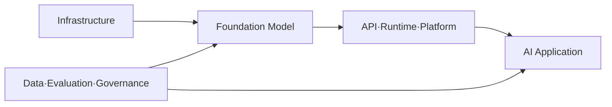

# Phase 2 — 01. AI 최신 동향 및 전체 지도

이 강의는 **오래 유지되는 AI의 전체 구조**와 **시점에 따라 달라지는 최신 동향**을 구분해서 학습한다.

- 전체 구조: AI/ML/DL, Model, Platform, Application, Data, Evaluation, Governance처럼 비교적 오래 유지되는 개념
- 최신 동향: 모델 세대, Agent Runtime, Benchmark, 가격, Context 길이, 제품 기능처럼 계속 바뀌는 정보

따라서 최신 사례에는 확인 시점을 표시하고, 다음 기수에서는 공식 자료로 다시 검증한다.

## 개요

모델·Provider·Runtime·Application과 데이터·평가의 관계를 전체 지도로 묶는다.

## 학습 목표

요구사항에 따라 모델 후보를 비교하고 검증일이 필요한 정보를 구별한다.

## Why

제품 이름과 가격은 바뀌지만 서비스 책임 경계는 계속 판단해야 한다.

## Concept

모델, 실행 방식, 데이터, 평가, 거버넌스를 서로 다른 요소로 본다.

## Architecture

문제·제약→후보 선택→서비스 구성→배포 뒤 관측의 고리를 그린다.

## Example

품질은 높지만 지연이 큰 후보와 저렴한 후보를 같은 업무에 비교한다.

## Practice

본문의 전체 지도에 비용·권한·품질 검증 지점을 표시한다.

## Summary

모델·Provider·Runtime·Application과 데이터·평가의 관계를 전체 지도로 묶는다.

## 실무 팁

변경 가능한 모델·가격·버전에는 확인 날짜를 남긴다.

## 주의사항

하나의 모델 순위가 서비스 성공 조건 전체를 대신하지 않는다.

## 참고자료

- [Gemma 공식 릴리스](https://ai.google.dev/gemma/docs/releases) — 모델 세대와 공개 시점을 확인할 때 사용한다.

## 관련 Wiki Link

- `[[AI_머신러닝_딥러닝 개요]]`는 기존 강의의 Wiki 제안 표기다. 실제 Wiki 경로는 아직 확인되지 않았다.

---

# [학습] AI 최신 동향 및 전체 지도 (Unit 1)

> **커리큘럼 위치**
> 
> **① AI 최신 동향 및 전체 지도** ← 현재 학습
> 
> ② AI / 머신러닝 / 딥러닝 개요
> 
> ③ Transformer
> 
> ④ LLM
> 
> ⑤ Prompt Engineering
> 
> ⑥ Embedding
> 
> ⑦ Vector DB
> 
> ⑧ RAG
> 
> ⑨ Agent
> 
> ⑩ Fine-tuning
> 
> ⑪ OCR / Multimodal
> 
> ⑫ AI Integration
> 
> ⑬ Document AI

---

## 개요 — 학습 지도

이 과목의 이름에 “최신 동향”이 들어 있어도, 수업의 뼈대는 특정 모델 이름이 아니다. **오래 유지되는 관계**를 먼저 배우고, 모델·Provider·가격·Context 길이처럼 바뀌는 사실은 검증일이 있는 사례로 읽는다. Phase 1에서 React와 FastAPI로 AI 서비스를 연결하는 위치를 보았다면, Phase 2에서는 각 기술이 왜 작동하는지 깊게 살핀다.



| 학습 구간 | 이 지도에서 다루는 질문 |
|---|---|
| 01~03: 전체 지도, AI/ML/DL, Transformer | 어떤 기반 위에서 모델이 학습·계산되는가? |
| 04~05: LLM, Prompt Engineering | 모델이 어떻게 출력을 만들고 입력 지시가 어떻게 영향을 주는가? |
| 06~08: Embedding, Vector DB, RAG | 외부 자료를 어떻게 표현·찾고 근거와 연결하는가? |
| 09~11: Agent, Fine-tuning, OCR/Multimodal | 행동, 모델 적응, 이미지·문서 인식은 각각 어떤 문제를 해결하는가? |
| 12~13: AI Integration, Document AI | 배운 기술을 Backend 및 실제 문서 처리 서비스로 어떻게 통합하는가? |

이 표는 선수지식과 역할의 지도다. 모든 AI 애플리케이션에 13개 기술이 전부 필요한 것은 아니다.

## 학습 목표

이 강의를 마치면 다음을 설명할 수 있다.

- AI 서비스의 Infrastructure, Model, Platform, Application, Data/Governance를 구분한다.
- AI/ML/DL부터 Document AI까지 13개 과목의 선수 관계와 책임을 배치한다.
- 오래 유지되는 개념과 검증일이 필요한 제품·비용·Context 사례를 구분한다.
- 실제 문서 서비스에 필요한 기술을 요구사항에 따라 선택하고 평가 위험을 적는다.

## ① 문제 이해 (Why)

### 왜 AI를 배우기 전에 "전체 지도"부터 알아야 할까?

많은 사람들이 AI를 공부할 때 이런 순서로 시작합니다.

> ChatGPT 사용법
> 
> → 프롬프트 작성
> 
> → API
> 
> → RAG
> 
> → Agent

하지만 이렇게 배우면 대부분 중간에서 막힙니다.

왜일까요?

**자신이 지금 무엇을 배우고 있는지 모르기 때문입니다.**

---

집을 지을 때를 생각해보겠습니다.

집을 지으려는데 갑자기

- 망치를 배우고
    
- 전동드릴을 배우고
    
- 페인트칠을 배우고
    
- 타일 붙이는 법을 배운다면
    

열심히는 배우겠지만,

**집이 어떻게 만들어지는지는 모릅니다.**

---

AI도 같습니다.

많은 기술들이 등장합니다.

- ChatGPT
    
- Claude
    
- Gemini
    
- Copilot
    
- Cursor
    
- MCP
    
- RAG
    
- Agent
    
- Vector DB
    
- Embedding
    
- Fine-tuning
    

이들은 각각 독립적인 기술처럼 보이지만 실제로는 하나의 큰 생태계를 구성하는 요소들입니다.

먼저 **전체 지도를 머릿속에 그려야** 이후의 모든 학습이 연결됩니다.

---

### AI는 생각보다 훨씬 큰 분야이다.

많은 사람이 AI = ChatGPT라고 생각합니다.

하지만 ChatGPT는 AI의 극히 일부입니다.

AI라는 큰 나무를 그려보면 다음과 같습니다.

```text
AI
│
├── 규칙 기반 AI
│
├── 머신러닝
│     │
│     ├── 지도학습
│     ├── 비지도학습
│     ├── 강화학습
│     │
│     └── 딥러닝
│           │
│           ├── CNN
│           ├── RNN
│           ├── Transformer
│           └── Diffusion
│
├── 생성형 AI
│     │
│     ├── LLM
│     ├── Image
│     ├── Video
│     ├── Audio
│     └── Multimodal
│
└── AI Application
      │
      ├── ChatGPT
      ├── Claude
      ├── Copilot
      ├── Cursor
      └── AI Agent
```

즉,

우리가 배우려는 것은

**ChatGPT가 아니라 AI 생태계 전체**입니다.

---

### 왜 최근 AI가 갑자기 폭발적으로 발전했을까?

AI는 사실 새로운 기술이 아닙니다.

1950년대부터 연구가 시작되었습니다.

그런데 왜 2022년 이후 갑자기 세상이 바뀌었을까요?

하나의 원인만으로 설명할 수는 없습니다. 다만 입문 단계에서는 **데이터, 컴퓨팅 자원, 학습 알고리즘과 모델 구조의 발전이 함께 영향을 주었다**고 이해할 수 있습니다.

#### ① 데이터

인터넷에는 엄청난 양의 문서가 축적되었습니다.

- 책
    
- 논문
    
- 코드
    
- 뉴스
    
- 위키
    
- 블로그
    

AI가 학습할 재료가 충분해졌습니다.

---

#### ② 컴퓨팅 성능

GPU가 발전했습니다.

예전에는 AI 학습이 수년 걸렸다면

현재의 대규모 모델은 GPU·TPU 같은 가속기를 여러 대 연결한 분산 학습을 활용할 수 있습니다. 모든 모델이 같은 규모의 장비를 사용하는 것은 아니며, 필요한 자원은 모델 크기와 학습 방식에 따라 달라집니다.

---

#### ③ 알고리즘

생성형 언어 모델의 발전에서 중요한 변화 중 하나는 **Transformer**의 등장입니다.

Transformer는 이전 AI 모델보다 훨씬 효율적으로 문맥을 이해할 수 있게 했고, 오늘날의 LLM 발전을 가능하게 한 핵심 기술입니다.

> Transformer는 이후 커리큘럼에서 자세히 학습합니다.

---

## ② 개념 이해 (Concept)

### AI를 하나의 회사로 비유해보자.

AI를 이해하기 가장 쉬운 방법은 회사를 떠올리는 것입니다.

```text
사용자

↓

ChatGPT

↓

LLM

↓

Transformer

↓

딥러닝

↓

머신러닝

↓

AI
```

즉,

우리가 사용하는 ChatGPT는 가장 위에 있는 서비스입니다.

그 아래에는

- LLM
    
- Transformer
    
- 딥러닝
    
- 머신러닝
    
- AI
    

가 층층이 쌓여 있습니다.

이 구조를 이해하면 앞으로 배우는 모든 내용이 어디에 위치하는지 자연스럽게 연결됩니다.

---

### AI 산업도 계층 구조로 이루어져 있다.

현재 AI 산업은 크게 네 단계로 나눌 수 있습니다.

```text
① Infrastructure

GPU
Cloud
Data Center

↓

② Foundation Model

LLM

↓

③ AI Platform

API
Framework
Vector DB

↓

④ AI Application

ChatGPT
Copilot
Cursor
AI 서비스
```

각 계층은 서로를 기반으로 발전합니다.

---

#### 1단계 : Infrastructure

AI가 학습되고 실행되는 기반입니다.

대표적으로

- GPU
    
- 클라우드
    
- 데이터센터
    

등이 여기에 속합니다.

---

#### 2단계 : Foundation Model

초거대 AI 모델입니다.

예를 들어

- GPT 계열
    
- Claude 계열
    
- Gemini 계열
    

과 같은 모델들이 여기에 해당합니다.

---

#### 3단계 : AI Platform

모델을 활용하기 위한 개발 환경입니다.

예를 들어

- API
    
- Embedding
    
- Vector DB
    
- RAG
    

등이 포함됩니다.

---

#### 4단계 : AI Application

사용자가 직접 사용하는 서비스입니다.

예를 들어

- ChatGPT
    
- Claude
    
- Copilot
    
- Cursor
    
- AI 검색 서비스
    
- AI 업무 자동화 서비스
    

등이 여기에 속합니다.

---

## ③ 구조와 원리 (Architecture / Principle)

### AI 서비스는 어떻게 만들어질까?

전체 흐름은 다음과 같습니다.

```text
인터넷 데이터

↓

AI 학습

↓

Foundation Model

↓

API

↓

Application

↓

사용자
```

예를 들어 사용자가 ChatGPT에 질문을 입력하면,

1. 질문이 AI 애플리케이션에 전달됩니다.
    
2. 애플리케이션은 내부적으로 AI 모델(API)을 호출합니다.
    
3. AI 모델은 학습된 지식을 바탕으로 응답을 생성합니다.
    
4. 결과가 다시 사용자에게 전달됩니다.
    

즉, 우리가 사용하는 서비스는 AI 모델 자체가 아니라, AI 모델을 활용하는 **응용 프로그램**인 경우가 많습니다.

---

## ④ 관계 이해 (Relation)

현재 커리큘럼 전체를 하나의 흐름으로 연결하면 다음과 같습니다.

```text
AI
│
├── 머신러닝
│
├── 딥러닝
│
├── Transformer
│
├── LLM
│
├── Prompt
│
├── Embedding
│
├── Vector DB
│
├── RAG
│
├── Agent
│
├── Fine-tuning
│
├── OCR / Multimodal
│
├── AI Architecture
│
└── AI Platform
```

각 주제는 독립된 기술이 아니라, 이전 개념을 기반으로 다음 개념이 확장되는 구조입니다. 앞으로의 학습에서는 이 연결 관계를 계속 이어가며 이해하게 됩니다.

---

## ⑤ 적용 예시 (Example / Application)

AI는 이미 다양한 산업에서 활용되고 있습니다.

- **개발**: 코드 생성, 테스트, 문서화
    
- **문서 업무**: 보고서, 계약서, 회의록 자동 작성
    
- **고객 지원**: 챗봇, 상담 요약
    
- **검색**: 자연어 기반 정보 탐색
    
- **교육**: 개인 맞춤형 튜터
    
- **콘텐츠 제작**: 이미지, 영상, 음성 생성
    
- **업무 자동화**: 여러 시스템을 연결해 반복 작업 수행
    

이러한 서비스들은 겉으로는 서로 달라 보이지만, 공통적으로 AI 모델을 중심으로 다양한 기술을 조합해 문제를 해결합니다.


### 2026년 현재 AI에서 실제로 확인되는 변화는 무엇인가?

“앞으로 AI는 무조건 이렇게 된다”라고 단정하는 것보다, **현재 관측되는 변화를 근거와 함께 읽는 것**이 더 중요합니다.

2026년의 AI를 이해할 때 특히 눈여겨볼 흐름은 다음과 같습니다.

```text
1. 모델 능력은 계속 올라가고 있다.
2. 반대로 공개 Benchmark만으로 모델을 비교하기는 더 어려워지고 있다.
3. 모델 단독 성능보다 Tool·Data·Workflow를 포함한 시스템 설계가 중요해지고 있다.
4. Agentic System이 빠르게 발전하고 있지만 실제 조직 도입은 아직 초기 단계다.
5. Text 하나만 다루는 모델보다 Multimodal 처리가 일반적인 방향이 되고 있다.
6. Closed API와 Open-weight / Local Model을 함께 비교하는 선택지가 넓어지고 있다.
7. 평가·보안·권한·감사 같은 운영 책임이 AI Lifecycle 전체의 문제로 다뤄지고 있다.
```

이 일곱 가지를 하나씩 살펴보겠습니다.

#### 변화 1. 모델 성능은 계속 향상되고 있다

Stanford HAI의 **2026 AI Index**는 2025년 동안 과학 문제, 수학, Coding, Multimodal Reasoning 등 여러 영역에서 Frontier Model의 성능이 크게 향상되었다고 정리합니다.

이 사실을 보고 학생들이 흔히 다음처럼 생각할 수 있습니다.

> “그러면 이제 가장 좋은 모델 하나만 선택하면 되는 것 아닌가?”

그렇지 않습니다.

모델이 강해질수록 오히려 **어떤 업무에 어떤 모델을 배치할지**, **비용과 응답시간을 어떻게 관리할지**, **틀렸을 때 어떻게 검증할지**가 더 중요해집니다.

---

#### 변화 2. 공개 Benchmark만으로는 충분하지 않다

AI Index는 여러 Benchmark가 짧은 시간 안에 포화되고, 일부 평가는 문제 품질이나 Leaderboard 최적화 때문에 신뢰성 문제가 커지고 있다고 지적합니다.

즉,

```text
과거
Benchmark 점수 → 모델 선택

현재의 더 안전한 방식
Benchmark → 후보 압축
         ↓
우리 업무 데이터로 Evaluation
         ↓
품질 / 비용 / 지연 / 보안 / 운영성 비교
         ↓
서비스에 적합한 모델 선택
```

이후 Prompt Engineering에서 배우는 **Golden Dataset**, Regression Test, RAG 평가, Agent 평가가 중요한 이유가 여기서 연결됩니다.

---

#### 변화 3. “모델”에서 “AI 시스템”으로 관심이 넓어지고 있다

예전에는 생성형 AI를 설명할 때 “어느 모델이 더 똑똑한가?”가 중심 질문인 경우가 많았습니다.

하지만 실제 서비스는 다음 요소를 함께 사용합니다.

```text
Model
+ Prompt / Context
+ Data
+ Search / RAG
+ Tool
+ Workflow
+ Application
+ Evaluation
+ Security / Permission
+ Monitoring
```

따라서 서비스 품질은 모델 점수 하나로 결정되지 않습니다.

같은 모델을 사용해도 검색 근거가 나쁘거나, Tool 권한이 잘못되어 있거나, 실패 처리와 평가가 없으면 서비스 품질은 크게 떨어질 수 있습니다.

---

#### 변화 4. Agentic System은 중요한 방향이지만 “모든 것이 Agent”는 아니다

2026년에는 모델이 Tool을 사용하고 여러 단계를 이어서 처리하는 **Agentic System**이 중요한 개발 영역으로 자리잡고 있습니다. OpenAI를 포함한 여러 Provider가 Agent Runtime, Tool Calling, 장기 실행, 상태 관리 기능을 공식 플랫폼 수준에서 제공하고 있습니다.

하지만 이것을

> “앞으로 모든 프로그램이 Agent로 바뀐다.”

라고 이해하면 안 됩니다.

Stanford AI Index의 2026년 조직 조사에서도 AI 사용 자체는 광범위해졌지만, **AI Agent의 실제 업무 기능별 배치는 아직 초기 단계**로 보고됩니다.

따라서 실무에서는 먼저 이렇게 판단해야 합니다.

```text
절차가 고정되어 있는가?
    ↓ Yes
일반 Workflow 우선

다음 행동을 상황에 따라 선택해야 하는가?
    ↓ Yes
Agent 검토
```

이 구분은 이후 [[AI 에이전트(Agent)]]에서 다시 자세히 배웁니다.

---

#### 변화 5. Multimodal이 특별 기능이 아니라 일반적인 모델 능력으로 이동하고 있다

현대 Foundation Model은 텍스트만 처리하는 방향에 머물지 않습니다.

```text
Text
Image
Audio
Video
Document
Screen / UI
```

같은 여러 입력을 한 모델이나 하나의 시스템이 함께 다루는 방향이 확대되고 있습니다.

Document AI 관점에서는 이 변화가 특히 중요합니다.

PDF는 단순한 문자열 파일이 아닙니다.

```text
PDF
├── 본문 Text
├── Table
├── Image
├── Chart
├── Layout
└── Scan Image
```

따라서 실제 문서 AI는 Text Parsing만으로 해결되지 않는 경우가 많고, OCR과 Multimodal Model을 함께 고려하게 됩니다.

---

#### 변화 6. Cloud Model과 Local/Open-weight Model을 함께 비교할 수 있게 되었다

Closed Model API만이 유일한 선택지는 아닙니다. Google의 Gemma 같은 Open-weight Model Family가 계속 발전하면서, 조직은 다음 두 방향을 함께 비교할 수 있습니다.

```text
Cloud API
├── 빠른 시작
├── 인프라 운영 부담이 상대적으로 작음
└── 데이터 정책·비용·Provider 의존성 확인 필요

Local / Open-weight
├── 실행 환경과 데이터 흐름을 더 직접 통제 가능
├── 내부망·Edge 환경 선택지
└── Hardware·Serving·보안·License 운영 책임 증가
```

여기서 중요한 것은 “Cloud가 좋다 / Local이 좋다”가 아닙니다.

**업무 요구사항에 따라 선택 기준이 달라진다**는 것입니다.

---

#### 변화 7. Responsible AI와 운영 안전이 별도 부록이 아니라 시스템 설계가 되고 있다

NIST AI RMF와 Generative AI Profile은 AI 위험 관리를 모델을 고른 뒤 마지막에 한 번 확인하는 체크리스트가 아니라 **설계·개발·사용·평가의 전체 Lifecycle 문제**로 다룹니다.

예를 들어 문서 RAG 시스템에서는 다음 모두가 위험 관리입니다.

```text
수집
→ 이 문서를 가져올 권한이 있는가?

색인
→ 민감 정보가 잘못 들어가지는 않았는가?

검색
→ 현재 사용자가 볼 수 있는 Chunk만 검색하는가?

생성
→ 근거에 없는 내용을 만들지는 않는가?

Action
→ Agent가 실행 가능한 Tool의 권한은 어디까지인가?

운영
→ 오류·비용·지연·보안 사건을 기록하고 추적할 수 있는가?
```

이 때문에 현대 AI 서비스는 **모델 개발 + 소프트웨어 엔지니어링 + 데이터 엔지니어링 + 평가 + 보안·거버넌스**가 함께 움직이는 시스템으로 보는 것이 더 정확합니다.

---

### 중간 확인 — “동향”과 “원리”를 구분해보기

다음 문장을 두 그룹으로 나눠봅니다.

**A. 비교적 오래 유지되는 원리**

- AI Application은 Model 하나가 아니라 여러 소프트웨어 구성요소를 결합한 시스템이다.
- 실제 서비스 모델은 업무 데이터로 평가해야 한다.
- 접근 권한은 AI를 붙였다고 사라지지 않는다.

**B. 시간이 지나면 다시 확인해야 하는 동향·사례**

- 현재 가장 높은 Benchmark 점수를 가진 Model은 무엇인가?
- 어느 Provider가 어떤 Agent API를 제공하는가?
- 특정 Model의 가격과 Context Window는 얼마인가?
- 현재 Gemma의 최신 세대는 무엇인가?

이 구분이 가능해야 “최신 동향” 강의가 몇 달 뒤에도 사용할 수 있는 지식 구조가 됩니다.

---

### AI 서비스는 점점 연결되고 있다

예전에는 각각의 AI 서비스가 독립적으로 존재했습니다.

예를 들어,

- 번역 AI
    
- 그림 생성 AI
    
- 음성 인식 AI
    
- 문서 작성 AI
    

처럼 각각 따로 사용했습니다.

하지만 최근에는 이러한 AI들이 하나의 서비스 안에서 함께 동작하기 시작했습니다.

예를 들어,

회의를 진행하면

음성을 인식하고,

자동으로 회의록을 작성하고,

핵심 내용을 요약하며,

필요한 업무를 일정에 등록하고,

참석자에게 메일을 보내는 것까지

모두 하나의 흐름으로 연결됩니다.

사용자는 여러 프로그램을 직접 실행하는 것이 아니라,

AI가 필요한 기능을 조합하여 업무를 대신 수행하게 되는 것입니다.

---

### 모델과 시스템을 함께 평가해야 한다

2026 AI Index에서는 상위권 모델들의 성능 차이가 좁아지는 동시에 기존 Benchmark의 포화와 신뢰성 문제가 커지는 현상을 함께 다룹니다. 따라서 실제 서비스에서는 “공개 순위 1등”보다 **내 업무에서의 품질·비용·지연·안전성**을 평가하는 과정이 더 중요해집니다.

초기 생성형 AI 시장에서는

어떤 모델이 가장 똑똑한지가 가장 중요한 경쟁 요소였습니다.

하지만 현재는 상황이 달라지고 있습니다.

같은 LLM을 사용하더라도

누가 더 좋은 서비스를 만드는가가 더 중요해지고 있습니다.

예를 들어,

동일한 GPT 모델을 사용하더라도

A 서비스는 단순한 챗봇일 수 있고,

B 서비스는

- 회사 문서를 검색하고
    
- ERP와 연결하고
    
- 이메일을 보내고
    
- 보고서를 작성하며
    
- 업무를 자동화하는
    

AI 업무 시스템이 될 수도 있습니다.

즉,

앞으로는

**모델(Model)의 성능만으로 서비스 품질이 결정되지는 않습니다.** 모델을 검색, 데이터, 권한, 평가, 업무 시스템과 어떻게 연결하는지도 함께 중요합니다.

그래서 최근에는

AI 모델 자체보다

AI 플랫폼,

AI Agent,

RAG,

Workflow,

MCP(Model Context Protocol)

같은 기술들이 더욱 중요하게 다루어지고 있습니다.

이러한 기술들은 앞으로의 강의에서 하나씩 자세히 살펴보겠습니다.

---

### AI를 배우는 올바른 순서

생성형 AI를 처음 접하는 사람들은 종종 최신 모델이나 화려한 기능부터 배우려고 합니다.

하지만 AI를 제대로 이해하려면 순서가 중요합니다.

이 강의에서는 초심자가 기술의 관계를 이해하기 쉽도록 다음 순서를 사용합니다. 이것은 유일한 정답이나 모든 서비스의 실행 순서가 아니라 **AIKOS의 학습 순서**입니다.

1. AI와 머신러닝의 기본 원리를 이해한다.
    
2. Transformer가 왜 등장했는지 이해한다.
    
3. LLM이 어떻게 학습되고 답변을 생성하는지 이해한다.
    
4. Prompt Engineering을 통해 AI와 효과적으로 대화하는 방법을 익힌다.
    
5. Embedding과 Vector Database를 이해하여 AI가 정보를 검색하는 방식을 배운다.
    
6. RAG를 통해 외부 지식을 활용하는 방법을 익힌다.
    
7. Agent를 통해 여러 도구를 연결하여 업무를 자동화하는 방법을 배운다.
    
8. 마지막으로 실제 서비스를 설계하고 구축하는 방법을 학습한다.
    

이 순서는 생성형 AI 서비스의 주요 구성요소를 기초부터 연결해 보는 학습 흐름입니다.

따라서 이번 강의 역시 이러한 순서를 따라 진행됩니다.


---

### 이번 강의를 통해 얻게 될 것

이번 강의의 목표는 단순히 AI 사용법을 배우는 것이 아닙니다.

AI가 왜 이러한 구조로 발전했는지,

각 기술이 어떤 문제를 해결하기 위해 등장했는지,

그리고 실제 서비스에서는 어떻게 조합되는지를 이해하는 것이 핵심 목표입니다.

강의를 모두 마치면 여러분은

- 생성형 AI의 전체 구조를 설명할 수 있고,
    
- AI 서비스가 어떻게 만들어지는지 이해하며,
    
- 새로운 AI 기술이 등장하더라도 빠르게 원리를 파악하고,
    
- 실제 업무와 프로젝트에 AI를 적용할 수 있는 기반을 갖추게 될 것입니다.
    

즉,

**이번 강의는 특정 AI 도구의 사용법을 배우는 강의가 아니라, AI 시대를 이해하고 활용하기 위한 전체 지도를 만드는 과정이라고 생각하면 됩니다.**


---

## ⑥ 핵심 정리 (Summary)

이번 Unit에서 반드시 기억해야 할 핵심은 다음과 같습니다.

1. AI는 ChatGPT 하나를 의미하는 것이 아니라 매우 넓은 기술 분야이다.
    
2. 생성형 AI는 AI 생태계의 일부이며, LLM은 생성형 AI의 핵심 기술 중 하나이다.
    
3. 현대 AI의 급성장은 **데이터, GPU 성능, Transformer**의 발전이 함께 이루어진 결과이다.
    
4. AI 산업은 **인프라 → 기반 모델 → 플랫폼 → 애플리케이션**의 계층 구조로 이해할 수 있다.
    
5. 앞으로의 커리큘럼은 이 전체 지도 위에서 각 계층과 기술을 하나씩 깊이 있게 학습하는 과정이다.
    
6. 최근에는 LLM이 외부 Tool과 Workflow를 통해 작업을 수행하는 Agent형 시스템도 개발되고 있다.
    
7. 앞으로의 AI 경쟁력은 모델 자체뿐 아니라, 모델을 RAG, Tool, Workflow, 업무 시스템과 어떻게 연결하느냐에서 결정된다.

---

## ⑦ 이해도 확인 (Check)

다음 질문에 자신의 언어로 답해보세요.

1. 많은 AI 기술을 배우기 전에 "전체 지도"를 먼저 이해해야 하는 이유는 무엇인가요?
    
2. AI와 생성형 AI, ChatGPT의 관계를 설명해보세요.
    
3. 현대 AI가 최근 몇 년 사이 급격히 발전한 세 가지 핵심 요인은 무엇인가요?
    
4. AI 산업을 **인프라 → 기반 모델 → 플랫폼 → 애플리케이션**의 흐름으로 설명해보세요.
    
5. 앞으로 배우게 될 Transformer, LLM, RAG, Agent는 왜 서로 독립된 기술이 아니라 연결된 기술이라고 할 수 있을까요?
    
6. 왜 앞으로의 AI 경쟁력은 모델 성능만이 아니라 시스템 설계 능력에서 결정된다고 할 수 있을까요?

---


### AIKOS Knowledge 제안

이번 Unit은 다음과 같은 Knowledge로 정리하는 것을 권장합니다.

**저장 위치**

```text
Knowledge/
└── AI/
    ├── AI 최신 동향 및 전체 지도.md
```

**관련 Wiki Link**

```text
[[AI_머신러닝_딥러닝 개요]]
[[트랜스포머(Transformer)]]
[[대규모 언어 모델(LLM)]]
[[프롬프트 엔지니어링(Prompt Engineering)]]
[[임베딩(Embedding)]]
[[벡터 데이터베이스(VectorDB)]]
[[검색 증강 생성(RAG)]]
[[AI 에이전트(Agent)]]
[[미세조정(Fine-tuning)]]
[[광학 문자 인식과 멀티모달(OCR_Multimodal)]]
[[AI Integration]]
[[Document AI]]
```

이 Unit에서는 AI 생태계의 **큰 그림(전체 지도)**을 만드는 데 집중했습니다. 다음 학습에서는 이 지도의 가장 기초가 되는 **「AI / 머신러닝 / 딥러닝 개요」**를 통해 AI의 정의와 세 기술의 차이 및 관계를 원리 중심으로 학습하게 됩니다.

---

# [보강 학습] 모델을 고르는 것에서 끝나지 않는 AI의 전체 생명주기

지금까지 AI 산업을 인프라, 기반 모델, 플랫폼, 애플리케이션이라는 층으로 살펴보았습니다. 이제 이 지도를 실제 프로젝트의 관점에서 한 번 더 연결해 보겠습니다.

회사에서 “우리도 생성형 AI를 도입하자”라고 결정했다고 가정해 봅시다. 이때 가장 먼저 특정 모델의 이름부터 고르면 될까요? 그렇지 않습니다. 먼저 해결하려는 업무와 허용할 수 없는 실패를 정의해야 합니다. 사내 규정 검색 서비스와 광고 문구 생성 서비스는 모두 LLM을 사용할 수 있지만, 잘못된 답변이 미치는 영향은 전혀 다릅니다. 광고 문구는 사람이 검토하고 고칠 수 있지만, 규정 검색 서비스가 존재하지 않는 휴가 규정을 만들어 내면 실제 업무 판단이 잘못될 수 있습니다.

이 차이를 이해하려면 `Foundation Model`, 모델 제공 방식, 모델 선택 기준, AI Lifecycle, Responsible AI를 하나의 흐름으로 보아야 합니다.

## 1. Foundation Model은 무엇인가?

Foundation Model은 광범위한 데이터로 학습되어 하나의 작업에만 머물지 않고 여러 작업에 적용할 수 있는 기반 모델입니다. 글을 이어 쓰고, 요약하고, 분류하고, 질문에 답하는 언어 모델이나 텍스트와 이미지를 함께 처리하는 멀티모달 모델이 대표적인 예입니다.

여기서 주의해야 할 점이 있습니다. 다음 용어들은 같은 말이 아닙니다.

```text
Foundation Model
넓은 범위의 작업에 적용할 수 있도록 학습된 기반 모델

Generative AI
텍스트·이미지·음성·영상·코드처럼 새로운 결과를 생성하는 AI

LLM
대규모 텍스트를 학습하여 언어를 처리하고 생성하는 모델

Multimodal Model
텍스트뿐 아니라 이미지·음성 등 둘 이상의 데이터 형태를 함께 처리하는 모델
```

이들은 서로 겹칠 수 있습니다. 예를 들어 어떤 LLM은 Foundation Model이면서 Generative AI일 수 있습니다. 이미지와 텍스트를 함께 처리하도록 확장되면 Multimodal Model이기도 합니다. 따라서 이 관계를 서로 완전히 분리된 상자로 외우기보다, 한 모델이 여러 성격을 동시에 가질 수 있는 개념 지도라고 이해해야 합니다.

## 2. Open-weight와 Closed Model은 무엇이 다른가?

모델을 사용하는 방법은 크게 두 방향으로 생각할 수 있습니다.

### Closed Model

사용자는 모델 내부의 가중치를 직접 받지 않고 제공 회사의 API나 서비스로 모델을 사용합니다. 모델 운영과 업데이트를 공급자가 담당하므로 시작하기 쉽지만, 데이터 처리 정책, 사용량 비용, 서비스 종속성, 모델 버전 변경의 영향을 확인해야 합니다.

### Open-weight Model

학습이 끝난 모델의 가중치를 내려받아 직접 실행할 수 있는 모델입니다. 내부망 배포나 세밀한 운영 제어에 유리할 수 있지만, GPU 자원, 서빙, 보안 패치, 성능 감시, 라이선스 준수까지 사용하는 조직이 책임져야 합니다.

`Open-weight`를 곧바로 `Open Source`와 같은 뜻으로 사용하면 안 됩니다. 가중치가 공개되어 있어도 학습 데이터, 학습 코드, 라이선스 권한이 모두 공개된 것은 아닐 수 있기 때문입니다. 실제 사용 전에는 “파일을 내려받을 수 있는가?”뿐 아니라 상업적 사용, 재배포, 수정, 출력물, 사용 제한에 관한 해당 모델의 라이선스를 확인해야 합니다.

## 3. 가장 똑똑한 모델이 항상 가장 좋은 모델은 아니다

모델 선택은 순위표에서 1등을 찾는 문제가 아닙니다. 실제 업무에 맞는지 확인하는 의사결정 문제입니다.

예를 들어 문서 분류 시스템에 최고 성능의 거대한 모델을 사용하면 정확도는 조금 좋아질 수 있습니다. 그러나 요청 한 건의 비용이 지나치게 크고 응답이 느리다면 실제 서비스에는 맞지 않을 수 있습니다. 반대로 작은 모델이 일반 벤치마크에서는 낮은 점수를 받았더라도 회사 문서 분류에서는 충분한 정확도와 훨씬 낮은 비용을 제공할 수 있습니다.

모델을 선택할 때는 최소한 다음 질문을 함께 확인해야 합니다.

1. **업무 적합성:** 요약, 추출, 검색, 추론, 이미지 이해 중 무엇을 잘해야 하는가?
2. **품질:** 우리 조직의 실제 입력과 정답으로 평가했을 때 목표 수준을 만족하는가?
3. **응답 시간:** 사용자가 기다릴 수 있는 시간 안에 답하는가?
4. **비용:** 입력·출력 토큰, 호출 횟수, 서버 운영비를 감당할 수 있는가?
5. **보안과 개인정보:** 입력 데이터가 어디로 전송되고 얼마나 보관되는가?
6. **운영 가능성:** 장애, 버전 변경, 사용량 증가에 대응할 수 있는가?
7. **라이선스와 정책:** 계획한 용도로 사용할 권한이 있는가?

공개 Benchmark는 후보를 좁히는 데 유용하지만 최종 답은 아닙니다. 시험 점수가 높은 사람이 모든 회사 업무를 가장 잘하는 것은 아닌 것처럼, 공개 문제에서 높은 점수를 받은 모델이 우리 문서의 표, 약어, 한국어 표현, 보안 조건까지 가장 잘 처리한다고 보장할 수는 없습니다. 최종 선택은 실제 업무를 대표하는 평가 데이터로 확인해야 합니다.

## 4. AI Lifecycle: 모델 호출 전과 후에 더 많은 일이 있다

AI 시스템은 한 번 모델을 연결하면 끝나는 프로그램이 아닙니다. 데이터와 업무가 변하고 모델도 바뀌기 때문에 계속 관찰하고 개선해야 합니다.

```text
1. 문제 정의
   무엇을 자동화하고 어떤 실패를 허용하지 않을지 결정

2. 데이터 준비
   사용할 데이터의 품질·권한·개인정보·대표성 확인

3. 모델과 방식 선택
   Prompt, RAG, Workflow, Fine-tuning 중 필요한 조합 선택

4. 사전 평가
   실제 업무 사례로 품질·안전·비용·속도 검증

5. 배포
   인증, 권한, 로그, 실패 처리와 함께 서비스에 연결

6. 운영 감시
   답변 품질, 오류, 지연시간, 비용, 보안 사건 관찰

7. 개선 또는 종료
   Prompt·데이터·모델·인덱스를 갱신하고 필요하면 이전 버전으로 복구하거나 시스템 종료
```

이 과정을 AI Lifecycle이라고 합니다. 중요한 점은 평가와 보안이 마지막에 한 번 수행되는 검사가 아니라 전체 과정에 계속 포함된다는 것입니다.

예를 들어 문서 수집 단계에서 열람 권한을 잃어버리면 나중에 출력 필터를 추가해도 이미 검색 과정에서 비밀 문서가 노출될 수 있습니다. 모델을 교체한 뒤 이전과 같은 질문에 답변 품질이 떨어질 수도 있습니다. 그래서 데이터, 모델, Prompt, Embedding, 검색 인덱스의 버전을 함께 기록하고 변경 전후를 비교해야 합니다.

## 5. Responsible AI는 “착한 AI”라는 구호가 아니다

Responsible AI는 AI를 만들고 사용하는 과정에서 발생할 수 있는 위험을 식별하고 책임 있게 관리하는 원칙과 활동을 말합니다. 여기에는 정확성뿐 아니라 안전, 보안, 개인정보, 편향, 투명성, 설명 가능성, 책임 소재가 포함됩니다.

사내 채용 지원 AI를 생각해 봅시다. 모델이 문장을 자연스럽게 작성한다고 해서 책임 있는 시스템이 되는 것은 아닙니다. 특정 집단에 불리한 추천을 하지 않는지, 어떤 데이터가 사용되었는지, 사람이 결정을 다시 검토할 수 있는지, 오류가 발생했을 때 누가 중단하고 수정할지까지 정해야 합니다.

따라서 Responsible AI는 다음과 같이 이해하는 것이 좋습니다.

> AI가 할 수 있는 일을 늘리는 것과, AI에게 맡겨도 되는 범위를 정하는 일을 함께 수행하는 것

모든 위험을 0으로 만들 수는 없습니다. 대신 업무의 영향도에 따라 더 강한 평가, 사람의 승인, 접근 통제, 기록과 감사를 적용합니다. 이것이 이후 Prompt Security, 권한 기반 RAG, Agent의 Human Approval, Production Architecture에서 반복해서 등장하는 공통 원리입니다.

## Document AI 프로젝트에 적용해 보기

회사 문서를 검색하고 요약하는 Document AI 서비스를 만든다면 전체 지도는 다음과 같이 구체화됩니다.

```text
문제 정의
회사 문서에 근거한 답변을 제공한다.

데이터
PDF, 스캔 문서, 표, 이미지와 문서별 접근 권한

기반 모델
한국어 문서 이해와 답변 생성에 적합한 LLM 또는 Multimodal Model

플랫폼
OCR, Parsing, Embedding, VectorDB, RAG, 평가 도구

애플리케이션
검색 화면, 답변과 근거 문서 표시, 사용자 피드백

운영
문서 갱신, 권한 동기화, 품질 감시, 비용 관리, 사고 대응
```

이제 “어떤 모델을 쓸까?”라는 질문은 전체 의사결정의 일부에 불과하다는 것을 알 수 있습니다. 좋은 AI 서비스는 모델의 이름이 아니라 문제 정의부터 운영까지 이어지는 시스템으로 완성됩니다.

## 현재 시점 사례 — 2026-09-26 검증

아래 사례는 위의 구조를 이해하기 위한 **검증일이 있는 예시**다. 새 기수에는 공식 문서와 계정·장비 조건을 다시 확인한다. 가격·사용 가능 지역·Context 길이처럼 변동 가능한 수치는 이 표에서 일반 사실로 고정하지 않는다.

| 관찰 영역 | 2026-09-26에 확인 가능한 사례 | 이 강의에서 볼 점 |
|---|---|---|
| 기술 성능 | [Stanford HAI 2026 AI Index](https://hai.stanford.edu/ai-index/2026-ai-index-report/technical-performance)는 Frontier Model의 성능 향상과 Benchmark 포화 문제를 함께 다룬다. | 성능 향상과 평가 신뢰성을 별개의 문제로 본다. |
| 실제 도입 | [Stanford HAI 2026 AI Index — Economy](https://hai.stanford.edu/ai-index/2026-ai-index-report/economy)는 조사 대상 조직의 AI 도입 확대와 Agent 배치가 아직 초기임을 함께 보여준다. | “관심이 크다”와 “실제 Production에 널리 배치됐다”를 구분한다. |
| Agent Runtime | [OpenAI Agents API](https://developers.openai.com/api/docs/guides/agents)는 Tool, 상태, Orchestration을 포함하는 Agent Runtime 경계를 설명한다. | Agent는 Model 이름이 아니라 Model과 Tool, State, Runtime을 묶은 시스템으로 본다. |
| Open-weight Model Family | [Google Gemma 공식 릴리스](https://ai.google.dev/gemma/docs/releases)는 2026년 Gemma 4 세대의 출시 이력을 제공한다. | Model Family와 Variant·License·Hardware 조건을 분리해 확인한다. |
| Responsible AI | [NIST AI RMF](https://www.nist.gov/itl/ai-risk-management-framework)와 [Generative AI Profile](https://www.nist.gov/publications/artificial-intelligence-risk-management-framework-generative-artificial-intelligence)은 위험 관리를 AI Lifecycle 전반에서 다룬다. | 평가·보안·책임을 배포 직전의 단일 단계로 보지 않는다. |

**업데이트 규칙:** 모델·Provider·Framework 사례를 수업에 추가하면 공식 출처 URL, 확인일, 적용 범위(해당 모델/계정/환경)를 함께 쓴다. 영구 개념과 사례가 충돌하면 먼저 공식 문서를 확인하고 사례를 갱신한다.

## Practice — AI 서비스 전체 지도 그리기

- **실습 목표:** 문서 질의응답 서비스를 Infrastructure, Model, Platform, Application, Data/Governance로 나누고 13개 과목의 학습 위치를 표시한다.
- **실습 환경:** 이 문서의 그림과 종이 또는 다이어그램 편집기. 실행 코드나 유료 계정은 필요 없다.
- **실습 절차:** 원문 PDF, 사용자 질문, 모델 호출, 검색 결과, 답변·근거 표시를 상자에 배치한다. 각 상자에 책임 과목과 검증할 위험을 한 개씩 적는다.
- **예상 결과:** PDF Parsing/OCR은 11·13, Embedding/Vector DB/RAG는 06~08, 모델 출력 원리는 04, Backend 연결은 12, 화면은 Phase 1 React로 구분된다.
- **실습 확인:** “모델이 PDF를 알아서 저장·검색·권한 검사한다”와 같이 서로 다른 계층의 책임을 하나로 합치지 않았는지 확인한다.
- **응용 과제:** 검색이 필요 없는 짧은 문서 분류 서비스라면 어떤 상자를 생략할지 설명한다.

## Practice 2 — 원리, 동향, 제품 사례 분리하기

- **실습 목표:** AI 정보를 읽을 때 오래 유지되는 개념과 다시 확인해야 하는 정보를 구분한다.
- **실습 환경:** 이 강의안의 “2026년 현재 AI에서 실제로 확인되는 변화”와 “현재 시점 사례” 표를 사용한다.
- **실습 절차:** 아래 항목을 `원리`, `동향`, `제품/버전 사례` 세 칸에 나눈다.
  - Transformer는 Attention을 핵심 구성요소로 사용한다.
  - Agentic System이 활발히 개발되고 있다.
  - 특정 Provider가 Agents API를 제공한다.
  - RAG는 외부 검색 결과를 생성 단계의 Context로 제공할 수 있다.
  - Gemma의 현재 세대와 Variant 이름
  - 모델 가격과 Context Window
- **예상 결과:** 구조·원리에 가까운 문장은 장기간 재사용할 수 있고, 제품명·가격·버전·현재 시장 동향은 검증일이 필요하다는 결론을 얻는다.
- **실습 확인:** “최신 모델 이름”을 AI의 원리처럼 외우고 있지는 않은지 확인한다.
- **응용 과제:** 자신이 최근 본 AI 뉴스 하나를 골라 원리와 시점 의존 사실을 분리해서 5줄로 다시 작성한다.

## 보강 핵심 정리

1. “AI 최신 동향”은 특정 모델 이름을 외우는 시간이 아니라, **변하지 않는 구조와 빠르게 바뀌는 사례를 구분하는 시간**이다.
2. Foundation Model, Generative AI, LLM, Multimodal은 서로 관련 있지만 같은 용어는 아니다.
3. Closed Model은 사용 편의성이 높고, Open-weight Model은 운영 통제 가능성이 높지만 조직이 더 많은 책임을 진다.
4. 모델 선택은 공개 Benchmark뿐 아니라 업무 품질, 속도, 비용, 보안, 라이선스, 운영 조건으로 판단한다.
5. Agentic System은 중요한 흐름이지만 모든 Workflow를 Agent로 만들 필요는 없다.
6. AI Lifecycle은 문제 정의부터 데이터, 평가, 배포, 감시, 개선과 종료까지 이어진다.
7. Responsible AI는 정확성·안전·보안·개인정보·편향·책임을 전체 생명주기에서 관리하는 활동이다.

## 자신의 말로 답해 보기

1. Foundation Model과 Generative AI가 완전히 같은 개념이 아닌 이유는 무엇인가요?
2. Open-weight Model을 직접 운영할 때 조직이 추가로 책임져야 하는 것은 무엇인가요?
3. 공개 Benchmark 1위 모델이 우리 회사 서비스에서는 최선이 아닐 수 있는 이유는 무엇인가요?
4. AI Lifecycle에서 평가와 보안을 배포 이후에만 확인하면 안 되는 이유는 무엇인가요?
5. Document AI 프로젝트에서 모델 이외에 반드시 설계해야 할 요소를 다섯 가지 이상 설명해 보세요.

## 짧은 확인 활동

다음 세 문장을 `기술적 사실`, `AIKOS의 학습 관점`, `프로젝트 권장사항`으로 구분해 보세요.

1. 딥러닝은 머신러닝에 포함되는 접근이다.
2. AIKOS는 Transformer 다음에 LLM을 학습한다.
3. Document AI의 모델은 공개 Benchmark뿐 아니라 실제 회사 문서로 평가해야 한다.

세 문장의 종류가 다른 이유를 구분할 수 있어야, 산업 전망이나 강의용 지도를 기술의 절대적인 발전 법칙으로 오해하지 않습니다.

## 실무 팁

- 모델 이름보다 먼저 입력 데이터, 성공 기준, 허용하지 않을 실패를 적는다.
- “최신” 사례 표에는 확인일을, 오래 유지되는 개념에는 역할과 관계를 적는다.

## 주의사항

- Open-weight는 무조건 무료·제한 없는 사용이나 완전한 오픈소스를 뜻하지 않는다.
- 공개 Benchmark 점수는 실제 조직 데이터의 품질·비용·권한을 대신하지 않는다.

## 참고자료 — 원문으로 확인하기

- [Deep Learning, Chapter 1](https://www.deeplearningbook.org/contents/intro.html) — AI·Machine Learning·Representation Learning·Deep Learning의 포함 관계는 Figure 1.4에서 확인할 수 있습니다.
- [On the Opportunities and Risks of Foundation Models](https://arxiv.org/abs/2108.07258) — Foundation Model의 정의와 광범위한 Downstream Task 적용, 위험의 전이를 Abstract와 Introduction에서 확인할 수 있습니다.
- [NIST AI Risk Management Framework](https://www.nist.gov/itl/ai-risk-management-framework) — AI 위험을 설계·개발·사용·평가의 전체 과정에서 관리하는 관점을 확인할 수 있습니다.
- [The 2026 AI Index Report — Stanford HAI](https://hai.stanford.edu/ai-index/2026-ai-index-report) — 2025~2026의 기술 성능, 도입, 경제, 교육 등 AI 동향을 데이터 중심으로 확인할 수 있습니다.
- [Technical Performance — 2026 AI Index](https://hai.stanford.edu/ai-index/2026-ai-index-report/technical-performance) — Frontier Model 성능 향상, 상위 모델 수렴, Benchmark 포화와 평가 신뢰성 문제를 확인할 수 있습니다.
- [Economy — 2026 AI Index](https://hai.stanford.edu/ai-index/2026-ai-index-report/economy) — 조직 AI 도입과 Agent 사용의 실제 확산 정도를 구분해 볼 수 있습니다.
- [OpenAI Agents API](https://developers.openai.com/api/docs/guides/agents) — 2026년 Agent Runtime 사례로 Model, Tool, Orchestration, State의 책임 경계를 확인할 수 있습니다.
- [Google Gemma Releases](https://ai.google.dev/gemma/docs/releases) — Open-weight Model Family가 시점에 따라 어떻게 업데이트되는지 확인하는 사례입니다.

## 최종 자기 점검

다음 질문에 자료를 보지 않고 자신의 말로 답할 수 있는지 확인합니다.

1. AI, Machine Learning, Deep Learning, Generative AI는 어떤 포함·관계 구조를 가지는가?
2. Model과 AI Application은 무엇이 다른가?
3. Foundation Model, LLM, Multimodal Model은 왜 완전히 같은 용어가 아닌가?
4. Infrastructure → Model → Platform/Runtime → Application의 각 층에는 무엇이 들어가는가?
5. 2026년 AI 동향을 “Agent 하나”로만 설명하면 왜 부족한가?
6. Benchmark가 높아도 실제 업무 평가가 필요한 이유는 무엇인가?
7. Workflow와 Agent 중 무엇을 사용할지 어떤 기준으로 판단할 수 있는가?
8. Closed API와 Open-weight/Local Model의 운영 책임은 어떻게 다른가?
9. 평가와 보안을 AI Lifecycle 전체에 넣어야 하는 이유는 무엇인가?
10. 앞으로 새로운 AI 제품이 나왔을 때 그것이 `Model`, `Platform/Runtime`, `Tool`, `Application` 중 어디에 속하는지 스스로 분류할 수 있는가?

이 질문에 답할 수 있다면 이후 Transformer, LLM, RAG, Agent 같은 용어가 등장해도 **“이 기술이 전체 지도에서 어디에 위치하는지”** 잃지 않고 학습할 수 있습니다.

## 관련 Wiki Link — 더 깊이 공부하기

- [[01. AI 생태계와 기반 모델 심화학습(Foundation Model Deep Dive)]]
- [[02. 머신러닝과 딥러닝 원리 심화학습(Machine Learning and Deep Learning Deep Dive)]]
- [[12. 운영 AI 아키텍처 심화학습(Production AI Architecture Deep Dive)]]
