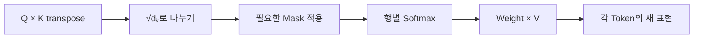

# Phase 2 — 03. 트랜스포머(Transformer)

> 이 강의는 Transformer의 등장 배경부터 Self-Attention 계산, Transformer Block, Mask와 생성 구조까지 단계적으로 연결합니다.

## 개요

Transformer는 현재의 LLM을 이해하기 위해 반드시 거쳐야 하는 핵심 구조입니다.

이 과목에서는 Transformer를 단순히 **“Attention을 사용하는 모델”**이라고 외우지 않습니다. 다음 질문이 하나의 흐름으로 연결되도록 학습합니다.

```text
왜 RNN 계열 구조에서 새로운 접근이 필요했는가?
        ↓
Token은 어떻게 숫자 표현이 되는가?
        ↓
왜 위치 정보가 필요한가?
        ↓
Q / K / V는 무엇을 계산하는가?
        ↓
Scaled Dot-Product Attention은 어떻게 만들어지는가?
        ↓
왜 Multi-Head Attention을 사용하는가?
        ↓
Residual / LayerNorm / Feed Forward는 왜 필요한가?
        ↓
Encoder-only / Decoder-only / Encoder–Decoder는 무엇이 다른가?
        ↓
왜 학습은 병렬화할 수 있지만 생성은 Token 단위로 진행되는가?
        ↓
KV Cache와 Context Window는 왜 운영 비용과 연결되는가?
```

이 흐름을 이해하면 다음 과목인 [[대규모 언어 모델(LLM)]]에서 **Pre-training, Next Token Prediction, Context Window, Decoding**을 훨씬 자연스럽게 이해할 수 있습니다.

## 학습 목표

Q/K/V·Scaling·Mask·Position·KV Cache의 역할을 설명한다.

### 선수 지식 연결

앞 과목에서 다음 개념을 배웠습니다.

```text
Input
→ 숫자 표현
→ Model
→ Parameter
→ Prediction
→ Loss
→ Parameter Update
```

Transformer에서는 이 중 **“입력의 여러 위치가 서로 어떤 정보를 참고해서 새로운 표현을 만드는가?”**에 집중합니다.

따라서 지금은 Transformer를 하나의 거대한 AI로 생각하기보다 다음처럼 보는 것이 좋습니다.

> **각 Token의 표현을 주변 문맥을 반영한 새로운 표현으로 계속 바꾸는 여러 개의 Block을 쌓은 구조**

## Why

긴 입력의 관계를 다루는 구조를 이해해야 LLM의 동작을 과장하지 않는다.

## Concept

원형 Encoder–Decoder와 현대 Decoder-only를 구별한다.

## Architecture

입력→Q/K/V→Score/Mask→가중합→층 반복을 그리고 생성의 이전 Token 의존성을 표시한다.

## Example

학습 시 위치 병렬 처리와 생성 시 순차 출력을 비교한다.

## Practice

작은 Attention 표에서 미래 위치를 Mask하고 허용 위치만 합산한다.

## Summary

Attention 계산과 구조 선택이 언어 모델 생성에 미치는 영향을 배운다.

## 실무 팁

Mask 방향과 Tensor Shape를 먼저 확인한다.

## 주의사항

Attention Weight만으로 모델의 판단 이유 전체가 드러나지 않는다.

## 참고자료

- [Attention Is All You Need](https://arxiv.org/abs/1706.03762) — 원형 Transformer의 Encoder–Decoder, Scaled Dot-Product Attention, Multi-Head Attention, Masking 구조를 확인하는 1차 자료입니다.

## 관련 Wiki Link

- `[[AI 최신 동향 및 전체 지도]]`는 기존 강의의 Wiki 제안 표기다. 실제 Wiki 경로는 아직 확인되지 않았다.

---

# [학습] 트랜스포머(Transformer) (Unit 1)

> **커리큘럼 위치**
> 
> ① AI 최신 동향 및 전체 지도 ✅
> 
> ② AI / 머신러닝 / 딥러닝 개요 ✅
> 
> **③ Transformer** ← 현재 학습
> 
> ④ LLM
> 
> ⑤ Prompt Engineering
> 
> ...

---

## 개요

02 AI/ML/DL에서 배운 `Feature·Parameter·Loss`를 바탕으로, 이 과목은 **입력 Token들이 서로의 정보를 어떻게 참고하는가**를 설명한다. 04 LLM에서는 이 구조를 이용한 Pre-training과 생성 행동을 배운다. 아래의 원형 Encoder–Decoder 구조와 현대 모델의 다양한 변형을 같은 것으로 단정하지 않는다.

## 학습 목표

이번 학습의 목표는 단순히 **"Transformer는 Attention을 사용하는 모델이다."**를 암기하는 것이 아닙니다.

학습이 끝나면 여러분은 다음 질문에 자신의 언어로 답할 수 있어야 합니다.

- 왜 Transformer가 필요했는가?
    
- 기존 딥러닝(CNN, RNN)은 무엇이 부족했는가?
    
- Transformer는 무엇을 새롭게 해결했는가?
    
- Attention은 왜 필요한가?
    
- ChatGPT와 LLM은 왜 Transformer 위에서 만들어졌는가?
    

---

## ① 문제 이해 (Why)

### Transformer는 왜 등장했을까?

새로운 기술은 대개 **기존 기술의 한계나 새로운 요구**를 해결하기 위해 등장합니다.

Transformer도 마찬가지입니다.

Transformer를 이해하려면 먼저 **이전 세대 AI가 어떤 문제를 가지고 있었는지** 알아야 합니다.

---

### 언어는 생각보다 어려운 문제이다.

컴퓨터에게 다음 문장을 보여줍니다.

> 나는 어제 도서관에서 친구를 만났는데 **그가** 책을 빌렸다.

질문

> "그"는 누구일까요?

사람은 즉시

> 친구

라는 것을 압니다.

왜일까요?

사람은 문장을 읽는 동안 앞뒤 문맥을 함께 연결해 해석할 수 있기 때문입니다.

컴퓨터 모델도 문맥을 연결해야 하지만, **어떤 구조로 문맥 정보를 전달하고 비교하느냐**에 따라 긴 관계를 다루는 방식과 계산 효율이 크게 달라집니다.

---

### RNN 계열 모델은 Sequence를 순서대로 처리했다.

사람은

```text
문장 전체를 본다.
```

대표적인 이전 Sequence 모델인 RNN 계열은

```text
나

↓

나는

↓

나는 어제

↓

나는 어제 도서관

↓

...
```

처럼 이전 시점의 Hidden State를 다음 시점으로 전달하며 순차적으로 계산합니다.

즉,

앞 위치의 계산 결과가
다음 위치의 계산에 직접 연결되는 구조입니다.

---

비유하면

책을 읽을 때

매 페이지를 넘길 때마다

앞 페이지를 조금씩 잊어버리는 사람과 같습니다.

처음 내용을 뒤에서 활용하기 어렵습니다.

---

### 문장이 길어질수록 문제가 심각해진다.

예를 들어

```text
A ...

(500단어)

...

B
```

라는 문장이 있다고 합시다.

맨 마지막 B를 이해하려면

처음의 A를 기억해야 합니다.

기본 RNN에서는 멀리 떨어진 정보가 여러 시점을 거쳐 전달되어야 하므로, 학습 과정에서 장거리 관계를 안정적으로 유지하기 어렵습니다. 이를 흔히 **장기 의존성(Long-term Dependency) 문제**라고 설명합니다.

LSTM과 GRU는 이런 문제를 완화하기 위해 고안되었지만, Sequence를 앞에서 뒤로 순차 계산해야 하는 구조적 특성은 여전히 남습니다.

즉, 핵심은 단순히 “앞 내용을 잊는다”가 아니라 다음 두 가지입니다.

- 먼 위치의 관계를 학습하기 어렵다.
- 이전 위치 계산에 의존하므로 Sequence 방향 병렬화가 제한된다.

---

### 또 다른 문제

RNN은 순차적으로 계산합니다.

```text
A

↓

B

↓

C

↓

D

↓

E
```

B를 계산하려면

A가 끝나야 합니다.

C를 계산하려면

B가 끝나야 합니다.

즉, 같은 Sequence 안의 여러 위치를 **완전히 독립적으로 동시에 계산하기 어렵습니다.**

Batch 차원의 병렬화나 여러 최적화는 가능하지만, Sequence 방향에서는 이전 Hidden State 의존성이 병목이 됩니다. 데이터와 모델 규모가 커질수록 이 차이는 중요한 문제가 됩니다.

---

#### 기존 방식의 한계

정리하면 기존 RNN 계열 모델은 다음과 같은 문제가 있었습니다.

- 긴 문장을 기억하기 어렵다.
    
- 앞 단어와 뒤 단어의 관계를 잘 이해하지 못한다.
    
- 이전 시점의 Hidden State에 의존하므로 Sequence 방향의 병렬화가 제한된다.
    
- 학습 시간이 매우 오래 걸린다.
    
- 대규모 학습에서 Sequence 방향 병렬화 측면의 제약이 크다.
    

---

### 그래서 등장한 것이 Transformer이다.

Transformer의 핵심 아이디어는 놀라울 정도로 단순합니다.

> **“각 위치가 이전 Hidden State를 한 단계씩 전달받지 않고도, 필요한 다른 위치의 정보를 직접 참고할 수는 없을까?”**

Transformer는 이 문제를 Attention 중심 구조로 해결했습니다.

---

## ② 개념 이해 (Concept)

### Transformer란 무엇인가?

Transformer는 2017년에 발표된 딥러닝 모델입니다.

핵심 아이디어는 다음 한 문장으로 설명할 수 있습니다.

> **Sequence의 각 위치가 RNN처럼 이전 Hidden State를 순차 전달받지 않고, Attention을 통해 허용된 다른 위치와의 관계를 직접 계산할 수 있는 신경망 구조**

입문 단계에서는 흔히 “문장 전체를 한 번에 본다”고 표현하지만, 이 말은 **순서를 무시한다**거나 **항상 모든 미래 Token까지 볼 수 있다**는 뜻이 아닙니다. Encoder의 양방향 Attention과 Decoder의 Causal Attention은 볼 수 있는 위치가 다르며, 위치 정보도 별도로 필요합니다.

---

### 비유

#### RNN

교실에서 학생이

앞사람에게만

쪽지를 전달합니다.

```text
A → B → C → D → E
```

맨 뒤 학생은

앞에서 무슨 이야기가 시작되었는지

잘 모릅니다.

---

#### Transformer

모든 학생이

동시에 서로를 바라봅니다.

```text
A ↔ B ↔ C ↔ D ↔ E
```

누가 누구와 관련 있는지

즉시 알 수 있습니다.

이것이 Transformer입니다.

---

### 핵심 개념

Transformer를 한 문장으로 요약하면

> **각 Token이 허용된 범위의 다른 Token 표현을 참고하여 문맥에 맞는 표현을 만드는 구조**

입니다.

여기서 등장하는 것이

**Attention**입니다.

---

### Attention이란?

Attention의 뜻은

> **주의, 집중**

입니다.

사람도 문장을 읽을 때

모든 단어를 동일하게 보지 않습니다.

예를 들어

> 고양이가 생선을 먹었다.

중요한 단어는

- 고양이
    
- 생선
    
- 먹었다
    

입니다.

"가", "을" 같은 조사보다 핵심 의미를 가진 단어에 더 집중합니다.

Transformer도 마찬가지입니다.

---

## ③ 구조와 원리 (Architecture / Principle)

### Transformer는 어떻게 동작할까?

전체 흐름은 다음과 같습니다.

```text
입력 문장

↓

단어를 숫자로 변환

↓

위치 정보 추가

↓

Attention

↓

Feed Forward Network

↓

출력
```

이제 하나씩 살펴보겠습니다.

---

### 1단계 : 입력(Input)

예를 들어

```text
나는 사과를 먹었다.
```

라는 문장이 입력됩니다.

컴퓨터는 글자를 직접 이해하지 못하므로

먼저 각 단어를 숫자로 변환합니다.

(Embedding은 이후 커리큘럼에서 자세히 학습합니다.)

---

### 2단계 : 위치 정보(Positional Encoding)

Self-Attention의 기본 Score 계산만 놓고 보면 Token의 **순서 정보가 자동으로 들어가지는 않습니다.**

따라서 모델이 “어떤 Token이 앞에 있고 뒤에 있는가”를 활용하려면 위치 정보를 표현에 포함해야 합니다.

예를 들어

```text
철수가 영희를 사랑한다.

영희를 철수가 사랑한다.
```

의 의미는 같지만,

```text
사랑한다 철수가 영희를
```

처럼 순서가 크게 바뀌면 자연스러운 문장이 아닙니다.

그래서 Transformer는

각 단어에 **위치 정보**를 함께 제공합니다.

원형 Transformer에서는 이를 **Positional Encoding**으로 처리했습니다. 현대 Transformer에서는 위치 정보를 주는 구체적인 방법이 달라질 수 있지만, **Token의 내용뿐 아니라 위치도 모델에 전달해야 한다**는 원리는 같습니다.

---

### 3단계 : Self-Attention

Transformer의 핵심입니다.

예를 들어

```text
철수가 사과를 먹었다.
```

에서

먹었다를 이해하려면

- 누가?
    

→ 철수

- 무엇을?
    

→ 사과

를 알아야 합니다.

Self-Attention은 각 Token이 **현재 구조와 Mask가 허용하는 다른 Token들**과의 관련성을 계산합니다.

Encoder처럼 양방향으로 볼 수 있는 구조에서는 입력 전체 위치를 참고할 수 있고, GPT 같은 Decoder-only 구조에서는 Causal Mask 때문에 미래 Token은 볼 수 없습니다.

```text
철수

↕
사과

↕
먹었다
```

즉,

각 단어는 자신과 관련된 단어를 더 강하게 참고합니다.

---

#### Self-Attention을 비유하면

회의실에 10명이 있다고 합시다.

누군가 발표할 때

모든 사람이 발표자를 동시에 듣고,

필요한 사람에게 질문하며,

관련 정보를 연결합니다.

순서를 기다릴 필요가 없습니다.

이것이 Self-Attention의 핵심입니다.

---

### 4단계 : Feed Forward Network

Attention으로 관계를 파악한 뒤,

각 단어의 표현을 더 풍부하게 변환합니다.

쉽게 말하면

> "관계를 이해한 정보를 더 깊게 가공하는 단계"

입니다.

---

### 5단계 : 출력(Output)

모든 계산이 끝나면

Transformer는

문맥을 반영한 새로운 단어 표현을 생성합니다.

이 표현은 이후 번역, 요약, 질의응답, 텍스트 생성 등 다양한 작업에 활용됩니다.

---

## ④ 관계 이해 (Relation)

Transformer는 AI 전체 구조에서 어디에 위치할까요?

```text
AI

↓

머신러닝

↓

딥러닝

↓

Transformer

↓

LLM

↓

ChatGPT
```

즉,

Transformer는

오늘날 많은 언어·코드·멀티모달 생성 모델의 기반 기술입니다.

앞으로 배우게 될 내용도 이 흐름으로 연결됩니다.

```text
Transformer

↓

LLM

↓

Prompt Engineering

↓

Embedding

↓

Vector DB

↓

RAG

↓

Agent
```

Transformer를 이해하지 못하면

이후의 대부분 개념을 깊이 이해하기 어렵습니다.

---

## ⑤ 적용 예시 (Example / Application)

Transformer는 다양한 AI 서비스의 핵심 기술입니다.

- **대규모 언어 모델(LLM)**: ChatGPT, Claude, Gemini 등은 Transformer 구조를 기반으로 합니다.
    
- **기계 번역**: 문맥을 고려해 자연스러운 번역을 생성합니다.
    
- **문서 요약**: 긴 문서에서 핵심 내용을 추출합니다.
    
- **질문 응답**: 질문과 관련된 정보를 문맥 속에서 찾아 답변합니다.
    
- **코드 생성**: 프로그래밍 언어의 문맥과 구조를 이해해 코드를 작성합니다.
    
- **멀티모달 AI**: 텍스트뿐 아니라 이미지와 음성 정보를 함께 처리하는 모델의 기반으로도 활용됩니다.
    

Transformer는 언어뿐 아니라 이미지, 음성, 생명과학 등 다양한 분야로 확장되었습니다.

---

## ⑥ 핵심 정리 (Summary)

이번 Unit에서 반드시 기억해야 할 핵심은 다음과 같습니다.

1. Transformer는 **RNN 계열의 장기 의존성 문제와 Sequence 방향 순차 계산의 제약을 줄이기 위한 Attention 중심 구조**로 등장했습니다.
    
2. Transformer는 학습이나 입력 처리 단계에서 **여러 Token 위치를 행렬 연산으로 함께 계산하며** Token 간 관계를 학습할 수 있습니다.
    
3. 핵심 기술인 **Self-Attention**은 모든 단어가 다른 모든 단어와의 관련성을 계산하도록 합니다.
    
4. RNN보다 Sequence 방향의 **병렬 학습에 유리**해 대규모 데이터와 가속기를 효과적으로 활용할 수 있게 되었습니다. 다만 Autoregressive 생성은 이전 출력이 필요하므로 순차적으로 진행됩니다.
    
5. 오늘날의 주요 LLM은 Transformer 계열 구조를 기반으로 하며, Encoder-only·Decoder-only·Encoder–Decoder 등 목적에 따라 구조가 달라집니다.
    

---

## ⑦ 이해도 확인 (Check)

다음 질문에 자신의 언어로 답해보세요.

1. Transformer가 등장하기 전 RNN 계열 모델은 어떤 한계를 가지고 있었나요?
    
2. "문장을 순서대로 읽지 않는다"는 것은 무엇을 의미하나요?
    
3. Self-Attention은 왜 Transformer의 핵심이라고 할 수 있나요?
    
4. Positional Encoding이 필요한 이유는 무엇인가요?
    
5. Transformer가 LLM과 생성형 AI 발전의 기반이 된 이유를 설명해보세요.
    

---

## Unit 1 연결 지도

지금까지의 내용을 한 줄로 연결하면 다음과 같습니다.

```text
RNN의 순차 Hidden State 전달
        ↓
장거리 관계와 Sequence 병렬화에 제약
        ↓
Attention 중심 구조
        ↓
각 Token이 필요한 다른 위치를 직접 참고
        ↓
위치 정보 추가
        ↓
Transformer
```

하지만 아직 가장 중요한 질문이 남았습니다.

> **“관련성을 계산한다”는 것은 실제로 어떤 계산인가?**

이 질문의 답이 바로 Unit 2의 `Query / Key / Value`와 `Scaled Dot-Product Attention`입니다.

---

## AIKOS Knowledge 제안

### 저장 위치

```text
Knowledge/
└── AI/
    ├── AI 최신 동향 및 전체 지도.md
    ├── AI · 머신러닝 · 딥러닝 개요.md
    └── Transformer.md
```

### 관련 Wiki Link

```text
[[AI 최신 동향 및 전체 지도]]
[[AI_머신러닝_딥러닝 개요]]
[[대규모 언어 모델(LLM)]]
[[프롬프트 엔지니어링(Prompt Engineering)]]
[[임베딩(Embedding)]]
[[벡터 데이터베이스(VectorDB)]]
[[검색 증강 생성(RAG)]]
[[AI 에이전트(Agent)]]
[[광학 문자 인식과 멀티모달(OCR_Multimodal)]]
```

---

### 학습 마무리

이번 Unit에서는 Transformer의 **등장 배경, 핵심 아이디어, 동작 원리, AI 생태계에서의 위치**를 이해했습니다.

다만 여기서는 이해를 돕기 위해 `Attention`을 직관적인 수준에서 설명했습니다. 실제 Transformer의 핵심인 **Self-Attention의 내부 계산(Query, Key, Value, Scaled Dot-Product Attention, Multi-Head Attention, Residual Connection, Layer Normalization, Encoder/Decoder 구조)**는 아직 다루지 않았습니다.

다음 Unit에서는 이러한 내부 구조를 하나씩 분해하여, **Transformer를 직접 설명하고 구현 원리를 이해할 수 있는 수준**까지 심화 학습을 진행합니다.

# [학습] 트랜스포머(Transformer) (Unit 2 - Self-Attention의 원리)

> 지금까지는 Transformer를 **"무엇인가?"** 수준에서 이해했습니다.
> 
> 이번 Unit에서는 Transformer의 핵심인 **Self-Attention이 실제로 어떻게 동작하는지** 이해합니다.
> 
> 이번 Unit이 끝나면 여러분은 다음 질문에 답할 수 있어야 합니다.
> 
> - Attention은 무엇을 계산하는가?
>     
> - Query, Key, Value는 왜 필요한가?
>     
> - Self-Attention은 왜 문맥을 이해할 수 있는가?
>     
> - Multi-Head Attention은 왜 사용하는가?
>     

---

## ① 문제 이해 (Why)

### Attention은 왜 필요할까?

Transformer의 가장 유명한 특징은 **Attention**입니다.

그런데 먼저 질문을 하나 해보겠습니다.

다음 문장을 봅시다.

> **철수가 대회에서 우승했다. 그는 매우 기뻤다.**

여기서

"그"

는 누구일까요?

이 문장에는 남성 인물이 한 명뿐이므로 사람은 자연스럽게

> 철수

라고 이해합니다.

왜 그럴까요?

우리는 단어 하나를 볼 때

문장 전체를 함께 보기 때문입니다.

---

이번에는 일부러 모호한 문장을 보겠습니다.

> 어제 학교에서 철수가 영희를 만났는데,  
> 수업이 끝난 후 함께 도서관에 가서 책을 빌렸고,  
> **그는** 집에 돌아와 바로 읽기 시작했다.

"그"는 누구일까요? 이 문장만으로는 철수인지 다른 남성 인물인지 확정하기 어렵고, 행동의 주체도 충분히 명시되지 않았습니다.

사람은

앞에서 등장했던

- 철수
    
- 영희
    

를 모두 떠올립니다.

그리고 문법, 앞뒤 문맥, 현실 지식을 함께 이용해 가능한 해석을 추론합니다. 문맥이 부족하면 사람과 모델 모두 틀리거나 서로 다른 해석을 할 수 있습니다.

즉,

우리의 뇌는

> **모든 단어를 동일하게 보지 않습니다.**

---

Transformer도 동일합니다.

모든 단어를 똑같이 처리하지 않습니다.

현재 Token의 새 표현을 만드는 데 사용할 다른 Token들의 Value를 서로 다른 가중치로 섞습니다.

그래서 이름이

Attention입니다.

---

## ② 개념 이해 (Concept)

### Attention이란?

Attention은 한 문장으로 정의하면

> **현재 단어를 이해하기 위해 다른 단어를 얼마나 참고해야 하는지를 계산하는 메커니즘**

입니다.

여기서 중요한 것은

"참고한다."

입니다.

예를 들어

```text
고양이가 생선을 먹었다.
```

먹었다를 이해하려면

무엇을 봐야 할까요?

Transformer는

```text
먹었다

↓

고양이

↓

생선
```

을 함께 봅니다.

즉,

현재 단어와

다른 단어들의 관계를 계산합니다.

---

### 비유

회의를 생각해봅시다.

10명이 회의 중입니다.

한 사람이 말합니다.

다른 사람들은

자신과 관련 있는 이야기만

집중해서 듣습니다.

예를 들어

개발 이야기가 나오면

개발자가 집중합니다.

디자인 이야기가 나오면

디자이너가 집중합니다.

모든 사람이

같은 정도로 듣는 것이 아닙니다.

이것이 Attention입니다.

---

## ③ 구조와 원리 (Architecture / Principle)

### Transformer는 무엇을 계산할까?

Transformer는

모든 단어끼리

관계를 계산합니다.

예를 들어

```text
나는

사과를

먹었다.
```

라면

실제로는

```text
나는 ↔ 사과

나는 ↔ 먹었다

사과 ↔ 먹었다
```

모든 조합을 계산합니다.

이것을

Self-Attention이라고 합니다.

---

### 그런데 관계를 어떻게 계산할까?

Transformer는

각 단어마다

세 개의 벡터를 만듭니다.

바로

```text
Query

Key

Value
```

입니다.

이것이 가장 유명한

Q, K, V입니다.

---

### 먼저 비유부터 이해해보자.

도서관을 생각해보겠습니다.

도서관에는

수천 권의 책이 있습니다.

여러분이

"Transformer"

책을 찾고 싶습니다.

어떻게 찾을까요?

#### 여러분

```text
찾고 싶은 내용
```

이 있습니다.

이것이

Query입니다.

---

#### 책장에는

각 책마다

```text
이 책은 무엇에 관한 책인가?
```

라는 제목이 붙어 있습니다.

이것이

Key입니다.

---

책을 찾으면

실제로 읽는 내용이 있습니다.

이것이

Value입니다.

---

즉,

```text
Query

↓

Key 비교

↓

가장 비슷한 책 선택

↓

Value 읽기
```

입니다.

Transformer도

완전히 동일합니다.

---

## 먼저 한 문장으로 잡기

Q/K/V는 세 개의 서로 다른 “데이터 종류”가 아니라, **같은 Token 표현을 서로 다른 학습된 선형 변환에 통과시켜 만든 세 가지 역할의 벡터**입니다.

```text
현재 Token 표현
   ├─ Wq → Query : 나는 무엇을 찾고 싶은가?
   ├─ Wk → Key   : 나는 어떤 정보와 관련 있는가?
   └─ Wv → Value : 선택되면 어떤 내용을 전달할 것인가?
```

비유는 역할을 이해하기 위한 도구이고, 실제 계산에서는 모두 Tensor입니다.

---

## Query란?

현재 단어가

무엇을 찾고 싶은지를 나타냅니다.

예를 들어

```text
먹었다
```

라는 단어는

자신과 관련된

주어

목적어

행위를 찾고 싶어 합니다.

이 질문이

Query입니다.

---

## Key란?

다른 단어들이

자신이 어떤 정보인지를 표현합니다.

예를 들어

```text
철수

↓

사람

↓

주어
```

같은 특징을 가집니다.

---

## Value란?

실제로 전달할 정보입니다.

Key가

명함이라면

Value는

실제 사람입니다.

---

### 흐름을 그림으로 보면

```text
현재 단어

↓

Query 생성

↓

모든 단어의 Key 비교

↓

관련성 계산

↓

가중치 생성

↓

Value 합산

↓

새로운 표현 생성
```

이것이

Self-Attention입니다.

---

## 왜 Value가 필요한가?

많은 사람들이

질문합니다.

> Query와 Key만 있으면 되지 않나요?

아닙니다.

예를 들어

검색엔진을 생각해보겠습니다.

검색창

↓

"Transformer"

↓

검색

↓

책 제목 발견

↓

책 내용을 읽음

책 제목만 알면

아무 의미가 없습니다.

실제 내용이 필요합니다.

그 내용이

Value입니다.

---

## 관련성은 어떻게 계산할까?

Transformer는

Query와

Key의

유사도를 계산합니다.

유사할수록

더 중요한 단어입니다.

예를 들어

```text
먹었다

↓

철수

0.7

↓

사과

0.9

↓

학교

0.1
```

라면

학교는 거의 참고하지 않습니다.

사과는

많이 참고합니다.

---

즉,

Attention은

```text
현재 Query와 허용된 Key의 점수 계산

↓

Softmax로 혼합 가중치 계산

↓

Value의 가중합
```

입니다.

Attention Weight는 현재 Layer와 Head에서 Value를 섞는 비율입니다. 이를 곧바로 “사람이 생각한 단어의 중요도”나 모델 판단의 완전한 설명으로 해석해서는 안 됩니다.

---

## Self-Attention이 Self인 이유

Attention에는 여러 종류가 있습니다.

Transformer에서 사용하는 것은

Self-Attention입니다.

왜 Self일까요?

문장 **자기 자신(Self)** 안에서

관계를 계산하기 때문입니다.

예를 들어

```text
나는 밥을 먹었다.
```

라면

이 문장 안에서만

Attention을 계산합니다.

---

## Multi-Head Attention

이제 질문이 생깁니다.

왜 Attention을

하나만 쓰지 않을까요?

사람도

한 문장을 읽을 때

한 가지 관점으로만 읽지 않습니다.

예를 들어

```text
철수가 영희에게 책을 주었다.
```

한 사람은

주어를 봅니다.

다른 사람은

목적어를 봅니다.

또 다른 사람은

행동을 봅니다.

즉,

여러 관점이 존재합니다.

Transformer도 같습니다.

Attention을

여러 개 동시에 수행합니다.

이것이

Multi-Head Attention입니다.

```text
Head1

주어 관계

↓

Head2

목적어 관계

↓

Head3

시간 관계

↓

Head4

문법 관계

↓

합치기
```

※ 여기서 "주어 관계", "목적어 관계" 등은 이해를 돕기 위한 비유입니다. 실제로 각 Head에 사람이 "이 Head는 주어를 담당한다"와 같은 역할을 미리 지정하지 않습니다. 학습 과정에서 각 Head가 서로 다른 유형의 관계를 **스스로 학습**합니다.

---

## ④ 관계 이해 (Relation)

지금까지 배운 내용을 연결해보겠습니다.

```text
AI

↓

머신러닝

↓

딥러닝

↓

Transformer

↓

Self-Attention

↓

Query

Key

Value
```

Transformer를 이해한다는 것은

결국

Attention을 이해하는 것입니다.

그리고

Attention의 핵심은

바로

Q, K, V입니다.

---

## ⑤ 적용 예시 (Example / Application)

Self-Attention 덕분에 AI는 단순히 단어를 나열하는 것이 아니라 **문맥을 고려한 표현**을 만들 수 있게 되었습니다.

대표적인 활용 사례는 다음과 같습니다.

- **번역**: 문장 앞뒤의 단어 관계를 반영하여 자연스럽게 번역합니다.
    
- **질문 응답**: 질문과 가장 관련 있는 문장이나 단어에 집중하여 답을 생성합니다.
    
- **문서 요약**: 핵심 문장을 더 높은 비중으로 반영합니다.
    
- **코드 생성**: 변수, 함수, 클래스 간의 관계를 함께 고려합니다.
    
- **대화형 AI**: 현재 질문뿐 아니라 이전 대화 내용을 함께 참고해 답변합니다.
    


---

## Transformer 보강 ① - Attention Score는 어떻게 계산될까?

지금까지 우리는

Query,

Key,

Value가

각각 어떤 역할을 하는지 배웠습니다.

그렇다면 이제 새로운 질문이 생깁니다.

> **Transformer는 Query와 Key의 관련성을 어떻게 계산할까요?**

여기서부터가

Transformer의 핵심 계산 과정입니다.

---

## 단순히 비교만 하면 될까?

예를 들어

다음과 같은 문장이 있습니다.

```
나는 학교에서 책을 읽었다.
```

Transformer는

"읽었다"라는 단어가

어떤 단어와 가장 관련이 있는지를 계산해야 합니다.

단순히

```
읽었다

↓

책
```

이라고 결정하는 것이 아닙니다.

각 단어와의 관련성을

숫자로 계산합니다.

즉,

```
읽었다 ↔ 나는

읽었다 ↔ 학교

읽었다 ↔ 책

읽었다 ↔ 읽었다
```

모든 관계를 계산한 뒤,

가장 중요한 단어를 선택합니다.

---

## Dot Product(내적)

Transformer는

Query와 Key를

비교할 때

**Dot Product(내적)** 를 사용합니다.

수식은

```
Q × Kᵀ
```

입니다.

여기서

중요한 것은

수식을 외우는 것이 아닙니다.

내적은 두 벡터의 대응하는 값을 곱해 더한 값입니다. 벡터 사이 각도뿐 아니라 크기의 영향도 받습니다. 방향만 비교하도록 크기를 1로 정규화한 뒤 내적하면 Cosine Similarity와 연결되지만, 기본 Attention의 `QKᵀ`를 곧바로 방향 유사도라고 부르면 안 됩니다.

즉,

```
학습된 Query와 Key의 내적 점수가 크다

↓

관련성이 높다
```

입니다.

반대로

```
학습된 Query와 Key의 내적 점수가 작다

↓

관련성이 낮다
```

입니다.

Transformer는

이 방법으로

모든 단어의 관련성을 계산합니다.

---

## 그런데 문제가 하나 있다.

Embedding 차원이

커질수록

Dot Product 값도

점점 커집니다.

예를 들어

Embedding 차원이

768,

1024,

4096처럼 커지면

계산 결과도

매우 큰 숫자가 될 수 있습니다.

그 결과

다음 단계에서 사용할 Softmax가

한쪽 값에만 지나치게 집중하게 됩니다.

즉,

Attention이

너무 극단적으로 계산될 수 있습니다.

---

## 그래서 등장한 것이 √dₖ이다.

Transformer는

Dot Product 결과를

그대로 사용하지 않습니다.

다음과 같이

Query와 Key의 차원의 제곱근으로 나눕니다.

```
QKᵀ

────────

√dₖ
```

이 과정을

**Scaling**이라고 합니다.

Scaling을 하면

Attention Score가

적절한 범위로 유지되어

학습이 더 안정적으로 이루어집니다.

중요한 것은

수식을 암기하는 것이 아니라

> **"값이 너무 커지는 것을 방지하기 위해 크기를 조절한다."**

라는 원리를 이해하는 것입니다.

---

## Scaled Dot-Product Attention 수식 한 번에 보기

지금까지의 계산은 다음 수식 하나로 표현됩니다.

```text
Attention(Q, K, V) = softmax(QKᵀ / √dₖ) V
```

처음 보면 복잡하지만 앞에서 배운 순서를 그대로 압축한 것입니다.

```text
QKᵀ          → 어떤 Key를 얼마나 참고할지 Score 계산
÷ √dₖ        → Score 규모 조정
Mask          → 보면 안 되는 위치 차단
Softmax       → Score를 혼합 비율로 변환
× V           → 필요한 정보를 가중합
```

중요한 것은 수식을 암기하는 것이 아니라 **각 연산이 왜 필요한지 말할 수 있는가**입니다.

---

## 다음 단계는 Softmax이다.

지금까지 계산한 값은

단순한 점수(Score)입니다.

예를 들어

```
나는 : 1.2

학교 : 3.5

책 : 8.9

읽었다 : 2.1
```

이 숫자만으로는

각 단어를

얼마나 참고해야 하는지

알 수 없습니다.

그래서

Transformer는

이 점수를

확률처럼 바꿉니다.

이 과정을

**Softmax**라고 합니다.

---

## Softmax는 왜 필요할까?

Softmax를 적용하면

각 점수는

0과 1 사이의 값으로 변환되고,

모든 값을 더하면

항상 1이 됩니다.

예를 들어

```
나는 : 0.05

학교 : 0.15

책 : 0.70

읽었다 : 0.10
```

처럼 변합니다.

이제 Transformer는

"책"이라는 단어를

가장 많이 참고해야 한다는 것을

명확하게 알 수 있습니다.

즉,

Softmax의 역할은

> **Attention Score를 실제 가중치(Weight)로 변환하는 것**입니다.

---

## 이제 Value를 가져온다.

여기까지 끝나면

Transformer는

계산된 가중치를 이용하여

Value를 읽습니다.

즉,

```
Attention Weight

↓

Value 가중합

↓

새로운 표현 생성
```

이라는 과정이 완성됩니다.

이 과정 전체를

**Scaled Dot-Product Attention**이라고 합니다.

---

### 작은 행렬 예제: 두 Token이 서로 얼마나 참고할까

계산 순서와 수식이 같은 현상을 말하는지 확인하기 위해, 학습용으로 차원 2의 두 Token `A`, `B`를 둔다. 실제 모델의 학습된 가중치나 성능을 나타내는 값은 아니다.

```text
Q = [[1, 0],     K = [[1, 0],     V = [[2, 0],
     [0, 1]]          [0, 1]]          [0, 4]]
```

`QKᵀ`는 `[[1, 0], [0, 1]]`이다. Key의 차원 `dₖ=2`이므로 각 Score를 `√2`로 나누면 대각은 약 `0.707`, 나머지는 `0`이 된다. 각 **행**에 Softmax를 적용하면 반올림한 Attention Weight는 다음과 같다.

```text
A가 볼 때: [A 0.670, B 0.330]
B가 볼 때: [A 0.330, B 0.670]
```

각 행의 합은 1이다. 이제 같은 행의 가중치로 Value를 가중합한다.

```text
A의 새 표현 ≈ 0.670 × [2, 0] + 0.330 × [0, 4] = [1.340, 1.320]
B의 새 표현 ≈ 0.330 × [2, 0] + 0.670 × [0, 4] = [0.660, 2.680]
```



이 예시는 **Mask가 없는 양방향 Attention**이다. Decoder의 Causal Mask가 있으면 미래 위치의 Score를 Softmax **전에** 가려야 하므로 같은 값이 나오지 않는다. `Q/K/V`는 학습된 선형 변환으로 생성되며, 위처럼 항상 단위행렬과 단순한 Value가 되는 것은 아니다.

## 지금까지의 계산 흐름

Transformer 내부에서는

실제로 다음과 같은 순서로 계산이 이루어집니다.

```
Embedding

↓

Query / Key / Value 생성

↓

Query와 Key의 내적(Dot Product)

↓

√dₖ로 나누기(Scaling)

↓

Softmax

↓

Attention Weight 생성

↓

Value 가중합

↓

새로운 표현(Output)
```

이 하나의 흐름이

Transformer를 가능하게 만든

가장 핵심적인 계산 과정입니다.

---

## 다음 강의와 연결

여기까지 이해했다면

또 하나의 질문이 생깁니다.

> **왜 Transformer의 학습과 Prefill에서는 여러 Token 위치를 한꺼번에 계산할 수 있을까요?**

바로 다음 보강에서는

Transformer가

**병렬 처리(Parallel Processing)** 를 수행하는 원리와,

왜 이런 행렬 계산이 GPU 같은 병렬 가속기에서 효율적으로 동작하는지를 살펴보겠습니다.

---

## Transformer 보강 ② - 왜 Transformer는 병렬 처리가 가능할까?

지금까지 우리는

Transformer가

Attention을 계산하는 과정을 살펴보았습니다.

그렇다면

또 하나의 중요한 질문이 생깁니다.

> **Transformer의 학습은 왜 같은 규모의 순차 RNN보다 병렬화하기 쉬울까요?**

이 질문의 답을 이해하면

왜 Transformer가

현대 AI의 표준 구조가 되었는지도

자연스럽게 이해할 수 있습니다.

---

## RNN은 왜 느렸을까?

먼저

RNN의 동작 방식을 떠올려 봅시다.

예를 들어

다음 문장이 있습니다.

```text
나는 학교에서 책을 읽었다.
```

RNN은

이 문장을

다음과 같이 처리합니다.

```text
나는

↓

학교에서

↓

책을

↓

읽었다
```

즉,

앞 단어의 계산이 끝나야

다음 단어를 계산할 수 있습니다.

이것을

**순차 처리(Sequential Processing)**

라고 합니다.

---

### 비유

책을 읽는다고 생각해봅시다.

한 사람이

한 줄씩 읽는다면

```text
1줄

↓

2줄

↓

3줄

↓

4줄
```

순서대로밖에

읽을 수 없습니다.

앞 줄을 읽지 않으면

다음 줄을

읽을 수 없습니다.

RNN도

거의 같은 방식입니다.

---

## Transformer는 어떻게 다를까?

Transformer는 학습과 입력 처리 단계에서 RNN처럼 이전 위치의 Hidden State가 끝나기를 기다릴 필요가 없습니다.

문장의 모든 단어를

한 번에

Embedding합니다.

```text
나는

학교에서

책을

읽었다
```

↓

모든 Token 생성

↓

동시에 Attention 계산

즉, Mask가 허용하는 여러 Token 위치의 Attention을 행렬 연산으로 함께 계산할 수 있습니다. 이는 학습과 입력을 처리하는 Prefill 단계에 관한 설명이며, 다음 Token이 아직 없는 Autoregressive 생성 단계와 구분해야 합니다.

---

## 왜 동시에 계산할 수 있을까?

Transformer에서는

각 단어가

Query,

Key,

Value를

가지고 있습니다.

그러면

모든 단어의 관계를

행렬(Matrix) 계산으로

한 번에 계산할 수 있습니다.

예를 들어

```text
Q Matrix

×

K Matrixᵀ
```

를 계산하면

문장 전체의

Attention Score가

한 번에 만들어집니다.

즉,

단어를 하나씩 비교하는 것이 아니라,

**행렬 연산(Matrix Multiplication)** 을 통해 전체 관계를 동시에 계산하는 것입니다.

---

## 병렬 처리(Parallel Processing)

이처럼 여러 위치의 같은 종류의 계산을 함께 수행할 수 있어 Sequence 방향의 병렬화에 유리합니다.

예를 들어

10명의 학생이

시험지를 채점한다고 생각해봅시다.

한 사람이

100장을 채점하면

오래 걸립니다.

하지만

10명이

각각 10장씩 채점하면

훨씬 빨라집니다.

Transformer도

마찬가지입니다.

문장을

한 단어씩 처리하는 것이 아니라,

여러 단어를

동시에 계산합니다.

---

## 그래서 GPU와 잘 맞는다.

GPU(Graphics Processing Unit)는

원래

게임 그래픽을

동시에 계산하기 위해 만들어졌습니다.

예를 들어

화면에는

수백만 개의 픽셀이 있습니다.

GPU는

이 픽셀들을

동시에 계산하는 데

매우 뛰어납니다.

Transformer도

같은 특징을 가집니다.

Attention 계산 역시

대규모 행렬 연산을

동시에 수행하기 때문입니다.

즉,

```text
Transformer

↓

행렬 연산(Matrix Multiplication)

↓

GPU

↓

병렬 계산
```

이라는 구조가 됩니다.

그래서

Transformer는

GPU에서

매우 높은 성능을 발휘합니다.

---

## CPU보다 GPU가 유리한 이유

CPU는

복잡한 작업을

순차적으로 처리하는 데

강합니다.

반면

GPU는

같은 계산을

수천 개 동시에 수행하는 데

강합니다.

Attention 계산은

같은 형태의

행렬 연산을

반복적으로 수행합니다.

그래서 충분히 큰 행렬 연산에서는 일반적으로 GPU 같은 병렬 가속기가 유리합니다. 다만 작은 모델·적은 요청·특수한 배포 환경에서는 CPU가 비용이나 운영 측면에서 더 적합할 수 있고, TPU·NPU 같은 다른 가속기도 사용됩니다.

---

## AI 발전과 GPU

Transformer가 등장하면서

GPU의 중요성도

함께 커졌습니다.

현재의 LLM은

수십억 개의 Parameter를

사용합니다.

이 많은 계산을

CPU만으로 처리하기는

매우 어렵습니다.

그래서

대규모 모델의 학습과 높은 처리량의 Serving에서는 GPU·TPU 같은 가속기가 널리 사용됩니다. 반면 양자화한 소형 모델이나 제한된 트래픽은 CPU와 여러 종류의 NPU에서도 실행할 수 있습니다.

최근에는

AI 전용 반도체(NPU, TPU 등)도

등장하고 있지만,

Transformer의 발전을 이끈 핵심 하드웨어는

GPU였습니다.

---

## 하드웨어와 소프트웨어 생태계도 함께 중요하다

Transformer의 대규모 행렬 연산을 빠르게 실행하려면 반도체 성능만이 아니라 분산 통신, Compiler, Kernel, 수치 연산 Library, 개발 도구가 함께 필요합니다. NVIDIA GPU와 CUDA 생태계는 대표적인 선택지이며, Google TPU와 여러 NPU·AI Accelerator도 목적과 환경에 따라 사용됩니다.

즉,

Transformer의 확산은

모델 구조뿐 아니라,

GPU와 같은 하드웨어의 발전과도

함께 이루어진 것입니다.

---

## 지금까지의 흐름 다시 연결

지금까지 배운 내용을

정리하면

Transformer는

다음과 같은 순서로

동작합니다.

```text
문장

↓

Tokenization

↓

Embedding

↓

Q / K / V 생성

↓

Scaled Dot-Product Attention

↓

Multi-Head Attention

↓

Feed Forward Network

↓

Output
```

그리고

이 모든 계산은

행렬 연산으로 이루어지기 때문에

GPU에서

동시에 처리할 수 있습니다.

이것이

Transformer가

기존 RNN보다

빠르고

확장성이 뛰어난

가장 큰 이유입니다.

---

## 다음 강의와 연결

Transformer는

언어를 이해하는 구조를 만들었습니다.

하지만

Transformer 하나만으로는

사람과 자연스럽게 대화할 수 있는 AI가

만들어지는 것은 아닙니다.

다음 강의에서는

Transformer를 기반으로

대규모 텍스트 Token을 학습하여

실제 대화가 가능한

**LLM(Large Language Model)** 이

어떻게 만들어지는지 살펴보겠습니다.


---

## ⑥ 핵심 정리 (Summary)

이번 Unit에서 기억해야 할 핵심은 다음과 같습니다.

1. **Attention은 현재 단어를 이해하기 위해 다른 단어를 얼마나 참고할지 계산하는 메커니즘**입니다.
    
2. **Self-Attention**은 문장 내부의 모든 단어가 서로를 참고하며 관계를 계산합니다.
    
3. 각 단어는 **Query, Key, Value(QKV)**라는 세 가지 표현으로 변환됩니다.
    
4. Query와 Key의 Scaled Dot-Product Score로 혼합 가중치를 계산하고, 그 가중치로 Value를 가중합하여 새로운 표현을 만듭니다.
    
5. **Multi-Head Attention**은 여러 개의 Attention을 병렬로 수행하여 다양한 관계를 학습하도록 돕습니다.
    

---

## ⑦ 이해도 확인 (Check)

다음 질문에 자신의 언어로 답해보세요.

1. Attention은 단순히 "중요한 단어를 찾는 기술"이라고만 설명하면 왜 부족한가요?
    
2. Query, Key, Value는 각각 어떤 역할을 하나요? 도서관 비유를 활용해 설명해보세요.
    
3. Query와 Key만으로는 충분하지 않고 Value가 필요한 이유는 무엇인가요?
    
4. Self-Attention과 Multi-Head Attention의 차이를 설명해보세요.
    
5. Transformer가 긴 문장에서도 문맥을 잘 이해할 수 있는 이유를 QKV와 Self-Attention 관점에서 설명해보세요.
    

---

### AIKOS Knowledge 제안

**저장 위치**

```text
Knowledge/
└── AI/
    └── Transformer/
        ├── Transformer 개요.md
        └── Self-Attention과 QKV.md
```

**관련 Wiki Link**

```text
[[트랜스포머(Transformer)]]
[[대규모 언어 모델(LLM)]]
[[임베딩(Embedding)]]
[[프롬프트 엔지니어링(Prompt Engineering)]]
```

#### 다음 Unit 예고

지금까지는 Self-Attention의 **직관적인 원리**를 이해했습니다. 다음 Unit에서는 이를 수학적·구조적으로 확장하여 **Scaled Dot-Product Attention**, **Softmax**, **Residual Connection**, **Layer Normalization**, **Encoder/Decoder 구조**를 학습하고, Transformer 논문의 전체 아키텍처를 연결해서 이해해 보겠습니다.

# [학습] 트랜스포머(Transformer) (Unit 3 - Transformer 내부 구조 완전 이해)

> 지금까지 우리는 Transformer의 **아이디어(Self-Attention)**를 이해했습니다.
> 
> 이제부터는 실제 Transformer 논문의 구조를 이해합니다.
> 
> 이번 Unit이 끝나면 아래 그림을 스스로 설명할 수 있는 것이 목표입니다.

```text
Input
   │
Embedding
   │
Positional Encoding
   │
────────────────────────────
Multi-Head Attention
   │
Add & LayerNorm
   │
Feed Forward Network
   │
Add & LayerNorm
────────────────────────────
(위 구조를 여러 번 반복)
   │
Output
```

이 구조가 바로 현대 LLM(GPT, Claude, Gemini 등)의 출발점입니다.

---

## ① 문제 이해 (Why)

### Self-Attention만 있으면 끝일까?

많은 사람들이 Transformer를

> "Attention 모델"

이라고만 기억합니다.

하지만 실제로는 그렇지 않습니다.

Transformer는 Attention 하나만으로 이루어져 있지 않습니다.

예를 들어 자동차를 생각해봅시다.

자동차가 움직이는 이유는

엔진 때문입니다.

그렇다고

자동차 = 엔진

은 아닙니다.

브레이크도 필요하고

변속기도 필요하고

핸들도 필요합니다.

Transformer도 같습니다.

Attention은 엔진입니다.

하지만

그 엔진을 제대로 동작시키기 위한 여러 장치들이 함께 있습니다.

---

## ② 개념 이해 (Concept)

Transformer의 기본 블록은 다음과 같습니다.

```text
입력

↓

Embedding

↓

Positional Encoding

↓

Multi-Head Attention

↓

Add

↓

Layer Normalization

↓

Feed Forward Network

↓

Add

↓

Layer Normalization

↓

다음 Layer
```

이 블록을

6층

12층

24층

48층

...

계속 쌓으면

거대한 AI가 됩니다.

오늘날 LLM은

이 블록을 수십~수백 번 반복한 모델입니다.

---

### Transformer는 레고 블록이다.

Transformer를

거대한 건물이라고 생각하면 어렵습니다.

오히려

하나의 레고 블록이라고 생각하는 것이 쉽습니다.

```text
□

↓

□

↓

□

↓

□

↓

□
```

같은 블록을

계속 쌓습니다.

이것이 Deep Learning의

"Deep"

입니다.

---

## ③ 구조와 원리 (Architecture / Principle)

이제 각 구성 요소를 하나씩 살펴보겠습니다.

---

## 1. Embedding

우리는 이전에

컴퓨터는

글자를 이해하지 못한다고 배웠습니다.

예를 들어

```text
사과
```

라는 단어는

컴퓨터에게는

문자일 뿐입니다.

그래서

숫자로 바꿔야 합니다.

```text
사과

↓

[0.31, -0.82, 1.44, ...]
```

이 숫자들의 집합을

벡터(Vector)라고 합니다.

Embedding은

단어를 의미를 가진 벡터로 변환하는 과정입니다.

> **중요한 연결**
> 
> Embedding은 단순히 번호(ID)를 붙이는 것이 아닙니다.
> 
> 의미가 비슷한 단어들이 **벡터 공간에서 가까운 위치**에 오도록 학습합니다.
> 
> 예를 들어 "고양이"와 "강아지"는 "고양이"와 "자동차"보다 더 가까운 벡터를 갖게 됩니다.
> 
> Embedding은 이후 커리큘럼에서 독립된 주제로 깊이 학습합니다.

---

## 2. Positional Encoding

Transformer는

문장을

한 번에 봅니다.

그러면 문제가 생깁니다.

```text
철수가 영희를 사랑한다.

영희를 철수가 사랑한다.
```

의 의미는 비슷하지만

```text
사랑한다 철수가 영희를
```

는 어색합니다.

순서가 중요합니다.

그래서

Transformer는

각 단어에

위치 정보를 추가합니다.

```text
철수

↓

Embedding

+

Position 1

↓

새로운 벡터
```

이것이

Positional Encoding입니다.

---

### 개념 경계: 위치 정보는 한 방식으로 고정되지 않는다

원형 Transformer는 순서 정보를 추가하는 대표 예로 **Sinusoidal Positional Encoding**을 사용했다. 하지만 “모든 Transformer가 반드시 같은 위치 벡터를 Embedding에 더한다”는 규칙은 아니다. 현대 모델은 구조와 학습 목표에 따라 다른 위치 처리 방식을 쓴다. 이 과목에서 고정할 원리는 **Attention 자체만으로는 순서 구분을 충분히 표현하지 못하므로 위치 정보가 필요하다**는 점이다. 특정 모델의 방식은 해당 Model Card/논문을 확인한다.

## Single Head만으로는 무엇이 아쉬울까?

하나의 Attention Head도 Token 간 관계를 계산할 수 있습니다. 하지만 하나의 표현 공간에서 모든 관계를 동시에 처리하도록 두는 것보다, 여러 Head가 서로 다른 Projection을 사용하면 **서로 다른 관계 패턴을 병렬로 학습할 기회**를 가질 수 있습니다.

예를 들어 한 문장에서 Head마다 다음과 같은 관계를 강제로 담당한다고 정해지는 것은 아니지만, 학습 결과 서로 다른 패턴을 포착할 수 있습니다.

```text
주어 ↔ 동사
대명사 ↔ 선행사
수식어 ↔ 명사
문장 앞부분 ↔ 뒷부분
```

따라서 “Head 1은 항상 문법, Head 2는 항상 의미”처럼 고정 역할로 해석하면 안 됩니다.

---

## 3. Multi-Head Attention

앞 Unit에서 배웠습니다.

여러 개의 Attention을

동시에 수행합니다.

```text
Head1

↓

Head2

↓

Head3

↓

Head4
```

그리고

결과를

합칩니다.

---

## 그런데 왜 여러 개가 좋을까?

예를 들어

문장을 읽을 때

한 사람은

문법을 봅니다.

한 사람은

주어를 봅니다.

한 사람은

감정을 봅니다.

한 사람은

시간을 봅니다.

이렇게

여러 시각으로

문장을 이해하는 것이

더 정확합니다.

> 실제 모델에서는 각 Head가 사람처럼 "문법 담당", "감정 담당"으로 미리 정해져 있지 않습니다. 서로 다른 Head들이 학습 과정에서 다양한 관계를 **자율적으로 분담**하는 것이 핵심입니다.

---

## 4. Add (Residual Connection)

여기가 매우 중요합니다.

Transformer에서

학습이 잘 되는 이유 중 하나입니다.

먼저

Attention 결과가 나옵니다.

그런데

Transformer는

기존 입력을

버리지 않습니다.

```text
입력

↓

Attention

↓

+

원래 입력

↓

다음 단계
```

이것이

Residual Connection입니다.

---

### 왜 이렇게 할까?

산을 올라간다고 생각해봅시다.

길을 잘못 들었습니다.

되돌아갈 길이 없습니다.

학습도 같습니다.

정보를 계속 변형하면

원래 정보가 사라질 수 있습니다.

Residual Connection은

원래 정보를 함께 전달하여

필요한 정보가 손실되는 것을 줄이고, 깊은 네트워크에서도 학습이 안정적으로 이루어지도록 돕습니다.

---

## 5. Layer Normalization

Layer Normalization은 여러 학생의 시험 점수나 Dataset 전체의 이상치를 정리하는 과정이 아닙니다. Transformer에서는 **한 Token을 나타내는 Hidden Vector의 Feature 값들**을 기준으로 평균과 분산을 계산해 정규화합니다.

```text
한 Token의 Hidden Vector
[h₁, h₂, h₃, ..., h_d]

↓ 같은 Token 안의 Feature 평균·분산 계산

↓ 정규화

↓ 학습 가능한 Scale과 Bias 적용
```

Batch에 다른 문장이 몇 개 들어왔는지와 관계없이 각 Token 표현을 정규화할 수 있다는 점이 Batch Normalization과 다른 중요한 특징입니다.

---

### 왜 필요한가?

딥러닝에서는

숫자가 너무 커지거나

너무 작아지면

학습이 불안정해집니다.

LayerNorm은 Layer를 지나며 Hidden Representation의 Scale이 불안정하게 변하는 문제를 줄여 Optimization을 돕습니다. 원 논문의 Transformer는 Sublayer 뒤에 LayerNorm을 적용하는 Post-LN 구조를 사용했으며, 현대 모델에는 LayerNorm의 위치와 형태가 다른 변형도 있습니다.

---

## 6. Feed Forward Network

Attention이 **Token 사이의 정보 교환**을 담당한다면, Feed Forward Network는 각 Token 위치의 표현을 **동일한 작은 신경망으로 개별 변환**하는 단계라고 이해하면 좋습니다.

```text
Attention : 다른 Token에게서 무엇을 가져올까?
FFN       : 가져온 정보를 바탕으로 내 표현을 어떻게 변환할까?
```

FFN은 위치마다 같은 Parameter를 사용하지만 각 위치에 독립적으로 적용됩니다.

Attention은

단어 관계를 찾습니다.

하지만

관계만 안다고

끝은 아닙니다.

이제

그 정보를

더 깊게 처리해야 합니다.

그래서

FFN이 등장합니다.

```text
Attention

↓

FFN

↓

더 풍부한 표현
```

FFN은

각 단어를

독립적으로

더 복잡하게 변환합니다.

즉,

Attention은

관계를 이해하고,

FFN은

그 관계를

더 발전시킵니다.

---

## 전체 흐름

이제

모든 과정을 연결해봅시다.

```text
문장 입력

↓

Embedding

↓

Position 추가

↓

Attention

↓

Residual

↓

LayerNorm

↓

Feed Forward

↓

Residual

↓

LayerNorm

↓

다음 Layer

↓

반복

↓

최종 출력
```

이것이

Transformer Block입니다.

---

## Encoder와 Decoder

Transformer 논문의 원래 구조는 두 부분으로 나뉩니다.

```text
Encoder

↓

Decoder
```

---

### Encoder

입력을

이해하는 역할입니다.

예를 들어

영어 문장을

읽습니다.

---

### Decoder

이해한 내용을

바탕으로

새로운 문장을

생성합니다.

---

예를 들어

번역에서는

```text
영어

↓

Encoder

↓

Decoder

↓

한국어
```

입니다.

---

### GPT는 왜 Encoder를 쓰지 않을까?

여기서 많은 사람들이 헷갈립니다.

원래 Transformer는

```text
Encoder + Decoder
```

였습니다.

하지만 GPT는

```text
Decoder Only
```

입니다.

왜냐하면

GPT의 목표는

입력을 분석하는 것보다

**다음 단어를 계속 생성하는 것**에 최적화되어 있기 때문입니다.

반대로 문장 이해를 중심으로 하는 모델(예: 분류, 개체명 인식 등)은 **Encoder 구조**를 활용하는 경우가 많습니다.

즉,

모든 Transformer가

같은 구조는 아닙니다.

---

### 비교: 원형 Transformer와 현대 언어 모델

| 구조 | 입력을 보는 조건 | 대표 학습/사용 맥락 | 주의할 점 |
|---|---|---|---|
| 원형 Encoder–Decoder | Encoder는 입력 전체를 보고, Decoder는 이전 출력과 Encoder 표현을 참조 | 번역처럼 입력 시퀀스에서 출력 시퀀스를 생성 | 원 논문의 설계와 모든 현대 LLM을 동일시하지 않는다. |
| Encoder-only 계열 | 입력 위치끼리 양방향으로 참고 | 분류·표현·추출 | 긴 문장을 생성하는 표준 Decoder-only 흐름과 다르다. |
| Decoder-only 계열 | Causal Mask로 미래 Token을 보지 않고 다음 Token을 예측 | Autoregressive 생성 | 학습 시 여러 위치를 병렬 계산해도 출력 생성은 순차적이다. |

원형의 `Encoder → Decoder` 그림은 역사적 출발점이고, 모델 유형의 차이는 **Attention이 어떤 위치를 볼 수 있고 무엇을 예측하도록 학습했는가**에서 설명한다. 세부 구현은 모델마다 다르므로 특정 현대 모델을 설명할 때는 해당 논문이나 Model Card를 함께 확인한다.

## ④ 관계 이해 (Relation)

이제 Transformer를

전체 AI 구조에서 보면

```text
AI

↓

머신러닝

↓

딥러닝

↓

Transformer

├── Embedding
├── Positional Encoding
├── Attention
├── Residual
├── LayerNorm
├── FFN
└── Encoder / Decoder

↓

LLM

↓

ChatGPT
```

다음 학습인

LLM은

이 구조 위에서

매우 많은 파라미터를 학습한 모델입니다.

---

## ⑤ 적용 예시 (Example / Application)

Transformer Block 구조는 현대 AI 모델의 표준이 되었습니다.

대표적인 활용은 다음과 같습니다.

- **LLM**: GPT, Claude, Gemini 등은 Transformer를 기반으로 대규모 언어를 학습합니다.
    
- **기계 번역**: 입력 문장을 이해하고 다른 언어로 생성합니다.
    
- **문서 요약**: 긴 문서의 핵심 내용을 생성합니다.
    
- **코드 생성**: 프로그래밍 언어의 문맥을 이해하고 이어서 작성합니다.
    
- **멀티모달 AI**: 텍스트뿐 아니라 이미지·음성 처리에도 Transformer 계열 구조가 널리 활용됩니다.
    

---

## ⑥ 핵심 정리 (Summary)

이번 Unit에서 반드시 기억해야 할 핵심은 다음과 같습니다.

1. Transformer는 **Embedding → Positional Encoding → Multi-Head Attention → Residual → LayerNorm → Feed Forward**의 블록으로 구성됩니다.
    
2. 이 블록을 여러 층 쌓아 거대한 모델을 만듭니다.
    
3. **Residual Connection**은 원래 정보를 함께 전달하여 깊은 모델에서도 안정적인 학습을 가능하게 합니다.
    
4. **Layer Normalization**은 데이터 분포를 안정시켜 학습 효율을 높입니다.
    
5. 원래 Transformer는 **Encoder + Decoder** 구조였지만, GPT 계열은 **Decoder 중심 구조**를 사용하여 다음 토큰 생성에 최적화되었습니다.
    


---

## ⑦ 이해도 확인 (Check)

다음 질문에 자신의 언어로 답해보세요.

1. Transformer Block을 처음부터 끝까지 순서대로 설명해보세요.
    
2. Positional Encoding이 없다면 어떤 문제가 발생할까요?
    
3. Residual Connection이 깊은 신경망 학습에 왜 중요한가요?
    
4. Layer Normalization은 어떤 문제를 해결하기 위해 사용되나요?
    
5. 원래 Transformer와 GPT의 구조는 어떤 차이가 있으며, 왜 그런 차이가 생겼을까요?
    

---

## AIKOS Knowledge 제안

**저장 위치**

```text
Knowledge/
└── AI/
    └── Transformer/
        ├── Transformer 개요.md
        ├── Self-Attention과 QKV.md
        └── Transformer 내부 구조.md
```

**관련 Wiki Link**

```text
[[트랜스포머(Transformer)]]
[[대규모 언어 모델(LLM)]]
[[임베딩(Embedding)]]
[[프롬프트 엔지니어링(Prompt Engineering)]]
[[벡터 데이터베이스(VectorDB)]]
```

---

### 다음 학습과의 연결

이제 Transformer의 구조를 이해했습니다. 다음 커리큘럼인 **LLM**에서는 Transformer가 **매우 많은 파라미터와 대규모 학습 데이터를 사용하는 언어 모델**로 어떻게 확장되는지, **토큰(Token)**, **파라미터(Parameter)**, **사전학습(Pre-training)**, **다음 토큰 예측(Next Token Prediction)**을 중심으로 학습하게 됩니다. 이 과정을 이해하면 "ChatGPT는 실제로 어떻게 글을 생성하는가?"를 원리 수준에서 설명할 수 있게 됩니다.

---

# [보강 학습] Transformer가 “보는 범위”와 생성 속도 이해하기

앞에서는 Transformer가 문장 전체의 관계를 Attention으로 계산하고, 행렬 연산을 이용해 학습을 병렬화할 수 있다고 배웠습니다. 여기서 초심자가 자주 갖는 의문이 있습니다.

> GPT가 문장 전체를 한 번에 볼 수 있다면, 학습할 때 미래의 정답까지 미리 보는 것은 아닐까?  
> 병렬 처리가 가능하다면, 답변도 문장 전체를 한 번에 만들면 되지 않을까?

이 질문에 답하려면 Mask, Transformer 구조의 종류, 학습과 추론의 차이, KV Cache를 함께 이해해야 합니다.

## 1. Mask는 “보아도 되는 정보”를 제한한다

Attention은 기본적으로 각 Token이 다른 Token을 얼마나 참고할지 계산합니다. 그러나 모든 Token을 항상 참고하도록 두면 안 되는 상황이 있습니다.

### Padding Mask

여러 문장을 한 묶음으로 계산하려면 길이를 맞추기 위해 의미 없는 Padding Token을 추가할 수 있습니다.

```text
문장 A: 나는 학교에 간다
문장 B: 비가 온다 [PAD] [PAD]
```

Padding Mask는 실제 문장이 아닌 `[PAD]` 위치에 Attention을 주지 않게 합니다. 즉, “계산 모양을 맞추기 위해 넣은 빈칸은 의미로 사용하지 말라”는 표시입니다.

### Causal Mask

GPT와 같은 생성 모델은 다음 Token을 예측합니다. `"나는 학교에"`까지 보고 다음 Token `"간다"`를 맞혀야 하는데, 학습 중에 `"간다"` 이후의 정답을 미리 볼 수 있다면 올바른 학습이 아닙니다.

그래서 각 위치는 자신보다 오른쪽, 즉 미래의 Token을 보지 못하도록 가립니다.

```text
입력: 나는  학교에  간다

"나는" 위치       → "나는"까지만 볼 수 있음
"학교에" 위치     → "나는 학교에"까지 볼 수 있음
"간다" 위치       → "나는 학교에 간다"까지 볼 수 있음
```

이 규칙을 **Causal Mask**라고 합니다. 원인과 이전 문맥을 이용해 다음 결과를 생성하도록 시간의 방향을 지키기 때문에 이런 이름을 사용합니다.

행렬로 표현하면 오른쪽 위의 미래 위치에 매우 작은 값, 구현상 흔히 `-∞`에 해당하는 값을 넣습니다. 이후 Softmax를 적용하면 그 위치의 Attention Weight가 0이 되어 미래 정보를 참고하지 못합니다.

중요한 점은 Causal Mask가 “문장을 짧게 자르는 기능”이 아니라, **학습 중에도 생성 시점과 같은 정보 조건을 지키게 하는 장치**라는 것입니다.

## 2. Encoder-only, Decoder-only, Encoder–Decoder

Transformer라고 해서 모두 같은 방식으로 정보를 보는 것은 아닙니다.

### Encoder-only

입력 전체를 양방향으로 참고하며 문맥을 이해하는 데 강합니다. 문장 분류, 검색용 표현 생성, 개체명 인식처럼 입력을 읽고 분석하는 작업에 적합합니다.

```text
입력 전체
↔ 서로 참고
→ 분류·표현·추출
```

### Decoder-only

이전 Token만 보고 다음 Token을 생성합니다. Causal Mask를 사용하며, GPT 계열 언어 모델처럼 텍스트를 이어 만드는 작업에 적합합니다.

```text
이전 Token들
→ 다음 Token 하나 예측
→ 예측한 Token을 입력에 추가
→ 다시 다음 Token 예측
```

### Encoder–Decoder

Encoder가 입력 전체를 이해하고 Decoder가 그 표현을 참고하여 출력을 생성합니다. 원래 Transformer의 번역 구조가 대표적입니다.

Decoder 안에서는 이전 출력 Token에 Self-Attention을 사용하고, Encoder의 출력 정보를 참고할 때는 **Cross-Attention**을 사용합니다. Self-Attention이 같은 입력 집합 안에서 Q, K, V를 만든다면 Cross-Attention에서는 Decoder의 현재 상태가 Query가 되고 Encoder의 출력이 Key와 Value가 됩니다.

```text
Encoder: 영어 문장 전체를 표현
                    ↓ Key, Value
Decoder 현재 상태 → Query
                    ↓
              한국어 다음 Token 생성
```

“Encoder는 이해하고 Decoder는 생성한다”는 설명은 입문용 직관입니다. 실제 모델의 능력을 이 두 단어로 완전히 나눌 수는 없지만, 각 구조가 어떤 Attention 조건을 사용하는지 구분하는 데 유용합니다.

## 3. 학습은 병렬화할 수 있지만 생성은 순차적이다

학습 데이터에 `"나는 학교에 간다"`가 있으면 각 위치의 정답을 이미 알고 있습니다. Causal Mask로 미래를 가린 상태에서 다음 Token 예측을 여러 위치에 대해 한 번에 계산할 수 있습니다.

```text
"나는"을 보고        → "학교에" 예측
"나는 학교에"를 보고 → "간다" 예측
```

정답 Token들이 학습 데이터에 존재하므로 행렬 연산으로 여러 위치의 Loss를 동시에 계산할 수 있습니다. 이것이 Transformer 학습이 RNN보다 병렬화에 유리한 중요한 이유입니다.

하지만 실제 답변 생성에서는 다음 Token이 아직 존재하지 않습니다.

```text
질문 입력
→ 첫 번째 Token 생성
→ 첫 번째 Token을 포함해 두 번째 Token 생성
→ 앞의 두 Token을 포함해 세 번째 Token 생성
→ 반복
```

두 번째 Token은 첫 번째 결과가 정해져야 생성할 수 있습니다. 따라서 Decoder-only LLM의 출력 생성은 기본적으로 **Autoregressive**, 즉 이전에 생성한 결과를 다시 입력으로 사용하는 순차 과정입니다.

이 차이를 다음처럼 기억하면 좋습니다.

> 학습은 정답 문장이 이미 있으므로 여러 위치를 함께 계산할 수 있지만, 추론은 아직 없는 답을 하나씩 만들어야 한다.

## 4. 매 Token마다 이전 문장을 전부 다시 계산해야 할까?

아무런 최적화가 없다면 새 Token을 하나 만들 때마다 이전 Token들의 Attention용 Key와 Value를 다시 계산해야 합니다. 문장이 길어질수록 같은 계산을 반복하게 됩니다.

여기서 **KV Cache**가 등장합니다.

각 Transformer Layer에서 이전 Token들의 Key와 Value를 저장해 두고, 다음 Token을 생성할 때 새 Token의 Q, K, V만 계산합니다. 새 Query는 Cache에 저장된 과거 Key들과 관련성을 계산하고, 과거 Value들을 필요한 만큼 가져옵니다.

```text
첫 Token 생성
→ 이전 Token들의 K, V 저장

다음 Token 생성
→ 새 Token의 Q, K, V 계산
→ 새 Q와 저장된 K 비교
→ 저장된 V와 새 V를 이용해 출력 계산
→ 새 K, V를 Cache에 추가
```

KV Cache는 모델이 대화 내용을 영구적으로 기억하게 하는 Memory가 아닙니다. 현재 요청을 생성하는 동안 이전 Token의 중간 계산을 재사용하는 **추론 최적화용 임시 저장소**입니다. 요청이 끝나면 일반적으로 해당 Cache도 더 이상 필요하지 않습니다.

### 확인: KV Cache는 학습 지식이나 장기 Memory가 아니다

`KV Cache`는 현재 생성 요청에서 이미 계산한 Key/Value를 다시 쓰기 위한 **추론 중간 상태**다. 모델 Parameter가 학습되는 것도, 서비스 Database에 사용자 대화를 영구 저장하는 것도 아니다. Cache가 커지면 메모리 비용이 늘므로 긴 Context의 이점과 운영 비용을 함께 판단한다. `Context Window`, 애플리케이션의 대화 저장, 검색(RAG)은 다음 LLM·RAG 과목에서 책임을 나누어 다룬다.

## 5. KV Cache에도 비용이 있다

KV Cache를 사용하면 반복 계산은 줄지만 메모리를 사용합니다. 대략적으로 다음 요소가 커질수록 Cache도 커집니다.

- Context에 포함된 Token 수
- Transformer Layer 수
- Key와 Value의 차원 및 개수
- 동시에 처리하는 사용자 요청 수
- 저장 정밀도

따라서 Context Window가 커졌다고 해서 항상 긴 문서를 모두 넣는 것이 좋은 선택은 아닙니다. 입력을 처음 처리하는 **Prefill** 단계의 Attention 계산량이 커지고, 생성 중에는 KV Cache 메모리가 증가하며, 관련 없는 정보가 많아지면 모델이 필요한 근거에 집중하기 어려울 수도 있습니다.

표준 Self-Attention은 입력 길이를 `n`이라고 할 때 모든 Token 쌍의 관계를 계산하므로 Attention Score의 수가 대략 `n²`에 비례해 증가합니다. 입력 길이가 두 배가 되면 관계 계산 대상은 단순히 두 배가 아니라 약 네 배가 될 수 있다는 뜻입니다.

실제 시스템에서는 다음 선택을 함께 고려합니다.

```text
정말 필요한 Context만 선택
→ 긴 문서는 검색과 RAG로 관련 부분 선별
→ 반복되는 고정 입력은 Cache 가능성 검토
→ 작은 모델·큰 모델 Routing
→ 응답 길이와 동시 요청 수 제한
```

## 6. Context가 길면 RAG가 필요 없을까?

긴 Context Window는 한 번에 더 많은 정보를 넣을 수 있게 합니다. 그러나 RAG가 해결하는 문제는 단순히 입력 칸의 크기만이 아닙니다.

- 수많은 문서 중 관련 문서를 선택
- 최신 문서로 갱신
- 사용자별 접근 권한 적용
- 어떤 문서를 근거로 사용했는지 추적
- 전체 입력 Token과 비용 절감

따라서 긴 Context와 RAG는 무조건 서로를 대체하는 기술이 아닙니다. 문서가 적고 고정되어 있으며 전체를 읽어야 하는 작업에서는 긴 Context가 유리할 수 있고, 문서가 많고 자주 바뀌며 권한이 다른 기업 환경에서는 검색과 RAG가 여전히 중요합니다.

## Document AI에서 생각해 보기

1,000쪽짜리 사내 규정집을 질문할 때마다 전부 Context에 넣는다고 가정해 봅시다. 모델의 최대 길이에 들어간다고 해도 매 요청의 입력 비용과 Prefill 시간이 커집니다. 사용자가 볼 수 없는 규정까지 함께 넣으면 권한 문제도 생깁니다.

더 현실적인 흐름은 다음과 같습니다.

```text
질문
→ 사용자 권한 확인
→ 관련 문서와 Chunk 검색
→ 필요한 근거만 Context에 구성
→ LLM이 답변 생성
→ 근거와 답변 검증
```

Transformer의 Context Window와 KV Cache를 이해하면 이후 RAG와 Production Architecture가 단지 기능을 추가하는 것이 아니라 계산량, 메모리, 비용, 권한 문제를 해결하는 시스템 설계라는 점을 이해할 수 있습니다.

## Practice — Attention 계산과 구조 설명

- **실습 목표:** 두 Token의 Score, Scaling, Softmax, Value 가중합을 손으로 계산하고 Encoder/Decoder의 Mask 차이를 말한다.
- **실습 환경:** 이 문서의 두 Token 행렬 예제, 계산기 또는 종이. 실행 코드 불필요.
- **실습 절차:** `QKᵀ`, `÷√2`, 행별 Softmax, `Weight×V`를 차례로 적는다. 첫 Token이 미래 Token을 보지 못하는 Causal Mask를 적용하면 어느 칸이 가려지는지 표시한다.
- **예상 결과:** Mask 없는 가중치는 각 행에서 약 `[0.670, 0.330]` 또는 그 반대이며, 첫 Token에 Causal Mask를 적용하면 미래 B의 가중치는 0이다.
- **실습 확인:** Softmax를 열별로 하지 않았는지, Mask를 Softmax 뒤에 단순히 곱하고 끝내지 않았는지 확인한다.
- **응용 과제:** Encoder-only와 Decoder-only 중 문서 분류·텍스트 생성에 각각 왜 다른 Attention 조건을 사용할지 설명한다.

## 보강 핵심 정리

1. Padding Mask는 빈칸을, Causal Mask는 미래 Token을 Attention에서 제외한다.
2. Encoder-only는 입력 이해, Decoder-only는 다음 Token 생성, Encoder–Decoder는 입력 표현과 출력 생성을 연결하는 데 주로 사용된다.
3. 학습은 정답 문장이 존재해 여러 위치를 병렬 계산할 수 있지만, 실제 생성은 이전 결과가 필요하므로 순차적이다.
4. KV Cache는 이전 Token의 Key와 Value 계산을 재사용해 생성 속도를 높인다.
5. KV Cache는 장기 Memory가 아니며 Context 길이와 동시 요청이 늘면 메모리 비용도 증가한다.
6. 긴 Context Window는 RAG의 검색·최신성·권한·출처 관리 역할을 자동으로 대체하지 않는다.

## 자신의 말로 답해 보기

1. GPT 학습에서 Causal Mask가 없다면 어떤 일이 생기나요?
2. Self-Attention과 Cross-Attention은 Q, K, V의 출처가 어떻게 다른가요?
3. Transformer는 병렬 처리가 가능하다면서 답변은 왜 한 Token씩 생성하나요?
4. KV Cache가 줄이는 비용과 새로 사용하는 비용은 각각 무엇인가요?
5. 1,000쪽 문서가 Context Window에 들어가더라도 RAG를 사용할 이유는 무엇인가요?

## 짧은 확인 활동

문장 `나는 학교에 간다`의 네 위치를 표로 그리고, Causal Mask를 적용했을 때 각 위치가 참고할 수 있는 Token에 표시해 보세요. 그 다음 다음 두 질문에 답합니다.

1. 학습에서는 네 위치의 Loss를 함께 계산할 수 있는데 생성에서는 왜 `나는 → 학교에 → 간다`처럼 순서가 필요한가?
2. 입력이 두 배 길어질 때 표준 Self-Attention의 Token 쌍은 대략 몇 배가 되는가?

## 학생이 자주 하는 오해 정리

| 오해 | 정확한 이해 |
|---|---|
| Transformer는 문장 순서를 무시한다 | Attention Score만으로는 순서를 충분히 나타내지 못하므로 위치 정보를 함께 사용한다. |
| Transformer는 항상 모든 Token을 본다 | Mask와 구조에 따라 볼 수 있는 위치가 다르다. Decoder-only 생성에서는 미래 Token을 볼 수 없다. |
| Attention Weight가 높으면 모델이 그 단어 때문에 판단했다는 뜻이다 | Attention Weight는 해당 Head/Layer에서 Value를 섞는 비율이며 전체 모델 판단의 완전한 인과 설명이 아니다. |
| 학습이 병렬이면 생성도 문장 전체를 동시에 만든다 | Autoregressive 생성은 이전에 생성된 Token을 다음 입력으로 사용하므로 기본적으로 순차적이다. |
| KV Cache는 대화 기억이다 | 현재 생성 요청에서 과거 Token의 K/V 계산을 재사용하는 추론용 Cache다. |
| 원 논문의 Encoder–Decoder가 모든 LLM 구조다 | 현대 LLM에는 Decoder-only를 포함한 다양한 Transformer 계열 구조가 있다. |

## 실무 팁

- Q/K/V의 비유를 사용할 때도 각 Tensor의 차원과 Score 계산 순서를 그림에 함께 적는다.
- 긴 입력을 무조건 넣기 전에 관련 정보 선택과 KV Cache 메모리 비용을 고려한다.

## 주의사항

- 원형 Transformer의 Position 방식이나 Encoder–Decoder 구성을 모든 현대 LLM의 단일 구조처럼 설명하지 않는다.
- KV Cache는 서비스가 저장하는 장기 대화 Memory가 아니다.

## 다음 과목으로 연결

Transformer 과목에서 반드시 가져가야 하는 연결은 다음입니다.

```text
Transformer
   ↓
Token의 문맥 표현을 반복적으로 갱신
   ↓
Decoder-only + Causal Mask
   ↓
이전 Token을 조건으로 다음 Token 예측
   ↓
대규모 데이터로 Pre-training
   ↓
LLM
```

다음 [[대규모 언어 모델(LLM)]] 과목에서는 여기서 구조 자체를 더 파고들기보다 다음 질문으로 이동합니다.

- Transformer를 대규모 데이터로 어떻게 학습하는가?
- Next Token Prediction은 무엇인가?
- Pre-training / Instruction Tuning / Alignment는 무엇인가?
- Context Window와 Decoding은 생성 결과에 어떤 영향을 주는가?

---

## 참고자료 — 원문으로 확인하기

- [Attention Is All You Need](https://arxiv.org/abs/1706.03762) — Encoder·Decoder, Scaled Dot-Product Attention, Multi-Head Attention, Masking과 병렬화의 근거를 Sections 2, 3, 5에서 확인할 수 있습니다.
- [Layer Normalization](https://arxiv.org/abs/1607.06450) — 한 학습 사례 안에서 Layer의 Hidden Unit 통계를 사용하는 정규화 원리를 Abstract와 Method에서 확인할 수 있습니다.

## 관련 Wiki Link — 더 깊이 공부하기

- [[03. 트랜스포머 심화학습(Transformer Deep Dive)]]
- [[04. 대규모 언어 모델 심화학습(LLM Deep Dive)]]
- [[08. 고급 검색 증강 생성 심화학습(Advanced RAG Deep Dive)]]
