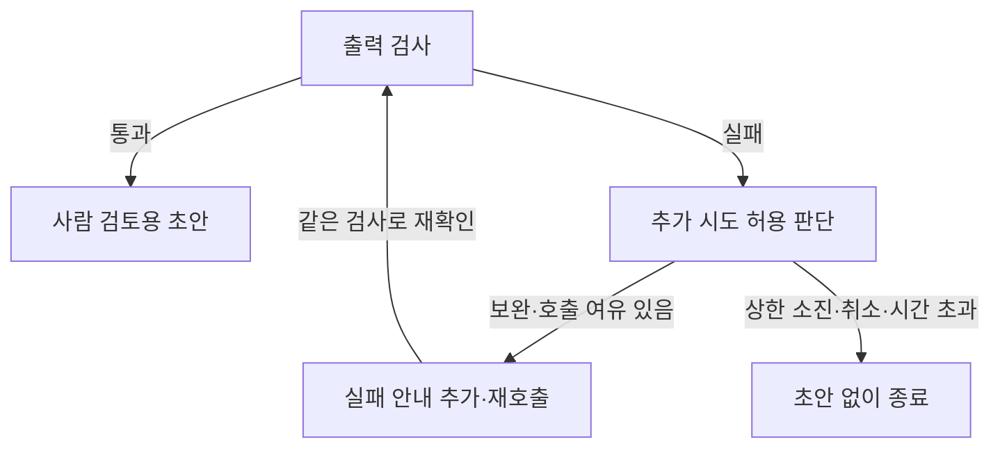

# 답을 받은 뒤 검사하고, 다시 시도하고, 멈추기

식비 규정을 답하는 도우미에 질문을 보냈다고 하자. 연결이 끊겼다면 같은 요청을 다시 보낼 수 있다. 반대로 응답은 도착했지만 약속한 형식이 아니라면 무엇을 고쳐야 할까? 세 번을 불렀는데도 쓸 수 있는 답이 없으면 계속 기다리게 해도 될까?

앞의 [Prompt](../강의용.md)와 [Context](<../Context Engineering/강의용.md>)에서는 무엇을 지시하고 어떤 자료를 넣을지 정했다. 이번에는 그 입력을 **호출하고, 결과를 검사하고, 필요한 경우 제한 안에서 다시 시도하고, 종료 이유를 남기는 실행기**를 배운다. 이런 실행기를 여기서는 Harness라고 부른다.

계속 같은 가상 기관의 “국내 당일 출장 식비 상한과 필요한 자료는?”을 사용한다. 근거는 사전 승인된 국내 당일 출장·상한 30,000원·영수증·식사 제공 예외다. [연결 실습](<../../../02. 실습/document-assistant/L2.md>)은 실제 모델 대신 미리 정한 응답과 오류를 넣어 실행기를 관찰한다. 고정 응답을 사용해도 호출·검사 코드는 실제로 실행된다. 그 기록을 모델 정답률로 바꾸지는 않는다.

## 1. 모델에 맡기는 일과 실행기가 맡는 일

### 요청 하나를 끝까지 따라가기

Provider는 모델이나 외부 서비스에 요청하고 결과를 돌려주는 연결부다. 현재 앱의 계약은 문자열을 받아 문자열을 반환하는 `generate(message)`다. Harness는 이 연결부 바깥에서 입력 준비·호출·검사·횟수·종료를 관리한다. 모델이 “검사 완료”라고 쓰는 것과 앱이 검사 함수를 실행한 것은 다르다.

첫 예에서는 아래 답안을 **교육용 고정 응답으로 작성**했다. 모델이 생성한 문장이 아니다.

> 사전 승인을 받은 국내 당일 출장 식비 상한은 30,000원입니다. 영수증이 필요하며 식사가 제공되면 지급하지 않습니다.

실행기에 돌려줄 때에는 답변 내용과 출처를 약속한 형태로 감싼다. 다음은 이 고정 응답의 **JSON 표현 예**다. 실행할 Python 코드나 실제 모델 응답 로그가 아니다.

```json
{"outcome":"answer","answer":"사전 승인을 받은 국내 당일 출장 식비 상한은 30,000원입니다. 영수증이 필요하며 식사가 제공되면 지급하지 않습니다.","citations":["DOC-A"]}
```

`outcome`은 답변 행동, `answer`는 사용자에게 보여줄 내용, `citations`는 제공 문서의 ID 목록이다. `DOC-A`는 현행 출장 규정이다. JSON 모양을 약속했기 때문에 실행기가 필드·자료형을 반복 검사할 수 있다. 이 세 필드가 있다는 사실만으로 그 문장이 맞다고 판정하는 것은 아니다.

이 응답을 실제 실행기에 넣어 관찰하면 다음처럼 진행된다.

| 순서 | 실행기가 한 일 | 누적 Provider 시도 |
|---|---|---|
| 1 | 현행 출장 자료를 고르고 최종 입력을 준비 | 0 |
| 2 | 고정 응답 Provider를 호출 | 1 |
| 3 | 출력 구조와 제공 문서 ID를 검사 | 1 |
| 4 | 사람이 검토할 초안을 반환하고 종료 | 1 |

시도는 한 번이고 통신 재시도·보완은 없다. 종료 이유는 **구조 통과·사람 검토 필요**다. “식비를 지급해도 된다”는 업무 승인이나 모델의 사실성 검증을 뜻하지 않는다. 위 답안이 원문의 조건과 일치하는지는 사람이 규정을 읽어 별도로 확인할 수 있다.

### 같은 앱에 실행 관리를 더한다

다음은 Backend 폴더에서 사용할 **실행 가능한 Python 코드**다. 고정 응답을 만드는 `draft`와 이를 돌려주는 `ScriptedProvider`는 실습 도구이며 실제 모델이 아니다.

```python
from app.harness import run_harness
from tools.harness_demo import ScriptedProvider, draft

answer = "사전 승인을 받은 국내 당일 출장 식비 상한은 30,000원입니다. 영수증이 필요하며 식사가 제공되면 지급하지 않습니다."
provider = ScriptedProvider([draft(answer)])
result = run_harness(provider, "C01")
print(result["status"], result["calls"], result["factuality_verified"])
```

`draft`는 답안과 기본 출처를 JSON 문자열로 만든다. `ScriptedProvider`는 준비한 순서대로 그 문자열이나 오류를 돌려준다. `run_harness`의 `C01`은 같은 식비 문의의 실제 실행 ID다. 결과의 `status`는 사람 검토가 필요한 초안, `calls`는 1, `factuality_verified`는 `False`다.

실행기는 앞의 입력 준비 함수를 재사용하고 출력 계약을 덧붙인 뒤 최종 2000문자 제한을 다시 확인한다. 입력이 처음에는 들어갔어도 뒤에 계약·보완 지시를 더하면 길이가 늘 수 있기 때문이다. 이번 관찰 도구가 기존 웹 API를 새 Harness 경로로 자동 전환하는 것은 아니다.

**이해 확인:**

1. 답변이 같은 문자열 형식으로 돌아오면 내용 검토도 끝난 것일까?
2. 입력 준비 뒤에 출력 계약을 추가했다면 왜 길이를 다시 확인할까?
3. 이 예의 Provider 시도 1회를 실제 모델 추론 1회라고 쓰면 왜 틀리는가?

## 2. 같은 요청을 재시도하는 것과 응답을 보완하는 것

### 통신이 실패하면 무엇이 부족한가?

연결 실패나 응답 대기 시간 초과가 생기면 실행기는 검사할 정상 응답을 받지 못한 상황이다. 이번 정책은 같은 입력으로 한 번만 재시도한다. 두 호출의 입력이 같은지 비교해야 “같은 요청을 다시 보냈다”고 말할 수 있다.

반면 응답이 왔는데 JSON 형식이 아니라면 내용물을 받기는 했지만 출력 계약을 지키지 않은 것이다. 이때는 실패 이유를 알려 주는 **보완 입력**을 만든다. 두 번째 입력이 달라지므로 통신 재시도와 구분한다.

| 관찰한 흐름 | Provider 시도 | 통신 재시도 | 보완 | 입력의 관계 |
|---|---|---|---|---|
| 시간 초과 → 정상 구조 | 2 | 1 | 0 | 두 입력이 같음 |
| 형식 오류 → 정상 구조 | 2 | 0 | 1 | 실패 안내가 추가되어 달라짐 |
| 시간 초과 → 형식 오류 → 정상 구조 | 3 | 1 | 1 | 1·2번째는 같고 3번째는 보완 입력 |

이는 고정 응답/오류를 실제로 주입해 확인한 제어 흐름이다. 실제 장애 서버의 복구율이나 모델의 수정 능력을 측정한 것이 아니다. 원격 오류 상태와 Provider 응답 해석 오류는 이번 정책에서 즉시 종료한다. 모든 오류가 잠깐 기다리면 해결되는 일시 오류는 아니다.

### 보완 한 번을 자세히 읽기

기존 실험의 첫 고정 응답은 `not json`이라는 문자열이다. 따라서 출력 계약 검사에 실패한다. 실행기는 원래 질문·자료·계약을 유지한 채 다음 안내를 추가한다. 아래는 **실제로 추가되는 보완 문장**이다.

> 검사 실패 ID: OUTPUT_CONTRACT. 원래 질문과 자료는 유지하고 출력 계약만 보완하라.

`OUTPUT_CONTRACT`는 출력 계약 실패를 가리키는 실제 기록 이름이다. 정답 금액을 알려 주는 값이 아니다. 틀린 응답 전문이나 평가용 정답·채점 기준을 보완 입력에 다시 넣지 않는다.

다음 그림은 **출력 검사 실패 뒤 보완하는 관계만** 보여준다. 통신 재시도와 모든 검사 순서를 포함한 전체 실행도는 아니다. 바로 아래 실제 사건 표와 연결해 읽는다.



| 사건 | 관찰 | 이때 할 수 있는 판단 |
|---|---|---|
| 최종 입력 준비 | 원래 자료·질문·출력 계약 결합 | 첫 호출의 기준 입력 |
| 첫 호출 | `not json` 반환 | 실제 모델 응답이 아닌 주입한 실패 |
| 검사 | 출력 계약 실패 | 검사 실패에 대한 보완 필요 |
| 보완 예약 | 실패 이름을 넣은 입력 생성 | 원래 입력과 달라짐 |
| 두 번째 호출 | 약속한 세 필드의 고정 응답 반환 | 같은 검사기로 재확인 |
| 검사·종료 | 구조 통과·초안 반환 | 내용과 업무 판단은 여전히 별도 |

기존 데모의 보완 뒤 문장은 “자료를 확인한 뒤 사람이 사실과 조건을 검토해야 합니다”라는 고정 문장이다. 식비 질문의 충실한 정답이 아닌데도 구조 검사는 통과한다. 보완 성공을 내용 개선으로 해석하지 않도록 이 차이를 읽는다.

### 횟수는 실행 전체가 공유한다

이 실습의 기본 정책은 **최초 호출 포함 최대 3회, 통신 재시도 최대 1회, 보완 최대 1회**다. 짧은 실험에서 첫 시도와 두 종류의 추가 시도를 관찰하기 위해 정한 값이며 모든 서비스의 권장 횟수는 아니다.

보완 단계에 들어갔다고 총 호출 수가 0으로 돌아가지 않는다. 시간 초과→형식 오류→정상 구조는 세 번 안에서 끝난다. 세 번째 응답이 검사를 통과하면 초안을 반환할 수 있지만 네 번째 호출을 새로 허용하지는 않는다. 보완 후 다시 실패하면 보완 예산이 소진되어 초안 없이 멈춘다. 실제 종료 이름은 어느 상한에 먼저 걸렸는지 함께 읽는다.

통신 시간 초과는 원격에서 아무 일도 하지 않았다는 보장이 아니다. 이 실습에는 외부 작업 도구가 없지만, 실제 저장·발송처럼 결과가 남는 작업의 재시도는 중복 실행을 따로 다뤄야 한다. 이번 규칙을 그대로 적용했다고 그 문제가 해결되지는 않는다.

**이해 확인:**

1. 시간 초과와 출력 계약 실패는 입력을 어떻게 다르게 다뤄야 하는가?
2. 보완 호출이 시간 초과하면 재시도·총 호출 예산을 처음부터 다시 주어도 될까?
3. 세 번째 호출의 구조가 통과했을 때에도 무조건 실패로 처리해야 할까?

## 3. 구조가 맞는 답과 근거가 맞는 답을 나누기

### 검사기가 실제로 보는 것

이번 출력 계약에서 행동은 답변·자료 부족·되묻기·거부 중 하나다. 각각 실제 필드 값은 `answer`, `abstain`, `clarify`, `deny`다. 답변 문자열은 비어 있으면 안 되고, 답변 행동에는 출처 ID가 필요하다. 추가 필드·중복 출처와 제공하지 않은 문서 ID도 거부한다.

다음은 [실제 검사 코드](<../../../02. 실습/document-assistant/backend/app/harness.py>)의 **핵심 발췌**다. 단독 실행 코드는 아니다. `raw`는 반환 문자열, `allowed_ids`는 이번 입력에 제공한 문서 ID 목록이다.

```python
draft = Draft.model_validate_json(raw)
```

이 호출이 JSON/필드·자료형·빈 값 등의 계약을 검사한다. 이어서 제공 ID를 확인한다.

```python
if not set(draft.citations).issubset(allowed_ids):
    return None, "CITATION_NOT_SUPPLIED"
```

`CITATION_NOT_SUPPLIED`는 제공하지 않은 출처를 인용했다는 실패 이름이다. 예를 들어 제한 문서를 실제로 제공하지 않았는데 그 ID를 답의 출처로 쓰면 거부한다. 이 검사는 인용한 조항이 주장을 뒷받침하는지까지 읽는 검사는 아니다.

### 같은 출처를 붙인 틀린 금액

기존 실험은 **“식비 한도는 999999원입니다.”에 DOC-A를 붙인 고정 응답**도 넣는다. 출력 모양은 맞고 DOC-A도 제공된 문서라 구조/제공 ID 검사는 통과한다. 그러나 현행 규정의 상한은 30,000원이므로 사람의 원문 검토에서 틀렸다고 판단해야 한다.

| 검토 층 | 확인하는 것 | 위 응답의 결과 |
|---|---|---|
| 출력 구조 | 필드·자료형·행동 값·빈 내용·중복 등 | 통과 |
| 제공 출처 | DOC-A를 이번 입력에 제공했는가? | 통과 |
| 의미·근거 | 금액·조건·예외가 실제 조항과 맞는가? | 금액 불일치 |
| 업무 사용 | 검토와 실행 권한이 충족됐는가? | 이 실습은 실제 승인/외부 작업을 수행하지 않음 |

자동 검사 통과 수가 늘어도 이 틀린 금액을 정답으로 바꿀 수 없다. 올바른 금액이라도 식사 제공 예외를 빠뜨렸다면 필수 내용을 보완해야 한다.

응답 크기 제한은 수신한 뒤 검사한다. 이것으로 생성 중 Token 사용량이나 비용을 강제로 제한한 것은 아니다. 현재 공통 Provider 계약은 사용량을 반환하지 않아 Token·비용 칸은 미확인이다. `None`을 0 Token·0원으로 읽지 않는다.

**이해 확인:**

1. 제공한 문서 ID인지 확인하면 왜 인용 내용의 타당성까지 알 수 없는가?
2. 허용하지 않은 ID를 쓴 응답과, 허용된 ID로 틀린 금액을 쓴 응답은 어느 검사에서 나뉘는가?
3. 응답을 다 받은 뒤 크기를 거부한 기록으로 생성 Token·비용 상한을 입증할 수 있는가?

## 4. 한 사례의 개선과 다른 사례의 회귀를 함께 보기

### 비교를 위해 무엇을 고정할까?

회귀는 변경 뒤에 이전에 되던 동작이 나빠진 것이다. 실제 모델/입력 버전을 비교할 때에는 질문 집합·자료·모델/리비전·생성 설정·평가 규칙을 고정하고 바꾼 조건을 기록한다. 최초 구조 통과, 보완 뒤 통과, 사실·조건·근거, 경계 행동, 호출 수는 각각 따로 본다.

이번 비교 도구는 같은 열두 질문에 **사람이 미리 정한 출력 A/B**를 넣는다. 모델이나 Prompt를 바꾸어 실행한 품질표가 아니다. 보완·재시도를 끄고 최대 한 번의 최초 구조 검사만 비교한다.

| 질문 | 고정 출력 A | 고정 출력 B | 읽을 변화 |
|---|---|---|---|
| 식비 문의 | `not json`으로 구조 실패 | 자료 부족이라는 세 필드의 구조 통과 | 구조 기준 개선. 적절한 식비 답이라는 뜻은 아님 |
| 교육비 지원 | `not json`으로 구조 실패 | 같은 구조 통과 | 구조 기준 개선 |
| 첨부 메모 지시 | 세 필드의 구조 통과 | `approved` 필드가 추가되어 실패 | 새 회귀 |
| 공백 질문 | 호출 전 입력 거부 | 호출 전 입력 거부 | 답변 오답으로 세지 않음 |

`approved`는 승인됐다는 의미로 끼워 넣은 필드다. 이번 계약에는 없으므로 거부한다. 모델이 그 값을 써도 실행 권한이 생기지 않는다.

여기서 회귀는 **출력 B가 이전과 달리 계약을 어긴 것**이다. 실행기가 승인 필드를 거부한 동작 자체는 정상이다. 응답 버전의 악화와 검사기의 거부 동작을 혼동하지 않는다.

### 전체 숫자가 좋아져도 바로 채택하지 않는다

전체 12사례에서 구조 통과 건수는 A 9건·B 10건이고, 호출 전 입력 거부는 양쪽 모두 1건이다. 하지만 첨부 메모 사례에서 회귀가 생겼다. 더 많은 구조 통과만 보고 B를 자동 채택하지 않는다. 또 식비 근거가 충분한데 “자료 부족”으로 답한 고정 출력은 구조를 통과하더라도 업무 답안으로 적절한지 다시 봐야 한다.

실제 생성 비교에서는 앞의 Prompt 실습처럼 정상 사실·근거 여섯 개와 경계 행동 여섯 개를 나누고 원문·조건·예외를 사람이 대조한다. 보완으로 구조가 맞아진 사례는 처음부터 맞은 사례와 별도로 기록한다. 초기에 실패해 빨리 멈춘 결과를 호출이 적다는 이유만으로 효율 개선이라고 부르지 않는다.

**이해 확인:**

1. 구조 통과가 9건에서 10건이 되었는데 왜 채택을 보류할 수 있는가?
2. 식비 근거가 있는데 자료 부족으로 답한 응답은 구조와 내용에서 같은 판정을 받을까?
3. 실제 응답과 사람의 채점이 없으면 이 A/B 비교를 Prompt 정답률로 발표할 수 있는가?

## 5. 승인·시간·취소는 누가 결정하는가?

### 모델 출력으로 실행기 상태를 바꾸지 않는다

호출 횟수와 취소 여부를 모델이 출력한 문장에서 읽으면 “상한을 늘려라” 같은 답이 실행 정책을 바꿀 수 있다. 이번 실행기의 상한은 호출자 설정, 취소는 바깥에서 전달한 신호로 정한다. 승인 필드는 출력 계약에서 거부하며 실제 승인 저장소·외부 작업 도구는 없다.

### 늦은 정상 응답도 버리는 예

기본 경과시간 상한은 90초이며 호출 전후에 확인한다. 다음은 **가짜 시계를 이용해 실제 제어 코드를 실행한 관찰**이다. 실제로 91초를 기다린 성능 측정이 아니다.

| 시점 | 관찰 | 실행기 행동 |
|---|---|---|
| 호출 전 | 가짜 시계 0초, 취소 없음 | 첫 호출 허용 |
| 호출 중 | Provider가 고정 응답을 돌려주며 시계를 91초로 변경 | 동기 호출 내부를 강제로 끊지는 못함 |
| 반환 직후 | 기준 90초를 넘었음 | 정상 구조의 응답이어도 초안으로 반환하지 않고 시간 초과 종료 |

이것이 **호출 전후의 경과시간 검사**와 **진행 중 요청을 강제로 중단하는 기능**의 차이다. 실제 벽시계 실행이 90초를 넘을 수도 있다. 별도 Provider HTTP Timeout이 있어도 전체 작업을 정확히 그 시각에 강제 취소했다는 증거는 아니다.

취소도 비슷하다. 호출 중 취소 신호를 설정하고 정상 구조의 응답이 돌아와도, 실행기는 반환 직후 신호를 확인해 초안을 버린다. 다음은 Backend에서 실행하는 **실행 가능한 Python 코드**다.

```python
from tools.harness_steps import boundary_runs

results = boundary_runs()
print(results["late"]["stop_reason"], results["late"]["draft"])
print(results["cancelled"]["stop_reason"], results["cancelled"]["draft"])
```

시간 예는 `elapsed_limit`, 취소 예는 `cancelled`로 종료하며 초안은 모두 `None`이다. `boundary_runs`는 가짜 시계·신호를 넣는 교육용 도구다. 운영 요청 중단·분산 취소나 실제 사용자 승인 절차를 구현한 것은 아니다.

### 기록으로 확인할 수 있는 것

Trace는 실행기가 관찰한 사건의 순서·실패·입출력 해시·종료 이유다. 모델의 내부 사고 과정을 복원하는 기록이 아니다. 해시는 입력이 같거나 달라졌는지 비교하는 데 사용하지만 원문을 복원하거나 내용을 암호화해 보관한 것은 아니다.

기본 Trace에는 잘못된 응답 전문·문서 본문·Key를 자동 복사하지 않는다. 다만 결과의 초안에는 답변 문장이 남을 수 있다. Trace 원문이 없다는 사실을 모든 산출물에 민감 내용이 없다는 뜻으로 확대하지 않는다. 실제 보관·공유 범위는 별도로 정해야 한다.

**이해 확인:**

1. 호출 전에 90초를 검사했다면 진행 중인 호출도 정확히 90초에 끊었다고 할 수 있는가?
2. 모델 출력의 “승인됨”과 호출자가 전달한 취소 신호 중 무엇을 실행 정책으로 읽는가?
3. Trace에 원문이 없고 해시가 있다면 재현용 원문이나 모든 산출물의 내용 처리도 끝난 것인가?

## 실습과 다음 연결

[연결 실습](<../../../02. 실습/document-assistant/L2.md>)에서 한 요청의 전체 실행, 통신 재시도/보완, 구조와 내용의 다른 판정, A/B 회귀, 시간/취소를 확인한다. 각 결과에 어떤 Provider를 썼고 무엇을 실제로 검증했는지 함께 기록한다.

다음 [Embedding 강의](<../../06. 임베딩(Embedding)/강의용.md>)와 [검색 인덱스 강의](<../../07. 벡터 데이터베이스(VectorDB)/강의용.md>)는 수동 문서 선택을 실제 검색으로 확장한다. 검색된 출처가 존재한다는 것과 답을 뒷받침한다는 것의 구분은 계속 필요하다.

<details>
<summary>강사용 해설과 구현 위치</summary>

개념별 질문·활동 해설·기존 단원 매핑은 [강사용 안내](강사용.md)에 있다. 이번 실행 정책의 근거는 [실제 Harness](<../../../02. 실습/document-assistant/backend/app/harness.py>), [기존 고정 응답 실험](<../../../02. 실습/document-assistant/backend/tools/harness_demo.py>), [관찰 도구](<../../../02. 실습/document-assistant/backend/tools/harness_steps.py>)다. 특정 라이브러리나 모든 서비스의 일반 정책으로 확장하지 않는다.

</details>
