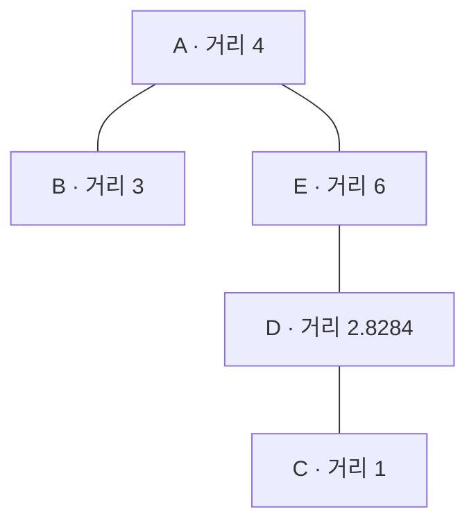

# 찾은 문장을 원문으로 확인하고, 바뀐 자료를 다시 검색하기

검색 결과가 “국내 당일 출장 식비 상한은 30000원”이라는 문장을 돌려줬다. 이제 어떤 문서의 어느 버전인지 확인해야 한다. 내일 규정이 바뀌거나 접근 권한이 없어지면 오늘의 검색 결과를 그대로 써도 될까? 벡터만 남겨 두었다면 그 문장을 다시 찾을 수 있을까?

[Embedding 수업](<../06. 임베딩(Embedding)/강의용.md>)에서는 질문과 자료를 비교할 숫자 표현을 만들었다. 이번에는 **그 표현과 본문·출처·상태를 함께 저장하고, 필요한 후보를 찾고, 변경 후 오래된 결과를 거부하는 방법**을 배운다. 저장소에 검색에 필요한 자료와 구조를 준비한 것을 여기서는 Index라고 부른다. 단순히 ‘벡터가 들어 있는 파일’만을 뜻하지 않는다.

예제 규정과 금액은 모두 [가상 원본 자료](<../../02. 실습/document-assistant/data/documents-v1.json>)다. 기본 구현은 SQLite에 본문과 벡터를 저장하고 적격 벡터를 모두 비교한다. 별도의 FAISS 실험은 합성 벡터로 탐색 방식을 비교한다. 이 둘과 원리 설명용 좌표 예제를 구분하며 [연결 실습의 Index 활동](<../../02. 실습/document-assistant/L3.md#index-활동>)을 진행한다.

## 1. 문장 하나를 저장하고 원문으로 돌아가기

### 본문·벡터·Metadata는 서로 다른 질문에 답한다

가상 출장 규정의 첫 줄에는 금액뿐 아니라 사전 승인·영수증·식사 제공 예외가 있다. 검색용 벡터는 이 조각과 질문의 관련도를 계산하는 데 쓴다. 하지만 벡터의 숫자만 읽어서는 “식사가 제공되면 지급하지 않는다”는 문장을 정확히 복원할 수 없다. 그래서 본문을 함께 보관한다. 또 그 본문이 현행인지, 누구에게 허용되는지, 어느 버전인지는 **Metadata**, 즉 자료를 설명하는 별도 정보로 남긴다.

이번 구현은 문서의 비어 있지 않은 줄을 검색 조각인 Chunk로 나눈다. 출장 규정은 두 줄이므로 두 조각이다. 각 벡터의 입력은 제목과 해당 줄이며, 검색 결과 본문은 그 줄이다. 작은 자료에서 조건·예외가 한 줄 안에 모여 있어 겹침 없이 나눈 것이다. 긴 PDF나 표에서도 한 줄 분할이 좋은 전략이라는 뜻은 아니다.

| 실제 저장 위치 | 들어가는 정보 | 왜 필요한가 |
|---|---|---|
| SQLite의 documents | 문서 ID·버전·제목·전체 본문·접근/현행/삭제 상태·본문 해시 | 문서 단위 상태와 변경을 관리 |
| SQLite의 chunks | 조각 ID·문서 ID·내부 줄·줄 본문·벡터 | 비교할 단위와 근거 문장을 함께 보관 |
| SQLite의 meta | 표현 설정·변경 번호·조각 정책·최초 자료 경로 | 벡터 호환성과 검색 시점을 확인 |

이것들은 서로 다른 문서를 새로 만드는 지시가 아니라 [현재 저장 구현](<../../02. 실습/document-assistant/backend/retrieval/index.py>)의 실제 테이블 이름이다. 검색할 때 조각과 문서 정보를 연결한다. 문서 ID만 같다고 옛 조각과 새 본문을 섞지 않는다.

### 실제 검색 결과 한 건 읽기

아래는 **저장된 실제 E5 검색 기록에서 출장 식비 질문의 첫 결과 중 필요한 필드를 발췌한 JSON**이다. 전체 실행 코드가 아니고, 벡터 자체도 이 응답에는 들어 있지 않다.

```json
{
  "chunk_id": "DOC-A@v1:L1",
  "doc_id": "DOC-A",
  "version": "v1",
  "line": 1,
  "text": "1. 사전 승인을 받은 국내 당일 출장의 식비 상한은 30000원이다. 영수증이 필요하며 식사가 제공되면 식비를 지급하지 않는다.",
  "content_sha": "0604aeacf48c57829a2873dcdd8d3dac963aa089e0f9b5f6cb0fd1f6de4728f7",
  "origin_path": "data/documents-v1.json",
  "source_locator": "sqlite:documents/DOC-A@v1:L1"
}
```

`DOC-A`는 가상 출장 규정을 파일에서 찾기 위한 실제 ID다. `@v1:L1`은 그 문서 v1의 내부 첫 줄이다. 원본 JSON 파일 전체의 첫째 행이라는 뜻이 아니다. `origin_path`는 최초 입력 파일을, `source_locator`는 SQLite에서 해당 문서/버전/줄을 찾는 논리적 위치를 가리킨다.

`content_sha`는 문서 전체 본문으로 계산한 해시다. 같은 문서의 첫째·둘째 조각은 이 값을 공유한다. 해시는 내용이 바뀌었는지 대조하는 데 쓰며 규정의 진실성이나 발행기관을 인증하지 않는다. 질문·벡터·내용 해시도 각각 다른 대상의 값이므로 섞지 않는다.

실습에서는 원본 파일의 `documents` 목록에서 ID가 DOC-A인 항목을 찾고, 그 항목의 `text`를 줄바꿈으로 나눈 첫 줄과 대조한다. 최초 v1에서는 일치한다. 갱신 실험의 v2는 임시 SQLite에만 만들므로 원본 JSON을 열어도 v1이 남는다. 그때의 v2 본문은 해당 저장소와 변경 관찰 기록에서 확인해야 한다. 경로 하나만 남겨 두면 모든 시점의 근거를 복원할 수 있는 것은 아니다.

**생각해 볼 질문**

1. 문서 ID와 384차원 벡터만 저장했다면 어느 버전의 어떤 조건을 근거로 삼았는지 재현할 수 있는가?
2. `L1`을 JSON 파일의 물리적 첫 행으로 읽으면 왜 다른 곳을 보게 되는가?
3. 두 조각의 `content_sha`가 같은 이유는 무엇이며, 이 해시가 맞으면 규정의 사실성도 검증되는가?

## 2. 모든 후보 비교와 일부 후보 탐색은 무엇이 다른가

### 다섯 점에서 정확한 이웃 구하기

먼저 의미 검색과 분리해 **직접 정한 2차원 좌표**로 계산하자. 질의 q=(0,0), 자료점은 아래 다섯 개다. 단위 정규화한 E5 벡터가 아니며 이 예제는 L2 거리를 사용한다. 거리가 작을수록 가깝다.

| 점 | 좌표 | q와 L2 거리 | 순위 |
|---|---|---:|---:|
| A | (4,0) | 4 | 4 |
| B | (3,0) | 3 | 3 |
| C | (0,1) | 1 | 1 |
| D | (2,2) | √8 ≈ 2.8284 | 2 |
| E | (6,0) | 6 | 5 |

다섯 점을 모두 비교하면 C→D→B→A→E다. 상위 두 개, 즉 k=2이면 C와 D를 반환한다. **Exact 검색**은 정해진 집합과 거리에서 이런 상위 결과를 빠뜨리지 않고 구한다. 이 작은 구현은 적격 집합을 전부 비교한다. 정답 문서라는 의미의 ‘정확함’과는 다르다. 벡터 표현 자체가 질문과 맞지 않으면 모든 벡터를 비교해도 필요한 규정은 낮게 나올 수 있다.

자료가 많아질 때는 매번 전부 비교하는 대신 일부 후보만 살펴 계산을 줄일 수 있다. 이웃을 근사적으로 찾는 **ANN(Approximate Nearest Neighbor)**은 이 과정에서 Exact 상위 이웃을 놓칠 수 있다. 예를 들어 U 구역의 A·B·D·E만 비교하면 D→B가 상위 두 개가 된다. 진짜 첫째인 C를 아예 살펴보지 않은 것이다. 그 구역을 고르는 과정은 다음 장에서 계산한다.

이 결과의 Exact 이웃 회수율은 `{C,D}`와 `{D,B}`가 겹치는 한 개를 기준 두 개로 나눈 `1/2=0.5`다. 이것은 **같은 벡터의 Exact 이웃**을 되찾은 비율이다. 앞 수업의 ‘필요한 문서가 상위 조각에 들어왔는가’와 분모가 다르다. 어느 쪽도 최종 답변 정답률은 아니다.

### 속도도 같은 조건에서 비교한다

Exact와 ANN을 비교하려면 자료 벡터·질의·거리·k를 고정한다. 표현 모델을 동시에 바꾸면 탐색 누락과 표현 차이를 구분하기 어렵다. 검색 시간만 잴 것인지, 인코딩·Index 구축·학습도 포함할 것인지도 정해야 한다. 작은 자료에서는 ANN 구조를 다루는 비용 때문에 Exact가 더 빠를 수 있다.

기존 선택 실험은 단위 길이의 **32차원 합성 벡터 4096개와 질의 128개**를 FAISS로 검색했다. 언어 모델로 만든 값이 아니다. Exact 상위 10개와 겹친 비율을 질의별로 계산한 평균과, 따뜻한 검색을 5번 실행한 배치 지연 중앙값을 남겼다. 인코딩·학습·구축 시간과 동시 사용자 성능은 포함하지 않았다.

| 기존 설정 | 전체 128질의 평균 이웃 회수율 | 첫 질의만의 회수율 | 128질의 배치 ms |
|---|---:|---:|---:|
| Exact | 100% | 100% | 2.302 |
| HNSW, efSearch=8 | 44.92% | 60% | 0.508 |
| HNSW, efSearch=64 | 92.81% | 100% | 3.075 |
| IVF, nprobe=1 | 16.64% | 20% | 0.149 |
| IVF, nprobe=16 | 81.72% | 80% | 1.125 |
| IVF, nprobe=64 | 100% | 100% | 3.867 |

이 표는 [저장된 과거 실행](https://github.com/cocoa2260/k-edu/blob/work/curriculum-production-001/curriculum-work/reports/KEDU-PRODUCTION-005/ann-observed.json)이며 지금 새로 측정한 속도가 아니다. HNSW의 첫 질의가 100%여도 전체 평균은 92.81%다. 첫 질의만 보고 전체 성공으로 표시하면 안 된다. 기록에는 첫 질의의 ID들이 있어 그 교집합은 다시 계산할 수 있지만, 전체 128질의의 ID가 모두 있는 것은 아니므로 이 파일만으로 전체 평균을 독립 재계산했다고 하지는 않는다.

**생각해 볼 질문**

1. Exact에서 필요한 규정을 놓쳤다면 항상 ANN 탐색 폭부터 늘려야 하는가?
2. Exact의 상위 둘이 C·D이고 근사 결과가 D·B라면 이웃 회수율은 얼마인가? 문서 정답률인가?
3. 첫 질의에서 10개를 모두 되찾았다면 전체 128질의의 회수율도 100%인가?

## 3. HNSW의 이웃 연결과 IVF의 구역 선택

### 그래프를 따라갈 때는 보지 않은 후보가 남는다

HNSW는 자료점을 이웃 연결 그래프로 구성하고 여러 층의 탐색을 이용한다. 윗층은 더 적은 점을 통해 출발 위치를 좁히고, 내려와 더 세밀한 이웃 후보를 탐색한다. 실제 구조에는 자료 추가 시 층과 이웃을 고르는 절차, 후보 유지와 종료 규칙이 있다.

먼저 아래 **직접 그린 아랫층 연결 예제**로 이웃 이동의 한계를 보자. 실제 HNSW가 구축한 그래프나 FAISS 내부 추적이 아니다. 각 노드의 숫자는 앞 질의와의 L2 거리이며 그림상의 선 길이가 거리는 아니다.



A에서 이웃 B·E를 본다. 당장 더 가까운 곳으로만 이동하면 B를 고른다. B의 이웃은 A뿐이고 A는 더 멀다. 여기서 멈추면 C를 놓친다. E는 당장 멀지만 E→D→C로 이어지는 길을 가지고 있다. 한 후보만 남기지 않고 살펴볼 후보를 유지하면 이런 다른 경로를 탐색할 여지가 생긴다.

관찰 도구는 이해를 돕기 위해 후보를 남긴 단순 확장에서 A→B→E→D→C를 출력한다. **이 확장 규칙은 HNSW 구현이 아니다.** 별도의 가상 윗층에 A—D 연결을 주었다면, 윗층에서 A→D로 이동하고 아랫층에서 D→C로 갈 수 있다. 계층과 후보 유지가 어떤 일을 하는지 보여 주는 예이며 모든 그래프에서 정답을 보장한다는 증명이 아니다.

실제 HNSW의 M은 이웃 연결 수와 관련되고, efConstruction은 구축 시, efSearch는 검색 시 탐색 폭을 조절한다. 연결·폭을 늘리면 이웃을 더 잘 찾을 기회가 생기지만 메모리·구축·검색 비용도 든다. efSearch=64를 ‘모든 요청에서 정확히 64개 벡터를 비교’ 또는 ‘64% 정확도’로 읽지 않는다. 이 수업 도구의 단순 확장 횟수와도 일대일 대응시키지 않는다.

### 가까운 구역을 골라도 가장 가까운 점이 다른 구역에 있을 수 있다

IVF는 자료를 구역별 목록으로 나누고 질의와 가까운 일부 구역만 탐색한다. 구역 수가 nlist, 검색할 구역 수가 nprobe다. 실제 실험에서는 대표 벡터로 구역 중심을 학습한다. 아래 중심은 **손계산용으로 직접 정한 것**이며 학습 결과가 아니다.

중심 U=(3,0), V=(0,4)로 정하고 각 점을 더 가까운 중심의 구역에 넣자. A·B·D·E는 U에, C는 V에 들어간다. C에서 U까지 거리는 √10≈3.1623, V까지는 3이므로 V가 맞다. 그런데 질의 q=(0,0)에서 중심까지 거리는 U가 3, V가 4다. 가까운 중심 하나만 고르면 U를 탐색하고, 정작 가장 가까운 점 C는 놓친다.

| 탐색할 구역 | 비교하는 점 | 상위 두 점 | Exact C·D와 겹친 비율 |
|---|---|---|---:|
| U만 | A·B·D·E | D·B | 1/2 |
| U와 V | 다섯 점 전부 | C·D | 2/2 |

nprobe를 늘리는 것은 **이미 만든 같은 표현의 탐색 범위**를 바꾼다. 임베딩 모델을 바꾸는 것은 표현 자체를 바꾼다. 범위를 넓혀도 잘못된 의미 표현을 자동으로 고치지는 않는다. 실제 사용에는 구역 분포·메모리·자료량·지연을 함께 평가한다.

기존 실험은 HNSWFlat에서 M=8, efConstruction=40을 고정하고 efSearch를 8→64로, IVFFlat에서 nlist=64를 고정하고 nprobe를 1→16→64로 바꿨다. 이 IVFFlat은 고른 구역 안에서 원래 벡터를 비교한다. 모든 구역을 검색해 이 실험의 Exact 이웃 회수율이 1이 된 것이며 모든 IVF 압축 변형의 보장을 뜻하지 않는다.

사용 중인 FAISS HNSW는 벡터 제거를 지원하지 않는다. SQLite에서 삭제를 확인했다고 HNSW에서도 삭제가 검증된 것은 아니다. HNSW에 삭제 표식·조회 제외·재구축을 붙인다면 그 동작과 누락을 별도로 확인해야 한다.

**생각해 볼 질문**

1. 가상 그래프에서 A→B로만 움직이면 C를 놓치는 이유는 무엇인가? 이것이 HNSW 전체 알고리즘인가?
2. 질의는 U 중심에 더 가까운데 왜 진짜 최근접점 C를 놓치는가?
3. efSearch/nprobe를 늘리는 것과 임베딩 모델을 바꾸는 것은 각각 무엇을 바꾸는가?

## 4. 허용한 자료를 고르고, 변경 뒤에는 다시 읽기

### 나중에 빼기만 하면 후보 수가 줄 수 있다

권한 밖 자료의 점수가 가장 높고 그다음이 허용 자료라고 하자. 전체에서 상위 한 개를 먼저 고른 뒤 권한 밖 자료만 빼면 결과가 비어 버린다. 허용된 집합에서 먼저 순위를 계산했다면 허용 자료를 고를 수 있었다. 현재 작은 Exact 구현은 접근 역할·현행·미삭제 조건과 해당 요청의 가용 문서 목록을 먼저 적용한다. ANN의 필터 결합 방식까지 같다고 가정하지 않는다.

처음 저장한 가상 문서는 6개이고 조각은 11개다. 이전 출장 규정 한 조각과 제한 문서 한 조각을 제외하면 기본 적격 조각은 9개다. 공격 메모는 접근 가능한 현행 자료라 이 필터만으로 제거되지 않는다. 접근 가능 여부와 믿을 만한 규정인지도 별개다. `staff`는 고정 학습 역할이며 실제 로그인·기관별 권한 체계는 아니다. SQLite에는 제한 자료도 저장되므로 파일 자체를 일반 사용자에게 제공하는 구조가 아니다.

### 한 번의 갱신과 삭제를 시간순으로 따라가기

아래는 [관찰 도구](<../../02. 실습/document-assistant/backend/tools/index_steps.py>)가 기존 Index를 호출해 확인하는 순서다. **실제 임시 SQLite 동작에 의미 없는 고정 2차원 벡터를 넣는 실습**이다. 검색 모델·금액 이해·검색 품질을 검증하는 것이 아니다. 기존 실제 E5 변경 기록도 별도로 읽을 수 있다.

| 시점 | 저장소와 검색 결과 | 이전 선택을 Context로 준비하면 |
|---|---|---|
| 처음 | 원본 6문서 저장, 변경 번호6, 11조각. 출장 규정 v1의 30000원 첫 줄 선택 | 현재 저장소에서 다시 읽어 전달 |
| 갱신 | 출장 규정만 v2 시험용 35000원 한 줄로 교체, 번호7, 10조각 | 번호6 선택 거부. 새 검색은 v2를 반환 |
| 삭제 | 출장 규정 조각 제거, 본문·제목·해시 비움, 삭제 표식. 번호8, 9조각 | 번호7 선택도 거부. 다시 찾아도 출장 규정은 없음 |
| 새 Index 재구축 | 원본 v1 자료로 새 저장소 생성, 11조각, 30000원 복귀 | 새 저장소의 선택을 사용 |

6→7→8은 이 구현이 문서를 저장/변경할 때 증가시킨 번호다. 규정 버전 v6·v7이라는 뜻이 아니다. 별도로 만든 Index의 번호6도 예전 Index의 번호6과 같은 시점이라는 보장이 없다. 현재 단일 저장소의 변경 감지 방식이며 여러 서버·Index 교체까지 포함한 전역 식별 체계는 아니다.

갱신할 때는 새 벡터를 먼저 준비한다. 생성에 실패하면 기존 내용을 유지하고, 성공하면 본문·버전·조각·벡터와 변경 번호를 저장 트랜잭션으로 바꾼다. 부분적으로 새 본문과 옛 벡터가 섞이지 않게 하려는 것이다. 같은 문서의 수정 전 선택을 그대로 모델에 보내지 않는다.

아래는 **현재 Context 준비 함수의 실제 핵심 발췌**다. `selection`과 저장소가 이미 있는 함수 내부이며 단독 실행 코드가 아니다.

```python
if selection['generation']!=self.generation or selection['profile_sha256']!=profile_hash(self.encoder.profile):
    raise StaleSelection("Index changed; search again before Context assembly")
```

선택 당시 변경 번호와 표현 설정 해시를 현재와 대조한다. 통과한 뒤에도 본문은 선택 결과의 문자열을 그대로 믿지 않고 저장소에서 다시 읽으며 접근·현행·삭제·내용 해시를 확인한다. 실습에서는 결과의 `text`만 위조해도 원본 본문이 다시 나오는지 본다. 이것은 작은 앱의 재조회 규칙이다. 호출자가 선택 구조 전체를 임의 작성해도 안전한 서명/인증 토큰이라는 뜻은 아니다.

삭제는 검색 조각/벡터를 제거하고 문서 행에는 ID·버전·접근 정보·삭제 표식 등을 남기는 방식이다. 디스크 잔여·백업·로그·다른 프로세스 캐시까지 안전하게 지웠다는 증거는 아니다. 이 실습은 동시 분산 변경도 검증하지 않는다.

표현 설정이 다르면 같은 차원이어도 기존 Index를 열지 못하게 한다. 실제 E5의 기존 변경 시험은 **같은 가중치의 Token 상한 512→128**이며 다른 가중치 전환 실험은 아니다. 이번 고정 벡터 시연에서도 설정 일치 거부와 새 저장소 구성을 관찰하지만 실제 Tokenizer의 길이 제한 실행은 하지 않는다.

또 하나 구분하자. 삭제 뒤에 **원본 v1 자료로 재구축하면 삭제한 출장 규정이 다시 들어온다.** 삭제 정책을 유지하려면 재구축의 입력에도 삭제·권한·현행 상태를 반영해야 한다. 이 실습은 원본을 복원하는 시험이므로 재등장을 정상으로 보여 준다. 운영상 삭제가 유지됐다는 증거로 쓰면 안 된다.

**생각해 볼 질문**

1. 제한 자료를 전체 상위 한 개에서 나중에 빼면 허용 자료를 놓칠 수 있는 이유는 무엇인가?
2. 갱신 전 검색 결과가 있어도 다시 검색해야 하는 이유는 무엇이며, 결과의 본문 문자열만 바꾸면 Context에도 반영되는가?
3. SQLite에서 삭제한 뒤 변경하지 않은 원본 JSON으로 재구축하면 삭제가 유지되는가? 무엇을 추가로 관리해야 하는가?

## 실습과 다음 연결

[Index 활동](<../../02. 실습/document-assistant/L3.md#index-활동>)에서 원문 추적, 좌표 계산/탐색, 실제 SQLite 변경, 저장된 E5/FAISS 기록 읽기를 차례로 수행한다. 학생 자신의 실제 모델/FAISS 재실행은 기존 환경 준비를 별도로 따른다. 계산·동작 검사·검색 품질·수업 검증은 다른 근거다.

구현 제약은 FAISS 공식 [Index 종류](https://github.com/facebookresearch/faiss/wiki/Faiss-indexes)와 [선택 가이드](https://github.com/facebookresearch/faiss/wiki/Guidelines-to-choose-an-index)를, 계층 그래프의 배경은 [HNSW 원 논문](https://arxiv.org/abs/1603.09320)을 참고한다. 그림과 다섯 점은 이 수업의 설명용 예제다. 다음 [RAG 수업](<../08. 검색 증강 생성(RAG)/강의용.md>)에서는 검색한 조각을 Context로 준비하고 생성·근거 검토까지 연결한다.
