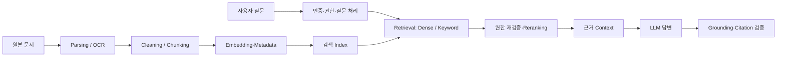

# Phase 2 — 08. RAG

## 개요

Offline Indexing과 Online Query를 연결하고 검색·생성 실패를 따로 평가한다.

## 학습 목표

이 과목이 끝나면 다음을 자신의 언어로 설명할 수 있어야 합니다.

- LLM의 Parameter 지식과 RAG가 가져오는 외부 Context의 차이를 설명한다.
- RAG를 **Offline Indexing Pipeline**과 **Online Query Pipeline**으로 나누어 설명한다.
- Parsing/OCR, Cleaning, Chunking, Metadata, Embedding, Index가 왜 필요한지 설명한다.
- Dense/Sparse/Hybrid Retrieval과 Reranking의 역할을 구분한다.
- Query Rewrite가 검색 성능을 높일 수 있는 이유와 원 질문을 보존해야 하는 이유를 설명한다.
- Grounding과 Citation의 차이를 설명한다.
- 근거 충분/부족/없음/충돌 상황에서 서비스가 어떻게 행동해야 하는지 설계한다.
- Retrieval 실패와 Generation 실패를 분리하여 디버깅한다.
- 권한, Version, 시행일, Prompt Injection을 포함한 RAG의 운영 위험을 설명한다.

## 전체 학습 지도

```text
[Offline: 문서를 검색 가능한 지식으로 준비]

원본 문서
   ↓
권한 / Version 확인
   ↓
Parsing / OCR
   ↓
Cleaning
   ↓
Chunking
   ↓
Metadata
   ↓
Embedding / Sparse Index
   ↓
Vector DB / Search Index
   ↓
샘플 검색 검증


[Online: 질문에 필요한 근거를 찾고 답변]

사용자 질문
   ↓
인증 / 권한 확인
   ↓
질문 해석 / 필요 시 Query Rewrite
   ↓
Dense + Keyword/Sparse Retrieval
   ↓
Reranking
   ↓
Context 구성
   ↓
LLM Generation
   ↓
Grounding / Citation / 형식 / 안전 검증
   ↓
답변 + 확인 가능한 근거
```

그리고 품질 평가는 두 축으로 나눕니다.

```text
Retrieval Evaluation
= 정답 근거를 찾았는가?

Generation Evaluation
= 찾은 근거를 올바르게 사용했는가?
```

## Why

최신 문서를 붙였다는 사실만으로 근거 있는 답변이 만들어지지 않는다.

## Concept

검색된 근거, 답변 주장, 인용 위치는 별도로 확인해야 한다.

## Architecture

문서 파싱·Chunk·Index → 권한 Filter·검색 → 생성·인용 검증으로 나눈다.

## Example

정답 Chunk는 검색됐으나 답변의 금액과 페이지가 틀린 사례를 분석한다.

## Practice

소수 문서에서 질문별 정답 Chunk와 답변 문장을 대조한다.

## Summary

RAG 품질은 Retrieval과 Generation 및 인용·권한을 함께 측정한다.

## 실무 팁

원문 위치·버전을 Metadata로 보존하고 주장별 Citation을 확인한다.

## 주의사항

검색 결과가 있어도 모델이 지어낸 사실을 그대로 내보내지 않는다.

## 참고자료

- [본문의 공식·원문 참고자료](https://developers.openai.com/api/docs/guides/retrieval)

## 관련 Wiki Link

- `[[임베딩(Embedding)]]`는 기존 강의의 Wiki 제안 표기다. 실제 Wiki 경로는 아직 확인되지 않았다.

---

# [학습] 검색 증강 생성(RAG, Retrieval-Augmented Generation) (Unit 1 - 왜 LLM만으로는 부족한가?)

> **개정 기준: 2026-09-26 (KST).** 여기서 RAG는 특정 Provider의 제품명이나 API 호출 하나가 아니라, 외부 근거를 준비하고 질문 시 검색·검증하여 생성에 연결하는 애플리케이션 구조입니다.

> **커리큘럼 위치**
> 
> ① AI 최신 동향 및 전체 지도 ✅
> 
> ② AI / 머신러닝 / 딥러닝 개요 ✅
> 
> ③ Transformer ✅
> 
> ④ LLM ✅
> 
> ⑤ Prompt Engineering ✅
> 
> ⑥ Embedding ✅
> 
> ⑦ Vector DB ✅
> 
> **⑧ RAG** ← 현재 학습
> 
> ⑨ Agent
> 
> ...

---

## 이번 학습 목표

이번 Unit이 끝나면 다음 질문에 답할 수 있어야 합니다.

- RAG는 왜 등장했는가?
    
- LLM만으로는 왜 부족한가?
    
- RAG는 어떤 문제를 해결하는가?
    
- RAG는 어떻게 동작하는가?
    
- 왜 기업들이 RAG를 사용하는가?
    

---

## ① 문제 이해 (Why)

### ChatGPT에게 회사 규정을 물어보자.

여러분이 회사를 운영한다고 가정해보겠습니다.

사내에는

```text
- 인사 규정

- 휴가 규정

- ERP 매뉴얼

- 계약서

- 개발 문서

- 업무 프로세스
```

수천 개의 문서가 있습니다.

직원이 질문합니다.

> "우리 회사 연차는 몇 일인가요?"

ChatGPT는 답할 수 있을까요?

답은

**기본적으로는 모릅니다.**

---

### 왜 모를까?

우리는 이전 시간에

LLM은

```text
Pre-training
```

을 통해 많은 패턴과 지식을 Parameter에 학습합니다.

하지만 여기서 중요한 구분이 있습니다.

```text
Model Parameter
= 학습 과정에서 형성된 내부 지식과 능력

Current Context
= 지금 요청에서 Prompt, 검색 결과, Tool 결과 등으로 전달한 정보
```

회사 내부 문서가 공개 학습 데이터에 없고 현재 요청에도 제공되지 않았다면, 모델은 그 문서의 최신 내용을 신뢰성 있게 알 수 없습니다.

따라서 문제는 단순히 “LLM이 아무것도 모른다”가 아니라 다음과 같습니다.

```text
최신성
비공개 정보
정확한 Version
사용자 권한
출처 추적

→ Model Parameter만으로 관리하기 어렵다.
```

---

### 그럼 다시 학습시키면 되지 않을까?

많은 사람들이

이렇게 생각합니다.

> "회사 문서를 다시 학습시키면 되지 않나요?"

모델을 추가 학습해 도메인 지식이나 작업 능력을 조정하는 방법도 있습니다. 그러나 **자주 바뀌는 회사 문서를 정확한 출처와 함께 답해야 하는 문제**에는 학습만으로 관리하기 어렵습니다.

왜일까요?

---

#### 문제 1

회사 문서는

매일 바뀝니다.

```text
휴가 규정 변경

↓

다시 학습

↓

비용 발생
```

---

#### 문제 2

LLM 재학습은

엄청나게 비쌉니다.

학습 방식과 모델 규모에 따라 데이터 준비, GPU 자원, 평가와 배포 비용이 필요합니다. LoRA 같은 PEFT는 비용을 줄일 수 있지만 문서가 바뀔 때마다 어떤 사실이 모델 내부에서 수정되었는지 추적하고 삭제하는 문제까지 자동으로 해결하지는 않습니다.

---

#### 문제 3

회사 문서를

외부 학습에

외부 서비스로 학습·추론을 수행한다면 데이터 처리 위치와 보관 정책을 확인해야 합니다. 직접 운영하는 학습도 접근 통제와 개인정보 관리가 필요합니다. 보안 위험은 Fine-tuning 자체에만 있는 것이 아니라 데이터가 이동·저장·처리되는 전체 과정에서 발생합니다.

---

### 결국 필요한 것은

LLM을

다시 학습시키는 것이 아니라

필요할 때

문서를

찾아주는 것입니다.

이것이

RAG입니다.

---

## ② 개념 이해 (Concept)

### RAG란?

RAG는

**Retrieval-Augmented Generation**

입니다.

단어를 나눠보겠습니다.

---

### Retrieval

검색

입니다.

문서를

찾습니다.

---

### Augmented

보강

입니다.

찾은 문서를

LLM에게

추가합니다.

---

### Generation

생성

입니다.

LLM이

답변을 만듭니다.

---

### 한 문장으로 정의하면

> **RAG는 필요한 정보를 검색(Retrieval)하여 LLM의 입력(Context)을 보강(Augment)한 뒤 답변을 생성(Generation)하는 기술입니다.**

이 정의가

가장 중요합니다.

---

### 기존 LLM

```text
질문

↓

LLM

↓

답변
```

---

### RAG

```text
질문

↓

문서 검색

↓

관련 문서

↓

LLM

↓

답변
```

엄청난 차이가 있습니다.

---

## 비유

학생에게

시험을 봅니다.

---

학생 A

```text
암기만 함
```

---

학생 B

```text
암기

+

오픈북
```

누가

더 정확할까요?

필요한 근거가 정확하고 찾기 쉬운 문제라면 학생 B가 유리할 수 있습니다. 그러나 오래되거나 관련 없는 책을 펼쳤다면 오픈북이 정답을 보장하지는 않습니다.

RAG는 LLM에게 현재 질문과 관련된 외부 정보를 찾아 Context로 제공하는 구조입니다. 검색된 정보의 품질과 모델이 근거를 올바르게 사용하는지까지 함께 평가해야 합니다.

---

## ③ 원리 이해 (Principle)

이제

RAG의

전체 흐름을

살펴보겠습니다.

---

## Step 1

문서를 준비합니다.

```text
PDF

Word

Excel

HTML

Wiki
```

---

## Step 2

문서를

작게 나눕니다.

이를

Chunking이라고 합니다.

예를 들어

100페이지 문서를

```text
문단1

문단2

문단3
```

처럼

나눕니다.

> **왜 Chunking이 필요할까요?**
> 
> 문서 전체를 한 번에 검색하면 너무 크고, 관련 없는 내용까지 함께 전달됩니다.
> Chunking 자체도 필요하지만, Chunk의 크기를 어느 정도로 나누는가도 중요합니다.
> 
> Chunk가 너무 크면
> ↓
> 관련 없는 내용까지 함께 검색됩니다.
>
> Chunk가 너무 작으면
> ↓
> 문맥이 끊어집니다.
>
> 따라서
> 적절한 Chunk 크기를 선택하는 것이
> RAG 성능에 매우 큰 영향을 줍니다.
>
> 적절한 크기의 조각(Chunk)으로 나누면 필요한 부분만 검색하여 LLM에 전달할 수 있습니다.

---

## Step 3

각 Chunk를

Embedding합니다.

```text
문단

↓

Embedding

↓

Vector
```

---

## Step 4

Vector DB에

저장합니다.

```text
Vector

↓

Vector DB
```

여기까지가 Offline Indexing의 기본 흐름입니다. 최초 구축 뒤에도 문서 추가·수정·삭제, 권한 변경, Parser·Embedding Model 변경에 따라 증분 갱신하거나 재색인해야 합니다.

---

## 이제 사용자가 질문합니다.

```text
우리 회사 연차는?
```

---

## Step 5

질문도

Embedding합니다.

```text
질문

↓

Embedding
```

---

## Step 6

Vector DB에서

검색합니다.

```text
질문 벡터

↓

Similarity Search

↓

관련 Chunk
```

---

예를 들어

```text
연차 규정

제15조

연차는 15일...
```

을

찾았습니다.

---

## Step 7

LLM에게

질문과 함께

전달합니다.

```text
질문

+

검색된 문서

↓

Prompt 구성

↓

LLM

↓

답변
```

즉,

LLM은

갑자기

회사 문서를

읽을 수 있게 됩니다.

---

## Step 8

답변 생성

```text
질문

+

회사 규정

↓

답변
```

끝입니다.

---

## 전체 흐름

이것이

RAG입니다.

```text
문서

↓

Chunking

↓

Embedding

↓

Vector DB

===================

질문

↓

Embedding

↓

Similarity Search

↓

Top-5 Chunk

↓

Prompt

↓

LLM

↓

답변
```

이 그림 하나가 RAG의 전체입니다.

보통 RAG는

가장 관련성이 높은 문서 하나만 가져오지 않습니다.

Top-3

Top-5

Top-10

처럼 여러 Chunk를 함께 가져와

LLM에게 전달합니다.

---

## ⭐ 중요한 사실

> **① LLM은 새로운 지식을 배운 것이 아닙니다.**
>
> RAG에서는 LLM이 답변 직전에 관련 문서를 읽고, 그 내용을 참고해 답변합니다.
>
> 이 차이가 매우 중요합니다.

② RAG는 Hallucination을 완전히 없애지 못합니다. 관련 있고 정확한 근거를 검색해 올바르게 사용한다면 사실에 기반한 답변을 만들 가능성을 높일 수 있지만, 잘못된 검색은 오히려 답변을 악화시킬 수도 있습니다.

③ RAG도 항상 정답을 보장하지는 않습니다. 예를 들어 검색된 문서가 틀렸거나, 관련 없는 Chunk가 검색되었거나, LLM이 검색 결과를 잘못 해석하면 부정확한 답변이 생성될 수 있습니다. 즉, RAG는 검색 품질과 LLM의 생성 품질이 함께 좋아야 합니다.


---

## ④ 관계 이해 (Relation)

이제

우리가 배운

모든 커리큘럼을

연결해봅시다.

```text
문서

↓

Chunking

↓

Embedding

↓

Vector DB

↓

Similarity Search

↓

Top-5 Chunk

↓

Prompt

↓

LLM

↓

답변
```

즉, RAG는 지금까지 배운 기술의 종합입니다.

---

## Fine-tuning과 비교

많은 사람들이

헷갈리는 부분입니다.

|RAG|Fine-tuning|
|---|---|
|외부 문서를 검색|모델 자체를 추가 학습|
|최신 정보 반영 쉬움|최신 정보 반영 어려움|
|문서만 바꾸면 됨|재학습 필요|
|기업 문서 활용에 적합|특정 행동이나 스타일 학습에 적합|

즉,

RAG는 외부 정보를 현재 Context에 제공하고, Fine-tuning은 모델의 Parameter를 바꿉니다. Fine-tuning도 특정 도메인 지식과 능력에 영향을 줄 수 있지만, 자주 바뀌는 사실의 갱신·삭제·출처 추적에는 일반적으로 RAG가 관리하기 쉽습니다.

둘은 경쟁 기술이 아니라

서로 다른 문제를 해결합니다.

---

## ⑤ 활용 이해 (Application)

RAG는 현재 기업 AI 시스템에서 가장 널리 사용되는 구조 중 하나입니다.

대표적인 사례는 다음과 같습니다.

|활용|RAG의 역할|
|---|---|
|사내 AI 챗봇|사내 규정·매뉴얼 검색|
|고객센터|제품 매뉴얼 기반 답변|
|법률 서비스|관련 법령과 판례 검색|
|의료 서비스|진료 지침과 논문 검색|
|개발 지원|API 문서와 코드베이스 검색|

예를 들어 개발자가

> "인증 API는 어떻게 사용하나요?"

라고 질문하면,

RAG는 최신 API 문서를 검색하여 LLM에 전달하고,

LLM은 그 내용을 바탕으로 설명을 생성합니다.

---

## ⑥ 핵심 정리 (Summary)

이번 Unit에서 반드시 기억해야 할 핵심은 다음과 같습니다.

1. 모델의 Parameter에 없는 최신·사내 정보는 현재 요청의 Context나 Tool·Retrieval을 통해 제공해야 합니다.
    
2. RAG는 **검색(Retrieval) → 문맥 보강(Augmentation) → 생성(Generation)** 의 구조를 가집니다.
    
3. Dense Vector RAG에서는 문서가 **Chunking → Embedding → Vector Index** 과정을 거칩니다. RAG 전체는 Keyword, SQL, Graph, API 같은 다른 Retrieval도 사용할 수 있습니다.
    
4. Dense Retrieval을 선택했다면 질문도 같은 Embedding Model로 변환해 Vector Search를 수행합니다.
    
5. 검색 결과를 LLM의 Context에 추가하되, 관련성·권한·최신성·출처를 검증해야 합니다.
    
6. RAG는 모델을 다시 학습시키지 않고도 새로운 지식을 활용할 수 있게 합니다.
    
7. RAG는 Hallucination을 줄이는 데 도움을 주지만, 검색 품질과 LLM 해석 품질에 따라 여전히 틀릴 수 있습니다.

---

## ⑦ 이해도 확인 (Check)

다음 질문에 자신의 언어로 답해보세요.

1. LLM만으로는 회사 내부 문서에 답하기 어려운 이유는 무엇인가요?
    
2. RAG에서 Chunking이 필요한 이유는 무엇인가요?
    
3. 질문과 문서는 각각 어떤 과정을 거쳐 연결되나요?
    
4. RAG와 Fine-tuning의 가장 큰 차이는 무엇인가요?
    
5. "RAG는 모델에 지식을 넣는 것이 아니라, 답변 전에 지식을 읽게 하는 기술이다."라는 말을 설명해보세요.
    

---

## AIKOS Knowledge 제안

### 저장 위치

```text
Knowledge/
└── AI/
    └── RAG/
        ├── RAG 개요.md
        ├── Retrieval-Augmented Generation.md
        ├── Chunking.md
        ├── RAG Workflow.md
        └── RAG vs Fine-tuning.md
```

### 관련 Wiki Link

```text
[[임베딩(Embedding)]]
[[벡터 데이터베이스(VectorDB)]]
[[대규모 언어 모델(LLM)]]
[[프롬프트 엔지니어링(Prompt Engineering)]]
[[미세조정(Fine-tuning)]]
[[AI 에이전트(Agent)]]
```

---

---

# [보강 학습] RAG를 두 개의 Pipeline과 두 개의 평가로 이해하기

RAG는 질문할 때 문서를 검색하는 단계만을 뜻하지 않습니다. 문서를 검색할 수 있게 준비하는 Offline Pipeline과 사용자의 질문에 답하는 Online Pipeline이 함께 있어야 합니다.



왼쪽의 **Offline Indexing**은 자료 변경 시 검색 가능한 형태를 준비한다. 오른쪽의 **Online Query**는 질문마다 허용된 근거를 찾고 답을 만든다. 권한은 검색 공간을 좁힐 때 적용하고, 최종 Context에 넣기 전에도 다시 검사한다.

## 1. Offline Indexing Pipeline

Offline Indexing은 사용자가 질문할 때마다 PDF 전체를 처음부터 다시 읽지 않도록, 문서를 **검색 가능한 지식 단위**로 미리 준비하는 과정입니다.

```text
원본 문서 수집
→ 권한·Version 확인
→ Parsing·OCR
→ 불필요한 Header·Footer 정리
→ Chunking
→ Metadata 부여
→ Embedding / Sparse Index 준비
→ Vector DB·검색 Index 저장
→ 샘플 검색 검증
```

### 단계별 의미

| 단계 | 하는 일 | 왜 필요한가 |
|---|---|---|
| 원본 문서 수집 | PDF, DOCX, HWP, HTML 등 등록 | 검색할 원본 확보 |
| 권한·Version 확인 | 부서, 역할, 시행일, 문서 버전 기록 | 권한 없는 문서·구버전 노출 방지 |
| Parsing·OCR | 텍스트·표·구조 추출, 스캔 문서 OCR | 검색 가능한 텍스트로 변환 |
| Cleaning | Header/Footer, 반복 주소, 페이지 번호 등 정리 | 반복 문구가 검색 결과를 오염시키는 것 방지 |
| Chunking | 의미 단위로 문서를 나눔 | 필요한 근거만 검색·전달 |
| Metadata | 문서명, Section, 페이지, 권한, Version 등 부여 | Filter·Citation·감사 추적 |
| Embedding | Chunk를 Dense Vector로 변환 | 의미 유사도 검색 |
| Sparse/Keyword Index | Term 기반 검색 구조 준비 | 규정 번호·고유명사 등 정확 문자열 검색 |
| Index 저장 | Vector와 Metadata를 검색 구조에 등록 | 빠른 Retrieval |
| 샘플 검색 검증 | 대표 질문으로 검색 결과 확인 | 등록 직후 문제 발견 |

예를 들어 계약서의 다음 문장을 저장한다고 하겠습니다.

```text
계약 기간은 2026년 3월 1일부터
2026년 12월 31일까지로 한다.
```

검색 시스템에는 텍스트만 저장하는 것이 아니라 다음 정보를 함께 보관합니다.

```text
chunk_id: contract-2026-001-p4-c2
document_id: contract-2026-001
document_name: A사업 계약서
page: 4
section: 계약 기간
version: 2.0
effective_date: 2026-03-01
department: 사업관리팀
access_roles: [관리자, 사업담당자]
```

이 Metadata가 있어야 “계약 종료일은?”이라는 질문에 답할 때 단순히 비슷한 문장을 찾는 것을 넘어 **최신 문서인지, 이 사용자가 볼 권한이 있는지, 어느 페이지를 인용해야 하는지**를 확인할 수 있습니다.

> **중요:** Offline Pipeline이 잘못되면 Online Prompt를 아무리 고쳐도 정답을 찾기 어렵습니다. 표의 행과 제목이 분리되거나, OCR이 금액을 잘못 읽거나, 오래된 문서가 최신 문서로 표시되거나, 권한 Metadata가 빠지는 문제는 Prompt Engineering만으로 해결되지 않습니다.

## 2. Chunking은 단순히 글자 수로 자르는 일이 아니다

Chunk가 너무 작으면 하나의 규칙과 조건이 분리되고, 너무 크면 관련 없는 내용이 함께 검색되어 Context와 비용을 낭비합니다. 문단·제목·표·페이지 구조를 고려하고, 필요한 경우 앞뒤를 조금 겹치게 합니다.

예를 들어 “해외 출장 시 임원은 1박당 20만 원, 일반 직원은 15만 원”이라는 문장을 금액 기준으로 잘못 나누면 직급과 금액의 관계를 잃습니다. Chunk에는 원문 위치, 문서 제목, Section, 날짜, 권한 같은 Metadata도 함께 보관해야 인용과 Filter가 가능합니다.

## 3. Online Query Pipeline

Online Query Pipeline은 사용자가 질문할 때마다 실행됩니다.

```text
사용자 인증과 질문 입력
→ 질문 해석·필요 시 재작성
→ 권한 Filter
→ Dense·Keyword/Sparse 후보 검색
→ 후보 결합 / Reranking
→ Context 구성
→ LLM 답변 생성
→ Grounding·Citation·형식·안전 검증
→ 답변과 근거 표시
```

### 단계별 의미

| 단계 | 하는 일 | 왜 필요한가 |
|---|---|---|
| 사용자 인증 | 누가 질문하는지 확인 | 권한 결정의 시작점 |
| 질문 입력 | 사용자의 실제 질문 보존 | 답변 대상 보존 |
| 질문 해석 | 지시어·약어·업무 문맥 해석 | 검색 정확도 개선 |
| Query Rewrite | 검색용 표현 생성 | 검색 Recall 개선 가능 |
| 권한 Filter | 허용된 문서 범위로 제한 | 기밀 정보 노출 방지 |
| Candidate Retrieval | Dense + Sparse/Keyword 검색 | 의미와 정확 문자열을 함께 활용 |
| Reranking | 후보를 질문과 다시 비교 | 상위 Context 품질 향상 |
| Context 구성 | 필요한 Chunk·출처만 배치 | Context Window와 비용 관리 |
| Generation | 근거를 바탕으로 답변 | 사용자 질문에 자연어 응답 |
| 검증 | Citation·Schema·민감정보·근거 확인 | 업무 품질과 보안 |
| 표시 | 답변과 확인 가능한 원문 위치 제공 | 사용자 검증 가능성 |

### Query Rewrite는 왜 하는가?

사용자 질문은 검색용 문장으로는 너무 짧을 수 있습니다.

```text
원본 질문:
카드 해외에서 현금 돼?
```

검색용으로 다음처럼 바꿀 수 있습니다.

```text
법인카드 해외 ATM 현금 인출 가능 여부 및 제한 규정
```

그러면 `법인카드`, `해외`, `ATM`, `현금 인출`, `제한`과 관련된 Chunk를 찾기 쉬워질 수 있습니다.

하지만 Query Rewrite는 **질문의 의미를 바꾸는 기능이 아닙니다.**

```text
잘못된 Rewrite:
법인카드 해외에서 현금 돼?

↓

개인 신용카드 해외 현금서비스 한도
```

법인카드와 개인 신용카드는 서로 다른 규정을 적용받을 수 있습니다.

따라서 좋은 운영 원칙은 다음과 같습니다.

```text
원 질문은 항상 보존
        ↓
Rewrite는 검색 보조용
        ↓
원 질문과 Rewrite를 Log에 함께 기록
        ↓
답변은 원 질문에 대해 생성
        ↓
근거가 부족하면 의미를 지어내지 않음
```

검색 결과가 부족하면 근거 없이 채우지 말고, 추가 질문을 하거나 답변을 보류합니다.

**Query Rewrite**는 약어 확장이나 문맥 속 지시어 해소처럼 원문 의도를 유지할 수 있을 때 검토합니다. 예를 들어 “그 한도는?”을 앞선 대화의 “해외 ATM 인출 한도”로 바꾸는 것은 도움이 될 수 있지만, “일반 직원 한도”를 “임원 한도”로 바꾸면 잘못된 문서를 찾습니다. 원 질문과 재작성 질문을 함께 기록해 비교합니다.

**Hybrid Retrieval**은 Dense 의미 검색과 Keyword/Sparse 검색의 후보를 결합합니다. 규정 번호처럼 정확한 문자열과 의미가 모두 중요한 질문에서 유용합니다. 서로 다른 점수의 단순 합산을 당연시하지 않고 순위 결합·정규화 방식을 평가합니다. **Reranker**는 적은 수의 후보를 질문과 다시 비교해 순서를 조정하며 추가 지연이 듭니다.

**Metadata/권한 Filtering**은 사용자의 실제 권한, 문서 상태, 시행일을 검색 조건에 반영합니다. 검색 엔진이 Filter를 ANN 전·중·후 언제 적용하는지는 구현마다 다르므로 최종 후보의 문서 권한도 서버에서 검사합니다. **Retrieval Failure**가 발생하면 (a) 문서 자체가 없는지, (b) Parsing/OCR이 실패했는지, (c) Chunk에 답이 분리됐는지, (d) 인덱스·검색·Filter가 누락했는지 구분합니다. 모델이 빈 근거를 말로 메우게 하지 않습니다.

## 4. Grounding과 Citation

Grounding과 Citation은 비슷해 보이지만 다른 문제를 다룹니다.

```text
Grounding
= 답변의 주장이 실제 검색된 근거에 기반하는가?

Citation
= 사용자가 그 근거의 문서·페이지·구간을 확인할 수 있는가?
```

예를 들어 검색된 계약서에는 다음 내용만 있다고 하겠습니다.

```text
계약 기간은 2026년 12월 31일까지이다.
```

### 좋은 Grounding + Citation

```text
계약 종료일은 2026년 12월 31일입니다.

근거: 「A사업 계약서」 4쪽, 계약 기간 조항
```

답변의 주장과 인용 근거가 실제로 일치합니다.

### Citation은 있지만 Grounding이 실패한 경우

```text
계약 금액은 3억 원입니다.

근거: 「A사업 계약서」 4쪽
```

4쪽에 계약 기간만 있고 계약 금액은 없다면, Citation을 표시했더라도 이 답변은 근거가 없습니다.

```text
Citation
= 어디를 봤는가?

Grounding
= 그 근거가 정말 이 주장을 뒷받침하는가?
```

### 답변 정책

| 상황 | 서비스의 행동 |
|---|---|
| 근거가 충분함 | 답변 + 주장별 문서·페이지 표시 |
| 근거가 일부 부족함 | 확인된 사실과 불확실한 부분을 나눠 답변 |
| 근거가 없음 | 추측하지 않고 답변 보류·필요 문서 안내 |
| 근거가 충돌함 | 하나를 임의 선택하지 않고 각 Version·시행일·충돌 내용 표시 |

예를 들어 다음 두 문서가 함께 검색됐다고 하겠습니다.

```text
2025년 규정 v1.0: 1일 한도 300달러
2026년 규정 v2.0: 1일 한도 500달러
```

서비스는 단순히 높은 검색 점수의 문서를 골라 “500달러입니다”라고 답하기보다, Version과 시행일을 확인해야 합니다. 최신 적용 여부가 Metadata만으로 확정되지 않는다면 다음처럼 답변을 보류할 수 있습니다.

```text
두 문서의 내용이 다릅니다.

- 「법인카드 규정」 v1.0: 1일 300달러
- 「법인카드 규정」 v2.0: 1일 500달러

적용 중인 최신 Version을 확인해야 합니다.
```

### Grounding 정책은 정책인가, 소스 구현인가?

둘 다입니다.

```text
정책
= 근거가 충분/부족/없음/충돌일 때 어떻게 행동할지 결정

소스 구현
= 그 정책이 실제 서비스에서 지켜지도록 데이터와 코드로 강제
```

최소한 다음 구조가 필요합니다.

```text
1. Chunk마다 chunk_id / document_id / page / version / 권한 저장
2. LLM에 검색된 Chunk와 Citation ID 함께 전달
3. 답변을 구조화된 형식으로 요청
4. Citation ID가 이번 검색 결과에 실제 존재하는지 서버에서 검증
5. 근거 없음 / 충돌 / 권한 실패 시 정책 응답으로 변경
```

예를 들면 응답 계약을 다음처럼 설계할 수 있습니다.

```json
{
  "answer": "계약 종료일은 2026년 12월 31일입니다.",
  "claims": [
    {
      "text": "계약 종료일은 2026년 12월 31일입니다.",
      "citation_ids": ["contract-2026-001-p4-c2"]
    }
  ],
  "status": "grounded"
}
```

백엔드는 다음을 확인할 수 있습니다.

```text
Citation ID가 이번 검색 결과에 없음
→ 응답 오류 / 재생성 / 보류

검색된 근거 자체가 없음
→ “문서에서 확인할 수 없습니다”

서로 다른 최신 Version 후보가 충돌
→ 충돌 안내 + 사람 검토
```

다만 **Citation ID가 존재한다는 것만으로 그 Chunk가 답변의 주장을 의미적으로 뒷받침한다는 사실이 자동 증명되지는 않습니다.**

따라서 실무에서는 다음을 함께 사용합니다.

```text
Prompt 규칙
+ Structured Output
+ Citation ID 검증
+ Claim-Evidence 평가
+ 중요 답변의 사람 검토
```

특히 금액, 날짜, 권리, 계약 조건처럼 오류 비용이 큰 정보는 원문 대조 경로를 남기는 것이 중요합니다.

## 5. RAG 평가는 Retrieval과 Generation을 나눈다

### Retrieval Evaluation

정답 근거가 상위 K개에 들어왔는지, 관련 없는 Chunk가 얼마나 섞였는지, 검색 시간이 목표를 만족하는지 확인합니다.

### Generation Evaluation

검색된 근거를 정확히 사용했는지, 질문에 답했는지, 근거 밖의 주장을 추가하지 않았는지, 인용이 올바른지 확인합니다.

```text
정답 문서가 검색되지 않음 → Parsing·Chunking·Embedding·검색 문제
정답 문서는 검색됐지만 답이 틀림 → Context 구성·Prompt·LLM 문제
답은 맞지만 출처가 틀림 → Citation mapping 문제
특정 사용자만 비밀 문서 노출 → 권한 Filter 문제
```

이렇게 원인을 분리해야 수정할 위치를 찾을 수 있습니다.

| 실패 관찰 | 우선 확인할 평가 | 조사 위치 |
|---|---|---|
| 정답 Chunk가 상위 K개에 없음 | Retrieval Recall@K, 권한별 Recall, 검색 지연 | 원본·OCR·Chunk·Embedding·Hybrid·Index |
| 정답 Chunk가 있지만 주장이 틀림 | 답변 사실성, 근거 밖 주장 비율 | Context 구성·Prompt·모델 |
| 답은 맞는데 잘못된 페이지 인용 | 주장별 Citation 정확도 | Chunk 원문 위치·출처 매핑 |
| 다른 부서 문서가 Context에 들어감 | 권한 위반 0건 | 검색 Filter·최종 후보 검사 |

평가 세트에는 정답이 있는 질문뿐 아니라 **근거가 없는 질문, 오래된 규정, 충돌하는 두 문서, 권한이 없는 문서**를 포함합니다. 검색 점수만으로 최종 답변의 안전성을 판정하지 않습니다.

## 6. RAG의 주요 위험

- 오래된 Index 때문에 폐기된 규정을 답함
- 문서 안의 악성 지시를 모델이 따르는 Indirect Prompt Injection
- 권한 없는 Chunk가 Context에 포함됨
- 개인정보가 검색 결과와 로그에 남음
- 긴 Context에서 핵심 근거가 묻힘
- 여러 문서의 상충하는 내용을 하나의 사실처럼 합침

RAG는 환각을 줄이는 데 도움을 줄 수 있지만 자동으로 없애지는 않습니다. 검색 품질, 권한, Grounding 평가, 사람 검토가 함께 필요합니다.

## 보강 핵심 정리

1. RAG는 Offline Indexing과 Online Query 두 Pipeline으로 구성된다.
2. Chunking은 의미 단위와 문서 구조, Metadata를 함께 고려한다.
3. Hybrid Retrieval과 Reranking은 후보 검색과 정밀 선정을 분리한다.
4. Citation 존재 여부와 답변이 실제 근거에 묶였는지는 별도로 확인한다.
5. Retrieval 실패와 Generation 실패를 나누어 평가해야 수정 지점을 찾을 수 있다.

## 자신의 말로 답해 보기

1. OCR 결과가 잘못되면 Prompt 수정으로 해결하기 어려운 이유는 무엇인가요?
2. Chunk가 너무 작거나 너무 클 때 각각 어떤 문제가 생기나요?
3. 출처 링크가 있는 답변도 근거 없는 답변일 수 있는 이유는 무엇인가요?
4. 정답 문서가 검색됐는데 답변이 틀렸다면 어느 단계를 조사해야 하나요?

## Practice — 단계별 실습

### Practice 1 — Offline과 Online 분리하기

다음 항목을 Offline 또는 Online으로 분류하세요.

```text
OCR
Embedding
사용자 인증
Query Rewrite
Chunking
Reranking
Citation 검증
Metadata 생성
```

### Practice 2 — Chunking 실패 찾기

다음 규정이 있다고 가정합니다.

```text
해외 출장 시 일반 직원의 숙박비 상한은 1박 15만 원이며,
예외 사용은 본부장 사전 승인을 받아야 한다.
```

질문:

```text
해외 출장 숙박비 상한과 예외 승인자는 누구인가?
```

`15만 원`과 `본부장 승인`이 서로 다른 Chunk로 분리됐을 때 어떤 문제가 생길지 설명하세요.

### Practice 3 — Query Rewrite 검토

```text
원 질문: 카드 해외에서 현금 돼?
```

검색용 Rewrite 후보를 만들고, 원래 의미를 바꾸지 않았는지 확인하세요.

### Practice 4 — Retrieval 실패 vs Generation 실패

다음 두 상황을 구분하세요.

```text
A. 정답 Chunk가 Top-5 안에 없음
B. 정답 Chunk가 Top-1인데 LLM이 금액을 잘못 답함
```

A와 B에서 먼저 조사할 위치가 왜 다른지 설명하세요.

### Practice 5 — Grounding과 Citation

검색된 Chunk에는 `계약 종료일`만 있습니다. 모델이 `계약 금액`까지 답하고 같은 Chunk를 Citation으로 붙였습니다.

- Citation은 존재하는가?
- Grounding은 성공했는가?
- 서비스는 어떤 행동을 해야 하는가?

### Practice 6 — Version 충돌

```text
v1.0: 해외 ATM 1일 300달러
v2.0: 해외 ATM 1일 500달러
```

시행일 Metadata가 없다면 서비스가 어떤 답을 해야 하는지 작성하세요.

### Practice 7 — 권한 설계

검색 결과 Top-1이 다른 부서의 기밀 문서입니다. LLM에게 전달하기 전에 어디에서 차단해야 하는지 설명하세요.

### Practice 8 — 전체 RAG Trace

질문 하나를 선택하여 다음 항목을 한 줄씩 기록하세요.

```text
원 질문
Rewrite Query
사용자 권한
검색된 Chunk ID
Reranking 결과
최종 Context
생성 답변
Claim별 Citation ID
Grounding 판정
최종 응답 상태
```

이 Trace를 남기면 “답이 틀렸다”에서 끝나지 않고 어느 단계가 실패했는지 추적할 수 있습니다.

## Practice — 짧은 확인 활동

같은 문서를 `문단 단위`, `고정 길이`, `제목을 포함한 의미 단위`로 각각 Chunking했다고 가정하고 다음 질문의 정답 근거가 어느 Chunk에 남는지 비교합니다.

```text
질문: 해외 출장 시 숙박비 상한과 예외 승인자는 누구인가?
```

검색 결과에 숙박비 상한만 있고 예외 승인자가 없다면 Generation Prompt보다 Chunking 또는 Retrieval 문제를 먼저 의심해야 합니다. `정답 Chunk가 Top-K에 있었는가`와 `LLM이 그 근거를 올바르게 사용했는가`를 분리해 기록합니다.

## 실무 팁

오답이 나면 먼저 정답 Chunk가 검색됐는지 확인합니다. 검색이 맞고 답이 틀렸다면 Context 구성·생성 단계로 좁히고, 답은 맞아도 Citation이 틀리면 원문 위치 매핑을 조사합니다.

## 주의사항

문서를 검색했다는 사실만으로 답변의 Grounding이나 사용자 권한이 보장되지 않습니다. 오래된 문서·악성 문장·출처 충돌과 근거 없음의 경우에는 답변 보류·사람 검토 경로를 둡니다.

## 현재 API에서 확인할 수 있는 구현 예시

아래 내용은 **RAG의 보편적 필수 구조가 아니라 OpenAI Retrieval/File Search의 현재 구현 예시**입니다. 특정 Provider의 기능을 RAG 전체의 정의로 일반화하지 않습니다.

2026년 9월 기준 OpenAI의 Retrieval API는 Vector Store를 검색 Index 컨테이너로 사용하고, 파일을 Vector Store에 추가하면 Chunking·Embedding·Indexing을 관리형으로 처리할 수 있습니다. 검색 시에는 자연어 Query, Attribute Filter, Query Rewrite, Ranking Option을 사용할 수 있으며 Hybrid Search 가중치도 조절할 수 있습니다.

이 예시는 앞에서 배운 개념이 실제 제품 기능에서 어떻게 나타나는지 확인하기 위한 것입니다.

```text
교과 개념                Provider 기능 예시
────────────────────────────────────────────
Chunk / Embedding / Index → Vector Store 처리
Metadata Filter          → attributes / filters
Query Rewrite            → rewrite_query
Top 후보 수              → max_num_results
Ranking 조절             → ranking_options
Hybrid Retrieval         → embedding/text weight
```

중요한 것은 API 이름을 외우는 것이 아니라 다음 책임을 이해하는 것입니다.

```text
무엇을 Index할 것인가?
누가 무엇을 검색할 수 있는가?
어떤 Query로 검색할 것인가?
어떤 후보를 Context에 넣을 것인가?
답변 주장이 어떤 근거에 연결되는가?
```

## 참고자료 — 원문으로 확인하기

- [OpenAI Retrieval](https://developers.openai.com/api/docs/guides/retrieval) — 2026-09-26 확인; Vector Store, Semantic Search, Query Rewrite, Attribute Filtering, Ranking/Hybrid Search의 현재 구현 예시를 확인합니다. 특정 API 동작을 모든 RAG 구현의 필수 단계로 일반화하지 않습니다.
- [OWASP RAG Security Cheat Sheet](https://cheatsheetseries.owasp.org/cheatsheets/RAG_Security_Cheat_Sheet.html) — 2026-09-24 확인; 외부 문서와 권한 경계를 점검합니다.

- [Retrieval-Augmented Generation for Knowledge-Intensive NLP Tasks](https://arxiv.org/abs/2005.11401) — Parametric Memory와 Non-parametric Memory를 결합한 원래 RAG 구조를 Abstract와 Method에서 확인할 수 있습니다.
- [Lost in the Middle](https://arxiv.org/abs/2307.03172) — 긴 Context에 정보가 들어 있다는 사실만으로 모든 위치의 정보를 안정적으로 사용하는 것이 아님을 확인할 수 있습니다.
- [RAGAS](https://arxiv.org/abs/2309.15217) — Retrieval Context와 생성 답변을 나누어 평가하는 대표적 관점을 확인할 수 있습니다.

## 더 깊이 공부하기

- [[08. 고급 검색 증강 생성 심화학습(Advanced RAG Deep Dive)]]
- [[11. 문서 AI와 멀티모달 심화학습(Document AI and Multimodal Deep Dive)]]
- [[12. 운영 AI 아키텍처 심화학습(Production AI Architecture Deep Dive)]]

## 최종 Mental Model

RAG를 한 문장으로 외우기보다 다음 네 질문으로 점검하세요.

```text
1. Prepare
   검색 가능한 지식을 제대로 준비했는가?

2. Retrieve
   이 사용자에게 필요한 근거를 제대로 찾았는가?

3. Generate
   찾은 근거 안에서 질문에 답했는가?

4. Verify
   주장·출처·권한·Version을 검증했는가?
```

이를 전체 흐름으로 연결하면 다음과 같습니다.

```text
Document
  ↓
Prepare
  ↓
Index
  ↓
User Query
  ↓
Retrieve
  ↓
Rerank / Filter
  ↓
Context
  ↓
Generate
  ↓
Ground / Cite / Verify
  ↓
Answer
```

> RAG는 “검색을 붙인 LLM”이 아니라, **근거를 준비하고 찾고 생성에 연결하고 검증하는 전체 시스템 설계**로 이해해야 합니다.

## 기존 강의의 강사 관점 정리

여기까지 배우면 AI의 큰 전환점을 이해하게 됩니다.

과거의 AI는

```text
질문
   ↓
LLM
   ↓
답변
```

이었습니다.

현대의 기업 AI는

```text
질문
   ↓
검색(RAG)
   ↓
LLM
   ↓
최종 답변
```

상세히,
```
문서

↓

Chunking

↓

Embedding

↓

Vector DB
      ▲
      │
질문 → Embedding
      │
Similarity Search
      │
Top-K 문서
      │
Prompt 구성
      │
LLM
      │
최종 답변
```
이라는 구조를 사용합니다.

실제 서비스에서는 LLM 하나만 호출하기보다 검색, 권한, 평가와 업무 시스템을 함께 구성할 수 있습니다.

다음 커리큘럼에서는 이 중 **행동 선택과 Tool 사용**이 필요한 Agent를 배웁니다. Agent가 RAG보다 무조건 발전된 다음 단계이거나 모든 RAG 시스템의 완성 형태라는 뜻은 아닙니다.

Agent형 시스템은 목표에 따라,

- 검색하고,
    
- 계획을 세우고,
    
- API를 호출하고,
    
- 코드를 실행하고,
    
- 여러 작업을 순차적으로 수행하는
    

여러 행동을 선택하고 Tool 결과를 관찰할 수 있습니다.

지금까지 배운 **Transformer → LLM → Prompt → Embedding → Vector DB → RAG**는 모두 Agent를 이해하기 위한 기반 지식입니다.

RAG는 정보를 '찾아오는' 기술입니다.

하지만 정보를 찾는 것만으로는 실제 업무를 수행할 수 없습니다.

일부 기업 AI 업무는 문서 검색을 넘어,

검색하고,
계획하고,
도구를 사용하고,
실행하고,
결과를 검증하는 단계로 발전했습니다.

이러한 선택과 반복이 필요한 경우 Agent를 검토합니다. 반대로 절차가 정해진 업무는 일반 Workflow가 더 예측 가능하고 안전할 수 있습니다.
