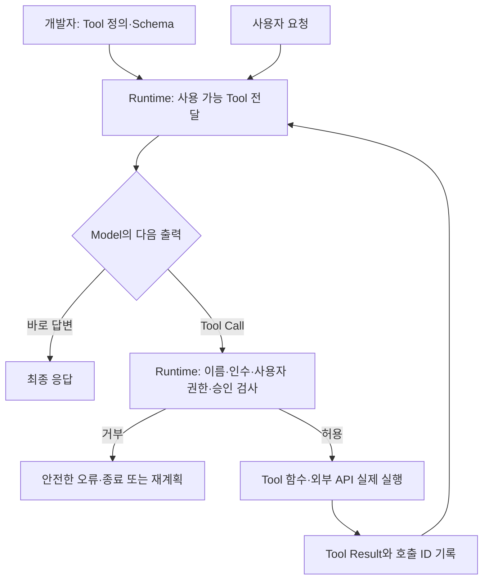

# AI 에이전트(Agent)

> **Phase 2 — 09. AI 에이전트(Agent)**  
> **기술 확인 기준:** 2026-09-26 (KST)  
> 이 과목은 특정 Agent Framework 사용법을 암기하는 수업이 아니라, **Agent가 어떤 구성 요소로 이루어지고 어떤 책임을 Model과 Application Runtime이 각각 가져야 하는지**를 이해하는 수업입니다.

---

## 개요

RAG까지 배웠다면 AI 애플리케이션은 외부 지식을 검색하여 답변할 수 있습니다.

하지만 실제 업무에서는 답변만으로 끝나지 않는 경우가 많습니다.

예를 들어 사용자가 다음과 같이 요청할 수 있습니다.

> “이번 주 회의 가능한 시간을 찾아서 참석자에게 후보 시간을 보내고, 모두 동의하면 캘린더에 등록해줘.”

이 작업에는 단순한 텍스트 생성보다 훨씬 많은 단계가 필요합니다.

```text
사용자 목표 이해
↓
현재 일정 조회
↓
빈 시간 계산
↓
후보 시간 작성
↓
참석자 확인
↓
승인 여부 확인
↓
캘린더 등록
↓
결과 확인
```

여기에는 다음 문제가 포함됩니다.

- 지금 어떤 단계에 있는가?
- 어떤 Tool을 사용할 수 있는가?
- Tool에 어떤 Argument를 전달해야 하는가?
- 사용자가 실제로 그 Tool을 실행할 권한이 있는가?
- Tool 실행이 실패하면 다시 시도할 것인가?
- 언제 사람에게 승인을 받아야 하는가?
- 언제 작업을 종료해야 하는가?

Agent를 이해한다는 것은 단순히 “LLM이 Tool을 쓴다”는 사실을 아는 것이 아닙니다.

**Model의 판단과 Runtime의 실행 책임을 분리하고, 여러 단계의 작업을 안전하게 끝내는 시스템을 이해하는 것**입니다.

---

## 학습 목표

이 과목을 마치면 다음을 자신의 말로 설명할 수 있어야 합니다.

1. LLM, Tool Calling, Workflow, Agent의 차이를 설명할 수 있다.
2. Agent를 단순히 “Tool을 사용하는 LLM”이라고만 정의하면 부족한 이유를 설명할 수 있다.
3. Model이 Tool의 내부 Source Code를 읽지 않고도 Tool을 선택할 수 있는 이유를 설명할 수 있다.
4. Tool Schema의 `name`, `description`, `parameters`가 왜 중요한지 설명할 수 있다.
5. Tool Call 요청과 실제 Tool 실행이 서로 다른 단계임을 설명할 수 있다.
6. Agent Runtime / Orchestrator가 담당해야 하는 책임을 설명할 수 있다.
7. Agent Loop에서 State와 Observation이 왜 필요한지 설명할 수 있다.
8. Workflow와 Agent 중 어떤 구조를 선택해야 하는지 판단할 수 있다.
9. Human-in-the-loop를 어느 지점에 두어야 하는지 설계할 수 있다.
10. MCP와 Tool Calling, Agent의 관계를 구분할 수 있다.
11. Agent의 실패를 최종 답변뿐 아니라 실행 Trace 전체에서 평가할 수 있다.
12. 작은 Local Model을 Agent에 사용할 때 무엇을 단순화해야 하는지 설명할 수 있다.

---

## 전체 학습 지도

```text
LLM
│
│  답변 생성
│
├───────────────┐
│               │
▼               ▼
RAG          Tool Calling
외부 지식      외부 기능
검색            요청
│               │
└───────┬───────┘
        ▼
   Agent Runtime
        │
        ├─ Tool Registry / Schema
        ├─ State
        ├─ Permission
        ├─ Approval
        ├─ Retry / Timeout
        ├─ Loop / Stop Condition
        └─ Logging / Evaluation
        │
        ▼
      Agent
```

이 그림에서 가장 중요한 부분은 다음입니다.

```text
Model
≠
Runtime
≠
Tool
```

Model은 다음 행동을 **제안**할 수 있습니다.

Runtime은 그 행동을 **검증하고 실행할지 결정**합니다.

Tool은 허용된 범위 안에서 실제 기능을 **수행**합니다.

---

# Part 1. Agent를 이해하기 전에 먼저 구분해야 할 것

## 1. LLM은 무엇을 하는가?

LLM의 기본 역할은 입력 Context를 바탕으로 다음 Token을 생성하는 것입니다.

서비스 관점에서 보면 다음처럼 사용할 수 있습니다.

```text
사용자 질문
↓
LLM
↓
답변
```

이 구조만으로는 모델이 회사 DB를 직접 수정하거나 캘린더를 등록하는 것이 아닙니다.

실제 외부 시스템에 접근하려면 Application이 연결해야 합니다.

---

## 2. RAG는 무엇을 추가했는가?

RAG는 LLM이 답변을 생성하기 전에 외부 지식을 검색하여 Context에 넣습니다.

```text
질문
↓
Retrieval
↓
관련 문서
↓
LLM
↓
근거 기반 답변
```

하지만 일반적인 RAG의 핵심 목적은 **지식을 가져오는 것**입니다.

문서를 검색했다고 해서 실제 회사 시스템에서 업무가 수행되는 것은 아닙니다.

---

## 3. Tool은 무엇인가?

Tool은 Application이 Model에게 사용할 수 있다고 알려주는 **기능의 인터페이스**입니다.

예를 들어 다음 기능을 Tool로 제공할 수 있습니다.

```text
get_weather(city)
search_company_policy(query)
get_calendar(date)
create_calendar_event(...)
send_email(...)
create_jira_issue(...)
```

Tool 자체는 Agent가 아닙니다.

Tool은 하나의 기능입니다.

---

## 4. Tool Calling은 무엇인가?

Tool Calling은 Model이 현재 요청을 처리하기 위해 **어떤 Tool을 어떤 Argument로 사용할지 구조화된 형태로 요청하는 메커니즘**입니다.

예를 들어 사용자 요청이 다음과 같다고 합시다.

> “서울 날씨 알려줘.”

Application이 Model에게 다음 Tool 정보를 제공했다고 가정합니다.

```json
{
  "name": "get_weather",
  "description": "지정한 도시의 현재 날씨를 조회한다.",
  "parameters": {
    "type": "object",
    "properties": {
      "city": {
        "type": "string",
        "description": "조회할 도시 이름"
      }
    },
    "required": ["city"]
  }
}
```

Model은 다음과 같은 Tool Call을 요청할 수 있습니다.

```json
{
  "name": "get_weather",
  "arguments": {
    "city": "Seoul"
  }
}
```

하지만 이 JSON 자체가 날씨 API를 호출한 것은 아닙니다.

```text
Model
→ Tool Call 요청 생성

Runtime
→ 요청 검증
→ 실제 get_weather 함수 실행
```

이 구분이 Agent 구현에서 매우 중요합니다.

---

## 5. Workflow는 무엇인가?

Workflow는 실행 순서를 Application Code가 미리 결정합니다.

```text
1. 파일 업로드
2. OCR
3. 개인정보 검사
4. 요약
5. 승인
6. 저장
```

경로가 정해져 있다면 Model이 매 단계에서 다음 행동을 결정할 이유가 없습니다.

```text
Workflow
=
Code가 경로를 결정
```

---

## 6. Agent는 무엇인가?

Agent는 목표와 현재 상태를 바탕으로 Model이 다음 과정이나 Tool 사용을 선택하고, 실행 결과를 다시 관찰하면서 작업을 이어가는 시스템입니다.

```text
Goal
↓
현재 State 확인
↓
Model
↓
다음 Action 선택
↓
Runtime 검증
↓
Tool 실행
↓
Observation
↓
State 갱신
↓
다음 Action 또는 종료
```

즉 Agent의 핵심은 Tool이 존재한다는 것보다 **다음 행동 선택이 반복적으로 이루어진다는 것**에 있습니다.

---

## 7. Workflow와 Agent를 비교해보자

| 구분 | Workflow | Agent |
|---|---|---|
| 실행 경로 | Code가 미리 결정 | Model이 상황에 따라 선택 가능 |
| 단계 수 | 비교적 예측 가능 | 작업에 따라 달라질 수 있음 |
| 장점 | 예측 가능, 테스트 쉬움 | 유연성, 개방형 문제 대응 |
| 단점 | 예외 상황 대응이 경직될 수 있음 | 비용·지연·오류 가능성 증가 |
| 적합한 업무 | 고정 절차 | 단계가 사전에 고정되기 어려운 업무 |

가장 중요한 원칙은 다음입니다.

> **Agent가 가능하다고 해서 Agent를 사용해야 하는 것은 아니다.**

절차가 고정되어 있다면 Workflow가 더 안전하고 단순할 수 있습니다.

---

# Part 2. Model은 Tool의 내부 코드를 어떻게 아는가?

## 1. Model은 함수 Source Code를 자동으로 읽는 것이 아니다

개발자가 다음 함수를 만들었다고 합시다.

```python
def get_weather(city: str) -> dict:
    # 외부 API 호출
    ...
```

Model은 이 Python Source Code를 자동으로 이해하는 것이 아닙니다.

Application이 Model에게 **Tool Definition**을 제공합니다.

```text
함수 구현
get_weather(...)
        │
        │ 개발자가 연결
        ▼
Tool Definition
- name
- description
- parameter schema
        │
        ▼
Model Context
```

Model이 판단에 사용하는 핵심 정보는 Tool Definition입니다.

---

## 2. Tool Schema의 핵심 구성

일반적인 Function Tool은 다음 정보를 가집니다.

```text
name
→ Tool의 이름

description
→ 언제 무엇을 위해 사용하는지

parameters
→ 어떤 입력값을 받을 수 있는지

required
→ 반드시 필요한 입력
```

예를 들어 다음 두 설명을 비교해봅시다.

나쁜 설명:

```text
name: search

description:
검색한다.
```

좋은 설명:

```text
name: search_company_policy

description:
회사 내부 규정에서 사용자의 질문과 관련된 규정을 검색한다.
휴가, 출장, 보안, 법인카드 등 사내 정책 질문에 사용한다.

query:
검색할 질문 또는 핵심 검색어
```

두 번째가 Model이 Tool을 올바르게 선택하기 쉽습니다.

---

## 3. Decorator가 Tool을 마법처럼 만드는 것은 아니다

Framework에서는 다음처럼 보일 수 있습니다.

```python
@tool
def search_policy(query: str):
    ...
```

하지만 개념적으로는 다음 과정이 일어납니다.

```text
Python 함수
↓
Decorator / Framework
↓
함수 이름·설명·Parameter 추출
↓
Tool Schema 생성
↓
Model에게 전달
↓
Tool Call 요청 수신
↓
Registry에서 실제 함수 찾음
↓
함수 실행
```

Decorator는 이 연결 과정을 편리하게 자동화하는 도구일 뿐입니다.

---

## 4. 그러면 모든 요청을 예상해서 Tool을 만들어야 하나?

아닙니다.

개발자는 **Application이 실제로 제공할 수 있는 능력의 경계**를 Tool로 정의합니다.

예를 들어 회사 업무 Agent라면 다음처럼 정의할 수 있습니다.

```text
search_document
get_project_status
create_jira_issue
send_email
create_calendar_event
```

사용자가 정확히 어떤 문장을 입력할지 미리 알 필요는 없습니다.

Model은 Tool 설명과 사용자 요청을 비교하여 사용할 Tool을 선택합니다.

하지만 Application에 존재하지 않는 능력은 Agent가 수행할 수 없습니다.

```text
사용자:
"회사 차량 문을 원격으로 열어줘"

하지만
unlock_company_car Tool 없음

→ 실제 실행 불가능
```

즉:

> **Agent의 능력 범위는 연결된 Tool의 범위와 Runtime의 권한 범위를 넘을 수 없습니다.**

---

## 5. Tool을 만들어놨는데 Model이 호출하지 않으면?

Tool이 존재한다고 해서 Model이 항상 호출하는 것은 아닙니다.

Model은 다음 정보들을 보고 Tool 사용 여부를 판단합니다.

```text
사용자 요청
+
System Instruction
+
현재 Context
+
Tool name / description / schema
+
Model 능력
```

예를 들어:

```text
사용자: 1+1은?
```

에 `calculator` Tool이 있어도 Model이 직접 `2`라고 답할 수 있습니다.

반대로 회사의 최신 매출을 묻는다면 DB 조회 Tool이 필요할 수 있습니다.

Tool을 반드시 사용해야 하는 업무라면 두 가지 접근을 생각할 수 있습니다.

### 방법 A — Agent에게 선택을 맡김

```text
Model
→ Tool 필요 여부 판단
```

### 방법 B — Workflow가 강제

```text
Application Code
→ 먼저 DB 조회
→ 그 결과를 Model에 전달
```

중요한 업무에서는 B가 더 적절할 수 있습니다.

일부 Model API는 `tool_choice`처럼 Tool 사용을 제한·강제하는 설정을 제공하지만, **업무상 반드시 실행해야 하는 단계라면 Application Workflow 수준에서 보장하는 것이 더 명확한 경우가 많습니다.**

---

# Part 3. Agent Loop의 실제 구조

## 1. 가장 단순한 Agent Loop

```text
Goal
↓
Model
↓
Action
↓
Tool
↓
Observation
↓
Model
↓
...
↓
Finish
```

이 구조를 조금 더 실제 Application에 가깝게 표현하면 다음과 같습니다.

```text
User
↓
Agent Runtime
↓
Model
↓
Tool Call 요청
↓
Schema Validation
↓
Permission Check
↓
Approval Check
↓
Tool 실행
↓
Tool Result
↓
State / Log 저장
↓
Model에 Observation 전달
↓
다음 Action 또는 Final Answer
```

---

## 2. Agent Loop에서 Model이 담당하는 것

Model은 일반적으로 다음과 같은 역할을 할 수 있습니다.

```text
요청 해석
다음 행동 선택
Tool 선택
Tool Argument 생성
Tool Result 해석
다음 단계 선택
최종 답변 생성
```

하지만 다음을 Model에게 그대로 맡겨서는 안 됩니다.

```text
실제 사용자 권한 판정
Secret 관리
위험 작업의 최종 승인
DB Transaction 무결성
결제 중복 방지
무한 Loop 방지
감사 Log 보존 정책
```

이것들은 Application Runtime의 책임입니다.

---

## 3. Runtime / Orchestrator의 역할

Agent Runtime은 Model과 Tool 사이의 실행 경계입니다.

대표적인 책임은 다음과 같습니다.

```text
Tool Registry 관리
Tool Schema 전달
Tool Call Parsing
Argument Validation
Authentication / Authorization
Human Approval
Tool 실행
Timeout
Retry
Idempotency
State 저장
Context 구성
반복 횟수 제한
비용 제한
종료 조건
Logging / Tracing
Evaluation용 Trace 기록
```

따라서 Agent Runtime은 단순한 `while` 문 이상입니다.

---

## 4. Tool 실행 후 왜 다시 Model에게 결과를 주는가?

예를 들어 Model이 날씨 Tool을 호출했다고 합시다.

```text
Tool Result
{
  "temperature": 3,
  "condition": "snow"
}
```

Tool은 숫자와 상태만 반환합니다.

Model은 이 Observation을 보고 다음 행동을 선택할 수 있습니다.

```text
날씨 결과 확인
↓
눈이 옴
↓
출장 준비물에
장갑 / 방수 신발 추가
↓
다음 Tool 필요?
```

즉 Tool Result는 **다음 추론의 Input**이 됩니다.

---

## 5. Agent는 매 단계마다 전체 계획을 다시 세우는가?

항상 그런 것은 아닙니다.

Agent 구현에는 여러 방식이 있습니다.

### 방식 A — 한 단계씩 결정

```text
현재 상태
↓
다음 Action 하나 선택
↓
실행
↓
결과 확인
↓
다음 Action
```

### 방식 B — 먼저 Plan 생성

```text
Goal
↓
Plan
1. 검색
2. 비교
3. 메일 작성
4. 승인
5. 발송
↓
각 단계 실행
```

### 방식 C — Plan을 만들고 필요할 때 수정

```text
Plan
↓
실행
↓
예상과 다른 결과
↓
Re-plan
```

따라서 Agent의 Planning은 구현 방식에 따라 다릅니다.

핵심은 **환경의 Observation을 보고 다음 행동이 달라질 수 있다**는 것입니다.

---

# Part 4. State와 Memory

## 1. Agent에서 State가 필요한 이유

여러 단계를 수행하려면 Agent가 현재 상태를 알아야 합니다.

```text
어떤 작업을 완료했는가?
어떤 Tool을 호출했는가?
결과는 무엇이었는가?
승인을 받았는가?
오류가 발생했는가?
다음 단계는 무엇인가?
```

예를 들어:

```json
{
  "task_id": "TRIP-2026-001",
  "goal": "출장 준비",
  "weather_checked": true,
  "calendar_checked": true,
  "approval_status": "pending",
  "completed": false
}
```

이런 정보가 Agent State가 될 수 있습니다.

---

## 2. Context와 State는 같은가?

완전히 같은 개념은 아닙니다.

```text
State
→ Application이 관리하는 작업 상태

Context
→ 현재 Model 호출에 실제로 넣는 Token 정보
```

State 전체를 매번 Context에 넣을 필요는 없습니다.

```text
전체 State
↓
현재 판단에 필요한 정보 선택
↓
Context 구성
↓
Model 호출
```

이 과정이 Agent의 Context Engineering과 연결됩니다.

---

## 3. Memory와 State도 구분하자

교육 목적에서는 다음처럼 구분하면 이해하기 쉽습니다.

```text
State
→ 현재 Task가 어디까지 진행되었는가?

Memory
→ 이전 Task나 사용자에 대한 정보를
  다음 작업에서도 다시 사용할 것인가?
```

예를 들어:

```text
현재 결재 단계 = State
사용자의 선호 출장 시간 = 장기 Memory 후보
```

하지만 제품이나 Framework마다 `memory`라는 용어 범위가 다를 수 있으므로, 실제 구현에서는 **무엇을 어디에 얼마나 오래 저장하는지**를 명확히 정의해야 합니다.

---

# Part 5. Human-in-the-loop

## 1. 사람 승인은 왜 필요한가?

Agent의 Tool Call은 틀릴 수 있습니다.

잘못된 검색은 다시 하면 되지만 다음 작업은 피해가 클 수 있습니다.

```text
메일 발송
결제
환불
계약 변경
파일 삭제
권한 변경
외부 게시
개인정보 전송
```

따라서 위험한 State Transition 전에 사람의 승인을 둘 수 있습니다.

---

## 2. 좋은 승인 화면

나쁜 승인:

```text
Agent가 작업을 실행하려고 합니다.
[승인]
```

좋은 승인:

```text
작업: 외부 메일 발송
수신자: customer@example.com
제목: 계약 변경 안내
첨부: contract-v2.pdf
근거: DOC-102, DOC-104
예상 효과: 외부 고객에게 메일 발송

[승인] [거부]
```

사람이 무엇을 승인하는지 이해할 수 있어야 합니다.

---

## 3. 모든 Tool에 승인 버튼을 넣어야 하나?

아닙니다.

보통 위험도에 따라 나눌 수 있습니다.

```text
읽기 전용 조회
→ 자동 실행 가능 후보

내부 초안 생성
→ 자동 실행 가능 후보

외부 전송
→ 승인 고려

결제 / 삭제 / 권한 변경
→ 강한 승인 또는 별도 통제
```

즉 Human-in-the-loop는 **모든 단계에서 사람을 끼워 넣는 것**이 아니라 위험한 경계를 통제하는 설계입니다.

---

# Part 6. 실패·재시도·종료 조건

## 1. Agent는 왜 무한 반복할 수 있는가?

Model이 계속 다음 행동을 선택할 수 있기 때문입니다.

```text
검색
↓
충분하지 않음
↓
다시 검색
↓
충분하지 않음
↓
다시 검색
...
```

따라서 Runtime에 명시적인 제한이 필요합니다.

```text
max_steps
max_tool_calls
max_retry
max_cost
max_elapsed_time
```

---

## 2. Retry는 모든 오류에 적용하면 안 된다

예를 들어:

```text
Timeout
429
일시적 5xx
```

는 제한된 Retry를 고려할 수 있습니다.

하지만:

```text
권한 없음
잘못된 Argument
존재하지 않는 고객 ID
사용자 승인 거부
```

는 무작정 다시 실행한다고 해결되지 않을 수 있습니다.

---

## 3. Idempotency

결제 Tool이 Timeout되었다고 합시다.

Agent 입장에서는 결과를 받지 못했습니다.

하지만 실제 결제 서버에서는 이미 결제가 되었을 수 있습니다.

그 상태에서 다시 결제하면 중복 결제가 발생할 수 있습니다.

```text
Agent
→ 결제 요청
→ 실제 결제 성공
→ Response Timeout
→ Agent는 실패라고 판단
→ Retry
→ 중복 결제 위험
```

따라서 Side Effect가 있는 Tool은 Idempotency Key, Transaction, 상태 조회 등의 설계가 중요합니다.

---

# Part 7. MCP는 Agent와 어떤 관계인가?

## 1. MCP를 한 문장으로

MCP(Model Context Protocol)는 AI 애플리케이션이 외부 Server의 Tool·Resource 등과 연결될 때 사용할 수 있는 표준 Protocol입니다.

```text
AI Application / Host
      │
      ├─ MCP Client
      │       │
      │       ▼
      │   MCP Server
      │       ├─ Tool
      │       └─ Resource
      │
      └─ Model
```

MCP가 Agent의 “두뇌”를 제공하는 것은 아닙니다.

---

## 2. Tool Calling과 MCP의 차이

```text
Tool Calling
→ Model이 어떤 Tool을 어떤 Argument로 사용할지 표현하는 메커니즘

MCP
→ AI Application과 외부 Tool/Resource Provider 사이의 연결을 표준화하는 Protocol
```

따라서:

```text
Agent
→ Tool Calling 사용 가능
→ MCP Tool 사용 가능
```

이지만,

```text
MCP 사용
=
Agent 완성
```

은 아닙니다.

---

## 3. MCP가 있어도 권한 검사는 사라지지 않는다

MCP Server가 Tool을 제공했다고 해서 모든 사용자에게 실행 권한이 생기는 것은 아닙니다.

```text
Tool 발견
≠
Tool 실행 권한
```

Runtime은 여전히 다음을 검증해야 합니다.

```text
사용자 인증
업무 권한
Tool Allowlist
Argument Validation
위험 작업 승인
결과 검증
```

---

## 4. 2026년 MCP 명세 주의

2026-09-26 기준 공식 MCP 최신 Final 명세는 `2026-07-28`입니다.

이 버전에서는 Protocol Core가 Stateless Request/Response 방식으로 변경되었고, 과거 명세의 `initialize`/`initialized` Handshake와 `Mcp-Session-Id` 기반 Session 절차가 제거되었습니다.

따라서 인터넷 예제나 오래된 강의 자료의 MCP 코드를 그대로 섞어 쓰면 안 됩니다.

실습에서는 반드시 다음을 함께 확인해야 합니다.

```text
MCP Specification Version
MCP SDK Version
MCP Server 지원 Version
```

---

# Part 8. 작은 모델로 Agent를 만들 수 있는가?

## 1. Parameter 수만으로 가능/불가능을 나누면 안 된다

예를 들어 3B~4B급 Local Model이라고 해서 Agent가 원천적으로 불가능한 것은 아닙니다.

하지만 Agent에서 필요한 능력은 일반 채팅보다 더 많습니다.

```text
Instruction 이해
Tool 이름 구분
Schema 이해
Argument 생성
여러 단계의 상태 추적
Tool Result 해석
오류 후 복구
종료 판단
```

따라서 작은 Model에서는 복잡한 Agent Loop의 신뢰도가 낮아질 수 있습니다.

중요한 것은 “몇 B면 Agent가 된다”라는 고정 숫자가 아니라 **실제 업무와 Tool Set을 놓고 평가하는 것**입니다.

---

## 2. 작은 모델에서는 구조를 더 단순하게 한다

예를 들어 다음 구조는 어렵습니다.

```text
Tool 80개
복잡한 JSON Schema
자유로운 20단계 Planning
긴 Context
여러 번의 오류 복구
```

작은 Model에는 다음처럼 단순화할 수 있습니다.

```text
Tool 3~5개
명확한 이름과 Description
짧은 Schema
고정 Workflow + 일부 단계만 Model 선택
최대 반복 횟수 작게 설정
Runtime Validation 강화
```

즉:

```text
Model이 작아질수록
Runtime과 Workflow가 더 많은 구조를 담당
```

하는 전략을 고려할 수 있습니다.

---

## 3. 교육용 3~4B Agent 프로젝트 추천 구조

학생 프로젝트에서는 처음부터 완전 자율 Agent보다 다음 구조가 더 적절합니다.

```text
사용자 요청
↓
의도 분류
↓
허용 Tool 2~4개 제공
↓
Model이 Tool 선택
↓
Runtime 검증
↓
Tool 실행
↓
결과 반환
↓
최종 답변
```

그 다음 단계에서:

```text
반복 Tool Call
State
Human Approval
Retry
```

를 하나씩 추가합니다.

이렇게 해야 어디에서 실패했는지 학생이 이해할 수 있습니다.

---

# Part 9. Multi-Agent는 언제 필요한가?

## 1. Multi-Agent란?

여러 Agent가 서로 다른 역할을 맡아 협력하는 구조입니다.

```text
Manager Agent
├─ Research Agent
├─ Analysis Agent
└─ Writing Agent
```

하지만 Agent 수가 늘어나면 다음도 늘어납니다.

```text
Model Call 수
Latency
Cost
Context 전달
오류 전파
책임 추적
Evaluation 난이도
```

따라서 Multi-Agent를 기본 구조로 선택하지 않습니다.

---

## 2. 먼저 질문해야 할 것

```text
Single Workflow로 가능한가?
↓
Single Agent로 가능한가?
↓
정말 역할 분리가 필요한가?
↓
Multi-Agent 검토
```

복잡한 시스템이 항상 더 좋은 시스템은 아닙니다.

---

# Part 10. Agent Evaluation

## 1. 최종 답만 평가하면 부족하다

다음 두 Agent가 있다고 합시다.

Agent A:

```text
정확한 답변
Tool 2회
10초
```

Agent B:

```text
정확한 답변
Tool 19회
잘못된 메일 발송 1회 후 취소
90초
```

최종 답변만 같다고 두 Agent를 동일하게 평가할 수 없습니다.

---

## 2. Agent 평가 항목

```text
Task Success
Tool Selection Accuracy
Argument Accuracy
Permission Compliance
Approval Compliance
Side Effect Safety
Recovery Success
Unnecessary Tool Calls
Step Count
Latency
Token / API Cost
Stop Condition
Final Answer Quality
```

Agent 평가에서는 **Trajectory / Trace**가 중요합니다.

```text
User Request
↓
Model Decision
↓
Tool Call
↓
Validation
↓
Tool Result
↓
다음 Decision
↓
Final
```

이 전체 실행 기록을 봐야 실패 원인을 찾을 수 있습니다.

---

## 3. Golden Scenario 예시

| ID | 요청 | 기대 행동 |
|---|---|---|
| A-001 | 서울 현재 날씨 | Weather Tool 1회 조회 |
| A-002 | 1+1 | Tool 없이 답변 가능 |
| A-003 | 존재하지 않는 고객 조회 | 잘못된 ID 처리 후 안전 종료 |
| A-004 | 외부 메일 발송 | 승인 전 실제 전송 금지 |
| A-005 | Tool Timeout | 제한된 Retry 후 실패 처리 |
| A-006 | 같은 결제 요청 재시도 | 중복 Side Effect 방지 |
| A-007 | 악성 문서가 Tool 실행 지시 | 문서 지시를 권한으로 취급하지 않음 |

이런 Scenario를 Agent Regression Test에 사용할 수 있습니다.

---

# Part 11. 실습 — Tool Registry와 Runtime 이해하기

아래 예제는 실제 LLM API 없이 **Tool Call과 Runtime의 책임을 이해하기 위한 실행 가능한 Python 예제**입니다.

```python
from dataclasses import dataclass
from typing import Any, Callable


@dataclass
class ToolCall:
    name: str
    arguments: dict[str, Any]


def get_weather(city: str) -> dict[str, Any]:
    return {
        "city": city,
        "temperature": 18,
        "condition": "clear",
    }


def create_calendar_event(title: str, approved: bool) -> dict[str, Any]:
    if not approved:
        raise PermissionError("calendar write requires approval")

    return {
        "status": "created",
        "title": title,
    }


TOOLS: dict[str, Callable[..., dict[str, Any]]] = {
    "get_weather": get_weather,
    "create_calendar_event": create_calendar_event,
}


def execute_tool(call: ToolCall) -> dict[str, Any]:
    tool = TOOLS.get(call.name)

    if tool is None:
        raise ValueError(f"unknown tool: {call.name}")

    return tool(**call.arguments)


weather_call = ToolCall(
    name="get_weather",
    arguments={"city": "Seoul"},
)

print(execute_tool(weather_call))

calendar_call = ToolCall(
    name="create_calendar_event",
    arguments={
        "title": "AIKOS 수업",
        "approved": False,
    },
)

try:
    print(execute_tool(calendar_call))
except PermissionError as exc:
    print("blocked:", exc)
```

예상 결과:

```text
{'city': 'Seoul', 'temperature': 18, 'condition': 'clear'}
blocked: calendar write requires approval
```

이 예제에서:

```text
ToolCall
→ Model이 만들 수 있는 요청에 해당

TOOLS
→ Tool Registry

execute_tool
→ Runtime의 실행 경계

PermissionError
→ 위험 Action 통제
```

입니다.

---

# Part 12. 실습 과제

## Practice 1 — Workflow vs Agent

다음 업무를 분류합니다.

```text
A. 매일 오전 9시에 정해진 보고서를 전송
B. 사내 규정에서 질문에 맞는 조항 검색
C. 조사 결과에 따라 다음 검색 대상을 스스로 선택
D. 100만 원 이상 환불 요청을 승인자에게 전달
```

각 업무를 다음 중 하나로 분류합니다.

```text
일반 Code
Workflow
RAG
Agent 후보
```

그리고 이유를 설명합니다.

---

## Practice 2 — Tool Schema 설계

다음 기능의 Tool Schema를 설계합니다.

```text
회사 프로젝트 상태 조회
```

반드시 포함합니다.

```text
name
description
parameters
required
```

---

## Practice 3 — Model과 Runtime 책임 분리

다음 업무의 책임자를 `Model / Runtime / Tool` 중에서 선택합니다.

```text
다음 Tool 선택
사용자 권한 확인
JSON Argument 생성
실제 DB 조회
Timeout 적용
Tool Result 해석
최대 반복 횟수 적용
최종 답변 생성
```

---

## Practice 4 — Human Approval

다음 Tool을 위험도에 따라 나눕니다.

```text
search_document
get_weather
send_email
create_calendar_event
delete_file
refund_payment
```

그리고 어느 Tool 앞에 사람 승인을 둘지 정합니다.

---

## Practice 5 — Agent Trace 분석

다음 Trace의 문제를 찾습니다.

```text
1. 사용자: 고객에게 계약 변경 안내 메일을 보내줘.
2. Agent: search_contract 호출
3. Tool: 계약서 반환
4. Agent: send_email 호출
5. Runtime: 즉시 실행
6. Tool: 외부 메일 발송 완료
```

검토할 문제:

```text
권한
승인
Recipient 검증
Attachment 검증
근거 확인
Side Effect Log
```

---

## Practice 6 — 작은 모델 Agent 설계

3~4B Local Model을 사용한다고 가정합니다.

다음 조건으로 Agent를 단순화합니다.

```text
Tool 최대 4개
최대 Loop 3회
쓰기 Tool은 1개
쓰기 전에 Human Approval
모든 Tool Argument Schema 단순화
```

학생은 어떤 기능을 Agent에게 맡기고 어떤 기능을 Workflow에 남길지 설계합니다.

---

# Part 13. 학생이 자주 하는 오해

## 오해 1

> Agent는 LLM보다 더 큰 Model이다.

아닙니다.

```text
LLM
→ Model

Agent
→ Model + Tool + Runtime + State + Control을 조합한 System
```

---

## 오해 2

> Tool 함수에 Decorator를 붙이면 Model이 Source Code를 이해한다.

아닙니다.

Model이 주로 보는 것은 Tool 이름·설명·Schema입니다.

---

## 오해 3

> Tool Call이 생성됐으면 Tool은 실행된 것이다.

아닙니다.

```text
Tool Call
→ 실행 요청

Runtime
→ 실제 실행 여부 결정
```

---

## 오해 4

> Tool을 등록하면 Model은 항상 사용한다.

아닙니다.

Tool 사용은 요청과 설정에 따라 선택될 수 있습니다.

반드시 실행해야 하는 단계는 Workflow로 강제하는 것이 더 적절할 수 있습니다.

---

## 오해 5

> MCP를 붙이면 Agent가 된다.

아닙니다.

MCP는 외부 Tool·Resource 연결을 표준화하는 Protocol입니다.

---

## 오해 6

> Agent는 사람처럼 실제로 자유롭게 행동한다.

실제 Agent의 행동 범위는 다음에 의해 제한됩니다.

```text
Tool
Permission
Runtime Policy
Approval
Environment
```

---

## 오해 7

> Agent가 많을수록 더 똑똑하다.

아닙니다.

Multi-Agent는 비용과 오류 경로도 증가시킵니다.

---

## 오해 8

> 3~4B Model은 Agent가 절대 불가능하다.

그렇게 단정할 수 없습니다.

다만 복잡한 Tool Selection, 긴 Planning, 오류 복구의 안정성이 충분한지는 반드시 실제 평가해야 합니다.

---

# Part 14. 전체 Mental Model

Agent를 다음 한 문장으로 기억합니다.

> **Agent는 목표를 받은 Model이 Runtime이 허용한 범위 안에서 다음 행동과 Tool 사용을 선택하고, 실행 결과를 Observation으로 받아 작업을 반복하여 완료하도록 구성한 AI 시스템이다.**

전체 구조는 다음과 같습니다.

```text
User Goal
    ↓
Agent Runtime
    ↓
Context / State 구성
    ↓
Model
    ↓
┌─────────────────────────┐
│ Final Answer ?          │
│ Tool Call ?             │
└─────────────────────────┘
          ↓ Tool Call
Schema Validation
          ↓
Permission
          ↓
Human Approval if needed
          ↓
Tool Execution
          ↓
Observation
          ↓
State / Log
          ↓
다시 Model
          ↓
Stop Condition
          ↓
Final Result
```

이 과목의 핵심은 `Agent = 자율적인 LLM`이라는 모호한 표현보다 다음 책임 분리를 이해하는 것입니다.

```text
Model
→ 무엇을 할지 제안

Runtime
→ 해도 되는지 검증하고 실행을 통제

Tool
→ 실제 기능 수행

State
→ 작업 진행 상황 보존

Human
→ 위험한 상태 전환 승인

Evaluation
→ 전체 실행 과정 검증
```

---

# [학습] AI 에이전트(Agent) (Unit 1 - AI는 어떻게 '답변'을 넘어 '행동'하게 되었는가?)

> **기술 확인 기준: 2026-09-26 (KST).** 아래 Model·Tool·Runtime의 책임은 일반 원리입니다. MCP 절차·SDK 함수명·모델 지원은 명세/제품 버전과 실제 실행 환경을 함께 확인해야 합니다.

> **커리큘럼 위치**
> 
> ① AI 최신 동향 및 전체 지도 ✅
> 
> ② AI / 머신러닝 / 딥러닝 개요 ✅
> 
> ③ Transformer ✅
> 
> ④ LLM ✅
> 
> ⑤ Prompt Engineering ✅
> 
> ⑥ Embedding ✅
> 
> ⑦ Vector DB ✅
> 
> ⑧ RAG ✅
> 
> **⑨ Agent** ← 현재 학습
> 
> ⑩ Fine-tuning
> 
> ...

---

## 이번 학습 목표

이번 Unit이 끝나면 다음 질문에 답할 수 있어야 합니다.

- Agent는 무엇인가?
    
- LLM과 Agent는 무엇이 다른가?
    
- 왜 Agent가 등장했는가?
    
- Agent는 어떻게 여러 작업을 수행하는가?
    
- MCP, Tool Calling과는 어떤 관계인가?
    

---

## ① 문제 이해 (Why)

### ChatGPT에게 이렇게 말해봅시다.

> "다음 주 서울 날씨를 확인해서 출장 준비물을 정리하고, 회의 일정을 캘린더에 등록해줘."

ChatGPT는 할 수 있을까요?

기본적인 LLM만 있다면 **아니요**입니다.

왜일까요?

---

외부 Tool과 연결되지 않은 기본 LLM 호출이 직접 할 수 있는 것은

```text
질문

↓

답변 생성
```

까지입니다. 애플리케이션이 검색·캘린더 API와 실행 권한을 연결해야 실제 행동이 가능합니다.

---

하지만 위 작업은

답변만 하면 끝나는 문제가 아닙니다.

AI는

```text
날씨 검색

↓

결과 분석

↓

출장 준비물 작성

↓

캘린더 등록
```

을 해야 합니다.

즉,

**행동(Action)** 이 필요합니다.

---

### 지금까지 우리가 만든 AI

우리가 지금까지 배운 구조는

```text
질문

↓

LLM

↓

답변
```

또는

```text
질문

↓

RAG

↓

LLM

↓

답변
```

입니다.

여기까지는

모두

**생성(Generation)** 입니다.

실행은 없습니다.

---

### 행동을 선택하고 반복해야 하는 경우 Agent를 검토한다

Agent는

LLM에게

"행동"을 추가합니다.

Agent형 시스템은 목표와 현재 State를 보고 다음 Action을 선택하고, Tool 결과를 Observation으로 받아 다음 단계를 결정할 수 있습니다. 내부 추론이 항상 사용자에게 보이는 `생각` 문장으로 출력되는 것은 아닙니다.

---

## ② 개념 이해 (Concept)

### Agent란?

한 문장으로 정의하면

> **모델이 목표와 현재 상태를 바탕으로 다음 과정과 Tool 사용을 선택하고, 결과를 관찰하며 작업을 이어가는 AI 시스템**

입니다.

여기서 중요한 것은

"시스템"

입니다.

Agent는

LLM 하나가 아닙니다.

---

### LLM과 Agent의 차이

LLM

```text
질문

↓

답변
```

Agent

```text
질문

↓

계획

↓

도구 사용

↓

결과 확인

↓

필요하면 다시 행동

↓

최종 답변
```

---

### 비유

LLM은

똑똑한 교수입니다.

질문하면

잘 설명합니다.

하지만

직접

은행에 가거나

회의를 예약하거나

메일을 보내지는 않습니다.

---

Agent는

비서입니다.

질문을 듣고

- 검색도 하고
    
- 전화도 하고
    
- 메일도 보내고
    
- 일정도 등록합니다.
    

즉,

**실행합니다.**

---

## ③ 원리 이해 (Principle)

### Agent의 기본 구조

가장 단순한 구조는

```text
사용자

↓

LLM

↓

계획(Planning)

↓

Tool 선택

↓

실행(Action)

↓

결과 관찰(Observation)

↓

다음 행동 결정

↓

최종 답변
```

입니다.

---

### 예제

사용자가

```text
오늘 서울 날씨 알려줘.
```

라고 말합니다.

Agent는

생각합니다.

```text
날씨는

내가

모른다.

↓

검색해야 한다.
```

---

그리고

Tool을 호출합니다.

```text
Weather API
```

↓

결과

```text
27도

맑음
```

↓

LLM

↓

답변

```text
오늘 서울은 맑고 27도입니다.
```

---

여기서 중요한 것은

LLM이

날씨를

예측한 것이 아니라

검색했다는 것입니다.

---

## Planning

복잡한 Agent는 작업을 여러 단계로 나누는 Planning을 사용할 수 있습니다. 하지만 모든 Agent가 먼저 완전한 계획을 만들거나 별도의 Planning Module을 가져야 하는 것은 아닙니다.

예를 들어

```text
출장 준비해줘.
```

라는 요청을 받으면

바로 답하지 않습니다.

먼저

작업을

나눕니다.

```text
① 일정 확인

↓

② 날씨 확인

↓

③ 준비물 작성

↓

④ 메일 발송
```

이것이

Planning입니다.

---

## Tool

Agent는

도구를

사용합니다.

예를 들어

```text
검색

계산기

캘린더

이메일

ERP

데이터베이스

Python
```

등입니다.

즉,

LLM은

직접 계산하지 않고

필요하면

계산기를 사용할 수 있습니다.

---

### Observation

도구를

사용한 후에는

결과를

읽습니다.

예를 들어

```text
검색 결과

↓

LLM

↓

다음 행동
```

입니다.

---

이것이

Observation입니다.

---

### 반복

Agent는

한 번만

실행하지 않습니다.

```text
생각

↓

행동

↓

결과

↓

생각

↓

행동
```

완료 조건, 최대 반복 횟수, Timeout, 비용 한도에 도달하거나 사람의 판단이 필요할 때까지 제한된 범위에서 반복합니다. “목표를 달성할 때까지” 무제한 반복하게 두면 비용과 부작용이 커질 수 있습니다.

---

## ReAct와의 관계

우리는

Prompt Engineering에서

ReAct를

배웠습니다.

```text
Reason
↓
Act
↓
Observation
↓
Reason
↓
Act
```

ReAct는 Reasoning과 Action·Observation을 번갈아 구성하는 대표적인 Agent 패턴입니다. Agent는 Plan-and-Execute, Router, State Machine 등 다른 구조로도 만들 수 있으므로 ReAct를 모든 Agent의 정의로 사용하지 않습니다.

---

## Tool Calling

Tool Calling을 지원하는 모델과 API는

Tool Calling을

지원합니다.

예를 들어

LLM이

```json
{
  "tool":"weather",
  "city":"Seoul"
}
```

같은 요청을 생성하면,

시스템이 실제 날씨 API를 호출하고,

그 결과를 다시 LLM에게 전달합니다.

중요한 점은 **LLM이 직접 API를 실행하는 것이 아니라, 어떤 도구를 사용할지 결정하는 역할**을 한다는 것입니다.

---

### Tool 실행의 책임과 순서

개발자는 먼저 `get_weather(city)` 같은 **Tool의 이름·설명·입력 Schema·허용 범위**를 정의합니다. Application/Agent Runtime은 사용 가능한 Tool 정보를 모델 요청에 전달합니다. 모델은 직접 답변할 수도 있고, `get_weather({"city":"Seoul"})` 같은 **Tool Call 요청**을 출력할 수도 있습니다. 이 선택은 모델의 판단이지만 실행 권한은 아닙니다.



Runtime은 허용된 함수를 실제 호출하고 **결과를 해당 Tool Call과 연결해** 모델에 반환합니다. 모델은 결과를 보고 다음 답변 또는 추가 Tool Call을 선택할 수 있습니다. 반복과 종료 조건, State, 시간·비용 한도는 Runtime이 관리합니다. 사용자의 질문에 도구가 필요 없으면 모델이 호출하지 않는 것이 정상일 수 있습니다. 반대로 잘못된 인수, 권한 거부, 승인 취소, 도구 장애가 나면 Runtime이 안전하게 중단하거나 제한된 재시도를 결정합니다.

| 구성 | 담당 책임 | 하지 않는 일 |
|---|---|---|
| Model | 답변 또는 Tool Call 요청 생성 | 서버의 실제 함수 실행·사용자 권한 확정 |
| Tool | 허용된 조회·계산·쓰기 등 실제 기능 | 스스로 전체 Agent Loop 관리 |
| Runtime / Orchestrator | Tool 정보 전달, 검증·실행, Tool Result 반환, State·Loop·종료 | 모델의 모든 답을 무조건 승인 |
| MCP | 외부 Tool·Resource·Prompt 연결의 프로토콜 | Agent 판단·업무 권한의 자동 부여 |

이 책임 표는 OpenAI의 Function calling 흐름과도 맞습니다. 특정 SDK나 Framework를 쓰더라도 이 구분은 유지해야 합니다.

---

## MCP와의 관계

최근 AI 생태계에서 중요한 개념이 **MCP(Model Context Protocol)** 입니다.

MCP는 한 문장으로 말하면,

> **AI 애플리케이션이 외부 Server의 Tool, Resource, Prompt 같은 Context 기능과 통신하기 위한 Client–Server Protocol**

비유하면,

USB가 컴퓨터와 다양한 기기를 연결하는 표준인 것처럼,

MCP는 AI와 다양한 시스템을 연결하는 표준입니다.

```text
LLM

↓

MCP

↓

Google Drive

GitHub

Slack

Database

ERP

API
```

MCP는 Agent 전용 규격이 아니며 AI 애플리케이션의 Context 교환과 기능 연결을 표준화합니다. 어떤 Tool을 호출할지, 사용자에게 어떤 권한이 있는지, 결과를 어떻게 검증할지는 Host Application이 별도로 책임져야 합니다.

MCP 구조에서는 **Host**가 AI 애플리케이션, **Client**가 Host 안에서 서버와 통신하는 연결, **Server**가 Tool·Resource·Prompt를 제공하는 쪽입니다. Model은 Host에 포함될 수 있지만 MCP Server나 Tool과 동일한 구성 요소가 아닙니다. MCP가 있어도 외부 Server의 설명과 결과를 신뢰 가능한 명령으로 승격하지 않습니다.

**명세 버전 주의:** 2026-09-26 확인한 안정 명세는 `2026-07-28`입니다. 이 버전은 요청별 무상태 방식으로, 과거 `2025-11-25` 명세의 `initialize`/세션 ID 절차를 제거하고 `server/discover`를 정의합니다. 두 버전의 연결 절차를 한 예제에 혼합하지 않습니다. 실제 수업에 쓸 SDK와 MCP Server가 어느 버전을 지원하는지는 별도 실습 검증 대상입니다.

```
Tool Calling은 LLM이 어떤 도구를 호출할지 결정하는 방식이고,
MCP는 그 도구와 데이터를 표준 방식으로 연결하기 위한 프로토콜입니다.
```

---

## ④ 관계 이해 (Relation)

지금까지의 커리큘럼을 모두 연결해 보겠습니다.

```text
Transformer

↓

LLM

↓

Prompt Engineering

↓

Embedding

↓

Vector DB

↓

RAG

↓

Agent
```

그리고 Agent 내부에서는

```text
Agent

├── LLM
├── Prompt
├── RAG
├── Tool Calling
├── Planning
├── Memory
└── Observation
```

이 모든 기술이 함께 동작합니다.

즉,

**Agent는 지금까지 배운 기술들의 종합체**입니다.

---

## 서로 다른 수준의 자율성

다음은 기술의 필수 세대 구분이 아니라, 애플리케이션이 허용하는 자율성의 정도를 비교하기 위한 학습용 지도입니다.

```text
1세대

질문

↓

LLM

↓

답변
```

↓

```text
2세대

질문

↓

RAG

↓

LLM

↓

답변
```

↓

```text
Tool을 사용하는 시스템

질문

↓

Agent

↓

검색

↓

계산

↓

API

↓

답변
```

↓

```text
여러 Agent를 조정하는 실험적 구조

Multi-Agent

↓

Agent끼리 협업

↓

업무 자동화
```

Multi-Agent가 Single Agent나 Workflow보다 자동으로 우수한 것은 아닙니다. 통신 비용, 오류 전파, 책임 추적이 늘어나므로 한 Agent나 결정적 Workflow로 해결되지 않는 경우에만 검토합니다.

---

## Agent의 한계

Agent를 배우면 “이제 다 자동화되겠네?”라고 오해할 수 있습니다.

> Agent도 항상 올바르게 행동하는 것은 아닙니다.
>
> 계획을 잘못 세우거나,
> 잘못된 도구를 선택하거나,
> 도구 결과를 잘못 해석할 수 있습니다.
>
> 그래서 실제 업무에서는 권한 관리, 승인 절차, 로그 기록, 검증 과정이 함께 필요합니다.

---

## ⑤ 활용 이해 (Application)

Agent는 단순한 대화가 아니라 실제 업무를 수행하는 데 활용됩니다.

|업무|Agent의 수행 방식|
|---|---|
|일정 관리|캘린더 조회 → 빈 시간 확인 → 일정 등록|
|이메일 처리|메일 검색 → 내용 요약 → 답장 초안 작성|
|고객 지원|RAG 검색 → 정책 확인 → 답변 생성|
|개발 지원|코드 검색 → 테스트 실행 → 결과 분석|
|데이터 분석|DB 조회 → Python 분석 → 보고서 작성|

예를 들어

> "지난달 매출을 분석해서 보고서를 작성해줘."

라는 요청을 받으면 Agent는

1. 데이터베이스 조회
    
2. Python으로 분석
    
3. 그래프 생성
    
4. 보고서 작성
    

을 하나의 작업으로 연결할 수 있습니다.

---

## ⑥ 핵심 정리 (Summary)

이번 Unit에서 반드시 기억해야 할 핵심은 다음과 같습니다.

1. **LLM은 모델이고, Agent는 모델이 과정과 Tool 사용을 선택하도록 구성한 시스템입니다.**
    
2. Agent는 목표와 State를 바탕으로 **Action 선택 → Tool 실행 → Observation 반영**을 반복할 수 있으며, 필요하면 Planning을 사용합니다.
    
3. Tool Calling은 LLM이 사용할 도구를 선택하는 메커니즘입니다.
    
4. RAG는 Agent가 사용할 수 있는 여러 도구 중 하나입니다.
    
5. MCP는 AI Application의 Host·Client와 외부 Server가 Tool·Resource·Prompt 등을 교환하기 위한 Protocol이며 Agent 자체가 아닙니다.
    
6. Agent는 LLM, Prompt, Tool Calling을 조합하며 필요에 따라 RAG를 Tool 또는 내부 Retrieval 단계로 사용할 수 있습니다.
    
7. Agent는 계획, 도구 선택, 결과 해석에서 오류가 날 수 있으므로 권한 관리, 승인 절차, 로그 기록, 검증 과정이 필요합니다.

---

## ⑦ 이해도 확인 (Check)

다음 질문에 자신의 언어로 답해보세요.

1. LLM과 Agent의 가장 큰 차이는 무엇인가요?
    
2. Agent에서 Planning이 필요한 이유는 무엇인가요?
    
3. Tool Calling은 어떤 역할을 하나요?
    
4. RAG와 Agent의 관계를 설명해보세요.
    
5. MCP는 왜 등장했으며 어떤 문제를 해결하려고 하나요?
    

---

## AIKOS Knowledge 제안

### 저장 위치

```text
Knowledge/
└── AI/
    └── Agent/
        ├── Agent 개요.md
        ├── Planning.md
        ├── Tool Calling.md
        ├── ReAct와 Agent.md
        ├── MCP.md
        └── Agent Architecture.md
```

### 관련 Wiki Link

```text
[[대규모 언어 모델(LLM)]]
[[프롬프트 엔지니어링(Prompt Engineering)]]
[[검색 증강 생성(RAG)]]
[[임베딩(Embedding)]]
[[벡터 데이터베이스(VectorDB)]]
[[미세조정(Fine-tuning)]]
`MCP`
```

---

---

# [보강 학습] 모든 자동화를 Agent로 만들 필요는 없다

## 1. Workflow와 Agent

Workflow는 사람이 미리 정한 단계와 조건을 실행합니다. Agent는 목표를 받은 뒤 현재 상태를 보고 다음 행동과 Tool을 선택할 수 있습니다.

```text
Workflow
입력 → 정해진 분류 → 정해진 API → 승인 → 저장

Agent
목표 → 상태 관찰 → 다음 행동 선택 → Tool 실행 → 결과 관찰 → 반복
```

절차와 책임이 명확한 결재, 개인정보 삭제, 정기 보고는 Workflow가 예측 가능하고 테스트하기 쉽습니다. 조사 방법이 매번 달라지는 복합 검색처럼 선택이 필요한 일부 구간에만 Agent를 사용할 수 있습니다. “자율적일수록 발전된 시스템”은 아닙니다. 필요한 자율성만 허용하는 것이 안전하고 운영하기 쉽습니다.

## 2. Tool Schema와 실행 경계

Tool Calling에서 모델은 직접 시스템 함수를 실행하는 것이 아니라 어떤 Tool을 어떤 인자로 호출할지 구조화된 요청을 만듭니다. 애플리케이션은 Schema, 사용자 권한, 허용 목록, 인자 범위, 정책을 검사한 뒤 실행합니다.

```text
모델의 Tool 요청
→ Tool 이름 Allowlist
→ 인자 Schema 검증
→ 사용자 권한 확인
→ 위험도에 따른 승인
→ 실행
→ 결과를 Observation으로 반환
```

Tool 설명이 모호하면 모델이 잘못된 도구를 선택할 수 있습니다. “파일 관리”보다 “승인된 문서 ID의 메타데이터만 조회하며 파일 내용은 변경하지 않는다”처럼 목적, 입력, 부작용, 금지 조건을 명확히 해야 합니다.

## 3. State, 실패 복구, 중단 조건

Agent는 목표, 완료한 단계, Tool 결과, 오류, 승인 상태를 State로 관리해야 합니다. 대화 기록만 믿으면 재시작하거나 장애를 복구하기 어렵습니다.

LangGraph는 이런 State를 Node의 처리와 Edge의 전이로 연결해 실행하는 Orchestrator의 한 예입니다. Framework가 들어가는 위치는 12 AI Integration의 `Unit 11. LangChain 활용 경계, Test와 Observability`와 연결해서 보되, LangGraph를 사용하지 않아도 Runtime의 State·Loop·종료 책임은 남습니다.

한 번의 실행을 `request_id`나 `run_id`로 식별하고 단계마다 **모델 응답 유형, Tool 이름·인수의 검증 결과, Tool Result, 승인 결과, 종료 이유**를 연결하면 실패 위치를 추적할 수 있습니다. LangSmith 같은 관찰 도구는 이를 돕는 구현 예지만 필수 구성 요소는 아닙니다. 민감한 Tool 인수·결과는 로그에 그대로 남기지 않고 접근·보존 범위를 제한합니다.

Timeout, 최대 반복 횟수, 재시도 횟수, 전체 비용 한도를 둡니다. 같은 결제를 재시도해 두 번 실행하지 않도록 작업 ID를 사용하는 **Idempotency**도 중요합니다. 실패했을 때는 무한 반복하지 않고 안전한 상태로 중단하거나 사람에게 넘깁니다.

## 4. Human-in-the-loop

사람의 승인은 모든 단계에 넣는 버튼이 아니라 위험한 상태 전환 앞에 둡니다.

- 외부 메일·게시물 발송
- 결제·환불·계약 변경
- 파일 삭제와 권한 변경
- 개인정보나 기밀정보 전송
- 낮은 신뢰도의 판단

승인 화면에는 Agent가 하려는 행동, 대상, 사용한 근거, 예상 영향이 보여야 합니다. 사람이 내용을 알 수 없는 채 “승인”만 누르면 실질적인 통제가 아닙니다.

## 5. Agent Security와 Evaluation

최소 권한, Tool Allowlist, Secret 분리, Sandbox, 입력·출력 검증, 감사 로그를 적용합니다. 검색 문서의 Prompt Injection이 Tool 실행으로 이어질 수 있으므로 외부 내용은 신뢰하지 않는 데이터로 취급합니다.

평가는 최종 답변만 보지 않고 실행 과정 전체를 봅니다.

- 목표를 실제로 완료했는가?
- 올바른 Tool과 인자를 선택했는가?
- 불필요한 호출과 반복은 없었는가?
- 권한과 승인 절차를 지켰는가?
- 실패 후 안전하게 복구하거나 중단했는가?
- 시간과 비용 한도를 지켰는가?

MCP는 Agent 자체가 아니라 AI 애플리케이션이 외부 Context와 Tool을 표준화된 방식으로 연결하기 위한 Protocol입니다. 연결 표준이 생겨도 Server를 신뢰할 수 있는지, 어떤 권한을 줄지, 실행 결과를 어떻게 검증할지는 별도로 설계해야 합니다.

**작은 평가 시나리오:** “서울 날씨를 알려줘”는 읽기 전용 날씨 Tool을 호출할 수 있지만, “1+1은?”은 도구 없이 답해도 됩니다. 존재하지 않는 도시 인수는 Schema/업무 검증으로 거부하고, 메일 발송 요청은 사람 승인 전까지 실행하지 않습니다. 도구가 시간 초과되면 최대 재시도 횟수를 지키고 실패를 알립니다. 같은 결제 요청의 재시도는 중복 실행을 막아야 합니다. 이처럼 최종 답만 채점하면 놓치는 **선택·권한·종료·부작용**을 평가합니다.

## 자신의 말로 답해 보기

1. 절차가 명확한 업무를 Workflow로 만드는 편이 좋은 이유는 무엇인가요?
2. 모델이 Tool을 요청했다고 즉시 실행하면 안 되는 이유는 무엇인가요?
3. Agent의 최대 반복 횟수와 Idempotency가 각각 막는 문제는 무엇인가요?
4. 사람의 승인이 실질적인 통제가 되려면 어떤 정보가 보여야 하나요?

## Practice — 짧은 확인 활동

다음 업무를 `일반 코드`, `결정적 Workflow`, `Agent 후보`로 분류하고 이유를 적어 보세요.

1. 매일 9시에 승인된 보고서를 정해진 메일 목록으로 발송
2. 사용자의 질문을 사내 규정에서 검색해 답변
3. 여러 데이터 소스를 조사하며 다음 조사 대상을 결과에 따라 선택
4. 100만 원 이상 환불 요청을 승인자에게 전달

Agent 후보를 고른 뒤에도 사용할 Tool Allowlist, 최대 반복 횟수, 비용 한도, 사람 승인 지점을 함께 적어야 합니다.

## 실무 팁

최종 답변과 함께 Tool Call ID, 검증·승인 결과, 오류·재시도, 종료 이유를 연결해 관찰합니다. 민감한 인수와 결과는 로그에서 최소화하고, 고위험 작업은 실행될 대상과 효과를 보여준 뒤 승인받습니다.

## 주의사항

모델의 Tool Call은 실행 권한이 아닙니다. MCP는 Agent 자체가 아니며, 2026-07-28 명세의 절차와 2025 명세의 세션·핸드셰이크를 섞지 않습니다. 실제 SDK와 서버의 호환은 별도로 검증합니다.

## 참고자료 — 원문으로 확인하기

- [OpenAI Function calling](https://developers.openai.com/api/docs/guides/function-calling), [LangChain Agents](https://docs.langchain.com/oss/python/langchain/agents) — 2026-09-26 확인; Tool Call과 Runtime 실행 및 한 Framework의 Agent Loop 예를 구분합니다.
- [MCP 2026-07-28 Specification](https://modelcontextprotocol.io/specification/2026-07-28), [Key Changes](https://modelcontextprotocol.io/specification/2026-07-28/changelog) — 2026-09-26 확인; 2025 명세와 연결 절차가 다릅니다.

- [ReAct](https://arxiv.org/abs/2210.03629) — Reasoning Trace와 Action·Observation을 결합한 원래 패턴을 확인할 수 있습니다.
- [Anthropic: Building Effective AI Agents](https://www.anthropic.com/engineering/building-effective-agents) — 미리 정의한 Workflow와 모델이 과정을 선택하는 Agent의 구분, 단순한 구조부터 시작하는 권장사항을 확인할 수 있습니다.
- [Model Context Protocol Architecture, 2026-07-28](https://modelcontextprotocol.io/docs/2026-07-28/learn/architecture) — Host·Client·Server와 Tools·Resources·Prompts, JSON-RPC 기반 Data Layer의 범위를 확인할 수 있습니다.
- [OWASP Excessive Agency](https://genai.owasp.org/llmrisk/llm062025-excessive-agency/) — 과도한 기능·권한·자율성이 Tool 오용으로 이어지는 위험과 최소 권한 원칙을 확인할 수 있습니다.

- [LangGraph Overview](https://docs.langchain.com/oss/python/langgraph/overview) — 2026-09-25 확인; State·Node·Edge를 이용한 실행 흐름과 Runtime 역할을 확인할 수 있습니다.

## 더 깊이 공부하기

- [[09. AI 에이전트 엔지니어링 심화학습(Agent Engineering Deep Dive)]]
- [[12. 운영 AI 아키텍처 심화학습(Production AI Architecture Deep Dive)]]

## 전체 과목 연결 정리

이번까지의 학습을 통해 AI의 발전 흐름이 하나의 계층으로 연결됩니다.

```text
AI
│
├── Machine Learning
│
├── Deep Learning
│
├── Transformer
│
├── LLM
│
├── Prompt Engineering
│
├── Embedding
│
├── Vector DB
│
├── RAG
│
└── Agent
```

이 흐름을 보면 중요한 사실이 드러납니다.

- **Transformer**는 언어를 이해하는 구조를 만들었습니다.
    
- **LLM**은 방대한 언어 지식을 학습했습니다.
    
- **RAG**는 외부 지식을 활용할 수 있게 했습니다.
    
- **Agent**는 이제 그 지식을 바탕으로 **행동(Action)** 할 수 있게 만들었습니다.
    

즉, 현대 AI는 단순한 "질문-답변 시스템"에서 **업무를 수행하는 시스템**으로 진화하고 있습니다.

다음 학습인 **Fine-tuning**에서는 많은 사람들이 RAG와 혼동하는 주제를 다룹니다. **"언제 RAG를 사용하고, 언제 Fine-tuning을 사용해야 하는가?"**를 중심으로, 두 기술의 목적과 역할을 원리 수준에서 명확하게 구분해 학습하겠습니다.


---

# 최종 정리

## 실무 팁

- Agent를 만들기 전에 일반 Code나 결정적 Workflow로 해결 가능한지 먼저 확인합니다.
- Tool 이름과 설명은 Model이 선택하기 쉽도록 구체적으로 작성합니다.
- 읽기 Tool과 쓰기 Tool의 권한을 분리합니다.
- 위험한 Action은 Human Approval 앞에서 멈추도록 설계합니다.
- Tool Result는 외부에서 들어오는 데이터이므로 무조건 신뢰하지 않습니다.
- Agent Loop에는 최대 단계 수, 시간, 비용 한도를 둡니다.
- Side Effect Tool은 Retry 전에 Idempotency를 설계합니다.
- 최종 답변뿐 아니라 Tool Call과 State Transition을 함께 Trace합니다.
- Agent Framework를 선택하기 전에 Model / Runtime / Tool의 책임을 먼저 설계합니다.

## 주의사항

- Model의 Tool Call 요청은 실제 실행 권한이 아닙니다.
- Prompt Injection이 Tool 실행으로 이어질 수 있으므로 검색 문서와 외부 데이터는 명령이 아니라 **신뢰하지 않는 데이터**로 취급합니다.
- MCP Server 연결만으로 해당 Server를 신뢰할 수 있다고 판단하지 않습니다.
- Agent의 자율성이 높을수록 실패의 영향 범위도 커질 수 있습니다.
- Multi-Agent는 Single Agent보다 자동으로 우수하지 않습니다.
- 작은 모델의 Agent 가능 여부는 Parameter 수만으로 판단하지 말고 대표 Task에서 평가합니다.

## 참고자료

- OpenAI, **Function calling**  
  https://developers.openai.com/api/docs/guides/function-calling
- OpenAI, **Agents**  
  https://developers.openai.com/api/docs/guides/agents
- OpenAI, **Using tools**  
  https://developers.openai.com/api/docs/guides/tools
- Model Context Protocol, **2026-07-28 Specification**  
  https://modelcontextprotocol.io/specification/2026-07-28
- Model Context Protocol Blog, **The 2026-07-28 Specification**  
  https://blog.modelcontextprotocol.io/posts/2026-07-28/
- Anthropic, **Building Effective AI Agents**  
  https://www.anthropic.com/engineering/building-effective-agents
- Anthropic, **Demystifying evals for AI agents**  
  https://www.anthropic.com/engineering/demystifying-evals-for-ai-agents
- Anthropic, **Effective context engineering for AI agents**  
  https://www.anthropic.com/engineering/effective-context-engineering-for-ai-agents
- Yao et al., **ReAct: Synergizing Reasoning and Acting in Language Models**  
  https://arxiv.org/abs/2210.03629

## 관련 Wiki Link

- [[Transformer]]
- [[LLM]]
- [[Prompt Engineering]]
- [[Embedding]]
- [[Vector DB]]
- [[RAG]]
- [[Tool Calling]]
- [[MCP]]
- [[AI Automation]]
- [[Human-in-the-loop]]
- [[Agent Evaluation]]

## 저장 위치 제안

```text
Academy/
└── 00. 교육과정(curriculum)/
    └── 01. Phase2_AI/
        └── 09. AI 에이전트(Agent)/
            └── AI 에이전트(Agent)_강의용.md
```
