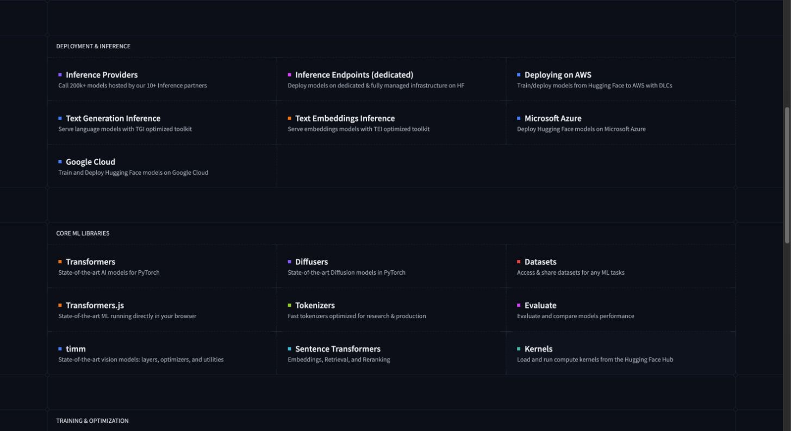
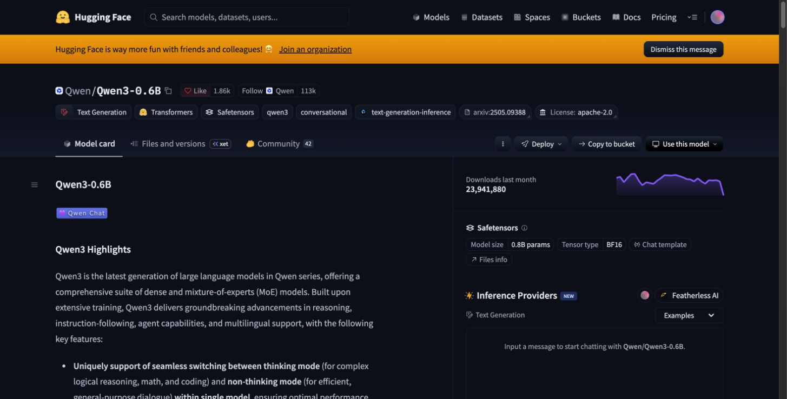

# Hugging Face 첫 방문에서 모델 입력 확인까지

PRE-HF · K2-03.U05~07 · 첫 강의 제작본 v0.1 · 2026-10-30

**오늘 할 일은 모델과 데이터를 찾는 화면을 읽고, 선택한 모델의 Tokenizer가 입력을 어떻게 바꾸는지 확인하는 것이다.** 처음부터 모든 메뉴나 라이브러리를 익힐 필요는 없다. 이 강의에서는 생성 모델을 실행하거나 학습시키지 않는다.

Python을 아직 배우지 않았다면 1~2부의 화면 활동을 먼저 한다. 3부는 Python 실행·가상환경·파일 경로를 확인한 뒤 수행한다. 선수지식의 부족과 모델 실행 실패를 혼동하지 않는다. 이미 Hugging Face를 사용해 본 사람은 각 부의 확인 과제로 이해를 확인할 수 있다.

| 이번에 할 수 있게 될 일 | 남길 결과 |
|---|---|
| 모델·데이터·데모·문서가 있는 위치 찾기 | 목적에 맞는 메뉴 선택 이유 |
| Model Card와 실제 파일을 함께 읽기 | 후보 두 개의 선택 근거·미확인 조건 |
| 문장이 Token ID로 바뀌는 과정 관찰 | 실제 관찰 결과와 길이·Padding·대화 형식 설명 |

**읽는 방법:** 설명을 먼저 읽고 화면에서 같은 위치를 찾는다. ‘따라하기’는 직접 수행할 활동이며 ‘확인 질문’에는 자신의 관찰 근거로 답한다. 이 문서의 화면은 실제 캡처지만, 화면 속 코드와 숫자가 우리 실습의 실행 결과인 것은 아니다.

## 1부. 처음 들어왔을 때 어디로 가야 할까?

### 1-1. 사이트와 라이브러리를 구분한다

Hugging Face Hub는 사람들이 모델·데이터·데모를 올리고 찾는 곳이다. Transformers, Datasets, PEFT 같은 이름은 이 자료를 코드에서 사용하거나 학습할 때 연결하는 라이브러리다. Docs는 각 도구의 사용 설명서다. 사이트에서 모델을 발견하는 것과 내 컴퓨터에서 실행하는 것은 서로 다른 단계다.

| 내가 하려는 일 | 첫 위치 | 이곳에서 확인할 것 |
|---|---|---|
| 답변 생성 모델 찾기 | 상단 Models | 작업 종류, 언어, 지원 도구·형식, 제작자 |
| 학습·평가용 자료 찾기 | 상단 Datasets | 샘플, 필드, Split, 출처·사용 조건 |
| 다른 사람이 만든 데모 보기 | 상단 Spaces | 데모 설명과 입력/출력. 시연 결과를 내 PC 성능으로 보지 않기 |
| Python에서 불러오는 법 찾기 | 상단 Docs | 도구 선택 → Quickstart/Tutorial → 필요한 API |

**따라하기:** [Models](https://huggingface.co/models)를 연다. 화면의 작업 종류에서 Text Generation을 찾아 선택하고, 제작자가 Qwen인 모델을 검색해 본다. UI 위치가 바뀌었으면 단어의 의미를 기준으로 찾는다. 언어·Library·형식은 하나씩 바꿔 결과가 어떻게 달라지는지 본다. 검색 결과 수를 정답으로 외우지 않는다.

**확인 질문:** “텍스트 답변을 만드는 모델”과 “문장 검색용 Embedding 모델”을 같은 기준으로 골라도 될까? 모델 이름에 익숙한 단어가 있는지보다, 내가 하려는 작업과 맞는지를 먼저 설명하자.

### 1-2. Docs는 전부 읽어야 하는 목차가 아니다

2026-10-30 실제 화면 · [원래 화면](https://huggingface.co/docs). **Core ML Libraries**의 Transformers·Datasets·Tokenizers가 서로 다른 도구라는 점을 먼저 본다. 아래 Training & Optimization에서 PEFT를 찾을 수 있다. 캡처에 보이지 않는 부분은 원래 페이지를 내려 확인한다.

| 도구 | 이번 과정에서 맡는 역할 | 지금 배울 깊이 |
|---|---|---|
| Transformers | 모델·설정·Tokenizer를 불러오고 생성/학습 기능 연결 | 이번에는 AutoTokenizer 사용 |
| Tokenizers | Token 분할·인코딩/디코딩을 처리하는 기반 라이브러리 | 기존 모델의 Tokenizer 사용. 새 Tokenizer 학습은 심화 |
| Datasets | 데이터를 읽고 검사·가공·저장 | 후속 Dataset 제작에서 실제 사용 |
| PEFT | 적은 Parameter를 학습하는 여러 기법·Adapter 관리 | 후속 LoRA/QLoRA 실습에서 사용 |
| TRL | SFT 등의 학습 절차 연결 | 후속 Fine-tuning에서 사용할 부분만 선택 |

예제는 현재 내 작업과 연결해서 읽는다. 지금 Tokenizer를 보고 있다면 분산 훈련 설명부터 시작할 필요가 없다. 먼저 Quickstart나 Tutorial에서 작은 입력/출력을 보고, 모르는 함수의 옵션을 API 문서에서 확인한다. 문서의 버전 선택과 설치한 라이브러리 버전도 맞춘다.

**따라하기:** Docs → Transformers를 열어 Tokenizer 설명을 찾는다. 예제에서 모델 ID가 들어가는 곳과 입력 문장이 들어가는 곳을 각각 찾는다. 예제 전체를 실행하기 전에 무엇을 내려받고 무엇을 계산하는지 적는다.

**확인 질문:** Docs의 Datasets와 사이트 상단의 Datasets는 어떤 관계인가? 하나는 데이터 목록으로 들어가는 길이고, 다른 하나는 데이터를 코드에서 다루는 도구의 설명서다.

## 2부. Model Card를 읽고 모델을 선택한다

### 2-1. 모델 페이지의 세 출발점

2026-10-30 실제 화면 · [Qwen/Qwen3-0.6B](https://huggingface.co/Qwen/Qwen3-0.6B). **Model card → Files and versions → Use this model**을 차례로 찾는다. 모델 페이지 예시이며 교육장 장비에서의 실행 성공을 보여주는 화면은 아니다.

| 위치 | 여기서 답할 질문 | 흔한 오해 |
|---|---|---|
| Model card | 어떤 모델이고 어디에 쓰며, 학습·평가·한계가 무엇인가? | 소개문에 좋다고 써 있으면 우리 업무에도 좋다 |
| Files and versions 또는 Files | 실제 가중치·Config·Tokenizer·버전은 무엇인가? | 파일 하나만 아무거나 받으면 된다 |
| Use this model | 어떤 Library/실행 경로를 사용할 수 있는가? | 예제 버튼이 있으면 내 PC에서도 바로 된다 |
| Inference Providers | 외부 서비스로 호출하는 경로인가? | 화면에서 답변을 받았으니 내 PC에서 실행했다 |

**따라하기:** Model card에서 모델의 목적과 제한을 찾는다. Files에서 Config, Tokenizer, 가중치 파일을 구분한다. Use this model에서는 Transformers 예제가 Tokenizer만 불러오는지, 모델 가중치까지 불러오는지 읽는다. 이 활동에서는 외부 추론 서비스에 요청하거나 파일을 모두 내려받을 필요가 없다.

### 2-2. 모델 이름만으로 결정하지 않는다

모델 ID의 제작자/모델명은 자료를 찾는 식별자다. 이름에 들어간 숫자나 Instruct·Base·GGUF·LoRA 같은 표시는 유용한 단서지만, 실제 종류와 사용 조건은 Card·Config·파일·설명을 함께 대조한다.

| 확인할 내용 | 읽는 방법 | 판단으로 연결하기 |
|---|---|---|
| 작업과 입력/출력 | 무엇을 받아 어떤 결과를 내는가? | 답변 생성·검색·분류 중 우리 목적과 맞는가? |
| Base / Instruct / Adapter | 사전학습 모델, 지시 학습 모델, 추가 학습분 중 무엇인가? | 대화용인지, 별도 Base가 필요한지 확인 |
| 언어와 데이터 | 어떤 언어·자료를 다뤘다고 설명하는가? 공개하지 않은 것은 무엇인가? | 한국어 적합성을 직접 확인할 질문 마련 |
| 평가 | 데이터셋·지표·비교 조건은 무엇인가? | 서로 다른 조건의 점수를 그대로 순위로 만들지 않기 |
| 라이선스·접근 조건 | Card의 표시와 연결된 License·추가 조건 확인 | 사용할 목적에 맞는지 확인하고 애매한 조건은 미확인으로 남기기 |
| 실행 도구·형식 | Transformers, GGUF 등 어떤 경로와 파일인가? | 사용할 Runtime과 맞추기 |
| 리비전 | main이 현재 가리키는 정확한 커밋은 무엇인가? | 같은 파일로 다시 실행할 수 있도록 고정 |
| 메모리·속도 | 정밀도·길이·배치·장비 조건이 함께 적혀 있는가? | 파일 크기를 전체 실행/훈련 메모리로 단정하지 않기 |

정보가 없으면 ‘없음/미확인’이라고 쓴다. 빈칸을 추측으로 채우지 않는다. 모델 제작자가 보고한 성능, 페이지의 자동 표시, 우리가 직접 실행한 관찰은 출처가 다르다. 표시가 다르면 바로 오류라고 단정하지 말고 리비전과 계산 기준을 대조한다.

### 2-3. 실제 파일의 역할

Files 탭에서 파일명과 크기를 보고 아래 역할을 연결한다. 모든 모델이 똑같은 파일 구성을 쓰지는 않는다.

| 파일 예 | 역할 | 이번 Tokenizer 실습에서 |
|---|---|---|
| README.md, LICENSE | 모델 설명과 사용 조건 | 읽고 출처 기록 |
| config.json | 모델 종류·구조 설정 | 선택한 로더가 이해하는 종류인지 확인 |
| tokenizer.json, tokenizer_config.json | Token 변환 규칙·Tokenizer 설정·대화 형식 등 | 실제로 사용 |
| vocab.json, merges.txt | 일부 Tokenizer의 어휘·병합 규칙 | 선택한 Tokenizer가 요구하면 사용 |
| model.safetensors 또는 분할 가중치 | 모델 Parameter | 이번 실습에서 내려받거나 로드하지 않음 |
| adapter_config.json, adapter_model.safetensors | 일부 PEFT 저장소의 Adapter 설정·가중치 | 후속 학습 실습에서 Base와 함께 확인 |

Files의 커밋/History에서 리비전을 확인한다. 실습의 [모델 목록](../../practice/huggingface-tokenizer/models.json)은 확인한 전체 커밋 SHA를 고정한다. 이 JSON은 **실제 실습 설정 파일**이며 임의 출력 예시가 아니다. 처음에는 직접 수정하지 않는다.

### 2-4. 후보 두 개 비교하기

이 활동에서는 [Qwen3-0.6B](https://huggingface.co/Qwen/Qwen3-0.6B)와 [SmolLM2-135M-Instruct](https://huggingface.co/HuggingFaceTB/SmolLM2-135M-Instruct)를 읽는다. 두 모델을 교육장용으로 채택했다는 뜻은 아니다. 서로 다른 페이지에서 같은 질문에 답하는 연습이다.

**과제:** [작성용 답안](../../practice/huggingface-tokenizer/WORKSHEET.md)의 비교표를 채운다. 각 판단 옆에 근거 URL/리비전을 기록한다. 한국어 규정 답변용 모델을 고른다고 가정하고 ‘현재 후보’, ‘추가 확인 필요’, ‘부적합’ 중 하나와 이유를 쓴다. Card 읽기만으로 최종 실행·품질 검증까지 끝났다고 표시하지 않는다.

**완료 기준:** 두 모델의 ID와 종류를 구분하고, Card·파일·실행 경로를 찾았으며, 최소 하나의 미확인 조건과 그 조건을 시험할 방법을 제시한다. 선호 모델의 이름 자체는 정답이 아니다.

## 3부. 문장은 모델에 어떻게 들어갈까?

### 3-1. Tokenizer는 답변하는 모델이 아니다

모델은 입력 문자열을 그대로 읽는 대신 숫자 ID의 열을 입력으로 사용한다. Tokenizer는 문자열을 나누고 ID로 바꾸며, ID를 문자열로 되돌리는 기능도 제공한다. Token은 글자·단어와 항상 일치하지 않는다. 같은 문장도 Tokenizer가 달라지면 나눠지는 방식과 ID가 달라질 수 있다.

이번 실습은 짧은 한국어·영어 문장을 Token ID로 바꾸는 작업이다. **Tokenizer 파일을 CPU에서 사용하는 데 모델 가중치나 GPU는 필요하지 않다.** 필요한 Python 라이브러리와 Tokenizer 파일은 준비해야 한다. 이 실습의 성공을 생성 모델이나 Fine-tuning 실행 성공으로 바꾸어 기록하지 않는다.

실행 파일은 [inspect_tokenizer.py](../../practice/huggingface-tokenizer/inspect_tokenizer.py)다. 가짜 Tokenizer로 대체하는 경로는 없고, 준비물이 없으면 준비 필요 상태로 종료한다. 동작을 살펴보고 싶을 때는 파일을 열고, 실행할 때는 아래 명령을 터미널에 입력한다.

코드가 처음이면 먼저 [짧은 핵심 코드](../../practice/huggingface-tokenizer/tokenizer_steps.py)를 읽는다. encode → decode, Padding, Template 세 부분만 담았다. inspect_tokenizer.py의 나머지 부분은 입력 검사·파일 확보·결과 기록을 위한 실행 도구다. 첫 수업에서 그 전체를 외우지 않아도 된다.

### 3-2. 실행 준비와 명령

처음에는 GitHub에서 **work/curriculum-production-001** 브랜치의 파일을 받는다. 기본 브랜치의 파일과 섞지 않는다. 저장소의 curriculum-work/practice/huggingface-tokenizer 폴더를 터미널에서 연다. 폴더를 잘못 열면 inputs.json·requirements.txt를 찾지 못할 수 있다.

다음은 **실제로 입력할 명령**이다. 출력 예시가 아니다. 가상환경 Python은 별도로 설치한 Python 3.12를 기준 후보로 한다. Windows는 3.12 실행기가 설치돼 있어야 하며 `py -3.12`를 먼저 확인한다. 자세한 준비·오류 처리는 [실습 안내](../../practice/huggingface-tokenizer/README.md)에 있다.

| 순서 | macOS/Linux | Windows PowerShell | 하는 일 |
|---|---|---|---|
| 1 | `python3.12 -m venv .venv` | `py -3.12 -m venv .venv` | 별도 가상환경 생성 |
| 2 | `.venv/bin/python -m pip install -r requirements.txt` | `.venv\Scripts\python.exe -m pip install -r requirements.txt` | 실습 의존성 설치 |
| 3 | `.venv/bin/python inspect_tokenizer.py --preflight` | `.venv\Scripts\python.exe inspect_tokenizer.py --preflight` | 설정·설치 버전 확인. Tokenizer 실행은 아님 |
| 4 | `.venv/bin/python inspect_tokenizer.py --profile qwen --allow-download --output runs/qwen-01` | `.venv\Scripts\python.exe inspect_tokenizer.py --profile qwen --allow-download --output runs/qwen-01` | 필요한 Tokenizer 파일을 확보하고 실제 관찰 |
| 5 | `.venv/bin/python inspect_tokenizer.py --profile qwen --output runs/qwen-offline-01` | `.venv\Scripts\python.exe inspect_tokenizer.py --profile qwen --output runs/qwen-offline-01` | 다운로드 허용 없이 같은 캐시로 재실행 |

처음 다운로드에는 인터넷이 필요하다. `--allow-download`가 없으면 로컬 캐시만 사용한다. 파일이 없으면 정상 결과를 만들어내지 않고 종료한다. 실행 파일은 다운로드 목록을 Tokenizer 관련 파일로 제한하며 모델 가중치를 요청하지 않는다. 공개 파일의 접근 조건이 바뀌면 원래 페이지를 확인한다.

**검증 상태:** 2026-10-31 Linux CPU / Python 3.12.14에서 Qwen·Smol 실제 Tokenizer와 캐시 재현을 확인했다. 정확한 실행 확인 범위는 [제작 결과](../../reports/KEDU-PRODUCTION-001/RESULT.md)에 기록한다. 이 문서의 명령과 실행 파일을 작성한 사실만으로 실제 Tokenizer 실행을 완료했다고 보지 않는다.

### 3-3. 결과를 읽는다

실행이 성공하면 지정한 폴더에 observations.md와 observations.json이 생긴다. **사람은 observations.md를 먼저 읽는다.** JSON은 모델 ID/리비전·파일 해시·설정·관찰값을 다시 확인하는 기록이다. 기존 결과가 있는 폴더에는 덮어쓰지 않으므로 재실행할 때는 새 이름을 사용한다.

| 결과 항목 | 관찰할 것 | 설명할 질문 |
|---|---|---|
| 문자 수와 Token 수 | KO/EN/SHORT의 수가 같은지 다른지 | 한 글자=한 Token이라고 할 수 있는가? 단 세 문장으로 언어 전체 효율을 결론 낼 수 있는가? |
| Token IDs·Token 표시 | 숫자와 내부 조각의 관계 | 내부 표시가 깨져 보이는 것과 decode 결과가 틀린 것은 같은가? |
| decode와 완전 복원 여부 | 원문과 복원 결과 비교 | 정규화/공백 처리 때문에 차이가 생길 가능성은 무엇인가? |
| 길이 제한 뒤 IDs | max-length 8에서 빠진 부분 | 중요한 조건이 잘리면 이후 답변에 어떤 문제가 생길까? |
| Padding과 Attention mask | 짧은 입력을 배치로 맞춘 자리 | 0인 위치가 뜻하는 것은 무엇인가? |
| Chat Template | 역할과 특수 Token이 포함된 최종 입력 | 화면의 변환 문자열은 입력인가, 모델이 생성한 답인가? |

`Token 표시`에는 일반적인 단어처럼 보이지 않는 조각이 나올 수 있다. 한 조각만으로 언어 표현이 깨졌다고 단정하지 않고 전체 ID 열의 decode와 함께 본다. 한국어/영어 세 문장의 Token 수 차이를 모델의 언어 능력 점수로 쓰지 않는다.

### 3-4. 대화 목록과 실제 입력은 다르다

사용자/시스템 같은 역할을 가진 메시지는 모델별 Chat Template을 거쳐 Token 열로 바뀐다. 모델마다 역할 구분과 종료를 표시하는 방식이 다를 수 있어, 다른 모델의 형식을 무조건 복사하면 안 된다. 이 실습은 모델에 맞는 Template을 불러와 변환 전/후를 보여준다.

Qwen 프로필은 Template 설정 중 enable_thinking을 false로 고정한다. 변환 문자열에 특정 제어 문자열이 포함되어도 모델이 생각하거나 답변을 생성했다는 뜻은 아니다. 여기서 수행한 것은 입력 형식 변환뿐이다.

한 번 Template으로 만든 문자열에 특수 Token을 다시 자동 추가하면 중복이 생길 수 있다. 다만 해당 Tokenizer가 추가하지 않는 설정이면 결과가 같을 수도 있다. 실행 결과의 두 비교 항목을 읽고 **실제로 달라졌는지** 기록한다. ‘항상 중복된다’라는 답을 미리 정하지 않는다.

Attention mask는 패딩을 포함한 입력 위치를 표시한다. 뒤 Fine-tuning에서 배우는 정답 영역의 Loss mask와 역할이 다르다. 지금은 두 이름이 같지 않다는 점까지만 확인하고 후속 학습 입력 실습에서 연결한다.

### 3-5. 한 조건씩 바꿔 관찰한다

| 변경 활동 | 방법 | 확인할 근거 |
|---|---|---|
| 길이 제한 변경 | 위 실행 명령에 `--max-length 16`을 추가하고 새 출력 폴더 사용 | 같은 원문에서 잘림이 어떻게 달라지는가? |
| 다른 Tokenizer 비교 | profile을 smol로 바꾸고 최초 1회 `--allow-download` 사용 | 같은 입력의 ID·Token 수·Template 차이 |
| 원문 변경 | inputs.json을 복사해 문장 하나만 바꾸고 `--inputs`에 새 파일 경로 지정 | 입력 해시·바뀐 관찰값·고정한 조건 |

Smol 프로필도 실제 모델 가중치는 로드하지 않는다. 한쪽이 잘게 분할한다고 한국어 답변 품질이 더 나쁘다고 바로 결론 내리지 않는다. 다른 Tokenizer의 같은 숫자 ID가 같은 뜻이라고 가정하지 않는다.

### 제작자가 실제로 확인한 관찰 예

아래는 같은 inputs.json과 고정 리비전으로 실행한 값이다. 자신의 실행 결과와 비교하되 예상값을 복사해 제출하지 않는다.

| 입력 | Qwen Token 수 | Smol Token 수 |
|---|---|---|
| KO: 한국어 예문 | 16 | 64 |
| EN: 영어 예문 | 13 | 13 |
| SHORT: Hi! | 2 | 2 |

Qwen에서 길이를 8로 제한하면 KO/EN이 8 Token으로 잘렸고, 16으로 늘리면 원래의 16/13 Token이 유지됐다. **제한 안에 모두 들어가서 잘리지 않는 것도 정상 결과다.** 이 몇 문장의 차이를 언어 능력 순위로 일반화하지 않는다. [실제 관찰 결과와 검증 범위](../../reports/KEDU-PRODUCTION-001/RESULT.md)를 볼 수 있다.

## 제출과 자기 확인

[작성용 답안](../../practice/huggingface-tokenizer/WORKSHEET.md)에 화면 탐색·두 모델 비교·관찰 해석을 남기고, 실제 실행으로 생성된 observations.md를 함께 제출한다. 실행하지 못한 경우에는 준비 상태와 오류를 기록하고 ‘실행 완료’로 제출하지 않는다.

| 확인 | 완료라고 말할 수 있는 근거 |
|---|---|
| 첫 방문 | 모델·데이터·데모·Docs 중 목적에 맞는 위치를 설명 |
| 모델 선택 | 두 Card와 파일에서 근거를 찾고 미확인 조건을 분리 |
| Tokenizer 실행 | 실제 리비전·파일 해시·관찰 결과가 있고 원문과 비교 |
| 이해 | 잘림·Padding·Template 변환을 자기 관찰값으로 설명 |
| 재현 | 같은 프로필/입력/길이에서 다운로드 허용 없이 재실행하고 관찰값을 비교 |

강사용 채점 기준과 보충 자료

[강사용 안내](INSTRUCTOR.md)는 답의 이름보다 선택 근거·실행 증거·관찰 해석을 평가한다. 기법 목록은 후속 PEFT 수업에서 계열 지도와 선택 비교로 연결한다. 이번 강의에서 모든 Adapter나 Datasets API를 설명하지 않는다.

## 참고 자료와 적용 범위

- [Hub와 모델 찾기](https://huggingface.co/docs/hub/models-the-hub)
- [Model Card가 담는 정보](https://huggingface.co/docs/hub/model-cards)
- [모델 파일 다운로드·리비전](https://huggingface.co/docs/huggingface_hub/guides/download)
- [Transformers 4.57.1 설치 안내](https://huggingface.co/docs/transformers/v4.57.1/installation)
- [Transformers 4.57.1 Tokenizer API](https://huggingface.co/docs/transformers/v4.57.1/main_classes/tokenizer)
- [Transformers 4.57.1 Chat Template](https://huggingface.co/docs/transformers/v4.57.1/chat_templating)

강의 설명은 이 자료를 바탕으로 재구성했으며, 원문 예제를 그대로 실행 완료했다고 표시하지 않았다. 설치 버전은 실습 요구사항 파일, 모델 리비전은 models.json, 실제 실행 환경·결과는 관찰 기록에서 구분해 확인한다.
