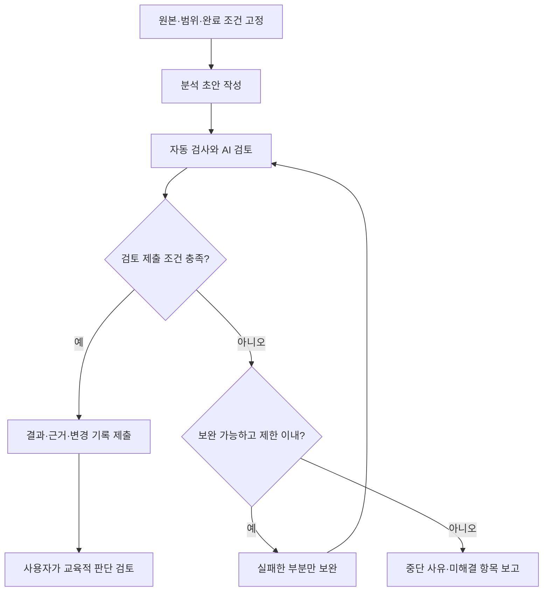

# K-Edu 교육자료 제작을 위한 최소 Loop 설계안 v0.1

이번 설계는 **강의 분석 결과를 검사하고, 실패한 부분만 고쳐 다시 검사하는 작은 루프**에서 시작한다. 첫 적용 작업은 강의 한 개에 대한 읽기 전용 분석이다. 교육과정 제작 9단계는 유지하며, 그 안의 실행·검증 방법을 구체화한다.

**현재 완료한 것은 설계안과 시범 작업 명세다.** GitHub 원본 구조와 후보 강의의 목차·관련 본문을 확인했다. 시범 강의의 전수 분석, 실제 반복 분석 실행, 자동 Runner 구현, 강의안 수정은 후속 작업이다.

## 1. 이번 결정과 설계 제안의 구분

| 구분 | 내용 | 적용 상태 |
|---|---|---|
| 현재 대화의 작업 방향 | 교육자료 제작에 제한된 분석·검증·개선 루프 적용 | 이번 설계의 전제 |
| 교육과정 제작 기준 | 기존 9단계를 유지하고 단계별 결과를 검토 | 유지 |
| 교육 내용 방향 | Prompt·Context·Harness·Loop의 관계를 다루고 RAG → Agent → Multi-Agent 누적 실습과 연결 | 상세 배치·시수는 후속 설계 |
| 제작 원칙 | Phase1의 완성도를 존중하고 필요한 변경만 검토, 동일 설명·예제의 불필요한 반복 방지 | 첫 시범에서는 Phase1을 비교 대상으로만 사용 |
| 이번 설계 제안 | 최초 분석 1회 + 보완 최대 2회, 자동 검사와 AI 검토를 구분 | 검토용 기본값 |
| 시범 과제 제안 | Phase2-02 한 과목과 Phase1 관련 3개 강의 비교 | 본문 근거를 확인해 선정한 추천 대상 |
| 후속 검토 대상 | 과목 삭제·통합·순서 변경, 최종 목차, 실제 교육자료 반영 | 분석 보고서에서 근거와 제안 제시 |

이 문서는 기존 강의 개편안을 승인하거나 강의 내용을 변경하는 문서가 아니다. 루프의 합격도는 **검토할 수 있는 분석 결과가 준비되었는가**를 뜻하며, 해당 제안이 교육적으로 최종 확정되었다는 뜻은 아니다.

## 2. 원본과 적용 기준

### 2.1 이번에 확인한 GitHub 기준점

| 항목 | 직접 확인 결과 |
|---|---|
| 저장소 | [cocoa2260/k-edu](https://github.com/cocoa2260/k-edu) |
| 실제 강의자료 브랜치 | `docs/academy-curriculum-v0.1` |
| 기준 커밋 | [`bc58756866cd6bdee20c102fb54340f21e65ad56`](https://github.com/cocoa2260/k-edu/commit/bc58756866cd6bdee20c102fb54340f21e65ad56) |
| 강의 루트 | `academy/00. 교육과정(curriculum)/` |
| 기본 브랜치 | `main` — 확인 시점에는 README만 존재 |
| main 커밋 | `f2d91fd5cf38c84c216ff3a126d08a962a84fb6b` |
| 소스 목록 확인 | 대상 커밋의 Git tree 응답은 잘리지 않았음. `AGENTS.md`는 해당 tree에서 발견되지 않음 |
| 이번 설계를 위해 직접 읽은 강의 파일 | Phase1 3개, Phase2 3개. 파일별 반환 Blob SHA와 tree의 SHA 일치 확인 |

브랜치 이름만 기록하면 이후 변경으로 분석 기준이 바뀔 수 있다. 따라서 **실행마다 커밋과 파일별 Blob SHA를 고정**한다. 같은 분석을 재개할 때 원본이 달라졌다면 기존 결과를 덮어쓰지 않고 새 실행으로 구분한다.

### 2.2 과거 문서와 현재 지시의 관계

첨부된 `PROJECT_CONTEXT.md`, `CURRICULUM_ANALYSIS.md`, `WORK_PROGRESS.md`는 2026-10-19 기준이다. 당시의 ZIP 단일 원본 규칙, Phase2 과목 수, AI Integration 구성, Chat 중심 작업 안내가 남아 있다. 2026-10-30 예비 분석 보고서도 확인했으며, 진행 이력을 파악하는 용도로 사용했다.

현재 대화에서 지정한 **GitHub 최신 강의자료 확인과 Work 실행 방향**을 이번 작업에 적용한다. 과거 ZIP과 현재 GitHub의 내용이 같다고 가정하지 않는다. 과거 보고서의 문제 목록도 실제 본문 확인 없이 현재 결함으로 복사하지 않는다. 설명 충실도·반복 방지·실행 증빙 구분 같은 유효한 원칙은 유지한다.

모델·SDK·라이선스·최신 용어의 정확성을 새로 검증할 필요가 생기면 해당 항목을 별도 기술 조사로 분리한다. 이번 설계와 읽기 전용 시범은 저장소 안의 교육내용 비교가 범위다.

## 3. 최소 Loop의 동작



초안은 시도 1, 첫 보완 결과는 시도 2, 두 번째 보완 결과는 시도 3이다. **각 보완 후에는 수정 부분과 연결된 판단을 검사하고 공통 필수 검사도 다시 수행**한다. 합격한 다른 과목이나 관계없는 문단을 다시 작성하지 않는다.

### 3.1 구성 요소와 책임

| 구성 요소 | 책임 | 최초 적용 방식 |
|---|---|---|
| 작업 명세 | 대상·비교 자료·출력·검사·제한·권한 지정 | 구조화된 JSON + 본 문서 |
| 분석 역할 | 원문을 읽고 중복·고유 성과·개선 후보 정리 | Work에서 순차 수행 |
| 검사 역할 | 파일·경로·근거 위치·형식·원본 보호 확인 | 로컬 검사 명령과 후속 최소 검사 스크립트 |
| AI 검토 역할 | 중복 판정의 타당성, 핵심 내용 보존, 학습 발전 검토 | 같은 Work 세션에서 검토 지시를 분리해 순차 수행 |
| 실행 제어 | 시도 수·실패·종료·상태·기록 관리 | 최초에는 Work가 규칙을 지키며 실행, 이후 필요할 때 Runner로 강제 |
| 사용자 | 과목 개편과 최종 반영 판단 | 완성된 근거·제안·미해결 목록 검토 |

분석과 검토는 **논리적인 역할 분리**다. 별도의 모델이나 독립 검토자가 확보되었다는 뜻이 아니며, 여러 Agent를 띄우는 구조를 첫 실험에 요구하지 않는다. 동일 모델의 검토에는 공통 오류 가능성이 있으므로 원문 근거와 의도적인 오류 사례로 검토 품질을 확인한다.

또한 이 최초 방식은 **Work가 수행하는 제한된 검증·보완 절차**다. 아직 독립 실행 프로그램이나 상시 자동화 서비스가 아니다. GitHub Actions만으로 Work가 재실행되거나, 프롬프트만으로 시간·토큰 제한이 시스템 수준에서 강제된다고 설명하지 않는다.

## 4. 시범 과제 선정

### 4.1 후보 비교

| 후보 | 이번에 확인한 내용 | 첫 실험 판단 |
|---|---|---|
| Phase2-02 AI·머신러닝·딥러닝 개요 | AI/ML/DL 정의와 Training/Inference 설명, 데이터 분리·일반화·누수·평가 보강을 함께 포함 | **추천.** 중복 후보 식별과 고유 내용 보존을 한 과목에서 검사 가능 |
| Phase2-05 Prompt Engineering | Unit 4에 Golden Dataset·Regression Test·평가·운영이 이미 포함 | 다음 후보. 기존 내용을 누락으로 오인하는지 검토하기 좋지만 신규 용어 배치까지 함께 다루면 범위가 커짐 |
| Phase2-09 Agent | Part 3에 Agent Loop·Runtime, Part 6에 실패·재시도·종료 조건 포함 | 후속 후보. Workflow/Agent 구분과 실행 예제 검증까지 확장하기 적합 |

Phase2-02를 추천하는 것은 **해당 과목을 삭제하거나 통합하기로 결정했다는 뜻이 아니다.** 비교의 난도가 적당하고 정답이 단순한 일괄 삭제가 아니어서 평가 기준 자체를 시험하기 좋다는 판단이다.

### 4.2 직접 확인한 선정 근거

아래 줄 번호는 고정 커밋의 파일 기준이다. 상세 경로와 Blob SHA는 부록 A에 있다. 이 표는 시범 대상 선정의 근거이며, 중복 전수 판정 결과가 아니다.

| 근거 ID | 위치 | 확인 내용 | 시범에서 검사할 판단 |
|---|---|---|---|
| E01 | S01 L181–226 | Phase1에 AI·ML·DL 관계 설명 존재 | Phase2의 같은 개념이 같은 설명을 반복하는지 비교 |
| E02 | S02 L213–263 | Phase1에 Training/Inference 정의·비교 존재 | 기초 재정의와 새로운 심화 설명을 구분 |
| E03 | S03 L148–230 | Phase1에 Loss·Gradient·Optimizer 역할과 코드 존재 | Phase2의 Loss/Optimization을 무조건 신규 내용이라고 판정하지 않는지 확인 |
| E04 | S04 L241–397 | Phase2-02에 AI·ML·DL 정의와 예시 존재 | 개념 공유, 유사 설명, 동일 예시를 따로 판정 |
| E05 | S04 L1432–1545 | 데이터 분리, Overfitting/Underfitting, Data Leakage, 평가 지표 설명 존재 | 이런 심화 내용을 근거 없이 통째로 삭제 제안하지 않는지 확인 |
| E06 | S05 L3080–3114 | Prompt Unit 4가 평가·운영과 학습목표 명시 | 이미 있는 평가 내용을 신규 누락으로 보고하지 않기 |
| E07 | S06 L513–624 | Agent Loop와 Runtime 책임 명시 | Harness·Loop 관련 기존 기반을 인정하기 |
| E08 | S06 L866–944 | 재시도·종료·중복 실행 문제 설명 존재 | 반복 횟수만 추가하면 완성이라는 오해 방지 |

## 5. 첫 시범의 입력·출력 계약

### 5.1 입력

첫 시범은 **Phase2-02 강의용 파일 전체**를 분석한다. 비교 대상은 S01·S02·S03 전체이며, Phase1 본문은 수정하지 않는다. 선정 단계의 발췌 확인을 전수 분석 완료로 승격하지 않는다.

- 원본: 기준 커밋과 파일별 Blob SHA.
- 작업 지시: 현재 대화에서 정한 범위, 본 설계의 검사·제한 조건.
- 비교 범위: Phase1의 세 강의. 이 범위를 벗어난 중복 여부는 `미검증`으로 표시.
- 제외: 강의 본문 편집, 과목 이동·삭제, 신규 강의 작성, 모델 설치·실행, GitHub 기본 브랜치 변경.

시범의 목적은 **정확한 비교·근거·검토 가능한 제안 생성**이다. RAG나 저사양 Multi-Agent가 실행 가능한지 확인하는 실험은 교육과정 제작 3~4단계에서 별도로 수행한다.

### 5.2 출력

| 출력 | 필수 내용 |
|---|---|
| `analysis.md` | 요약 판단, 전체 구간별 비교, 보존·축소·연결·차별화 제안, 미검증 범위, 사용자 판단이 필요한 항목 |
| `findings.json` | 개념·근거·판정·새 학습 성과·권고를 구조화한 목록 |
| `review.json` | 자동 검사 결과, AI 검토 결과, 발견 문제, 보완 전후 해소·신규 문제 |
| `run.json` | task 원본, 커밋·파일 명세, 시도 수, 상태, 종료 사유, 측정 가능 범위와 한계 |
| `events.jsonl` | 실제 실행한 읽기·검사·보완·중단 이벤트. 로그 기록을 시작한 시점부터만 기록 |

실행 루트는 `curriculum-work/reports/<task-id>/<run-id>/`다. 시도별 파일을 그 아래 `attempt-01/`, `attempt-02/`, `attempt-03/`로 보존한다. 후속 시도가 이전 보고서를 덮어쓰지 않는다. 실제 만들어진 시도만 기록하며, 실행하지 않은 빈 시도를 완료로 생성하지 않는다.

### 5.3 구간과 판정의 기록 규칙

1. 대상 파일 전체를 제목·본문·예제·활동·보강·참고 구간으로 나눈다. 코드 블록 안의 `#`를 Markdown 제목으로 집계하지 않는다. 제목이 없는 본문도 인접 구간에 포함한다.
2. 내용 구간마다 `검토함 / 비교 불충분 / 해당 없음`을 기록한다. 메타데이터·참고 구간의 제외 사유도 남겨 분석 범위의 분모를 숨기지 않는다.
3. 개념이 같다는 사실과 설명·비유·표·코드가 반복된다는 판정을 분리한다.
4. 중복 후보에는 **양쪽 원문의 파일·줄 범위·짧은 근거**가 있어야 한다. 한쪽만 있으면 `비교 불충분`이다.
5. 별도 학습 성과가 있으면 새로운 원리·반례·구현·평가 결과를 구체적으로 적는다. 단순히 “심화이므로 유지”라고 쓰지 않는다.
6. `유지 / 짧게 연결 / 차별화 / 통합 후보 / 삭제 후보 / 판단 보류`는 권고다. 실제 삭제·이동은 후속 검토 결과를 반영한다.
7. 전수 검토를 했더라도 비교 범위가 Phase1 세 강의이므로 전체 교육과정 중복 전수 조사로 표현하지 않는다.

`findings.json`의 항목 필드: `id`, `concept`, `source_refs`, `comparison_refs`, `relation`, `new_learning_outcome`, `recommendation`, `reason`, `decision_required`, `verification_status`. 고유 내용은 `comparison_refs`가 빈 배열일 수 있으며, 그 이유를 명시한다.

## 6. 품질 검사와 합격 조건

### 6.1 자동으로 확인할 항목

이 표는 **구현할 검사 명세**다. 현재 이 검사 프로그램이 모두 구현되어 실행된 상태는 아니다.

| ID | 검사 | 합격 기준 | 실패 시 처리 |
|---|---|---|---|
| A01 | 원본 식별 | 커밋·경로·Blob SHA가 실제 읽은 자료와 일치 | 차단. 원본 재식별 후 새 실행 |
| A02 | 출력 형식 | 필수 파일·JSON 필드·자료형·허용 상태 존재 | 해당 출력만 보완 |
| A03 | 근거 유효성 | 파일과 줄 범위가 존재하고 근거 발췌가 해당 원문과 일치 | 잘못된 근거와 연결된 판단 보완 |
| A04 | 범위 추적 | 대상 구간 목록의 각 항목에 검토 상태와 사유 존재 | 누락 구간만 분석 |
| A05 | 원본 보호 | 분석 전후 원본 SHA 동일, 출력 허용 경로 밖 변경 없음 | 즉시 중단. 차이 보고 후 원본 확인 |
| A06 | 링크·문서 구조 | 새 보고서의 파일 링크·고정 커밋 링크·코드 펜스가 올바름 | 새 출력의 관련 위치만 수정 |
| A07 | 실행 상태의 일관성 | 명령·결과 증빙 없는 실행 완료 표시가 없고 미측정 값은 null | 상태 정정. 실행 필요 시 별도 작업으로 분리 |
| A08 | 제어 기록 | 시도 수·종료 상태·보완 근거가 기록과 일치 | 제어 기록 보완 또는 중단 |

줄 범위가 유효하다는 사실만으로 **그 근거가 주장을 뒷받침한다고 판정하지 않는다.** 의미의 타당성은 AI 검토와 사용자 검토 대상이다. 새 보고서의 링크 검사는 수행하지만, 원본 저장소 전체의 기존 링크 문제를 첫 시범의 수정 과제로 끌어오지 않는다.

### 6.2 AI가 검토할 항목

| ID | 질문 | 통과에 필요한 근거 |
|---|---|---|
| Q01 | 실제 중복인가, 같은 개념을 다른 수준에서 배우는가? | 두 구간의 설명 방식·예시·학습 결과 비교 |
| Q02 | 최초 설명과 고유 학습 성과가 보존되는가? | 유지 위치 또는 삭제·이동 제안의 대체 위치와 보존 근거 |
| Q03 | 초보 학습자가 배울 순서와 연결이 설명되는가? | 이미 배운 것·새로 배우는 것·필요 선수지식 구분 |
| Q04 | 이미 있는 내용을 누락으로 오인하지 않는가? | 보강·활동·실습 구간까지 확인한 위치 |
| Q05 | 미검증·설계·실행·권고·확정을 구분하는가? | 각 결론의 증거 수준과 적용 범위 표시 |

각 항목을 `pass / revise / uncertain`으로 판정하고 사유를 쓴다. 숫자 평균으로 근거 결함이나 핵심 내용 누락을 상쇄하지 않는다.

- `revise`: 자료가 있어 바로 보완할 수 있는 오류. 루프 안에서 처리한다.
- `uncertain — evidence`: 필요한 원문을 읽지 못했거나 근거가 부족함. 보완할 수 없으면 차단한다.
- `uncertain — decision`: 두 교육 구성안이 모두 성립해 사용자의 선택이 필요함. 근거·영향·추천을 갖춘 상태로 제출할 수 있다.

**제출 조건:** A01~A08의 적용 항목 통과, 해소되지 않은 `revise`와 근거 부족 없음, 교육적 선택은 명시적 검토 항목으로 분리. `해당 없음`은 사유를 기록하며 합격 수에 포함하지 않는다. 이는 최종 강의 승인과 별개다.

### 6.3 검사 자체를 확인하는 오류 사례

첫 시범에는 정상 보고서 외에, 복사본에 의도적으로 넣은 아래 오류가 발견되는지 확인한다. 실제 원본과 최종 보고서는 오염시키지 않는다.

| 사례 | 의도적인 오류 | 기대하는 검출 |
|---|---|---|
| C01 | S04의 존재하지 않는 L99999를 근거로 인용 | A03 실패 |
| C02 | Phase1에 기초 설명이 있다는 이유만으로 Phase2의 데이터 분리·누수·평가 구간 전체를 삭제 권고 | Q01/Q02에서 근거 부족·학습 성과 훼손 발견 |
| C03 | 실행 로그 없이 “Ollama/Multi-Agent 실행 검증 완료”로 표시 | A07 및 Q05 실패 |

이 사례를 검출하지 못하면 평가 기준 또는 검사 방식을 보완한다. 오류 검출 실험 결과와 실제 강의 분석의 품질을 따로 보고한다. **현재는 사례를 설계한 상태이며, 검출 성공 결과는 아직 없다.**

## 7. 반복·중단·재개 규칙

### 7.1 기본 제한

| 항목 | 첫 시범 기본값 | 의미 |
|---|---|---|
| 분석 시도 | 최대 3회 | 최초 작성 1회 + 보완 최대 2회 |
| 같은 문제 재발 | 보완 직후 동일 실패가 남으면 중단 | 표현만 바꾸는 반복 방지 |
| 검사 기준 | 실행 중 고정 | 통과를 위해 기준을 낮추지 않음 |
| 원본 범위 | 커밋 + 네 파일 고정 | 비교 자료 추가가 필요하면 별도 후속 범위로 기록 |
| 실행 시간 | 실제 실행 시작 후 30분을 소프트 한도로 제안 | 단계 사이에 확인·기록. 현재 Work의 강제 중단 기능은 아님 |
| Tool/API 오류 재시도 | 같은 읽기·검사에 최대 1회 추가 | 일시적 오류에 한함. 품질 보완 횟수와 별도 기록 |
| Token/유료 API | 첫 시범에 별도 유료 모델 API 호출 없음 | Work 자체의 실제 Token 사용량은 노출되지 않으면 미측정 |

시간 제한을 넘겼거나 거의 소진한 상태에서 긴 새 단계를 시작하지 않는다. 자동 Runner를 구현하면 단일 호출 timeout과 전체 실행 deadline을 별도로 강제할 수 있다. 현재 설계 단계에서는 그런 강제가 이미 존재한다고 표현하지 않는다.

### 7.2 같은 실패와 개선의 정의

실패 식별자는 `검사 ID + 대상 파일/구간 + 문제 유형`으로 유지한다. 보고서 문구나 항목 번호가 바뀌어도 같은 원인이면 같은 실패다.

보완 효과는 **해소된 문제, 남은 문제, 새로 생긴 문제**를 원문 근거와 함께 비교한다. 원문 해석을 더 정확하게 하면서 새로운 문제를 발견한 경우 단순히 문제 개수가 늘었다는 이유로 악화라고 판정하지 않는다. 반대로 문제 목록을 지워 개수만 줄이는 것은 개선이 아니다. 보완 직후 동일 실패가 해결되지 않았다면 추가 자동 보완을 멈추고 원인을 보고한다.

### 7.3 종료 상태

| 상태 | 조건 | 다음 동작 |
|---|---|---|
| `READY_FOR_REVIEW` | 제출 조건 충족 | 결과·근거·교육적 선택 사항 제출 |
| `BLOCKED` | 원본 불일치·접근 불가·필수 근거 부족 | 부족한 입력과 현재까지의 결과 제출 |
| `STOPPED` | 시도/시간 제한, 반복 실패, 허용 범위 이탈 | 마지막 유효 결과·중단 코드·재개 조건 제출 |

중단 코드 예: `SOURCE_CHANGED`, `MISSING_EVIDENCE`, `REPEATED_FAILURE`, `ATTEMPT_LIMIT`, `TIME_LIMIT`, `OUT_OF_SCOPE_WRITE`, `TOOL_UNAVAILABLE`.

재개할 때는 task·원본 SHA·마지막 유효 시도·미해결 항목부터 읽는다. 같은 입력·같은 기준의 검사를 이유 없이 반복하지 않는다. 원본이나 평가 기준을 바꾸면 task revision과 새 run ID를 만들고 기존 기록을 연결한다.

## 8. 실행 기록과 효율 측정

단순히 모델이 “오래 걸렸다”라고 회고하는 대신, 기록 가능한 실행 사실을 남긴다. 다만 Work에서 보이지 않는 사용량을 추정해 정밀 측정치로 적지 않는다.

| 정보 | 기록 주체 | 값이 없을 때 |
|---|---|---|
| 시작·종료 시각, 시도 번호 | 실행기 또는 Work의 실제 체크포인트 | 미기록 범위 명시 |
| 읽은 파일·커밋·Blob SHA | 파일 조회 결과와 명세 | 근거 확보 전 차단 |
| 검사 명령·종료 코드·결과 경로 | 로컬 프로세스/검사기 | 미실행 표시 |
| 수정한 항목·사유·검증 결과 | Work + 결과 Diff | 사후 추정으로 채우지 않음 |
| 실제 모델 호출·Token | 호출 API/Runner가 제공한 usage | `null`, `not_exposed` |
| Tool 호출 수 | 관찰 가능한 호출 래퍼/이벤트 로그 | 기록 범위와 누락 표시 |
| 사용자 검토 대기 시간 | 검토 요청·응답 타임스탬프 | 생성 시간과 섞지 않음 |

현재 Work만으로 얻은 기록에는 `telemetry_complete: false`를 사용한다. 검사 프로세스가 남긴 사실과 모델이 작성한 원인 해석을 별도 필드로 둔다. Runner가 없는데 독립적인 전체 시간·Token·내부 재시도 집계가 완성되었다고 주장하지 않는다.

첫 실험의 효율 보고는 초안 대비 근거 오류·미검토 구간·잘못된 삭제 권고가 어떻게 달라졌는지 중심으로 작성한다. 수작업 비교 기준이 없으므로 “몇 % 시간 절감” 같은 수치를 만들지 않는다.

## 9. GitHub에 적용할 최소 구조

다음은 **후속 적용안**이다. 이번 설계 작업에서 디렉터리나 브랜치를 생성·변경한 것은 아니다.

| 경로 | 역할 |
|---|---|
| `academy/` | 기존 강의 원본. 첫 시범에서는 읽기 전용 |
| `curriculum-work/loop/loop-spec.md` | 본 실행 규칙 |
| `curriculum-work/loop/prompts.md` | 분석·검토·부분 보완 지시 |
| `curriculum-work/loop/tasks/KEDU-PILOT-001.json` | 대상·원본·완료 조건·제한 |
| `curriculum-work/loop/checks/check_analysis.py` | 첫 시범에 필요한 자동 검사 |
| `curriculum-work/reports/<task-id>/<run-id>/` | 시도별 분석·검사·실행 기록 |

시범 실행을 준비할 때 `loop/` 아래에 작업 명세·지시·검사기를 먼저 마련한다. 이후 실제 분석 task의 쓰기 허용 범위는 해당 보고서 디렉터리로 제한한다. 준비 작업과 분석 결과를 구분해 기록한다.

별도 DB, 대시보드, 상시 실행 서버, 범용 Agent 플랫폼은 첫 실험에 필요하지 않다. 실제 강의 개편본과 실습 코드를 두는 구조는 3~5단계에서 확정한다.

GitHub 적용 시 작업 브랜치는 **강의자료가 있는 기준 커밋에서** 분기한다. 예: `work/loop-pilot-001`. PR을 만든다면 비교 기준도 `docs/academy-curriculum-v0.1`로 지정해 강의자료 전체가 불필요한 신규 변경으로 보이지 않도록 한다. `main` 병합과 기본 브랜치 변경은 별도 운영 판단이다.

검사 실패→수정→재검사를 Work에서 실행하고, 필요하면 이후 GitHub Actions에 자동 검사를 연결한다. Actions는 검사 결과를 남길 수 있지만 그것만으로 AI의 자동 재작성 루프가 완성되지는 않는다.

### 9.1 최초 분석·검토 지시

**분석 역할 지시**

> 고정 커밋의 대상 강의 전체와 지정 비교 자료를 읽는다. 개념 공유와 동일·유사 설명/비유/표/코드 반복을 구분한다. 모든 내용 구간에 검토 상태를 부여한다. 원문 파일·줄 범위를 근거로 고유 학습 성과와 개선 후보를 작성한다. 이미 있는 보강·활동을 누락으로 보고하지 않는다. 원본은 편집하지 않는다. 부족한 근거와 교육적 선택은 분리해 기록한다.

**AI 검토 역할 지시**

> 분석자의 결론에 동의하는 것을 목표로 삼지 않는다. 작업 명세, 원문, 출력, A/Q 검사 기준을 대조한다. 중복 주장에는 양쪽 근거가 있는지, 고유한 평가·실습 내용까지 삭제 권고하지 않았는지, 미검증 내용을 완료로 표시하지 않았는지 확인한다. 각 실패에 안정적인 ID·근거·수정 요구를 남긴다. 근거가 충분한 복수의 교육 구성안은 단정하지 않고 선택지와 영향을 정리한다.

**부분 보완 지시**

> 실패 ID에 연결된 분석·근거·제안만 수정한다. 평가 기준과 원본을 바꾸지 않는다. 이전 문제의 해소·잔존·신규 발생을 비교하고 연결된 회귀 검사를 수행한다. 동일 실패가 남거나 허용 시도를 소진하면 중단 보고한다.

## 10. 시범 작업 명세 예시

아래 JSON은 실제 원본 경로와 Blob SHA를 채운 실행 입력안이다. `planned`는 **시범이 아직 실행되지 않았음**을 뜻한다. 구현 시 검사 ID와 필드의 허용값을 검사기에 고정한다.

```json
{
  "schema_version": "0.1",
  "task_id": "KEDU-PILOT-001",
  "task_revision": 1,
  "state": "planned",
  "mode": "analyze",
  "repository": "cocoa2260/k-edu",
  "base_ref": "docs/academy-curriculum-v0.1",
  "source_commit": "bc58756866cd6bdee20c102fb54340f21e65ad56",
  "source_root": "academy/00. 교육과정(curriculum)/",
  "target": {
    "source_id": "S04",
    "path": "academy/00. 교육과정(curriculum)/01. Phase2_AI/02. AI 머신러닝 딥러닝 개요/AI 머신러닝 딥러닝 개요_강의용.md",
    "blob_sha": "fb3ada033eed3f57b847d2ea4fa9889288cf31d2",
    "read_scope": "full_file"
  },
  "comparisons": [
    {
      "source_id": "S01",
      "path": "academy/00. 교육과정(curriculum)/00. Phase1_Theoretical/04. GPT, Ollama, Gemma/Day1/Day1_02_AI_전체_지도_강의용_v0.2.md",
      "blob_sha": "3cb81e503410a081d7b080e520bda61932674d25"
    },
    {
      "source_id": "S02",
      "path": "academy/00. 교육과정(curriculum)/00. Phase1_Theoretical/04. GPT, Ollama, Gemma/Day1/Day1_03_일반_프로그램과_AI의_차이_강의용_v0.2.md",
      "blob_sha": "89b94bceaa54cbc165fe994b51ec495043573d00"
    },
    {
      "source_id": "S03",
      "path": "academy/00. 교육과정(curriculum)/00. Phase1_Theoretical/04. GPT, Ollama, Gemma/Day2/Day2_03_AI_Model과_Parameter_Training과_Inference_강의용_v0.2.md",
      "blob_sha": "655ae8c2bbf9c66c604030d6af0c515517c06250"
    }
  ],
  "write_allowlist": [
    "curriculum-work/reports/KEDU-PILOT-001/"
  ],
  "protected_paths": ["academy/"],
  "limits": {
    "max_attempts": 3,
    "max_repairs": 2,
    "stop_on_same_failure_after_repair": true,
    "soft_deadline_minutes": 30,
    "transient_tool_retries_per_operation": 1,
    "external_model_api_calls": 0
  },
  "required_automatic_checks": [
    "A01", "A02", "A03", "A04", "A05", "A06", "A07", "A08"
  ],
  "required_ai_review": ["Q01", "Q02", "Q03", "Q04", "Q05"],
  "required_controls": ["C01", "C02", "C03"],
  "success_state": "READY_FOR_REVIEW",
  "approval_required_for": [
    "course_delete_or_merge",
    "learning_sequence_change",
    "apply_lesson_edits"
  ]
}
```

## 11. 실행 전 상태 기록 예시

아래는 시범 실행 전에 사용할 상태 기록 형식이다. 실제 분석·검사가 아직 시작되지 않았으므로 실행 ID와 측정값을 비워 두고 시도 수를 0으로 표시했다.

```json
{
  "task_id": "KEDU-PILOT-001",
  "run_id": null,
  "status": "NOT_STARTED",
  "attempt_count": 0,
  "repairs_completed": 0,
  "checks_executed": [],
  "source_commit": "bc58756866cd6bdee20c102fb54340f21e65ad56",
  "telemetry_complete": false,
  "metrics": {
    "wall_clock_seconds": null,
    "model_api_calls": null,
    "input_tokens": null,
    "output_tokens": null,
    "tool_calls": null
  },
  "missing_metrics_reason": "not_started; Work internal usage is not exposed",
  "resolved_findings": [],
  "remaining_findings": [],
  "new_findings": [],
  "stop_reason": null,
  "lesson_files_modified": false
}
```

실제 시범 실행에서는 값이 확인된 필드만 채운다. 검토가 끝나면 사람의 결정 내용과 근거를 별도 기록하며 AI가 사용자의 승인 상태를 스스로 만들어 넣지 않는다.

## 12. 이번 작업 결과와 다음 실행

| 항목 | 이번 상태 |
|---|---|
| 현재 대화·기존 운영 문서·예비 분석 이력 확인 | 완료 |
| GitHub 브랜치·커밋·실제 tree 확인 | 완료 |
| 시범 후보 관련 원문 확인과 선정 근거 | 완료 — 원문 전체 전수 비교 결과는 아님 |
| 최소 Loop 입력·출력·검사·반복·중단·기록 설계 | 본 문서로 작성 |
| 시범 task·역할별 지시·오류 검출 사례 명세 | 작성 |
| 자동 Runner 및 첫 시범 검사기 | 미구현 |
| KEDU-PILOT-001 전수 분석·실제 보완 루프 | 미실행 |
| 강의안·실습 코드·기존 운영 문서 수정 | 미실행 |
| GitHub 브랜치 생성·커밋·PR·병합 | 미실행 |
| 로컬 모델·RAG·Multi-Agent 실행·성능 검증 | 미실행 |

### 이번 설계 문서의 검증 결과

설계 문서를 대상으로 다음을 실제 검사했으며 통과했다.

- 직접 읽은 강의 6개의 UTF-8 내용으로 Git Blob SHA를 재계산해 원본 명세와 일치 확인.
- 선정 근거 8개의 파일·줄 범위가 고정 원문 안에 존재하는지 확인.
- JSON 예시 2개 파싱 및 대상·비교 경로/Blob SHA, 최초 1회+보완 2회 제한, 미실행 상태 기록의 일치 확인.
- Markdown 코드 펜스와 문자 인코딩, 기준 커밋 링크 형식 확인.

이 검사는 설계 문서의 근거·형식·입력 일관성 검사다. **A01~A08 검사기, C01~C03 검출 실험, 강의 내용 전수 분석 또는 반복 개선 성능을 검증한 결과가 아니다.**

다음 작업은 이 명세를 기준으로 **KEDU-PILOT-001 읽기 전용 분석을 실행하고 검사 결과에 따라 최대 두 번 보완한 뒤 제출**하는 것이다. 결과물에는 초안과 최종안의 차이, 실제 발견·해소된 문제, 검사 자체의 오류 검출 결과를 포함한다. 그 결과를 검토한 다음 전체 분석으로 확장할지 결정한다.

후속 강의 제작에서는 최초 설명의 충실함, 불필요한 반복, 단원 간 누적 기능, 실제 실행 증빙을 추가 검사한다. 과거 운영 문서의 설명량 90%/80% 기준은 편집 단계의 검토 신호이며, 중복을 정상 제거했다는 이유만으로 자동 실패시키는 규칙으로 사용하지 않는다.

## 부록 A. 직접 확인한 원본 명세

모든 경로는 커밋 `bc58756866cd6bdee20c102fb54340f21e65ad56`의 저장소 루트 기준이다.

| ID | 역할 | 파일 경로 | Blob SHA |
|---|---|---|---|
| S01 | 시범 비교 | `academy/00. 교육과정(curriculum)/00. Phase1_Theoretical/04. GPT, Ollama, Gemma/Day1/Day1_02_AI_전체_지도_강의용_v0.2.md` | `3cb81e503410a081d7b080e520bda61932674d25` |
| S02 | 시범 비교 | `academy/00. 교육과정(curriculum)/00. Phase1_Theoretical/04. GPT, Ollama, Gemma/Day1/Day1_03_일반_프로그램과_AI의_차이_강의용_v0.2.md` | `89b94bceaa54cbc165fe994b51ec495043573d00` |
| S03 | 시범 비교 | `academy/00. 교육과정(curriculum)/00. Phase1_Theoretical/04. GPT, Ollama, Gemma/Day2/Day2_03_AI_Model과_Parameter_Training과_Inference_강의용_v0.2.md` | `655ae8c2bbf9c66c604030d6af0c515517c06250` |
| S04 | 시범 대상 | `academy/00. 교육과정(curriculum)/01. Phase2_AI/02. AI 머신러닝 딥러닝 개요/AI 머신러닝 딥러닝 개요_강의용.md` | `fb3ada033eed3f57b847d2ea4fa9889288cf31d2` |
| S05 | 후보 확인 | `academy/00. 교육과정(curriculum)/01. Phase2_AI/05. 프롬프트 엔지니어링(Prompt Engineering)/프롬프트 엔지니어링(Prompt Engineering)_강의용.md` | `4be08276929eec28cc3f7dee59ecd3ea13738f23` |
| S06 | 후보 확인 | `academy/00. 교육과정(curriculum)/01. Phase2_AI/09. AI 에이전트(Agent)/AI 에이전트(Agent)_강의용.md` | `fe9388cc37c518194f9e7f18afaaef50969a359b` |

## 부록 B. 9단계 제작 계획에 연결하는 범위

| 제작 단계 | 루프가 검사할 결과 |
|---|---|
| 1. 기존 강의 전수 분석 | 개념·설명·예제 비교, 근거, 검토 범위, 고유 성과 |
| 2. 교육 목표·범위 설계 | 필수·선택 개념과 목표의 연결, 재배치 근거 |
| 3. 누적 실습 설계 | 각 단계 입력·출력·추가 기능·완료 조건 |
| 4. 저사양 가능성 검증 | 실제 환경·모델·명령·메모리·지연시간·실패 기록 |
| 5. 상세 목차 확정 | 선수학습·신규 개념·실습 연결·예상 시간 |
| 6. 강의안·소스 동시 제작 | 설명과 코드 일치, 실행·변경·오류 분석 활동 |
| 7. 통합 프로젝트 | 문서 검색 → 근거 수집 → 답변·검토의 실제 연결 |
| 8. 교육생 관점 검증 | 개념 이해 → 실행 → 코드 수정 → 오류 설명 |
| 9. 최종 자료 정리 | 강의·시작 코드·완료 코드·실행 가이드의 버전 연결 |

첫 실험은 1단계 중 한 과목에만 적용한다. 모든 단계를 위한 시스템을 먼저 구축하지 않고 실제 발견한 실패를 해결하는 데 필요한 검사부터 추가한다.
