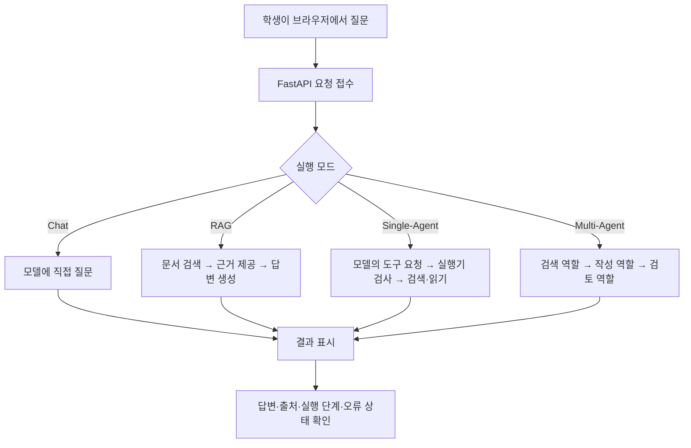

# EDU-03 — Phase2_AI 최종 누적 실습 프로젝트 정의

- 문서 버전: v0.1 (설계 초안, 최종 승인 전)
- 작성일: 2026-11-06
- 저장소: `cocoa2260/k-edu`
- 작업 브랜치: `work/curriculum-production-001`
- 참조 기준: `academy/00. 교육과정(curriculum)/01. Phase2_AI/`, `academy/00. 교육과정(curriculum)/02. 실습/document-assistant/`
- 참조 시점: EDU-01에서 확인한 커밋 `39f85fc9570ed15f68d27850c9cd05e2a45eb7ec`
- 상태: **EDU-03 설계안 작성 완료 / 사용자 확정 및 실제 구현 검증 전**
- GitHub 변경: 없음

> **가장 중요한 수업 원칙:** 학생이 Obsidian의 Markdown 강의와 실습 지시를 보며 **하나의 프로젝트에 코드를 직접 복사·붙여넣고, 설명에 따라 수정하고, 실행 결과를 확인하고, 다음 단원에서 기존 코드에 기능을 추가**한다. 모든 단원을 끝내면 동일 프로젝트가 RAG·Single-Agent·Multi-Agent 기능을 가진 애플리케이션으로 완성돼야 한다.
>
> **이번 문서의 역할:** 폴더 구조나 단원 세부 목차를 먼저 확정하지 않는다. **무엇을 만들 것인지와 어디까지 완성할 것인지**를 먼저 정한다. 세부 단원·강의 순서는 EDU-04, 이론↔실습 매핑은 EDU-05, 최종 디렉터리는 EDU-06에서 정의한다.

---

## 1. 최종 결과물 한 문장 정의

**교육용 가상 사내 규정 문서를 읽고, 관련 근거를 검색해 답하며, 필요한 도구를 스스로 선택하고, 검색·작성·검토 역할을 분리해 결과를 만드는 AI 문서 도우미.**

- **업무 시나리오:** 사용자가 “국내 당일 출장 식비 상한과 필요한 자료는?”처럼 교육용 사내 규정을 질문한다.
- **기본 데이터:** 기존 실습의 가상 규정 문서·질문·출처 정보를 재사용한다. 특정 금액이나 규정은 실제 기관의 규정으로 제시하지 않는다.
- **최종 사용자 경험:** 브라우저에서 질문 → 처리 방식 선택 또는 비교 → 답변 및 근거 확인 → 실행 단계/역할 전달 확인 → 근거 부족·오류 시 명확한 안내.
- **최종 개발 결과:** 단일 학생용 실습 프로젝트의 React 화면 + FastAPI Backend + 문서/검색/Agent 기능. 개발 과정에서 기존 코드에 순차적으로 기능이 추가된다.
- **수업에서 보여줄 핵심 차이:** 단순 Chat은 모델에 질문하는 것, RAG는 검색한 문서를 근거로 답하는 것, Single-Agent는 다음 도구를 선택하는 것, Multi-Agent는 역할과 책임을 나누어 공동 처리하는 것이라는 차이를 **같은 질문·같은 문서·같은 화면**에서 확인한다.

## 2. 최종 애플리케이션 사용 흐름



위 그림은 **목표 설계**이며 현재 GitHub에서 모든 경로가 하나의 API/화면으로 구현돼 있다는 뜻이 아니다.

## 3. 필수 구현 기능 (이번 수업의 목표 범위)

| 기능 ID | 필수 기능 | 학생이 확인할 수 있는 결과 | 완료 판정 |
|---|---|---|---|
| F-01 | 기준 AI 대화 앱 유지 | 기존 질문을 보내 답변/오류 확인 | 기본 Chat이 정상 동작하며 후속 코드 추가에도 깨지지 않음 |
| F-02 | Prompt·Context 구성 | 입력에 포함된 지시·질문·자료 구분 | 전송될 입력 구성을 직접 확인하고 한 가지 조건을 변경 가능 |
| F-03 | 모델 호출·응답 검증·재시도/종료 | 정상/형식 오류/실패 상태 확인 | 성공·실패·중단을 구별하며 무한 재시도를 하지 않음 |
| F-04 | TXT·Markdown 기반 문서 적재 및 Chunking | 원문에서 생성된 Chunk와 출처/순서 확인 | 문서를 분할·저장하고 원문 위치를 다시 찾을 수 있음 |
| F-05 | Embedding·Index·검색 | 질문에 대한 검색 후보·유사도·본문 표시 | 실제 검색이 가능하고 부적합/미검색도 관찰 가능 |
| F-06 | RAG 답변 생성 및 근거 표시 | 질문 → 검색 → 답변, 근거 Chunk 확인 | 근거를 답변과 함께 제시하고 미확인 내용은 단정하지 않음 |
| F-07 | 도구 요청 검증·안전 실행 | 요청된 도구명/인자와 실제 실행 결과 | 모델의 요청과 애플리케이션의 실행·허용 여부를 구별 |
| F-08 | Single-Agent | 검색→원문 읽기→답변 등 실행 이력 | 한도 내에서 도구 선택과 종료까지 완료하고 단계 기록 보존 |
| F-09 | Multi-Agent | 검색·작성·검토 역할별 결과와 전달 기록 | 세 역할을 순서대로 실행하고 공통 한도·실패를 통제 |
| F-10 | React·FastAPI 통합 및 기본 테스트 | 하나의 브라우저 화면에서 기능 확인 | 실제 모델/제공 환경에서 종단 간 한 건 이상 실행·검증 |

**제한:** ‘근거가 있다’와 ‘내용이 사실이다’는 다르다. 인용문이 존재하는지 확인하는 검사는 주장의 의미적 정확성까지 보장하지 않는다. 강의·평가에서도 이 차이를 분명하게 다룬다.

## 4. 누적 제작 단계 — 학생이 매번 무엇을 추가하는가

> 아래는 **개발 성과를 정의한 단계**이며 최종 강의 폴더 순서·상세 목차가 아니다. 학생의 실습은 같은 작업 디렉터리와 앞 단계의 코드를 이어서 사용한다.

| 단계 | 학생이 새로 작성·수정하는 것 | 해당 단계의 실행 화면/결과 | 다음 단계에 남는 것 |
|---|---|---|---|
| S0: 기준 앱 | Phase1의 API·Provider를 이어받아 기본 프로젝트 실행. 기존 소스 중 필수 시작본 제공 | 질문 → 모델 응답 또는 명시적 Provider 오류 | React/FastAPI 기반과 실행 명령 |
| S1: Prompt·Context | 메시지 조립 함수, 시스템 지시, 문서 Context 전달 | 같은 질문에서 입력 구성 변화 확인 | 입력 구성 함수 |
| S2: 실행 제어 | 응답 구조 검사, 제한된 재시도·오류·중단 함수 | 성공/실패/재시도 횟수 표시 | 공통 LLM 실행기 |
| S3: 문서 준비 | TXT/MD 읽기, 전처리, Chunk ID·원문 위치 생성 | 문서가 Chunk 목록으로 출력·표시 | 문서/Chunk 데이터 |
| S4: Embedding·검색 | 임베딩 생성, 로컬 Index 저장, 검색 함수 | 질문에 맞는 문서 조각과 점수 | 검색 인터페이스 |
| S5: RAG 완성 | 검색 결과를 Context로 조립, 답변·출처 반환 | **RAG 모드로 근거 있는 답변** | 검증 가능한 RAG 함수 |
| S6: Tool Calling·Single-Agent | 검색/원문 읽기 도구 등록, 모델 행동 요청 파싱, 루프 제어 | 선택한 도구와 실행 이력 | Single-Agent 실행기 |
| S7: Multi-Agent | 검색자·작성자·검토자 역할, 역할 전달/공통 한도/종료 | **역할별 과정과 최종 결과** | Multi-Agent 실행기 |
| S8: 통합·평가 | React 모드 비교, 결과·오류·출처·역할 흔적 표시, 회귀 테스트 | 같은 질문으로 Chat/RAG/Agent/Multi-Agent 비교 | 최종 학생 프로젝트 |

**수업 진행 원칙:** S1~S8에서는 기존 작업물을 통째로 교체하지 않는다. 바뀐 파일, 붙여넣을 위치, 수정할 코드, 실행 명령, 예상되는 관찰 항목, 실패 점검, 그 단계의 완료 조건을 반드시 교안에 제시한다. 앞 단계의 기능을 보존하는 회귀 확인도 포함한다.

## 5. 기술적 최소 설계 (과도한 의존성 방지)

| 영역 | 우선 사용할 방식 | 선택 이유 및 주의 |
|---|---|---|
| Python Backend | FastAPI (기존 소스 재사용) | Phase1 선수학습을 활용하고 별도 새 Backend를 반복 생성하지 않음 |
| Frontend | React의 **간단한 단일 화면** | 이미 배운 React를 재사용. 화면 기능을 단계별로 확장 |
| 모델 Provider | 기존 OpenAI/Ollama 추상화 기반, 실습 환경에 맞는 한 경로 우선 | 학생 PC 환경마다 GPU가 다름. 모든 모델을 필수로 설치하지 않음 |
| 검색 데이터 | 기존 가상 규정 TXT/Markdown 또는 정형 예제에서 추출한 텍스트 | PDF/OCR 없이 RAG의 핵심을 먼저 구현 |
| Chunking | 단락 또는 의미 단위 + Chunk ID·문서 ID·원문 위치 | 단순 길이 자르기만 하지 않고 출처 추적 가능하게 유지 |
| Embedding | 기존 E5 계열 구현을 참고하고 실습 장비에서 실행 가능한 모델 선택 | 고성능 GPU 강제 금지, 모델/Revision/차원 기록 |
| Index | 기본은 SQLite 기반 Exact 검색 구현 | Vector DB 개념은 가르치되 외부 서비스·유료 DB를 필수로 두지 않음 |
| Agent 실행 | Python에서 직접 구현하는 **제한된 Tool Runtime** | 원리를 직접 이해한 뒤 Framework/MCP와 비교. 실행 승인과 모델 판단을 분리 |
| Multi-Agent | 검색/작성/검토 **순차 실행** | 세 개 모델 또는 별도 서버가 필수가 아님. 한 Provider로 역할을 나눌 수 있음 |
| 실습 검증 | 고정 응답 테스트 + 실제 모델 1건 이상 | 고정 응답만 성공한 것을 실제 AI 품질 완료라고 하지 않음 |

**API 설계 원칙:** 기존 `/ai/chat`는 유지한다. RAG/Agent/Multi-Agent를 화면에서 사용할 **추가 API와 공통 응답 구조**는 후속 상세 설계에서 고정한다. 기존 API의 동작을 조용히 바꾸거나, CLI에만 기능을 추가하고 통합 완료로 표시하지 않는다.

**기존 모델 검증 기록의 한계:** 저장소의 과거 단계 기록에는 RAG/Agent/Multi-Agent 실제 모델 실행 이력이 있지만 답변/작업 품질은 미채택 상태로 남아 있다. 따라서 이 문서의 '최종 완성'은 **앞으로 구현하고 확인할 목표**이지 현재 달성된 상태가 아니다.

## 6. 최종 화면의 최소 요구사항

**화면은 하나이고, 각 단계에서 기능이 추가된다.** 학생이 매번 다른 실습 웹앱을 실행하는 방식이 아니다.

```text
┌───────────────────────────────────────────────────────┐
│ AI 문서 도우미                                        │
├───────────────────────────────────────────────────────┤
│ 질문: [국내 당일 출장 식비 상한과 필요한 자료는?    ] │
│ 모드: [Chat | RAG | Single-Agent | Multi-Agent]       │
│ [질문하기]                                             │
├───────────────────────────────────────────────────────┤
│ 답변/판정:                                            │
│ ...                                                   │
│                                                       │
│ 사용한 근거: (RAG 단계부터 나타남)                    │
│ - 문서·Chunk ID·출처 위치                             │
│                                                       │
│ 실행 과정: (Agent 단계부터 나타남)                    │
│ - 검색 요청 → 문서 읽기 → 작성 → 검토 → 종료             │
│                                                       │
│ 상태: 성공 / 근거 부족 / 되묻기 / 오류 / 중단           │
└───────────────────────────────────────────────────────┘
```

위 화면은 **설계용 텍스트 스케치**이며 현재 구현 화면이나 검증된 UI가 아니다. 학생이 자신의 PC에서 기능이 하나씩 추가되는 것을 확인하도록 화면은 처음부터 사용할 수 있게 하고, 단원별로 섹션이 활성화된다.

## 7. 최종 완료 기준 — 반드시 확인할 7개 시나리오

| 검증 ID | 시나리오 | 기대되는 관찰/판정 |
|---|---|---|
| T-01 | 기준 앱에 일반 질문 전송 | FastAPI → 모델 응답과 React 표시, 오류 시 메시지 확인 |
| T-02 | 가상 규정 문서 적재 후 Chunk/Index 조회 | 적재된 조각의 본문과 원문 위치 확인 |
| T-03 | 기존 규정의 정답이 있는 질문을 RAG로 요청 | 검색 후보·답변·관련 근거가 함께 표시됨 |
| T-04 | 문서에 근거가 없는 질문 | 출처나 답을 꾸며내지 않고 근거 부족·보류 또는 되묻기 |
| T-05 | Single-Agent가 검색/읽기 도구를 요청 | 도구 요청·인자 검증·실제 실행·최종 종료가 추적됨 |
| T-06 | Multi-Agent가 검색→작성→검토를 수행 | 역할 간 전달 결과와 최종 판정·공통 예산 확인 |
| T-07 | 문서 변경 또는 도구/모델 오류 발생 | 오래된 근거 사용 방지 및 실패·중단 처리, 기존 기능 회귀 없음 |

**완료 판정은 3개로 나눠 기록한다.**

1. **학생 구현 완료:** 실제 파일을 직접 작성·수정하여 앱이 실행되고 기능별 T-01~T-07 검사를 수행했다.
2. **AI 실제 실행 확인:** 최소 한 가지 지정된 실제 Provider/모델로 RAG·Single-Agent·Multi-Agent의 실행 결과를 확보했다. Fixture만 실행한 경우에는 '구조·제어 테스트 통과'로 기록한다.
3. **답변 품질 평가:** 잘못된 인용, 의미적으로 틀린 답, 실패한 도구 선택 등의 한계를 별도 평가한다. 앱이 실행됐다는 사실을 모든 답변이 정확하다는 뜻으로 사용하지 않는다.

**수업 완료와 서비스 상용화는 다르다.** 이 과정은 통제된 가상 문서와 교육용 기능의 구현·검증을 목표로 한다. 실제 기관의 정책 승인·인증·보안·정확성·부하까지 보장하는 제품이 아니다.

## 8. 이번 본과정에서 제외할 항목 (기존 자료 보존)

다음 항목은 삭제가 아니라 **선택 또는 이후 심화·확장으로 분리**한다.

| 항목 | 핵심 경로에서 제외하는 이유 | 기존 자료 활용 |
|---|---|---|
| Fine-tuning/LoRA 학습 | Multi-Agent 구현의 선행 필수 조건 아님 | 기존 L7, LoRA 코드·교안 유지 |
| OCR·스캔 PDF·복잡한 표 | 최초 RAG는 텍스트로 충분히 구현 가능 | 기존 L8, OCR/Multimodal 교안 유지 |
| Document AI 보고서·DOCX/PDF 출력 | RAG·Agent의 기본 원리보다 범위가 넓음 | 기존 L9, Document AI 교안 유지 |
| 고급 Streaming·다중 Provider Fallback | 수업 핵심 목표 대비 UI·운영 복잡도 증가 | 기존 `stream-ui`와 Provider 자료 참고/추후 연결 |
| 대규모 Vector DB·분산 시스템·상용 인증 | 장비·시간·운영 제약을 늘림 | 심화 및 실서비스 과제로 분리 |
| LangChain/LangGraph/LlamaIndex/MCP 전체 구현 | 직접 만든 실행기의 원리 이해 후 비교가 적절 | 기존 개요 자료를 심화 비교에 활용 |

단, **문서 적재와 기본 Chunking은 RAG 이전의 필수 단계로 포함**한다. 현재 Phase2 배치에서 이 부분은 강화가 필요하다.

## 9. 기존 GitHub 자료와 연결 (확인됨 / 향후 제작)

| 기존 소스·교안 | 이번 결과물에서의 용도 | 현재 상태 |
|---|---|---|
| Phase1 Day3 Provider·React 연동 교안 | 학생 시작본 및 선수학습 | GitHub 교안 확인됨; 학생 시작본 적합성 재검증 필요 |
| `12. AI Integration/강의용.md` | 기준 앱의 책임·API 계약 안내 | 교안 확인됨. 새 단원 순서에서 앞에 배치할 후보 |
| `02. 실습/document-assistant/backend/app/main.py` | 기본 `/ai/chat`, `/ai/prepare` API 참고 | 기존 구현 확인됨 |
| `backend/app/harness.py` | S2 실행 관리 구현 참고 | 기존 구현 확인됨 |
| `backend/retrieval/encoder.py`, `retrieval/index.py` | S4 검색 구현 참고 | 기존 구현 확인됨 |
| `backend/app/rag.py` | S5 RAG 참고 구현 | 기존 구현 확인됨, 품질 통과는 아님 |
| `backend/app/agent.py` | S6 Single-Agent 참고 구현 | 기존 구현 확인됨, 과제 품질 통과는 아님 |
| `backend/app/multi_agent.py` | S7 Multi-Agent 참고 구현 | 기존 구현 확인됨, 과제 품질 통과는 아님 |
| `L1.md`~`L6.md`, `CONTEXT.md` | 개념 확인·평가·실패 사례 재사용 | 활동 안내 확인됨, 단계별 직접 구현 교안으로는 보완 필요 |
| `stream-ui/src/App.jsx` | React/SSE 참고 | 별도 실험 UI 확인됨. 최종 통합 UI로 이미 완성됐다고 보지 않음 |
| `milestones/L0.json`~`L6.json` | 과거 구현 범위·실패·미채택 판정 확인 | 저장된 기록의 상태값이며 현재 재실행 결과는 아님 |

**교안 제작 시 재사용 규칙:** 기존 코드를 참고해 새 학생용 단계별 코드 블록을 작성한다. '해당 단원까지 배운 기능만 포함한 시작 상태'와 '학생이 이번에 추가하는 코드'를 명확히 구분하며, 완성 코드를 미리 노출하지 않는다. 기존 실습·보고서·검증 자료는 보존한다.

## 10. 이후 작업에 전달할 확정 대상

- **EDU-04 (단원 구성):** S0~S8 기능을 강의의 실제 학습 순서와 연결하고, Phase1 기초를 반복하지 않는 심화 이론 배치.
- **EDU-05 (강의↔실습 매핑):** 단원별 '새 개념 → 직접 작성할 파일/함수 → 실행·관찰 결과 → 다음 단계 누적물' 정의.
- **EDU-06 (Obsidian 구조):** 학생이 강의 폴더를 열면 실제 Markdown 강의가 보이고, 별도 실습 폴더에서 동일 프로젝트를 수정할 수 있도록 구성.
- **EDU-07/08 (소스 재구성):** 기존 코드를 보존하며 학생 시작본, 단계별 코드/패치, 강사용 완성본, 검증 케이스를 구분.

## 11. EDU-03 완료 판정

- [x] 최종 교육용 애플리케이션의 단일 목표·업무 사례 정의
- [x] RAG → Tool/Single-Agent → Multi-Agent 필수 기능 정의
- [x] 복사·붙여넣기 기반 누적 구현과 화면의 단계별 변화 정의
- [x] 필수 범위와 심화·선택 범위 구분
- [x] 개발 완료 및 실제 모델·답변 품질 검증의 차이 정의
- [x] 기존 소스의 재사용 후보와 미완성 경계 확인
- [ ] 사용자 최종 승인
- [ ] 실제 학생용 코드/교안 제작 및 실행 검증 (EDU-07 이후)

**작업 상태:** `EDU-03 설계안 작성 완료 / 사용자 최종 확정 전`. 이 문서 자체는 학생용 강의나 동작하는 소스가 아니며, 후속 설계의 기준이 될 최종 결과물 정의서다.