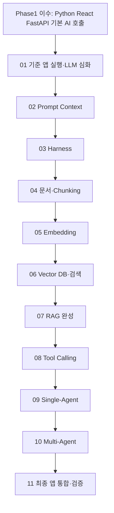

# EDU-04 — Phase2_AI 단원 구성·학습 순서·선수학습 설계

- 문서 버전: v0.1
- 작성일: 2026-11-06
- 프로젝트: `k-edu`
- 기준 저장소/브랜치: `cocoa2260/k-edu` / `work/curriculum-production-001`
- 기존 자료 확인 기준 커밋: `39f85fc9570ed15f68d27850c9cd05e2a45eb7ec` (EDU-01에서 확인한 기준)
- 선행 결정: **EDU-03 최종 누적 실습 프로젝트 정의서 v0.1 — 사용자 승인**
- 상태: **EDU-04 설계안 작성 완료 / 사용자 검토·확정 전**
- GitHub 변경: 없음

> **교육 목표:** Phase1에서 익힌 React·Python·FastAPI·기본 LLM 사용 능력을 바탕으로, 학생이 Obsidian 교안을 따라 **하나의 AI 문서 도우미 프로젝트를 직접 수정하고 실행**하여 RAG → Single-Agent → Multi-Agent 애플리케이션을 완성한다.
>
> **중복 원칙:** Phase1은 다시 분석·수정하지 않는다. 교안 집필 당시 필요한 개념 또는 예제만 Phase1과 대조하여 동일·유사한 설명을 피한다. 같은 실습 데이터/질문은 누적 프로젝트의 전후 비교를 위해 재사용할 수 있지만, **같은 개념을 가르치는 비유·표·코드를 반복하는 것은 금지**한다.

---

## 1. 무엇을 확정하는 문서인가

**이번 EDU-04에서 설계하는 것**

1. 11개 본과정 단원의 순서와 각각의 역할
2. 이론에서 새로 가르칠 내용의 경계, 선수학습 및 실습 단계 연결
3. 기존 Phase2 강의·실습 자료를 어느 단원에 활용할지에 관한 1차 배치
4. 본과정 필수/심화/선택 범위와 선행·완료 조건

**이번에 확정하지 않는 것**

- 교시·일수·시간표 및 단원 내부 상세 목차: 이후 강의 분량과 환경을 확인한 뒤 배분
- 학생이 편집할 구체적인 파일·함수·코드 블록·API 명세: **EDU-05, EDU-07~08**
- Obsidian 디렉터리의 실제 이름·파일 이동: **EDU-06**
- 모든 예제의 실제 실행·브라우저 테스트·모델 품질 통과: **EDU-24 이후**

## 2. 전체 본과정 — 11개 단원

| 단원 | 강의 단원 | 새롭게 배우는 핵심 | 누적 실습 | 학생이 관찰할 결과 | 선행 조건 |
|---|---|---|---|---|---|
| **01** | **LLM 심화와 AI 프로젝트 출발** | 응답의 한계·근거·평가 관점, 프로젝트 구성 요소의 실제 연결 | **S0** 기준 대화 앱 실행 | 동일 앱의 질문→기본 응답·오류 | Phase1의 Python/React/FastAPI/LLM 사용 |
| **02** | **Prompt & Context Engineering** | 지시와 자료 분리, Prompt 구성, 현재 입력 Context, Token 예산 | **S1** 입력 구성 기능 추가 | 같은 질문의 실제 모델 입력 구성 변화 | 01의 실행 가능한 기본 앱 |
| **03** | **AI 실행 관리(Harness)** | 출력 구조 검사, 호출 실패·보완·재시도·한도·중단 분리 | **S2** 실행 제어 기능 추가 | 정상/형식 오류/재시도/중단 원인 | 02의 입력 구성 함수 |
| **04** | **문서 수집·전처리·Chunking** | 원본 읽기·정규화·단락별 분할, ID·순서·출처 위치 | **S3** TXT/MD 문서 적재·청킹 | 원문 → 청크 목록 및 원문 위치 | 01의 Backend 구조, 03의 입력·실행 관리 이해 |
| **05** | **Embedding** | 검색용 벡터와 Token ID의 차이, Embedding 생성, 차원, 유사도 | **S4-A** 문서·질문 임베딩 생성 | 실제 숫자 벡터/차원/유사도 비교 | 04의 청크 데이터; Phase1 Token·Vector 기초 |
| **06** | **Vector DB & Retrieval** | Index, 본문·벡터·Metadata, 검색·필터링·갱신 | **S4-B** Index 저장·유사도 검색 | 질문에 맞는 청크·점수·출처 | 05의 임베딩 생성 및 04의 문서·출처 체계 |
| **07** | **RAG 구축** | 질문→검색→Context→생성, 인용 검토, 근거 부족 처리 | **S5** RAG 모드 추가 | 근거 표시된 답변, 근거 부족 상태 | 02~06의 기능 |
| **08** | **Tool Calling** | 모델의 도구 요청과 애플리케이션 실행의 책임 분리, 도구 계약 | **S6-A** 검색·원문 읽기 도구 등록 | 요청 이름/인자/실행 결과 | 07의 검색·근거 및 03의 실행 경계 |
| **09** | **Single-Agent 구축** | 상태 기반 다음 행동 선택, Tool Loop, 재시도·종료·한도 | **S6-B** Single-Agent 모드 추가 | 검색→읽기→답변/되묻기/중단 이력 | 08의 도구 실행기 |
| **10** | **Multi-Agent 구축** | 검색·작성·검토 역할 분리, 전달 데이터, 공유 예산·종료 | **S7** Multi-Agent 모드 추가 | 역할별 입출력과 최종 결과·실패 | 09의 Single-Agent·실행 기록 |
| **11** | **서비스 통합 및 최종 검증** | 모드 간 비교, 출처/오류/실행 단계의 화면 표현, 통합 평가 | **S8** React·FastAPI 최종 연결 | 한 화면에서 Chat/RAG/Single/Multi 비교 | 01~10의 누적 코드와 평가 데이터 |

**순서의 이유**

- 01~03: LLM을 안정적으로 호출·관리할 **실행 기반** 확보
- 04~06: LLM에 전달할 근거를 직접 준비하고 **찾을 수 있게** 구현
- 07: 검색 결과를 답변에 연결해 **RAG를 첫 완성**
- 08~09: 고정된 RAG 흐름을 넘어 **도구 선택·실행·반복** 수행
- 10: 이미 구현한 동작을 **역할별로 분담**
- 11: 앞 단원에서 만든 기능을 **하나의 화면·API 흐름으로 확인하고 회귀 평가**

## 3. 단원별 학습 경계와 학생의 직접 구현

### 01. LLM 심화와 AI 프로젝트 출발 — S0

- **강의에서 새롭게 다룰 것:** 언어 모델 생성 결과가 업무상 근거가 되지 못하는 이유, 모델이 갖지 않은 최신 문서 정보의 문제, RAG와 Agent가 필요한 이유, 프로젝트의 현재 상태와 최종 상태 비교, 답변 품질/시스템 동작/수업 완료의 차이.
- **직접 작업:** 제공된 **최소 시작본**을 학생이 직접 실행하고 React 화면·FastAPI `/ai/chat`·Provider 호출 흐름을 확인한다. 이 단계는 Phase1 코드를 그대로 다시 작성하게 하는 단계가 아니라 **시작할 수 있는 기준 상태를 확보**하는 단계다.
- **확인:** 학생별 실행 환경, 질문/응답/오류, 다음 단계에서 건드릴 폴더·파일 확인.
- **범위 주의:** AI/ML/DL 역사, HTTP·JSON, React·FastAPI 문법, Ollama 설치 원리, Model Card 기본 읽기 등을 처음부터 반복 강의하지 않는다.
- **활용:** 기존 Phase2 `01. AI 최신 동향 및 전체 지도`, `04. 대규모 언어 모델(LLM)`, `12. AI Integration`; 필요할 때 `02. AI 머신러닝 딥러닝 개요`의 평가 개념 연결.

### 02. Prompt & Context Engineering — S1

- **새 개념:** Role/Task/Constraint/Format의 실제 입력 분리, 신뢰할 수 없는 문서의 지시와 시스템 지시 구별, Context 선택·순서·예산, 같은 질문·자료에서 변경 조건 하나만 비교.
- **직접 작업:** 기존 대화 앱에 `Prompt/Context` 입력 구성 함수와 현재 입력을 확인할 수 있는 기능을 추가한다.
- **확인:** 입력 구성의 변경점, 자료가 실제 요청에 포함되는지, Token 예산 또는 길이 확인.
- **활용:** 기존 Phase2 `05. 프롬프트 엔지니어링`의 기본 교안 및 `Context Engineering`, 실습 `L1.md`, `CONTEXT.md`.

### 03. AI 실행 관리(Harness) — S2

- **새 개념:** 통신 오류의 재시도와 형식 오류의 보완, 구조 검증과 사실 검증의 차이, 실행 횟수 상한·실패 종료·취소·로그.
- **직접 작업:** 기존 LLM 호출 경로에 출력 검증 및 제한된 재시도·중단 함수를 추가한다. 성공 응답만 전제하지 않는다.
- **확인:** 정상 응답과 의도적으로 발생시킨 실패에서 호출 횟수·종료 사유 확인.
- **활용:** `05. .../Harness`, `L2.md`, `backend/app/harness.py`를 **참고 구현**으로 사용.

### 04. 문서 수집·전처리·Chunking — S3

- **새 개념:** 원문과 검색 입력의 차이, TXT/Markdown 적재, 단락·제목·구분자 기준 분할, 메타데이터, 원문 내 순서/위치, 너무 큰/작은 청크의 문제.
- **직접 작업:** 가상 규정의 텍스트 문서를 읽고 여러 개 청크로 변환하는 함수를 작성한다. 각 청크에 문서 ID·순서·출처 위치를 연결한다.
- **확인:** 청크 개수·본문·순서·원문 위치 출력, 분할 기준 변경 시 차이.
- **활용:** 기존 `document-assistant/data/documents-v1.json`, `Document AI/01. 문서 등록`의 원문·버전 개념, `retrieval/index.py`의 Chunk/Metadata 처리. 실제 TXT/MD 실습 입력 파일 구성은 EDU-07에서 결정한다.
- **범위 주의:** PDF OCR·표 추출·멀티모달 전체를 필수로 만들지 않는다.

### 05. Embedding — S4-A

- **새 개념:** Token ID/LLM 내부 표현/검색용 Embedding Vector 구분, Encoder의 입력·출력, 문장/청크 표현과 Pooling 개요, 차원·정규화, Cosine Similarity, 실제 검색의 한계.
- **직접 작업:** 04에서 만든 문서 청크와 사용자 질문을 **실제 Embedding 모델**로 변환하고 벡터의 차원·점수·유사도 차이를 확인한다.
- **확인:** 원문/청크/질문에 대응하는 벡터, 유사한 표현과 단순 문자열 일치가 다른 사례.
- **활용:** 기존 `06. 임베딩(Embedding)`, `backend/retrieval/encoder.py`, 관련 `L3.md`. 기존 `03. Transformer`, `04. LLM/Hugging Face` 자료는 **원리 이해에 필요한 새로운 대목만** 선별 연결.
- **중요:** Embedding을 용어·그림으로 끝내지 않는다. 직접 코드 작성 → 실제 벡터 생성 → 다음 06단원의 검색 데이터로 넘기는 것이 완료 조건이다.

### 06. Vector DB & Retrieval — S4-B

- **새 개념:** Embedding과 Index의 역할 차이, 본문·벡터·Metadata 저장, Exact Search, 유사도 정렬, 검색 필터, 문서 갱신·삭제 시 오래된 근거 관리, ANN/Hybrid 개요.
- **직접 작업:** 05의 벡터를 기존 프로젝트의 로컬 저장소에 넣고 검색 함수를 만든다. 질문에 대한 상위 청크를 반환한다.
- **확인:** 검색 순위·출처·점수, 다른 질문/필터의 결과, 문서 상태 변경에 따른 검색 반영.
- **활용:** 기존 `07. 벡터 데이터베이스(VectorDB)`, `backend/retrieval/index.py`, `L3.md`.
- **범위 주의:** 별도의 유료 Vector DB나 클라우드 서비스는 필수가 아니다. SQLite Exact Index를 기본으로 하고 ANN·Hybrid는 원리·선택 확장으로 구분한다.

### 07. RAG 구축 — S5

- **새 개념:** 문서 준비(Indexing)와 질문 처리(Querying), Retrieval vs Generation, 근거 Context 구성, 인용 존재와 실제 주장 지지의 차이, 근거 부족·되묻기·보류.
- **직접 작업:** 검색 함수를 LLM 입력 구성·출력 검사에 연결하여 RAG 요청 경로를 만든다. 답변과 출처를 함께 반환한다.
- **확인:** 같은 질문의 Chat 대비 RAG 응답, 검색 근거, 근거가 없는 경우의 출력.
- **활용:** 기존 `08. 검색 증강 생성(RAG)`, `L4.md`, `backend/app/rag.py`.
- **검증 주의:** 인용문이 존재한다고 답변의 의미적 정확성이 자동으로 확인되는 것은 아니다.

### 08. Tool Calling — S6-A

- **새 개념:** 도구의 이름·설명·입력 Schema, 모델의 실행 *요청*과 애플리케이션의 실제 *수행*, 허용 목록·인자 검증·실패 반환·승인 경계.
- **직접 작업:** 기존 검색과 문서 읽기 기능을 제한된 도구로 노출하고, 모델의 도구 요청을 해석해 실행기에 전달한다.
- **확인:** 도구 요청, 잘못된 인자/미허용 도구 거부, 실제 실행 결과.
- **활용:** 기존 `09. AI 에이전트(Agent)/01. Single-Agent`, `backend/app/agent.py`의 도구 계약/Registry 부분, `L5.md`.
- **범위 주의:** 외부 시스템 수정·삭제·실제 업무 승인과 같은 위험한 도구는 본과정 필수 구현에서 제외한다.

### 09. Single-Agent 구축 — S6-B

- **새 개념:** 고정 Workflow와 Agent의 차이, 관찰→다음 행동 선택, 상태 누적, Tool Loop, 반복 상한·종료 이유·모델의 잘못된 선택 처리.
- **직접 작업:** 08에서 만든 도구 실행기를 반복 구조로 연결하고 검색→원문 읽기→최종 답변의 동작을 구현한다.
- **확인:** 단계별 이력과 마지막 결과, 실패/되묻기/정지의 이유.
- **활용:** 기존 Single-Agent 강의, `L5.md`, `backend/app/agent.py`.

### 10. Multi-Agent 구축 — S7

- **새 개념:** 여러 역할의 구분 기준, 검색자·작성자·검토자 간 입력/출력, Handoff, 공유 예산, 실패 전파와 전체 종료, 모델 검토와 사람/시스템 승인 차이.
- **직접 작업:** Single-Agent의 검색·근거·출력 기능을 재사용하면서 세 역할을 **순차적으로** 수행하고 역할 전달 데이터를 명시한다.
- **확인:** 각 역할의 요청·결과, 전달된 근거, 최종 답변, 실패/중단.
- **활용:** 기존 Multi-Agent 강의, `L6.md`, `backend/app/multi_agent.py`.
- **범위 주의:** 3개 GPU 모델이나 3개 별도 서버를 필수로 요구하지 않는다. 한 Provider의 역할별 호출로 시작한다.

### 11. 서비스 통합 및 최종 검증 — S8

- **새 개념:** 기능별 API 계약과 화면 상태의 정합성, 모드별 실패·출처·실행 이력 표현, 실제 모델 테스트와 고정 응답 테스트의 구분, 답변 품질/기능 동작 분리 평가.
- **직접 작업:** 기존 **동일 React·FastAPI 앱**에서 Chat/RAG/Single-Agent/Multi-Agent를 선택·실행하게 만들고, 답변·출처·단계 이력을 표시한다. 앞 단계의 기능을 회귀 테스트한다.
- **확인:** EDU-03의 T-01~T-07 시나리오, 기본 Chat 기능 보존, 최소 지정 실제 모델의 RAG/Agent/Multi-Agent 실행.
- **활용:** `12. AI Integration`의 기본 계약, `13. Document AI`의 Provider/Streaming/평가 일부, 기존 `stream-ui`의 화면·상태 처리 방식.
- **주의:** 11단원에서 처음 웹화면을 만들지 않는다. **01단원부터 학생의 기준 앱 화면은 존재**하고, 02~10단원의 기능은 그 동일 Backend/화면에 단계적으로 연결한다. 11단원은 최종 정리·비교·종합 검증이다.

## 4. 선수학습과 누적 개발의 연결

- **01 시작 조건:** Phase1의 기본 Python·React·FastAPI·AI Provider 사용 경험이 있다고 가정하되, 학생별 최소 시작본·실행 환경은 EDU-07/08에서 준비한다.
- **기능 의존:** 05는 04의 Chunk 데이터, 06은 05의 Embedding, 07은 06의 Retrieval, 09는 08의 Tool, 10은 09의 상태/실행 패턴을 재사용한다.
- **단계 완료 규칙:** 각 단계 종료 시 **실행 결과 + 다음 단원에 그대로 남는 코드**가 있어야 다음 단계로 진행한다. 새 프로젝트를 복제하거나 이전 코드를 통째로 바꾸지 않는다.
- **학생 경험:** 같은 데이터와 질문으로 기능 확장 전후를 비교한다. 동일 사례를 쓰는 이유는 '새로운 기능의 차이'를 드러내기 위해서이며, 같은 개념 설명을 반복하기 위한 것이 아니다.

## 5. 기존 Phase2 교육자료의 1차 배치

다음은 **기존 폴더 유지안이 아니라, 자료 재사용 위치를 정한 설계안**이다. 실제 파일 이동은 EDU-06 이후 별도 수행한다.

| 기존 Phase2 자료 | 새 단원에서의 역할 | 비고 |
|---|---|---|
| `01. AI 최신 동향 및 전체 지도` | **01** 프로젝트 목적·업무 실패·책임 | 일반 기술 동향 나열은 수업 목적에 필요한 범위만 사용 |
| `02. AI 머신러닝 딥러닝 개요` | **01·11** 평가 기준·데이터 설계·오류 해석 | 모델 훈련 전용 상세 내용은 심화 참고 보존 |
| `03. 트랜스포머(Transformer)` | **01·05** 생성/표현의 내부 원리 참고 | Q/K/V 등 상세 계산은 독립 심화 자료로 보존 가능 |
| `04. 대규모 언어 모델(LLM)` 및 `Hugging Face` | **01·05** 생성·Context/Embedding 모델 이해·선택 | Phase1에 이미 배운 설치/Tokenizer 기초 재강의 금지 |
| `05. 프롬프트 엔지니어링` 기본/Context/Harness | **02·03** 각 단계의 직접 구현 내용 | 세 학습 성과를 혼합하지 않음 |
| `06. 임베딩(Embedding)` | **05** 실제 문장·청크 벡터 생성 | 핵심 필수 |
| `07. 벡터 데이터베이스(VectorDB)` | **06** Index·검색·갱신 | 핵심 필수 |
| `08. 검색 증강 생성(RAG)` | **07** 검색→생성→근거 검토 | 핵심 필수 |
| `09. AI 에이전트(Agent)` | **08·09·10** Tool/Single/Multi | 핵심 필수 |
| `10. 미세조정(Fine-tuning)` | **심화/확장** | 본과정 필수 제외, 기존 자료 보존 |
| `11. OCR_Multimodal` | **심화/확장**; 04의 문서 입력 확장 연계 | 본과정 TXT/MD 처리 이후에 학습 |
| `12. AI Integration` | **01** 누적 실습 시작본 | 기존 12번 위치에서 맨 앞으로 가져올 후보 |
| `13. Document AI` | **04·07·11 + 심화** | 문서 상태·근거·Provider·화면 관련 부분만 본과정에 활용; 보고서·OCR/다형식·고급 Streaming 등은 확장 |

### 별도 실습 재사용

| 기존 파일/범위 | 연결 대상 | 재사용 방향 |
|---|---|---|
| `02. 실습/document-assistant/backend`의 기준 앱 | 01 | **학생 시작본의 근거**. 그대로 완성본을 배포하는 것이 아니라 후속 기능 노출 범위를 관리 |
| `L1.md`, `CONTEXT.md` | 02 | 입력 비교·Context 활동과 평가 예시 |
| `L2.md` | 03 | Harness 실패 사례·시나리오 |
| `L3.md` | 05~06 | 검색/Index 실험·데이터와 기존 구현 참고 |
| `L4.md` | 07 | RAG의 인용/사실 검토 |
| `L5.md` | 08~09 | 도구 요청·Agent 제어·실패 사례 |
| `L6.md` | 10 | 역할 전달·검증 사례 |
| `L7.md` / `L8.md` / `L9.md` | 확장 / 관련 일부 04·11 | LoRA·OCR·Document AI 확장과 일부 통합 검증 |
| `data-evaluation`, `transformer-basics`, `llm-basics`, `huggingface-tokenizer` | 01·05 선택 참고 | Phase1 중복 검토 후 필요한 활동만 선택; 별도 앱을 필수 누적 프로젝트로 간주하지 않음 |

## 6. 본과정과 심화·확장 과정의 경계

### 본과정 필수 (11개 단원)

- 01부터 11까지의 **기본 앱 → 문서 분할 → 임베딩/검색 → RAG → Tool → Single/Multi-Agent → 통합**.
- 실제 모델을 이용해 최종 동작을 최소 범위에서 확인한다. 학생 장비 여건에 따라 Provider 실행 경로는 EDU-07/08에서 선정한다.
- 근거 부족/도구 오류/문서 변경 등 EDU-03의 T-01~T-07 검증 시나리오를 유지한다.

### 별도 심화 또는 선택 자료 (삭제하지 않음)

- Transformer의 수식과 각 Block 상세 계산, LLM의 학습·Post-training 상세 실험, 데이터 평가 확장, Hugging Face 추가 실습.
- LoRA/Fine-tuning 학습, OCR·스캔 PDF·표·이미지, Document AI 보고서·다중 포맷 처리.
- LangChain/LangGraph/LlamaIndex/MCP Framework 전체 구현, 고급 Streaming/다중 Provider Fallback, 대규모 ANN/상용 Vector DB.

**원칙:** 심화 자료는 기존 원문을 보존한다. 실제 이동/편집 시에는 `원본 → 새 단원/심화 자료` 연결을 기록하여 교육내용이 조용히 누락되지 않게 한다.

## 7. 모든 단원에 공통으로 적용할 교안 형태

교안의 상세 목차는 EDU-05와 개별 제작 작업에서 정하지만, **학생이 실제로 할 수 있어야 하는 7가지**는 모든 단원에 공통 적용한다.

1. **오늘 만들 기능:** 이전 단원까지의 앱에서 무엇이 바뀌는가.
2. **새 개념 설명:** 왜 필요한지 → 직관적인 동작 → 기술적 원리 → 이번 구현과의 연결. 처음 배우는 부분은 충분히 설명한다.
3. **기존 코드 위치:** 학생이 열 파일과 수정할 위치를 정확히 보여준다.
4. **붙여넣을 코드 및 직접 변경:** 복사할 전체 코드나 명확한 변경 코드, 추가/삭제 지점을 구분한다. 숨은 선행 코드가 없어야 한다.
5. **실행 명령과 확인 방법:** 어떤 화면·API·터미널에서 결과를 확인할지 기재한다. 단원마다 새 프로젝트를 만들지 않는다.
6. **실행 결과·오류 대응:** 정상·오류·환경 차이를 구분한다. 예상 출력과 직접 실행 검증 기록을 혼동하지 않는다.
7. **누적 결과:** 다음 수업에서 재사용할 파일·함수·데이터와 간단한 완료 확인.

**중복 방지:** Phase1의 이미 배운 개념은 필요한 연결 문장만 사용하고, Phase2 뒤 단원은 **앞 단원에서 만든 코드 자체를 가져와 새로운 기능을 추가**한다. 반복해서 같은 설치 설명이나 동일 용어 비유를 늘리지 않는다.

## 8. 실제 수업 준비 및 통합 검증의 유보 사항

아래는 EDU-04의 순서 결정을 방해하지 않지만, 구현 전 확정·검증해야 할 사항이다.

| 항목 | 현재 판정 | 다음 처리 |
|---|---|---|
| 단원별 실제 시수와 시간표 | 미확정 | EDU-05 및 교육 운영 일정에서 조정 |
| 학생 PC Python/OS/CPU·GPU 및 실제 모델 선택 | 미확정 | EDU-07~08에서 최소 실행 환경과 대체 경로 고정 |
| 기준 앱 학생 시작본(필수 파일만) | 제작 필요 | EDU-07~08 |
| TXT/Markdown 실습 원문과 문서 ID·Chunk 구조 | 제작·정의 필요 | EDU-05·07 |
| RAG/Single/Multi 웹 API 계약 및 실제 React 화면 연계 | 통합 설계·검증 필요 | EDU-05·07~08·11단원 제작 |
| 기존 `L3~L6` 일부 과거 보고서 상대경로 | EDU-01에서 연결 문제 확인 | 교안 작성 시 학생용 경로 재설계, 사후 링크 검수 |
| 모델 답변·Agent 과제 품질 | 기존 기록에 품질 미채택 존재 | EDU-24에서 실제 재실행 후 기능 성공/품질을 별도 판단 |

## 9. EDU-04 자체 완료 기준

- [x] 승인된 EDU-03 S0~S8와 11개 본과정 단원을 연결했다.
- [x] 단원별 새 학습 내용·학생 실습 목표·선수 조건을 지정했다.
- [x] Chunking → Embedding → Index/Retrieval → RAG의 기술 의존 순서를 명시했다.
- [x] Tool Calling → Single-Agent → Multi-Agent의 기술 의존 순서를 명시했다.
- [x] 기존 Phase2의 13개 주제 폴더와 분리된 실습 자산의 재배치 방향을 제시했다.
- [x] Phase1 재분석 금지 및 작성 단계에서의 선택적 중복 검사 원칙을 반영했다.
- [x] 기존 심화 내용의 보존·선택 범위를 구분했다.
- [ ] 사용자 검토·확정
- [ ] EDU-05 상세 이론↔실습 연결표·파일 단위 작업 목록
- [ ] EDU-06 최종 Obsidian 폴더 구조 및 실제 파일 배치

**최종 판정:** `EDU-04 설계안 작성 완료 / 사용자 승인 대기`. 이 문서만으로 새로운 강의 Markdown이나 학생용 완성 프로젝트가 만들어진 것은 아니다. 현재 GitHub 자료는 변경하지 않았다.